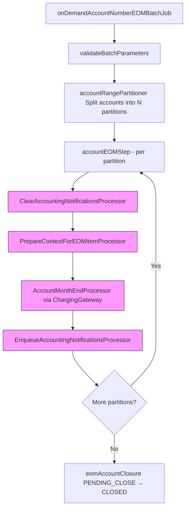

Phụ lục này là tài liệu tra cứu cho kỹ sư và kiến trúc sư. Không cần đọc theo thứ tự: hãy mở khi cần tra một module, một exchange hay một quyết định thiết kế. Các chương tương ứng giải thích lý do phía sau.

## A.1 Tổng quan các module

### Bản đồ module

```text
┌─────────────────────────────────────────────────────────────────────────┐
│                        Vela Lending Platform                            │
│                                                                         │
│  ┌─────────┐  ┌─────────┐  ┌─────────┐  ┌─────────┐  ┌─────────┐        │
│  │   LOS   │  │   LPS   │  │   LAS   │  │   DRG   │  │   DSA   │        │
│  │Khởi tạo │  │ Kế hoạch│  │Quản lý  │  │ Sổ nợ   │  │Tổng hợp │        │
│  │khoản vay│  │ trả góp │  │tài khoản│  │         │  │ dữ liệu │        │
│  └────┬────┘  └────┬────┘  └────┬────┘  └────┬────┘  └────┬────┘        │
│       │            │            │            │            │             │
│  ┌────┴────┐  ┌────┴────┐  ┌────┴────┐  ┌────┴────┐  ┌────┴────┐        │
│  │   ADR   │  │   QST   │  │   PDC   │  │   CTM   │  │   CTS   │        │
│  │ Dữ liệu │  │ Lưu báo │  │Danh mục │  │ Quản lý │  │ Dịch vụ │        │
│  │ đơn vay │  │   giá   │  │sản phẩm │  │ hợp đồng│  │ hợp đồng│        │
│  └─────────┘  └─────────┘  └─────────┘  └─────────┘  └─────────┘        │
│                                                                         │
│  Thông điệp: RabbitMQ + Kafka                                           │
│  Điều phối: LOS dùng controller bất đồng bộ + Infinispan                │
│             (Zeebe chỉ dùng tùy chọn cho chấm điểm)                     │
│  Cấu hình sản phẩm và biểu phí: PDC                                     │
└─────────────────────────────────────────────────────────────────────────┘
```

### Trách nhiệm của từng module

| Module | Vai trò | Thực thể chính | API chính |
|---------|------|-------------|---------|
| **LOS** | Loan Origination Service: bộ điều phối bất đồng bộ, không trạng thái (10 endpoint) | ApplicationRequest (Infinispan cache, 7 cache có tên) | POST /api/workflows/*ApplicationForm |
| **LPS** | Loan Pricing: tính kế hoạch trả góp và XIRR (EIR) bằng Newton-Raphson | InstalmentPlan, InstalmentSummary, Instalment | POST /api/v3/calculators/instalment-plan/by-offer-code |
| **LAS** | Account Management: vòng đời tài khoản, billing | Account, Transaction, CurrentBalance, LedgerEntry | GET /accounts/{id}, POST /accounts/{id}/transactions |
| **DRG** | Debt Register: theo dõi DPD, publish trạng thái nợ (SCD Type 2) | DebtRegister, DebtRegisterStatistics | GET /debt-catalogue/{contractCode} |
| **DSA** | Data Source Aggregator: tổng hợp dữ liệu từ các hệ thống nội bộ thành XML để sinh tài liệu | DataSource (XML) | POST /api/generateDataSource |
| **ADR** | Application Data Repository: lưu dữ liệu đơn vay trong quá trình khởi tạo | Application, ApplicationEvent | GET /applications/{id} |
| **QST** | Quote Store: lưu và quản lý vòng đời báo giá | SalesQuote (kèm arrangement) | POST /sales-quotes |
| **QCE** | Quote Calculation Engine: tính giá phức tạp (15+ miền tính) | DTO tính báo giá | POST /calculateQuote (qua LOS) |
| **PDC** | Product Catalog: gói tài trợ, quản lý biểu phí | FinancingPackage, Tariff, FeeComponent | API định nghĩa sản phẩm |
| **SRT** | Service Router: bộ định tuyến không trạng thái (9 connector FeignClient) | | POST /rest/v1/loan-requests |
| **AOS** | Supplement: sản phẩm bổ sung tùy chọn (bảo hiểm, gói bảo vệ) | ContractSupplement | API vòng đời supplement |
| **STS** | Statement Management: sinh sao kê tháng | STS_STATEMENT (cabinetUUID→DMS, trạng thái NEW→XML_GENERATED→PDF_GENERATED), STS_STATEMENT_LINE | Kích hoạt bởi sự kiện EOM_FEE từ LAS qua RabbitMQ; cụm STATEMENT (schema `sts`) |
| **RVS** | Revolving Service: định nghĩa dịch vụ quay vòng | `rvs_rel_service` (RelService), ServiceParameter | `GET /rel-services/api/relService?code={id}`; cụm LEDGER (schema `rvs`) |
| **RDS** | Reference Data Service: dữ liệu tham chiếu (tiền tệ, quốc gia) | RDS_COUNTRY, RDS_CURRENCY | API danh mục mã |
| **CIS** | Customer Identity Service: định danh và xác minh khách hàng | CustomerProfile, IncomeVerification | API xác minh KYC |
| **CTM** | Contract Management: vòng đời hợp đồng, các bên, sự kiện | Contract, ContractStatusTransition, BusinessEvent | API quản lý hợp đồng |
| **CTS** | Contract Services: thao tác trên dịch vụ hợp đồng | CONTRACT_SERVICE, CONTRACT_SERVICE_H (lịch sử SCD2) | API activate/deactivate/terminate/cancel; dùng chung cụm CORE (schema `cts` riêng) |
| **LBS** | Legacy Business Services: hệ thống cũ **bên ngoài** (giải ngân, quản lý thẻ) | Bên ngoài | REST bên ngoài |
| **CMS** | Card Management System: thao tác thẻ, **bên ngoài** | Bên ngoài | Bên ngoài (RabbitMQ) |

## A.2 Mô hình miền: LAS

### Các thực thể chính (giản lược)

```text
Account
  ├── id: Long (PK)
  ├── contractId: UUID
  ├── customerId: Long
  ├── status: CREATED | ACTIVE | CANCELLED | PENDING_CLOSE | CLOSED | WRITTEN_OFF | PAID_OFF
  ├── openDate: LocalDate
  ├── closeDate: LocalDate (nullable)
  ├── tariffCode: String → tra cứu biểu phí
  └── accountParameters: List<AccountParameter>

AccountParameter
  ├── account: Account (FK)
  ├── parameterType: ParameterType (enum)
  ├── value: String (lưu dạng chuỗi, bên dùng tự parse)
  ├── effectiveFrom: LocalDate
  └── effectiveTo: LocalDate (null trong DB = đang hiệu lực)

  ParameterType chính:
    CREDIT_LIMIT, INTEREST_RATE_OVERRIDE, PAYMENT_HOLIDAY_USED,
    DPD_BUCKET, RISK_TIER, CHANNEL

CurrentBalance
  ├── account: Account (FK)
  ├── balanceType: PRINCIPAL | INTEREST | FEE | PENALTY
  ├── amount: BigDecimal (không âm)
  ├── currency: Currency
  └── asOf: LocalDate

Transaction
  ├── id: Long (PK)
  ├── account: Account (FK)
  ├── transactionType: TransactionType (enum)
  ├── amount: BigDecimal
  ├── eventDate: LocalDate      ← ngày xảy ra
  ├── processingDate: LocalDate ← ngày hệ thống xử lý
  ├── valueDate: LocalDate      ← ngày tiền thực sự có hiệu lực
  ├── referenceId: String       ← mã tham chiếu bên ngoài (payment_id...)
  └── reversalOf: Transaction (FK, nullable)

  TransactionType chính:
    DISBURSEMENT, PAYMENT_RECEIVED, INTEREST_ACCRUAL, FEE_CHARGE,
    WRITE_OFF, REVERSAL, PAYMENT_HOLIDAY_ACCRUAL

LedgerEntry
  ├── account: Account (FK)
  ├── itemType: PRINCIPAL | INTEREST | FEE
  ├── dueDate: LocalDate
  ├── dueAmount: BigDecimal
  ├── paidAmount: BigDecimal
  ├── paidDate: LocalDate (nullable)
  └── status: OPEN | PARTIAL | PAID | OVERDUE

InstalmentSummary (tổng hợp, phi chuẩn hóa)
  ├── account: Account (FK, OneToOne)
  ├── totalInstallments: Integer
  ├── remainingInstallments: Integer
  ├── totalPrincipal: BigDecimal
  ├── totalInterest: BigDecimal
  ├── nextDueDate: LocalDate
  ├── nextDueAmount: BigDecimal
  └── refreshedAt: LocalDateTime

  QUAN TRỌNG: refreshInstalmentSummary() chỉ an toàn khi MỌI thực thể con
  đã được lưu. Không gọi trong giai đoạn prescribing (xem A.6 và Chương 16, VLP-670).

ContractService (nối Account với biểu phí của PDC)
  ├── account: Account (FK)
  ├── serviceType: INTEREST | INSURANCE | FEE
  ├── tariffCode: String
  ├── tariffVersion: Integer
  └── activatedAt: LocalDate
```

### Máy trạng thái của tài khoản

```text
                  [CREATED]
                     │
              supplement được ký / tài khoản kích hoạt
                     │
                     ▼
              [ACTIVE] ────────────────────┐
                │  │                       │
                │  │ bắt đầu tất toán      │
                │  ▼                       │
                │ [PENDING_CLOSE]          │ tín hiệu write-off từ DRG
                │      │                   │ (DPD vượt ngưỡng)
                │      │ hết nợ            ▼
                │      └──► [PAID_OFF]  [WRITTEN_OFF]
                │                          │
                │  đóng                    │ chấm dứt
                └──► [CLOSED] ◄────────────┘

Hủy trước khi ACTIVE: [CANCELLED]

Lưu ý: enum AccountStatus KHÔNG có trạng thái SUSPENDED.
Việc khóa dùng Account.blocked=true + thực thể BlockingReason
(loại: FLEXI_TERMINATION, FLEXI_CONVERSION, FRAUD, LEGAL_HOLD)
```

## A.3 Luồng khởi tạo

```text
LOS: 10 endpoint REST, tất cả trả về 202 ACCEPTED kèm header Location

Bước 1: POST /api/workflows/submitApplicationForm
  LOS → PTY (tạo người nộp đơn) → ADR (tạo đơn)

Bước 2: POST /api/workflows/checkEligibility
  LOS → PTY (tìm khách hàng) → LAS (kiểm tra tài khoản) → QCE (loại kế hoạch trả góp) → OFR (khớp đề nghị)

Bước 3: POST /api/workflows/calculateSalesQuotes
  LOS → QCE (tính giá, 15+ miền) → LPS (tính XIRR) → QST (lưu báo giá)

Bước 4: POST /api/workflows/chooseOffer
  LOS → ADR (cập nhật) → OFR (kiểm tra) → Zeebe "PreTransactionRiskCheck" (chấm điểm bất đồng bộ)
       → POSITIVE: LOS → LBS (tạo supplement)
       → NEGATIVE: workflow FAILED

Bước 5-6: calculateAccountWithPurchaseQuote / calculateAccountWithCashQuote
  LOS → QCE (báo giá trước hợp đồng)

Bước 7: POST /api/workflows/generateAgreement
  LOS → SRT → {CTS → RabbitMQ → LAS (tài khoản CREATED), CTM, AOS, DMS, QST, PDC}

Bước 8: POST /api/workflows/signAgreement
  LOS → AOS.acceptContractSupplementDocuments() → chuỗi RabbitMQ
       → SRT → CTM.signContract → CTS.activate(ACCMAINT) → LAS (tài khoản CREATED→ACTIVE)
  LOS publish origination.completed (RabbitMQ) → LAS xác nhận kích hoạt

Bổ sung: cancelSupplement, rejectSupplement

Điểm chính: LOS không trạng thái, dùng Infinispan cache nhúng cho từng bước.
            Zeebe chỉ tùy chọn, dùng cho chấm điểm ở bước 4, không phải engine điều phối chính.
            Chưa có định tuyến A/B champion/challenger.
```

Chương 7 trình bày luồng này cùng các lý do thiết kế.

## A.4 Xử lý EOM

### Kiến trúc batch



*Hình A.1. Job EOM theo yêu cầu: kiểm tra tham số, chia tài khoản thành partition, xử lý từng partition, rồi đóng các tài khoản PENDING_CLOSE.*

### Khóa lũy đẳng

```sql
-- Check before processing:
SELECT 1 FROM eom_completion_log 
WHERE account_id = ? AND processing_date = ? AND status = 'COMPLETED';

-- After processing:
INSERT INTO eom_completion_log 
  (account_id, processing_date, completed_at, status)
VALUES (?, ?, NOW(), 'COMPLETED');
-- Unique constraint on (account_id, processing_date)
-- Duplicate insert → constraint violation → skip (idempotent)
```

### Tính lãi theo ngày

```text
Công thức (quy ước 30/360, như các ví dụ trong sách):
  I = P × r × d / 360

  P = dư nợ gốc (từ CurrentBalance)
  r = lãi suất năm (từ ContractService → biểu phí)
  d = số ngày kể từ lần tích lũy trước (kỳ đủ tháng = 30)

Ví dụ: khoản vay của chị Lan, kỳ 2
  P = 17,081,420 VNĐ (sau kỳ 1)
  r = 18% = 0.18
  d = 30

  I = 17,081,420 × 0.18 × 30 / 360
    = 256,221.3
    → 256,221 VNĐ (làm tròn HALF_UP về đồng), khớp lịch trả nợ ở Chương 2

Hiện thực: BigDecimal, làm tròn HALF_UP, scale 0 (đơn vị đồng)
```

Quy ước ngày được cấu hình theo sản phẩm; nếu một sản phẩm dùng thực tế/365, chỉ thay mẫu số và số ngày thực tế của kỳ.

## A.5 Kiến trúc thông điệp

### Các exchange RabbitMQ chính

| Exchange | Loại | Bên gửi | Bên nhận | Mục đích |
|----------|------|----------|-----------|---------|
| `am.headers.event.notification` | Headers | LAS | CTM, LOS, AOS, SRT | Sự kiện tài khoản (EventRecord: CREATE/ACTIVATE/CANCEL_ACCOUNT...) |
| `am.topic.account.closure` | Topic | LAS | CTM | Sự kiện đóng tài khoản |
| `csi.contract.service` | Headers | CTS | LAS | Thông báo vòng đời dịch vụ (định tuyến theo header) |
| `csi.sup.contract.supplement` | Fanout | AOS | SRT, LOS (và CTM) | Vòng đời supplement (đã ký, đang hủy, đã hủy) |
| `cos.contractservice` | Direct | CTS | LAS | Hủy dịch vụ hợp đồng |
| `stm.direct` | Direct | STS | STS (nội bộ) | Định tuyến nội bộ của STS (gửi sao kê) |
| `account.events` (hoặc lọc EOM_FEE trên am.headers) | Headers | LAS | STS | Kích hoạt sinh sao kê; STS lọc eventType=EOM_FEE |
| `AM_FANOUT_CMS_ACCOUNT_BALANCE_CHANGE_EXCHANGE` | Fanout | LAS | CMS | Thay đổi số dư → hệ thống thẻ |
| `zeebe.event.exchange` | Fanout | Zeebe | LOS | Callback chấm điểm (tùy chọn) |
| `cosi.sir.processing-result` | Fanout | SRT | LOS | Kết quả xử lý khoản vay |
| `origination.completed` | Topic | LOS | LAS | Tín hiệu khởi tạo hoàn tất → LAS kích hoạt tài khoản |

Định tuyến theo header (`eventType`, `version`, `x-match: all`). Mẫu xử lý lỗi: `queue → queue.dlq (thử lại theo TTL) → queue.plq (xử lý thủ công)`.

### Các topic Kafka

| Topic | Bên gửi | Bên nhận | Định dạng | Ghi chú |
|-------|----------|-----------|--------|-------|
| `transaction.confirmed` | LAS | DRG | Avro | Kích hoạt chính của DRG |
| `contract.events` | CTM | DRG, SRT | Avro | Thay đổi trạng thái hợp đồng |
| `debt.events` | DRG | Nhiều bên | CloudEvents | Thay đổi trạng thái nợ (DPD, write-off) |
| `application.events` (bí danh `ads.application-data.v2`) | ADR | SRT, LOS | CloudEvents + Avro | Vòng đời đơn vay |
| `sqs.sales-quote.v1` | QST | LOS | CloudEvents | Báo giá sẵn sàng |
| `orp.workflow-events.<step>.v1` | LOS | Zeebe, QCE | CloudEvents + Avro | Sự kiện theo từng bước workflow |
| `tck.ticket.event.v1` | TKT | | Avro | Sự kiện ticket |

Schema Registry: Confluent tại `https://schema-registry.vlp.internal:8081`. Bảo mật: SASL_SSL + SCRAM-SHA-256 (vận hành: SCRAM-SHA-512).

## A.6 Các quyết định kỹ thuật then chốt

### Vì sao BigDecimal thay cho double

Số thực dấu phẩy động không biểu diễn chính xác phân số thập phân. Với số tiền, sai số dù rất nhỏ ở mỗi giao dịch cũng trở nên đáng kể ở quy mô lớn. Dùng `BigDecimal` cho mọi giá trị tiền tệ: scale 0 cho VNĐ (không có đơn vị lẻ), scale 10 cho các bước tính trung gian (Chương 2, Chương 16).

### Vì sao thiết kế dựa trên biểu phí

Quy tắc kinh doanh thay đổi nhanh hơn tốc độ triển khai code. Thay đổi lãi suất (vì quy định hay cạnh tranh) phải có hiệu lực đúng ngày mà không cần triển khai. Biểu phí trong cơ sở dữ liệu với `validFrom`/`validTo` cho phép thay đổi quy tắc kinh doanh không gián đoạn (Chương 3, Chương 12).

### Vì sao khóa lạc quan

Tài khoản được đọc nhiều, ghi thỉnh thoảng. Khóa bi quan tạo tranh chấp; khóa lạc quan (trường version) cho phép đọc đồng thời và phát hiện xung đột lúc ghi. Chấp nhận được vì ghi đồng thời vào cùng một tài khoản hiếm khi xảy ra.

### Vì sao gọi refreshInstalmentSummary trong lúc prescribing là nguy hiểm

`InstalmentSummary` là bản tổng hợp phi chuẩn hóa tính từ các bản ghi `Instalment` con. Trong giai đoạn prescribing, các bản ghi con đang được tạo trong giao dịch. Nếu gọi `refreshInstalmentSummary()` trước khi mọi bản ghi con được lưu, bản tổng hợp được tính từ dữ liệu thiếu và phần header sai. Chỉ gọi sau khi giao dịch hoàn tất.

### Vì sao dùng ngày "không bao giờ tới"

Với bản ghi đang hiệu lực (`effectiveTo = null`), truy vấn "bản ghi nào hiệu lực hôm nay" có hai cách: `WHERE effectiveTo IS NULL OR effectiveTo >= :today` (đúng nhưng cần OR), hoặc `WHERE effectiveTo >= :today` với một giá trị canh gác (truy vấn đơn giản hơn, dùng được index). VLP dùng nhiều giá trị canh gác cho các thực thể khác nhau (Chương 8):

| Trường | Giá trị | Cách có |
|---|---|---|
| `AccountParameter.validTo` | 3000-01-01 (`DateUtil.UNREACHABLE_FUTURE_DATE`) | NULL trong DB → `NullDateToFarFutureConverter` → 3000-01-01 trong Java |
| `AccountService.endDate` | 3000-01-01 | Giá trị mặc định khai báo trong entity |
| `PostingUnit.firstPrescribeDate` | 3333-01-01 | Canh gác riêng cho "chưa prescribe" |

### Vì sao LOS dùng controller bất đồng bộ, không dùng engine BPMN

LOS dùng controller bất đồng bộ của Spring cùng Infinispan cache để quản lý trạng thái. Zeebe là tích hợp tùy chọn, chỉ dùng cho chấm điểm (profile `zeebe-integration`), không phải bộ điều phối chính. Lựa chọn này giúp gỡ lỗi đơn giản hơn (controller Spring tiêu chuẩn) và không có engine BPMN trên đường đi then chốt. Cái giá là phải tự viết logic thử lại và không có biểu diễn trực quan của workflow; các đơn bị kẹt được xử lý bởi job đối soát bên ngoài (Chương 7).

## A.7 Số liệu hiệu năng tham khảo

| Thao tác | P50 | P99 | Thông lượng | Ghi chú |
|-----------|------------|------------|-----------|-------|
| Chấm điểm tín dụng | 45 ms | 180 ms | 500 req/s | Gồm suy luận mô hình |
| Tra cứu trung tâm tín dụng | 450 ms | 950 ms | 200 req/s | Phụ thuộc bên ngoài |
| Tạo tài khoản | 120 ms | 350 ms | 300 req/s | Ghi DB + sự kiện |
| EOM mỗi tài khoản | khoảng 300 ms | | | Gồm đọc và ghi dữ liệu |
| EOM toàn bộ (1.2 triệu tài khoản) | | | khoảng 6.25 giờ | 16 partition song song (Chương 8) |
| Xử lý thanh toán | 65 ms | 180 ms | 400 req/s | Gồm kiểm tra lũy đẳng |

## A.8 Schema cơ sở dữ liệu: các bảng chính

```sql
-- Account (simplified)
CREATE TABLE account (
    id BIGINT GENERATED ALWAYS AS IDENTITY PRIMARY KEY,
    contract_id UUID NOT NULL UNIQUE,
    customer_id BIGINT NOT NULL,
    status VARCHAR(20) NOT NULL DEFAULT 'ACTIVE',
    open_date DATE NOT NULL,
    close_date DATE,
    tariff_code VARCHAR(50) NOT NULL,
    version INTEGER NOT NULL DEFAULT 0, -- optimistic locking
    created_at TIMESTAMP NOT NULL DEFAULT NOW(),
    updated_at TIMESTAMP NOT NULL DEFAULT NOW()
);

-- Transaction (simplified)
CREATE TABLE transaction (
    id BIGINT GENERATED ALWAYS AS IDENTITY PRIMARY KEY,
    account_id BIGINT NOT NULL REFERENCES account(id),
    transaction_type VARCHAR(50) NOT NULL,
    amount NUMERIC(15,2) NOT NULL,
    event_date DATE NOT NULL,
    processing_date DATE NOT NULL,
    value_date DATE NOT NULL,
    reference_id VARCHAR(100),
    reversal_of_id BIGINT REFERENCES transaction(id),
    created_at TIMESTAMP NOT NULL DEFAULT NOW()
    -- NOTE: No updated_at — transactions are immutable
);

-- Tariff Item (simplified)
CREATE TABLE fee_component (
    id BIGINT GENERATED ALWAYS AS IDENTITY PRIMARY KEY,
    tariff_code VARCHAR(50) NOT NULL,
    item_type VARCHAR(50) NOT NULL,
    percentage NUMERIC(10,8), -- e.g., 0.01292 for 1.292%/month
    fixed_amount NUMERIC(15,2),
    valid_from DATE NOT NULL,
    valid_to DATE NOT NULL DEFAULT '3333-01-01', -- UNREACHABLE_FUTURE_DATE (NULL in DB → 3333-01-01 in Java)
    created_at TIMESTAMP NOT NULL DEFAULT NOW()
);
CREATE INDEX idx_fee_component_lookup ON fee_component(tariff_code, item_type, valid_from, valid_to);

-- EOM Completion Log (idempotency)
CREATE TABLE eom_completion_log (
    id BIGINT GENERATED ALWAYS AS IDENTITY PRIMARY KEY,
    account_id BIGINT NOT NULL REFERENCES account(id),
    processing_date DATE NOT NULL,
    completed_at TIMESTAMP NOT NULL,
    status VARCHAR(20) NOT NULL,
    CONSTRAINT uq_eom_completion UNIQUE (account_id, processing_date)
);
```

Lược đồ trên là bản rút gọn để minh họa. Giá trị mặc định 3333-01-01 của `fee_component.valid_to` là lựa chọn của lược đồ mẫu này; hằng số `DateUtil.UNREACHABLE_FUTURE_DATE` của VLP là 3000-01-01, còn 3333-01-01 là canh gác riêng của `PostingUnit.firstPrescribeDate` (bảng ở mục A.6). Khi viết truy vấn "bản ghi đang hiệu lực", luôn so với đúng hằng số của thực thể đang truy vấn.

## A.9 Kiến trúc triển khai


*Hình A.2. Các module, cụm cơ sở dữ liệu và hạ tầng dùng chung.*

### Cụm cơ sở dữ liệu (PostgreSQL qua PgBouncer, cổng 6432)

| Cụm | Cơ sở dữ liệu | Module | Ghi chú |
|---------|----------|---------|------|
| LEDGER (tài khoản) | `vlp_ledger_a1p` | LAS, LPS, RVS | LAS truy vấn thẳng schema của LPS/RVS |
| CORE (holdings) | `vlp_core_a1p` | ADR, CTM, CTS, RDS, DRG, DMS, CIS, PTY, PDC, QST, AOS, TKT | Cụm lớn nhất (12 module) |
| CNTR (hợp đồng) | `vlp_cntr_a1p` | OFR | |
| STATEMENT (sao kê) | `vlp_statement_a1p` | STS | |
| Phát triển cục bộ | `testdb` | Tất cả | Podman/cục bộ |

Bốn cụm cho môi trường vận hành, cộng một cơ sở dữ liệu chung cho phát triển cục bộ, như Chương 6 đã mô tả. Các module không có cơ sở dữ liệu riêng: LOS, SRT, DSA (chỉ cache đọc) và BFF (NestJS 11, không truy cập DB trực tiếp, tổng hợp API phía sau). Truy cập chéo schema: LAS đọc thẳng schema của CTM qua JPA (không qua REST) để lấy dữ liệu ContractService.

### Triển khai theo GitOps (ArgoCD + Helm)

```text
Thứ tự đồng bộ (sync wave):
  Wave 1: ConfigMap, Secret
  Wave 2: Migration cơ sở dữ liệu bằng Liquibase
  Wave 3: Deployment của ứng dụng
  Wave 98: HPA (Horizontal Pod Autoscaler)
  Wave 99: PDB (Pod Disruption Budget)

Tự động co giãn: KEDA với trigger Prometheus và cron
Bí mật: HashiCorp Vault (xác thực Kubernetes)
Truy vết: OpenTelemetry Java agent (W3C Trace Context)
```

### Các môi trường

| Môi trường | Mục đích | Dữ liệu | Tự động triển khai |
|------------|---------|------|------------|
| dev | Phát triển | Dữ liệu tổng hợp | Mỗi commit |
| staging | Kiểm thử tích hợp | Dữ liệu vận hành đã ẩn danh | Khi merge PR |
| uat | Nghiệm thu người dùng | Dữ liệu vận hành đã ẩn danh | Thủ công |
| prod | Vận hành (Kubernetes tại chỗ) | Dữ liệu thật | Thủ công qua ArgoCD |

*Phụ lục A được cập nhật khi kiến trúc có thay đổi lớn.*
