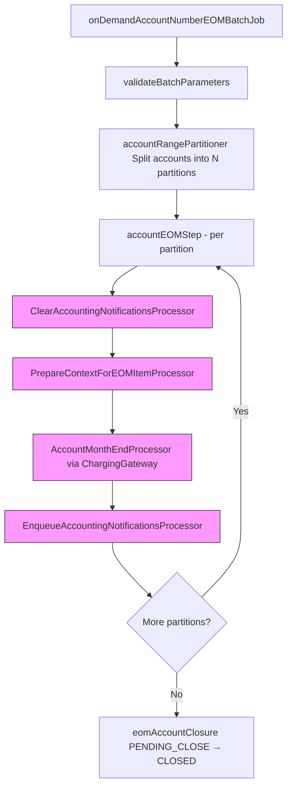
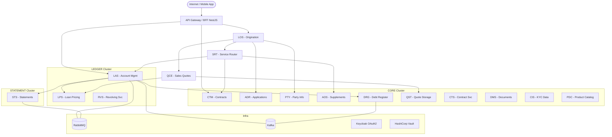

> *Tài liệu này là reference cho kỹ sư và kiến trúc sư hệ thống. Không cần đọc theo trình tự - dùng như reference khi cần.*

## A.1 tổng quan Microservices

### Service Map

```text
┌─────────────────────────────────────────────────────────────────────────┐
│                        Vela Lending Platform                                  │
│                                                                          │
│  ┌─────────┐  ┌─────────┐  ┌─────────┐  ┌─────────┐  ┌─────────┐      │
│  │   LOS   │  │   LPS    │  │   LAS    │  │   DRG    │  │   DSA   │      │
│  │Originat.│  │Account  │  │Account  │  │Debt Col.│  │DataSrcMg│      │
│  │ Process │  │ Pricing │  │Managmt  │  │         │  │         │      │
│  └────┬────┘  └────┬────┘  └────┬────┘  └────┬────┘  └────┬────┘      │
│       │            │            │            │            │            │
│  ┌────┴────┐  ┌────┴────┐  ┌────┴────┐  ┌────┴────┐  ┌────┴────┐      │
│  │   ADR   │  │   QST   │  │   PDC   │  │  CTM   │  │   CTS   │      │
│  │Applicnt │  │SalesQtSt│  │Product  │  │ContractM│  │ContractS│      │
│  │  Data   │  │         │  │         │  │         │  │ Service │      │
│  └─────────┘  └─────────┘  └─────────┘  └─────────┘  └─────────┘      │
│                                                                          │
│  Message Bus: RabbitMQ + Kafka                                           │
│  Workflow: LOS controller-driven async + Infinispan (Zeebe: optional scoring only)  │
│  Config: CTS (Contract Services)                                            │
└─────────────────────────────────────────────────────────────────────────┘
```

### Service Responsibilities

| Service | Role | Key Entities | Key APIs |
|---------|------|-------------|---------|
| **LOS** | Loan Origination Service - stateless async orchestrator (10 endpoints) | ApplicationRequest (Infinispan cache, 7 named caches) | POST /api/workflows/*ApplicationForm |
| **LPS** | Loan Pricing - calculates instalment plans & XIRR (EIR) via Newton-Raphson | InstalmentPlan, InstalmentSummary, Instalment | POST /api/v3/calculators/instalment-plan/by-offer-code |
| **LAS** | Account Management - core account lifecycle, billing | Account, Transaction, CurrentBalance, LedgerEntry | GET /accounts/{id}, POST /accounts/{id}/transactions |
| **DRG** | Debt Register - DPD tracking, debt state publishing (SCD Type 2) | DebtRegister, DebtRegisterStatistics | GET /debt-catalogue/{contractCode} |
| **DSA** | **Data Source Aggregator** - aggregates data from internal systems as XML for document generation | DataSource (XML) | POST /api/generateDataSource |
| **ADR** | Application Data Repository - stores application data during origination | Application, ApplicationEvent | GET /applications/{id} |
| **QST** | **Quote Store** - stores and manages sales quotes lifecycle | SalesQuote (with arrangements) | POST /sales-quotes |
| **QCE** | **Quote Calculation Engine** - complex pricing calculations (12 domains) | Quote calculation DTOs | POST /calculateQuote (via LOS) |
| **PDC** | Product Catalog - financing packages, tariff management | FinancingPackage, Tariff, FeeComponent | Product definition APIs |
| **SRT** | **Service Router** - stateless router (9 FeignClient connectors) | - | POST /rest/v1/loan-requests |
| **AOS** | **Supplement** - optional add-ons (insurance, protection) | ContractSupplement | Supplement lifecycle APIs |
| **STS** | Statement Management - generates monthly statements | STS_STATEMENT (cabinetUUID→DMS, state: NEW→XML_GENERATED→PDF_GENERATED), STS_STATEMENT_LINE | Triggered via RabbitMQ EOM_FEE event from LAS; STATEMENT cluster (`sts` schema) |
| **RVS** | Revolving Service - revolving service definitions | `rvs_rel_service` (RelService entity), ServiceParameter | `GET /rel-services/api/relService?code={id}`; LEDGER cluster (`rvs` schema) |
| **RDS** | Reference Data Service - reference data (currencies, countries) | RDS_COUNTRY, RDS_CURRENCY | Code list APIs |
| **CIS** | Customer Identity Service - customer identity and verification | CustomerProfile, IncomeVerification | KYC verification APIs |
| **CTM** | Contract Management - contract lifecycle, parties, events | Contract, ContractStatusTransition, BusinessEvent | Contract management APIs |
| **CTS** | Contract Services - contract service operations | CONTRACT_SERVICE, CONTRACT_SERVICE_H (SCD2 history) | activate/deactivate/terminate/cancel APIs; shares CORE cluster (own `cts` schema) |
| **LBS** | Legacy Business Services - **external** legacy system (disbursement, card mgmt) | External | External REST |
| **CMS** | Card Management System - **external** card operations | External | External (RabbitMQ) |

## A.2 Domain Model: LAS (Account Management)

### Core Entities

```text
Account
  ├── id: Long (PK)
  ├── contractId: UUID
  ├── customerId: Long
  ├── status: CREATED | ACTIVE | CANCELLED | PENDING_CLOSE | CLOSED | WRITTEN_OFF | PAID_OFF
  ├── openDate: LocalDate
  ├── closeDate: LocalDate (nullable)
  ├── tariffCode: String → CTS lookup
  └── accountParameters: List<AccountParameter>

AccountParameter
  ├── account: Account (FK)
  ├── parameterType: ParameterType (enum)
  ├── value: String (stored as string, parsed by consumer)
  ├── effectiveFrom: LocalDate
  └── effectiveTo: LocalDate (nullable = current)

  Key ParameterTypes:
    CREDIT_LIMIT, INTEREST_RATE_OVERRIDE, PAYMENT_HOLIDAY_USED,
    DPD_BUCKET, RISK_TIER, CHANNEL

CurrentBalance
  ├── account: Account (FK)
  ├── balanceType: PRINCIPAL | INTEREST | FEE | PENALTY
  ├── amount: BigDecimal (never negative for balance)
  ├── currency: Currency
  └── asOf: LocalDate

Transaction
  ├── id: Long (PK)
  ├── account: Account (FK)
  ├── transactionType: TransactionType (enum)
  ├── amount: BigDecimal
  ├── eventDate: LocalDate   ← when it happened
  ├── processingDate: LocalDate ← when system processed it
  ├── valueDate: LocalDate   ← when funds cleared
  ├── referenceId: String    ← external reference (payment_id, etc.)
  └── reversalOf: Transaction (FK, nullable)

  Key TransactionTypes:
    DISBURSEMENT, PAYMENT_RECEIVED, INTEREST_ACCRUAL, FEE_CHARGE,
    WRITE_OFF, REVERSAL, PAYMENT_HOLIDAY_ACCRUAL

LedgerEntry
  ├── account: Account (FK)
  ├── itemType: PRINCIPAL | INTEREST | FEE
  ├── dueDate: LocalDate
  ├── dueAmount: BigDecimal
  ├── paidAmount: BigDecimal
  ├── paidDate: LocalDate (nullable)
  └── status: OPEN | PARTIAL | PAID | OVERDUE

InstalmentSummary (summary, denormalized)
  ├── account: Account (FK, OneToOne)
  ├── totalInstallments: Integer
  ├── remainingInstallments: Integer
  ├── totalPrincipal: BigDecimal
  ├── totalInterest: BigDecimal
  ├── nextDueDate: LocalDate
  ├── nextDueAmount: BigDecimal
  └── refreshedAt: LocalDateTime

  IMPORTANT: refreshInstalmentSummary() safe only after
  ALL children persisted. Never call during prescribing phase.

ContractService (links Account to PDC tariff)
  ├── account: Account (FK)
  ├── serviceType: INTEREST | INSURANCE | FEE
  ├── tariffCode: String
  ├── tariffVersion: Integer
  └── activatedAt: LocalDate
```

### State Machine: Account Status

```text
                  [CREATED]
                     │
              supplement signed / account activated
                     │
                     ▼
              [ACTIVE] ────────────────────┐
                │  │                       │
                │  │ payoff initiated       │
                │  ▼                       │
                │ [PENDING_CLOSE]          │ DPD threshold crossed
                │      │                  │
                │      │ debt cleared     ▼
                │      └──► [PAID_OFF]  [WRITTEN_OFF]
                │                         │
                │  closed                 │ terminate
                └──► [CLOSED] ◄───────────┘
                
Admin cancel (before ACTIVE): [CANCELLED]

Note: NO SUSPENDED status in AccountStatus enum.
Blocking uses Account.blocked=true + BlockingReason entity
(BlockingReason types: FLEXI_TERMINATION, FLEXI_CONVERSION, FRAUD, LEGAL_HOLD)
```

## A.3 Origination Flow

### High-Level Sequence

```text
// verified: origination-flow.md, origination-flow-complete.md

LOS (Loan Origination Service) — 10 REST endpoints, all return 202 ACCEPTED + Location header

Step 1: POST /api/workflows/submitApplicationForm
  LOS → PTY (create applicant) → ADR (create application)

Step 2: POST /api/workflows/checkEligibility
  LOS → PTY (find customer) → LAS (validate account) → QCE (get IP types) → OFR (match offers)

Step 3: POST /api/workflows/calculateSalesQuotes
  LOS → QCE (pricing: 15+ domains) → LPS (XIRR calculation) → QST (store quotes)

Step 4: POST /api/workflows/chooseOffer
  LOS → ADR (update) → OFR (validate) → Zeebe "PreTransactionRiskCheck" (async scoring)
       → POSITIVE: LOS → LBS (create supplement)
       → NEGATIVE: workflow FAILED

Step 5-6: calculateAccountWithPurchaseQuote / calculateAccountWithCashQuote
  LOS → QCE (pre-contract quotes)

Step 7: POST /api/workflows/generateAgreement
  LOS → SRT → {CTS → RabbitMQ → LAS (account CREATED), CTM, AOS, DMS, QST, PDC}

Step 8: POST /api/workflows/signAgreement
  LOS → AOS.acceptContractSupplementDocuments() → RabbitMQ chain
       → SRT → CTM.signContract → CTS.activate(ACCMAINT) → LAS (account CREATED→ACTIVE)
  LOS publishes origination.completed (RabbitMQ) → LAS confirms activation

Additional: cancelSupplement, rejectSupplement (Step 3/9/10)

Key: LOS stateless — Infinispan embedded cache per step
     Zeebe optional — only for scoring (step 4), NOT main workflow engine
     Champion/Challenger A/B routing: NOT implemented
```

## A.4 EOM (End of Month) Batch Processing

### Batch Architecture


### Idempotency Key

```sql
-- Check before processing:
SELECT 1 FROM eom_completion_log 
WHERE account_id = ? AND processing_date = ? AND status = 'COMPLETED';

-- After processing:
INSERT INTO eom_completion_log 
  (account_id, processing_date, completed_at, status)
VALUES (?, ?, NOW(), 'COMPLETED');
-- Unique constraint on (account_id, processing_date)
-- Duplicate insert → constraint violation → skip (idempotent)
```

### Daily Interest Calculation

```text
Formula: I = P × r / 365 × d

Where:
  P = principal outstanding (from CurrentBalance)
  r = annual interest rate (from ContractService → tariff)
  d = days since last accrual date

Example:
  P = 15,834,200 VNĐ
  r = 15.5% = 0.155
  d = 30 days (EOM November)
  
  I = 15,834,200 × 0.155 / 365 × 30
    = 15,834,200 × 0.000424657...
    = 6,722.15 VNĐ/day × 30 days
    = 201,664 VNĐ

Implementation: BigDecimal with HALF_UP rounding, scale 0 (VNĐ unit)
```

## A.5 Messaging Architecture

### RabbitMQ Exchanges (Key)

| Exchange | Type | Producer | Consumers | Purpose |
|----------|------|----------|-----------|---------|
| `am.headers.event.notification` | Headers | LAS | CTM, LOS, AOS, SRT | Account events (EventRecord: CREATE/ACTIVATE/CANCEL_ACCOUNT, etc.) |
| `am.topic.account.closure` | Topic | LAS | CTM | Account closure events |
| `csi.contract.service` | Headers | CTS | LAS | Service lifecycle notifications (header-based routing) |
| `csi.sup.contract.supplement` | Fanout | AOS | SRT, LOS (and CTM) | Supplement lifecycle events (signed, cancelling, cancelled) |
| `cos.contractservice` | Direct | CTS | LAS | Contract service cancellations |
| `stm.direct` | Direct | STS | STS (internal) | STS internal routing (statement delivery) |
| `account.events` (or EOM_FEE filter on am.headers) | Headers | LAS | STS | Statement generation trigger; STS filters on eventType=EOM_FEE |
| `AM_FANOUT_CMS_ACCOUNT_BALANCE_CHANGE_EXCHANGE` | Fanout | LAS | CMS | Balance change → card system |
| `zeebe.event.exchange` | Fanout | Zeebe | LOS | Scoring callbacks (optional) |
| `cosi.sir.processing-result` | Fanout | SRT | LOS | Loan processing results |
| `origination.completed` (RabbitMQ topic) | Topic | LOS | LAS | Final origination signal → LAS activates account |

Exchange-based routing uses headers (`eventType`, `version`, `x-match: all`).
DLQ pattern: `queue → queue.dlq (TTL retry) → queue.plq (manual)`.

### Kafka Topics (Event Streaming)

| Topic | Producer | Consumers | Format | Notes |
|-------|----------|-----------|--------|-------|
| `transaction.confirmed` | LAS | DRG | Avro | Main DRG trigger |
| `contract.events` | CTM | DRG, SRT | Avro | Contract state changes |
| `debt.events` | DRG | Multiple | CloudEvents | Debt state changes (DPD, write-off) |
| `application.events` (alias: `ads.application-data.v2`) | ADR | SRT, LOS | CloudEvents+Avro | Application lifecycle |
| `sqs.sales-quote.v1` | QST | LOS | CloudEvents | Quote ready notifications |
| `orp.workflow-events.<step>.v1` | LOS | Zeebe, QCE | CloudEvents+Avro | Per-step workflow events |
| `tck.ticket.event.v1` | TKT | - | Avro | Ticketing events |

Schema Registry: Confluent at `https://schema-registry.vlp.internal:8081`
Security: SASL_SSL + SCRAM-SHA-256 (prod: SCRAM-SHA-512)

## A.6 Key Technical Decisions And Rationale

### Why BigDecimal (Not Double)

Floating-point cannot represent decimal fractions exactly. For financial amounts, even 0.001 VNĐ error per transaction becomes significant at scale. Use `BigDecimal` for all monetary values. Scale: 0 for VNĐ (no fractional unit), 10 for intermediate calculations.

### Why Tariff-Driven Design

Business rules change faster than code can be deployed. Rate changes (regulatory, competitive) must take effect on specific dates without deployment. Tariff in database with `validFrom`/`validTo` enables zero-downtime business rule changes.

### Why Optimistic Locking

Account is read-heavy, write-occasional. Pessimistic locking would create contention. Optimistic locking (version field) allows concurrent reads; conflicts detected at write time. Acceptable because concurrent writes to same account are rare.

### Why refreshInstalmentSummary Is Dangerous During Prescribing

`InstalmentSummary` is a denormalized summary computed from child `Instalment` records. During `prescribing` phase, children are being created in transaction. If `refreshInstalmentSummary()` is called before all children are persisted, the summary is computed from incomplete data → incorrect header. Safe to call only after transaction completes.

### Why UNREACHABLE_FUTURE_DATE

For `effectiveTo = null` (currently active) records, querying "give me the record active as of today" requires:
- Option A: `WHERE effectiveTo IS NULL OR effectiveTo >= :today` - works but requires OR logic
- Option B: `WHERE effectiveTo >= :today` with sentinel value - simpler query, indexable

Two sentinel values used in VLP (different entities):
- `AccountParameter.validTo`: `3333-01-01` (UNREACHABLE_FUTURE_DATE)
  NULL in DB → `NullDateToFarFutureConverter` → 3333-01-01 in Java
- `AccountService.endDate`: `3000-01-01` (explicit default, no converter)

### Why LOS Uses Controller-Driven Async (Not BPMN Engine)

LOS uses Spring async controllers with Infinispan cache for state management. Zeebe is an optional integration used only for scoring workflows (profile: `zeebe-integration`), not the main orchestrator. This design choice:
- Simpler debugging (standard Spring controllers)
- No BPMN engine dependency in critical path
- Tradeoff: manual retry logic, no visual workflow representation
- Stuck applications handled by external reconciliation jobs

## A.7 Performance Benchmarks

| Operation | P50 Latency | P99 Latency | Throughput | Notes |
|-----------|------------|------------|-----------|-------|
| Credit scoring | 45ms | 180ms | 500 req/s | Includes model inference |
| Bureau query | 450ms | 950ms | 200 req/s | External dependency |
| Account creation | 120ms | 350ms | 300 req/s | DB write + events |
| EOM per account | 85ms | 220ms | - | Batch, partitioned |
| EOM total (100K accounts) | - | - | ~2.5 hours | 8-thread parallel |
| Payment processing | 65ms | 180ms | 400 req/s | Includes idempotency check |

## A.8 Database Schema: Key Tables

```sql
-- Account (simplified)
CREATE TABLE account (
    id BIGINT GENERATED ALWAYS AS IDENTITY PRIMARY KEY,
    contract_id UUID NOT NULL UNIQUE,
    customer_id BIGINT NOT NULL,
    status VARCHAR(20) NOT NULL DEFAULT 'ACTIVE',
    open_date DATE NOT NULL,
    close_date DATE,
    tariff_code VARCHAR(50) NOT NULL,
    version INTEGER NOT NULL DEFAULT 0, -- optimistic locking
    created_at TIMESTAMP NOT NULL DEFAULT NOW(),
    updated_at TIMESTAMP NOT NULL DEFAULT NOW()
);

-- Transaction (simplified)
CREATE TABLE transaction (
    id BIGINT GENERATED ALWAYS AS IDENTITY PRIMARY KEY,
    account_id BIGINT NOT NULL REFERENCES account(id),
    transaction_type VARCHAR(50) NOT NULL,
    amount NUMERIC(15,2) NOT NULL,
    event_date DATE NOT NULL,
    processing_date DATE NOT NULL,
    value_date DATE NOT NULL,
    reference_id VARCHAR(100),
    reversal_of_id BIGINT REFERENCES transaction(id),
    created_at TIMESTAMP NOT NULL DEFAULT NOW()
    -- NOTE: No updated_at — transactions are immutable
);

-- Tariff Item (simplified)
CREATE TABLE fee_component (
    id BIGINT GENERATED ALWAYS AS IDENTITY PRIMARY KEY,
    tariff_code VARCHAR(50) NOT NULL,
    item_type VARCHAR(50) NOT NULL,
    percentage NUMERIC(10,8), -- e.g., 0.01292 for 1.292%/month
    fixed_amount NUMERIC(15,2),
    valid_from DATE NOT NULL,
    valid_to DATE NOT NULL DEFAULT '3333-01-01', -- UNREACHABLE_FUTURE_DATE (NULL in DB → 3333-01-01 in Java)
    created_at TIMESTAMP NOT NULL DEFAULT NOW()
);
CREATE INDEX idx_fee_component_lookup ON fee_component(tariff_code, item_type, valid_from, valid_to);

-- EOM Completion Log (idempotency)
CREATE TABLE eom_completion_log (
    id BIGINT GENERATED ALWAYS AS IDENTITY PRIMARY KEY,
    account_id BIGINT NOT NULL REFERENCES account(id),
    processing_date DATE NOT NULL,
    completed_at TIMESTAMP NOT NULL,
    status VARCHAR(20) NOT NULL,
    CONSTRAINT uq_eom_completion UNIQUE (account_id, processing_date)
);
```

## A.9 Deployment Architecture


### Database Topology (5 PostgreSQL Clusters via PgBouncer :6432)

| Cluster | Database | Modules | Note |
|---------|----------|---------|------|
| LEDGER (Account) | `vlp_ledger_a1p` | LAS, LPS, RVS | LAS queries LPS/RVS schema directly |
| CORE (Holdings) | `vlp_core_a1p` | ADR, CTM, CTS, RDS, DRG, DMS, CIS, **PTY**, PDC, QST, AOS, **TKT** | Largest cluster (12 modules) |
| CNTR (Contract) | `vlp_cntr_a1p` | OFR | |
| STATEMENT (Statement) | `vlp_statement_a1p` | STS | |
| Local Dev | `testdb` | All | Podman/local |

Stateless (no DB): LOS, SRT, DSA (read-only cache), **BFF** (NestJS 11, no direct DB - aggregates backend APIs)

Cross-schema access: LAS reads CTM schema directly via JPA (not REST) for ContractService data.

### GitOps Deployment (ArgoCD + Helm)

```text
Sync waves:
  Wave 1: ConfigMaps, Secrets
  Wave 2: Liquibase DB migrations
  Wave 3: Application Deployments
  Wave 98: HPA (Horizontal Pod Autoscaler)
  Wave 99: PDB (Pod Disruption Budget)

Autoscaling: KEDA with Prometheus + cron triggers
Secrets: HashiCorp Vault (Kubernetes auth)
Tracing: OpenTelemetry Java agent (W3C Trace Context)
```

### Environment Configuration

| Environment | Purpose | Data | Auto-deploy |
|------------|---------|------|------------|
| dev | Development | Synthetic | On commit |
| staging | Integration test | Anonymized prod | On PR merge |
| uat | User acceptance | Anonymized prod | Manual |
| prod | Production (on-premise K8s) | Real | Manual via ArgoCD |

*Phụ lục A - Architecture Reference. Cập nhật khi có major architecture changes.*

*Xem thêm: `.claude/rules/` trong repo `vlp-engineering-handbook` cho detailed technical specs.*
