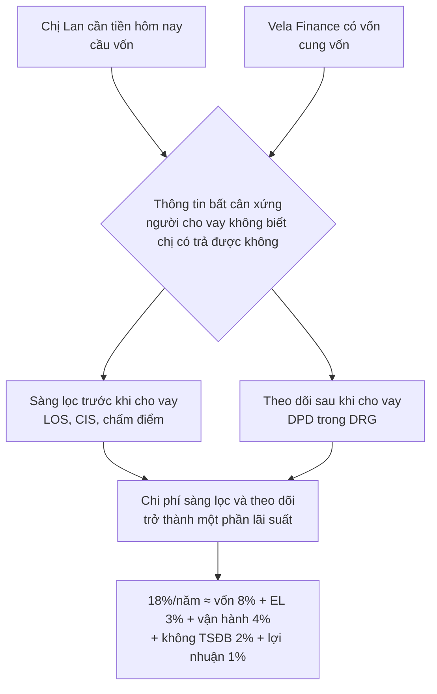

import CostStackChart from '@site/src/components/Charts/CostStackChart';

> *"Tín dụng không tạo ra sự giàu có; nó phân phối lại sự giàu có theo thời gian. Câu hỏi là ai được phân phối, theo điều kiện nào, và ai chịu rủi ro."*
>
> *Phỏng theo Hyman Minsky*

## Dẫn nhập: một buổi sáng thứ hai

::::story
Chị Lan, 28 tuổi, nhân viên kế toán tại một công ty xuất nhập khẩu ở Hà Nội, vừa nhận tin không vui: chiếc máy tính xách tay chị dùng để làm việc đã hỏng hoàn toàn. Công ty không cấp thiết bị và yêu cầu chị có máy riêng trong vòng ba ngày.

Chiếc laptop phù hợp có giá 18,500,000 VNĐ. Tài khoản tiết kiệm của chị có 6,000,000 VNĐ, số tiền dành dụm trong sáu tháng cho kỳ nghỉ hè. Mười ngày nữa mới đến kỳ lương.

Chị có ba lựa chọn: dùng hết tiền tiết kiệm và vay thêm bạn bè; mua một chiếc laptop rẻ hơn nhưng không đủ cấu hình; hoặc vay tiêu dùng để mua ngay, trả dần trong 12 tháng. Chị chọn cách thứ ba, và câu chuyện của cuốn sách bắt đầu từ đây.
::::

Quyết định đơn giản và phổ biến đó chứa đựng toàn bộ kinh tế học của tín dụng tiêu dùng. Vì sao có người sẵn sàng cho chị vay? Với điều kiện gì? Vì sao lãi suất là 18%/năm mà không phải 5% hay 50%? Ai chịu rủi ro nếu chị không trả được? Và hệ thống công nghệ nào giúp toàn bộ quá trình diễn ra trong vài phút, thay vì vài tuần như hai mươi năm trước?

Chương này trả lời những câu hỏi đó, từ các nguyên lý kinh tế học cho đến lý do tồn tại của từng module trong nền tảng cho vay xử lý khoản vay của chị Lan.

## 1.1 Tín dụng là gì?

### Câu chuyện của hai người nông dân

::::story
Hãy tạm quên chị Lan và lùi lại vài nghìn năm.

Trong một ngôi làng có hai người nông dân, ông Bình và ông Cường. Mùa xuân, ông Bình có 100 kg lúa giống nhưng chỉ đủ ruộng để gieo 60 kg. Ông Cường có ruộng nhưng không còn lúa giống, vì mùa đông vừa rồi khó khăn, ông đã phải ăn hết. Không có giống, ruộng của ông Cường sẽ bỏ hoang cả năm.

Ông Bình cho ông Cường mượn 40 kg lúa giống. Cuối mùa, ông Cường trả lại 50 kg: 40 kg gốc và 10 kg để cảm ơn.
::::

Đây là tín dụng ở dạng nguyên thủy nhất, và nó đã chứa đủ ba yếu tố vẫn còn nguyên trong hệ thống tài chính hiện đại. Tín dụng **chuyển nguồn lực theo thời gian**: ông Cường dùng lúa hôm nay và trả sau. Tín dụng **mang lại lợi ích cho cả hai bên**: ông Bình sinh lời từ số lúa thừa, ông Cường không phải bỏ ruộng. Và tín dụng **có chi phí**: 10 kg lúa trả thêm chính là một dạng lãi suất.

### Giá trị thời gian của tiền

::::story
Anh Minh, Product Owner của Vela Finance, đang họp với một nhà đầu tư. Nhà đầu tư đưa ra đề nghị: "Tôi cho anh vay 1 tỷ đồng hôm nay. Hai năm nữa anh trả tôi đúng 1 tỷ. Anh nghĩ sao?"
::::

Đề nghị nghe có vẻ hào phóng, nhưng anh Minh hiểu rằng nhà đầu tư đang chịu thiệt. Một tỷ đồng hôm nay và một tỷ đồng sau hai năm không phải cùng một thứ. Có tiền trong tay hôm nay, nhà đầu tư có thể gửi tiết kiệm với lãi suất 6%/năm và nhận về 1,123,600,000 VNĐ sau hai năm, mua trái phiếu chính phủ, hoặc đầu tư kinh doanh. Cho vay không lãi, họ từ bỏ ít nhất 123,600,000 VNĐ. Khoản từ bỏ đó gọi là **chi phí cơ hội** (opportunity cost).

:::key[Giá trị thời gian của tiền]
**Giá trị thời gian của tiền** (time value of money, TVM) là nguyên lý: một đồng nhận hôm nay có giá trị hơn một đồng nhận trong tương lai, vì đồng tiền hôm nay có thể được đầu tư để sinh lời. Hai công thức cốt lõi, với $r$ là lãi suất mỗi kỳ và $n$ là số kỳ:

$$
FV = PV \cdot (1 + r)^n \qquad\qquad PV = \frac{FV}{(1 + r)^n}
$$
:::

Trong đó $PV$ (present value) là giá trị hiện tại và $FV$ (future value) là giá trị tương lai.

**Ví dụ số.** Bà Hương, giám đốc tài chính của Vela Finance, phải chọn giữa hai dự án cùng cần 500,000,000 VNĐ vốn: dự án A thu về 650,000,000 VNĐ sau 3 năm, dự án B thu về 580,000,000 VNĐ sau 1 năm. Chi phí cơ hội của vốn là 10%/năm.

```text
PV(A) = 650,000,000 / 1.10^3 = 650,000,000 / 1.331 ≈ 488,354,621 VNĐ
PV(B) = 580,000,000 / 1.10   =                      ≈ 527,272,727 VNĐ
```

Dự án A trả nhiều tiền hơn về số tuyệt đối, nhưng giá trị hiện tại của nó thấp hơn cả số vốn bỏ ra. Nói cách khác, dự án A chỉ mang lại khoảng 9.1%/năm, thấp hơn chi phí vốn 10%, nên nó phá hủy giá trị. Dự án B được chọn.

Nếu chi phí cơ hội giảm xuống 7%/năm, PV(A) tăng lên khoảng 530.6 triệu và PV(B) khoảng 542.1 triệu. Cả hai dự án đều đáng làm, dù B vẫn tốt hơn. Khi lãi suất thị trường giảm, các dự án dài hạn trở nên hấp dẫn hơn; đó là một trong những cơ chế đứng sau các chu kỳ đầu tư.

**Trong VLP**, nguyên lý giá trị thời gian của tiền là lý do module LPS (Loan Pricing Service) tồn tại. Khi chị Lan vay 18,500,000 VNĐ, LPS không chia đều số tiền cho 12 tháng. Nó tính khoản trả mỗi tháng sao cho tổng giá trị hiện tại của 12 khoản trả đúng bằng số tiền vay. Chương 2 trình bày chi tiết phép tính này.

### Ba thành phần của lãi suất

Người cho vay tính lãi để được bồi thường cho ba điều.

**Thời gian.** Lãi suất thực (real interest rate) là phần thưởng cho việc từ bỏ tiêu dùng hiện tại. Ngay cả trong một thế giới không có rủi ro và lạm phát, người ta vẫn muốn được bù đắp vì phải chờ. Lãi suất thực phản ánh cung cầu vốn trong nền kinh tế và chịu ảnh hưởng của lãi suất chính sách của ngân hàng trung ương.

**Lạm phát.** Nếu lạm phát là 4%/năm, người cho vay nhận lại một số tiền có sức mua thấp hơn. Mối quan hệ này được mô tả bằng **phương trình Fisher** (Fisher equation), với $i$ là lãi suất danh nghĩa (con số trên hợp đồng), $r$ là lãi suất thực và $\pi^e$ là lạm phát kỳ vọng:

$$
(1 + i) = (1 + r)(1 + \pi^e) \qquad\Longrightarrow\qquad i \approx r + \pi^e
$$

Với lãi suất thực 3% và lạm phát kỳ vọng 4%, lãi suất danh nghĩa tối thiểu là khoảng 7%. Một ngân hàng cho vay 6% trong môi trường lạm phát 4% thực chất chỉ nhận lãi suất thực 2%.

**Rủi ro.** Người vay có thể không trả được, và mức rủi ro khác nhau giữa từng người. Phần bù rủi ro (risk premium) phải đủ để bù đắp những khoản bị mất. Đây là thành phần phức tạp nhất và là trọng tâm của mục 1.3.

$$
\text{Lãi suất danh nghĩa} \approx \text{lãi suất thực} + \text{lạm phát kỳ vọng} + \text{phần bù rủi ro}
$$

Với khoản vay 18%/năm của chị Lan, một cách phân tách minh họa là khoảng 3% lãi suất thực, 4% lạm phát kỳ vọng và 11% phần bù rủi ro. Mục 1.3 sẽ phân tách cùng con số 18% theo một góc nhìn khác, từ cấu trúc chi phí của công ty tài chính; hai cách phân tách bổ sung cho nhau chứ không mâu thuẫn.

:::summary[Mục 1.1]
Tiền hôm nay có giá trị hơn tiền tương lai vì cơ hội đầu tư bị bỏ qua. Lãi suất danh nghĩa bù đắp cho thời gian, lạm phát và rủi ro; phương trình Fisher cho $i \approx r + \pi^e$. Mọi phép tính của module định giá LPS trong VLP đều dựa trên giá trị thời gian của tiền.
:::

## 1.2 Thông tin bất cân xứng: vấn đề gốc rễ

### Câu chuyện của người bán xe

::::story
Kỹ sư Tuấn muốn mua một chiếc xe máy cũ. Ở chợ xe, anh thấy ba chiếc cùng đời, cùng hãng, cùng màu, nhưng giá khác nhau: 18 triệu, 22 triệu và 28 triệu đồng. Người bán biết rõ lịch sử từng chiếc: chiếc 28 triệu chưa bao giờ ngã và được bảo dưỡng đúng hạn; chiếc 18 triệu đã qua hai lần tai nạn, khung hơi lệch. Tuấn thì không biết.

Để an toàn, Tuấn quyết định trả tối đa 20 triệu. Người có chiếc xe tốt không muốn bán dưới 28 triệu nên rút khỏi chợ. Người có chiếc xe xấu vui vẻ bán với giá 20 triệu. Dần dần, chợ chỉ còn xe xấu; người mua nhận ra điều đó và hạ giá sẵn sàng trả xuống 15 triệu; những người bán còn lại tiếp tục rút đi. Thị trường thu hẹp dần, không phải vì thiếu người mua hay người bán, mà vì **thông tin bất cân xứng** (information asymmetry).
::::

Đây là mô hình "thị trường chanh" (market for lemons) mà George Akerlof công bố năm 1970 và là một phần công trình giúp ông nhận giải Nobel Kinh tế năm 2001.

Thị trường tín dụng có cùng vấn đề, nhưng nguy hiểm hơn vì ba lý do. Hàng hóa, tức tiền, được giao trước và thanh toán sau, nên rủi ro dồn về phía người cho vay. Người vay hiểu tình hình tài chính, mục đích sử dụng tiền và khả năng trả nợ của chính mình hơn bất kỳ ai. Và không có cách nào "kiểm tra xe" để xác minh chắc chắn ý định của người vay trước khi giải ngân.

### Lựa chọn bất lợi

:::key[Lựa chọn bất lợi]
**Lựa chọn bất lợi** (adverse selection) xảy ra **trước** giao dịch. Khi người cho vay không phân biệt được người vay tốt và người vay xấu, họ đặt một mức lãi suất "trung bình". Mức đó quá cao với người vay tốt, nên họ đi tìm nơi khác, và quá thấp với người vay xấu, nên họ chấp nhận. Danh mục cho vay vì thế xấu dần đi theo thời gian.
:::

**Ví dụ số.** Giả sử có 1,000 người muốn vay: 700 người vay tốt với xác suất vỡ nợ (probability of default, PD) 1%, và 300 người vay xấu với PD 15%. Không phân biệt được hai nhóm, công ty tài chính định giá theo PD trung bình:

```text
PD trung bình = (700 × 1% + 300 × 15%) / 1,000 = (7 + 45) / 1,000 = 5.2%
Tổn thất dự kiến với LGD 60% = 5.2% × 60% = 3.12%/năm
```

Cộng chi phí vốn, chi phí vận hành và lợi nhuận, lãi suất cần thiết vào khoảng 15%/năm. Nhưng người vay tốt có thể vay ngân hàng với 10%/năm, nên họ không vay ở đây. Khi chỉ còn nhóm người vay xấu, PD thực tế là 15%, tổn thất dự kiến là 15% × 60% = 9%/năm, và lãi suất phải tăng lên khoảng 24%/năm. Ở mức 24%, cả những người vay "xấu vừa phải" cũng rút đi; chỉ còn lại những trường hợp rủi ro nhất. Vòng xoáy tự củng cố này có thể làm sụp đổ một công ty tài chính.


*Hình 1.1. Vòng xoáy lựa chọn bất lợi. Mỗi lần tăng lãi suất lại đẩy thêm người vay tốt ra khỏi danh mục.*

Bản thảo gốc nhận định đây là điều đã xảy ra với một số công ty tài chính tiêu dùng tại Việt Nam giai đoạn 2015-2018, khi tăng trưởng nhanh hơn năng lực chấm điểm tín dụng. Nhận định này chưa được đối chiếu với nguồn công khai và được giữ ở dạng nhận định của tác giả.

**Trong VLP**, để phá vỡ vòng xoáy, hệ thống phải **phân biệt** được người vay tốt và xấu. Vì vậy module khởi tạo khoản vay LOS (Loan Origination Service) không đơn giản là "nhận hồ sơ, phê duyệt", mà điều phối một quy trình sàng lọc nhiều bước. Mỗi bước trả lời một câu hỏi kinh tế:

| Bước | Module hoặc nguồn | Câu hỏi kinh tế |
|---|---|---|
| Thu thập và xác minh danh tính | CIS (Customer Identity Service) | Người này có thật không, có nằm trong danh sách đen không? |
| Kiểm tra lịch sử tín dụng | Trung tâm thông tin tín dụng | Người này đã từng vỡ nợ chưa? |
| Xác minh thu nhập | Tài liệu lưu trong DMS | Người này có khả năng trả không? |
| Chấm điểm hành vi | Dữ liệu hành vi | Người này giống nhóm khách hàng nào? |
| Tính đề nghị vay | QCE (Quote Calculation Engine) và LPS | Với mức rủi ro này, lãi suất nào là phù hợp? |

Mỗi bước là một nỗ lực giảm thông tin bất cân xứng. Chi phí của quy trình này, gồm nhân lực, hệ thống và thời gian, trở thành chi phí khởi tạo khoản vay và cuối cùng được phản ánh trong lãi suất trên hợp đồng.

### Rủi ro đạo đức

::::story
Khoản vay 18,500,000 VNĐ của chị Lan vừa được giải ngân. Trên đường đến cửa hàng laptop, chị đi ngang một cửa hàng điện thoại và thấy một chiếc điện thoại cao cấp mới ra mắt, giá 25,000,000 VNĐ. Chị bắt đầu tính: chiếc laptop cũ có thể dùng tạm thêm vài tháng, còn 18.5 triệu này cộng thêm một khoản vay thẻ tín dụng nhỏ thì...
::::

:::key[Rủi ro đạo đức]
**Rủi ro đạo đức** (moral hazard) xảy ra **sau** giao dịch. Khi đã có tiền, người vay ít động lực hơn để giữ cam kết ban đầu, vì một phần hậu quả đã chuyển sang người cho vay.
::: Rủi ro đạo đức không nhất thiết là gian lận có chủ ý; thường nó là phản ứng tự nhiên khi gánh nặng hậu quả được chia sẻ, kiểu suy nghĩ "nếu tôi không trả được, công ty tài chính lớn như vậy cũng không phá sản".

| Cam kết trước khi vay | Hành vi có thể xảy ra sau khi vay |
|---|---|
| Hứa cắt giảm chi tiêu | Mua thêm những thứ không cần thiết |
| Dùng tiền cho mục đích X | Dùng cho mục đích Y rủi ro hơn |
| Trả nợ đúng hạn | Trì hoãn trả nợ khi có thể |
| Tiết kiệm để dự phòng | Tiêu hết vì "có thể vay thêm" |

Nếu không được kiểm soát, rủi ro đạo đức làm tỷ lệ vỡ nợ cao hơn mức cần thiết. Lý do không phải người vay thiếu khả năng, mà là cấu trúc khuyến khích không đúng. Hệ thống tài chính phản ứng bằng hai cơ chế.

**Theo dõi liên tục** (continuous monitoring). Hệ thống ghi nhận từng kỳ thanh toán và đo số ngày quá hạn (days past due, DPD). Trả đúng hạn kỳ 1 được ghi nhận bình thường; trả trễ 5 ngày ở kỳ 2 đưa DPD lên 5 và tạo cảnh báo; trễ 35 ngày ở kỳ 3 dẫn đến leo thang xử lý; không trả ở kỳ 4, DPD lên 65 và tài khoản chuyển sang bộ phận thu hồi nợ.

Trong VLP, module DRG (Debt Register) theo dõi DPD của từng tài khoản. DRG nhận sự kiện từ module quản lý tài khoản LAS qua Kafka (topic `transaction.confirmed`) gần như theo thời gian thực, đồng thời chạy job `updateOverdueDebtJob` hằng ngày để đối soát nợ quá hạn. Hai cơ chế bổ sung cho nhau: sự kiện cho cập nhật nhanh, batch job cho tính nhất quán. Mỗi khi LAS xác nhận một giao dịch, DRG cập nhật bản ghi `DebtRegister` (lưu lịch sử theo kiểu SCD Type 2) và phát sự kiện lên topic `debt.events`. Chương 10 mô tả kiến trúc này.

**Ràng buộc danh tiếng** (reputation mechanism). Lịch sử thanh toán của chị Lan không chỉ ảnh hưởng đến khoản vay hiện tại mà đến mọi khoản vay trong tương lai: hành vi xấu hôm nay dẫn đến lãi suất cao hơn hoặc bị từ chối sau này. Đây là lý do các trung tâm thông tin tín dụng tồn tại và các tổ chức tín dụng phải báo cáo cho họ. Cơ chế này chỉ hiệu quả khi thông tin được chia sẻ rộng rãi trong ngành.

### Tín hiệu và sàng lọc: giải pháp của thị trường

Nếu thông tin bất cân xứng là căn bệnh, tín hiệu và sàng lọc là thuốc chữa.

**Tín hiệu** (signaling) do **người vay** chủ động đưa ra. Người vay tốt muốn phân biệt mình với người vay xấu, nên họ tự nguyện cung cấp thông tin khó làm giả, thứ mà người vay xấu không thể hoặc không muốn cung cấp.

| Tín hiệu | Vì sao khó làm giả |
|---|---|
| Sao kê lương 6 tháng | Người không có thu nhập ổn định không có sao kê này |
| Chấp nhận lãi suất cao hơn để có hạn mức lớn hơn | Người biết mình sẽ vỡ nợ khó dám cam kết |
| Dùng dịch vụ lâu năm trước khi vay lớn | Người cơ hội không đủ kiên nhẫn |

**Sàng lọc** (screening) do **người cho vay** chủ động thực hiện. Người cho vay thiết kế quy trình để kiểm chứng thông tin người vay cung cấp và thu thập cả những thông tin người vay không tự nguyện tiết lộ.

:::key[Lập luận kinh tế]
Chi phí sàng lọc tốt thường thấp hơn tổn thất nợ xấu khi không sàng lọc.
:::

Từ lập luận này, có thể hiểu lý do tồn tại của toàn bộ hệ thống công nghệ trong quy trình khởi tạo khoản vay. Trong VLP, CIS xác minh danh tính, LOS điều phối các bước chấm điểm, QCE tính đề nghị vay theo rủi ro, và DMS lưu và xác minh tài liệu. Mỗi module không chỉ là một service kỹ thuật, mà là hiện thực hóa của một giải pháp kinh tế cho vấn đề thông tin bất cân xứng.

:::summary[Mục 1.2]
Lựa chọn bất lợi xảy ra trước giao dịch: khi không sàng lọc được, người vay xấu đẩy người vay tốt ra khỏi thị trường. Rủi ro đạo đức xảy ra sau giao dịch: hành vi thay đổi khi hậu quả được chia sẻ. Thị trường đáp lại bằng tín hiệu từ người vay và sàng lọc từ người cho vay. Trong VLP, chuỗi khởi tạo khoản vay là cỗ máy sàng lọc, còn module DRG là công cụ theo dõi rủi ro đạo đức.
:::

## 1.3 Vì sao lãi suất vay tiêu dùng cao hơn vay mua nhà?

### Tình huống

::::story
Anh Minh vừa tiếp một nhà báo đang viết bài về "tín dụng đen núp bóng tài chính tiêu dùng". Nhà báo đưa ra dữ liệu: vay mua nhà 9%/năm, vay tiêu dùng 24%/năm, chênh lệch 15 điểm phần trăm, và kết luận đó là bóc lột. Anh Minh biết kết luận này sai, nhưng cần giải thích sao cho thuyết phục.

Câu trả lời nằm ở cấu trúc chi phí. Lãi suất cho vay phải bù đắp bốn loại chi phí thực của người cho vay; thiếu một loại, người cho vay sẽ lỗ.
::::

### Thành phần 1: chi phí vốn

Ngân hàng thương mại huy động tiền gửi tiết kiệm với lãi suất khoảng 5-6%/năm. Đây là nguồn vốn rẻ nhất, một phần vì tiền gửi được bảo hiểm.

Công ty tài chính tiêu dùng **không được nhận tiền gửi**. Họ huy động vốn bằng cách vay ngân hàng mẹ (thường 7-9%/năm), phát hành trái phiếu doanh nghiệp (8-10%/năm), hoặc vay các tổ chức quốc tế (7-9%/năm cộng chi phí phòng ngừa rủi ro tỷ giá). Chi phí vốn bình quân vì thế vào khoảng 8-10%/năm, cao hơn ngân hàng 2-4 điểm phần trăm ngay cả khi mọi yếu tố khác như nhau.

### Thành phần 2: tổn thất dự kiến

Đây là thành phần quan trọng nhất và cũng hay bị hiểu sai nhất.

:::key[Tổn thất dự kiến]
**Tổn thất dự kiến** (expected loss, EL) là mức tổn thất trung bình mỗi năm, tính bằng:

$$
EL = PD \times LGD \times EAD
$$
:::

| Biến | Ý nghĩa | Vay mua nhà | Vay tiêu dùng |
|---|---|---|---|
| PD | Xác suất vỡ nợ trong một năm (probability of default) | 0.5-1% | 3-8% |
| LGD | Tỷ lệ tổn thất khi vỡ nợ (loss given default) | 15-25% | 50-70% |
| EAD | Dư nợ tại thời điểm vỡ nợ (exposure at default) | Xấp xỉ dư nợ | Có thể cao hơn với hạn mức quay vòng |

PD của vay tiêu dùng cao hơn vì người vay mua nhà thường phải đáp ứng điều kiện chặt: thu nhập ổn định với tỷ lệ nợ trên thu nhập không quá khoảng 40%, khoản tiết kiệm đủ trả trước 20-30%, lịch sử tín dụng sạch. Vay tiêu dùng phục vụ một phân khúc rộng hơn nhiều, kể cả những người không đủ điều kiện vay ngân hàng.

LGD của vay tiêu dùng cao hơn vì không có tài sản đảm bảo. Khi người vay mua nhà vỡ nợ, ngân hàng phát mại tài sản và thường thu hồi được 75-85% dư nợ, tức LGD 15-25%. Khi người vay tiêu dùng vỡ nợ, không có tài sản nào để thu giữ; người cho vay phải thuê đơn vị thu hồi nợ với chi phí 10-20% dư nợ, và sau nhiều năm thường chỉ thu được 30-50%. LGD vì vậy ở mức 50-70%.

**Ví dụ số.** Bà Hương định giá một sản phẩm vay tiêu dùng với dữ liệu lịch sử: PD 5%, LGD 60%, EAD bình quân 15,000,000 VNĐ.

```text
EL mỗi khoản vay = 5% × 60% × 15,000,000 = 450,000 VNĐ/năm
Với 100,000 khoản vay = 100,000 × 450,000  = 45 tỷ VNĐ/năm
Tỷ lệ trên dư nợ      = 45 tỷ / 1,500 tỷ   = 3%/năm
```

Để bù 45 tỷ này, lãi suất phải chứa ít nhất 3 điểm phần trăm phần bù rủi ro trên toàn bộ danh mục 1,500 tỷ đồng. Với một khoản vay mua nhà 1.5 tỷ đồng, PD 0.8% và LGD 20%, EL chỉ là 0.8% × 20% = 0.16%/năm, tức 2,400,000 VNĐ mỗi năm. Riêng tổn thất dự kiến đã tạo ra chênh lệch khoảng 2.84 điểm phần trăm.

### Thành phần 3: chi phí vận hành

Thành phần này ít được nhắc đến nhưng rất quan trọng. Một khoản vay mua nhà 2 tỷ đồng, kỳ hạn 20 năm, tốn khoảng 2-5 triệu đồng chi phí khởi tạo một lần, có 240 kỳ trả ổn định và hiếm khi cần thu hồi nợ; tổng chi phí vận hành khoảng 0.3-0.5%/năm trên dư nợ. Một khoản vay tiêu dùng 20 triệu đồng, kỳ hạn 12 tháng, tốn khoảng 0.5-2 triệu đồng chi phí khởi tạo, tức 5-10% giá trị khoản vay; có 12 kỳ trả cần tự động hóa tốt, nhu cầu thu hồi nợ thường xuyên và nhiều câu hỏi từ khách hàng đại chúng. Tổng chi phí vận hành vào khoảng **3-5%/năm** trên dư nợ.

Phần lớn chi phí khởi tạo là chi phí cố định: thẩm định một khoản vay 5 triệu tốn gần bằng một khoản vay 50 triệu. Với khoản vay nhỏ, chi phí này chiếm tỷ trọng rất lớn.

Đây là lý do kinh tế khiến VLP phải là một hệ thống tự động hóa cao. Một khoản vay 20 triệu với lãi suất 18%/năm chỉ tạo ra khoảng 3.6 triệu đồng tiền lãi mỗi năm. Nếu hai nhân viên phải dành thời gian đáng kể cho khoản vay đó, công ty sẽ lỗ. Chi phí vận hành 3-5%/năm chỉ bền vững khi phần lớn quy trình, từ khởi tạo đến billing và thu hồi nợ, được xử lý tự động.

### Thành phần 4: phần bù cho khoản vay không có tài sản đảm bảo

Vay mua nhà là khoản vay **có tài sản đảm bảo** (secured loan): nếu người vay không trả, ngân hàng có quyền xử lý tài sản. Phần lớn khoản vay tiêu dùng **không có tài sản đảm bảo** (unsecured loan): khi vỡ nợ, người cho vay chỉ có thể nhắc nợ, thuê đơn vị thu hồi nợ, hoặc khởi kiện, vốn tốn kém, kéo dài và không chắc chắn. Phần bù cho rủi ro này vào khoảng **2-4%/năm**.

### Tổng hợp

| Thành phần chi phí | Vay mua nhà | Vay tiêu dùng | Chênh lệch |
|---|---:|---:|---:|
| Chi phí vốn | 5.50% | 8.50% | +3.00 |
| Tổn thất dự kiến (EL) | 0.16% | 3.00% | +2.84 |
| Chi phí vận hành | 0.40% | 4.00% | +3.60 |
| Phần bù không tài sản đảm bảo | 0.00% | 3.00% | +3.00 |
| **Tổng chi phí** | **6.06%** | **18.50%** | **+12.44** |
| Biên lợi nhuận | 2-3% | 2-4% | xấp xỉ nhau |
| **Lãi suất cho vay** | **khoảng 9%** | **khoảng 21-23%** | |

<CostStackChart
  title="Hình 1.2. Cấu trúc chi phí của lãi suất: vay mua nhà và vay tiêu dùng"
  categoryKey="product"
  data={[
    {product: 'Vay mua nhà', cof: 5.5, el: 0.16, opex: 0.4, unsecured: 0},
    {product: 'Vay tiêu dùng', cof: 8.5, el: 3.0, opex: 4.0, unsecured: 3.0},
  ]}
  series={[
    {key: 'cof', label: 'Chi phí vốn', color: '#2f6f9f'},
    {key: 'el', label: 'Tổn thất dự kiến', color: '#c98a2b'},
    {key: 'opex', label: 'Chi phí vận hành', color: '#6b8f71'},
    {key: 'unsecured', label: 'Phần bù không TSĐB', color: '#9b6a9e'},
  ]}
  caption="Số liệu minh họa từ bảng trên, đơn vị điểm phần trăm mỗi năm, chưa gồm biên lợi nhuận. Chênh lệch 12.44 điểm phần trăm đến từ cả bốn thành phần, không riêng thành phần nào."
/>

Chênh lệch lãi suất giữa vay tiêu dùng và vay mua nhà không phải là bóc lột; nó phản ánh chênh lệch chi phí thực. Biên lợi nhuận của cho vay tiêu dùng thực ra không cao hơn đáng kể so với cho vay mua nhà.

### Định giá dựa trên rủi ro

Nếu mọi khách hàng phải trả cùng một mức lãi suất, mức đó phải đủ cao để bù cho khách hàng rủi ro nhất. Khi đó khách hàng tốt đang **trợ cấp** cho khách hàng xấu. **Định giá dựa trên rủi ro** (risk-based pricing) giải quyết vấn đề này: mỗi khách hàng được định giá theo mức rủi ro thực của họ.

| Phân khúc | PD | LGD | EL | Chi phí vốn | Chi phí vận hành | Lãi suất cần thiết |
|---|---:|---:|---:|---:|---:|---:|
| Prime | 1% | 50% | 0.5% | 8.5% | 3.5% | khoảng 15% |
| Standard | 5% | 60% | 3.0% | 8.5% | 4.0% | khoảng 20% |
| Sub-prime | 12% | 65% | 7.8% | 8.5% | 5.0% | khoảng 27% |

Cột cuối cao hơn tổng ba cột chi phí (12.0%, 15.5% và 21.3%) vì còn gồm phần bù không tài sản đảm bảo và biên lợi nhuận. Bản thảo không tách riêng hai phần này cho từng phân khúc; phần chênh lệch ngầm định lần lượt là khoảng 3.0, 4.5 và 5.7 điểm phần trăm.

Nếu áp một lãi suất chung 20%, phân khúc Prime trả thừa khoảng 5 điểm phần trăm và sẽ dần chuyển sang ngân hàng; phân khúc Sub-prime được trợ cấp khoảng 7 điểm và công ty lỗ trên từng khoản vay của nhóm này. Đây chính là cơ chế của vòng xoáy lựa chọn bất lợi ở mục 1.2.

**Trong VLP**, đây là lý do hệ thống biểu phí không có một mức lãi suất cố định. Cấu trúc Tariff, FeeComponent và FeeComponentType cho phép cấu hình lãi suất và phí khác nhau theo sản phẩm, phân khúc và mức rủi ro mà không cần sửa code. Chương 3 giải thích vì sao thiết kế này tốt hơn việc viết cứng giá trị trong code.

:::summary[Mục 1.3]
Lãi suất cho vay bù đắp chi phí vốn, tổn thất dự kiến $EL = PD \times LGD \times EAD$, chi phí vận hành và phần bù không tài sản đảm bảo, cộng biên lợi nhuận. Vay tiêu dùng đắt hơn vay mua nhà vì cả bốn thành phần đều cao hơn. Định giá dựa trên rủi ro, mỗi khách hàng một mức giá, công bằng và bền vững hơn một lãi suất chung.
:::

## 1.4 Tài chính tiêu dùng trong hệ sinh thái tài chính

### Ai là ai trong hệ sinh thái

Để thiết kế hệ thống tốt, cần biết hệ thống phục vụ loại tổ chức nào, vì loại tổ chức quyết định các ràng buộc thiết kế.

**Ngân hàng thương mại** có giấy phép nhận tiền gửi, nguồn vốn rẻ nhất, chịu giám sát chặt nhất (chuẩn mực Basel, hệ số an toàn vốn) và thường phục vụ phân khúc trung và cao cấp. Hệ thống của họ phải hỗ trợ báo cáo cho cơ quan quản lý phức tạp, audit trail nghiêm ngặt và kiểm tra sức chịu đựng (stress testing) định kỳ.

**Công ty tài chính tiêu dùng** không nhận tiền gửi; họ huy động vốn bằng trái phiếu hoặc vay ngân hàng mẹ, có chi phí vốn cao hơn ngân hàng 2-4 điểm phần trăm, và phục vụ thị trường đại chúng, kể cả những người có ít lịch sử tín dụng (thin-file). Ràng buộc thiết kế quan trọng nhất của họ là: **số lượng khoản vay lớn, giá trị mỗi khoản nhỏ, nên tự động hóa là điều kiện sống còn**. Chi phí vận hành phải được kiểm soát chặt, và việc khởi tạo khoản vay phải tính bằng phút chứ không phải ngày.

Vela Finance thuộc loại tổ chức này, và VLP được thiết kế cho nó. Điều đó giải thích vì sao batch xử lý cuối tháng phải xử lý song song hàng triệu tài khoản, và vì sao quy trình khởi tạo khoản vay là một workflow bất đồng bộ thay vì một lời gọi chờ đồng bộ.

**Cho vay qua nền tảng công nghệ** (fintech lending) không có giấy phép ngân hàng và thường hoạt động như một sàn kết nối người vay với nhà đầu tư. Chi phí vận hành thấp vì không có mạng lưới chi nhánh, nhưng chi phí vốn cao và phụ thuộc khẩu vị rủi ro của nhà đầu tư.

### Nguồn vốn và hệ quả

Nguồn vốn là yếu tố ít được chú ý nhất khi thiết kế hệ thống, nhưng lại ảnh hưởng đến nhiều quyết định kiến trúc.

| Nguồn vốn | Chi phí | Độ ổn định | Ai sử dụng |
|---|---|---|---|
| Tiền gửi | Thấp nhất | Cao | Chỉ ngân hàng |
| Vay ngân hàng mẹ | Trung bình | Cao, phụ thuộc công ty mẹ | Công ty tài chính có công ty mẹ |
| Phát hành trái phiếu | Trung bình | Trung bình | Công ty tài chính, ngân hàng |
| Chứng khoán hóa | Trung bình | Thấp, phụ thuộc thị trường | Tổ chức lớn, có danh mục đủ quy mô |
| Vốn chủ sở hữu | Cao nhất | Cao | Startup |

Khi một công ty đóng gói các khoản vay thành chứng khoán có tài sản bảo đảm (asset-backed securities, ABS) để bán cho nhà đầu tư, hệ thống phải trích xuất được dữ liệu danh mục chi tiết: danh sách khoản vay (loan tape), hiệu suất theo vintage, dự phóng dòng tiền. Đó là một yêu cầu về kiến trúc dữ liệu mà không phải hệ thống nào cũng được chuẩn bị sẵn.

Khi công ty huy động trái phiếu kỳ hạn 3 năm nhưng cho vay kỳ hạn 5 năm, họ chịu rủi ro tái cấp vốn: lúc trái phiếu đáo hạn, thị trường có thể không thuận lợi. Quản lý tài sản nợ - tài sản có (asset-liability management, ALM) phải theo dõi khoảng chênh này, và hệ thống báo cáo phải phân tích được dòng tiền theo kỳ hạn. Chương 5 quay lại chủ đề này.

### Khung pháp lý như một ràng buộc thiết kế

Một sai lầm phổ biến là xem tuân thủ pháp luật như tính năng bổ sung sau khi hệ thống đã chạy. Thực tế, các yêu cầu pháp lý là **ràng buộc hạng nhất** (first-class constraints) và phải được đưa vào ngay từ thiết kế kiến trúc. Bốn yêu cầu dưới đây định hình VLP.

**Không xóa dữ liệu lịch sử.** Cơ quan quản lý yêu cầu audit trail đầy đủ: mọi giao dịch và mọi thay đổi trạng thái phải được lưu với thời điểm và người hoặc hệ thống thực hiện. Trong VLP, bút toán `LedgerEntry` không bao giờ bị xóa vật lý; khi cần hủy, hệ thống đặt `cancelled = true` kèm `cancellationReason`. Đó không phải sở thích kỹ thuật mà là một yêu cầu pháp lý được chuyển thành ràng buộc thiết kế.

**Trần lãi suất.** Nhiều quốc gia giới hạn lãi suất cho vay tiêu dùng. Giới hạn đó thường áp dụng không chỉ cho lãi suất danh nghĩa mà cho chi phí tín dụng tổng thể như APR, gồm cả phí. Hệ thống biểu phí vì thế cần một lớp kiểm tra APR thực tế trước khi xác nhận khoản vay, và phải từ chối nếu vượt trần, ngay cả khi cấu hình biểu phí hợp lệ về mặt kỹ thuật.

:::info[Phạm vi của VLP]
Module LPS của VLP tính XIRR và EIR, nhưng việc chặn khoản vay vượt trần lãi suất chưa được hiện thực hóa (không có class `RateCapValidator`). Đây là thiết kế khuyến nghị, không phải hành vi hiện tại. Chương 2, mục 2.2 trình bày cách tính và luồng kiểm tra.
:::

**Cho vay có trách nhiệm** (responsible lending). Người cho vay phải đánh giá khả năng trả nợ thực sự của người vay và không được cho vay khi tỷ lệ nợ trên thu nhập (debt-to-income, DTI) vượt ngưỡng. Quy trình khởi tạo khoản vay vì thế không được phép bỏ qua bước đánh giá khả năng chi trả; LOS phải bắt buộc bước này, kể cả khi áp lực doanh số cao.

**Bảo vệ dữ liệu.** Dữ liệu định danh khách hàng và lịch sử tín dụng là dữ liệu nhạy cảm, phải được mã hóa khi lưu trữ và khi truyền, kiểm soát truy cập, và xóa khi không còn nghĩa vụ pháp lý phải lưu. Yêu cầu này mâu thuẫn trực tiếp với yêu cầu không xóa lịch sử; các hệ thống tài chính hiện đại thường giải quyết bằng giả danh hóa (pseudonymization), xóa liên kết định danh nhưng giữ dữ liệu tổng hợp. Cũng vì yêu cầu này, dữ liệu định danh không được lưu chung với dữ liệu giao dịch: CIS là một module riêng không chỉ vì ranh giới nghiệp vụ, mà vì yêu cầu tách biệt dữ liệu.

:::summary[Mục 1.4]
Loại tổ chức quyết định nguồn vốn, nguồn vốn quyết định chi phí, và chi phí quyết định ràng buộc thiết kế. Với công ty tài chính tiêu dùng, số lượng lớn và giá trị nhỏ khiến tự động hóa là sống còn. Audit trail, trần lãi suất, cho vay có trách nhiệm và bảo vệ dữ liệu là bốn ràng buộc pháp lý lớn, cần được đưa vào kiến trúc từ đầu.
:::

## Tổng kết chương 1

Quyết định vay tiền mua laptop của chị Lan, nhìn từ góc độ kinh tế học:



*Hình 1.3. Từ nhu cầu vay đến cấu trúc lãi suất. Phân tách 18% ở đây là minh họa của bản thảo; mục 1.1 đưa ra một cách phân tách khác theo lãi suất thực, lạm phát và rủi ro.*

### Những điểm cần ghi nhớ

| Khái niệm | Ý nghĩa | Liên hệ với VLP |
|---|---|---|
| Giá trị thời gian của tiền | Tiền hôm nay có giá trị hơn tiền tương lai | Cơ sở mọi phép tính của LPS |
| Phương trình Fisher | Lãi suất danh nghĩa ≈ lãi suất thực + lạm phát kỳ vọng | Khung tư duy định giá lãi suất |
| Lựa chọn bất lợi | Người vay xấu đẩy người vay tốt ra khỏi thị trường | Lý do quy trình sàng lọc nhiều bước |
| Rủi ro đạo đức | Hành vi thay đổi sau khi rủi ro được chia sẻ | Lý do DRG theo dõi liên tục |
| $EL = PD \times LGD \times EAD$ | Tổn thất dự kiến | Thành phần cốt lõi của định giá |
| Định giá dựa trên rủi ro | Mỗi khách hàng một mức giá | Lý do hệ thống biểu phí linh hoạt |

### Thuật ngữ quan trọng

Giá trị thời gian của tiền (time value of money), chi phí cơ hội (opportunity cost), lãi suất danh nghĩa và lãi suất thực (nominal and real interest rate), thông tin bất cân xứng (information asymmetry), lựa chọn bất lợi (adverse selection), rủi ro đạo đức (moral hazard), tín hiệu và sàng lọc (signaling and screening), PD, LGD, EAD, tổn thất dự kiến (expected loss), định giá dựa trên rủi ro (risk-based pricing), DPD. Xem định nghĩa trong trang [Thuật ngữ](/docs/glossary).

## Câu hỏi tự kiểm tra

**Nhớ lại**

1. Phương trình Fisher là gì? Mỗi biến có ý nghĩa gì?
2. Định nghĩa đầy đủ của PD, LGD và EAD trong công thức $EL = PD \times LGD \times EAD$.
3. Kể tên bốn thành phần chi phí cấu thành lãi suất cho vay tiêu dùng.
4. Lựa chọn bất lợi xảy ra trước hay sau khi khoản vay được phê duyệt? Còn rủi ro đạo đức?

**Hiểu**

5. Vì sao LGD của vay tiêu dùng cao hơn vay mua nhà, ngay cả khi hai người vay có cùng thu nhập và lịch sử tín dụng?
6. Giải thích vì sao một mức lãi suất chung cho mọi khách hàng dẫn đến vòng xoáy lựa chọn bất lợi. Vẽ sơ đồ mô tả quá trình này.
7. Vì sao chi phí khởi tạo một khoản vay 5 triệu đồng gần bằng khoản vay 50 triệu đồng? Điều đó có ý nghĩa gì với thiết kế sản phẩm?

**Áp dụng**

8. Một công ty tài chính có 50,000 khoản vay, PD 4%, LGD 65%, EAD bình quân 25 triệu đồng. Tính tổn thất dự kiến hằng năm. Nếu chi phí vốn là 9%/năm và chi phí vận hành 4%/năm, lãi suất tối thiểu để hòa vốn là bao nhiêu (bỏ qua phần bù không tài sản đảm bảo và lợi nhuận)?
9. Bà Hương cân nhắc ra mắt sản phẩm vay cho giáo viên công lập, nhóm có thu nhập ổn định và ít rủi ro mất việc. Dữ liệu thử nghiệm cho PD 1.5%, LGD 55%. So sánh EL với sản phẩm tiêu chuẩn (PD 5%, LGD 60%). Bà Hương nên định giá sản phẩm mới như thế nào?

**Phân tích**

10. Một startup fintech đề xuất bỏ hẳn chấm điểm tín dụng và thay bằng phân tích mạng xã hội. Từ góc độ thông tin bất cân xứng, phân tích ưu và nhược điểm của cách làm này. VLP cần thay đổi gì nếu áp dụng?
11. Trong giai đoạn COVID-19 (2020-2021), nhiều công ty tài chính tiêu dùng cho phép khách hàng hoãn trả nợ 3 đến 6 tháng. Phân tích tác động của chính sách này lên lựa chọn bất lợi và rủi ro đạo đức. Nếu là CTO, bạn cần bổ sung tính năng gì cho hệ thống để quản lý giai đoạn này?

## Bài tập áp dụng

**Bài 1. Cơ bản.** Chị Lan vay 18,500,000 VNĐ, lãi suất 18%/năm, kỳ hạn 12 tháng. (a) Tính khoản trả hằng tháng; công thức niên kim được trình bày ở [Chương 2](/docs/foundations/ch02-mathematics-of-lending). (b) Tính tổng tiền lãi trong cả kỳ hạn. (c) Trong 18%/năm đó, ước tính bao nhiêu là chi phí vốn, bao nhiêu là tổn thất dự kiến, bao nhiêu là chi phí vận hành. (d) Nếu lãi suất giảm xuống 15%/năm, khoản trả hằng tháng thay đổi bao nhiêu? Có thể kiểm tra (a), (b) và (d) bằng [công cụ tính](/docs/tools).

**Bài 2. Trung bình.** Một công ty tài chính thiết kế định giá theo rủi ro cho ba phân khúc: A (thu nhập ổn định, lịch sử tín dụng tốt) có PD 1.5%, LGD 55%; B (thu nhập ổn định, ít lịch sử tín dụng) có PD 4%, LGD 62%; C (thu nhập biến động, lịch sử tín dụng kém) có PD 9%, LGD 68%. Chi phí vốn 8.5%/năm, chi phí vận hành 4%/năm cho mọi phân khúc, biên lợi nhuận mục tiêu 2%/năm. (a) Tính EL và lãi suất tối thiểu của từng phân khúc. (b) Nếu áp lãi suất chung 20%, phân khúc nào được trợ cấp, phân khúc nào bị thiệt? (c) Về dài hạn, lãi suất chung 20% ảnh hưởng thế nào đến cơ cấu danh mục, và vì sao?

**Bài 3. Nâng cao.** Kỹ sư Tuấn thiết kế một module mới, "phát hiện sớm rủi ro đạo đức", tự động nhận diện dấu hiệu và kích hoạt can thiệp. (a) Liệt kê năm tín hiệu từ dữ liệu giao dịch có thể cho thấy rủi ro đạo đức đang xảy ra, và giải thích vì sao mỗi tín hiệu đáng lo ngại. (b) Trong VLP, cần tổng hợp dữ liệu nào, từ module nào? (c) Khi phát hiện dấu hiệu, hệ thống nên làm gì? Thiết kế quy trình can thiệp với ít nhất ba mức leo thang. (d) Phát hiện nhầm (false positive) gây ra rủi ro gì, và cần cơ chế bảo vệ nào?

## Đọc thêm

**Kinh tế học**

- Akerlof (1970). "The Market for 'Lemons': Quality Uncertainty and the Market Mechanism." *Quarterly Journal of Economics*, 84(3), 488-500. Bài báo gốc về thị trường chanh, ngắn và dễ đọc.

**Tài chính**

- Saunders & Cornett. *Financial Institutions Management: A Risk Management Approach*. McGraw-Hill. Các chương về cho vay tiêu dùng và rủi ro tín dụng.

**Thực tiễn**

- Bank for International Settlements, Basel Committee on Banking Supervision (2021). *Revisions to the Principles for the Sound Management of Operational Risk*. Khung quản lý rủi ro hoạt động trong tổ chức tài chính, có tại bis.org.

Chương 2 xây dựng nền tảng toán học để hiểu cách module LPS tính khoản trả góp hằng tháng của chị Lan, và vì sao tính sai dù chỉ một đồng cũng không được chấp nhận trong hệ thống tài chính. [Chương 2. Toán học của tín dụng](/docs/foundations/ch02-mathematics-of-lending).
