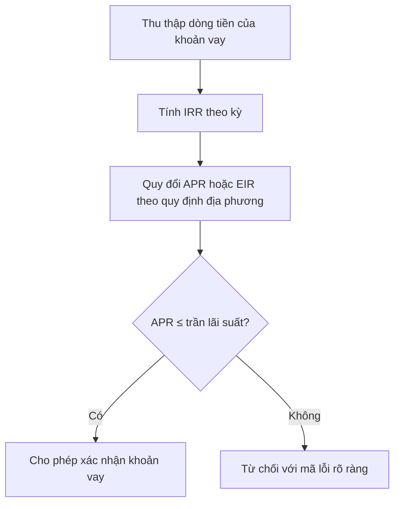
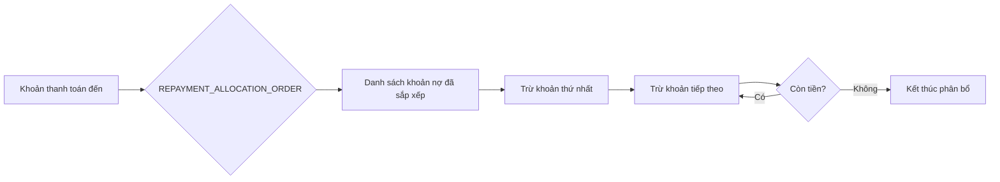
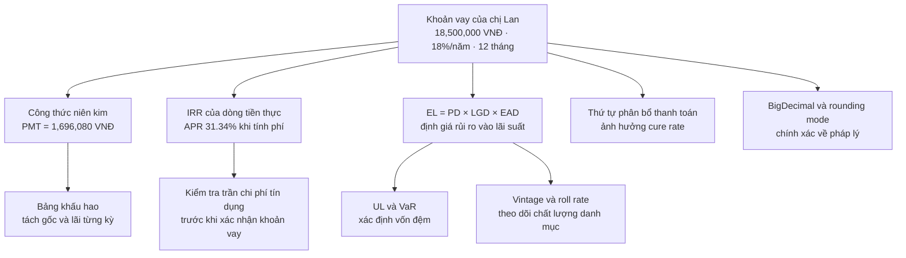

import {AmortizationFigure, LoanCalculator, CostOfCreditCalculator, TermComparison} from '@site/src/components/Loan';

> *"Toán học không quan tâm đến ý định của bạn. Nếu công thức sai, số tiền sai, dù bạn có thiện chí đến đâu."*
>
> *Nguyên tắc thiết kế hệ thống tài chính*

## Dẫn nhập: khi một đồng cũng quan trọng

::::story
Trong ngành ngân hàng, không hiếm những vụ một tổ chức tín dụng phải hoàn trả hàng trăm triệu đô la cho khách hàng vì một lỗi tính lãi kéo dài nhiều năm. Điểm chung của các vụ việc đó là lỗi hiếm khi đến từ ý đồ xấu. Thông thường, một công thức được hiện thực hóa sai, hoặc hệ thống lấy số dư cuối ngày trong khi hợp đồng quy định số dư đầu ngày. Sai số ở mỗi giao dịch rất nhỏ, nhưng nhân lên hàng triệu giao dịch trong nhiều năm thì thành một con số không thể bỏ qua.

Tài chính là một trong số ít lĩnh vực mà sai số làm tròn (rounding error) có thể đồng thời là vi phạm hợp đồng và vi phạm pháp luật.
::::

Chương này xây dựng nền tảng toán học để hiểu một hệ thống cho vay tính toán đúng như thế nào. Trọng tâm không chỉ là công thức, mà là vì sao lại dùng công thức đó, vì sao lại hiện thực hóa theo cách đó, và vì sao sai lệch dù rất nhỏ cũng không được chấp nhận.

Mỗi nhân vật sẽ tìm thấy câu trả lời của mình. Kỹ sư Tuấn sẽ hiểu vì sao phải dùng `BigDecimal` thay cho `double`. Chị Lan sẽ hiểu khoản trả hằng tháng của mình được tính ra sao. Anh Minh sẽ hiểu vì sao APR không bằng lãi suất ghi trên hợp đồng. Bà Hương sẽ hiểu vì sao tổn thất trung bình chưa đủ để quyết định lượng vốn cần giữ.

## 2.1 Niên kim: nền tảng của mọi tính toán trả góp

### Tình huống

::::story
Kỹ sư Tuấn được giao hiện thực hóa endpoint tính số tiền khách hàng phải trả hằng tháng. Đồng nghiệp cũ để lại đoạn code sau:

```java
public BigDecimal calculateMonthlyPayment(BigDecimal principal,
                                           double annualRate,
                                           int months) {
    return principal.divide(BigDecimal.valueOf(months), 2, HALF_UP);
}
```

Tuấn nhận ra ngay đoạn code này sai. Câu hỏi là sai ở đâu, và công thức đúng là gì.
::::

### Vấn đề

Đoạn code chia đều số tiền gốc cho số tháng và bỏ qua hoàn toàn lãi suất. Với khoản vay 18,500,000 VNĐ trong 12 tháng, kết quả là 1,541,667 VNĐ mỗi tháng. Đó chỉ là tiền gốc. Bên cho vay không thu được đồng lãi nào.

Một cách sửa thường gặp là cộng thêm lãi đơn (simple interest) tính trên số tiền gốc ban đầu:

```text
Lãi mỗi tháng = 18,500,000 × 18% / 12 = 277,500 VNĐ
Tổng trả mỗi tháng = 1,541,667 + 277,500 = 1,819,167 VNĐ
```

Cách này cũng sai, vì nó tính lãi trên toàn bộ số gốc ban đầu ở mọi tháng. Sau khi chị Lan trả kỳ đầu tiên, dư nợ thực tế đã giảm. Nếu tiếp tục tính lãi trên 18,500,000 VNĐ, chị đang trả lãi cho một khoản tiền mà mình đã hoàn trả.

:::key[Nguyên tắc]
Mỗi kỳ, lãi được tính trên dư nợ gốc còn lại tại đầu kỳ, không phải trên số gốc ban đầu.
:::

### Khái niệm: niên kim

:::key[Niên kim]
**Niên kim** (annuity) là chuỗi các khoản thanh toán bằng nhau, phát sinh đều đặn theo thời gian. Khi vay tiền và trả góp một số tiền cố định mỗi tháng, người vay đang thực hiện một niên kim.
:::

Lý do các khoản trả được thiết kế bằng nhau chủ yếu nằm ở hành vi con người chứ không phải kỹ thuật. Người vay dễ lập kế hoạch tài chính khi biết chính xác mỗi tháng phải trả bao nhiêu. Một khoản cố định cũng hạn chế tâm lý "tháng này trả ít, tháng sau trả bù", và giúp việc thu nợ tự động đơn giản hơn.

### Cơ chế: dẫn xuất công thức PMT

Gọi:

- $PV$ (present value) là số tiền vay ban đầu,
- $PMT$ (payment) là số tiền trả mỗi kỳ,
- $r$ là lãi suất mỗi kỳ; với khoản vay trả hằng tháng, $r = i / 12$, trong đó $i$ là lãi suất danh nghĩa năm,
- $n$ là số kỳ.

Điều kiện để khoản vay "công bằng" về mặt toán học là tổng giá trị hiện tại của tất cả các khoản trả phải bằng đúng số tiền vay. Khoản trả ở cuối kỳ thứ $k$ có giá trị hiện tại là $PMT / (1+r)^k$, nên:

$$
PV = \frac{PMT}{(1+r)} + \frac{PMT}{(1+r)^2} + \cdots + \frac{PMT}{(1+r)^n}
= PMT \cdot \frac{1 - (1+r)^{-n}}{r}
$$

Vế phải là tổng của một cấp số nhân với công bội $1/(1+r)$. Giải theo $PMT$:

:::key[Công thức khoản trả định kỳ]
$$
PMT = PV \cdot \frac{r\,(1+r)^n}{(1+r)^n - 1}
$$
:::

Đây là công thức của **niên kim cuối kỳ** (ordinary annuity): khoản trả phát sinh vào cuối mỗi kỳ. Phần lớn khoản vay tiêu dùng trả góp đều dùng công thức này.

### Ví dụ số: khoản vay của chị Lan

Chị Lan vay 18,500,000 VNĐ, lãi suất danh nghĩa 18%/năm, kỳ hạn 12 tháng, trả hằng tháng. Đây là dữ liệu mô phỏng, dùng xuyên suốt cuốn sách.

**Bước 1. Lãi suất kỳ.** $r = 18\% / 12 = 1.5\%$ mỗi tháng, tức $r = 0.015$.

**Bước 2. Hệ số tăng trưởng.** $(1 + 0.015)^{12}$ có thể tính bằng cách bình phương liên tiếp:

```text
(1.015)^2  = 1.030225
(1.015)^4  = 1.030225^2 = 1.061364
(1.015)^8  = 1.061364^2 = 1.126493
(1.015)^12 = (1.015)^8 × (1.015)^4 = 1.126493 × 1.061364 = 1.195618
```

**Bước 3. Áp dụng công thức.**

$$
PMT = 18{,}500{,}000 \times \frac{0.015 \times 1.195618}{1.195618 - 1}
= 18{,}500{,}000 \times \frac{0.017934}{0.195618}
\approx 18{,}500{,}000 \times 0.091680
$$

Kết quả chưa làm tròn là 1,696,079.87 VNĐ. Làm tròn đến đồng theo quy tắc HALF_UP, **PMT = 1,696,080 VNĐ/tháng**.

**Kiểm tra hợp lý.** Mười hai kỳ trả 1,696,080 VNĐ cho tổng cộng 20,352,960 VNĐ, tức tổng lãi xấp xỉ 1.85 triệu đồng, khoảng 10% số tiền vay. Con số này hợp lý: lãi mỗi kỳ bằng dư nợ đầu kỳ nhân 1.5%, và dư nợ giảm dần từ 18.5 triệu về 0. Dư nợ bình quân trong 12 tháng vì thế chỉ khoảng 10.3 triệu, và 10.3 triệu × 18% ≈ 1.85 triệu.

Bảng khấu hao ở mục sau cho tổng lãi chính xác là 1,852,957 VNĐ, ít hơn 3 đồng so với ước tính 12 × PMT, vì kỳ cuối được điều chỉnh làm tròn.

### Kỳ hạn dài hơn: khoản trả nhỏ hơn, tổng lãi lớn hơn

Nếu chị Lan chọn kỳ hạn 24 tháng với cùng lãi suất:

$$
(1.015)^{24} = 1.429503, \qquad
PMT = 18{,}500{,}000 \times \frac{0.015 \times 1.429503}{0.429503} \approx 923{,}596
$$

| Kỳ hạn | Trả hằng tháng | Tổng lãi theo bảng khấu hao |
|---|---|---|
| 12 tháng | 1,696,080 VNĐ | 1,852,957 VNĐ |
| 24 tháng | 923,596 VNĐ | 3,666,301 VNĐ |

Kéo dài kỳ hạn làm khoản trả hằng tháng giảm gần một nửa, nhưng tổng lãi tăng gần gấp đôi. Kinh tế học hành vi gọi hiện tượng người vay chỉ chú ý đến khoản trả hằng tháng mà bỏ qua tổng chi phí là "ảo giác về khoản trả" (payment size illusion). Chương 13 sẽ quay lại hiện tượng này khi bàn về thiết kế sản phẩm có trách nhiệm.

Bảng dưới đây mở rộng phép so sánh cho nhiều kỳ hạn. Có thể thay đổi số tiền và lãi suất để tự kiểm chứng.

<TermComparison />

### Bảng khấu hao

Công thức niên kim cho biết khoản trả mỗi kỳ, nhưng không cho biết trong khoản trả đó bao nhiêu là gốc, bao nhiêu là lãi. **Bảng khấu hao** (amortization schedule) trả lời câu hỏi này bằng ba quy tắc áp dụng lần lượt cho từng kỳ $t$. Gọi $B_t$ là dư nợ đầu kỳ, $I_t$ là phần lãi và $P_t$ là phần gốc của kỳ $t$:

$$
\begin{aligned}
I_t &= B_t \times r \\
P_t &= PMT - I_t \\
B_{t+1} &= B_t - P_t
\end{aligned}
$$

Áp dụng cho khoản vay của chị Lan, với lãi mỗi kỳ được làm tròn HALF_UP đến đồng:

| Kỳ | Dư nợ đầu kỳ | Lãi (1.5%) | Gốc | Số tiền trả | Dư nợ cuối kỳ |
|---:|---:|---:|---:|---:|---:|
| 1 | 18,500,000 | 277,500 | 1,418,580 | 1,696,080 | 17,081,420 |
| 2 | 17,081,420 | 256,221 | 1,439,859 | 1,696,080 | 15,641,561 |
| 3 | 15,641,561 | 234,623 | 1,461,457 | 1,696,080 | 14,180,104 |
| 4 | 14,180,104 | 212,702 | 1,483,378 | 1,696,080 | 12,696,726 |
| 5 | 12,696,726 | 190,451 | 1,505,629 | 1,696,080 | 11,191,097 |
| 6 | 11,191,097 | 167,866 | 1,528,214 | 1,696,080 | 9,662,883 |
| 7 | 9,662,883 | 144,943 | 1,551,137 | 1,696,080 | 8,111,746 |
| 8 | 8,111,746 | 121,676 | 1,574,404 | 1,696,080 | 6,537,342 |
| 9 | 6,537,342 | 98,060 | 1,598,020 | 1,696,080 | 4,939,322 |
| 10 | 4,939,322 | 74,090 | 1,621,990 | 1,696,080 | 3,317,332 |
| 11 | 3,317,332 | 49,760 | 1,646,320 | 1,696,080 | 1,671,012 |
| 12 | 1,671,012 | 25,065 | 1,671,012 | **1,696,077** | 0 |
| **Tổng** | | **1,852,957** | **18,500,000** | **20,352,957** | |

Kỳ 12 cần được giải thích. Nếu vẫn trả đúng 1,696,080 VNĐ, phần gốc sẽ là 1,671,015 VNĐ, lớn hơn dư nợ còn lại 3 đồng. Ba đồng chênh lệch này là sai số tích lũy từ việc làm tròn PMT và làm tròn lãi ở từng kỳ. Quy tắc xử lý là: kỳ cuối trả đúng toàn bộ dư nợ còn lại cộng lãi của kỳ đó, nên khoản trả kỳ cuối là 1,696,077 VNĐ và dư nợ khép lại ở đúng 0.

Tùy dữ liệu đầu vào, sai số ở kỳ cuối có thể dương hoặc âm, nhưng luôn chỉ vài đồng. Điều quan trọng là quy tắc xử lý phải được định nghĩa rõ ràng và áp dụng nhất quán, vì khách hàng, sao kê và hệ thống kế toán đều phải thấy cùng một con số.

<AmortizationFigure
  principal={18500000}
  annualRate={18}
  months={12}
  kind="split"
  title="Hình 2.1. Cơ cấu gốc và lãi trong từng kỳ trả, khoản vay của chị Lan"
  caption="Dữ liệu mô phỏng: 18,500,000 VNĐ, 18%/năm, 12 tháng, niên kim cuối kỳ. Phần lãi giảm dần và phần gốc tăng dần trong khi tổng khoản trả gần như không đổi. Số liệu được sinh từ cùng hàm tính với bảng 12 kỳ ở trên."
/>

Ba quan sát rút ra từ bảng và biểu đồ:

1. Ở kỳ 1, lãi chiếm 277,500 / 1,696,080 ≈ 16.4% khoản trả. Ở kỳ 12, tỷ lệ này chỉ còn 25,065 / 1,696,077 ≈ 1.5%.
2. Phần gốc trả mỗi kỳ tăng dần. Đây là đặc trưng của khoản vay khấu hao dần (amortizing loan).
3. Dư nợ không giảm tuyến tính. Nó giảm chậm ở đầu kỳ hạn và nhanh hơn về cuối, như Hình 2.2.

<AmortizationFigure
  principal={18500000}
  annualRate={18}
  months={12}
  kind="balance"
  title="Hình 2.2. Dư nợ gốc cuối mỗi kỳ, khoản vay của chị Lan"
  caption="Kỳ 0 là thời điểm giải ngân. Đường cong hơi lồi xuống vì phần gốc trả mỗi kỳ tăng dần."
/>

**Ý nghĩa kinh doanh.** Nếu chị Lan trả hết nợ ngay sau kỳ 3, chị chỉ còn nợ 14,180,104 VNĐ chứ không phải 18,500,000 VNĐ. Bên cho vay mất toàn bộ phần lãi của 9 kỳ còn lại mà họ đã dự tính khi định giá khoản vay. Đây là **rủi ro trả nợ trước hạn** (prepayment risk), một rủi ro quan trọng của cho vay tiêu dùng, và là lý do nhiều sản phẩm có phí trả nợ trước hạn. Chương 5 phân tích tác động của rủi ro này lên doanh thu danh mục.

### Hiện thực hóa: module LPS

Trong VLP, module LPS (Loan Pricing) tạo lịch trả nợ theo đúng các quy tắc trên, nhưng phải xử lý nhiều chi tiết hơn: biểu phí, kỳ khuyến mãi, ngày đến hạn thực tế. Đoạn code dưới đây được rút gọn để làm rõ thuật toán.

```java
// Code minh họa - không phải mã nguồn production
InstalmentPlanDto calculateInstalmentPlan(IPCalculationRequest request) {
    BigDecimal monthlyRate = request.getAnnualRate()
        .divide(TWELVE, 10, HALF_UP);            // (1) 10 chữ số thập phân cho giá trị trung gian

    BigDecimal factor = ONE.add(monthlyRate).pow(request.getTenor());

    BigDecimal pmt = request.getFinancedAmount()
        .multiply(monthlyRate).multiply(factor)
        .divide(factor.subtract(ONE), 0, HALF_UP); // (2) chỉ làm tròn về đồng ở bước cuối

    List<IPInstalmentDto> schedule = new ArrayList<>();
    BigDecimal balance = request.getFinancedAmount();

    for (int month = 1; month <= request.getTenor(); month++) {
        BigDecimal interest = balance.multiply(monthlyRate)
            .setScale(0, HALF_UP);                 // lãi kỳ làm tròn về đồng
        BigDecimal principal = pmt.subtract(interest);
        BigDecimal payment = pmt;

        if (month == request.getTenor()) {         // (3) kỳ cuối khép dư nợ về đúng 0
            principal = balance;
            payment = principal.add(interest);
        }

        schedule.add(new IPInstalmentDto(month, payment, principal, interest));
        balance = balance.subtract(principal);
    }
    return new InstalmentPlanDto(pmt, schedule);
}
```

Input là số tiền tài trợ (financed amount), lãi suất năm và kỳ hạn. Output là PMT và danh sách các kỳ, mỗi kỳ có tổng tiền, phần gốc và phần lãi. Ba quyết định thiết kế đáng chú ý:

1. Lãi suất kỳ được giữ 10 chữ số thập phân. Nếu làm tròn lãi suất tháng sớm, sai số sẽ bị khuếch đại qua phép lũy thừa $(1+r)^n$.
2. Chỉ làm tròn về đồng ở bước tạo ra con số mà khách hàng nhìn thấy: PMT và lãi từng kỳ. Mục 2.5 giải thích vì sao.
3. Kỳ cuối dùng một biến `payment` riêng để trả hết dư nợ. Không gán đè `pmt`, vì `pmt` là khoản trả định kỳ đã cam kết với khách hàng và còn được dùng ở nơi khác.

### Niên kim cuối kỳ và niên kim đầu kỳ

Công thức ở trên áp dụng cho niên kim cuối kỳ: khoản trả phát sinh vào cuối mỗi kỳ. Với **niên kim đầu kỳ** (annuity due), khoản trả phát sinh vào đầu mỗi kỳ, nên mỗi khoản được chiết khấu ít hơn một kỳ:

$$
PMT_{due} = \frac{PMT_{ordinary}}{1 + r}
$$

Với khoản vay của chị Lan, nếu trả vào đầu kỳ thì khoản trả là 1,696,079.87 / 1.015 ≈ 1,671,015 VNĐ. Phần lớn khoản vay tiêu dùng ở Việt Nam là niên kim cuối kỳ, nhưng một số sản phẩm thu một khoản ngay từ đầu kỳ. Nhầm lẫn giữa hai loại là nguồn gốc của nhiều lỗi tính toán.

Có thể tự kiểm chứng toàn bộ mục này bằng công cụ dưới đây. Giá trị mặc định là khoản vay của chị Lan.

<LoanCalculator />

:::summary[Mục 2.1]
Khoản trả định kỳ của một khoản vay trả góp được tính bằng công thức niên kim $PMT = PV \cdot r(1+r)^n / ((1+r)^n - 1)$. Lãi mỗi kỳ bằng dư nợ đầu kỳ nhân lãi suất kỳ, phần còn lại của khoản trả là gốc, nên lãi giảm dần và gốc tăng dần. Kỳ hạn dài hơn làm khoản trả nhỏ hơn nhưng tổng lãi lớn hơn. Kỳ cuối được điều chỉnh để dư nợ về đúng 0.
:::

## 2.2 IRR, APR và EIR: "lãi suất thật" là gì?

### Tình huống

::::story
Hợp đồng của chị Lan ghi lãi suất 18%/năm. Nhưng hợp đồng còn hai khoản phí:

- phí thẩm định 200,000 VNĐ, thu một lần và trừ thẳng vào số tiền giải ngân,
- phí bảo hiểm khoản vay 100,000 VNĐ mỗi tháng, trả cùng kỳ góp.

Thực tế, chị Lan chỉ nhận về 18,300,000 VNĐ, nhưng mỗi tháng phải trả 1,696,080 + 100,000 = 1,796,080 VNĐ. Chi phí thực sự của khoản vay này có còn là 18%/năm không?
::::

### Vấn đề với lãi suất danh nghĩa

Con số 18%/năm trên hợp đồng là **lãi suất danh nghĩa** (nominal interest rate). Nó chỉ phản ánh chi phí sử dụng tiền gốc và không bao gồm các khoản phí. Đây là lý do khách hàng thường bất ngờ khi nhận ra tổng chi phí cao hơn nhiều so với con số họ nhìn thấy.

Vì vậy, quy định ở nhiều quốc gia yêu cầu bên cho vay công bố một chỉ số phản ánh toàn bộ chi phí vay, thường là **APR** hoặc **EIR**. Cả hai đều được xây dựng từ cùng một đại lượng: IRR.

### Tỷ suất hoàn vốn nội bộ

:::key[IRR]
**IRR** (internal rate of return, tỷ suất hoàn vốn nội bộ) là mức lãi suất làm cho tổng giá trị hiện tại của mọi dòng tiền bằng 0. Trong bối cảnh khoản vay, IRR là lãi suất kỳ mà người vay thực sự chịu khi tính đến **tất cả** dòng tiền: số tiền thực nhận, khoản trả góp, phí, bảo hiểm.
:::

$$
0 = CF_0 + \frac{CF_1}{1+IRR} + \frac{CF_2}{(1+IRR)^2} + \cdots + \frac{CF_n}{(1+IRR)^n}
$$

Trong đó $CF_0$ là số tiền người vay thực nhận tại thời điểm giải ngân (mang dấu dương với người vay), $CF_1, \ldots, CF_n$ là các khoản phải trả ở từng kỳ (mang dấu âm). IRR không có công thức nghiệm đóng; nó phải được tìm bằng phương pháp lặp như thử và điều chỉnh, chia đôi khoảng (bisection) hay Newton-Raphson.

### Ví dụ số: chi phí thực của khoản vay chị Lan

Dòng tiền từ phía chị Lan:

```text
CF_0          = +18,300,000   (18,500,000 trừ 200,000 phí thẩm định)
CF_1 ... CF_11 = -1,796,080   (1,696,080 gốc và lãi + 100,000 bảo hiểm)
CF_12         = -1,796,077   (kỳ cuối đã điều chỉnh làm tròn)
```

Ta tìm lãi suất tháng $i$ sao cho giá trị hiện tại của 12 khoản trả đúng bằng 18,300,000 VNĐ. Lãi suất chiết khấu càng cao thì giá trị hiện tại càng nhỏ, nên có thể dò dần:

| Lãi suất tháng thử | Giá trị hiện tại của 12 khoản trả | So với 18,300,000 |
|---:|---:|---|
| 1.9% | 19,111,336 | lớn hơn, cần tăng lãi suất |
| 2.1% | 18,878,030 | lớn hơn, cần tăng lãi suất |
| 2.5% | 18,423,766 | lớn hơn, cần tăng lãi suất |
| 2.6% | 18,312,708 | lớn hơn một chút |
| 2.7% | 18,202,631 | nhỏ hơn, đã vượt |

Nghiệm nằm giữa 2.6% và 2.7%. Giải chính xác bằng phương pháp chia đôi cho **IRR ≈ 2.611%/tháng**.

:::caution[Sai một hệ số, lệch cả kết luận]
Khi tính tay, chỉ cần một hệ số chiết khấu sai ở chữ số thứ tư, ví dụ ghi $(1.019)^{-12}$ là 0.79685 thay vì 0.79783, nghiệm có thể trượt xuống khoảng 2.15%/tháng, tức APR chỉ còn 25.8%. Đó là lý do LPS giải IRR bằng thuật toán số và kiểm tra lại bằng cách thay nghiệm ngược vào phương trình NPV.
:::

### APR, EIR và lãi suất danh nghĩa

Ba khái niệm này thường bị dùng lẫn lộn, kể cả trong ngành.

**Lãi suất danh nghĩa** (nominal rate) là con số trên hợp đồng. Nó chỉ phản ánh chi phí lãi thuần và không bao gồm phí.

**APR** (annual percentage rate) quy IRR theo kỳ về năm bằng phép nhân đơn giản, không tính lãi kép giữa các kỳ. Ký hiệu $IRR_m$ là IRR theo tháng:

$$
APR = IRR_m \times 12
$$

**EIR** (effective interest rate, lãi suất thực tế) quy IRR về năm có tính lãi kép, phản ánh chi phí thực nếu dòng tiền được tái đầu tư ở cùng mức lãi suất:

$$
EIR = (1 + IRR_m)^{12} - 1
$$

Áp dụng cho khoản vay của chị Lan:

| Chỉ số | Không có phí | Chỉ có phí thẩm định | Có phí thẩm định và bảo hiểm |
|---|---:|---:|---:|
| Lãi suất danh nghĩa | 18.00%/năm | 18.00%/năm | 18.00%/năm |
| IRR tháng | 1.500% | 1.675% | 2.611% |
| APR | 18.00% | 20.10% | 31.34% |
| EIR | 19.56% | 22.06% | 36.25% |

Cột đầu tiên cho thấy một điểm thường bị bỏ qua: ngay cả khi không có phí, EIR vẫn cao hơn lãi suất danh nghĩa (19.56% so với 18%), vì lãi được ghép theo tháng. Cột thứ hai và thứ ba cho thấy phí bảo hiểm 100,000 VNĐ/tháng, nghe có vẻ nhỏ, chiếm khoảng 6.5% số tiền vay mỗi năm và đẩy APR từ khoảng 20% lên hơn 31%.

### Vì sao đây là vấn đề pháp lý

Giả sử quy định có hiệu lực giới hạn APR ở mức 20%/năm. Khoản vay của chị Lan, với APR 31.34%, vi phạm quy định đó dù lãi suất danh nghĩa chỉ là 18%. Ngay cả khi bỏ phí bảo hiểm, APR 20.10% vẫn vượt trần.

Ví dụ này cho thấy ba yêu cầu đối với hệ thống:

1. APR phải được tính và kiểm tra trước khi khoản vay được xác nhận, không phải sau đó.
2. Kiểm tra lãi suất danh nghĩa là không đủ.
3. Mọi khoản phí bắt buộc phải được đưa vào dòng tiền dùng để tính APR.

Mức trần 20% ở đây là giả định để minh họa. Trần lãi suất thực tế và cách tính chi phí tín dụng phụ thuộc quy định của từng thị trường; Phụ lục D tóm tắt khung pháp lý tại Việt Nam.

### Hiện thực hóa: kiểm tra trần chi phí tín dụng

:::info[Phạm vi của VLP]
Trong VLP, module LPS tính XIRR và EIR, nhưng việc chặn khoản vay vượt trần lãi suất chưa được hiện thực hóa: không có class `RateCapValidator` hay mã lỗi `APR_EXCEEDS_RATE_CAP`. Luồng dưới đây là thiết kế khuyến nghị theo thông lệ ngành, không phải hành vi hiện tại của hệ thống.
:::



Dòng tiền cần thu thập gồm số tiền thực nhận sau các khoản phí một lần, các khoản trả định kỳ kể cả phí định kỳ, và mọi khoản phí phát sinh ở cuối kỳ. Trong một hệ thống tuân thủ, bước kiểm tra này là điểm chặn bắt buộc (hard stop) của quy trình khởi tạo khoản vay, không phải một tính năng tùy chọn.

Công cụ dưới đây tính IRR, APR và EIR cho bất kỳ tổ hợp lãi suất và phí nào. Giá trị mặc định là khoản vay của chị Lan.

<CostOfCreditCalculator />

:::summary[Mục 2.2]
Lãi suất danh nghĩa không phản ánh phí. IRR là lãi suất kỳ làm giá trị hiện tại của mọi dòng tiền bằng 0. APR bằng IRR tháng nhân 12; EIR bằng $(1+IRR)^{12} - 1$. Với khoản vay của chị Lan, phí thẩm định và phí bảo hiểm đẩy APR từ 18% lên 31.34%. Việc kiểm tra trần chi phí tín dụng là thiết kế khuyến nghị và chưa có trong VLP.
:::

## 2.3 Mô hình rủi ro tín dụng định lượng

### Từ tổn thất dự kiến đến vốn đệm

Chương 1 đã giới thiệu công thức tổn thất dự kiến $EL = PD \times LGD \times EAD$. Mục này đi sâu hơn một bước: EL chỉ là giá trị **trung bình** của tổn thất. Tổn thất thực tế trong một năm cụ thể có thể thấp hơn hoặc cao hơn nhiều.

::::story
Bà Hương nhận được báo cáo: tổn thất dự kiến của danh mục năm nay là 45 tỷ VNĐ. Bà hỏi trưởng phòng quản trị rủi ro liệu trích lập 45 tỷ có đủ không. Câu trả lời là không. 45 tỷ là con số trung bình. Năm nay tổn thất có thể là 30 tỷ nếu may mắn, hoặc 80 tỷ nếu kinh tế suy giảm. Công ty cần đủ vốn để đứng vững trong kịch bản xấu.
::::

### Tổn thất dự kiến và tổn thất ngoài dự kiến

**Tổn thất dự kiến** (expected loss, EL) là mức tổn thất trung bình, có thể ước lượng được và có thể định giá vào lãi suất thông qua phần bù rủi ro.

**Tổn thất ngoài dự kiến** (unexpected loss, UL) là phần tổn thất vượt quá EL trong các kịch bản xấu. UL không thể định giá vào lãi suất, vì nếu làm vậy sản phẩm sẽ quá đắt; nó phải được hấp thụ bởi vốn chủ sở hữu.

| Thành phần | Bù đắp bằng |
|---|---|
| Tổn thất dự kiến (EL) | Lãi suất, cụ thể là phần bù rủi ro tín dụng |
| Tổn thất ngoài dự kiến (UL) | Vốn chủ sở hữu, đóng vai trò vốn đệm (capital buffer) |

**VaR** (value at risk) ở mức tin cậy 99% là mức tổn thất mà trong 99% kịch bản, tổn thất thực tế không vượt quá. Vốn đệm cần thiết $C$ xấp xỉ khoảng cách giữa VaR và EL:

$$
C \approx VaR_{99\%} - EL
$$

**Ví dụ số.** Danh mục gồm 100,000 khoản vay, mỗi khoản 15 triệu đồng, PD = 5%, LGD = 60%.

```text
EAD tổng = 100,000 × 15,000,000           = 1,500 tỷ VNĐ
EL       = 5% × 60% × 1,500 tỷ            = 45 tỷ VNĐ
```

Giả sử, để đơn giản hóa, tổn thất phân phối chuẩn với độ lệch chuẩn khoảng 12 tỷ đồng (ước lượng từ biến động của PD qua các năm). Với phân phối chuẩn, mức tin cậy 99% một phía tương ứng 2.33 độ lệch chuẩn:

```text
VaR 99%  ≈ EL + 2.33 × σ = 45 + 2.33 × 12 = 72.96 tỷ VNĐ
Vốn đệm  ≈ 72.96 - 45                    = 27.96 tỷ VNĐ
```

Nếu bà Hương chỉ dự phòng 45 tỷ và năm xấu tổn thất lên tới 72 tỷ, công ty thiếu khoảng 27 tỷ và có thể mất khả năng thanh toán. Trong thực tế, phân phối tổn thất tín dụng lệch phải với đuôi dày hơn phân phối chuẩn, nên giả định phân phối chuẩn có xu hướng đánh giá thấp VaR. Ví dụ này chỉ minh họa logic.

### Phân tích vintage

::::story
Anh Minh cần báo cáo với hội đồng quản trị về hiệu quả của sản phẩm vay dành cho giáo viên, ra mắt tháng 1/2024. Câu hỏi nghe đơn giản nhưng không dễ trả lời: một khoản vay 36 tháng mới chạy được 12 tháng thì đánh giá như thế nào?
::::

:::key[Vintage]
Một **vintage** là nhóm các khoản vay được giải ngân trong cùng một khoảng thời gian, thường là một tháng hoặc một quý. **Phân tích vintage** theo dõi hiệu suất của từng nhóm theo "tuổi" của khoản vay, tức số tháng kể từ khi giải ngân.
:::

Lý do không thể chỉ nhìn tỷ lệ vỡ nợ tổng thể là vì nó trộn lẫn các vintage có tuổi khác nhau. Một vintage tốt năm 2022 có thể che khuất một vintage xấu năm 2024, đơn giản vì vintage mới chưa đủ thời gian để bộc lộ vấn đề.

```text
Tỷ lệ vỡ nợ tích lũy (minh họa)
    │
10% │                          ....vintage_2022
    │                    .....
 8% │              ......              vintage_2023
    │        .......         .........
 6% │  .......        ......
    │..                          .......vintage_2024
 4% │              ...........
    │    ..........
 2% │....
    └───────────────────────────────────→ Tháng kể từ giải ngân
        3   6   9   12  15  18  21  24
```

Cách đọc biểu đồ: vintage 2022 có tỷ lệ vỡ nợ tích lũy 10% sau 24 tháng; vintage 2023 là 8%, tốt hơn, có thể nhờ mô hình chấm điểm được cải thiện; vintage 2024 mới 6 tháng tuổi với tỷ lệ 2%, chưa đủ dữ liệu để kết luận.

Hành vi trong 1 đến 3 tháng đầu của một vintage thường là chỉ báo sớm tốt cho hiệu suất dài hạn. Nếu vintage 2024 đã có tỷ lệ 3% ở tháng thứ 3, trong khi vintage 2023 cùng tuổi chỉ có 1.5%, cần điều tra ngay mà không chờ thêm dữ liệu.

### Roll rate

**Roll rate** (tỷ lệ chuyển nhóm) là xác suất một tài khoản chuyển từ nhóm số ngày quá hạn (DPD bucket) này sang nhóm khác sau một tháng. Các nhóm thường dùng:

| Nhóm | Số ngày quá hạn (DPD) |
|---|---|
| Current | 0, trả đúng hạn |
| Bucket 1 | 1 đến 30 |
| Bucket 2 | 31 đến 60 |
| Bucket 3 | 61 đến 90 |
| Bucket 4 | trên 90, thường được xem là vỡ nợ |

Ma trận roll rate minh họa, mỗi hàng là trạng thái tháng này, mỗi cột là trạng thái tháng sau, tổng mỗi hàng bằng 100%:

| Từ \ Đến | Current | 1–30 | 31–60 | 61–90 | 91+ |
|---|---:|---:|---:|---:|---:|
| **Current** | 94% | 6% | 0% | 0% | 0% |
| **1–30** | 40% | 20% | 40% | 0% | 0% |
| **31–60** | 15% | 10% | 15% | 60% | 0% |
| **61–90** | 5% | 5% | 10% | 15% | 65% |
| **91+** | 2% | 1% | 2% | 5% | 90% |

Đọc theo hàng: mỗi tháng 6% tài khoản đang đúng hạn trở thành quá hạn lần đầu; 40% tài khoản ở Bucket 1 tự quay về đúng hạn (self-cure); 65% tài khoản ở Bucket 3 chuyển sang nhóm trên 90 ngày, gần như chắc chắn trở thành tổn thất.

**Trong VLP**, module DRG (Debt Register) theo dõi DPD dựa trên luồng sự kiện từ module LAS qua Kafka (topic `transaction.confirmed`) và một batch job chạy hằng ngày. Phân tích roll rate thường được tính theo batch từ dữ liệu của DRG, không phải theo thời gian thực. Khi roll rate từ Bucket 1 sang Bucket 2 tăng đột biến, ví dụ từ 40% lên 55%, đó là tín hiệu cảnh báo sớm về chất lượng danh mục, thường xuất hiện 2 đến 3 tháng trước khi tỷ lệ vỡ nợ chính thức tăng. Chương 10 mô tả kiến trúc của DRG.

:::summary[Mục 2.3]
EL là tổn thất trung bình và được định giá vào lãi suất; UL là tổn thất vượt trung bình trong kịch bản xấu và phải được vốn chủ sở hữu hấp thụ. VaR 99% cho biết mức tổn thất không bị vượt quá trong 99% kịch bản. Phân tích vintage so sánh các nhóm khoản vay cùng tuổi; roll rate là chỉ báo sớm về chất lượng danh mục.
:::

## 2.4 Thiết kế cơ chế: khi toán học gặp kinh tế học

### Tình huống

::::story
Bộ phận thu hồi nợ gửi yêu cầu cho anh Minh: "Hiện hệ thống dùng tiền khách trả để trừ phí phạt trước, rồi mới đến gốc. Chúng tôi muốn đổi lại: gốc trước, phí phạt sau."

Nhìn bề ngoài, đây là một thay đổi cấu hình đơn giản. Thực ra, đó là một bài toán **thiết kế cơ chế** với hệ quả kinh tế đáng kể.
::::

### Cơ chế khuyến khích trong tín dụng

:::key[Thiết kế cơ chế]
**Thiết kế cơ chế** (mechanism design) là nhánh kinh tế học nghiên cứu cách xây dựng luật chơi để đạt kết quả mong muốn khi mỗi bên tham gia hành động theo lợi ích riêng.
:::

Trong tín dụng tiêu dùng, một "luật chơi" quan trọng là **thứ tự phân bổ thanh toán**: khi khách hàng trả không đủ toàn bộ số nợ đến hạn, số tiền đó được dùng để trừ khoản nào trước. Ví dụ khách hàng trả 500,000 VNĐ trong khi đang nợ 800,000 VNĐ gồm gốc, lãi và phí phạt.

**Cách A: phí phạt trước, gốc sau.** Thứ tự là phí phạt, lãi, rồi gốc. Cách này có lợi cho bên cho vay trong ngắn hạn: phí phạt được thu ngay, và dư nợ gốc còn cao nên lãi tương lai vẫn lớn. Nhưng gốc giảm rất chậm, khách hàng dễ rơi vào vòng nợ, và mất động lực trả vì cảm thấy "trả bao nhiêu cũng không thoát được". Một số người chọn ngừng trả hẳn. Đây là biểu hiện của rủi ro đạo đức đã bàn ở Chương 1.

**Cách B: gốc trước, phí phạt sau.** Thứ tự là lãi, gốc, rồi phí phạt. Gốc giảm nhanh hơn, khách hàng thấy được lối ra, và tỷ lệ tài khoản quá hạn tự quay về đúng hạn (cure rate) cao hơn. Đổi lại, phí phạt có thể không bao giờ thu được nếu tài khoản vỡ nợ.

### Ví dụ số: so sánh hai cơ chế

Bà Hương có dữ liệu lịch sử của 10,000 tài khoản đang quá hạn 30 đến 60 ngày, dư nợ bình quân 8 triệu đồng, LGD 60%:

- với cách A, 35% tài khoản tự phục hồi,
- với cách B, 52% tài khoản tự phục hồi,
- phí phạt bình quân không thu được ở cách B là 500,000 VNĐ mỗi tài khoản vỡ nợ.

```text
Cách A:  6,500 tài khoản vỡ nợ × 8,000,000 × 60% = 31.20 tỷ VNĐ tổn thất
Cách B:  4,800 tài khoản vỡ nợ × 8,000,000 × 60% = 23.04 tỷ VNĐ tổn thất
         Phí phạt không thu được: 4,800 × 500,000  =  2.40 tỷ VNĐ

Lợi ích ròng của cách B = 31.20 - 23.04 - 2.40   =  5.76 tỷ VNĐ
```

Cơ chế tưởng như bất lợi cho bên cho vay lại có lợi hơn về kinh tế, vì nó tạo ra động lực trả nợ phù hợp cho khách hàng. Các tỷ lệ phục hồi ở đây là số liệu minh họa; trong thực tế, chúng phải được đo bằng thử nghiệm có kiểm soát trước khi thay đổi cơ chế cho toàn bộ danh mục.

### Hiện thực hóa: tham số `REPAYMENT_ALLOCATION_ORDER`

Trong VLP, thứ tự phân bổ thanh toán được quyết định bởi tham số `REPAYMENT_ALLOCATION_ORDER`. Giá trị của tham số được lưu trong bảng `GLOBAL_PARAMETER` của cơ sở dữ liệu, không viết cứng trong code. LAS hỗ trợ năm chế độ:

```text
// verified: 5 chế độ được xác nhận trong tài liệu kỹ thuật của module LAS
PRIORITY_ONLY                      Sắp xếp theo độ ưu tiên trong biểu phí
DUE_DATE_AND_PRIORITY              Khoản đến hạn trước được trừ trước, sau đó theo độ ưu tiên
DUE_DATE_IP_GROUP_PRIORITY         Theo ngày đến hạn và độ ưu tiên của nhóm instalment plan
IP_INTEREST_RANK                   Ưu tiên khoản có lãi suất cao hơn
DUE_DATE_AND_PRIORITY_NONZERO_DPD  Ưu tiên khoản quá hạn khi DPD > 0
```



Mỗi chế độ trả lời câu hỏi "khoản nợ nào được trừ trước" theo một cách khác nhau:

| Chế độ | Khoản được trừ trước | Đặc điểm |
|---|---|---|
| `PRIORITY_ONLY` | Khoản có độ ưu tiên cao nhất trong biểu phí, bỏ qua ngày đến hạn | Kết quả phụ thuộc hoàn toàn vào cách cấu hình độ ưu tiên |
| `DUE_DATE_AND_PRIORITY` | Khoản đến hạn sớm nhất, cùng ngày thì theo độ ưu tiên | "Nợ cũ trả trước", dễ giải thích với khách hàng |
| `IP_INTEREST_RANK` | Kế hoạch trả góp có lãi suất cao nhất | Giảm nhanh khoản nợ đắt nhất |

:::key[Tên chế độ không nói lên kết quả]
Nhìn tên, `PRIORITY_ONLY` có vẻ là chế độ "ưu tiên trả gốc". Nhưng với biểu phí đang cấu hình trong VLP, phí phạt có độ ưu tiên cao nhất, nên chế độ này thực chất trừ phí phạt trước. Với một khoản thanh toán không đủ, cả `PRIORITY_ONLY` lẫn `DUE_DATE_AND_PRIORITY` đều không đưa tài khoản về trạng thái đúng hạn; khác biệt thực sự nằm ở thời điểm ghi nhận doanh thu. [Chương 8](/docs/system/ch08-account-management) phân tích chi tiết hai chế độ này.
:::

Kết quả kinh tế của một chế độ phân bổ không nằm ở tên của nó, mà ở thứ tự ưu tiên được cấu hình trong biểu phí và ở hành vi trả nợ của khách hàng khi thấy dư nợ của mình thay đổi.

Lựa chọn chế độ ảnh hưởng trực tiếp đến tổn thất thực tế (qua cure rate), đến hành vi khách hàng (qua động lực trả nợ), và đến tuân thủ pháp luật, vì một số thị trường quy định thứ tự ưu tiên khi phân bổ thanh toán. Vì vậy, đây là quyết định kinh doanh, được hiện thực hóa thành cấu hình kỹ thuật, chứ không phải quyết định của kỹ sư.

:::summary[Mục 2.4]
Thứ tự phân bổ thanh toán là một cơ chế khuyến khích. Cơ chế có vẻ bất lợi cho bên cho vay, như ưu tiên trừ gốc, có thể mang lại giá trị kinh tế ròng cao hơn nhờ tăng cure rate. Trong VLP, quyết định này được cấu hình qua `REPAYMENT_ALLOCATION_ORDER` với năm chế độ.
:::

## 2.5 Tại sao tài chính không dùng số thực dấu phẩy động

### Tình huống

::::story
Kỹ sư Tuấn đang review code của một đồng nghiệp mới:

```java
double principal = 18500000.0;
double rate = 0.015;
double payment = principal * rate * Math.pow(1 + rate, 12)
                / (Math.pow(1 + rate, 12) - 1);
System.out.println("Monthly payment: " + payment);
// Output: Monthly payment: 1696079.8687652452

long charged = (long) payment;   // 1,696,079
```

Phép tính cho kết quả gần đúng, nhưng dòng cuối cắt bỏ phần thập phân thay vì làm tròn, nên khoản trả bị ghi nhận là 1,696,079 VNĐ thay vì 1,696,080 VNĐ như hợp đồng. Đồng nghiệp cho rằng lệch một đồng thì không ai quan tâm. Tuấn từ chối merge. Lý do không chỉ nằm ở một đồng.
::::

:::note[Một đồng đi đâu]
Giá trị chính xác của biểu thức trên là 1,696,079.8687... Ép kiểu `(long)` cắt bỏ phần thập phân thay vì làm tròn, nên hệ thống mất gần trọn một đồng. Sai số biểu diễn của `double` ở mức này còn nhỏ hơn nhiều; vấn đề chính là thiếu một quy tắc làm tròn được khai báo rõ ràng. Hai vấn đề này cộng lại mới là nguồn gốc của các khoản chênh lệch khi đối soát.
:::

### Vấn đề của số thực dấu phẩy động

Máy tính lưu số thực dấu phẩy động (floating point) theo chuẩn IEEE 754, ở hệ nhị phân. Phần lớn số thập phân không thể biểu diễn chính xác trong hệ nhị phân, giống như 1/3 không thể viết chính xác trong hệ thập phân.

```java
System.out.println(0.1 + 0.2);         // 0.30000000000000004
System.out.println(0.1 + 0.2 == 0.3);  // false
```

Với một phép tính đơn lẻ, sai số này cực nhỏ: kiểu `double` có khoảng 15 đến 16 chữ số có nghĩa, nên với số tiền cỡ chục triệu đồng, sai số mỗi phép tính chỉ ở mức một phần tỷ đồng. Vấn đề nằm ở ba chỗ khác.

**So sánh không đáng tin cậy.** Hai hệ thống tính cùng một khoản tiền theo thứ tự phép tính khác nhau có thể cho ra hai giá trị `double` khác nhau ở chữ số cuối, và phép so sánh bằng sẽ thất bại. Trong đối soát (reconciliation) giữa các hệ thống, điều diễn ra hằng ngày trong một công ty tài chính, những chênh lệch kiểu này tạo ra hàng trăm giờ điều tra.

**Cộng dồn không cho kết quả mong đợi.** Cộng mười lần 0.1 không ra 1.0:

```java
double total = 0.0;
for (int i = 0; i < 10; i++) {
    total += 0.1;
}
System.out.println(total);  // 0.9999999999999999
```

Tương tự, cộng lãi phát sinh hằng ngày trong 30 ngày bằng `double` không đảm bảo ra đúng lãi của tháng.

**Làm tròn ở giá trị biên bị sai.** Đây là vấn đề nghiêm trọng nhất. Số 1.005 không biểu diễn được chính xác; giá trị thực sự được lưu là 1.00499999999999989... Khi làm tròn HALF_UP về hai chữ số thập phân, kết quả là 1.00 thay vì 1.01:

```java
new BigDecimal(1.005).setScale(2, RoundingMode.HALF_UP);    // 1.00  (từ double)
new BigDecimal("1.005").setScale(2, RoundingMode.HALF_UP);  // 1.01  (từ chuỗi thập phân)
```

Một sai lệch vô cùng nhỏ đã đổi hướng làm tròn và tạo ra chênh lệch cả một đơn vị. Trong một hệ thống tính lãi cho hàng triệu tài khoản, các trường hợp biên như vậy chắc chắn xảy ra, và mỗi trường hợp là một khoản thu sai so với hợp đồng.

### Giải pháp: `BigDecimal`

`BigDecimal` trong Java, và các kiểu tương đương như `decimal` trong C# hay `NUMERIC` trong PostgreSQL, lưu số thập phân với độ chính xác tùy chọn và không có sai số biểu diễn như số dấu phẩy động:

```java
BigDecimal a = new BigDecimal("0.1");
BigDecimal b = new BigDecimal("0.2");
System.out.println(a.add(b));  // 0.3
```

Lưu ý luôn khởi tạo `BigDecimal` từ chuỗi (`new BigDecimal("0.1")`) hoặc từ `BigDecimal.valueOf(...)`, không từ một giá trị `double`, vì `new BigDecimal(0.1)` mang theo nguyên vẹn sai số nhị phân của `double`.

### Rounding mode và ý nghĩa pháp lý

| Chế độ | Quy tắc | Ví dụ, làm tròn về số nguyên | Thường dùng khi |
|---|---|---|---|
| `HALF_UP` | Từ .5 trở lên làm tròn lên | 1.5 → 2, 1.4 → 1 | Phổ biến nhất, "làm tròn thông thường" |
| `HALF_EVEN` | Đúng .5 thì về số chẵn gần nhất | 1.5 → 2, 2.5 → 2 | Giảm thiên lệch tích lũy (banker's rounding) |
| `UP` | Luôn ra xa số 0 | 1.1 → 2, −1.1 → −2 | Phí, để không bao giờ thu thiếu |
| `DOWN` | Luôn về phía số 0 | 1.9 → 1, −1.9 → −1 | Lãi trả cho khách, để không trả thừa |
| `CEILING` | Về phía dương vô cùng | 1.1 → 2, −1.9 → −1 | Ít dùng |
| `FLOOR` | Về phía âm vô cùng | 1.9 → 1, −1.1 → −2 | Ít dùng |

Lựa chọn rounding mode là vấn đề pháp lý vì nó quyết định số tiền khách hàng phải trả. Giả sử 1,000,000 tài khoản, mỗi tháng phép tính lãi cho ra 12,345.678 VNĐ:

```text
HALF_UP → 12,346 VNĐ
DOWN    → 12,345 VNĐ

Chênh lệch: 1 VNĐ × 1,000,000 tài khoản × 12 tháng = 12,000,000 VNĐ mỗi năm
```

Nếu hợp đồng quy định một cách làm tròn mà hệ thống dùng cách khác, đó là vi phạm hợp đồng, dù chỉ một đồng mỗi giao dịch.

### Độ chính xác của giá trị trung gian

Làm tròn quá sớm cũng nguy hiểm như không làm tròn:

```java
// Sai: làm tròn lãi suất tháng còn 2 chữ số thập phân
BigDecimal monthlyRate = annualRate.divide(TWELVE, 2, HALF_UP);   // 0.18/12 = 0.015 thành 0.02: sai lệch 33%
BigDecimal factor = ONE.add(monthlyRate).pow(n);

// Đúng: giữ độ chính xác cao cho giá trị trung gian
BigDecimal monthlyRate = annualRate.divide(TWELVE, 10, HALF_UP);  // 10 chữ số thập phân
BigDecimal factor = ONE.add(monthlyRate).pow(n);
// Chỉ làm tròn ở bước tạo ra con số khách hàng nhìn thấy
BigDecimal result = /* ... */ .setScale(0, HALF_UP);
```

:::key[Nguyên tắc làm tròn]
Giữ độ chính xác cao trong suốt quá trình tính toán, và chỉ làm tròn đúng một lần ở bước tạo ra số tiền được ghi nhận, theo đúng rounding mode mà hợp đồng quy định.
:::

### Hiện thực hóa: lớp `Money` trong VLP

Trong VLP, mọi tính toán tài chính bắt buộc dùng `BigDecimal`. Ngoài ra, hệ thống bọc giá trị tiền trong lớp `Money`, một `@Embeddable` gồm `BigDecimal` và mã tiền tệ, để không bao giờ cộng nhầm hai số tiền khác loại tiền:

```java
// verified: Money.java (com.vela.lending.las.entity.container.Money)
@Embeddable
@NoArgsConstructor
public class Money implements Serializable, Comparable<Money> {
    private BigDecimal value;
    private String currency;

    // Factory methods
    public static Money of(BigDecimal value, String currency) { ... }
    public static Money zero(String currency) { ... }

    // Arithmetic
    public Money add(Money other) { ... }
    public Money subtract(Money other) { ... }
    public Money multiply(BigDecimal factor) { ... }

    // Comparisons
    public boolean isZero() { ... }
    public boolean isPositive() { ... }
}
```

Ví dụ sử dụng, dựa trên entity `CurrentBalance` có trường `outstandingDebt` kiểu `Money`:

```java
// Không bao giờ:
double interest = balance * rate;                       // ✗ số dấu phẩy động

// Luôn luôn:
Money interest = Money.setScale(
    currentBalance.getOutstandingDebt().multiply(rate),
    0, HALF_UP);                                        // ✓ phương thức static của Money
```

Khi kỹ sư Tuấn từ chối merge đoạn code dùng `double`, anh không khó tính. Anh đang bảo vệ tính chính xác về mặt pháp lý của hàng triệu giao dịch.

:::summary[Mục 2.5]
Số dấu phẩy động có sai số biểu diễn; sai số đó tuy nhỏ nhưng làm hỏng phép so sánh, phép cộng dồn và đặc biệt là phép làm tròn ở giá trị biên. Tiền phải được biểu diễn bằng kiểu thập phân chính xác như `BigDecimal`, khởi tạo từ chuỗi. Rounding mode phải khớp hợp đồng, và chỉ làm tròn một lần ở bước cuối. VLP dùng lớp `Money` để gắn giá trị với loại tiền.
:::

## Tổng kết chương 2

Chương này đi qua toàn bộ toán học đứng sau khoản vay của chị Lan:



### Bảng công thức tham chiếu

| Công thức | Ý nghĩa | Dùng khi |
|---|---|---|
| $PMT = PV \cdot \dfrac{r(1+r)^n}{(1+r)^n - 1}$ | Khoản trả mỗi kỳ | Tạo lịch trả nợ |
| $FV = PV \cdot (1+r)^n$ | Giá trị tương lai | Tính lãi tích lũy |
| $PV = FV / (1+r)^n$ | Giá trị hiện tại | Chiết khấu dòng tiền |
| $EL = PD \times LGD \times EAD$ | Tổn thất dự kiến | Định giá rủi ro |
| $APR = IRR_m \times 12$ | Chi phí tín dụng năm, không ghép lãi | Công bố, kiểm tra trần |
| $EIR = (1 + IRR_m)^{12} - 1$ | Chi phí tín dụng năm, có ghép lãi | So sánh sản phẩm |

### Những điểm cần ghi nhớ

Khoản trả góp cố định không có nghĩa là gốc và lãi cố định; tỷ trọng của chúng thay đổi theo từng kỳ. Lãi suất ghi trên hợp đồng không phải chi phí thật của khoản vay khi có phí. Tổn thất trung bình chưa đủ để quyết định lượng vốn cần giữ. Những quyết định nghe như cấu hình kỹ thuật, như thứ tự phân bổ thanh toán hay chế độ làm tròn, thực chất là quyết định kinh doanh và pháp lý.

### Thuật ngữ quan trọng

Niên kim (annuity), bảng khấu hao (amortization schedule), lãi suất danh nghĩa (nominal rate), IRR, APR, EIR, tổn thất dự kiến (EL), tổn thất ngoài dự kiến (UL), VaR, vintage, roll rate, cure rate, thiết kế cơ chế (mechanism design), rounding mode. Xem định nghĩa đầy đủ trong trang [Thuật ngữ](/docs/glossary).

## Câu hỏi tự kiểm tra

**Nhớ lại**

1. Công thức tính PMT của niên kim cuối kỳ là gì? Mỗi biến có ý nghĩa gì?
2. Lãi suất danh nghĩa, APR và EIR khác nhau như thế nào?
3. Phân tích vintage là gì? Vì sao không thể chỉ nhìn tỷ lệ vỡ nợ tổng thể?
4. Vì sao không được dùng `double` hay `float` để tính tiền?

**Hiểu**

5. Giải thích vì sao kỳ hạn dài hơn làm giảm PMT nhưng tăng tổng lãi. Điều này tạo ra vấn đề gì về kinh tế học hành vi?
6. Trong bảng khấu hao, vì sao phần gốc tăng dần còn phần lãi giảm dần? Điều đó có ý nghĩa gì với rủi ro trả nợ trước hạn?
7. Vì sao cách tính APR quan trọng với tuân thủ pháp luật? Cho ví dụ một khoản vay có lãi suất danh nghĩa "hợp lệ" nhưng APR vượt trần.
8. Roll rate từ Bucket 1 sang Bucket 2 tăng từ 35% lên 50% trong một tháng. Điều đó có nghĩa là gì, và bạn sẽ làm gì tiếp theo?

**Áp dụng**

9. Anh Minh thiết kế sản phẩm vay cho sinh viên: 5,000,000 VNĐ, lãi suất 24%/năm, kỳ hạn 6 tháng, phí thẩm định 150,000 VNĐ.
   - (a) Tính PMT hằng tháng.
   - (b) Tính APR khi tính cả phí thẩm định.
   - (c) Nếu trần là 30% APR, sản phẩm có hợp lệ không?
   - (d) Phí thẩm định tối đa là bao nhiêu để không vượt trần?
10. Danh mục của bà Hương có 200,000 khoản vay, PD = 3.5%, LGD = 58%, EAD bình quân 12 triệu đồng.
    - (a) Tính EL hằng năm, theo giá trị tuyệt đối và theo phần trăm dư nợ.
    - (b) Lãi suất cần cao hơn mức cơ sở bao nhiêu để bù đắp EL này?
    - (c) Nếu PD tăng lên 5% do kinh tế xấu đi, EL tăng thêm bao nhiêu?

**Phân tích**

11. VLP dùng quy ước ngày 30/360 (D30_360). Một công ty fintech đề xuất chuyển sang actual/365.
    - (a) Tính lãi tháng 2 (28 ngày) và tháng 8 (31 ngày) theo cả hai quy ước cho khoản vay 10 triệu đồng, 18%/năm.
    - (b) Quy ước nào có lợi hơn cho bên cho vay, cho người vay, và trong hoàn cảnh nào?
    - (c) Nếu chuyển từ 30/360 sang actual/365, cần thay đổi những gì trong cấu hình biểu phí, billing engine và mẫu hợp đồng?
    - (d) Ở góc độ pháp lý, Việt Nam có quy định về quy ước tính ngày không?
12. Kỹ sư Tuấn phát hiện hệ thống làm tròn HALF_UP cho cả lãi và gốc, trong khi hợp đồng ghi "lãi làm tròn lên, gốc làm tròn xuống". Ước tính tác động tài chính sau 5 năm với 500,000 tài khoản đang hoạt động. Đây có phải lỗi cần hotfix ngay không? Lập luận cho câu trả lời.

## Bài tập áp dụng

**Bài 1. Xây dựng bảng khấu hao.** Lập bảng khấu hao đầy đủ cho khoản vay 30,000,000 VNĐ, lãi suất 21%/năm, kỳ hạn 18 tháng. Tính PMT trước, sau đó điền từng kỳ; dư nợ sau kỳ 18 phải về đúng 0. Câu hỏi bổ sung: nếu khách hàng muốn tất toán ngay sau kỳ 9, họ cần trả bao nhiêu? Đây là số tiền tất toán (settlement amount), bằng dư nợ gốc sau kỳ 9, chưa tính phí trả trước hạn nếu có. Có thể dùng [công cụ tính lịch trả nợ](/docs/tools) để kiểm tra kết quả.

**Bài 2. Tính APR và kiểm tra tuân thủ.** Một công ty tài chính có sản phẩm: vay 10,000,000 VNĐ, kỳ hạn 12 tháng, lãi suất danh nghĩa 19.8%/năm, phí thẩm định 300,000 VNĐ thu khi giải ngân, phí bảo hiểm 80,000 VNĐ/tháng, phí dịch vụ 50,000 VNĐ/tháng. Trần chi phí tín dụng giả định là 25% APR.
(a) Tính tổng khoản phải trả mỗi tháng. (b) Tính APR bằng phương pháp thử và điều chỉnh để tìm IRR. (c) Sản phẩm có vượt trần không? (d) Nếu vượt, cần điều chỉnh thông số nào và điều chỉnh ra sao?

**Bài 3. Phân tích thiết kế cơ chế.** Một công ty tài chính cân nhắc đổi `REPAYMENT_ALLOCATION_ORDER` từ `DUE_DATE_AND_PRIORITY` sang `PRIORITY_ONLY`. Dữ liệu hiện tại: 50,000 tài khoản quá hạn 30 đến 60 ngày, dư nợ bình quân 10 triệu đồng, LGD 62%, cure rate với chế độ hiện tại 38%. Thử nghiệm trên 5,000 tài khoản với `PRIORITY_ONLY` cho cure rate 49%.
(a) Tính lợi ích hoặc tổn thất kinh tế ròng của việc chuyển đổi. (b) Tính tổng phí phạt không thu được, giả sử bình quân 300,000 VNĐ mỗi tài khoản vỡ nợ. (c) Có nên chuyển đổi không, và với điều kiện gì? (d) Cần trao đổi gì với cơ quan quản lý khi thay đổi?

## Đọc thêm

**Toán tài chính**

- Brealey, Myers & Allen (2019). *Principles of Corporate Finance*, 13th ed. McGraw-Hill. Chương 2 đến 4 về giá trị thời gian của tiền, chương 24 về rủi ro tín dụng.

**Rủi ro tín dụng**

- McNeil, Frey & Embrechts (2015). *Quantitative Risk Management: Concepts, Techniques and Tools*. Princeton University Press. Tài liệu tham khảo về VaR và các mô hình rủi ro tín dụng.

**Kỹ thuật**

- Bloch (2018). *Effective Java*, 3rd ed. Addison-Wesley. Item 60, "Avoid float and double if exact answers are required", giải thích ngắn gọn vì sao dùng `BigDecimal` từ góc nhìn kỹ sư phần mềm.

Chương 3 áp dụng nền tảng vừa xây dựng vào bài toán thực tế đầu tiên: thiết kế sản phẩm tín dụng. Từ các quyết định về cấu trúc lãi suất, phí và kỳ hạn, chương này đi đến cách hệ thống biểu phí (tariff) của VLP biến những quyết định đó thành cấu hình có thể thay đổi mà không cần triển khai lại code. [Chương 3. Thiết kế sản phẩm tài chính](/docs/products/ch03-product-design).
