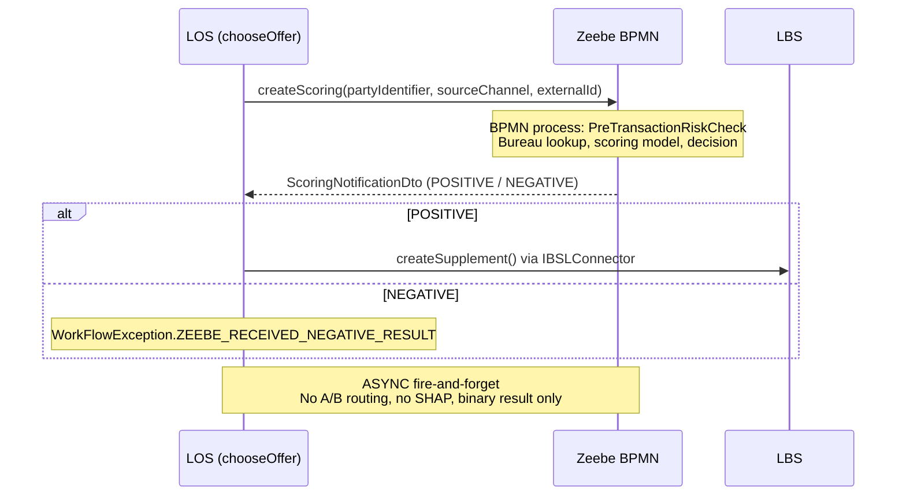

> *"Một model tốt trong tay người không hiểu nó còn nguy hiểm hơn không có model."*
>
> *Nguyên tắc Model Risk Management*

## Dẫn nhập: Bốn phút quyết định tương lai

::::story
Khi chị Lan nộp đơn vay lúc 10h15 sáng và nhận được phê duyệt lúc 10h19, có một quyết định xảy ra trong 4 phút đó mà cô không thấy - và thực ra không ai thấy.

Một model đã nhìn vào 47 features về chị Lan - từ lịch sử tín dụng, thu nhập đã xác minh, đến thời điểm cô nộp đơn và ngay cả cách cô điền form - và cho ra một con số: 420.

Con số đó quyết định: chị Lan có được vay không, bao nhiêu, và với lãi suất nào.

Model đó đúng hay sai? Công bằng hay thiên kiến? Tốt hơn hay tệ hơn model cũ? Khi nào nó sẽ bắt đầu lỗi thời?
::::

Chương này đi từ nền tảng thống kê của credit scoring, qua các kỹ thuật model hiện đại, đến những vấn đề thực tế mà người ta ít nói đến: explainability, fairness, model drift, và production deployment. Đây là chương mà data scientist, engineer, và business analyst đều cần đọc - với những góc nhìn khác nhau.

## 11.1 Lịch sử và Evolution của Credit Scoring

### Từ Judgmental đến Statistical

::::story
Năm 1950, anh Bình muốn vay tiền mua nhà. Anh đến ngân hàng, ngồi đối diện với loan officer - ông Hùng, đã làm 20 năm. Ông Hùng nhìn anh Bình, hỏi vài câu về công việc, gia đình, ý định sử dụng tiền vay - rồi quyết định.

Đây là **judgmental lending** - phán đoán dựa trên kinh nghiệm và trực giác con người.
::::

**Vấn đề với judgmental lending:**

```text
Vấn đề 1: Không consistent
  Ông Hùng có thể approve anh Bình nhưng reject anh Cường
  với cùng profile — tùy thuộc vào tâm trạng buổi sáng.

Vấn đề 2: Bias tiềm ẩn
  Ông Hùng có thể unconsciously prefer người cùng quê,
  cùng trường, hoặc có cùng phong cách nói chuyện.

Vấn đề 3: Không scale được
  1 loan officer xử lý 10-20 hồ sơ/ngày
  Với 10,000 đơn/ngày: cần 500-1,000 loan officers

Vấn đề 4: Không có audit trail
  "Tại sao reject anh Bình?" — "Cảm giác không ổn"
  → Không thể defend legally, không thể improve
```

**Statistical scoring - bước đột phá:**

```text
1956: Bill Fair và Earl Isaac thành lập Fair, Isaac and Company
      → Sau này là FICO (Fair Isaac Corporation)

1989: FICO Score ra đời và được các lender Mỹ adopt rộng rãi

Ý tưởng cơ bản: Thay vì hỏi "Tôi có cảm thấy tin tưởng anh không?"
Hỏi: "Những người có profile giống anh trong quá khứ đã trả nợ như thế nào?"

Statistical approach:
  1. Collect historical data: applicant features + outcome (paid/default)
  2. Find features that predict outcome
  3. Assign weights: features that predict well → higher weight
  4. Score = weighted combination of features
  5. Decision: score above threshold → approve
```

### FICO Score: Tại sao vẫn tồn tại năm 2025

::::story
Kỹ sư Tuấn hỏi: "Với ML hiện đại, tại sao nhiều ngân hàng vẫn dùng FICO? Chỉ là tradition hay có lý do thực sự?"
::::

**Năm thành phần của FICO Score:**

```text
Payment History (35%):
  Có trả đúng hạn không? DPD history?
  → Strongest predictor of future behavior

Amounts Owed (30%):
  Credit utilization ratio = balance / credit limit
  → High utilization → stress signal

Length of Credit History (15%):
  Bao lâu đã có tín dụng?
  → Longer = more data = more predictable

Credit Mix (10%):
  Có nhiều loại tín dụng không? (revolving, installment, mortgage)
  → Diversity indicates experience with credit

New Credit (10%):
  Gần đây có nhiều inquiries không?
  → Multiple applications → financial stress signal
```

**Tại sao FICO vẫn tồn tại:**

```text
Reason 1: Ecosystem lock-in
  Mortgage lenders, landlords, employers — tất cả reference FICO
  → "What's your FICO?" là câu hỏi phổ biến hơn "What's your ML score?"
  → Switching cost cho toàn bộ ecosystem rất cao

Reason 2: Regulatory familiarity
  Regulators hiểu FICO — biết cách audit, biết biases của nó
  → New ML models cần time để build regulatory trust

Reason 3: Interpretability
  Dễ giải thích cho customer: "Score giảm vì bạn mở thẻ mới"
  → ML: "Score giảm vì attention head 7 của layer 3..."

Reason 4: Consistent baseline
  Tất cả lenders dùng cùng scale (300-850)
  → Comparable across lenders, over time
  → Network effect: valuable because everyone uses it

Reason 5: Actually works well
  In low-complexity, data-rich environments
  FICO accuracy không thua kém ML nhiều
  Gini coefficient: FICO ~0.45-0.55, gradient boosting ~0.55-0.65
  → Incremental gain từ ML < cost of adoption
```

### Scorecard vs ML: Khi nào dùng gì

**Bảng so sánh thực tế:**

| Yếu tố | Traditional Scorecard | ML Model |
|--------|----------------------|----------|
| Accuracy (Gini) | 0.40-0.55 | 0.55-0.70 |
| Explainability | ✓ Rất cao | Lưu ý: Thấp hơn (cần SHAP) |
| Regulatory approval | ✓ Dễ | Lưu ý: Phức tạp hơn |
| Development time | 3-6 tháng | 2-4 tháng (nhưng validation dài hơn) |
| Maintenance | Thấp | Cao (drift monitoring) |
| Minimum data required | 5,000+ defaults | 10,000+ (preferably 50,000+) |
| Thin-file performance | ✗ Kém | ✓ Tốt hơn với alternative data |

**Decision framework:**

```text
Chọn Scorecard khi:
  ✓ Regulatory yêu cầu full explainability (mortgage, consumer loan)
  ✓ Data size nhỏ (< 10,000 defaults in training)
  ✓ Team chưa có ML infrastructure
  ✓ Product stable, không cần frequent model updates
  ✓ Customer base: mainstream, bureau-visible

Chọn ML khi:
  ✓ Thin-file segment (alternative data available)
  ✓ Large data volume (> 50,000 defaults)
  ✓ Complex non-linear relationships expected
  ✓ Accuracy improvement justifies compliance cost
  ✓ BNPL/fintech: speed to market > regulatory complexity

Hybrid approach (common in practice):
  Scorecard as primary → ML as override for edge cases
  Or: ML score → translated to scorecard points for compliance
```

:::summary[Evolution Của Credit Scoring]
Judgmental → Statistical: consistency, scale,
audit trail
FICO vẫn tồn tại: ecosystem lock-in, regulatory,
interpretability, network effect
Scorecard: regulated environments, small data,
explainability priority
ML: thin-file, large data, accuracy priority
:::

## 11.2 Building A Credit Scorecard

### Bước 1: Data Collection và Feature Engineering

::::story
Anh Minh được giao xây dựng scoring model mới cho sản phẩm vay tiêu dùng. Anh có access vào 18 tháng lịch sử data. Bắt đầu từ đâu?
::::

**Target variable - định nghĩa "default":**

```text
Trước khi làm gì, phải định nghĩa rõ: "default" là gì?

Option A: DPD 30+ (bất kỳ lúc nào trong 12 tháng)
  → Broad definition, nhiều positive examples
  → Includes temporary defaults (situational hardship)
  → May overpredict risk for borderline customers

Option B: DPD 90+ (bất kỳ lúc nào trong 24 tháng)
  → Stricter definition, fewer positive examples
  → More reflective of actual credit loss
  → Better for IFRS 9 alignment

Option C: Write-off hoặc debt sale
  → Purest definition of credit loss
  → But too few examples for model training
  → Lagging indicator (takes 2+ years to observe)

*(Note: DPD 90+ in 24 months là industry standard phổ biến.
   VLP-specific threshold không được xác nhận từ codebase —
   đây là configurable parameter trong DRG module, không hardcoded)*
  → Balance between predictive power and credit loss alignment
```

**Observation window và performance window:**

```text
Timeline:
  Jan 2022 ─────────── Dec 2023 ──────── Dec 2025
       │                    │                │
       │← Application date  │← Observation  │← Performance
       │                    │   window       │   window ends
       │                    │   (24 months)  │
       
For each application in Jan-Dec 2022:
  Features: data available AT APPLICATION TIME (Jan-Dec 2022)
  Target: did they default in next 24 months (2022-2024)?
  
Key rule: Never use data AFTER application date as features
          → Future data leakage → model overfits → fails in production
```

**Feature categories:**

```text
CATEGORY 1: Credit Bureau Features
  cb_max_dpd_12m: Max DPD in last 12 months
  cb_max_dpd_24m: Max DPD in last 24 months
  cb_num_accounts: Number of credit accounts
  cb_total_outstanding: Total outstanding debt
  cb_num_inquiries_6m: Number of inquiries last 6 months
  cb_credit_age_months: Age of oldest account
  cb_utilization_rate: Credit utilization (balance/limit)

CATEGORY 2: Income & Employment (from CIS verification)
  income_monthly_verified: Verified monthly income
  income_type: SALARIED, SELF_EMPLOYED, PENSION
  employment_tenure_months: Months at current employer
  income_stability_score: Based on consistency of income proof

CATEGORY 3: Application Features
  loan_to_income: Requested amount / monthly income
  dti_after_loan: Debt-to-income ratio if loan approved
  loan_purpose: PRODUCTIVE vs CONSUMPTION vs REFINANCE
  channel: DIGITAL vs POS vs TELESALES
  application_hour: Hour of day submitted
  form_completion_time: Time taken to fill application

CATEGORY 4: Behavioral (existing customers only)
  payment_ratio_12m: Actual payments / required payments
  avg_utilization_12m: Average utilization over 12 months
  app_login_frequency: How often customer logs into app
  early_payment_rate: % months paid before due date
```

### Bước 2: WOE và Information Value

**Khái niệm:**

:::key
**WOE** *(Weight of Evidence)* đo lường mức độ mỗi bucket của một feature phân biệt giữa "good" (không default) và "bad" (default) customers.

**IV** *(Information Value)* tổng hợp toàn bộ predictive power của một feature.
:::

**Tại sao cần WOE/IV:**

```text
Thay vì dùng raw features trực tiếp, WOE transform:
  1. Xử lý missing values (WOE cho missing bucket)
  2. Xử lý non-linear relationships (mỗi bin có WOE riêng)
  3. Monotonic relationship với target (dễ validate)
  4. Comparable scale across different features
  5. Scorecard points calculation dễ hơn nhiều
```

**Tính toán WOE - ví dụ số:**

Feature: `cb_max_dpd_12m` (Max DPD trong 12 tháng)

```text
Data: 10,000 loans, 800 defaults (8% default rate)

Binning:
Bin           | Count | # Default | # Good  | %Default | %Good
─────────────────────────────────────────────────────────────
DPD = 0      | 6,000 |    240    |  5,760  |  30.0%  | 71.3%
DPD 1-5      | 2,000 |    200    |  1,800  |  25.0%  | 22.3%
DPD 6-30     | 1,200 |    200    |  1,000  |  25.0%  |  12.4%
DPD 31-90    |   600 |    120    |    480  |  15.0%  |  5.9%
DPD 90+      |   200 |     40    |    160  |   5.0%  |  2.0%
─────────────────────────────────────────────────────────────
Total        |10,000 |    800    |  9,200  | 100.0%  | 100.0%

WOE formula: WOE_i = ln(%Default_i / %Good_i)

WOE calculations:
DPD = 0:   ln(30.0% / 71.3%) = ln(0.421) = -0.866  ← Good predictor (low risk)
DPD 1-5:   ln(25.0% / 22.3%) = ln(1.121) = +0.114
DPD 6-30:  ln(25.0% / 12.4%) = ln(2.016) = +0.700
DPD 31-90: ln(15.0% / 5.9%)  = ln(2.542) = +0.933
DPD 90+:   ln(5.0% / 2.0%)   = ln(2.500) = +0.916

Interpretation:
  Negative WOE: predominantly Good customers (low default risk)
  Positive WOE: predominantly Bad customers (high default risk)
  Magnitude: larger absolute value = stronger predictor
```

**Information Value:**

```text
IV = Σ (%Default_i - %Good_i) × WOE_i

IV calculation:
DPD = 0:   (30.0% - 71.3%) × (-0.866) = (-41.3%) × (-0.866) = 0.358
DPD 1-5:   (25.0% - 22.3%) × 0.114   = 2.7% × 0.114         = 0.003
DPD 6-30:  (25.0% - 12.4%) × 0.700   = 12.6% × 0.700        = 0.088
DPD 31-90: (15.0% - 5.9%)  × 0.933   = 9.1% × 0.933         = 0.085
DPD 90+:   (5.0% - 2.0%)   × 0.916   = 3.0% × 0.916         = 0.027

Total IV = 0.358 + 0.003 + 0.088 + 0.085 + 0.027 = 0.561

IV interpretation:
  IV < 0.02: Useless predictor
  IV 0.02-0.10: Weak predictor
  IV 0.10-0.30: Medium predictor
  IV > 0.30: Strong predictor

cb_max_dpd_12m: IV = 0.561 → Very strong predictor ✓
```

**Feature selection dựa trên IV:**

```text
Feature                     IV          Selection
──────────────────────────────────────────────────
cb_max_dpd_12m             0.561        ✅ Include
cb_utilization_rate        0.312        ✅ Include
employment_tenure_months   0.245        ✅ Include
loan_to_income             0.198        ✅ Include
income_type                0.156        ✅ Include
application_hour           0.043        ⚠️ Weak, evaluate
cb_credit_age_months       0.031        ⚠️ Weak, evaluate
form_completion_time       0.018        ❌ Too weak, exclude
customer_surname           0.000        ❌ Useless, exclude
```

### Bước 3: Logistic Regression và Scorecard Points

**Tại sao Logistic Regression:**

```text
Mục tiêu: predict probability of default P(default=1 | features)

P phải be between 0 and 1 → không thể dùng linear regression
Logistic regression: P = 1 / (1 + e^(-z))
where z = β₀ + β₁×WOE₁ + β₂×WOE₂ + ... + βₙ×WOEₙ

Sau khi transform features sang WOE:
  Model trở nên linear (easier to validate, interpret)
  Monotonic relationship giữa features và target (easier to audit)
  Coefficients directly interpretable as odds ratios
```

**Ví dụ Logistic Regression (simplified):**

```text
Training kết quả (5 features):

Feature                  Coefficient (β)
────────────────────────────────────────
Intercept               -2.145
cb_max_dpd_12m_WOE      +1.234
cb_utilization_WOE      +0.856
employment_tenure_WOE   -0.642
loan_to_income_WOE      +0.521
income_type_WOE         -0.398

For chị Lan:
  cb_max_dpd_12m = 0 → WOE = -0.866
  cb_utilization = 15% → WOE = -0.520 (computed from binning)
  employment_tenure = 36 months → WOE = -0.480
  loan_to_income = 0.842 → WOE = -0.210
  income_type = SALARIED → WOE = -0.380

z = -2.145
  + 1.234 × (-0.866)
  + 0.856 × (-0.520)
  + (-0.642) × (-0.480)
  + 0.521 × (-0.210)
  + (-0.398) × (-0.380)

z = -2.145 - 1.069 - 0.445 + 0.308 - 0.109 + 0.151
z = -3.309

P(default) = 1 / (1 + e^(-(-3.309)))
           = 1 / (1 + e^(3.309))
           = 1 / (1 + 27.34)
           = 0.035 = 3.5%

Chị Lan có 3.5% probability of default.
```

**Chuyển đổi sang Scorecard Points:**

```text
Dùng scaling formula:
  Score = A - B × log(odds)
  
  Where:
    log(odds) = z (logistic regression output)
    A, B: constants chosen để:
      Average score ≈ 600
      Double odds ≈ 20 points (industry convention)

Standard FICO-like scaling: A = 600, B = 28.85

For chị Lan:
  z = -3.309
  log(odds) = z = -3.309 (already in log-odds)
  Score = 600 - 28.85 × (-3.309)
        = 600 + 95.5
        = 695.5 ≈ 696

  Chị Lan: Score 696 (ví dụ minh họa — score range thực tế của VLP không được xác nhận từ codebase;
             scoring logic nằm trong Zeebe process bên ngoài monorepo)
```

### Bước 4: Model Validation

**Gini Coefficient - thước đo chính:**

```text
Gini Coefficient đo lường khả năng phân biệt của model:
  0 = random (model không có giá trị)
  1 = perfect (model luôn đúng)
  Industry benchmark: Gini > 0.45 considered acceptable

Calculation: Gini = 2 × AUROC - 1
(AUROC = Area Under ROC Curve)

Ví dụ với validation data 2,000 accounts (160 defaults):

Sort by score (high to low):
  Top 10%: 200 accounts, 60 defaults (37.5% of all defaults)
  Top 20%: 400 accounts, 96 defaults (60% of all defaults)
  ...

ROC Curve construction:
  For each threshold: True Positive Rate vs False Positive Rate
  Area under curve = AUROC

If AUROC = 0.72 → Gini = 2 × 0.72 - 1 = 0.44 → Borderline acceptable

If AUROC = 0.80 → Gini = 0.60 → Good model
```

**KS Statistic - Kolmogorov-Smirnov:**

```text
KS = max(Cum%Good - Cum%Bad) at each score point

Shows: at what score threshold does model best discriminate?

Score Range  | %Good Cumulative | %Bad Cumulative | Difference
────────────────────────────────────────────────────────────
300-350      |      5%         |      18%        |   13%
350-400      |     18%         |      38%        |   20%
400-450      |     40%         |      62%        |   22%
450-500      |     68%         |      80%        |   12%  ← KS = 22%
500-550      |     85%         |      92%        |    7%
550-600      |     95%         |      98%        |    3%
600+         |    100%         |     100%        |    0%

KS = 22% at score range 400-450
Benchmark: KS > 30% good, KS > 40% very good
```

**PSI - Population Stability Index:**

```text
PSI measures: Is the distribution of applicants changing over time?

High PSI = model trained on different population than currently applying
         = model performance likely degraded

PSI Formula:
  PSI = Σ (% Expected - % Actual) × ln(% Expected / % Actual)

PSI interpretation:
  PSI < 0.10: No significant shift → model still valid
  PSI 0.10-0.25: Some shift → monitor carefully
  PSI > 0.25: Large shift → retrain model

Example: Model trained on 2022 data, applied to 2024 applicants
  If economy changed significantly → PSI > 0.25 → retrain needed
```

:::summary[Building A Scorecard]
Data: observation window vs performance window
→ No data leakage after application date
WOE: transform each bin → consistent scale,
handles missing, non-linear
IV: select features with IV > 0.10
Logistic regression on WOE → scorecard points
Validation: Gini > 0.45, KS > 30%, PSI < 0.10
:::

## 11.3 ML trong Credit Scoring

### Gradient Boosting: Tại sao phổ biến nhất

::::story
Data Science team của Anh Minh thử nghiệm nhiều algorithms. XGBoost cho Gini 0.63, LightGBM cho 0.65, Scorecard cho 0.48. Team muốn deploy XGBoost ngay.

Anh Minh dừng lại: "Accuracy tốt hơn là đủ chưa? Chúng ta cần giải thích được tại sao reject một khách hàng."
::::

**Tại sao Gradient Boosting (XGBoost, LightGBM) chiếm ưu thế:**

```text
1. Accuracy: Consistently beats other methods on tabular data
   → Kaggle competitions: gradient boosting wins 70%+ of tabular challenges
   → Real-world credit: Gini improvement 10-20% vs logistic regression

2. Handles imbalanced data well:
   Default rate 5% → 95% non-default
   Gradient boosting: focal loss, scale_pos_weight parameter
   → Better minority class detection than logistic regression

3. Handles non-linear interactions:
   "DPD 0 + low income + short employment" → different risk than any feature alone
   → Trees naturally capture interaction effects

4. Missing value handling:
   XGBoost: built-in missing value direction learning
   → No need to impute (which can introduce bias)

5. Feature importance built-in:
   SHAP values via TreeExplainer
   → Explainability added on top

6. Fast training:
   LightGBM: histogram-based, can handle 10M+ rows efficiently
   → Frequent retraining feasible
```

**Tuning XGBoost for credit scoring:**

```python
# Key hyperparameters với credit scoring rationale:

params = {
    'objective': 'binary:logistic',     # Output probability
    'eval_metric': 'auc',               # AUROC as primary metric
    
    'n_estimators': 500,                # Number of trees
    'max_depth': 4,                     # Shallow trees → less overfit
                                        # Credit data: 3-6 typical
    
    'learning_rate': 0.05,              # Small step → better generalization
    'subsample': 0.8,                   # Row sampling → prevents overfit
    'colsample_bytree': 0.8,            # Feature sampling per tree
    
    'min_child_weight': 50,             # Min samples per leaf
                                        # High value → conservative splits
                                        # Prevents: learning from 1-2 defaults
    
    'scale_pos_weight': 19,             # = (non-defaults / defaults) - 1
                                        # = (95/5) - 1 = 19
                                        # Helps with imbalanced data
    
    'reg_alpha': 0.1,                   # L1 regularization
    'reg_lambda': 1.0,                  # L2 regularization
    
    'random_state': 42,                 # Reproducibility
}

# Cross-validation strategy for time-series data:
# KHÔNG dùng random k-fold (data leakage in time)
# Dùng TimeSeriesSplit:

from sklearn.model_selection import TimeSeriesSplit
tscv = TimeSeriesSplit(n_splits=5)
# Fold 1: train Jan-Apr 2022, test May 2022
# Fold 2: train Jan-Jun 2022, test Jul 2022
# ...
# Validates temporal generalization
```

### SHAP Values: Explainability cho ML

::::story
Khách hàng bị reject bởi ML model. Regulatory yêu cầu: "Tại sao reject?" Bạn không thể trả lời "Vì tree node 284 trong tree 47 của ensemble..."

SHAP (SHapley Additive exPlanations) giải quyết vấn đề này.
::::

**Khái niệm SHAP:**

:::key
**SHAP values** là framework giải thích prediction của bất kỳ model nào - đo lường contribution của từng feature vào prediction cụ thể đó.
:::

**Ví dụ SHAP explanation:**

```text
Khách hàng bị reject (P(default) = 0.23 = 23%)
Base rate: 8% (average default rate)

SHAP contribution breakdown:
  Base value:                              0.08 (=8% base rate)
  
  + cb_max_dpd_12m = DPD 35             + 0.09 (high DPD → increases risk)
  + cb_num_inquiries_6m = 4             + 0.03 (many inquiries → increases risk)
  + loan_to_income = 1.2                + 0.05 (high LTI → increases risk)
  
  - employment_tenure = 48 months       - 0.02 (long tenure → decreases risk)
  - income_type = SALARIED              - 0.01 (stable income → decreases risk)
  ─────────────────────────────────────────────
  Final prediction:                       0.23 (=23%)

Human-readable rejection reason:
  "Đơn vay của bạn không được phê duyệt vì:
   1. Lịch sử thanh toán: Tài khoản của bạn có 35 ngày quá hạn
      trong 12 tháng gần đây (yếu tố quan trọng nhất)
   2. Tỷ lệ vay/thu nhập: Khoản vay này chiếm tỷ lệ cao
      so với thu nhập hàng tháng của bạn
   3. Số lần hỏi tín dụng: Bạn đã có nhiều lần check
      tín dụng trong 6 tháng gần đây
   
   Bạn có thể cải thiện bằng cách: [actionable advice]"
```

**Implementing SHAP in production:**

```python
import shap
import xgboost as xgb

# Train model:
model = xgb.XGBClassifier(**params)
model.fit(X_train_woe, y_train)

# Create explainer (one-time, reusable):
explainer = shap.TreeExplainer(model)

# For each application at scoring time:
def get_rejection_reasons(application_features):
    # Transform to WOE:
    features_woe = transform_to_woe(application_features)
    
    # Get SHAP values:
    shap_values = explainer.shap_values(features_woe)
    
    # Sort by absolute contribution:
    contributions = dict(zip(feature_names, shap_values[0]))
    sorted_contributions = sorted(contributions.items(),
                                  key=lambda x: abs(x[1]),
                                  reverse=True)
    
    # Take top 3 negative factors:
    top_negative = [(f, v) for f, v in sorted_contributions if v > 0][:3]
    
    # Translate to human-readable:
    return translate_to_customer_language(top_negative, application_features)
```

### Ensemble Methods: Kết hợp nhiều Models

**Khi nào dùng ensemble:**

```text
Single model risks:
  - Model overfit to specific data patterns
  - Sudden performance degradation when patterns change

Ensemble approaches:

1. Model averaging:
   Score = 0.6 × scorecard_score + 0.4 × xgboost_score
   → More stable than either alone
   → Good when models capture different aspects

2. Stacking:
   Level 1: Multiple base models (logistic, XGBoost, LightGBM)
   Level 2: Meta-model combines predictions of base models
   → More complex, harder to validate

3. Specialized models for segments:
   Thin-file model: for customers with < 6 months history
   Thick-file model: for customers with rich history
   → Route customer to appropriate model based on data availability
   → Ensemble = specialized models + routing logic
```

:::summary[ML Credit Scoring]
Gradient boosting: consistently best on tabular
data, handles imbalance, non-linear interactions
Key tuning: max_depth (shallow), min_child_weight
(conservative), scale_pos_weight (imbalance)
Scoring: binary POSITIVE/NEGATIVE (SHAP-based explanation NOT implemented in VLP) → regulatory
compliant rejection reasons
TimeSeriesSplit: temporal validation, no leakage
:::

## 11.4 Fairness và Bias trong Credit Scoring

### Disparate Impact: Khi Model "đúng" mà vẫn Sai

::::story
Công ty tài chính deploy model mới. Model không include race, gender, hay địa chỉ như features. Nhưng sau 6 tháng, analysis cho thấy: approval rate cho phụ nữ thấp hơn nam giới 8 điểm phần trăm - dù cùng income và credit history.

Legal team báo: "Đây có thể là disparate impact discrimination."
::::

**Khái niệm - Proxy Discrimination:**

:::key
**Proxy discrimination** xảy ra khi một feature không phải protected attribute (race, gender, religion...) nhưng **correlates strongly** với protected attribute - dẫn đến discriminatory outcome dù không intentional.
:::

**Ví dụ proxy:**

```text
Feature: Neighborhood / zip code
  → Correlates với race/ethnicity (due to historical housing segregation)
  → If model uses neighborhood → effectively using race

Feature: College education level
  → Correlates với socioeconomic status
  → May proxy for family wealth, not individual creditworthiness

Feature: Employer name
  → Certain industries: gender skewed
  → "Nurse" vs "Engineer" → may proxy for gender

Feature: Application hour
  → "Applied at 2am" may correlate with shift workers
  → May proxy for blue-collar vs white-collar

In credit scoring:
  Features seem "neutral" but may correlate with protected attributes
  → SHAP + demographic analysis needed to detect
```

**Disparate Impact Test:**

```text
80% Rule (US Equal Employment Opportunity Commission guideline):
  If selection rate of protected group < 80% of most favored group
  → Potential disparate impact

Example:
  Male approval rate: 72%
  Female approval rate: 64%
  Ratio: 64% / 72% = 88.9% > 80% → OK by 80% rule

  If female rate was 55%:
  Ratio: 55% / 72% = 76.4% < 80% → Disparate impact concern

Note: 80% rule is NOT a legal safe harbor — just a starting point
```

### Fairness Definitions: Có mâu thuẫn nhau không?

**Bốn định nghĩa fairness phổ biến:**

**1. Demographic Parity:**
```text
P(Approved | Male) = P(Approved | Female)
→ Equal approval rates across groups

Ưu điểm: Simple, intuitive
Nhược điểm: Nếu actual default rates khác nhau giữa groups,
             enforcing demographic parity = approve more risky customers
             trong one group, reject less risky in another
```

**2. Equal Opportunity:**
```text
P(Approved | Good customer, Male) = P(Approved | Good customer, Female)
→ Among good customers, equal chance of approval

More aligned with meritocracy (reward actual creditworthiness)
```

**3. Equalized Odds:**
```text
Both: P(Approved | Good, Male) = P(Approved | Good, Female)
And:  P(Approved | Bad, Male) = P(Approved | Bad, Female)
→ Equal true positive AND false positive rates
```

**4. Calibration:**
```text
P(default | Score=S, Male) = P(default | Score=S, Female)
→ Same score = same actual risk across groups
→ Score is "fair" from actuarial perspective
```

**Impossibility result (Chouldechova, 2017):**

```text
MATHEMATICAL PROOF: Cannot simultaneously achieve
  Demographic Parity + Calibration + Equal Opportunity
  when base rates differ between groups.

If Group A has 10% default rate and Group B has 5%:
  Calibrated model: Group A will have lower scores (higher risk)
  → Approval rate for Group A lower (violates demographic parity)

This is NOT a modeling problem — it's a mathematical impossibility.

Practical implication:
  Must CHOOSE which fairness definition to optimize
  Different definitions → different policy choices
  → Legal, ethical, and business decision — not just technical
```

### Regulatory Requirements

**Adverse Action Notice (khi reject):**

```text
Legal requirement in many jurisdictions:
When rejecting credit application, must provide:
  1. Reason for rejection (specific factors, not just "score")
  2. Score used (if score-based rejection)
  3. Range of possible scores (context)
  4. Key factors that adversely impacted score (top 4)
  5. Contact info for credit bureau used

In VLP:
  *(verified: scoring-pipeline-spec.md)*
  Scoring returns POSITIVE / NEGATIVE (binary, via Zeebe callback)
  Detailed rejection reasons: NOT implemented in current codebase
  SHAP-based explanations: NOT found — scoring logic is in Zeebe (external)
  If adverse action notice is needed → implementation required in future
  Must be specific: NOT "Your score was insufficient"
  Must be: "Your score was impacted by: (1) 35 days past due..."
```

**Explainability requirements:**

```text
EU AI Act (2024): High-risk AI systems in credit decisions
  → Require meaningful explanation
  → Right to human review
  → Transparency about when AI is used

US Fair Credit Reporting Act:
  → Adverse action notices required
  → Cannot use protected characteristics

Vietnam:
  → Credit Information Law, NHNN regulations
  → Evolving framework, but trend toward explainability
```

### Practical Mitigation Strategies

**Strategy 1: Feature selection với fairness lens**

```python
def fairness_aware_feature_selection(features, demographic_data):
    high_risk_features = []
    
    for feature in features:
        # Test correlation với protected attributes:
        for protected_attr in ['gender', 'region', 'age_group']:
            correlation = calculate_correlation(features[feature],
                                               demographic_data[protected_attr])
            if abs(correlation) > 0.3:  # Threshold
                high_risk_features.append(
                    (feature, protected_attr, correlation))
    
    return high_risk_features

# Remove or adjust high-risk features
# Alternatively: keep but monitor closely
```

**Strategy 2: Post-processing fairness adjustment**

```python
def fair_score_adjustment(raw_score, group):
    # Calibrate scores across groups:
    group_medians = {
        'salaried_urban': 0.06,
        'salaried_rural': 0.08,
        'self_employed': 0.12,
    }
    
    base_median = 0.08
    adjustment = base_median / group_medians[group]
    
    # Apply adjustment: equalize expected default rates at same score
    adjusted_score = raw_score * adjustment
    return adjusted_score

# Caveat: May conflict with calibration requirement
# Legal review required before implementation
```

**Strategy 3: Regular fairness audits**

```text
Monthly audit process:
  1. Calculate approval rates by demographic segment
  2. Calculate default rates by demographic segment at same score
  3. Apply 80% rule and equalized odds tests
  4. If disparate impact detected: root cause analysis
  5. Document findings and remediation actions
  6. Report to compliance team
```

:::summary[Fairness Và Bias]
Proxy discrimination: neutral features correlate
với protected attributes → discriminatory effect
Fairness impossibility: không thể đồng thời đạt
demographic parity + calibration → must choose
Adverse action notice: legal requirement →
binary POSITIVE/NEGATIVE via Zeebe callback (SHAP not implemented)
Mitigation: feature selection, post-processing,
regular fairness audits
:::

## 11.5 Từ Model đến Production

### Model Governance Framework

::::story
Anh Minh muốn deploy model mới. Nhưng bà Hương yêu cầu: "Chúng ta cần validation đầy đủ trước khi deploy. Một model sai sẽ approve những người không nên approve và reject những người đáng được approve - cả hai đều tốn tiền."
::::

**Model Risk Management (MRM) framework:**

```text
TIER 1: Development Validation (by model developer)
  □ Out-of-time validation (OOT): Test trên data sau training cutoff
  □ Out-of-sample validation (OOS): Hold-out set không dùng trong training
  □ Discriminatory power: Gini, KS statistics
  □ Calibration: Predicted P(default) vs actual default rate
  □ Stability: PSI across different time periods
  □ Fairness: Demographic analysis, adverse impact testing
  □ Explainability: Top feature drivers, SHAP analysis

TIER 2: Independent Model Validation (by separate team)
  □ Replicate all Tier 1 validation independently
  □ Challenge model assumptions (feature engineering choices)
  □ Alternative benchmark: simpler model comparison
  □ Sensitivity analysis: what if key features are missing?
  □ Stress testing: model performance in adverse economic scenarios

TIER 3: Ongoing Monitoring (post-deployment)
  □ Monthly: PSI for feature distributions
  □ Monthly: Prediction drift (score distribution shift)
  □ Quarterly: Gini on accumulated outcome data
  □ Trigger: Auto-alert if PSI > 0.25 or Gini drop > 0.05
```

### Champion/Challenger Framework: Revisit

Đã covered trong Chương 7 (Origination). Ở đây, focus vào monitoring sau khi model được deployed.

**Model monitoring dashboard:**

```text
Daily metrics:
  Application volume (total, by channel, by product)
  Score distribution (mean, std, percentiles)
  Approval rate (total, by tier)
  Score band distribution (% in each bucket)

Weekly metrics:
  PSI: feature-level population stability
  PSI: score-level population stability
  Missing value rates per feature
  
Monthly metrics (as data matures):
  DPD 30+ rate by vintage and score band
  Gini coefficient on first 12 months of data
  Feature drift analysis: top 5 features

Automated alerts:
  PSI > 0.10: Warning
  PSI > 0.25: Action required
  Score mean shift > 10 points: Investigate
  Approval rate shift > 5%: Investigate
  Early DPD rate > 2× expected: Urgent
```

### Model Drift và Retraining Triggers

**Ba loại drift:**

```text
1. Data Drift (Feature Drift):
   Input features distribution changes
   Example: Income levels increase across all applicants
            → Model trained on old income levels may misinterpret
   Detection: PSI on each feature
   Response: Retrain if PSI > 0.25

2. Concept Drift:
   Relationship between features and target changes
   Example: High DPD used to predict default strongly
            → COVID forgiveness programs → DPD no longer predicts well
   Detection: Model performance degradation on new data
   Response: Retrain (often more urgent)

3. Label Drift:
   Default rate itself changes
   Example: Economic recession → default rate doubles
            → Model trained on normal times under-predicts risk
   Detection: Actual vs predicted default rate divergence
   Response: Recalibrate threshold, retrain
```

**Retraining strategy:**

```text
Scheduled retraining (when economy stable):
  Frequency: Every 12-18 months
  Data: Rolling window, typically last 36 months with more weight on recent
  Trigger: Scheduled calendar + any monitoring alert

Event-triggered retraining:
  Triggers: Economic shock, regulatory change, product change
  Timeline: 2-4 weeks from trigger to deploy
  Process: Compressed validation, higher risk tolerance for speed

Continuous learning (advanced):
  Model updated incrementally with each new cohort
  Risk: May adapt too quickly to noise
  Benefit: Always reflects current patterns
  When to use: High data volume, stable regulatory environment
```

### Production Deployment Architecture

**Scoring trong VLP - Zeebe-based flow:**


**General scoring pipeline best practices** (industry-wide, NOT VLP-specific):

```text
Feature Extraction → Feature Store → Model Serving (Champion/Challenger)
  → SHAP Explanation → Policy Rules → Decision + Audit

[Đây là industry best practice. VLP implement phần lớn logic trong
 Zeebe BPMN process engine — details không visible trong monorepo source code]
```

**Latency requirements:**

```text
Total scoring latency budget: 2,000ms (2 seconds)
  Credit bureau API: 800ms (largest component)
  Feature extraction: 200ms
  Model inference: 50ms (fast with XGBoost)
  SHAP calculation: 150ms (TreeExplainer, fast)
  Policy rules: 50ms
  Logging: 100ms async (non-blocking)
  Buffer: 650ms

Optimization strategies:
  Credit bureau: parallel calls if multiple bureaus
  Feature store: Redis cache for reusable features
  Model: ONNX runtime for faster inference
  SHAP: Background job for complex cases, simple lookup for common
```

:::summary[Model Đến Production]
3-tier validation: developer → independent →
ongoing monitoring
3 types of drift: data, concept, label
→ PSI, performance degradation, rate divergence
Retraining: scheduled (12-18 months) +
event-triggered (economic shock)
Latency: 2s total budget, credit bureau largest
component → parallel calls to optimize
:::

## 11.6 Alternative Data: Mở rộng tầm với của Scoring

### The Thin-File Problem

::::story
Bà Hương nhận được báo cáo: 35% người nộp đơn vay không có credit bureau history - hoặc lịch sử quá ít để score được. Tất cả bị reject tự động. Đây là 35% cơ hội bị bỏ lỡ.
::::

**Thin-file borrowers là ai:**

```text
Profile characteristics:
  - Người trẻ (18-25 tuổi) lần đầu vay
  - Người mới đến thành phố, chưa có tài khoản ngân hàng
  - Người làm việc tự do, ít dùng tín dụng chính thức
  - Nhóm thu nhập thấp: ít tương tác với hệ thống tài chính

Vietnam context (2024):
  - 40% dân số không có bank account (NHNN data)
  - Significant portion unscored by traditional bureaus
  - BNPL và fintech đang phục vụ segment này
  - Mobile penetration: 75%+ → digital footprint available
```

**Alternative data sources:**

```text
SOURCE 1: Telco Data
  Call patterns, SMS frequency, top-up behavior
  → People who top up regularly → financial discipline proxy
  → Night calls only → may indicate irregular employment
  → Premium plan → income proxy
  Consent: Must get explicit opt-in
  Predictive power: Gini improvement +5-10% for thin-file

SOURCE 2: eWallet / Mobile Payment
  Transaction frequency, merchant diversity, saving behavior
  → Regular small savings → discipline indicator
  → Diverse merchant spending → economic activity proxy
  → Irregular large transactions → volatility indicator
  Predictive power: Gini improvement +8-15% for thin-file

SOURCE 3: Utility Bills
  Electricity, water, internet payment history
  → On-time payment → payment behavior proxy
  → Strong predictor for first-time borrowers
  Predictive power: Gini +10-18% for thin-file

SOURCE 4: Social Media (controversial)
  Network quality, profile completeness
  → Used by some fintechs but highly controversial
  → Regulatory pushback in many markets
  → Privacy concerns significant
  Not recommended: legal risk > benefit

SOURCE 5: Behavioral Data (in-app)
  How applicant fills form, time spent on each section
  → Careful reading of terms → conscientiousness proxy
  → Fast completion → may not understand what they're signing
  → Predictive but ethically complex
  Use with caution and transparency
```

**Alternative data model architecture:**

```text
Thin-file scoring pipeline:

Step 1: Classify applicant
  IF bureau data available AND score computable:
    → Route to standard scorecard
  ELSE IF bureau thin-file OR no bureau:
    → Route to alternative data model

Step 2: Alternative model
  Features:
    telco_payment_regularity: 0-100 score from telco data
    ewallet_transaction_count_6m: number of transactions
    utility_ontime_rate_12m: % utility bills paid on time
    mobile_app_tenure_months: how long using financial apps
    
  Model: XGBoost (more powerful for limited traditional features)
  
Step 3: Combined scoring
  If partial bureau data:
    Score = α × standard_model + (1-α) × alternative_model
    α determined by data richness
  If no bureau data:
    Score = alternative_model_only
    Max loan amount capped (prudent limit for unproven segment)
```

**Privacy và consent requirements:**

```text
For alternative data usage:
  1. Explicit opt-in required: "Bạn có đồng ý cho phép chúng tôi
     truy cập dữ liệu [telco/eWallet/utility] để đánh giá đơn vay?"

  2. Explain how data is used: specific, not generic

  3. Opt-out option: customer can decline → application still processed
     (without alternative data = standard thin-file treatment)

  4. Data minimization: only request what's needed for scoring
     (not entire transaction history if only 6 months needed)

  5. Retention limit: alternative data deleted after scoring decision
     (or after account closed, whichever is later)

  6. Right to explanation: customer can ask what alternative data
     contributed to their score
```

:::summary[Alternative Data]
Thin-file: 35-40% Vietnam applicants unscored
Best alternatives: utility bills (+10-18% Gini),
eWallet (+8-15%), telco (+5-10%)
Social media: high risk, not recommended
Architecture: standard model + alt model +
routing logic based on data richness
Privacy: explicit opt-in, data minimization,
explanation rights mandatory
:::

## Tóm tắt chương 11

```text
Credit scoring journey — từ raw data đến decision:

DATA
  47 features về chị Lan:
  - Credit bureau: DPD history, utilization, inquiries
  - CIS: income 22M, SALARIED, tenure 36 months
  - Application: amount 18.5M, channel DIGITAL, hour 10:15

FEATURE ENGINEERING
  WOE transformation:
  cb_max_dpd_12m (DPD=0) → WOE = -0.866 ← Strong good signal

MODEL
  XGBoost: 500 trees, max_depth=4, trained on 50,000+ loans
  → P(default | chị Lan) = 3.5%

SCORE
  Score = 420 (Prime tier)
  → Approve, rate 15%/năm

EXPLAINABILITY (if rejected — this case she's approved):
  SHAP would show top positive/negative factors
  → Regulatory compliance, customer transparency

FAIRNESS CHECK
  Monthly audit: approval rate by gender, region, age
  → Detect proxy discrimination before it becomes systemic

MONITORING
  PSI daily, Gini monthly
  → Model valid → no drift detected

Every step documented. Every decision auditable.
"Score 420" is not a black box — it's a justified, explainable, monitored decision.
```

## Câu hỏi tự kiểm tra

**Loại 1 - Nhớ lại:**
1. WOE là gì? Tại sao chuyển đổi features sang WOE trước khi dùng logistic regression?
2. IV = 0.05 có ý nghĩa gì? Threshold thường được dùng để chọn features là gì?
3. Gini coefficient đo lường gì? Benchmark chấp nhận được trong credit scoring?
4. PSI > 0.25 cần action gì?

**Loại 2 - Hiểu:**
5. Tại sao không dùng random k-fold cross-validation cho credit scoring? Thay bằng gì và tại sao?
6. "Fairness impossibility theorem" nói gì? Tại sao không thể đồng thời đạt demographic parity và calibration khi base rates khác nhau?
7. SHAP values giải quyết vấn đề regulatory nào của ML models?
8. Tại sao payment holiday vẫn tích lũy lãi suất? Giải thích từ góc độ kinh tế học.

**Loại 3 - Áp dụng:**
9. Cho data sau:
   - 8,000 accounts: 4,000 DPD=0, 2,000 DPD 1-30, 1,500 DPD 31-90, 500 DPD 90+
   - Total defaults: 640 (distribution: 80, 120, 200, 240)
   - Total non-defaults: 7,360
   
   (a) Tính WOE cho mỗi bin
   (b) Tính IV cho feature này
   (c) Feature này có nên include trong model không?
   (d) Monotonicity check: WOE có tăng đơn điệu theo DPD không? Nếu không, cần xử lý gì?

10. Model đang có Gini = 0.58. Sau 6 tháng deploy, PSI của feature `employment_tenure` = 0.18. Monthly Gini tính trên new data = 0.51.
    (a) Cần action gì ngay?
    (b) Root cause analysis: cần investigate gì?
    (c) Nếu retrain ngay, cần validation nào?

**Loại 4 - Phân tích:**
11. Fintech đề xuất dùng smartphone behavioral data (app usage patterns, GPS location history, social graph) để score thin-file borrowers. Phân tích:
    (a) Predictive potential của từng data type
    (b) Privacy concerns và regulatory risks
    (c) Fairness implications: which groups might be disadvantaged?
    (d) Your recommendation: what's acceptable, what's not?

12. Startup dùng ML model mới (Gini 0.68 vs scorecard 0.50). CEO muốn deploy ngay mà không cần full validation vì "competition is fierce." Phân tích:
    (a) Risks của incomplete validation trong credit scoring
    (b) Minimum viable validation (if must go fast)
    (c) Monitoring requirements to catch problems early
    (d) How to explain to CEO why this shortcut is dangerous

## Bài tập áp dụng

**Bài 1 - WOE/IV Analysis:**
Dataset: 15,000 loans với target = default trong 24 tháng

Feature: `loan_to_income_ratio`

| Bin | N Accounts | N Defaults |
|-----|------------|------------|
| < 0.3 | 3,000 | 90 |
| 0.3 - 0.5 | 4,500 | 180 |
| 0.5 - 0.7 | 3,500 | 280 |
| 0.7 - 1.0 | 2,500 | 325 |
| > 1.0 | 1,500 | 375 |
| Missing | 500 | 100 |

(a) Tính WOE cho mỗi bin
(b) Tính IV tổng
(c) Có nên include feature này không?
(d) Monotonicity: WOE có consistent với business logic không?
(e) Nên xử lý "Missing" như thế nào?

**Bài 2 - Champion/Challenger Impact Analysis:**
Bạn có hai models:
- Champion: Gini 0.52, approve rate 65%, deployed 18 tháng
- Challenger: Gini 0.61, approve rate 68%, tested 3 tháng (5% traffic)

Challenger data sau 3 tháng (1,500 loans):
- DPD 30+ rate at M3: 2.8% vs Champion M3: 4.1%
- Average score: 392 vs Champion: 381

Business metrics (portfolio 100,000 loans, avg 12M VNĐ):

(a) Calculate net economic benefit of promoting Challenger
(b) Is 3 months of data sufficient? What additional validation needed?
(c) Design a gradual promotion plan (10% → 50% → 100%)
(d) What monitoring metrics needed during promotion?
(e) Define rollback triggers

**Bài 3 - Fairness Audit Design:**
Design monthly fairness audit process for credit scoring system:

Portfolio: 50,000 applications/month
Protected attributes to monitor: gender, age group (18-25, 26-40, 41-60, 60+), province

Requirements:
(a) Define metrics to calculate for each protected group
(b) Define alert thresholds (when to investigate vs just monitor)
(c) Design root cause analysis process when disparate impact detected
(d) Define remediation options (in order of preference)
(e) Reporting template for compliance team

## Đọc thêm

**Credit Scoring:**
- Siddiqi, N. (2017). *Intelligent Credit Scoring: Building and Implementing Better Credit Risk Scorecards.* Wiley. - Định nghĩa book về scorecard development, bao gồm WOE/IV trong thực tế.

**ML Explainability:**
- Molnar, C. (2022). *Interpretable Machine Learning.* Free at christophm.github.io/interpretable-ml-book/ - Comprehensive guide về SHAP, LIME, và các explainability methods.

**Fairness in ML:**
- Barocas, S., Hardt, M., & Narayanan, A. (2023). *Fairness and Machine Learning.* MIT Press. - Available free at fairmlbook.org - rigorous treatment của fairness definitions và impossibility results.

*Chương 12 sẽ xây dựng trên credit scoring để tackle một vấn đề phức tạp hơn: Risk-Based Pricing - không chỉ là "approve hay không" mà còn là "approve với điều kiện gì?" Từ score đến rate, từ tariff architecture đến pricing optimization, và tại sao "right price for right customer" quan trọng hơn nhiều so với "lowest possible price."*
