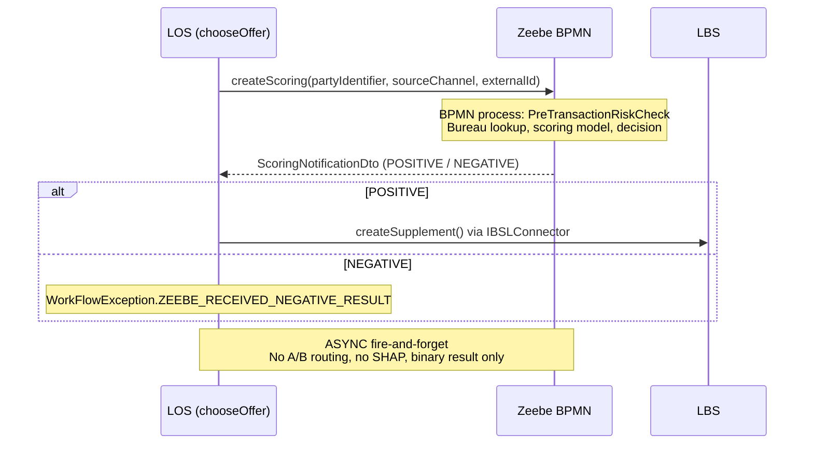

> *"Một mô hình tốt trong tay người không hiểu nó còn nguy hiểm hơn không có mô hình."*
>
> *Nguyên tắc quản trị rủi ro mô hình*

## Dẫn nhập: bốn phút quyết định

::::story
Chị Lan nộp đơn vay lúc 10 giờ 15 và nhận được phê duyệt lúc 10 giờ 19. Trong bốn phút đó có một quyết định mà chị không nhìn thấy, và thực ra không ai nhìn thấy.

Một mô hình đã xem 47 biến đầu vào về chị Lan, từ lịch sử tín dụng, thu nhập đã xác minh, đến thời điểm chị nộp đơn và cả cách chị điền biểu mẫu, rồi cho ra một con số: 420.

Con số đó quyết định chị Lan có được vay hay không, được vay bao nhiêu và với lãi suất nào.

Mô hình đó đúng hay sai? Công bằng hay thiên lệch? Tốt hơn hay tệ hơn mô hình cũ? Khi nào nó bắt đầu lỗi thời?
::::

Chương này đi từ nền tảng thống kê của chấm điểm tín dụng *(credit scoring)*, qua các kỹ thuật mô hình hiện đại, đến những vấn đề ít được nói đến khi vận hành thật: khả năng giải thích, tính công bằng, drift của mô hình và triển khai. Nhà khoa học dữ liệu, kỹ sư và chuyên viên phân tích nghiệp vụ đều cần đọc chương này, mỗi người với một góc nhìn riêng.

## 11.1 Lịch sử của chấm điểm tín dụng

### Từ phán đoán đến thống kê

::::story
Năm 1950, anh Bình muốn vay tiền mua nhà. Anh đến ngân hàng, ngồi đối diện với nhân viên tín dụng là ông Phúc, người đã làm nghề hai mươi năm. Ông Phúc nhìn anh Bình, hỏi vài câu về công việc, gia đình, mục đích sử dụng tiền vay, rồi quyết định.

Đó là cho vay theo phán đoán *(judgmental lending)*: quyết định dựa trên kinh nghiệm và trực giác của con người.
::::

Cách làm này có bốn vấn đề:

| Vấn đề | Biểu hiện |
|---|---|
| Không nhất quán | Ông Phúc có thể duyệt anh Bình nhưng từ chối anh Cường có hồ sơ tương tự, tùy tâm trạng buổi sáng |
| Thiên lệch ngầm | Ông Phúc có thể vô thức ưu ái người cùng quê, cùng trường, hoặc có cách nói chuyện giống mình |
| Không mở rộng được | Một nhân viên xử lý 10-20 hồ sơ mỗi ngày; 10,000 đơn mỗi ngày cần 500-1,000 người |
| Không có dấu vết kiểm toán | "Vì sao từ chối anh Bình?" "Cảm thấy không ổn." Không thể bảo vệ trước pháp luật, cũng không thể cải tiến |

**Chấm điểm thống kê, bước đột phá:**

```text
1956: Bill Fair và Earl Isaac thành lập Fair, Isaac and Company
      → Sau này là FICO
1989: FICO Score ra đời và được các bên cho vay ở Mỹ áp dụng rộng rãi

Ý tưởng: thay vì hỏi "Tôi có thấy tin anh không?",
hãy hỏi "Những người có hồ sơ giống anh đã trả nợ thế nào?"

Cách làm thống kê:
  1. Thu thập dữ liệu lịch sử: đặc điểm người vay + kết quả (trả được / vỡ nợ)
  2. Tìm các biến dự báo được kết quả
  3. Gán trọng số: biến dự báo tốt → trọng số cao
  4. Điểm = tổ hợp có trọng số của các biến
  5. Quyết định: điểm trên ngưỡng → duyệt
```

### Vì sao FICO Score vẫn tồn tại

::::story
Kỹ sư Tuấn hỏi: "Với ML hiện đại, sao nhiều ngân hàng vẫn dùng FICO? Chỉ là thói quen hay có lý do thật?"
::::

FICO công bố năm nhóm yếu tố cùng tỷ trọng tương đối:

| Nhóm | Tỷ trọng | Nội dung | Vì sao dự báo được |
|---|---|---|---|
| Lịch sử thanh toán | 35% | Có trả đúng hạn không, lịch sử DPD | Hành vi quá khứ là chỉ báo mạnh nhất cho hành vi tương lai |
| Số tiền đang nợ | 30% | Tỷ lệ sử dụng hạn mức = dư nợ / hạn mức | Dùng gần hết hạn mức là tín hiệu căng thẳng tài chính |
| Độ dài lịch sử tín dụng | 15% | Đã có tín dụng bao lâu | Lịch sử dài hơn, nhiều dữ liệu hơn, dễ dự báo hơn |
| Cơ cấu tín dụng | 10% | Thẻ, trả góp, thế chấp | Cho thấy kinh nghiệm sử dụng tín dụng |
| Tín dụng mới | 10% | Số lần tra cứu gần đây | Nộp đơn nhiều nơi là tín hiệu căng thẳng |

FICO tồn tại không chỉ vì nó đủ tốt. Thứ nhất là hiệu ứng hệ sinh thái: bên cho vay thế chấp, chủ nhà cho thuê, nhiều bên khác đều tham chiếu FICO, nên chi phí chuyển đổi cho cả hệ sinh thái rất cao. Thứ hai, cơ quan quản lý hiểu FICO, biết cách kiểm toán nó và biết các thiên lệch của nó; một mô hình ML mới cần thời gian để xây dựng niềm tin đó. Thứ ba là khả năng giải thích: "điểm giảm vì bạn mở thêm thẻ" dễ nói với khách hàng hơn nhiều so với một lời giải thích từ bên trong một ensemble. Thứ tư, mọi bên cho vay dùng cùng thang điểm 300-850 nên điểm so sánh được giữa các bên và theo thời gian; giá trị của nó đến từ việc ai cũng dùng. Cuối cùng, trong môi trường nhiều dữ liệu và ít phức tạp, khoảng cách độ chính xác giữa điểm truyền thống và ML thường không lớn, nên phần cải thiện chưa chắc bù được chi phí chuyển đổi.

### Thẻ điểm hay ML: khi nào dùng gì

| Yếu tố | Thẻ điểm truyền thống | Mô hình ML |
|--------|----------------------|----------|
| Độ chính xác (Gini, khoảng điển hình) | 0.40-0.55 | 0.55-0.70 |
| Khả năng giải thích | Rất cao | Thấp hơn, cần SHAP |
| Phê duyệt của cơ quan quản lý | Dễ | Phức tạp hơn |
| Thời gian phát triển | 3-6 tháng | 2-4 tháng, nhưng thẩm định lâu hơn |
| Bảo trì | Thấp | Cao (giám sát drift) |
| Dữ liệu tối thiểu | Vài nghìn ca vỡ nợ | Thường cần nhiều hơn đáng kể |
| Khách hàng thin-file | Kém | Tốt hơn khi có dữ liệu thay thế |

Thẻ điểm phù hợp khi quy định yêu cầu giải thích đầy đủ, dữ liệu huấn luyện ít, đội ngũ chưa có hạ tầng ML, sản phẩm ổn định và khách hàng chủ yếu đã có lịch sử tín dụng. ML phù hợp khi có phân khúc thin-file với dữ liệu thay thế, khối lượng dữ liệu lớn, quan hệ phi tuyến rõ rệt và phần cải thiện độ chính xác đủ bù chi phí tuân thủ. Trong thực tế, cách lai rất phổ biến: thẻ điểm là mô hình chính và ML dùng cho các trường hợp biên, hoặc điểm ML được quy đổi thành điểm thẻ điểm để phục vụ tuân thủ.

:::summary[Mục 11.1]
Chấm điểm thống kê thay thế phán đoán con người vì nó nhất quán, mở rộng được và để lại dấu vết kiểm toán. FICO vẫn tồn tại nhờ hiệu ứng hệ sinh thái, sự quen thuộc với cơ quan quản lý, khả năng giải thích và thang điểm chung. Thẻ điểm hợp với môi trường quản lý chặt và dữ liệu ít; ML hợp với khách hàng thin-file và dữ liệu lớn, và cách lai giữa hai bên rất phổ biến.
:::

## 11.2 Xây dựng một thẻ điểm

### Bước 1: dữ liệu và biến đầu vào

::::story
Đội khoa học dữ liệu được giao xây dựng mô hình chấm điểm mới cho sản phẩm vay tiêu dùng, với 18 tháng dữ liệu lịch sử. Bắt đầu từ đâu?
::::

**Biến mục tiêu: định nghĩa "vỡ nợ"**

Trước mọi thứ phải định nghĩa rõ "vỡ nợ" *(default)* là gì.

| Lựa chọn | Ưu điểm | Nhược điểm |
|---|---|---|
| DPD 30+ bất kỳ lúc nào trong 12 tháng | Nhiều ca dương tính để huấn luyện | Gồm cả khó khăn tạm thời; có thể đánh giá quá cao rủi ro của khách hàng biên |
| DPD 90+ bất kỳ lúc nào trong 24 tháng | Phản ánh sát tổn thất tín dụng thật; khớp với IFRS 9 | Ít ca dương tính hơn |
| Write-off hoặc bán nợ | Định nghĩa thuần nhất của tổn thất | Quá ít ca; phải chờ hơn hai năm mới quan sát được |

DPD 90+ trong 24 tháng là lựa chọn phổ biến vì cân bằng giữa sức dự báo và độ khớp với tổn thất thật. Ở VLP, ngưỡng này là tham số cấu hình trong DRG module chứ không hardcode; các ví dụ trong chương dùng DPD 90+ trong 24 tháng.

**Thời điểm quan sát và cửa sổ hiệu quả:**

```text
Dòng thời gian:
  Jan 2022 ────────── Dec 2022 ─────────────────── Dec 2024
     │                    │                            │
     │← Đơn vay nộp trong năm 2022                     │
     │                    │← Mỗi đơn được theo dõi     │
     │                    │   24 tháng kể từ ngày nộp  │← Cửa sổ hiệu quả
     │                    │                            │   của đơn cuối cùng kết thúc

Với mỗi đơn vay nộp trong Jan-Dec 2022:
  Biến đầu vào: chỉ dữ liệu có TẠI THỜI ĐIỂM NỘP ĐƠN
  Mục tiêu: có vỡ nợ trong 24 tháng tiếp theo không?

Quy tắc then chốt: không bao giờ dùng dữ liệu SAU ngày nộp đơn làm biến đầu vào
  → Rò rỉ dữ liệu tương lai → mô hình đẹp khi kiểm thử, hỏng khi vận hành
```

**Các nhóm biến đầu vào:**

```text
NHÓM 1: Dữ liệu trung tâm thông tin tín dụng
  cb_max_dpd_12m: DPD lớn nhất trong 12 tháng
  cb_max_dpd_24m: DPD lớn nhất trong 24 tháng
  cb_num_accounts: Số tài khoản tín dụng
  cb_total_outstanding: Tổng dư nợ
  cb_num_inquiries_6m: Số lần tra cứu trong 6 tháng
  cb_credit_age_months: Tuổi của tài khoản lâu nhất
  cb_utilization_rate: Tỷ lệ sử dụng hạn mức (dư nợ/hạn mức)

NHÓM 2: Thu nhập và việc làm (đã xác minh qua CIS)
  income_monthly_verified: Thu nhập tháng đã xác minh
  income_type: SALARIED, SELF_EMPLOYED, PENSION
  employment_tenure_months: Số tháng làm ở nơi hiện tại
  income_stability_score: Độ ổn định của chứng từ thu nhập

NHÓM 3: Thông tin đơn vay
  loan_to_income: Số tiền vay / thu nhập tháng
  dti_after_loan: Tỷ lệ nợ trên thu nhập nếu khoản vay được duyệt
  loan_purpose: PRODUCTIVE, CONSUMPTION hoặc REFINANCE
  channel: DIGITAL, POS hoặc TELESALES
  application_hour: Giờ nộp đơn
  form_completion_time: Thời gian điền đơn

NHÓM 4: Hành vi (chỉ khách hàng hiện hữu)
  payment_ratio_12m: Số tiền đã trả / số tiền phải trả
  avg_utilization_12m: Tỷ lệ sử dụng hạn mức bình quân 12 tháng
  app_login_frequency: Tần suất đăng nhập ứng dụng
  early_payment_rate: Tỷ lệ tháng trả trước hạn
```

### Bước 2: WOE và Information Value

:::key
**WOE** *(Weight of Evidence)* đo mức độ mỗi nhóm giá trị (bin) của một biến tách được khách hàng "tốt" (không vỡ nợ) với khách hàng "xấu" (vỡ nợ).

**IV** *(Information Value)* tổng hợp sức dự báo của cả biến.
:::

Thay vì đưa giá trị thô vào mô hình, biến đổi WOE xử lý được giá trị thiếu (bin "thiếu" có WOE riêng), xử lý quan hệ phi tuyến (mỗi bin một WOE), đưa mọi biến về cùng một thang đo, và làm cho việc quy đổi sang điểm thẻ điểm đơn giản hơn nhiều. Nó cũng buộc người xây mô hình nhìn vào từng bin, nên các quan hệ không đơn điệu dễ bị phát hiện.

**Tính WOE cho biến `cb_max_dpd_12m`:**

```text
Dữ liệu: 10,000 khoản vay, 800 ca vỡ nợ (tỷ lệ 8%), 9,200 ca tốt

Bin        | Số TK | Vỡ nợ | Tốt   | Tỷ lệ vỡ nợ | %Vỡ nợ | %Tốt
───────────────────────────────────────────────────────────────────
DPD = 0    | 6,000 |  240  | 5,760 |     4.0%    | 30.0%  | 62.6%
DPD 1-5    | 2,000 |  200  | 1,800 |    10.0%    | 25.0%  | 19.6%
DPD 6-30   | 1,200 |  200  | 1,000 |    16.7%    | 25.0%  | 10.9%
DPD 31-90  |   600 |  120  |   480 |    20.0%    | 15.0%  |  5.2%
DPD 90+    |   200 |   40  |   160 |    20.0%    |  5.0%  |  1.7%
───────────────────────────────────────────────────────────────────
Tổng       |10,000 |  800  | 9,200 |     8.0%    | 100.0% | 100.0%

Công thức: WOE_i = ln(%Vỡ nợ_i / %Tốt_i)

DPD = 0:   ln(30.0% / 62.6%) = −0.736  ← Nghiêng về khách hàng tốt
DPD 1-5:   ln(25.0% / 19.6%) = +0.245
DPD 6-30:  ln(25.0% / 10.9%) = +0.833
DPD 31-90: ln(15.0% /  5.2%) = +1.056
DPD 90+:   ln( 5.0% /  1.7%) = +1.056

Đọc kết quả:
  WOE âm: bin nghiêng về khách hàng tốt (rủi ro thấp)
  WOE dương: bin nghiêng về khách hàng xấu (rủi ro cao)
  Trị tuyệt đối lớn: bin phân biệt mạnh
```

Hai bin cuối có cùng tỷ lệ vỡ nợ 20%, nên cùng WOE. Dữ liệu không cho thấy DPD 90+ rủi ro hơn DPD 31-90, chỉ vì bin DPD 90+ quá nhỏ (200 tài khoản). Cách xử lý thông thường là gộp hai bin thành "DPD 31+", giữ cho WOE tăng đơn điệu theo DPD đúng như logic nghiệp vụ.

**Information Value:**

```text
IV = Σ (%Vỡ nợ_i − %Tốt_i) × WOE_i

DPD = 0:   (30.0% − 62.6%) × (−0.736) = 0.240
DPD 1-5:   (25.0% − 19.6%) × 0.245   = 0.013
DPD 6-30:  (25.0% − 10.9%) × 0.833   = 0.118
DPD 31-90: (15.0% −  5.2%) × 1.056   = 0.103
DPD 90+:   ( 5.0% −  1.7%) × 1.056   = 0.034

IV tổng = 0.509

Thang đọc IV thông dụng:
  IV < 0.02: Không có giá trị
  IV 0.02-0.10: Yếu
  IV 0.10-0.30: Trung bình
  IV > 0.30: Mạnh
  IV > 0.50: Mạnh bất thường, nên kiểm tra rò rỉ dữ liệu

cb_max_dpd_12m: IV = 0.509 → rất mạnh, đáng tin vì đây là biến
                lịch sử thanh toán, vốn là nhóm dự báo tốt nhất
```

**Chọn biến dựa trên IV:**

| Biến | IV | Quyết định |
|---|---|---|
| `cb_max_dpd_12m` | 0.509 | Đưa vào |
| `cb_utilization_rate` | 0.312 | Đưa vào |
| `employment_tenure_months` | 0.245 | Đưa vào |
| `loan_to_income` | 0.198 | Đưa vào |
| `income_type` | 0.156 | Đưa vào |
| `application_hour` | 0.043 | Yếu, cân nhắc |
| `cb_credit_age_months` | 0.031 | Yếu, cân nhắc |
| `form_completion_time` | 0.018 | Quá yếu, loại |
| `customer_surname` | 0.000 | Không có giá trị, loại |

### Bước 3: hồi quy logistic và điểm thẻ điểm

Mục tiêu là ước lượng xác suất vỡ nợ P(default = 1 | biến đầu vào). Xác suất phải nằm giữa 0 và 1 nên không dùng hồi quy tuyến tính được. Hồi quy logistic mô hình hóa log-odds:

$$
P = \frac{1}{1 + e^{-z}}, \qquad z = \beta_0 + \beta_1 \cdot WOE_1 + \dots + \beta_n \cdot WOE_n
$$

Sau khi biến đổi sang WOE, mô hình tuyến tính theo log-odds, dễ thẩm định và dễ giải thích. Với WOE định nghĩa như trên (dương nghĩa là rủi ro cao hơn), mọi hệ số β của các biến đều phải dương. Một hệ số âm là dấu hiệu đa cộng tuyến hoặc lỗi chia bin, và cần được điều tra trước khi dùng mô hình.

**Ví dụ hồi quy logistic (giản lược):**

```text
Kết quả huấn luyện (5 biến):

Biến                     Hệ số (β)
────────────────────────────────────
Hệ số chặn              −1.767
cb_max_dpd_12m_WOE      +1.234
cb_utilization_WOE      +0.856
employment_tenure_WOE   +0.642
loan_to_income_WOE      +0.521
income_type_WOE         +0.398

Chị Lan:
  cb_max_dpd_12m = 0        → WOE = −0.736
  cb_utilization = 15%      → WOE = −0.520 (theo bảng chia bin)
  employment_tenure = 36 tháng → WOE = −0.480
  loan_to_income = 18.5/22 = 0.84 → WOE = −0.210
  income_type = SALARIED    → WOE = −0.380

z = −1.767
  + 1.234 × (−0.736) = −0.908
  + 0.856 × (−0.520) = −0.445
  + 0.642 × (−0.480) = −0.308
  + 0.521 × (−0.210) = −0.109
  + 0.398 × (−0.380) = −0.151

z = −3.688

P(vỡ nợ) = 1 / (1 + e^3.688) = 1 / (1 + 40.0) = 2.4%
Odds tốt/xấu = 40 : 1
```

**Quy đổi sang điểm:**

Điểm thẻ điểm là một phép biến đổi tuyến tính của log-odds, được chọn để dễ đọc. Quy ước phổ biến: chọn một điểm neo và số điểm để odds tăng gấp đôi *(points to double the odds, PDO)*.

```text
Điểm = Offset + Factor × ln(odds tốt/xấu)

Quy ước của thẻ điểm này:
  Neo: 380 điểm ứng với odds 20 : 1 (P(vỡ nợ) ≈ 4.8%)
  PDO: 40 điểm (cứ thêm 40 điểm, odds tốt/xấu tăng gấp đôi)

  Factor = PDO / ln(2) = 40 / 0.6931 = 57.71
  Offset = 380 − 57.71 × ln(20) = 380 − 172.9 = 207.1

Chị Lan:
  ln(odds) = −z = 3.688
  Điểm = 207.1 + 57.71 × 3.688 = 207.1 + 212.8 = 420

Các mốc khác trên cùng thang:
  340 điểm ↔ odds 10 : 1 (P ≈ 9.1%)
  440 điểm ↔ odds ≈ 57 : 1 (P ≈ 1.7%)
```

Odds của chị Lan là 40 : 1, gấp đôi odds ở điểm neo, nên điểm của chị cao hơn điểm neo đúng một PDO. Với các ngưỡng ở Chương 7 (Prime từ 440, Standard 380-439, Sub-prime 340-379), 420 điểm đặt chị vào hạng Standard. Thang này cũng cho biết mỗi hạng tương ứng với khoảng xác suất vỡ nợ nào: Prime dưới khoảng 1.7%, Standard từ 1.7% đến 4.8%, Sub-prime từ 4.8% đến 9.1%. Chương 12 dùng các khoảng này để định giá. Thang điểm, điểm neo và PDO là lựa chọn thiết kế, không phải quy luật: điều quan trọng là giữ chúng cố định để điểm so sánh được qua các phiên bản mô hình.

### Bước 4: thẩm định mô hình

**Gini, thước đo chính:**

```text
Gini đo khả năng phân biệt khách hàng tốt và xấu của mô hình:
  0 = ngẫu nhiên (mô hình vô giá trị)
  1 = hoàn hảo
  Mốc thường dùng trong tín dụng tiêu dùng: Gini > 0.45 là chấp nhận được

Công thức: Gini = 2 × AUROC − 1
(AUROC: diện tích dưới đường ROC)

Ví dụ với 2,000 tài khoản thẩm định (160 ca vỡ nợ), xếp theo mức rủi ro giảm dần:
  10% rủi ro nhất: 200 TK, 60 ca vỡ nợ (37.5% tổng số ca)
  20% rủi ro nhất: 400 TK, 96 ca vỡ nợ (60% tổng số ca)
  ...

Đường ROC: với mỗi ngưỡng, tỷ lệ dương thật so với tỷ lệ dương giả
AUROC = 0.72 → Gini = 2 × 0.72 − 1 = 0.44 → sát ngưỡng chấp nhận
AUROC = 0.80 → Gini = 0.60 → mô hình tốt
```

**KS (Kolmogorov-Smirnov):**

```text
KS = max(%Xấu lũy kế − %Tốt lũy kế) trên các khoảng điểm

Khoảng điểm | %Tốt lũy kế | %Xấu lũy kế | Chênh lệch
──────────────────────────────────────────────────────
300-350     |      5%     |     18%     |   13%
350-400     |     18%     |     38%     |   20%
400-450     |     40%     |     62%     |   22%  ← KS = 22%
450-500     |     68%     |     80%     |   12%
500-550     |     85%     |     92%     |    7%
550-600     |     95%     |     98%     |    3%
600+        |    100%     |    100%     |    0%

KS = 22% tại khoảng 400-450
Mốc thường dùng: KS > 30% là tốt, KS > 40% là rất tốt
→ Mô hình này phân biệt chưa đủ tốt
```

**PSI (Population Stability Index):**

```text
PSI đo xem phân bố của người nộp đơn có đang thay đổi không.

PSI cao = mô hình được huấn luyện trên một tập khách hàng khác
          với tập đang nộp đơn hiện nay → hiệu quả có thể đã giảm

Công thức:
  PSI = Σ (%Thực tế_i − %Kỳ vọng_i) × ln(%Thực tế_i / %Kỳ vọng_i)

Thang đọc:
  PSI < 0.10: Không thay đổi đáng kể → mô hình còn dùng được
  PSI 0.10-0.25: Có thay đổi → theo dõi sát
  PSI > 0.25: Thay đổi lớn → cần huấn luyện lại

Ví dụ: mô hình huấn luyện trên dữ liệu 2022, áp dụng cho người nộp đơn 2024.
  Nếu kinh tế thay đổi mạnh → PSI > 0.25 → cần huấn luyện lại
```

:::summary[Mục 11.2]
Mỗi đơn vay chỉ được mô tả bằng dữ liệu có tại thời điểm nộp đơn, còn kết quả được quan sát trong cửa sổ hiệu quả sau đó. WOE đưa các biến về cùng thang đo log-odds, IV đo sức dự báo để chọn biến, và hồi quy logistic trên WOE cho ra log-odds được quy đổi thành điểm bằng điểm neo và PDO. Với quy ước 380 điểm ở odds 20 : 1 và PDO 40, odds 40 : 1 của chị Lan cho đúng 420 điểm. Mô hình được thẩm định bằng Gini, KS và PSI.
:::

## 11.3 ML trong chấm điểm tín dụng

### Gradient boosting: vì sao phổ biến nhất

::::story
Đội khoa học dữ liệu thử nhiều thuật toán. XGBoost cho Gini 0.63, LightGBM cho 0.65, thẻ điểm cho 0.48. Đội muốn triển khai XGBoost ngay.

Anh Minh dừng lại: "Chính xác hơn đã đủ chưa? Chúng ta phải giải thích được vì sao từ chối một khách hàng."
::::

Gradient boosting (XGBoost, LightGBM) chiếm ưu thế trên dữ liệu dạng bảng vì nhiều lý do:

| Đặc điểm | Ý nghĩa trong tín dụng |
|---|---|
| Độ chính xác | Trên dữ liệu dạng bảng, gradient boosting thường vượt các phương pháp khác, kể cả trong các cuộc thi dữ liệu công khai |
| Dữ liệu mất cân bằng | Tỷ lệ vỡ nợ chỉ vài phần trăm; tham số như `scale_pos_weight` giúp mô hình chú ý đến nhóm thiểu số |
| Tương tác phi tuyến | "DPD 0 + thu nhập thấp + mới đi làm" có rủi ro khác với từng yếu tố riêng lẻ; cây quyết định tự nắm bắt điều này |
| Giá trị thiếu | XGBoost tự học hướng đi cho giá trị thiếu, không cần điền giá trị giả (vốn có thể gây thiên lệch) |
| Giải thích | SHAP với TreeExplainer tính nhanh trên mô hình cây |
| Tốc độ huấn luyện | LightGBM dùng histogram, xử lý hàng chục triệu dòng hiệu quả, nên huấn luyện lại thường xuyên là khả thi |

**Tinh chỉnh XGBoost cho chấm điểm tín dụng:**

```python
# Key hyperparameters với credit scoring rationale:

params = {
    'objective': 'binary:logistic',     # Output probability
    'eval_metric': 'auc',               # AUROC as primary metric
    
    'n_estimators': 500,                # Number of trees
    'max_depth': 4,                     # Shallow trees → less overfit
                                        # Credit data: 3-6 typical
    
    'learning_rate': 0.05,              # Small step → better generalization
    'subsample': 0.8,                   # Row sampling → prevents overfit
    'colsample_bytree': 0.8,            # Feature sampling per tree
    
    'min_child_weight': 50,             # Min samples per leaf
                                        # High value → conservative splits
                                        # Prevents: learning from 1-2 defaults
    
    'scale_pos_weight': 19,             # = (non-defaults / defaults) - 1
                                        # = (95/5) - 1 = 19
                                        # Helps with imbalanced data
    
    'reg_alpha': 0.1,                   # L1 regularization
    'reg_lambda': 1.0,                  # L2 regularization
    
    'random_state': 42,                 # Reproducibility
}

# Cross-validation strategy for time-series data:
# KHÔNG dùng random k-fold (data leakage in time)
# Dùng TimeSeriesSplit:

from sklearn.model_selection import TimeSeriesSplit
tscv = TimeSeriesSplit(n_splits=5)
# Fold 1: train Jan-Apr 2022, test May 2022
# Fold 2: train Jan-Jun 2022, test Jul 2022
# ...
# Validates temporal generalization
```

### SHAP: giải thích cho mô hình ML

::::story
Một khách hàng bị mô hình ML từ chối. Cơ quan quản lý hỏi: "Vì sao từ chối?" Không thể trả lời "Vì nút 284 trong cây thứ 47 của ensemble..."

SHAP *(SHapley Additive exPlanations)* giải quyết vấn đề này.
::::

:::key
**Giá trị SHAP** chia một dự đoán cụ thể thành phần đóng góp của từng biến, sao cho giá trị nền cộng tổng các đóng góp đúng bằng dự đoán. Nó áp dụng được cho bất kỳ mô hình nào.
:::

**Ví dụ giải thích bằng SHAP:**

```text
Khách hàng bị từ chối, P(vỡ nợ) = 23%
Giá trị nền: 8% (tỷ lệ vỡ nợ bình quân)

Phân rã SHAP (trên thang xác suất, để dễ đọc):
  Giá trị nền:                            0.08

  + cb_max_dpd_12m = DPD 35             + 0.09 (DPD cao → tăng rủi ro)
  + cb_num_inquiries_6m = 4             + 0.04 (tra cứu nhiều → tăng rủi ro)
  + loan_to_income = 1.2                + 0.05 (tỷ lệ vay/thu nhập cao → tăng rủi ro)

  − employment_tenure = 48 tháng        − 0.02 (làm lâu năm → giảm rủi ro)
  − income_type = SALARIED              − 0.01 (thu nhập ổn định → giảm rủi ro)
  ─────────────────────────────────────────────
  Dự đoán cuối:                           0.23

Lý do từ chối dạng con người đọc được:
  "Đơn vay của bạn không được phê duyệt vì:
   1. Lịch sử thanh toán: tài khoản của bạn có 35 ngày quá hạn
      trong 12 tháng gần đây (yếu tố quan trọng nhất)
   2. Tỷ lệ vay trên thu nhập: khoản vay này cao
      so với thu nhập hằng tháng của bạn
   3. Số lần tra cứu tín dụng: bạn đã được tra cứu tín dụng
      nhiều lần trong 6 tháng gần đây

   Bạn có thể cải thiện bằng cách: [gợi ý cụ thể]"
```

Với mô hình cây, SHAP thường được tính trên thang log-odds; ví dụ trên quy về thang xác suất để dễ theo dõi, và tổng các đóng góp cộng với giá trị nền đúng bằng 23%.

**SHAP khi vận hành:**

```python
import shap
import xgboost as xgb

# Train model:
model = xgb.XGBClassifier(**params)
model.fit(X_train_woe, y_train)

# Create explainer (one-time, reusable):
explainer = shap.TreeExplainer(model)

# For each application at scoring time:
def get_rejection_reasons(application_features):
    # Transform to WOE:
    features_woe = transform_to_woe(application_features)
    
    # Get SHAP values:
    shap_values = explainer.shap_values(features_woe)
    
    # Sort by absolute contribution:
    contributions = dict(zip(feature_names, shap_values[0]))
    sorted_contributions = sorted(contributions.items(),
                                  key=lambda x: abs(x[1]),
                                  reverse=True)
    
    # Take top 3 negative factors:
    top_negative = [(f, v) for f, v in sorted_contributions if v > 0][:3]
    
    # Translate to human-readable:
    return translate_to_customer_language(top_negative, application_features)
```

### Ensemble: kết hợp nhiều mô hình

Một mô hình đơn lẻ có thể khớp quá mức với một kiểu dữ liệu cụ thể và giảm hiệu quả đột ngột khi kiểu đó thay đổi. Có ba cách kết hợp thường gặp. Lấy trung bình có trọng số, ví dụ 0.6 × điểm thẻ điểm + 0.4 × điểm XGBoost, ổn định hơn từng mô hình và hữu ích khi hai mô hình nắm bắt các khía cạnh khác nhau. Stacking dùng một mô hình tầng hai để kết hợp dự đoán của các mô hình tầng một; mạnh hơn nhưng khó thẩm định hơn. Cách thứ ba là dùng mô hình chuyên biệt cho từng phân khúc: một mô hình cho khách hàng có dưới sáu tháng lịch sử, một mô hình cho khách hàng có lịch sử dày, cùng logic định tuyến khách hàng đến mô hình phù hợp với lượng dữ liệu đang có.

:::summary[Mục 11.3]
Gradient boosting thường cho độ chính xác cao nhất trên dữ liệu dạng bảng, xử lý tốt dữ liệu mất cân bằng và tương tác phi tuyến; khi tinh chỉnh cho tín dụng, ưu tiên cây nông và tham số thận trọng. SHAP biến một dự đoán thành các đóng góp cộng được của từng biến, là cơ sở cho lý do từ chối. Kiểm định phải theo thời gian (TimeSeriesSplit) để tránh rò rỉ dữ liệu tương lai. Ensemble và mô hình theo phân khúc giúp mô hình ổn định hơn.
:::

## 11.4 Công bằng và thiên lệch trong chấm điểm tín dụng

### Tác động bất lợi: khi mô hình "đúng" mà vẫn sai

::::story
Một công ty tài chính triển khai mô hình mới. Mô hình không dùng dân tộc, giới tính hay địa chỉ làm biến đầu vào. Nhưng sau sáu tháng, phân tích cho thấy tỷ lệ duyệt của phụ nữ thấp hơn nam giới 8 điểm phần trăm, dù cùng thu nhập và cùng lịch sử tín dụng.

Legal team cảnh báo: "Đây có thể là phân biệt đối xử do tác động bất lợi *(disparate impact)*."
::::

:::key
**Phân biệt qua biến đại diện** *(proxy discrimination)* xảy ra khi một biến không phải là thuộc tính được bảo vệ (dân tộc, giới tính, tôn giáo...) nhưng **tương quan mạnh** với thuộc tính đó, dẫn đến kết quả phân biệt đối xử dù không ai cố ý.
:::

| Biến | Có thể đại diện cho |
|---|---|
| Khu vực sinh sống, mã bưu chính | Dân tộc, do lịch sử phân bố dân cư |
| Trình độ học vấn | Điều kiện kinh tế gia đình, không phải uy tín tín dụng của cá nhân |
| Tên nơi làm việc, nghề nghiệp | Giới tính, ở những ngành có tỷ lệ giới chênh lệch |
| Giờ nộp đơn | Người làm ca đêm, tức lao động phổ thông so với văn phòng |

Những biến này trông "trung lập" nhưng có thể tương quan với thuộc tính được bảo vệ. Phát hiện chúng cần SHAP kết hợp với phân tích theo nhóm nhân khẩu học.

**Kiểm tra tác động bất lợi:**

```text
Quy tắc 80% (hướng dẫn của Ủy ban Cơ hội Việc làm Bình đẳng Mỹ, EEOC):
  Nếu tỷ lệ được chọn của nhóm được bảo vệ < 80% tỷ lệ của nhóm thuận lợi nhất
  → Có dấu hiệu tác động bất lợi

Ví dụ:
  Tỷ lệ duyệt nam: 72%
  Tỷ lệ duyệt nữ: 64%
  Tỷ số: 64% / 72% = 88.9% > 80% → đạt theo quy tắc 80%

  Nếu tỷ lệ duyệt nữ là 55%:
  Tỷ số: 55% / 72% = 76.4% < 80% → có dấu hiệu tác động bất lợi

Lưu ý: quy tắc 80% KHÔNG phải vùng an toàn pháp lý, chỉ là điểm khởi đầu
```

### Các định nghĩa công bằng có mâu thuẫn nhau không?

Có bốn định nghĩa công bằng phổ biến, mỗi định nghĩa đòi hỏi một điều khác nhau:

| Định nghĩa | Điều kiện | Ý nghĩa |
|---|---|---|
| Ngang bằng nhân khẩu *(demographic parity)* | P(duyệt \| nam) = P(duyệt \| nữ) | Tỷ lệ duyệt như nhau giữa các nhóm. Nếu tỷ lệ vỡ nợ thật khác nhau, ép điều kiện này nghĩa là duyệt khách rủi ro hơn ở nhóm này và từ chối khách ít rủi ro hơn ở nhóm kia |
| Cơ hội ngang bằng *(equal opportunity)* | P(duyệt \| khách tốt, nam) = P(duyệt \| khách tốt, nữ) | Trong số khách hàng tốt, cơ hội được duyệt như nhau; gần với nguyên tắc "thưởng cho uy tín thật" |
| Odds ngang bằng *(equalized odds)* | Như trên, và P(duyệt \| khách xấu, nam) = P(duyệt \| khách xấu, nữ) | Tỷ lệ dương thật VÀ dương giả như nhau giữa các nhóm |
| Hiệu chuẩn *(calibration)* | P(vỡ nợ \| điểm S, nam) = P(vỡ nợ \| điểm S, nữ) | Cùng điểm nghĩa là cùng rủi ro thật, công bằng theo góc nhìn định phí |

**Kết quả bất khả thi:**

Khi tỷ lệ vỡ nợ nền khác nhau giữa hai nhóm, các định nghĩa này không thể cùng được thỏa mãn. Chouldechova (2017) và Kleinberg, Mullainathan và Raghavan (2016) chứng minh rằng một điểm đã hiệu chuẩn không thể đồng thời có tỷ lệ dương giả và âm giả bằng nhau giữa các nhóm, trừ khi mô hình hoàn hảo hoặc tỷ lệ nền bằng nhau. Mâu thuẫn giữa hiệu chuẩn và ngang bằng nhân khẩu còn trực tiếp hơn: nếu nhóm A có tỷ lệ vỡ nợ 10% và nhóm B 5%, một mô hình hiệu chuẩn sẽ cho nhóm A điểm thấp hơn, nên tỷ lệ duyệt của nhóm A thấp hơn.

Đây không phải lỗi mô hình mà là một giới hạn toán học. Hệ quả thực tế là tổ chức phải **chọn** định nghĩa công bằng nào để tối ưu, và đó là quyết định pháp lý, đạo đức và kinh doanh, không chỉ là quyết định kỹ thuật.

### Yêu cầu của cơ quan quản lý

**Thông báo từ chối** *(adverse action notice)*:

Ở Mỹ, Đạo luật Cơ hội Tín dụng Bình đẳng (ECOA) và Regulation B yêu cầu bên cho vay nêu lý do cụ thể khi từ chối; Đạo luật Báo cáo Tín dụng Công bằng (FCRA) yêu cầu thông báo khi quyết định dựa trên báo cáo tín dụng, kèm điểm đã dùng, khoảng điểm có thể có, tối đa bốn yếu tố chính làm giảm điểm, và thông tin liên hệ của trung tâm tín dụng. Lý do phải cụ thể: không phải "điểm của bạn không đủ" mà là "điểm của bạn bị ảnh hưởng bởi: (1) 35 ngày quá hạn...".

Ở VLP, LOS gọi một BPMN process trên Zeebe để chấm điểm và nhận về kết quả nhị phân POSITIVE hoặc NEGATIVE qua callback. Lý do từ chối chi tiết và giải thích bằng SHAP chưa có trong luồng này. Nếu Vela Finance cần gửi thông báo từ chối có lý do cụ thể, phần đó phải được xây thêm, và SHAP là cách tự nhiên để làm.

**Yêu cầu về khả năng giải thích:**

| Khu vực | Khung pháp lý | Yêu cầu chính |
|---|---|---|
| EU | Đạo luật AI (2024) xếp hệ thống chấm điểm tín dụng cá nhân vào nhóm rủi ro cao; GDPR Điều 22 về quyết định tự động | Minh bạch, giám sát của con người, quyền yêu cầu con người xem xét lại |
| Mỹ | ECOA/Regulation B, FCRA | Thông báo từ chối có lý do; không dùng thuộc tính được bảo vệ |
| Việt Nam | Quy định của NHNN về thông tin tín dụng; Luật Bảo vệ dữ liệu cá nhân 91/2025/QH15 | Khuôn khổ về giải thích quyết định tín dụng còn đang hình thành; xu hướng là tăng minh bạch |

### Các cách giảm thiểu thiên lệch

**Cách 1: chọn biến qua lăng kính công bằng**

```python
def fairness_aware_feature_selection(features, demographic_data):
    high_risk_features = []
    
    for feature in features:
        # Test correlation với protected attributes:
        for protected_attr in ['gender', 'region', 'age_group']:
            correlation = calculate_correlation(features[feature],
                                               demographic_data[protected_attr])
            if abs(correlation) > 0.3:  # Threshold
                high_risk_features.append(
                    (feature, protected_attr, correlation))
    
    return high_risk_features

# Remove or adjust high-risk features
# Alternatively: keep but monitor closely
```

**Cách 2: điều chỉnh sau mô hình**

```python
def fair_score_adjustment(raw_score, group):
    # Calibrate scores across groups:
    group_medians = {
        'salaried_urban': 0.06,
        'salaried_rural': 0.08,
        'self_employed': 0.12,
    }
    
    base_median = 0.08
    adjustment = base_median / group_medians[group]
    
    # Apply adjustment: equalize expected default rates at same score
    adjusted_score = raw_score * adjustment
    return adjusted_score

# Caveat: May conflict with calibration requirement
# Legal review required before implementation
```

**Cách 3: kiểm toán công bằng định kỳ.** Hằng tháng, tính tỷ lệ duyệt và tỷ lệ vỡ nợ ở cùng mức điểm theo từng nhóm nhân khẩu học, áp dụng quy tắc 80% và kiểm tra odds ngang bằng. Nếu phát hiện tác động bất lợi, phân tích nguyên nhân gốc, ghi lại phát hiện và hành động khắc phục, rồi báo cáo cho bộ phận tuân thủ.

:::summary[Mục 11.4]
Một biến trông trung lập vẫn có thể là đại diện cho thuộc tính được bảo vệ và gây tác động bất lợi. Khi tỷ lệ vỡ nợ nền khác nhau giữa các nhóm, không thể cùng lúc đạt hiệu chuẩn, cân bằng sai số và ngang bằng nhân khẩu, nên chọn định nghĩa công bằng là một quyết định chính sách. Thông báo từ chối có lý do cụ thể là yêu cầu pháp lý ở nhiều nơi; VLP hiện chỉ nhận kết quả nhị phân từ Zeebe, nên phần lý do từ chối cần được xây thêm. Giảm thiểu bằng chọn biến, điều chỉnh sau mô hình và kiểm toán định kỳ.
:::

## 11.5 Từ mô hình đến vận hành

### Khung quản trị mô hình

::::story
Anh Minh muốn triển khai mô hình mới. Bà Hương yêu cầu: "Phải thẩm định đầy đủ trước khi triển khai. Một mô hình sai sẽ duyệt người không nên duyệt và từ chối người đáng được duyệt, và cả hai đều tốn tiền."
::::

Quản trị rủi ro mô hình *(Model Risk Management, MRM)* thường có ba tầng:

| Tầng | Ai làm | Nội dung |
|---|---|---|
| 1. Thẩm định khi phát triển | Người xây mô hình | Kiểm định ngoài thời gian (dữ liệu sau mốc huấn luyện) và ngoài mẫu; Gini, KS; hiệu chuẩn (xác suất dự báo so với tỷ lệ vỡ nợ thật); PSI qua các giai đoạn; phân tích công bằng; các biến dẫn dắt chính qua SHAP |
| 2. Thẩm định độc lập | Một đội khác | Lặp lại toàn bộ tầng 1; chất vấn giả định và cách xây biến; so với một mô hình đơn giản hơn; phân tích độ nhạy khi thiếu biến quan trọng; kiểm tra sức chịu đựng trong kịch bản kinh tế xấu |
| 3. Giám sát liên tục | Sau triển khai | PSI của biến và của điểm hằng tháng; Gini trên dữ liệu kết quả tích lũy hằng quý; cảnh báo tự động khi PSI > 0.25 hoặc Gini giảm hơn 0.05 |

### Giám sát sau triển khai

Cơ chế champion/challenger để thử mô hình mới đã được bàn ở Chương 7. Ở đây ta tập trung vào giám sát sau khi mô hình đã chạy.

```text
Hằng ngày:
  Số đơn (tổng, theo kênh, theo sản phẩm)
  Phân bố điểm (trung bình, độ lệch chuẩn, các phân vị)
  Tỷ lệ duyệt (tổng, theo hạng)

Hằng tuần:
  PSI theo từng biến và theo điểm
  Tỷ lệ giá trị thiếu theo từng biến

Hằng tháng (khi dữ liệu kết quả đủ chín):
  Tỷ lệ DPD 30+ theo vintage và theo dải điểm
  Gini trên 12 tháng dữ liệu đầu tiên
  Phân tích drift của 5 biến quan trọng nhất

Cảnh báo tự động:
  PSI > 0.10: Cảnh báo
  PSI > 0.25: Phải hành động
  Điểm trung bình dịch chuyển > 10 điểm: Điều tra
  Tỷ lệ duyệt thay đổi > 5 điểm phần trăm: Điều tra
  Tỷ lệ DPD sớm > 2 lần kỳ vọng: Khẩn cấp
```

### Drift và thời điểm huấn luyện lại

| Loại drift | Điều gì thay đổi | Ví dụ | Phát hiện | Phản ứng |
|---|---|---|---|---|
| Drift dữ liệu | Phân bố biến đầu vào | Thu nhập của người nộp đơn tăng đều; mô hình huấn luyện trên mức thu nhập cũ đọc sai | PSI từng biến | Huấn luyện lại nếu PSI > 0.25 |
| Drift khái niệm | Quan hệ giữa biến và kết quả | Sau các chương trình giãn nợ thời COVID, DPD không còn dự báo tốt như trước | Hiệu quả giảm trên dữ liệu mới | Huấn luyện lại, thường gấp hơn |
| Drift nhãn | Chính tỷ lệ vỡ nợ | Suy thoái làm tỷ lệ vỡ nợ tăng gấp đôi; mô hình huấn luyện thời bình đánh giá thấp rủi ro | Tỷ lệ thật lệch khỏi dự báo | Hiệu chuẩn lại ngưỡng, huấn luyện lại |

Khi kinh tế ổn định, huấn luyện lại định kỳ mỗi 12-18 tháng với cửa sổ dữ liệu trượt, thường 36 tháng gần nhất, có trọng số cao hơn cho dữ liệu mới. Khi có cú sốc kinh tế, thay đổi quy định hoặc thay đổi sản phẩm, huấn luyện lại theo sự kiện trong 2-4 tuần, chấp nhận quy trình thẩm định rút gọn. Học liên tục, tức cập nhật mô hình với mỗi nhóm khách hàng mới, luôn phản ánh hành vi hiện tại nhưng có rủi ro thích nghi quá nhanh với nhiễu; nó chỉ hợp khi dữ liệu rất lớn và môi trường quản lý ổn định.

### Kiến trúc triển khai

**Chấm điểm trong VLP, qua Zeebe:**



*Hình 11.1. Luồng chấm điểm của VLP qua Zeebe.*

LOS gửi yêu cầu chấm điểm và nhận kết quả bất đồng bộ. Luồng hiện tại không có định tuyến A/B và không có SHAP; kết quả chỉ là POSITIVE hoặc NEGATIVE.

Một pipeline chấm điểm đầy đủ theo thực hành tốt của ngành có các bước: trích xuất biến, feature store, phục vụ mô hình (champion/challenger), giải thích SHAP, quy tắc chính sách, rồi quyết định kèm ghi nhận kiểm toán. Ở VLP, phần lớn các bước này nằm trong BPMN process trên Zeebe, ngoài các service ta đang xét trong sách.

**Ngân sách độ trễ:**

```text
Tổng ngân sách độ trễ chấm điểm: 2,000 ms
  API trung tâm thông tin tín dụng: 800 ms (lớn nhất)
  Trích xuất biến: 200 ms
  Suy luận mô hình: 50 ms (XGBoost nhanh)
  Tính SHAP: 150 ms (TreeExplainer)
  Quy tắc chính sách: 50 ms
  Ghi log: 100 ms, bất đồng bộ (không chặn)
  Dự phòng: 650 ms

Cách tối ưu:
  Trung tâm tín dụng: gọi song song nếu dùng nhiều nguồn
  Feature store: cache Redis cho các biến dùng lại
  Mô hình: ONNX runtime để suy luận nhanh hơn
  SHAP: chạy nền cho trường hợp phức tạp, tra sẵn cho trường hợp phổ biến
```

:::summary[Mục 11.5]
Quản trị mô hình có ba tầng: thẩm định khi phát triển, thẩm định độc lập và giám sát liên tục. Drift có ba loại, dữ liệu, khái niệm và nhãn, được phát hiện lần lượt qua PSI, hiệu quả trên dữ liệu mới và độ lệch giữa tỷ lệ thật với dự báo. Huấn luyện lại định kỳ 12-18 tháng và theo sự kiện khi có cú sốc. Ngân sách độ trễ 2 giây bị chi phối bởi lời gọi đến trung tâm tín dụng.
:::

## 11.6 Dữ liệu thay thế: mở rộng phạm vi chấm điểm

### Vấn đề thin-file

::::story
Bà Hương nhận báo cáo: 35% người nộp đơn không có lịch sử ở trung tâm thông tin tín dụng, hoặc có quá ít để chấm điểm. Tất cả bị từ chối tự động. Đó là 35% cơ hội bị bỏ lỡ.
::::

Người vay thin-file thường là người trẻ vay lần đầu, người mới chuyển lên thành phố, người làm nghề tự do ít dùng tín dụng chính thức, và nhóm thu nhập thấp ít tiếp xúc với hệ thống tài chính.

Ở Việt Nam, khoảng cách lớn nhất không còn nằm ở tài khoản ngân hàng mà ở lịch sử tín dụng. Theo Ngân hàng Nhà nước, tỷ lệ người từ 15 tuổi trở lên có tài khoản tại ngân hàng đạt 86.97% vào năm 2024, và đến cuối năm 2025 đạt gần 89%. Khảo sát Global Findex dùng phương pháp khác và cho con số thấp hơn: tỷ lệ người từ 15 tuổi trở lên có tài khoản tăng từ 30.8% năm 2017 lên 70.6% năm 2024. Dù theo số liệu nào, rất nhiều người đã có tài khoản và dùng thanh toán số nhưng chưa từng vay chính thức, nên trung tâm thông tin tín dụng gần như không có gì về họ. Đó chính là nhóm mà dữ liệu thay thế nhắm đến.

**Các nguồn dữ liệu thay thế:**

| Nguồn | Tín hiệu | Lưu ý |
|---|---|---|
| Nhà mạng viễn thông | Nạp tiền đều đặn (kỷ luật tài chính), gói cước (đại diện thu nhập), kiểu gọi | Bắt buộc có sự đồng ý rõ ràng |
| Ví điện tử, thanh toán di động | Tần suất giao dịch, độ đa dạng của nơi chi tiêu, thói quen tiết kiệm nhỏ, giao dịch lớn bất thường | Thường là nguồn giàu tín hiệu nhất cho thin-file |
| Hóa đơn điện, nước, internet | Lịch sử trả đúng hạn | Gần với hành vi trả nợ nhất; mạnh với người vay lần đầu |
| Mạng xã hội | Chất lượng mạng lưới, độ đầy đủ hồ sơ | Gây tranh cãi lớn, rủi ro pháp lý và quyền riêng tư cao; không khuyến nghị |
| Hành vi trong ứng dụng | Cách điền đơn, thời gian đọc điều khoản | Có sức dự báo nhưng phức tạp về đạo đức; chỉ dùng thận trọng và minh bạch |

Mức cải thiện Gini mà dữ liệu thay thế mang lại cho nhóm thin-file khác nhau nhiều giữa các thị trường và các bộ dữ liệu, nên phải đo trên chính danh mục của mình bằng champion/challenger, không nên dựa vào con số của người khác.

**Kiến trúc chấm điểm cho thin-file:**

```text
Bước 1: Phân loại người nộp đơn
  NẾU có dữ liệu trung tâm tín dụng VÀ đủ để chấm điểm:
    → Thẻ điểm tiêu chuẩn
  NẾU dữ liệu mỏng HOẶC không có:
    → Mô hình dữ liệu thay thế

Bước 2: Mô hình dữ liệu thay thế
  Biến đầu vào:
    telco_payment_regularity: điểm 0-100 từ dữ liệu nhà mạng
    ewallet_transaction_count_6m: số giao dịch ví trong 6 tháng
    utility_ontime_rate_12m: tỷ lệ hóa đơn trả đúng hạn trong 12 tháng
    mobile_app_tenure_months: thời gian dùng ứng dụng tài chính

  Mô hình: XGBoost (mạnh hơn khi biến truyền thống ít)

Bước 3: Kết hợp
  Nếu có một phần dữ liệu tín dụng:
    Điểm = α × mô hình tiêu chuẩn + (1 − α) × mô hình thay thế
    α phụ thuộc vào độ dày của dữ liệu
  Nếu không có dữ liệu tín dụng:
    Điểm = chỉ mô hình thay thế
    Giới hạn số tiền vay tối đa (thận trọng với phân khúc chưa có lịch sử)
```

**Quyền riêng tư và sự đồng ý:**

Dữ liệu thay thế là dữ liệu cá nhân, nên mọi nguyên tắc về đồng ý và tối thiểu hóa đều áp dụng, càng chặt hơn kể từ khi Luật Bảo vệ dữ liệu cá nhân có hiệu lực. Khách hàng phải đồng ý rõ ràng ("Bạn có đồng ý cho chúng tôi truy cập dữ liệu [nhà mạng/ví/hóa đơn] để đánh giá đơn vay?") và được giải thích cụ thể dữ liệu được dùng thế nào. Khách hàng có quyền từ chối, và khi đó đơn vay vẫn được xử lý theo cách dành cho thin-file. Chỉ lấy đúng phần dữ liệu cần cho chấm điểm (sáu tháng giao dịch nếu chỉ cần sáu tháng), xóa sau khi có quyết định hoặc theo thời hạn lưu trữ đã công bố, và khách hàng có quyền hỏi dữ liệu thay thế đã ảnh hưởng thế nào đến kết quả của họ.

:::summary[Mục 11.6]
Ở Việt Nam, phần lớn người trưởng thành đã có tài khoản ngân hàng nhưng nhiều người chưa có lịch sử tín dụng, nên thin-file là một phân khúc lớn. Hóa đơn, ví điện tử và dữ liệu nhà mạng là những nguồn thay thế hữu ích; mạng xã hội thì rủi ro hơn lợi ích. Kiến trúc gồm mô hình tiêu chuẩn, mô hình thay thế và logic định tuyến theo độ dày dữ liệu. Đồng ý rõ ràng, tối thiểu hóa dữ liệu và quyền được giải thích là bắt buộc.
:::

## Tóm tắt chương 11

```text
Hành trình chấm điểm, từ dữ liệu thô đến quyết định:

DỮ LIỆU
  47 biến về chị Lan:
  - Trung tâm tín dụng: lịch sử DPD, tỷ lệ sử dụng hạn mức, số lần tra cứu
  - CIS: thu nhập 22 triệu, SALARIED, 36 tháng ở nơi làm hiện tại
  - Đơn vay: 18.5 triệu, kênh DIGITAL, nộp lúc 10:15

BIẾN ĐỔI BIẾN
  WOE: cb_max_dpd_12m (DPD = 0) → WOE = −0.736, tín hiệu tốt

MÔ HÌNH
  Hồi quy logistic trên 5 biến WOE
  → z = −3.688, P(vỡ nợ | chị Lan) = 2.4%, odds 40 : 1

ĐIỂM
  Neo 380 điểm ở odds 20 : 1, PDO 40 → 420 điểm
  → Hạng Standard, lãi suất 18%/năm (Chương 7)

GIẢI THÍCH (nếu bị từ chối; chị Lan được duyệt):
  SHAP cho thấy các yếu tố tăng và giảm rủi ro
  → Tuân thủ quy định, minh bạch với khách hàng

KIỂM TRA CÔNG BẰNG
  Kiểm toán hằng tháng: tỷ lệ duyệt theo giới tính, vùng, độ tuổi
  → Phát hiện phân biệt qua biến đại diện trước khi nó thành hệ thống

GIÁM SÁT
  PSI hằng tuần, Gini hằng tháng
  → Mô hình còn hiệu lực, chưa có drift

Mọi bước đều được ghi lại. Mọi quyết định đều kiểm toán được.
"420 điểm" không phải hộp đen mà là một quyết định có căn cứ, giải thích được và được giám sát.
```

## Câu hỏi tự kiểm tra

**Loại 1: Nhớ lại**
1. WOE là gì? Vì sao biến đổi biến sang WOE trước khi dùng hồi quy logistic?
2. IV = 0.05 nghĩa là gì? Ngưỡng IV thường dùng để chọn biến là bao nhiêu?
3. Gini đo điều gì? Mức chấp nhận được trong chấm điểm tín dụng là bao nhiêu?
4. PSI > 0.25 thì cần làm gì?

**Loại 2: Hiểu**
5. Vì sao không dùng kiểm định chéo k-fold ngẫu nhiên cho chấm điểm tín dụng? Thay bằng gì và vì sao?
6. Kết quả bất khả thi về công bằng nói gì? Vì sao không thể đồng thời đạt hiệu chuẩn và tỷ lệ sai số bằng nhau khi tỷ lệ vỡ nợ nền khác nhau?
7. SHAP giải quyết vấn đề quản lý nào của mô hình ML?
8. Với thẻ điểm có neo 380 điểm ở odds 20 : 1 và PDO 40, một khách hàng có P(vỡ nợ) = 3% được bao nhiêu điểm? Thuộc hạng nào theo ngưỡng của Chương 7?

**Loại 3: Áp dụng**
9. Cho dữ liệu:
   - 8,000 tài khoản: 4,000 DPD = 0, 2,000 DPD 1-30, 1,500 DPD 31-90, 500 DPD 90+
   - Tổng số ca vỡ nợ: 640 (phân bố: 80, 120, 200, 240)
   - Tổng số ca tốt: 7,360

   (a) Tính WOE cho từng bin
   (b) Tính IV của biến này
   (c) Có nên đưa biến này vào mô hình không?
   (d) WOE có tăng đơn điệu theo DPD không? Nếu không, cần xử lý thế nào?

10. Mô hình đang có Gini 0.58. Sau 6 tháng triển khai, PSI của biến `employment_tenure` là 0.18 và Gini tính trên dữ liệu mới hằng tháng là 0.51.
    (a) Cần làm gì ngay?
    (b) Phân tích nguyên nhân gốc: cần điều tra những gì?
    (c) Nếu huấn luyện lại ngay, cần thẩm định gì?

**Loại 4: Phân tích**
11. Một fintech đề xuất dùng dữ liệu hành vi trên điện thoại (cách dùng ứng dụng, lịch sử vị trí GPS, mạng quan hệ xã hội) để chấm điểm khách hàng thin-file. Phân tích:
    (a) Sức dự báo tiềm năng của từng loại dữ liệu
    (b) Rủi ro quyền riêng tư và pháp lý
    (c) Tác động công bằng: nhóm nào có thể bị bất lợi?
    (d) Đề xuất của bạn: điều gì chấp nhận được, điều gì không?

12. Một startup có mô hình ML mới (Gini 0.68 so với 0.50 của thẻ điểm). CEO muốn triển khai ngay, không cần thẩm định đầy đủ, vì "cạnh tranh quá gay gắt". Phân tích:
    (a) Rủi ro của thẩm định không đầy đủ trong chấm điểm tín dụng
    (b) Mức thẩm định tối thiểu nếu buộc phải nhanh
    (c) Yêu cầu giám sát để phát hiện vấn đề sớm
    (d) Giải thích với CEO vì sao lối tắt này nguy hiểm

## Bài tập áp dụng

**Bài 1: Phân tích WOE/IV**

Dữ liệu: 15,500 khoản vay, mục tiêu là vỡ nợ trong 24 tháng.

Biến: `loan_to_income_ratio`

| Bin | Số tài khoản | Số ca vỡ nợ |
|-----|------------|------------|
| < 0.3 | 3,000 | 90 |
| 0.3 - 0.5 | 4,500 | 180 |
| 0.5 - 0.7 | 3,500 | 280 |
| 0.7 - 1.0 | 2,500 | 325 |
| > 1.0 | 1,500 | 375 |
| Thiếu | 500 | 100 |

(a) Tính WOE cho từng bin
(b) Tính IV tổng
(c) Có nên đưa biến này vào mô hình không?
(d) WOE có nhất quán với logic nghiệp vụ không?
(e) Nên xử lý bin "Thiếu" thế nào?

**Bài 2: Đánh giá champion/challenger**

Bạn có hai mô hình:
- Champion: Gini 0.52, tỷ lệ duyệt 65%, đã chạy 18 tháng
- Challenger: Gini 0.61, tỷ lệ duyệt 68%, đã thử 3 tháng trên 5% lưu lượng

Dữ liệu của challenger sau 3 tháng (1,500 khoản vay):
- Tỷ lệ DPD 30+ ở tháng thứ 3: 2.8% so với 4.1% của champion
- Điểm trung bình: 392 so với 381 của champion

Danh mục: 100,000 khoản vay, bình quân 12 triệu VNĐ.

(a) Tính lợi ích kinh tế ròng nếu đưa challenger lên thay champion
(b) Ba tháng dữ liệu có đủ không? Cần thẩm định thêm gì?
(c) Thiết kế kế hoạch chuyển dần (10% → 50% → 100%)
(d) Cần giám sát chỉ số nào trong quá trình chuyển?
(e) Định nghĩa các điều kiện quay lui

**Bài 3: Thiết kế kiểm toán công bằng**

Thiết kế quy trình kiểm toán công bằng hằng tháng cho hệ thống chấm điểm:

Danh mục: 50,000 đơn mỗi tháng. Thuộc tính cần giám sát: giới tính, nhóm tuổi (18-25, 26-40, 41-60, trên 60), tỉnh thành.

(a) Các chỉ số cần tính cho từng nhóm
(b) Ngưỡng cảnh báo: khi nào điều tra, khi nào chỉ theo dõi
(c) Quy trình phân tích nguyên nhân gốc khi phát hiện tác động bất lợi
(d) Các phương án khắc phục, theo thứ tự ưu tiên
(e) Mẫu báo cáo cho bộ phận tuân thủ

## Đọc thêm

**Chấm điểm tín dụng:**
- Siddiqi, N. (2017). *Intelligent Credit Scoring: Building and Implementing Better Credit Risk Scorecards* (2nd ed.). Wiley. Sách chuẩn về phát triển thẻ điểm, gồm WOE/IV trong thực tế.

**Khả năng giải thích:**
- Molnar, C. (2022). *Interpretable Machine Learning* (2nd ed.). Đọc miễn phí tại christophm.github.io/interpretable-ml-book. Hướng dẫn đầy đủ về SHAP, LIME và các phương pháp giải thích khác.

**Công bằng trong ML:**
- Barocas, S., Hardt, M., & Narayanan, A. (2023). *Fairness and Machine Learning: Limitations and Opportunities.* MIT Press. Đọc miễn phí tại fairmlbook.org. Trình bày chặt chẽ các định nghĩa công bằng và kết quả bất khả thi.
- Chouldechova, A. (2017). Fair prediction with disparate impact: A study of bias in recidivism prediction instruments. *Big Data*, 5(2), 153-163.

*Chương 12 xây tiếp trên chấm điểm tín dụng để giải một bài toán phức tạp hơn: định giá theo rủi ro. Câu hỏi không còn là "duyệt hay không" mà là "duyệt với điều kiện gì?". Từ điểm đến lãi suất, từ kiến trúc biểu phí đến tối ưu giá, và vì sao "đúng giá cho đúng khách hàng" quan trọng hơn nhiều so với "giá thấp nhất có thể".*
