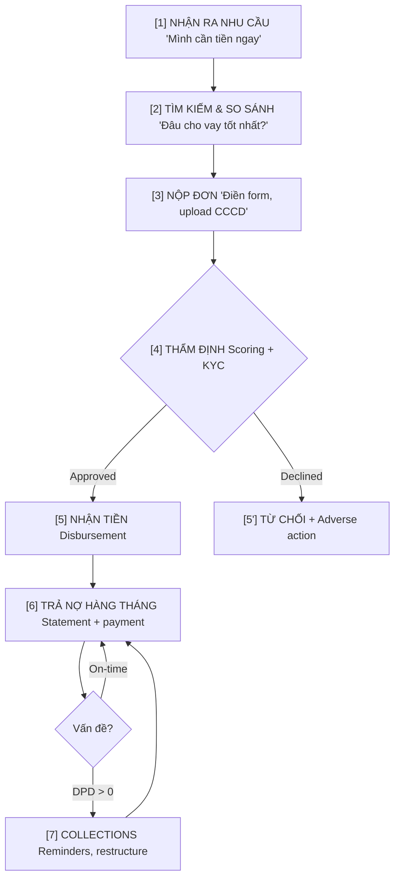

> *"Người vay không đưa ra quyết định tài chính thuần lý trí. Họ đưa ra quyết định con người - với tất cả sự phức tạp, thiên kiến, và cảm xúc đi kèm. Hệ thống tốt phải hiểu điều này."*

## Dẫn nhập: Cùng một người, hai quyết định khác nhau

::::story
Sáng thứ Hai, chị Lan đang ngồi trong văn phòng và đọc email thông báo laptop hỏng. Cô bình tĩnh, tính toán: "Mình cần 18.5 triệu. Lương còn 10 ngày nữa mới về. Vay tiêu dùng là hợp lý nhất."

Cô mở app, điền thông tin cẩn thận, đọc kỹ điều khoản trước khi ký. Quyết định hoàn toàn tỉnh táo.

Chiều thứ Sáu cùng tuần, chị Lan đang mua sắm ở trung tâm thương mại với bạn. Bạn chị vừa mua bộ sofa mới, được nhân viên bán hàng giới thiệu chương trình "Trả góp 0%, chỉ 2 triệu/tháng trong 24 tháng." Chị Lan nhìn sang bộ ghế đẹp hơn, giá 56 triệu - "cũng chỉ" 2.3 triệu/tháng. Cô ký hợp đồng trong vòng 15 phút.

Cùng một người. Cùng loại sản phẩm tài chính. Nhưng quá trình ra quyết định hoàn toàn khác nhau - và mức độ "hợp lý" cũng khác nhau.
::::

Chương này theo dõi toàn bộ hành trình của chị Lan - từ khi nhận ra nhu cầu đến khi tất toán khoản vay - qua hai lăng kính: quy trình vận hành *(operational flow)* và kinh tế học hành vi *(behavioral economics)*. Hiểu cả hai là điều kiện cần để thiết kế sản phẩm và hệ thống thực sự phục vụ người dùng - thay vì chỉ khai thác điểm yếu của họ.

## 4.1 Tổng quan hành trình: 8 giai đoạn

### Bức tranh toàn cảnh


Đây không chỉ là flowchart - mỗi mũi tên là một quyết định kinh doanh, mỗi ô vuông là một hoặc nhiều module trong VLP, và mỗi điểm chuyển tiếp là cơ hội để cải thiện hoặc phá hỏng trải nghiệm.

### Giai đoạn 1: Nhận ra nhu cầu *(Need Recognition)*

::::story
Nhu cầu vay tiền không xuất hiện từ một điểm. Nó xuất hiện từ nhiều trigger khác nhau - và loại trigger quyết định rất nhiều về hành vi của người vay sau đó.
::::

**Phân loại trigger:**

| Loại trigger | Ví dụ | Trạng thái tâm lý | Hành vi vay |
|-------------|-------|-------------------|-------------|
| **Khủng hoảng cấp bách** | Laptop hỏng cần thay ngay | Lo lắng, áp lực thời gian | Ra quyết định nhanh, ít so sánh |
| **Mua sắm có kế hoạch** | Tiết kiệm mua xe, thiếu phần còn lại | Tỉnh táo, có thời gian | So sánh nhiều, đàm phán |
| **Tiêu dùng bốc đồng** | Thấy sofa đẹp trong mall | Hưng phấn, FOMO | Quyết định tại chỗ, ít đọc điều khoản |
| **Tái cơ cấu tài chính** | Muốn gộp nợ nhiều nơi | Stress về tài chính | Tập trung vào rate, ít quan tâm thời hạn |

**Tại sao điều này quan trọng?**

Loại trigger ảnh hưởng đến:
1. **Channel preference**: Khủng hoảng cấp bách → digital (nhanh); Mua có kế hoạch → có thể đến chi nhánh
2. **Sensitivity**: Khủng hoảng → ít nhạy cảm với lãi suất (cần tiền ngay); Kế hoạch → so sánh kỹ
3. **Default risk**: Tiêu dùng bốc đồng → PD cao hơn (quyết định ít cẩn thận)
4. **Support needs**: Tái cơ cấu → cần tư vấn, không chỉ transaction

**Ứng dụng thiết kế:** Marketing và UX cho từng channel cần align với trigger type. App push notification "Bạn có thể vay ngay 20 triệu trong 5 phút" target trigger khủng hoảng cấp bách - hiệu quả về conversion nhưng thu hút behavioral risk.

### Giai đoạn 2: Tìm kiếm và So sánh

::::story
Chị Lan mở Google tìm "vay tiêu dùng nhanh" và thấy hàng chục kết quả. Làm thế nào cô quyết định chọn đâu?

Nghiên cứu về information search trong financial services cho thấy pattern đáng ngạc nhiên: hầu hết người vay **không** chọn option tốt nhất về tài chính. Họ chọn option **đủ tốt** và **ít friction nhất**.
::::

**Yếu tố quyết định lựa chọn** (theo thứ tự ưu tiên thực tế):

```text
1. Brand recognition / Trust (40%)
   "Ngân hàng/công ty này tôi đã nghe tên"

2. Speed and friction (30%)
   "Xét duyệt trong 5 phút, không cần giấy tờ"

3. Rate / terms (20%)
   "Lãi suất thế nào?" — thường được check SAU khi đã apply

4. Referral (10%)
   "Bạn tôi dùng và hài lòng"
```

**Điều này có hệ quả quan trọng:** Lãi suất tốt hơn không tự động thu hút khách hàng tốt hơn. Trust và speed quan trọng hơn trong giai đoạn tìm kiếm. Đây là lý do marketing và UX trong fintech tập trung vào "3-minute approval" hơn là "lowest rate."

### Giai đoạn 3: Nộp đơn và thẩm định

Đây là giai đoạn phức tạp nhất từ góc nhìn hệ thống. Origination flow trong VLP xử lý giai đoạn này - sẽ được mô tả chi tiết trong Chương 7. Ở đây, chúng ta focus vào trải nghiệm khách hàng.

**Friction trong origination là con dao hai lưỡi:**

*Friction cao (nhiều giấy tờ, nhiều bước):*
- Lọc bỏ người vay ít cam kết → adverse selection thấp hơn
- Người vay phải "đầu tư" vào process → ít bỏ giữa chừng sau khi được duyệt
- Nhưng: tỷ lệ hoàn thành đơn *(completion rate)* thấp → acquisition cost cao

*Friction thấp (apply trong 5 phút):*
- Conversion rate cao → nhiều đơn hơn
- Nhưng: nhiều đơn không nghiêm túc → adverse selection tăng
- Người vay ít suy nghĩ → default rate tiềm ẩn cao hơn

**Optimal friction point** là điểm cân bằng giữa conversion và risk - khác nhau theo từng phân khúc và sản phẩm.

**Ví dụ số:**

```text
Scenario A: High friction (10 giấy tờ, 3 ngày thẩm định)
  Đơn submitted: 1,000
  Completion rate: 40% → 400 đơn hoàn chỉnh
  Approval rate: 70% → 280 approved
  Default rate (12 tháng): 3%
  Bad loans: 280 × 3% = 8.4 khoản

Scenario B: Low friction (3 fields, 5 phút)
  Đơn submitted: 3,000 (conversion 3x)
  Completion rate: 80% → 2,400 đơn hoàn chỉnh
  Approval rate: 50% (scoring phải làm việc nhiều hơn): 1,200 approved
  Default rate: 6% (adverse selection)
  Bad loans: 1,200 × 6% = 72 khoản

Volume: B tốt hơn 4x
Bad loans: B tệ hơn 8.6x
```

Scenario B có thể vẫn profitable nếu margin đủ cao, nhưng rủi ro tập trung vào portfolio chất lượng thấp hơn đáng kể.

### Giai đoạn 4: Phán quyết và Offer Presentation

Khi hệ thống đã có đủ thông tin, hai điều xảy ra:

**4a. Từ chối *(Decline):***

Thông điệp từ chối là một trong những touchpoint quan trọng nhất - nhưng thường được thiết kế tệ nhất. Từ chối tệ → khách hàng bị xúc phạm, phẫn nộ, review xấu. Từ chối tốt → khách hàng hiểu lý do, có thể quay lại khi đủ điều kiện.

**Framework từ chối tốt:**
```text
Thay vì: "Đơn của bạn bị từ chối."

Nên: "Hiện tại chúng tôi chưa thể phê duyệt đơn của bạn vì [lý do cụ thể].
      Bạn có thể cải thiện bằng cách [action cụ thể].
      Hãy thử lại sau [thời gian cụ thể]."
```

Đây là thông tin mà hệ thống cần generate một cách thông minh - không chỉ là error code.

**4b. Chấp nhận và Offer Presentation:**

Cách trình bày offer ảnh hưởng lớn đến quyết định chấp nhận - và đây là nơi behavioral economics bắt đầu đóng vai trò quan trọng. Chúng ta sẽ đi sâu vào điều này ở section 4.3.

### Giai đoạn 5-8: Từ ký hợp đồng đến tái vay

Bốn giai đoạn cuối sẽ được mô tả chi tiết trong các chương kỹ thuật (Chương 7-10). Ở đây, điểm quan trọng cần ghi nhớ:

**Mỗi giai đoạn là một cơ hội CLV:**

| Giai đoạn | Cơ hội CLV | Rủi ro CLV |
|-----------|------------|------------|
| Ký hợp đồng | Upsell, cross-sell bảo hiểm | Over-commitment → default |
| Sử dụng (active) | Engage, loyalty | Disengagement → không tái vay |
| Trả trễ | Hardship program → save the customer | Collections aggressive → mất khách |
| Tất toán | Offer tái vay ngay | Không contact → khách đi chỗ khác |

:::summary[8 Giai Đoạn Hành Trình]
Trigger type → channel preference + risk profile
Search stage: Trust > Speed > Rate (theo thứ tự)
Friction là con dao hai lưỡi: conversion vs risk
Từ chối tốt = cơ hội retention tương lai
Mỗi giai đoạn = cơ hội hoặc rủi ro CLV
:::

## 4.2 Kênh phân phối và hành vi khách hàng

### Tình huống: Kênh nào tốt nhất?

::::story
Anh Minh nhận được câu hỏi từ CEO: "Chúng ta nên invest vào kênh nào? App hay POS merchant network?"

Câu trả lời đúng: "Phụ thuộc vào phân khúc target và risk tolerance. Không có kênh nào tốt nhất - chỉ có kênh phù hợp nhất với từng mục tiêu."
::::

### Ba kênh chính và Economics

**Kênh 1: POS *(Point of Sale)* - Tại Điểm Bán Hàng**

Người mua đang ở cửa hàng, nhân viên bán hàng (đã được training) giới thiệu sản phẩm tài chính tại chỗ.

**Đặc điểm:**
- Trigger: Tiêu dùng có kế hoạch hoặc bốc đồng
- Decision context: Đang hưng phấn với sản phẩm muốn mua
- Friction: Thấp - nhân viên hỗ trợ điền form

**Economics:**
```text
Acquisition cost: 500,000 - 1,500,000 VNĐ/khách hàng
  (commission cho merchant + training cost + system integration)

Ưu điểm:
  • Conversion rate cao (context phù hợp)
  • Merchant handle phần lớn origination
  • Tied to specific purchase → EAD predictable

Nhược điểm:
  • Phụ thuộc vào merchant relationship
  • Commission cao → cần volume lớn để profitable
  • Khó scale nhanh (phải sign từng merchant)
  • Behavioral risk: bốc đồng → default cao hơn
```

**Ví dụ số - POS Economics:**

```text
100 merchant partners, mỗi merchant 50 khoản vay/tháng = 5,000 loans/tháng
Average loan: 15,000,000 VNĐ
Commission: 2% = 300,000 VNĐ/loan
Total commission: 5,000 × 300,000 = 1,500,000,000 VNĐ/tháng

Revenue (net margin per loan): 1,200,000 VNĐ × 5,000 = 6,000,000,000 VNĐ/tháng
Commission as % of revenue: 1,500 / 6,000 = 25%
→ Cần margin đủ lớn để profitable sau commission
```

**Kênh 2: Digital *(App/Web)* - Self-Service**

Khách hàng tự apply qua app hoặc website, không cần nhân viên.

**Đặc điểm:**
- Trigger: Thường là khủng hoảng hoặc kế hoạch có chủ ý
- Decision context: Riêng tư, không áp lực xã hội
- Friction: Thiết kế được - từ rất thấp đến trung bình

**Economics:**
```text
Acquisition cost: 200,000 - 600,000 VNĐ/khách hàng
  (marketing digital: CPC, CPM, referral)

Ưu điểm:
  • Scale không giới hạn địa lý
  • Automation cao → cost per loan thấp
  • Data rich → scoring tốt hơn
  • 24/7 operation

Nhược điểm:
  • Trust barrier cao với new-to-credit
  • Fraud risk cao hơn POS (không có face-to-face)
  • Customer service phức tạp hơn (không có người hỗ trợ)
```

**Một insight quan trọng về digital:**

Thời điểm apply qua app tương quan với risk:

```text
Dữ liệu thực tế từ nhiều CFTC:
  Apply 9h-17h (giờ hành chính): Default rate X%
  Apply 18h-22h (tối): Default rate X + 0.5%
  Apply 23h-5h sáng: Default rate X + 1.8%

Giải thích hành vi: Apply lúc 2h sáng thường là dấu hiệu
của financial stress cấp tính → rủi ro cao hơn
```

Thông tin này có thể là một feature trong scoring model - nhưng cũng đặt ra câu hỏi về đạo đức: có nên từ chối hoặc tính lãi cao hơn chỉ vì người ta cần tiền lúc 2h sáng không?

**Kênh 3: Telesales / Agent - High Touch**

Nhân viên sales gọi điện hoặc gặp trực tiếp tại nhà/văn phòng khách hàng.

**Đặc điểm:**
- Trigger: Thường là outbound - công ty chủ động tiếp cận
- Decision context: Có người tư vấn, nhưng cũng có pressure
- Friction: Cao nhất - nhưng conversion sau friction thường tốt

**Economics:**
```text
Acquisition cost: 800,000 - 2,500,000 VNĐ/khách hàng
  (salary + commission cho agent + overhead)

Phù hợp với:
  • Khoản vay lớn (> 30 triệu) → margin đủ để bù cost
  • Khách hàng cần tư vấn (tái cơ cấu nợ, lần đầu vay)
  • Vùng nông thôn ít smartphone penetration
```

### Omnichannel và Friction Design

::::story
Chị Lan bắt đầu apply qua app lúc 10h tối, điền được 60% form thì buồn ngủ, tắt máy. Sáng hôm sau cô vào chi nhánh vì muốn hỏi thêm. Nhân viên nhìn vào hệ thống và nói: "Chị ơi, chị điền lại từ đầu nhé, chúng tôi không thấy đơn của chị."

Chị Lan bỏ đi, vay ở chỗ khác.
::::

**Đây là Omnichannel failure** - và nó xảy ra do thiếu một shared state layer giữa các kênh.

**Omnichannel requirement đối với hệ thống:**

```text
Shared Application State:
  → App lưu trạng thái đơn vay (draft) theo session
  → Chi nhánh có thể tiếp tục từ điểm đã dừng
  → Call center có thể xem lịch sử và context

Shared Customer Profile:
  → Mọi channel đều thấy cùng một customer 360
  → Không hỏi lại thông tin đã cung cấp

Cross-channel Journey Tracking:
  → Biết khách hàng đến từ channel nào
  → Attribution đúng cho marketing
```

Trong VLP, đây là lý do ADR *(Application Data Repository)* module tồn tại tách biệt với LOS *(Loan Origination Service)* - ADR là persistent state store, LOS là stateless orchestrator. Thiết kế này cho phép tiếp tục đơn từ bất kỳ channel nào.

### Friction Design: Nghệ thuật và Khoa học

::::story
Anh Minh đang A/B test hai phiên bản of onboarding:
- Version A: 3 bước, 5 phút
- Version B: 8 bước, 15 phút (thêm income verification, spending habit questions)

Version A: Completion rate 78%, default rate 5.8%
Version B: Completion rate 45%, default rate 3.2%

Câu hỏi: Version nào tốt hơn cho business?
::::

**Phân tích:**

```text
Version A (1,000 visitors):
  Completed: 780
  Approved (70%): 546
  Good loans (94.2%): 514
  Bad loans (5.8%): 32
  Revenue: 514 × 1,200,000 = 616,800,000 VNĐ
  Loss từ bad loans: 32 × 15,000,000 × 60% LGD = 288,000,000 VNĐ
  NET: 328,800,000 VNĐ

Version B (1,000 visitors):
  Completed: 450
  Approved (75% — scoring tốt hơn vì nhiều data): 338
  Good loans (96.8%): 327
  Bad loans (3.2%): 11
  Revenue: 327 × 1,200,000 = 392,400,000 VNĐ
  Loss từ bad loans: 11 × 15,000,000 × 60% = 99,000,000 VNĐ
  NET: 293,400,000 VNĐ
```

Version A tốt hơn về net value - dù bad loan rate cao hơn. Friction không phải luôn là giải pháp đúng.

**Nguyên tắc friction design:**

```text
1. Friction nên có mục đích rõ ràng
   → "Thu thập data này để làm gì?" — nếu không có câu trả lời tốt, bỏ đi

2. Friction nên có thể giải thích cho khách hàng
   → "Chúng tôi hỏi điều này để bảo vệ bạn khỏi over-indebtedness"

3. Progressive disclosure
   → Hỏi thông tin cơ bản trước, thông tin phức tạp sau
   → Không hỏi tất cả ngay từ đầu

4. Friction không đồng đều theo risk
   → Loan nhỏ: ít friction
   → Loan lớn: nhiều friction
   → Returning customer: ít friction hơn first-time
```

:::summary[Kênh Phân Phối]
POS: conversion cao, commission cao, behavioral
risk cao - phù hợp với purchase-linked products
Digital: scalable, data-rich, fraud risk, trust
barrier - phù hợp với tech-savvy, planned loans
Telesales: highest cost, highest touch - phù hợp
với large loans, first-time, rural
Omnichannel: shared state là requirement kỹ thuật
Friction: tối ưu hóa cho net value, không chỉ
completion rate hoặc default rate riêng lẻ
:::

## 4.3 Kinh tế học hành vi trong tín dụng tiêu dùng

### Tại sao phần này quan trọng

Kinh tế học truyền thống giả định con người ra quyết định tối ưu *(rational agents)*. Kinh tế học hành vi, được Richard Thaler và Daniel Kahneman tiên phong, cho thấy điều ngược lại: con người ra quyết định theo những pattern có thể dự đoán được - nhưng không phải lúc nào cũng tối ưu.

Trong tín dụng tiêu dùng, điều này có hai hệ quả:

1. **Opportunity for lender:** Biết behavioral biases → thiết kế sản phẩm và UX để tăng conversion và retention
2. **Responsibility for lender:** Cùng kiến thức đó có thể được dùng để khai thác → ranh giới đạo đức mỏng

Người thiết kế hệ thống cần hiểu cả hai phía.

### Thiên kiến 1: Present Bias: Kẻ thù của kế hoạch tài chính

**Khái niệm:**

:::key
**Present bias** *(thiên kiến hiện tại)* là xu hướng con người định giá phần thưởng immediate cao hơn phần thưởng tương lai một cách bất hợp lý - ngay cả khi đã biết điều này là không tối ưu.
:::

**Thí nghiệm kinh điển:**

Hỏi người A: "Bạn muốn 100,000 VNĐ hôm nay hay 120,000 VNĐ tuần sau?"
Đa số chọn 100,000 VNĐ hôm nay - dù lãi suất 20% trong một tuần là phi thường.

Hỏi người A: "Bạn muốn 100,000 VNĐ trong 52 tuần hay 120,000 VNĐ trong 53 tuần?"
Đa số chọn 120,000 VNĐ - vì cả hai đều xa, thêm một tuần không quan trọng.

**Nghịch lý:** Cùng một sự đánh đổi (thêm 20,000 VNĐ để chờ thêm 1 tuần), nhưng quyết định khác nhau tùy thuộc vào bối cảnh.

**Biểu hiện trong tín dụng tiêu dùng:**

*Khi vay:* Present bias khiến người ta vay quá nhiều vì "tiền hôm nay" cảm thấy thật hơn "nợ tương lai."

```text
Tư duy của người vay có present bias:
  "20 triệu hôm nay để mua sofa đẹp = rất thật, rất hấp dẫn"
  "2,300,000 VNĐ × 24 tháng = 55,200,000 VNĐ = trừu tượng, xa vời"
```

*Khi trả nợ:* "Tháng này tôi chi trước, tháng sau tiết kiệm để trả nợ" - nhưng tháng sau, tư duy tương tự lại xuất hiện.

**Ví dụ số - Tổng chi phí của present bias:**

Chị Lan, do present bias, mua sofa 56 triệu trả góp 24 tháng thay vì tiết kiệm 24 tháng rồi mua:

```text
Kịch bản A — Tiết kiệm rồi mua (không có present bias):
  Tiết kiệm 56,000,000 VNĐ trong 24 tháng
  = 2,333,333 VNĐ/tháng vào tài khoản tiết kiệm lãi 6%/năm
  Sau 24 tháng có: 56,000,000 + lãi tiết kiệm ~3,360,000 = 59,360,000 VNĐ
  Mua sofa 56 triệu, còn dư 3,360,000 VNĐ

Kịch bản B — Vay và trả góp (có present bias):
  Vay 56,000,000 VNĐ, lãi 15%/năm, 24 tháng
  PMT = 56,000,000 × 0.0125 × (1.0125)^24 / [(1.0125)^24 - 1]
      = 56,000,000 × 0.0125 × 1.3474 / 0.3474
      = 56,000,000 × 0.04849
      = 2,715,440 VNĐ/tháng

Chi phí thực:
  Kịch bản A: 2,333,333/tháng → cuối cùng có sofa + 3,360,000 VNĐ
  Kịch bản B: 2,715,440/tháng → cuối cùng chỉ có sofa

  Chi phí của present bias = (2,715,440 - 2,333,333) × 24 = 9,170,568 VNĐ
  ≈ 16.4% giá trị chiếc sofa
```

Present bias khiến chị Lan trả thêm gần 9.2 triệu VNĐ - gần bằng một chiếc điện thoại mới.

### Thiên kiến 2: Anchoring và Payment Size Illusion

**Khái niệm:**

:::key
**Anchoring** *(neo giá)* là xu hướng con người phụ thuộc quá nhiều vào thông tin đầu tiên nhận được khi ra quyết định.
:::

**Payment Size Illusion trong consumer lending:**

Người vay có xu hướng tập trung vào PMT hàng tháng thay vì tổng chi phí vay.

**Thí nghiệm:**

Cho hai nhóm người xem hai offer:
- Offer A: "Vay 20 triệu, lãi 18%/năm, 12 tháng, trả 1,836,500 VNĐ/tháng"
- Offer B: "Vay 20 triệu, lãi 18%/năm, 36 tháng, trả 722,000 VNĐ/tháng"

Hỏi: "Offer nào rẻ hơn?"

Đa số người chưa qua training tài chính nói Offer B "rẻ hơn" - vì 722,000 < 1,836,500. Nhưng:

```text
Offer A: 1,836,500 × 12 = 22,038,000 VNĐ → Lãi tổng: 2,038,000 VNĐ
Offer B: 722,000 × 36 = 25,992,000 VNĐ → Lãi tổng: 5,992,000 VNĐ

Offer B "rẻ hơn" tốn gấp 3x tiền lãi.
```

**Ứng dụng trong product design:**

Salespeople được training để present kỳ hạn dài trước vì:
- 722,000 VNĐ/tháng "cảm giác" dễ chịu hơn
- Người vay ít có khả năng tính tổng chi phí
- Margin cho lender cao hơn đáng kể

**Hệ quả ethical:** Transparency laws ở nhiều nước yêu cầu hiển thị **tổng số tiền phải trả** (không chỉ PMT) và **APR** (không chỉ nominal rate) để counteract anchoring bias.

**Trong hệ thống:** Giao diện app phải hiển thị đủ thông tin để người vay có thể ra quyết định informed. Đây không chỉ là UX best practice - ở nhiều thị trường, đây là regulatory requirement.

### Thiên kiến 3: Mental Accounting: Tại sao BNPL "cảm thấy Free"

**Khái niệm:**

:::key
**Mental accounting** *(hạch toán tâm lý)* là xu hướng con người phân loại tiền vào các "tài khoản" tâm lý khác nhau và xử lý chúng khác nhau dù về mặt tài chính là như nhau.
:::

**Ví dụ kinh điển:**

Bạn nhận được 1,000,000 VNĐ tiền thưởng bất ngờ. Bạn dùng nó để mua bữa tối sang (500,000 VNĐ) và quần áo (500,000 VNĐ).

Nếu bạn tự kiếm 1,000,000 VNĐ qua làm thêm - bạn có chi thoải mái như vậy không? Nghiên cứu cho thấy: không. "Tiền thưởng bất ngờ" và "tiền mồ hôi" được xử lý khác nhau dù có cùng giá trị.

**Mental Accounting trong BNPL:**

"Chỉ 500,000 VNĐ/tháng" được mental account vào bucket "chi phí hàng tháng nhỏ" - không phải "nợ." Cảm giác hoàn toàn khác với "tôi đang nợ 6,000,000 VNĐ."

```text
Thực tế tài chính:
  BNPL 6,000,000 VNĐ trả 3 lần = nợ 6,000,000 VNĐ

Mental accounting:
  "3 lần × 2,000,000 VNĐ" → xem như monthly expense, không phải debt

Hệ quả: Người có 5 BNPL đang chạy đồng thời có thể
  không nhận ra họ đang nợ 20-30 triệu VNĐ
```

**Giải thích tại sao BNPL có default rate cao hơn dự kiến:**

BNPL providers thường under-estimate default risk vì họ không account cho mental accounting effect - người dùng tích lũy nhiều BNPL obligations hơn họ nhận ra, và khi tất cả đến hạn cùng lúc, khả năng trả của họ thấp hơn dự báo.

### Thiên kiến 4: Loss Aversion: Công cụ Retention mạnh nhất

**Khái niệm:**

:::key
**Loss aversion** *(né tránh tổn thất)* là xu hướng con người cảm nhận nỗi đau của việc mất mát mạnh gấp khoảng 2-2.5 lần niềm vui của việc đạt được tương đương.
:::

**Thí nghiệm:**

Bạn muốn chơi game: tung đồng xu.
- Ngửa: bạn thắng 150,000 VNĐ
- Sấp: bạn mất 100,000 VNĐ

Expected value: 150,000 × 0.5 - 100,000 × 0.5 = +25,000 VNĐ → Positive!

Nhưng đa số người từ chối chơi. Tại sao? Vì nỗi đau mất 100,000 VNĐ cảm thấy mạnh hơn niềm vui thắng 150,000 VNĐ.

**Ứng dụng trong retention:**

```text
Thông điệp A (gain framing):
  "Trả đúng hạn 3 tháng liên tiếp → nhận 50,000 VNĐ reward"

Thông điệp B (loss framing):
  "Bạn đang có 50,000 điểm reward sắp hết hạn
   nếu không trả đúng hạn tháng này"

Nghiên cứu cho thấy: Thông điệp B hiệu quả hơn ~30-40%
về on-time payment rate
```

**Ứng dụng trong collections:**

```text
Thông điệp collections A (standard):
  "Bạn đang nợ quá hạn. Vui lòng thanh toán ngay."

Thông điệp collections B (loss framing):
  "Bạn sắp mất credit score của mình.
   Chỉ còn 3 ngày để tránh ảnh hưởng đến credit history.
   Mất credit score sẽ ảnh hưởng đến khả năng vay tiếp theo."

Thông điệp B sử dụng loss aversion để tăng cure rate.
```

**Ranh Giới Đạo Đức:**

Loss aversion là công cụ mạnh. Dùng sai:
- "Bạn sắp mất nhà" (khi không có tài sản đảm bảo) → misleading
- Tạo ra sự sợ hãi không có căn cứ để pressure payment

Dùng đúng:
- Thông báo về real consequences (credit score, future borrowing)
- Nhắc về rewards sắp hết hạn
- "You're almost there" messaging khi gần tất toán

### Ứng dụng tổng hợp: Thiết kế hành trình tốt

::::story
Kỹ sư Tuấn được giao thiết kế notification system cho app. Anh có data về behavioral biases và muốn dùng nó để tối ưu hóa.

Anh Minh - Product Owner - nhắc nhở: "Tuấn, mình có thể dùng psychology để increase payment rate. Nhưng phải phân biệt rõ: đâu là nudge hợp lý, đâu là manipulation."
::::

**Framework phân biệt Nudge vs Manipulation:**

```text
NUDGE (hợp lý):
  ✅ Thông tin chính xác, được trình bày rõ ràng
  ✅ Người dùng vẫn có thể opt-out hoặc chọn khác
  ✅ Hướng đến lợi ích của người dùng
  ✅ Transparent về cơ chế hoạt động

MANIPULATION (không hợp lý):
  ❌ Tạo ra áp lực giả tạo (fake urgency)
  ❌ Ẩn thông tin quan trọng
  ❌ Khai thác vulnerabilities (người đang khủng hoảng)
  ❌ Hướng đến lợi ích của lender, gây hại cho user
```

**Ví dụ thực tế:**

| Hành vi | Nudge hay Manipulation? |
|---------|------------------------|
| Hiển thị countdown "Offer hết hạn trong 2h" (thực sự có deadline) | ✓ Nudge |
| Hiển thị countdown (không có deadline thực, tự động reset) | ✗ Manipulation |
| "Bạn đang tiết kiệm X VNĐ so với trả hết một lần" (đúng sự thật) | ✓ Nudge |
| Hiển thị PMT thay vì tổng chi phí để hide total cost | ✗ Manipulation |
| Nhắc nhở trả nợ 3 ngày trước deadline | ✓ Nudge |
| Gọi điện nhiều lần/ngày khi chỉ quá hạn 1 ngày | ✗ Manipulation |

:::summary[Behavioral Economics]
Present bias: immediate > future → over-borrowing
Anchoring: PMT framing → people ignore total cost
Mental accounting: BNPL "feels free" → debt
accumulation without awareness
Loss aversion: ~2.5x mạnh hơn gain → dùng trong
retention và collections (responsibly)
Ranh giới: nudge = hướng lợi ích user;
manipulation = khai thác biases để harm user
:::

## 4.4 Phân khúc khách hàng và Product Fit

### Tình huống: Sản phẩm đúng, khách hàng Sai

::::story
Công ty tài chính Z ra sản phẩm vay giáo viên thành công vang dội - default rate chỉ 1.5%, NPS 72. Năm sau, họ quyết định scale: mở rộng cùng sản phẩm (cùng lãi suất, cùng terms) cho "công nhân viên chức nhà nước."

12 tháng sau, default rate nhảy lên 4.8%. Điều tra phát hiện: "công nhân viên chức nhà nước" là định nghĩa quá rộng, bao gồm cả những người có thu nhập không ổn định, nhiều khoản nợ khác, và rủi ro cao hơn giáo viên nhiều.

Sản phẩm đúng - nhưng phân khúc sai.
::::

### Thin-File vs Thick-File Borrowers

**Thin-file borrower:**
- Ít hoặc không có lịch sử tín dụng chính thức
- Có thể là người trẻ lần đầu vay, người mới chuyển đến thành phố, người chưa bao giờ dùng ngân hàng
- Challenge: Không có data để score → rủi ro cao và/hoặc bị từ chối oan

**Thick-file borrower:**
- Có lịch sử tín dụng phong phú
- Score dễ tính, risk predictable
- Competition cao: ngân hàng cũng muốn phân khúc này

**Chiến lược với thin-file:**

```text
Option A: Từ chối toàn bộ
  → Safe nhưng bỏ lỡ thị trường lớn và profitable nếu được phục vụ đúng

Option B: Cho vay với lãi suất cao (bù rủi ro không có data)
  → Có thể thu hút adverse selection (vì người vay tốt có alternative)

Option C: Starter loan → Build history → Graduate to better products
  → Vay nhỏ đầu tiên (1-3 triệu), theo dõi hành vi, cập nhật model
  → Nếu trả tốt → tăng limit, giảm rate
  → Đây là sustainable model với thin-file
```

### Behavioral Segmentation

Ngoài demographic và credit score, hành vi trên platform cung cấp tín hiệu có giá trị:

| Hành vi | Tín hiệu |
|---------|---------|
| Đọc full terms & conditions | Responsible borrower |
| Dùng calculator trước khi apply | Careful planner |
| Apply và cancel nhiều lần | Uncertain / shopping around |
| Trả hơn MMI mỗi tháng | Financial discipline cao |
| Rút revolving credit đúng ngày nhận lương | Cash flow tight |
| Không login app sau 3 tháng đầu | Disengagement risk |

**Ứng dụng:** Behavioral signals kết hợp với credit score tạo ra segmentation phong phú hơn - không chỉ "tốt/xấu" mà còn "tốt nhưng cần education," "average nhưng improving," "xấu nhưng temporary hardship."

### Risk-Based Segmentation và Pricing Implications

Phân khúc tốt dẫn đến pricing tốt. Nhưng cần cẩn thận với một tension quan trọng:

**Tension: Accuracy vs Fairness**

Risk-based pricing chính xác có thể dẫn đến price discrimination theo demographic - nếu demographic features correlate với risk, pricing "fair" về mặt actuarial có thể "unfair" về mặt xã hội.

**Ví dụ:**

```text
Nếu model scoring phát hiện: địa chỉ ở một số phường nhất định
correlates với PD cao hơn (vì socioeconomic factors)

→ Pricing dựa trên địa chỉ sẽ charge người nghèo nhiều hơn
→ Là "actuarially fair" (chính xác về rủi ro)
→ Nhưng là "redlining" (phân biệt đối xử theo địa lý)
→ Bị cấm ở nhiều nước
```

**Regulatory approach:** Nhiều nước yêu cầu model phải "explainable" - không chỉ accurate. Và một số features (race, religion, gender - hoặc proxies của chúng) bị cấm sử dụng trong credit decisions.

**Hệ quả thiết kế hệ thống:**

Scoring model phải có khả năng:
1. Giải thích lý do từ chối *(explainability)*
2. Audit features để phát hiện proxy discrimination
3. Log đầy đủ để regulatory review

Đây là yêu cầu không phải của "nice to have" mà là compliance requirement ảnh hưởng đến architecture của toàn bộ ML pipeline.

:::summary[Phân Khúc Khách Hàng]
Product fit cần đúng segment - không phải
mọi "government employee" là như nhau
Thin-file: starter loan → build history là
sustainable hơn từ chối hoặc lãi cao ngay
Behavioral signals bổ sung demographic +
credit score để segmentation phong phú hơn
Accuracy vs Fairness: pricing chính xác có thể
vi phạm anti-discrimination law → explainability
và feature audit là architecture requirement
:::

## 4.5 Thiết kế hành trình tốt

### 10 Nguyên tắc thiết kế hành trình khách hàng

Tổng hợp toàn bộ chương, đây là 10 nguyên tắc cho việc thiết kế customer journey tốt trong consumer finance:

**1. Align channel với trigger type**
Khủng hoảng cấp bách → digital nhanh; Kế hoạch có chủ ý → có thể có agent; Bốc đồng → friction có chủ ý để protect khách hàng.

**2. Trust first, rate second**
Trong giai đoạn tìm kiếm, trust và speed quan trọng hơn rate. Invest vào brand và UX, không chỉ vào pricing.

**3. Friction phải có mục đích**
Mỗi field trong form phải trả lời được câu hỏi: "Thông tin này giúp chúng ta phục vụ khách hàng tốt hơn như thế nào?" Friction không có mục đích là acquisition barrier.

**4. Từ chối là cơ hội**
Từ chối tốt = thông báo lý do + action plan + invitation to return. Đây là brand moment, không chỉ là rejection.

**5. Transparency về total cost**
Hiển thị APR, tổng số tiền phải trả, và thời gian tất toán - không chỉ PMT. Đây là đúng về đạo đức và đúng về luật.

**6. Counter-act biases, không khai thác**
Dùng behavioral knowledge để help khách hàng ra quyết định tốt hơn: hiển thị total cost để counter anchoring; thông báo về debt accumulation để counter mental accounting.

**7. Omnichannel là bắt buộc**
Khách hàng không sống trong một channel. Shared state layer là foundation không thể thiếu.

**8. Segmentation drives personalization**
Người dùng khác nhau cần journey khác nhau: first-time vs returning, thin-file vs thick-file, mobile-first vs branch.

**9. Collections là customer service**
Collections team không chỉ là "debt collectors" - họ là tuyến cuối cùng để save a customer relationship. Hardship program > aggressive collections về CLV.

**10. Tái vay là kết quả, không phải mặc định**
Sau khi tất toán, offer tái vay phải dựa trên việc tái vay có phù hợp với nhu cầu khách hàng không - không phải chỉ vì pipeline cần volume.

## Tóm tắt chương 4

```text
Hành trình của chị Lan nhìn từ hai góc độ:

Operational view:
  Nhận ra nhu cầu
    → Tìm kiếm (Trust > Speed > Rate)
    → Apply (Friction optimization)
    → Thẩm định (LOS/CIS/Scoring)
    → Offer presentation (Behavioral framing)
    → Ký hợp đồng (DMS)
    → Sử dụng và billing (LAS + EOM)
    → Tất toán (CLV opportunity)

Behavioral view:
  Present bias → vay nhiều hơn tối ưu
  Anchoring → tập trung PMT, bỏ qua total cost
  Mental accounting → BNPL debt không "cảm thấy" là debt
  Loss aversion → công cụ retention và collections

Thiết kế tốt phải account cho cả hai.
Thiết kế tệ chỉ nhìn một trong hai.
Thiết kế xấu cố ý khai thác behavioral biases.
```

## Câu hỏi tự kiểm tra

**Loại 1 - Nhớ lại:**
1. Kể 4 loại trigger khiến người ta muốn vay tiêu dùng. Mỗi loại trigger ảnh hưởng đến hành vi vay như thế nào?
2. Present bias là gì? Cho một ví dụ không liên quan đến tín dụng.
3. Thin-file borrower khác thick-file borrower ở điểm nào? Tại sao phân biệt này quan trọng với lender?
4. Omnichannel yêu cầu gì về mặt kỹ thuật từ hệ thống?

**Loại 2 - Hiểu:**
5. Tại sao "Trust > Speed > Rate" trong giai đoạn tìm kiếm? Điều này có nghĩa là lãi suất không quan trọng không?
6. Giải thích tại sao friction cao không phải lúc nào cũng tốt cho business - dù nó giảm default rate. Dùng phân tích net value để minh họa.
7. Mental accounting giải thích tại sao người có nhiều khoản BNPL đồng thời có thể không nhận ra mức nợ thực sự của họ. Điều này tạo ra rủi ro gì cho hệ thống?
8. Tại sao explainability của scoring model là architecture requirement, không chỉ là "nice to have"?

**Loại 3 - Áp dụng:**
9. Công ty tài chính đang thiết kế notification system để tăng on-time payment rate. Với kiến thức về loss aversion và present bias, thiết kế 3 loại notification khác nhau - một cho 7 ngày trước deadline, một cho 1 ngày trước, và một cho ngày sau khi quá hạn. Giải thích tại sao bạn chọn framing đó.

10. Anh Minh đang phân tích hai A/B test:
    - Variant A: Hiển thị "Chỉ 722,000 VNĐ/tháng" (không có thông tin khác)
    - Variant B: Hiển thị "722,000 VNĐ/tháng | Tổng trả: 25,992,000 VNĐ | APR: 22.5%"

    Variant A có conversion rate 68%, Variant B có 52%.
    - (a) Tại sao Variant A có conversion cao hơn? (behavioral explanation)
    - (b) Dự đoán sự khác biệt về default rate và customer satisfaction giữa hai variant
    - (c) Bạn nên chọn variant nào? Justify từ cả business và ethical perspective.

**Loại 4 - Phân tích:**
11. Một công ty tài chính thu thập app usage data (thời điểm login, tần suất check balance, pattern mua sắm qua linked accounts) và dùng nó để:
    - (a) Detect early warning signs của financial stress → proactive outreach
    - (b) Score people who have no credit history
    - (c) Charge higher rates to people who check balance more frequently (proxy for financial anxiety)

    Phân tích từng use case: (i) có acceptable không về ethical, (ii) có hợp pháp không, (iii) hệ thống cần gì để implement safely?

12. Startup fintech đề xuất: "Thay vì 8-step origination, chúng tôi dùng AI để approve trong 30 giây với chỉ số điện thoại." Phân tích:
    - (a) Behavioral economics implications (adverse selection, moral hazard)
    - (b) Risk modeling challenges (thin data)
    - (c) Regulatory compliance risks
    - (d) Long-term viability của business model này

## Bài tập áp dụng

**Bài 1 - Customer Journey Mapping:**
Vẽ customer journey map đầy đủ cho một khách hàng muốn vay 30 triệu VNĐ qua kênh digital để mua xe máy.

Yêu cầu:
- (a) 8 giai đoạn với touchpoints cụ thể (ít nhất 3 touchpoints mỗi giai đoạn)
- (b) Emotional curve: mức độ hài lòng/lo lắng tại mỗi touchpoint
- (c) Pain points: 3 điểm dễ bỏ lỡ nhất (và tại sao)
- (d) System interactions: module VLP nào được kích hoạt tại mỗi giai đoạn?
- (e) Behavioral bias nào có thể ảnh hưởng tại mỗi giai đoạn?

**Bài 2 - Behavioral Design:**
Công ty tài chính muốn giảm tỷ lệ trả trễ từ 8% xuống 5%. Budget: 50,000 VNĐ/tháng/khách hàng cho intervention.

Data có sẵn:
- 70% khách hàng dùng smartphone thường xuyên
- 85% cho phép push notification
- Average DPD khi trả trễ: 12 ngày
- Phí trả trễ: 200,000 VNĐ/lần

Thiết kế một behavioral intervention program:
- (a) Ít nhất 3 loại intervention khác nhau, dùng behavioral principles khác nhau
- (b) Sequence và timing của từng intervention
- (c) A/B test design để validate effectiveness
- (d) Đo lường: metrics nào để biết chương trình có hiệu quả?

**Bài 3 - Segmentation Strategy:**
Công ty tài chính X đang target phân khúc "freelancer và người tự kinh doanh" (chiếm 30% workforce nhưng chỉ 8% loan portfolio hiện tại).

Challenge: Thu nhập không đều, không có payslip truyền thống, thin-file với nhiều người.

Yêu cầu:
- (a) Thiết kế scoring approach không dựa vào payslip (alternative data sources nào?)
- (b) Thiết kế product phù hợp (kỳ hạn, repayment schedule, limit) cho thu nhập không đều
- (c) Thiết kế origination journey phù hợp với đặc thù của segment này
- (d) Rủi ro chính và cách mitigate
- (e) Trong VLP, những thay đổi nào cần thiết để hỗ trợ flexible repayment schedule?

## Đọc thêm

**Behavioral Economics:**
- Thaler, R. H., & Sunstein, C. R. (2008). *Nudge: Improving Decisions About Health, Wealth, and Happiness.* Yale University Press. - Cuốn sách foundational về nudge theory và ứng dụng.

**Consumer Finance Psychology:**
- Kahneman, D. (2011). *Thinking, Fast and Slow.* Farrar, Straus and Giroux. - Mô tả System 1 vs System 2 thinking - nền tảng để hiểu tại sao người vay ra quyết định như họ làm.

**UX trong Financial Services:**
- Morville, P. (2014). *Intertwingled: Information Changes Everything.* Semantic Studios. - Về thiết kế trải nghiệm thông tin trong context phức tạp - applicable cho financial UX.

*Chương 5 sẽ nhìn vào hành trình của chị Lan từ góc độ của người điều hành công ty: mô hình doanh thu, quản lý danh mục, và những gì xảy ra ở cấp độ portfolio khi hàng triệu hành trình cá nhân như của chị Lan được cộng lại.*
