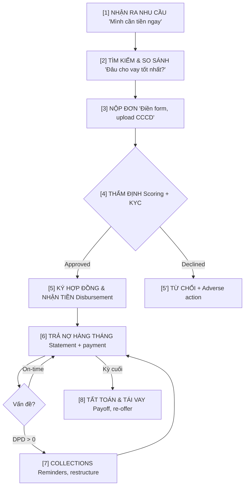

> *"Người vay không đưa ra quyết định tài chính thuần lý trí. Họ đưa ra quyết định của con người, với đầy đủ sự phức tạp, thiên kiến và cảm xúc đi kèm. Hệ thống tốt phải hiểu điều này."*

## Dẫn nhập: cùng một người, hai quyết định khác nhau

::::story
Sáng thứ hai, chị Lan ngồi ở văn phòng và đọc email báo laptop không sửa được. Chị bình tĩnh tính toán: "Mình cần 18.5 triệu. Mười ngày nữa mới có lương. Vay tiêu dùng là hợp lý nhất."

Chị mở ứng dụng, điền thông tin cẩn thận, đọc kỹ điều khoản rồi mới ký. Một quyết định hoàn toàn tỉnh táo.

Chiều thứ sáu cùng tuần, chị Lan đi mua sắm với bạn ở trung tâm thương mại. Bạn chị vừa mua một bộ sofa 48 triệu, được nhân viên giới thiệu chương trình "trả góp chỉ từ 2.3 triệu/tháng trong 24 tháng". Chị Lan nhìn sang bộ đẹp hơn, giá 56 triệu, "cũng chỉ" khoảng 2.7 triệu/tháng. Chị ký hợp đồng trong vòng 15 phút.

Cùng một người, cùng một loại sản phẩm tài chính. Nhưng cách ra quyết định hoàn toàn khác, và mức độ hợp lý của quyết định cũng khác.
::::

Chương này theo chị Lan trong toàn bộ hành trình, từ lúc nhận ra nhu cầu đến khi tất toán khoản vay, qua hai lăng kính: quy trình vận hành *(operational flow)* và kinh tế học hành vi *(behavioral economics)*. Hiểu cả hai là điều kiện cần để thiết kế sản phẩm và hệ thống thực sự phục vụ người dùng, thay vì khai thác điểm yếu của họ.

## 4.1 Tổng quan hành trình: tám giai đoạn

### Bức tranh toàn cảnh



*Hình 4.1. Tám giai đoạn của hành trình vay.*

Mỗi mũi tên trong hình là một quyết định kinh doanh, mỗi ô là một hoặc nhiều module của VLP, và mỗi điểm chuyển tiếp là cơ hội để cải thiện hoặc phá hỏng trải nghiệm của khách hàng.

### Giai đoạn 1: nhận ra nhu cầu

Nhu cầu vay không xuất hiện từ một điểm duy nhất. Nó đến từ nhiều tác nhân *(trigger)* khác nhau, và loại tác nhân quyết định rất nhiều về hành vi của người vay sau đó.

| Loại tác nhân | Ví dụ | Trạng thái tâm lý | Hành vi vay |
|---|---|---|---|
| **Khủng hoảng cấp bách** | Laptop hỏng, cần thay ngay | Lo lắng, áp lực thời gian | Quyết định nhanh, ít so sánh |
| **Mua sắm có kế hoạch** | Tiết kiệm mua xe, còn thiếu một phần | Tỉnh táo, có thời gian | So sánh nhiều, thương lượng |
| **Tiêu dùng bốc đồng** | Thấy sofa đẹp ở trung tâm thương mại | Hưng phấn, sợ bỏ lỡ | Quyết định tại chỗ, ít đọc điều khoản |
| **Tái cơ cấu tài chính** | Muốn gộp nợ ở nhiều nơi | Căng thẳng về tài chính | Tập trung vào lãi suất, ít quan tâm kỳ hạn |

Loại tác nhân ảnh hưởng tới bốn điều. **Kênh ưa thích**: khủng hoảng cấp bách hướng tới kênh số vì nhanh, còn mua có kế hoạch có thể đến chi nhánh. **Độ nhạy với giá**: người đang khủng hoảng ít nhạy với lãi suất vì cần tiền ngay, người có kế hoạch so sánh kỹ. **Rủi ro vỡ nợ**: tiêu dùng bốc đồng thường có PD cao hơn vì quyết định ít cân nhắc. **Nhu cầu hỗ trợ**: người tái cơ cấu nợ cần được tư vấn, không chỉ một giao dịch.

Vì vậy, marketing và trải nghiệm của từng kênh cần khớp với loại tác nhân. Một thông báo đẩy "Vay ngay 20 triệu trong 5 phút" nhắm vào người đang khủng hoảng: hiệu quả về tỷ lệ chuyển đổi, nhưng cũng thu hút đúng nhóm có rủi ro hành vi cao.

### Giai đoạn 2: tìm kiếm và so sánh

::::story
Chị Lan tìm "vay tiêu dùng nhanh" trên mạng và thấy hàng chục kết quả. Chị chọn nơi nào?

Các nghiên cứu về hành vi tìm kiếm thông tin trong dịch vụ tài chính cho thấy một mẫu hình đáng chú ý: phần lớn người vay **không** chọn phương án tốt nhất về tài chính. Họ chọn phương án **đủ tốt** và **ít trở ngại nhất**.
::::

Thứ tự ưu tiên điển hình của người vay khi chọn nơi vay, với tỷ trọng mang tính minh họa:

```text
1. Brand recognition / Trust (40%)
   "Ngân hàng/công ty này tôi đã nghe tên"

2. Speed and friction (30%)
   "Xét duyệt trong 5 phút, không cần giấy tờ"

3. Rate / terms (20%)
   "Lãi suất thế nào?" — thường được check SAU khi đã apply
```

Điều này có hệ quả quan trọng: lãi suất tốt hơn không tự động thu hút khách hàng tốt hơn. Ở giai đoạn tìm kiếm, niềm tin và tốc độ thường quan trọng hơn giá. Đó là lý do các công ty fintech quảng cáo "duyệt trong 3 phút" nhiều hơn "lãi suất thấp nhất". Lời giới thiệu từ bạn bè *(referral)* là yếu tố thứ tư, chiếm phần còn lại.

### Giai đoạn 3: nộp đơn và thẩm định

Đây là giai đoạn phức tạp nhất về mặt hệ thống. Quy trình khởi tạo khoản vay của VLP được mô tả chi tiết ở [Chương 7](/docs/system/ch07-origination); ở đây ta tập trung vào trải nghiệm của khách hàng.

Mức độ ma sát *(friction)* trong quy trình nộp đơn là con dao hai lưỡi. Ma sát cao, tức nhiều giấy tờ và nhiều bước, lọc bớt người vay thiếu nghiêm túc nên giảm lựa chọn bất lợi, và người đã "đầu tư công sức" ít bỏ cuộc sau khi được duyệt. Nhưng tỷ lệ hoàn thành đơn *(completion rate)* thấp, nên chi phí có khách hàng cao. Ma sát thấp, tức nộp đơn trong 5 phút, cho tỷ lệ chuyển đổi cao và nhiều đơn hơn; nhưng cũng nhiều đơn thiếu nghiêm túc, lựa chọn bất lợi tăng, và người vay ít suy nghĩ nên rủi ro vỡ nợ tiềm ẩn cao hơn.

Mức ma sát tối ưu là điểm cân bằng giữa chuyển đổi và rủi ro, và nó khác nhau theo từng phân khúc, từng sản phẩm.

```text
Scenario A: High friction (10 giấy tờ, 3 ngày thẩm định)
  Đơn submitted: 1,000
  Completion rate: 40% → 400 đơn hoàn chỉnh
  Approval rate: 70% → 280 approved
  Default rate (12 tháng): 3%
  Bad loans: 280 × 3% = 8.4 khoản

Scenario B: Low friction (3 fields, 5 phút)
  Đơn submitted: 3,000 (conversion 3x)
  Completion rate: 80% → 2,400 đơn hoàn chỉnh
  Approval rate: 50% (scoring phải làm việc nhiều hơn): 1,200 approved
  Default rate: 6% (adverse selection)
  Bad loans: 1,200 × 6% = 72 khoản

Volume: B gấp khoảng 4.3 lần
Bad loans: B gấp khoảng 8.6 lần
```

Kịch bản B vẫn có thể có lãi nếu biên lợi nhuận đủ cao, nhưng danh mục của nó chứa tỷ trọng khoản vay xấu cao hơn hẳn. Mục 4.2 sẽ tính lời lỗ cụ thể cho một bài toán tương tự.

### Giai đoạn 4: quyết định và trình bày đề nghị vay

Khi đã có đủ thông tin, hệ thống đi tới một trong hai kết quả.

**Từ chối.** Thông báo từ chối là một trong những điểm chạm quan trọng nhất, nhưng thường được thiết kế kém nhất. Từ chối không khéo khiến khách hàng thấy bị xúc phạm và để lại đánh giá xấu. Từ chối tốt giúp khách hàng hiểu lý do và có thể quay lại khi đủ điều kiện.

```text
Thay vì: "Đơn của bạn bị từ chối."

Nên: "Hiện tại chúng tôi chưa thể phê duyệt đơn của bạn vì [lý do cụ thể].
      Bạn có thể cải thiện bằng cách [action cụ thể].
      Hãy thử lại sau [thời gian cụ thể]."
```

Hệ thống vì vậy phải tạo ra được lý do từ chối có ý nghĩa với khách hàng, chứ không chỉ một mã lỗi. Yêu cầu này nối trực tiếp với tính giải thích được của mô hình chấm điểm ở mục 4.4 và [Chương 11](/docs/intelligence/ch11-credit-scoring).

**Chấp thuận.** Cách trình bày đề nghị vay ảnh hưởng lớn tới quyết định chấp nhận, và đây là nơi kinh tế học hành vi bắt đầu đóng vai trò quan trọng. Mục 4.3 sẽ đi sâu vào điều này.

### Giai đoạn 5 đến 8: từ ký hợp đồng đến vay lại

Bốn giai đoạn cuối được mô tả chi tiết trong các chương kỹ thuật, từ [Chương 7](/docs/system/ch07-origination) đến [Chương 10](/docs/system/ch10-collections). Điều cần ghi nhớ ở đây là mỗi giai đoạn đều là một cơ hội, hoặc một rủi ro, đối với giá trị vòng đời khách hàng (CLV) đã giới thiệu ở [Chương 3](/docs/products/ch03-product-design):

| Giai đoạn | Cơ hội CLV | Rủi ro CLV |
|---|---|---|
| Ký hợp đồng | Bán thêm, bán chéo bảo hiểm | Cam kết quá khả năng, dẫn đến vỡ nợ |
| Đang trả nợ | Gắn kết, trung thành | Thờ ơ, không vay lại |
| Trả trễ | Chương trình hỗ trợ giữ được khách hàng | Thu hồi nợ quá gắt làm mất khách |
| Tất toán | Đề nghị vay lại kịp thời | Không liên hệ, khách hàng đi nơi khác |

:::summary[Mục 4.1]
Loại tác nhân dẫn tới nhu cầu vay quyết định kênh ưa thích và hồ sơ rủi ro của khách hàng. Ở giai đoạn tìm kiếm, niềm tin và tốc độ thường quan trọng hơn lãi suất. Ma sát khi nộp đơn là con dao hai lưỡi giữa chuyển đổi và rủi ro. Một lời từ chối tốt là cơ hội giữ khách hàng cho tương lai, và mỗi giai đoạn của hành trình là một cơ hội hoặc một rủi ro đối với CLV.
:::

## 4.2 Kênh phân phối và hành vi khách hàng

### Tình huống: kênh nào tốt nhất?

::::story
Tổng giám đốc hỏi anh Minh: "Chúng ta nên đầu tư vào kênh nào, ứng dụng hay mạng lưới đối tác bán lẻ?"

Câu trả lời đúng là: "Tùy phân khúc mục tiêu và khẩu vị rủi ro. Không có kênh tốt nhất, chỉ có kênh phù hợp nhất với từng mục tiêu."
::::

### Ba kênh chính và kinh tế học của chúng

#### Kênh 1: tại điểm bán (POS)

Người mua đang ở cửa hàng; nhân viên bán hàng, đã được đào tạo, giới thiệu sản phẩm tài chính ngay tại chỗ. Tác nhân thường là mua sắm có kế hoạch hoặc bốc đồng, người mua đang hào hứng với món hàng, và ma sát thấp vì nhân viên hỗ trợ điền đơn.

```text
Acquisition cost: 500,000 - 1,500,000 VNĐ/khách hàng
  (commission cho merchant + training cost + system integration)

Ưu điểm:
  • Conversion rate cao (context phù hợp)
  • Merchant handle phần lớn origination
  • Tied to specific purchase → EAD predictable

Nhược điểm:
  • Phụ thuộc vào merchant relationship
  • Commission cao → cần volume lớn để profitable
  • Khó scale nhanh (phải sign từng merchant)
  • Behavioral risk: bốc đồng → default cao hơn
```

Một phép tính đơn giản cho thấy hoa hồng chiếm bao nhiêu trong lợi nhuận của kênh này:

```text
100 merchant partners × 50 khoản vay/tháng = 5,000 khoản vay/tháng
Khoản vay bình quân: 15,000,000 VNĐ
Hoa hồng cho merchant: 2% = 300,000 VNĐ/khoản vay
Tổng hoa hồng: 5,000 × 300,000 = 1,500,000,000 VNĐ/tháng

Lợi nhuận trước hoa hồng: 1,200,000 VNĐ/khoản vay × 5,000 = 6,000,000,000 VNĐ/tháng
Hoa hồng / lợi nhuận trước hoa hồng: 1.5 / 6.0 = 25%
```

Một phần tư lợi nhuận đi vào hoa hồng. Kênh POS chỉ bền vững khi biên lợi nhuận mỗi khoản vay đủ dày, và [Chương 3](/docs/products/ch03-product-design) đã cho thấy biên đó mỏng tới mức nào.

#### Kênh 2: kênh số (ứng dụng, website)

Khách hàng tự nộp đơn qua ứng dụng hoặc website, không cần nhân viên. Tác nhân thường là khủng hoảng cấp bách hoặc kế hoạch có chủ ý; khách hàng quyết định trong không gian riêng tư, không có áp lực xã hội; và mức ma sát do công ty tự thiết kế, từ rất thấp đến trung bình.

```text
Acquisition cost: 200,000 - 600,000 VNĐ/khách hàng
  (marketing digital: CPC, CPM, referral)

Ưu điểm:
  • Scale không giới hạn địa lý
  • Automation cao → cost per loan thấp
  • Data rich → scoring tốt hơn
  • 24/7 operation

Nhược điểm:
  • Trust barrier cao với new-to-credit
  • Fraud risk cao hơn POS (không có face-to-face)
  • Customer service phức tạp hơn (không có người hỗ trợ)
```

Kênh số cũng tạo ra loại dữ liệu mà kênh khác không có, ví dụ thời điểm nộp đơn. Một số công ty tài chính tiêu dùng ghi nhận rằng thời điểm nộp đơn tương quan với rủi ro:

```text
Mẫu hình quan sát được (minh họa):
  Apply 9h-17h (giờ hành chính): Default rate X%
  Apply 18h-22h (tối): Default rate X + 0.5%
  Apply 23h-5h sáng: Default rate X + 1.8%

Giải thích hành vi: Apply lúc 2h sáng thường là dấu hiệu
của financial stress cấp tính → rủi ro cao hơn
```

Thông tin này có thể trở thành một biến trong mô hình chấm điểm. Nhưng nó cũng đặt ra một câu hỏi đạo đức: có nên từ chối, hoặc tính lãi cao hơn, chỉ vì một người cần tiền lúc 2 giờ sáng? [Chương 11](/docs/intelligence/ch11-credit-scoring) quay lại câu hỏi này khi bàn về tính công bằng của mô hình.

#### Kênh 3: bán hàng qua điện thoại, nhân viên trực tiếp

Nhân viên gọi điện hoặc gặp khách hàng tại nhà, tại nơi làm việc. Kênh này thường chủ động tiếp cận *(outbound)*; khách hàng có người tư vấn nhưng cũng chịu áp lực; ma sát cao nhất, nhưng tỷ lệ chuyển đổi sau khi vượt qua ma sát thường tốt.

```text
Acquisition cost: 800,000 - 2,500,000 VNĐ/khách hàng
  (salary + commission cho agent + overhead)

Phù hợp với:
  • Khoản vay lớn (> 30 triệu) → margin đủ để bù cost
  • Khách hàng cần tư vấn (tái cơ cấu nợ, lần đầu vay)
  • Vùng nông thôn ít smartphone penetration
```

### Đa kênh: trạng thái chung là yêu cầu kỹ thuật

::::story
Chị Lan bắt đầu nộp đơn qua ứng dụng lúc 10 giờ tối, điền được 60% thì buồn ngủ và tắt máy. Sáng hôm sau chị ghé chi nhánh để hỏi thêm. Nhân viên tra hệ thống rồi nói: "Chị ơi, chị điền lại từ đầu nhé, em không thấy đơn của chị."

Chị Lan bỏ về và vay ở nơi khác.
::::

Đây là một thất bại đa kênh *(omnichannel failure)*, và nguyên nhân là các kênh không dùng chung một lớp trạng thái. Để tránh nó, hệ thống cần ba thứ:

```text
Shared Application State:
  → App lưu trạng thái đơn vay (draft) theo session
  → Chi nhánh có thể tiếp tục từ điểm đã dừng
  → Call center có thể xem lịch sử và context

Shared Customer Profile:
  → Mọi channel đều thấy cùng một customer 360
  → Không hỏi lại thông tin đã cung cấp

Cross-channel Journey Tracking:
  → Biết khách hàng đến từ channel nào
  → Attribution đúng cho marketing
```

Trong VLP, đây là lý do module ADR *(Application Data Repository)* tồn tại tách biệt với LOS *(Loan Origination Service)*. ADR là nơi lưu trạng thái lâu dài của đơn vay, còn LOS là bộ điều phối không trạng thái *(stateless orchestrator)*. Nhờ tách như vậy, một đơn vay có thể được tiếp tục từ bất kỳ kênh nào. [Chương 7](/docs/system/ch07-origination) phân tích thiết kế này chi tiết hơn.

### Thiết kế ma sát: vừa là nghệ thuật, vừa là phép tính

::::story
Anh Minh chạy thử nghiệm A/B cho hai phiên bản quy trình đăng ký. Phiên bản A có 3 bước, mất 5 phút. Phiên bản B có 8 bước, mất 15 phút, thêm bước xác minh thu nhập và câu hỏi về thói quen chi tiêu.

Phiên bản A có tỷ lệ hoàn thành 78% và tỷ lệ vỡ nợ 5.8%. Phiên bản B có tỷ lệ hoàn thành 45% và tỷ lệ vỡ nợ 3.2%.

Phiên bản nào tốt hơn cho công ty?
::::

Giả sử mỗi khoản vay tốt mang lại 1,200,000 VNĐ lợi nhuận, mỗi khoản vay xấu có EAD 15 triệu đồng và LGD 60%:

```text
Version A (1,000 visitors):
  Completed: 780
  Approved (70%): 546
  Good loans (94.2%): 514
  Bad loans (5.8%): 32
  Revenue: 514 × 1,200,000 = 616,800,000 VNĐ
  Loss từ bad loans: 32 × 15,000,000 × 60% LGD = 288,000,000 VNĐ
  NET: 328,800,000 VNĐ

Version B (1,000 visitors):
  Completed: 450
  Approved (75% — scoring tốt hơn vì nhiều data): 338
  Good loans (96.8%): 327
  Bad loans (3.2%): 11
  Revenue: 327 × 1,200,000 = 392,400,000 VNĐ
  Loss từ bad loans: 11 × 15,000,000 × 60% = 99,000,000 VNĐ
  NET: 293,400,000 VNĐ
```

Phiên bản A mang lại giá trị ròng cao hơn, dù tỷ lệ vỡ nợ cao hơn. Ma sát không phải lúc nào cũng là câu trả lời đúng; điều cần tối ưu là giá trị ròng, không phải riêng tỷ lệ hoàn thành hay riêng tỷ lệ vỡ nợ. Kết quả này cũng rất nhạy với giả định: nếu lợi nhuận mỗi khoản vay tốt chỉ còn 800,000 VNĐ, phiên bản A còn 123.2 triệu, phiên bản B còn 162.6 triệu, và kết luận đảo ngược.

:::key[Bốn nguyên tắc thiết kế ma sát]
Thứ nhất, ma sát phải có mục đích: nếu không trả lời được "thu thông tin này để làm gì", hãy bỏ bước đó. Thứ hai, ma sát phải giải thích được với khách hàng, ví dụ "chúng tôi hỏi điều này để tránh cho bạn vay quá khả năng trả". Thứ ba, hỏi dần dần *(progressive disclosure)*: thông tin cơ bản trước, thông tin phức tạp sau. Thứ tư, ma sát không đồng đều theo rủi ro: khoản vay nhỏ ít ma sát, khoản vay lớn nhiều ma sát hơn, khách hàng quay lại ít ma sát hơn khách hàng lần đầu.
:::

:::summary[Mục 4.2]
Kênh POS có tỷ lệ chuyển đổi cao nhưng hoa hồng cao và rủi ro hành vi lớn, phù hợp với sản phẩm gắn với một món hàng. Kênh số mở rộng dễ và giàu dữ liệu, nhưng rủi ro gian lận cao hơn và khó tạo niềm tin với người lần đầu vay. Kênh bán hàng trực tiếp tốn kém nhất, phù hợp với khoản vay lớn, người vay lần đầu và vùng nông thôn. Trạng thái dùng chung giữa các kênh là một yêu cầu kỹ thuật, không phải tính năng phụ. Mức ma sát phải được tối ưu theo giá trị ròng.
:::

## 4.3 Kinh tế học hành vi trong tín dụng tiêu dùng

### Vì sao phần này quan trọng

Kinh tế học truyền thống giả định con người ra quyết định tối ưu *(rational agents)*. Kinh tế học hành vi, với những người tiên phong như Daniel Kahneman và Richard Thaler, cho thấy con người ra quyết định theo những mẫu hình có thể dự đoán được, nhưng không phải lúc nào cũng tối ưu.

Trong tín dụng tiêu dùng, điều đó có hai mặt. Bên cho vay hiểu các thiên kiến hành vi thì có thể thiết kế sản phẩm và trải nghiệm để tăng chuyển đổi và giữ chân khách hàng. Nhưng cùng hiểu biết ấy cũng có thể được dùng để khai thác người vay, và ranh giới giữa hai việc này rất mỏng. Người thiết kế hệ thống cần hiểu cả hai mặt. [Chương 13](/docs/intelligence/ch13-behavioral-economics) đi sâu hơn vào chủ đề này; mục này giới thiệu bốn thiên kiến quan trọng nhất.

### Thiên kiến 1: thiên kiến hiện tại

:::key[Thiên kiến hiện tại (present bias)]
**Present bias** là xu hướng coi trọng phần thưởng trước mắt hơn phần thưởng trong tương lai một cách thiếu nhất quán, ngay cả khi biết điều đó không tối ưu.
:::

Một thí nghiệm kinh điển minh họa sự thiếu nhất quán này. Hỏi một người: "Bạn muốn nhận 100,000 VNĐ hôm nay hay 120,000 VNĐ vào tuần sau?" Đa số chọn 100,000 VNĐ hôm nay, dù chờ một tuần để được thêm 20% là một mức lợi suất phi thường. Hỏi tiếp: "Bạn muốn 100,000 VNĐ sau 52 tuần hay 120,000 VNĐ sau 53 tuần?" Lần này đa số chọn 120,000 VNĐ, vì cả hai đều xa và thêm một tuần chẳng đáng kể. Cùng một sự đánh đổi, thêm 20,000 VNĐ để chờ thêm một tuần, nhưng quyết định thay đổi tùy theo việc phần thưởng có nằm ngay trước mắt hay không.

Trong tín dụng tiêu dùng, thiên kiến này xuất hiện ở hai thời điểm. Khi vay, "món đồ hôm nay" cảm thấy thật hơn nhiều so với "khoản nợ tương lai":

```text
Tư duy của người vay có present bias:
  "Bộ sofa 56 triệu hôm nay = rất thật, rất hấp dẫn"
  "2,715,252 VNĐ × 24 tháng = 65,166,053 VNĐ = trừu tượng, xa vời"
```

Khi trả nợ, người vay nghĩ "tháng này chi trước, tháng sau tiết kiệm để trả", nhưng sang tháng sau, cùng suy nghĩ đó lại xuất hiện.

::::story
**Cái giá của việc có ngay.** Quay lại bộ sofa 56 triệu của chị Lan, vay với lãi suất 15%/năm trong 24 tháng. So sánh với phương án tiết kiệm trước rồi mua sau:

```text
Kịch bản A: tiết kiệm rồi mua
  Gửi 2,333,333 VNĐ/tháng trong 24 tháng, lãi tiết kiệm 6%/năm
  Sau 24 tháng có: ≈ 59,341,220 VNĐ (gồm ≈ 3,341,220 VNĐ tiền lãi)
  Mua sofa 56 triệu, còn dư ≈ 3,341,220 VNĐ

Kịch bản B: vay và trả góp ngay
  Vay 56,000,000 VNĐ, lãi 15%/năm, 24 tháng
  PMT = 56,000,000 × 0.0125 × (1.0125)^24 / [(1.0125)^24 - 1]
      = 56,000,000 × 0.0125 × 1.34735 / 0.34735
      = 2,715,252 VNĐ/tháng
  Tổng lãi vay: 2,715,252 × 24 - 56,000,000 ≈ 9,166,053 VNĐ

Chênh lệch giữa hai kịch bản:
  Lãi vay phải trả:          ≈ 9,166,053 VNĐ
  Lãi tiết kiệm bỏ lỡ:       ≈ 3,341,220 VNĐ
  Tổng:                      ≈ 12,507,273 VNĐ, khoảng 22% giá bộ sofa
```

Để có bộ sofa sớm hai năm, chị Lan trả thêm khoảng 12.5 triệu đồng.
::::

Có đồ dùng sớm hai năm không phải là vô giá trị, và vay để mua không tự nó là sai. Vấn đề là thiên kiến hiện tại khiến người vay đánh giá thấp cái giá đó tại thời điểm quyết định, đặc biệt khi quyết định diễn ra trong 15 phút ở cửa hàng.

### Thiên kiến 2: hiệu ứng mỏ neo và ảo giác khoản trả nhỏ

:::key[Hiệu ứng mỏ neo (anchoring)]
**Anchoring** là xu hướng dựa quá nhiều vào thông tin đầu tiên nhận được khi ra quyết định.
:::

Trong cho vay tiêu dùng, con số đầu tiên người vay thấy thường là khoản trả hằng tháng, và nó trở thành mỏ neo. Người vay tập trung vào khoản trả mỗi tháng thay vì tổng chi phí vay. Thử đưa hai đề nghị cho cùng một nhóm người:

- Đề nghị A: vay 20 triệu, lãi 18%/năm, 12 tháng, trả 1,833,600 VNĐ/tháng.
- Đề nghị B: vay 20 triệu, lãi 18%/năm, 36 tháng, trả 723,048 VNĐ/tháng.

Hỏi "đề nghị nào rẻ hơn?", phần lớn người chưa học về tài chính chọn B, vì 723,048 nhỏ hơn 1,833,600. Nhưng:

```text
Offer A: tổng trả ≈ 22,003,199 VNĐ → Lãi tổng: ≈ 2,003,199 VNĐ
Offer B: tổng trả ≈ 26,029,723 VNĐ → Lãi tổng: ≈ 6,029,723 VNĐ

Offer B "rẻ hơn" tốn gấp 3 lần tiền lãi.
```

Đề nghị B có khoản trả nhỏ hơn và lãi suất như nhau, nhưng tổng tiền lãi gấp ba. Đây không phải lỗi của người vay, mà là hệ quả của việc khoản trả hằng tháng được đặt lên trước. Nhân viên bán hàng vì thế thường được hướng dẫn giới thiệu kỳ hạn dài trước: khoản trả mỗi tháng "dễ chịu" hơn, người vay ít khi tự tính tổng chi phí, và tổng thu nhập lãi của bên cho vay cao hơn.

Để chống lại hiệu ứng này, luật minh bạch thông tin ở nhiều nước yêu cầu hiển thị **tổng số tiền phải trả** bên cạnh khoản trả hằng tháng, và **APR** bên cạnh lãi suất danh nghĩa. Với hệ thống, điều này có nghĩa là giao diện đề nghị vay phải luôn hiển thị đủ thông tin để người vay quyết định có hiểu biết. Đây không chỉ là thực hành tốt về trải nghiệm người dùng, mà ở nhiều thị trường còn là yêu cầu pháp lý. Có thể so sánh nhanh nhiều kỳ hạn bằng [công cụ so sánh kỳ hạn](/docs/tools).

### Thiên kiến 3: hạch toán tâm lý, vì sao BNPL "có cảm giác miễn phí"

:::key[Hạch toán tâm lý (mental accounting)]
**Mental accounting** là xu hướng chia tiền vào các "tài khoản" tâm lý khác nhau và đối xử với chúng khác nhau, dù về mặt tài chính chúng như nhau.
:::

Ví dụ kinh điển: bạn nhận 1,000,000 VNĐ tiền thưởng bất ngờ và dùng nó cho một bữa tối sang trọng cùng vài bộ quần áo. Nếu 1,000,000 VNĐ đó là tiền làm thêm vất vả mới có, bạn có chi thoải mái như vậy không? Nghiên cứu cho thấy thường là không. "Tiền trời cho" và "tiền mồ hôi" được đối xử khác nhau dù có cùng giá trị.

Với BNPL, "chỉ 500,000 VNĐ/tháng" được xếp vào ngăn "chi tiêu nhỏ hằng tháng", không phải ngăn "nợ". Cảm giác đó khác hẳn với "tôi đang nợ 6 triệu đồng".

```text
Thực tế tài chính:
  BNPL 6,000,000 VNĐ trả 3 lần = nợ 6,000,000 VNĐ

Mental accounting:
  "3 lần × 2,000,000 VNĐ" → xem như monthly expense, không phải debt

Hệ quả: Người có 5 BNPL đang chạy đồng thời có thể
  không nhận ra họ đang nợ 20-30 triệu VNĐ
```

Điều này góp phần giải thích vì sao tỷ lệ vỡ nợ BNPL thường cao hơn dự kiến. Mô hình rủi ro của nhà cung cấp BNPL dễ đánh giá thấp hiệu ứng hạch toán tâm lý: người dùng tích lũy nhiều nghĩa vụ hơn họ nhận ra, và khi các khoản đến hạn cùng lúc, khả năng trả thực tế thấp hơn dự báo. Kết hợp với rủi ro vay ở nhiều nơi đã nêu ở [Chương 3](/docs/products/ch03-product-design), đây là một trong những điểm yếu lớn nhất của mô hình BNPL.

### Thiên kiến 4: né tránh tổn thất

:::key[Né tránh tổn thất (loss aversion)]
**Loss aversion** là xu hướng cảm nhận nỗi đau khi mất mát mạnh hơn niềm vui khi được một lượng tương đương, theo các nghiên cứu là khoảng 2 đến 2.5 lần.
:::

Thử một trò tung đồng xu: ngửa bạn được 150,000 VNĐ, sấp bạn mất 100,000 VNĐ. Giá trị kỳ vọng là $0.5 \times 150,000 - 0.5 \times 100,000 = +25,000$ VNĐ. Trò chơi có lợi, nhưng phần lớn mọi người từ chối, vì nỗi đau mất 100,000 VNĐ lớn hơn niềm vui được 150,000 VNĐ. Với hệ số né tránh tổn thất khoảng 2.25, khoản mất "cảm thấy" như 225,000 VNĐ.

Né tránh tổn thất là một công cụ mạnh trong giữ chân khách hàng. Cùng một phần thưởng có thể được diễn đạt theo hai cách:

```text
Thông điệp A (gain framing):
  "Trả đúng hạn 3 tháng liên tiếp → nhận 50,000 VNĐ reward"

Thông điệp B (loss framing):
  "Bạn đang có 50,000 điểm reward sắp hết hạn
   nếu không trả đúng hạn tháng này"
```

Lý thuyết dự đoán thông điệp B hiệu quả hơn, nhưng mức chênh lệch phụ thuộc vào sản phẩm và khách hàng, nên cần được đo bằng thử nghiệm A/B trước khi áp dụng rộng.

Trong thu hồi nợ, cách diễn đạt theo tổn thất cũng giúp tăng cure rate:

```text
Thông điệp A (standard):
  "Bạn đang nợ quá hạn. Vui lòng thanh toán ngay."

Thông điệp B (loss framing, đúng sự thật):
  "Khoản thanh toán của bạn đã trễ 5 ngày.
   Nếu thanh toán trước ngày [X], lịch sử tín dụng của bạn sẽ không bị ảnh hưởng.
   Lịch sử tín dụng tốt giúp bạn vay với điều kiện tốt hơn trong tương lai."
```

:::caution[Ranh giới đạo đức của né tránh tổn thất]
Dùng sai, né tránh tổn thất trở thành công cụ gây sợ hãi: "Bạn sắp mất nhà" khi khoản vay không có tài sản đảm bảo, hay đe dọa những hậu quả không có thật để ép trả nợ. Dùng đúng là thông báo hậu quả có thật (ảnh hưởng tới lịch sử tín dụng, khả năng vay sau này), nhắc phần thưởng sắp hết hạn, hay thông điệp "bạn sắp hoàn thành rồi" khi khách hàng gần tất toán.
:::

### Gợi ý hợp lý hay thao túng

::::story
Kỹ sư Tuấn được giao thiết kế hệ thống thông báo cho ứng dụng. Anh có dữ liệu về các thiên kiến hành vi và muốn dùng chúng để tối ưu.

Anh Minh nhắc: "Tuấn, mình có thể dùng tâm lý học để tăng tỷ lệ trả đúng hạn. Nhưng phải phân biệt rõ đâu là gợi ý hợp lý, đâu là thao túng."
::::

Gợi ý hợp lý *(nudge)* đưa ra thông tin chính xác và trình bày rõ ràng, để người dùng vẫn tự do chọn khác hoặc từ chối, hướng tới lợi ích của chính người dùng và minh bạch về cách nó hoạt động. Thao túng *(manipulation)* tạo áp lực giả, che giấu thông tin quan trọng, khai thác người đang ở thế yếu như người đang khủng hoảng tài chính, và phục vụ lợi ích của bên cho vay bằng cách gây hại cho người dùng.

| Hành vi | Gợi ý hợp lý hay thao túng? |
|---|---|
| Đếm ngược "đề nghị hết hạn sau 2 giờ", khi thời hạn là thật | Gợi ý hợp lý |
| Đếm ngược không có thời hạn thật, tự động đặt lại | Thao túng |
| "Bạn tiết kiệm X VNĐ so với trả hết một lần", khi điều đó đúng | Gợi ý hợp lý |
| Chỉ hiển thị khoản trả hằng tháng để giấu tổng chi phí | Thao túng |
| Nhắc trả nợ 3 ngày trước hạn | Gợi ý hợp lý |
| Gọi điện nhiều lần trong ngày khi khách hàng mới trễ hạn 1 ngày | Thao túng |

:::summary[Mục 4.3]
Thiên kiến hiện tại khiến người vay đánh giá thấp cái giá của việc có ngay, dẫn tới vay quá mức. Hiệu ứng mỏ neo khiến người vay nhìn vào khoản trả hằng tháng và bỏ qua tổng chi phí. Hạch toán tâm lý khiến các khoản BNPL không "có cảm giác" là nợ. Né tránh tổn thất là công cụ mạnh cho giữ chân khách hàng và thu hồi nợ nếu dùng có trách nhiệm. Ranh giới là: gợi ý hợp lý hướng tới lợi ích người dùng, còn thao túng khai thác thiên kiến để gây hại cho họ.
:::

## 4.4 Phân khúc khách hàng và độ phù hợp của sản phẩm

### Tình huống: sản phẩm đúng, phân khúc sai

::::story
Một công ty tài chính ra sản phẩm vay cho giáo viên và thành công lớn: tỷ lệ vỡ nợ chỉ 1.5%, NPS đạt 72. Năm sau, họ mở rộng đúng sản phẩm đó, cùng lãi suất và điều khoản, cho nhóm "cán bộ, công nhân viên chức nhà nước".

Mười hai tháng sau, tỷ lệ vỡ nợ tăng lên 4.8%. Điều tra cho thấy "công nhân viên chức nhà nước" là một định nghĩa quá rộng, gồm cả những người thu nhập không ổn định, đang có nhiều khoản nợ khác và rủi ro cao hơn hẳn giáo viên.

Sản phẩm đúng, nhưng phân khúc sai.
::::

### Hồ sơ tín dụng mỏng và hồ sơ tín dụng dày

Người có **hồ sơ tín dụng mỏng** *(thin-file)* có ít hoặc không có lịch sử tín dụng chính thức: người trẻ vay lần đầu, người mới chuyển đến thành phố, người chưa từng dùng dịch vụ ngân hàng. Khó khăn là không có dữ liệu để chấm điểm, nên họ hoặc bị coi là rủi ro cao, hoặc bị từ chối oan.

Người có **hồ sơ tín dụng dày** *(thick-file)* có lịch sử tín dụng phong phú, dễ chấm điểm và rủi ro dễ dự đoán. Nhưng cạnh tranh ở phân khúc này rất gay gắt, vì ngân hàng cũng muốn phục vụ họ.

Với nhóm hồ sơ mỏng, có ba chiến lược:

```text
Option A: Từ chối toàn bộ
  → Safe nhưng bỏ lỡ thị trường lớn và profitable nếu được phục vụ đúng

Option B: Cho vay với lãi suất cao (bù rủi ro không có data)
  → Có thể thu hút adverse selection (vì người vay tốt có alternative)

Option C: Starter loan → Build history → Graduate to better products
  → Vay nhỏ đầu tiên (1-3 triệu), theo dõi hành vi, cập nhật model
  → Nếu trả tốt → tăng limit, giảm rate
  → Đây là sustainable model với thin-file
```

Phương án C bền vững nhất. Nó biến vấn đề thiếu thông tin ở [Chương 1](/docs/foundations/ch01-credit-economics) thành một quá trình học: mỗi kỳ trả nợ đúng hạn là một tín hiệu, và khoản vay đầu tiên nhỏ giới hạn thiệt hại trong lúc công ty còn đang học.

### Phân khúc theo hành vi

Ngoài thông tin nhân khẩu học và điểm tín dụng, hành vi trên nền tảng cũng cung cấp những tín hiệu có giá trị:

| Hành vi | Tín hiệu |
|---|---|
| Đọc hết điều khoản và điều kiện | Người vay có trách nhiệm |
| Dùng công cụ tính trước khi nộp đơn | Người lập kế hoạch cẩn thận |
| Nộp đơn rồi hủy nhiều lần | Còn phân vân hoặc đang so sánh nhiều nơi |
| Mỗi tháng trả nhiều hơn mức tối thiểu | Kỷ luật tài chính cao |
| Rút tiền từ hạn mức đúng ngày nhận lương | Dòng tiền eo hẹp |
| Không đăng nhập ứng dụng sau ba tháng đầu | Nguy cơ thờ ơ, không vay lại |

Kết hợp tín hiệu hành vi với điểm tín dụng cho phép phân khúc tinh hơn, không chỉ "tốt" và "xấu" mà còn "tốt nhưng cần được hướng dẫn", "trung bình nhưng đang cải thiện", hay "xấu do khó khăn tạm thời".

### Phân khúc theo rủi ro và hệ quả với định giá

Phân khúc tốt dẫn tới định giá tốt, theo đúng logic định giá dựa trên rủi ro ở [Chương 1](/docs/foundations/ch01-credit-economics). Nhưng có một mâu thuẫn quan trọng giữa độ chính xác và sự công bằng. Định giá chính xác theo rủi ro có thể dẫn tới phân biệt đối xử: nếu một đặc điểm nhân khẩu học tương quan với rủi ro, mức giá "công bằng" về mặt tính toán bảo hiểm có thể "bất công" về mặt xã hội.

```text
Nếu model scoring phát hiện: địa chỉ ở một số phường nhất định
correlates với PD cao hơn (vì socioeconomic factors)

→ Pricing dựa trên địa chỉ sẽ charge người nghèo nhiều hơn
→ Là "actuarially fair" (chính xác về rủi ro)
→ Nhưng là "redlining" (phân biệt đối xử theo địa lý)
→ Bị cấm ở nhiều nước
```

Nhiều nước yêu cầu mô hình chấm điểm phải giải thích được, không chỉ chính xác, và cấm dùng một số đặc điểm như chủng tộc, tôn giáo, giới tính, cùng các biến đại diện gián tiếp cho chúng *(proxy)*, trong quyết định tín dụng.

Với hệ thống, điều đó có nghĩa mô hình chấm điểm phải giải thích được lý do từ chối, các biến đầu vào phải được kiểm toán để phát hiện phân biệt đối xử gián tiếp, và mọi quyết định phải được ghi nhật ký đầy đủ để cơ quan quản lý có thể xem xét. Đây không phải tính năng "có thì tốt", mà là yêu cầu tuân thủ, ảnh hưởng tới kiến trúc của toàn bộ chuỗi xử lý máy học. [Chương 11](/docs/intelligence/ch11-credit-scoring) trình bày cách hiện thực hóa các yêu cầu này.

:::summary[Mục 4.4]
Một sản phẩm thành công chỉ thành công với đúng phân khúc của nó. Với người có hồ sơ tín dụng mỏng, khoản vay khởi đầu nhỏ để xây dựng lịch sử bền vững hơn cả từ chối lẫn tính lãi cao ngay. Tín hiệu hành vi bổ sung cho thông tin nhân khẩu học và điểm tín dụng. Định giá chính xác theo rủi ro có thể vi phạm luật chống phân biệt đối xử, nên tính giải thích được và kiểm toán biến đầu vào là yêu cầu kiến trúc.
:::

## 4.5 Mười nguyên tắc thiết kế hành trình khách hàng

Tổng hợp toàn chương, đây là mười nguyên tắc thiết kế hành trình khách hàng trong tài chính tiêu dùng.

1. **Khớp kênh với loại tác nhân.** Khủng hoảng cấp bách cần kênh số nhanh; kế hoạch có chủ ý có thể cần nhân viên tư vấn; tiêu dùng bốc đồng cần ma sát có chủ ý để bảo vệ khách hàng.
2. **Niềm tin trước, lãi suất sau.** Ở giai đoạn tìm kiếm, niềm tin và tốc độ quan trọng hơn lãi suất. Hãy đầu tư vào thương hiệu và trải nghiệm, không chỉ vào giá.
3. **Ma sát phải có mục đích.** Mỗi trường trong biểu mẫu phải trả lời được câu hỏi "thông tin này giúp phục vụ khách hàng tốt hơn thế nào?". Ma sát không có mục đích chỉ là rào cản.
4. **Từ chối là cơ hội.** Một lời từ chối tốt gồm lý do, việc khách hàng có thể làm, và lời mời quay lại. Đó là một khoảnh khắc thương hiệu.
5. **Minh bạch tổng chi phí.** Hiển thị APR, tổng số tiền phải trả và thời gian tất toán, không chỉ khoản trả hằng tháng. Điều đó đúng về đạo đức và đúng về luật.
6. **Hóa giải thiên kiến, không khai thác.** Dùng hiểu biết về hành vi để giúp khách hàng quyết định tốt hơn: hiển thị tổng chi phí để hóa giải hiệu ứng mỏ neo, cảnh báo tổng dư nợ để hóa giải hạch toán tâm lý.
7. **Đa kênh là bắt buộc.** Khách hàng không sống trong một kênh. Lớp trạng thái dùng chung là nền móng không thể thiếu.
8. **Phân khúc dẫn dắt cá nhân hóa.** Người vay lần đầu và người quay lại, hồ sơ mỏng và hồ sơ dày, người quen dùng điện thoại và người quen đến chi nhánh cần những hành trình khác nhau.
9. **Thu hồi nợ là dịch vụ khách hàng.** Đội thu hồi nợ là tuyến cuối cùng để giữ một mối quan hệ khách hàng. Về CLV, chương trình hỗ trợ khách hàng gặp khó khăn có giá trị hơn thu hồi gắt gao.
10. **Vay lại là kết quả, không phải mặc định.** Sau khi tất toán, đề nghị vay lại phải dựa trên việc khoản vay mới có phù hợp với nhu cầu của khách hàng hay không, không chỉ vì cần thêm doanh số.

## Tổng kết chương 4

Hành trình của chị Lan có thể được nhìn từ hai góc độ:

| Góc nhìn vận hành | Góc nhìn hành vi |
|---|---|
| Nhận ra nhu cầu, tìm kiếm (niềm tin trước tốc độ, tốc độ trước lãi suất) | Thiên kiến hiện tại: vay nhiều hơn mức tối ưu |
| Nộp đơn (tối ưu ma sát), thẩm định (LOS, CIS, chấm điểm) | Hiệu ứng mỏ neo: nhìn khoản trả hằng tháng, bỏ qua tổng chi phí |
| Trình bày đề nghị vay, ký hợp đồng (DMS) | Hạch toán tâm lý: nợ BNPL không "có cảm giác" là nợ |
| Trả nợ và lập hóa đơn (LAS, EOM), tất toán (cơ hội CLV) | Né tránh tổn thất: công cụ giữ chân và thu hồi nợ |

Thiết kế tốt tính đến cả hai góc nhìn. Thiết kế kém chỉ nhìn một. Thiết kế xấu cố ý khai thác thiên kiến của người vay.

### Những điểm cần ghi nhớ

| Khái niệm | Ý nghĩa | Liên hệ với VLP |
|---|---|---|
| Tám giai đoạn hành trình | Mỗi giai đoạn là một cơ hội hoặc rủi ro CLV | Mỗi giai đoạn gắn với một nhóm module |
| Ma sát | Đánh đổi giữa chuyển đổi và rủi ro | Tối ưu theo giá trị ròng |
| Đa kênh | Khách hàng tiếp tục đơn vay ở bất kỳ kênh nào | ADR lưu trạng thái, LOS không trạng thái |
| Thiên kiến hiện tại, mỏ neo | Người vay đánh giá thấp chi phí tương lai | Màn hình đề nghị vay hiển thị tổng chi phí và APR |
| Hạch toán tâm lý | Nợ nhỏ chia nhiều kỳ không "có cảm giác" là nợ | Cảnh báo tổng dư nợ |
| Gợi ý hợp lý và thao túng | Ranh giới đạo đức của thiết kế hành vi | Quy tắc cho hệ thống thông báo |
| Tính giải thích được | Lý do từ chối, kiểm toán biến đầu vào | Yêu cầu kiến trúc của chuỗi chấm điểm |

### Thuật ngữ quan trọng

Hành trình khách hàng (customer journey), tác nhân (trigger), ma sát (friction), tỷ lệ hoàn thành (completion rate), đa kênh (omnichannel), thiên kiến hiện tại (present bias), hiệu ứng mỏ neo (anchoring), hạch toán tâm lý (mental accounting), né tránh tổn thất (loss aversion), gợi ý hợp lý (nudge), hồ sơ tín dụng mỏng (thin-file), phân biệt đối xử theo địa lý (redlining). Xem định nghĩa trong trang [Thuật ngữ](/docs/glossary).

## Câu hỏi tự kiểm tra

**Nhớ lại**

1. Kể bốn loại tác nhân khiến người ta muốn vay tiêu dùng. Mỗi loại ảnh hưởng tới hành vi vay như thế nào?
2. Thiên kiến hiện tại là gì? Cho một ví dụ không liên quan đến tín dụng.
3. Người có hồ sơ tín dụng mỏng khác người có hồ sơ dày ở điểm nào? Vì sao bên cho vay cần phân biệt?
4. Đa kênh đòi hỏi gì về mặt kỹ thuật từ hệ thống?

**Hiểu**

5. Vì sao ở giai đoạn tìm kiếm, niềm tin và tốc độ quan trọng hơn lãi suất? Điều đó có nghĩa là lãi suất không quan trọng không?
6. Vì sao ma sát cao không phải lúc nào cũng tốt cho công ty, dù nó giảm tỷ lệ vỡ nợ? Dùng phân tích giá trị ròng để minh họa.
7. Hạch toán tâm lý giải thích thế nào việc người có nhiều khoản BNPL cùng lúc không nhận ra mức nợ thực của họ? Điều đó tạo ra rủi ro gì cho hệ thống?
8. Vì sao tính giải thích được của mô hình chấm điểm là yêu cầu kiến trúc, không chỉ là tính năng "có thì tốt"?

**Áp dụng**

9. Một công ty tài chính thiết kế hệ thống thông báo để tăng tỷ lệ trả đúng hạn. Dựa trên né tránh tổn thất và thiên kiến hiện tại, thiết kế ba thông báo: một gửi 7 ngày trước hạn, một gửi 1 ngày trước hạn, và một gửi sau khi trễ hạn. Giải thích vì sao bạn chọn cách diễn đạt đó.
10. Anh Minh phân tích một thử nghiệm A/B. Biến thể A chỉ hiển thị "Chỉ 723,048 VNĐ/tháng". Biến thể B hiển thị "723,048 VNĐ/tháng · Tổng trả 26,029,723 VNĐ · APR 18%". Biến thể A có tỷ lệ chuyển đổi 68%, biến thể B có 52%.
    (a) Vì sao biến thể A có tỷ lệ chuyển đổi cao hơn? Giải thích theo kinh tế học hành vi.
    (b) Dự đoán khác biệt về tỷ lệ vỡ nợ và mức độ hài lòng giữa hai biến thể.
    (c) Bạn chọn biến thể nào? Lập luận từ cả góc độ kinh doanh và đạo đức.

**Phân tích**

11. Một công ty tài chính thu thập dữ liệu sử dụng ứng dụng (thời điểm đăng nhập, tần suất xem số dư, mẫu hình chi tiêu qua tài khoản liên kết) và dùng nó để (a) phát hiện sớm dấu hiệu căng thẳng tài chính để chủ động hỗ trợ, (b) chấm điểm người chưa có lịch sử tín dụng, (c) tính lãi cao hơn với người hay xem số dư, coi đó là dấu hiệu lo âu tài chính. Với từng trường hợp, phân tích (i) có chấp nhận được về đạo đức không, (ii) có hợp pháp không, và (iii) hệ thống cần gì để triển khai an toàn.
12. Một startup fintech đề xuất: "Thay vì quy trình 8 bước, chúng tôi dùng AI để duyệt trong 30 giây chỉ với số điện thoại." Phân tích (a) hệ quả về lựa chọn bất lợi và rủi ro đạo đức, (b) khó khăn khi mô hình hóa rủi ro với ít dữ liệu, (c) rủi ro tuân thủ pháp luật, và (d) khả năng tồn tại dài hạn của mô hình kinh doanh này.

## Bài tập áp dụng

**Bài 1. Bản đồ hành trình khách hàng.** Vẽ bản đồ hành trình đầy đủ cho một khách hàng muốn vay 30 triệu đồng qua kênh số để mua xe máy. (a) Tám giai đoạn, mỗi giai đoạn ít nhất ba điểm chạm cụ thể. (b) Đường cảm xúc: mức độ hài lòng hoặc lo lắng ở từng điểm chạm. (c) Ba điểm dễ mất khách nhất, và vì sao. (d) Module nào của VLP được kích hoạt ở từng giai đoạn? (e) Thiên kiến hành vi nào có thể xuất hiện ở từng giai đoạn?

**Bài 2. Thiết kế can thiệp hành vi.** Một công ty tài chính muốn giảm tỷ lệ trả trễ từ 8% xuống 5%, với ngân sách can thiệp 50,000 VNĐ mỗi khách hàng mỗi tháng. Dữ liệu sẵn có: 70% khách hàng dùng điện thoại thông minh thường xuyên, 85% cho phép thông báo đẩy, số ngày trễ bình quân khi trả trễ là 12 ngày, phí trả trễ 200,000 VNĐ mỗi lần. (a) Thiết kế ít nhất ba loại can thiệp dựa trên các nguyên lý hành vi khác nhau. (b) Xác định thứ tự và thời điểm của từng can thiệp. (c) Thiết kế thử nghiệm A/B để kiểm chứng hiệu quả. (d) Dùng những chỉ số nào để biết chương trình có hiệu quả?

**Bài 3. Chiến lược cho một phân khúc mới.** Một công ty tài chính nhắm tới phân khúc người làm tự do và tự kinh doanh, chiếm 30% lực lượng lao động nhưng chỉ 8% danh mục cho vay hiện tại. Khó khăn: thu nhập không đều, không có bảng lương truyền thống, nhiều người có hồ sơ tín dụng mỏng. (a) Thiết kế cách chấm điểm không dựa vào bảng lương: dùng nguồn dữ liệu thay thế nào? (b) Thiết kế sản phẩm phù hợp với thu nhập không đều: kỳ hạn, lịch trả nợ, hạn mức. (c) Thiết kế quy trình khởi tạo phù hợp với đặc thù phân khúc. (d) Nêu các rủi ro chính và cách giảm thiểu. (e) VLP cần thay đổi gì để hỗ trợ lịch trả nợ linh hoạt?

## Đọc thêm

**Kinh tế học hành vi**

- Thaler, R. H. & Sunstein, C. R. (2008). *Nudge: Improving Decisions About Health, Wealth, and Happiness.* Yale University Press. Cuốn sách nền tảng về lý thuyết gợi ý hợp lý và ứng dụng.
- Kahneman, D. (2011). *Thinking, Fast and Slow.* Farrar, Straus and Giroux. Trình bày hai hệ thống tư duy, nền tảng để hiểu vì sao người vay quyết định như họ vẫn làm.

**Trải nghiệm người dùng trong dịch vụ tài chính**

- Morville, P. (2014). *Intertwingled: Information Changes Everything.* Semantic Studios. Về thiết kế trải nghiệm thông tin trong bối cảnh phức tạp, áp dụng được cho sản phẩm tài chính.

Chương 5 nhìn hành trình của chị Lan từ góc độ người điều hành công ty: mô hình doanh thu, quản lý danh mục, và điều gì xảy ra khi hàng triệu hành trình như của chị Lan được cộng lại. [Chương 5. Mô hình doanh thu và quản lý danh mục](/docs/products/ch05-revenue-portfolio).
