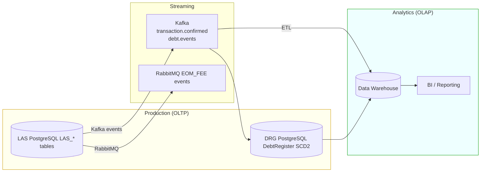

import SeriesLineChart from '@site/src/components/Charts/SeriesLineChart';

> *"Một khoản vay tốt trong một danh mục xấu vẫn là vấn đề. Quản lý tín dụng không phải là quản lý từng giao dịch, mà là quản lý tổng thể rủi ro và cơ hội theo thời gian."*

## Dẫn nhập: thấy cây mà không thấy rừng

::::story
Cuối quý 3, bà Hương nhận báo cáo từ ba phòng ban, phòng nào cũng báo "tốt".

**Kinh doanh:** "Giải ngân tăng 35% so với quý trước. Dư nợ đạt 2,800 tỷ đồng, kỷ lục mới!"

**Quản trị rủi ro:** "Tỷ lệ vỡ nợ quý này là 4.2%, trong giới hạn cho phép 5%."

**Tài chính:** "NIM đạt 20.2%, vượt mục tiêu 20%."

Bà Hương nhìn ba con số và thấy bất an. Mọi thứ đều "ổn", nhưng bức tranh tổng thể không đúng. Bà yêu cầu thêm dữ liệu:

- Đường cong vintage của nhóm khoản vay mới nhất (quý 2): tỷ lệ DPD 30+ đã ở mức 6.8% sau 90 ngày, cao hơn 70% so với nhóm quý 2 năm ngoái ở cùng thời điểm.
- Roll rate từ nhóm đúng hạn sang nhóm trễ 1 đến 30 ngày: tăng từ 4.5% lên 6.8% trong hai tháng qua.
- Rủi ro tập trung: 28% dư nợ nằm ở khách hàng làm trong một ngành đang chịu áp lực.

"Chúng ta đang tăng trưởng nhanh vào một danh mục đang xấu đi", bà Hương kết luận. "Nếu không điều chỉnh ngay, quý 1 năm sau sẽ rất khó khăn."
::::

Ba con số "tốt" kia đều là chỉ số tổng hợp, và chỉ số tổng hợp che giấu những gì đang diễn ra bên trong danh mục. Chương này giúp nhìn thấy cả rừng, không chỉ từng cây: từ báo cáo lãi lỗ của một công ty tài chính tiêu dùng, qua các công cụ phân tích danh mục, đến rủi ro tập trung và quản lý tài sản và nợ *(asset-liability management, ALM)*. Quan trọng hơn, chương này cho thấy những cách nhìn đó định hình kiến trúc hệ thống như thế nào.

## 5.1 Báo cáo lãi lỗ của một công ty tài chính tiêu dùng

### Tình huống: đọc báo cáo tài chính

::::story
Kỹ sư Tuấn lần đầu được mời dự buổi họp đánh giá kinh doanh hằng quý. Bà Hương trình bày báo cáo kết quả kinh doanh, và Tuấn không hiểu phần lớn các dòng. Anh biết code, biết hệ thống, nhưng chưa từng đọc báo cáo lãi lỗ của một công ty tài chính tiêu dùng.

Đây là chuyện phổ biến: kỹ sư xây hệ thống xử lý hàng tỷ đồng mỗi ngày, nhưng không hiểu vì sao mình xây những thứ đó.
::::

### Cấu trúc báo cáo kết quả kinh doanh

Dưới đây là báo cáo quý 3 của Vela Finance, với dư nợ bình quân 2,800 tỷ đồng và nguồn vốn vay 2,500 tỷ đồng.

```text
BÁO CÁO KẾT QUẢ KINH DOANH, Quý 3/2025 (tỷ VNĐ)
Vela Finance

A. THU NHẬP LÃI (interest income)
   Lãi từ vay tiền mặt                                 140.0
   Lãi từ vay trả góp tại điểm bán                      56.0
   ──────────────────────────────────────────────────────────
   Tổng thu nhập lãi                                   196.0

B. CHI PHÍ LÃI (interest expense)
   Lãi trái phiếu phát hành (2,000 tỷ, 8.5%/năm)       (42.5)
   Lãi vay ngân hàng (500 tỷ)                          (12.0)
   ──────────────────────────────────────────────────────────
   Tổng chi phí lãi                                    (54.5)

C. THU NHẬP LÃI THUẦN (NII)  [A - B]                  141.5

D. THU NHẬP NGOÀI LÃI (non-interest income)
   Phí thẩm định                                         8.5
   Hoa hồng bảo hiểm                                     6.2
   Phí dịch vụ tài khoản                                 4.8
   Phí trả trễ                                           3.1
   ──────────────────────────────────────────────────────────
   Tổng thu nhập ngoài lãi                              22.6

E. TỔNG THU NHẬP HOẠT ĐỘNG  [C + D]                   164.1

F. CHI PHÍ DỰ PHÒNG RỦI RO TÍN DỤNG
   Tăng dự phòng ECL Stage 1                            (5.2)
   Tăng dự phòng ECL Stage 2                           (10.4)
   Tăng dự phòng ECL Stage 3                           (17.2)
   Xóa nợ ròng sau thu hồi                              (9.2)
   ──────────────────────────────────────────────────────────
   Tổng chi phí dự phòng                               (42.0)

G. THU NHẬP SAU DỰ PHÒNG  [E - F]                     122.1

H. CHI PHÍ HOẠT ĐỘNG (operating expenses)
   Nhân sự (kinh doanh, vận hành, rủi ro, công nghệ)   (45.0)
   Marketing và chi phí có khách hàng                  (18.5)
   Công nghệ và hạ tầng                                 (8.2)
   Thu hồi nợ                                           (6.8)
   Chi phí khác                                         (4.1)
   ──────────────────────────────────────────────────────────
   Tổng chi phí hoạt động                              (82.6)

I. LỢI NHUẬN TRƯỚC THUẾ  [G - H]                       39.5
J. THUẾ (20%)                                           (7.9)
K. LỢI NHUẬN SAU THUẾ                                   31.6
```

Báo cáo này có cấu trúc khác báo cáo của một doanh nghiệp sản xuất ở hai điểm. Thứ nhất, "giá vốn hàng bán" của công ty tài chính là chi phí lãi, tức giá của đồng vốn đi vay. Thứ hai, có một dòng chi phí lớn mà doanh nghiệp khác không có: dự phòng rủi ro tín dụng, tức tiền dành sẵn cho những khoản vay sẽ không được trả.

### Ba chỉ số sức khỏe cốt lõi

#### NIM: biên lãi thuần

:::key[NIM (net interest margin)]
**NIM** đo hiệu quả của hoạt động cho vay cốt lõi: thu nhập lãi thuần trên mỗi đồng tài sản sinh lãi.
:::

```text
NIM = Thu nhập lãi thuần / Tài sản sinh lãi bình quân

  Thu nhập lãi thuần quý 3: 141.5 tỷ VNĐ
  Quy năm: 141.5 × 4 = 566 tỷ VNĐ/năm
  Dư nợ cho vay bình quân: 2,800 tỷ VNĐ

  NIM = 566 / 2,800 ≈ 20.2%/năm
```

NIM giảm qua các quý cho biết lãi suất cho vay đang giảm hoặc chi phí vốn đang tăng. NIM tăng đột ngột lại cần được kiểm tra kỹ: có phải danh mục đang dịch chuyển sang sản phẩm rủi ro cao hơn, lãi suất cao hơn?

Khoảng NIM điển hình theo loại tổ chức (số liệu tham khảo, khác nhau theo thị trường và thời kỳ):

| Loại tổ chức | NIM điển hình |
|---|---|
| Ngân hàng thương mại lớn | 3-5% |
| Ngân hàng bán lẻ | 5-8% |
| Công ty tài chính, phân khúc khách hàng tốt | 12-18% |
| Công ty tài chính, phân khúc đại chúng | 18-28% |
| Tài chính vi mô | 25-40% |

NIM của công ty tài chính tiêu dùng cao hơn ngân hàng vì phải bù tổn thất tín dụng và chi phí vận hành cao hơn, như đã phân tích ở [Chương 1](/docs/foundations/ch01-credit-economics), không phải vì lợi nhuận cao bất thường. Báo cáo của Vela Finance minh họa điều này: trong 141.5 tỷ thu nhập lãi thuần, 42 tỷ đi vào dự phòng và 82.6 tỷ đi vào chi phí hoạt động.

#### ROA: tỷ suất sinh lời trên tài sản

:::key[ROA (return on assets)]
**ROA** đo hiệu quả sử dụng toàn bộ tài sản của công ty.
:::

```text
ROA = Lợi nhuận sau thuế (quy năm) / Tổng tài sản bình quân

  Lợi nhuận sau thuế quy năm: 31.6 × 4 = 126.4 tỷ VNĐ
  Tổng tài sản bình quân: 3,200 tỷ VNĐ
  (gồm dư nợ cho vay, tiền và tài sản khác)

  ROA = 126.4 / 3,200 ≈ 3.95%
```

Với công ty tài chính tiêu dùng, ROA trên 3% thường được coi là tốt, 1% đến 3% là trung bình, dưới 1% là cần cải thiện, thường do tổn thất tín dụng hoặc chi phí hoạt động quá cao.

#### ROE: tỷ suất sinh lời trên vốn chủ sở hữu

:::key[ROE (return on equity)]
**ROE** đo hiệu quả sử dụng vốn của cổ đông.
:::

```text
ROE = Lợi nhuận sau thuế (quy năm) / Vốn chủ sở hữu bình quân

  Lợi nhuận sau thuế quy năm: 126.4 tỷ VNĐ
  Vốn chủ sở hữu bình quân: 640 tỷ VNĐ
  (Tổng tài sản 3,200 tỷ - Tổng nợ phải trả 2,560 tỷ)

  ROE = 126.4 / 640 ≈ 19.75%

Đòn bẩy = Tổng tài sản / Vốn chủ sở hữu = 3,200 / 640 = 5 lần
ROE = ROA × Đòn bẩy = 3.95% × 5 ≈ 19.75%
```

Đòn bẩy càng cao, ROE càng cao, nhưng rủi ro cũng tăng theo: với đòn bẩy 5 lần, tổn thất bằng 20% tổng tài sản là xóa sạch vốn chủ sở hữu. Đó là lý do cơ quan quản lý đặt tỷ lệ an toàn vốn tối thiểu, để công ty tài chính không vay nợ quá mức so với vốn của mình.

### Dự phòng theo IFRS 9

::::story
Anh Minh nhìn báo cáo lãi lỗ và thắc mắc: "Sao dự phòng lớn vậy, 42 tỷ trong một quý? Chúng ta đang mất nhiều tiền thế à?"

Bà Hương giải thích: "Đó không phải là tiền đã mất, mà là tiền chúng ta *dự kiến* sẽ mất. Chuẩn mực kế toán yêu cầu ghi nhận tổn thất trước khi nó thực sự xảy ra."
::::

:::key[IFRS 9 và tổn thất tín dụng dự kiến]
**IFRS 9** là chuẩn mực kế toán quốc tế yêu cầu tổ chức tài chính trích lập dự phòng dựa trên **tổn thất tín dụng dự kiến** *(expected credit loss, ECL)* trong tương lai, thay vì chỉ ghi nhận khi tổn thất đã xảy ra như chuẩn cũ IAS 39.
:::

IFRS 9 chia khoản vay thành ba nhóm *(stage)*:

```text
STAGE 1 — Performing (Bình thường)
  Điều kiện: DPD = 0, chưa có dấu hiệu tín dụng xấu đi
  Provision: 12-month ECL (tổn thất dự kiến trong 12 tháng tới)
  Ví dụ: Chị Lan vay xong, đang trả bình thường

STAGE 2 — Underperforming (Suy giảm đáng kể)
  Điều kiện: Rủi ro tín dụng tăng đáng kể so với lúc phát sinh
    (DPD 30+, hoặc scoring giảm mạnh, hoặc economic deterioration)
  Provision: Lifetime ECL (tổn thất dự kiến trong toàn bộ thời gian còn lại)
  Ví dụ: Chị Lan bắt đầu trả trễ, DPD = 35

STAGE 3 — Credit-impaired (Tổn thất đã xảy ra)
  Điều kiện: DPD 90+, hoặc có bằng chứng rõ ràng về default
  Provision: Lifetime ECL với higher severity
  Ví dụ: Chị Lan DPD = 120, không liên lạc được
```

Mốc DPD 30 cho Stage 2 và DPD 90 cho Stage 3 là các giả định mặc định trong IFRS 9; tổ chức có thể dùng tiêu chí khác nếu chứng minh được là phù hợp hơn.

Áp dụng cho danh mục của Vela Finance cuối quý 3:

```text
Stage 1 (bình thường):
  Dư nợ: 2,100 tỷ VNĐ (75% danh mục)
  12-month PD: 3.5%, LGD: 60%
  ECL = 2,100 × 3.5% × 60% = 44.1 tỷ
  Tỷ lệ bao phủ: 44.1 / 2,100 = 2.1%

Stage 2 (suy giảm):
  Dư nợ: 420 tỷ VNĐ (15% danh mục)
  Lifetime PD: 18%, LGD: 62%
  ECL = 420 × 18% × 62% = 46.9 tỷ
  Tỷ lệ bao phủ: 46.9 / 420 = 11.2%

Stage 3 (suy giảm giá trị):
  Dư nợ: 280 tỷ VNĐ (10% danh mục)
  PD: 85%, LGD: 68%
  ECL = 280 × 85% × 68% = 161.8 tỷ
  Tỷ lệ bao phủ: 161.8 / 280 = 57.8%

TỔNG DỰ PHÒNG TRÊN BẢNG CÂN ĐỐI: 44.1 + 46.9 + 161.8 = 252.8 tỷ
```

Con số trong báo cáo lãi lỗ không phải tổng dự phòng, mà là **chi phí dự phòng** của quý: phần dự phòng phải trích thêm để số dư dự phòng đạt mức cần thiết, cộng với phần đã dùng để xóa nợ trong quý.

```text
Dự phòng đầu quý 3:                 220.0 tỷ
  (Stage 1: 38.9, Stage 2: 36.5, Stage 3: 144.6)
Trừ: xóa nợ ròng sau thu hồi:        (9.2) tỷ
Cộng: chi phí dự phòng trong quý:    42.0 tỷ
Dự phòng cuối quý 3:                252.8 tỷ

Chi phí dự phòng = 252.8 - 220.0 + 9.2 = 42.0 tỷ (khớp dòng F của báo cáo)
```

Để tính ECL, hệ thống cần năm thứ. Mỗi khoản vay phải được **phân loại stage** dựa trên DPD và các tín hiệu rủi ro. Cần một **mô hình PD** theo từng stage và từng khoảng thời gian, một **mô hình LGD** theo sản phẩm và tài sản đảm bảo, và cách **tính EAD**, với sản phẩm quay vòng còn phải mô hình hóa mức sử dụng hạn mức. Cuối cùng là **điều chỉnh theo kịch bản vĩ mô**, vì IFRS 9 yêu cầu ECL phản ánh thông tin dự báo về nền kinh tế. Vì vậy nhiều công ty tài chính có hẳn một nhóm chuyên tính IFRS 9, và dữ liệu từ LAS phải được chuẩn hóa để đưa vào các mô hình ECL.

:::summary[Mục 5.1]
NIM bằng thu nhập lãi thuần trên tài sản sinh lãi, đo hiệu quả của hoạt động cho vay cốt lõi. ROA đo hiệu quả tổng thể, ROE đo hiệu quả trên vốn cổ đông, và ROE bằng ROA nhân đòn bẩy. IFRS 9 yêu cầu dự phòng theo tổn thất dự kiến, chia làm ba stage theo mức độ suy giảm tín dụng. Chi phí dự phòng trong báo cáo lãi lỗ là phần thay đổi của số dư dự phòng cộng với xóa nợ ròng, và việc phân loại stage cần dữ liệu DPD cập nhật liên tục từ LAS.
:::

## 5.2 Phân tích danh mục theo chiều sâu

### Đường cong vintage: so sánh các thế hệ khoản vay

::::story
Anh Minh cần báo cáo hội đồng quản trị: "Sản phẩm vay cho giáo viên ra mắt tháng 1/2025 hiệu quả thế nào?"

Câu hỏi nghe đơn giản, nhưng sau sáu tháng vận hành thì rất khó trả lời chính xác. Khoản vay kỳ hạn 24 tháng mới đi được một phần tư vòng đời. Làm sao đánh giá?
::::

:::key[Vintage và đường cong vintage]
**Vintage** là nhóm các khoản vay được giải ngân trong cùng một khoảng thời gian, thường là một tháng hoặc một quý. **Đường cong vintage** *(vintage curve)* theo dõi kết quả của từng nhóm theo số tháng kể từ khi giải ngân, nhờ đó so sánh được các thế hệ khoản vay ở cùng "tuổi".
:::

**Vì sao không dùng tỷ lệ vỡ nợ tổng thể?** Vì nó trộn lẫn các khoản vay ở những độ tuổi khác nhau:

```text
Tháng 12/2025, danh mục có 10,000 khoản vay đang hoạt động:
  Vintage Jan/2025 (11 tháng tuổi): 2,000 khoản, đã vỡ nợ 1.60% (32 khoản)
  Vintage Jun/2025 (6 tháng tuổi):  3,000 khoản, đã vỡ nợ 1.40% (42 khoản)
  Vintage Sep/2025 (3 tháng tuổi):  5,000 khoản, đã vỡ nợ 0.40% (20 khoản)

Tỷ lệ vỡ nợ tổng thể:
  = (32 + 42 + 20) / 10,000 = 0.94%
```

Con số 0.94% trông rất ổn. Nhưng nó che đi một sự thật: vintage tháng 6 mới sáu tháng tuổi đã có tỷ lệ vỡ nợ gần bằng vintage tháng 1 ở tuổi 11 tháng. Danh mục càng tăng trưởng nhanh, càng nhiều khoản vay "trẻ" chưa kịp vỡ nợ, và tỷ lệ tổng thể càng trông đẹp. Tăng trưởng nhanh che giấu chất lượng tín dụng đang xấu đi; đó chính là điều bà Hương cảm thấy ở đầu chương.

Để dựng đường cong vintage, mỗi khoản vay cần biết ngày giải ngân và DPD theo từng tháng. Sau đó tính tỷ lệ vỡ nợ lũy kế theo tuổi khoản vay:

```text
Vintage Jan/2025 (2,000 khoản):
  Tuổi 2 tháng:   2 khoản vỡ nợ → lũy kế 0.10%
  Tuổi 3 tháng:   5 khoản       → lũy kế 0.25%
  Tuổi 6 tháng:  15 khoản       → lũy kế 0.75%
  Tuổi 9 tháng:  25 khoản       → lũy kế 1.25%
  Tuổi 12 tháng: 35 khoản       → lũy kế 1.75%

Vintage Jun/2025 (3,000 khoản):
  Tuổi 2 tháng:   4 khoản vỡ nợ → lũy kế 0.13%
  Tuổi 3 tháng:  16 khoản       → lũy kế 0.53%
  Tuổi 6 tháng:  42 khoản       → lũy kế 1.40%
```

<SeriesLineChart
  title="Hình 5.1. Đường cong vintage: tỷ lệ vỡ nợ lũy kế theo tuổi khoản vay"
  xKey="age"
  xLabel="Tuổi khoản vay (tháng)"
  data={[
    {age: 0, typical: 0, jan25: 0, jun25: 0},
    {age: 3, typical: 0.3, jan25: 0.25, jun25: 0.53},
    {age: 6, typical: 0.75, jan25: 0.75, jun25: 1.4},
    {age: 9, typical: 1.3, jan25: 1.25},
    {age: 12, typical: 1.8, jan25: 1.75},
    {age: 15, typical: 2.2},
    {age: 18, typical: 2.55},
    {age: 21, typical: 2.8},
    {age: 24, typical: 3.0},
  ]}
  series={[
    {key: 'typical', label: 'Đường cong chuẩn của sản phẩm', color: '#8a8f98', dashed: true},
    {key: 'jan25', label: 'Vintage Jan/2025', color: '#0b8a66'},
    {key: 'jun25', label: 'Vintage Jun/2025', color: '#c0392b'},
  ]}
  caption="Đường cong chuẩn là bình quân của các vintage cũ đã đi hết vòng đời 24 tháng, kết thúc ở 3.0%. Vintage tháng 1 bám sát đường chuẩn; vintage tháng 6 ở tuổi 6 tháng đã cao gần gấp đôi."
/>

Đọc hình này, vintage tháng 1/2025 bám sát đường cong chuẩn, thậm chí tốt hơn một chút. Vintage tháng 6/2025 thì khác: ở tuổi 6 tháng nó đã ở mức 1.40%, gần gấp đôi mức 0.75% của vintage tháng 1 và của đường chuẩn ở cùng tuổi. Đây là tín hiệu đỏ: thế hệ khoản vay mới đang xấu hơn rõ rệt.

**Dự báo tổn thất từ đường cong vintage.** Theo đường cong chuẩn, đến tuổi 6 tháng mới có 0.75 / 3.00 = 25% số vụ vỡ nợ của cả vòng đời xảy ra. Nếu vintage tháng 6 đi theo cùng hình dạng đường cong:

```text
Tỷ lệ vỡ nợ cả vòng đời dự báo = 1.40% / 25% = 5.6%

Vintage Jun/2025 có 3,000 khoản vay:
  Đã vỡ nợ đến tuổi 6 tháng (1.40%):  42 khoản
  Dự báo vỡ nợ cả vòng đời (5.6%):    168 khoản
  Còn sẽ vỡ nợ thêm:                   126 khoản

Khi nào phải hành động? Ngay bây giờ, không phải khi 126 khoản kia thực sự vỡ nợ.
```

Đây là khác biệt giữa **chỉ báo dẫn dắt** *(leading indicator)* và **chỉ báo trễ** *(lagging indicator)*. Tỷ lệ vỡ nợ tổng thể là chỉ báo trễ: khi thấy vấn đề thì đã muộn. Đường cong vintage là chỉ báo dẫn dắt: thấy vấn đề khi vẫn còn làm được gì đó, như siết tiêu chí duyệt cho phân khúc đang xấu đi hoặc tăng dự phòng sớm.

### Ma trận roll rate: hệ thống cảnh báo sớm

:::key[Roll rate]
**Roll rate** là tỷ lệ tài khoản chuyển từ một nhóm DPD *(DPD bucket)* sang nhóm khác trong một tháng. **Ma trận roll rate** tổng hợp tất cả các chuyển dịch đó trong một bảng.
:::

Từ dữ liệu DPD đầu và cuối tháng của LAS, tháng 9/2025 có 10,530 tài khoản được phân bổ như sau (hàng là trạng thái đầu tháng, cột là trạng thái cuối tháng):

| Đầu tháng \ Cuối tháng | Đúng hạn | 1-30 | 31-60 | 61-90 | 91+ | Xóa nợ | Tổng |
|---|---:|---:|---:|---:|---:|---:|---:|
| Đúng hạn | 8,930 | 420 | 0 | 0 | 0 | 0 | 9,350 |
| 1-30 | 186 | 68 | 146 | 0 | 0 | 0 | 400 |
| 31-60 | 31 | 14 | 51 | 184 | 0 | 0 | 280 |
| 61-90 | 7 | 5 | 11 | 38 | 89 | 0 | 150 |
| 91+ | 3 | 2 | 5 | 9 | 281 | 50 | 350 |

Chia mỗi ô cho tổng của hàng, ta có roll rate:

| Đầu tháng \ Cuối tháng | Đúng hạn | 1-30 | 31-60 | 61-90 | 91+ | Xóa nợ |
|---|---:|---:|---:|---:|---:|---:|
| Đúng hạn | 95.5% | 4.5% | 0% | 0% | 0% | 0% |
| 1-30 | 46.5% | 17.0% | 36.5% | 0% | 0% | 0% |
| 31-60 | 11.1% | 5.0% | 18.2% | 65.7% | 0% | 0% |
| 61-90 | 4.7% | 3.3% | 7.3% | 25.3% | 59.3% | 0% |
| 91+ | 0.9% | 0.6% | 1.4% | 2.6% | 80.3% | 14.3% |

Mỗi ô trong bảng trả lời một câu hỏi kinh doanh:

- **Đúng hạn sang đúng hạn (95.5%):** gần như mọi tài khoản tốt vẫn tốt.
- **Đúng hạn sang 1-30 (4.5%):** tỷ lệ tài khoản tốt bắt đầu trễ hạn trong tháng, hay tỷ lệ trễ hạn mới.
- **1-30 sang đúng hạn (46.5%):** gần một nửa tài khoản trễ hạn lần đầu tự quay lại đúng hạn. Đây là **cure rate**.
- **1-30 sang 31-60 (36.5%):** hơn một phần ba trượt sâu hơn. Đây là tỷ lệ **lăn tới** *(roll forward)*.
- **61-90 sang 91+ (59.3%):** phần lớn tài khoản trễ 61-90 ngày sẽ sang nhóm 91+, nơi khả năng thu hồi rất thấp.

Roll rate là hệ thống cảnh báo sớm vì nó thay đổi trước tỷ lệ vỡ nợ:

```text
Tháng 8: Đúng hạn → 1-30 = 4.5% (mức nền)
Tháng 9: Đúng hạn → 1-30 = 4.5% (bình thường)
Tháng 10: Đúng hạn → 1-30 = 6.8% (tăng 51%!)

Tín hiệu: có điều gì đó trong tháng 10 khiến nhiều tài khoản tốt bắt đầu trễ hạn.
Có thể là:
  - Kinh tế vĩ mô xấu đi (thất nghiệp tăng)
  - Một nhóm khách hàng cụ thể bị ảnh hưởng (một ngành cắt giảm nhân sự)
  - Mô hình chấm điểm bỏ sót một yếu tố rủi ro mới
  - Một sản phẩm mới ra mắt có vấn đề

Hành động: điều tra ngay, không chờ tỷ lệ vỡ nợ tăng
(sẽ mất 3 đến 6 tháng mới hiện ra trong các chỉ báo trễ)
```

**Roll rate trong VLP.** Module DRG *(Debt Register)* cập nhật DPD của từng tài khoản gần như theo thời gian thực, từ luồng sự kiện Kafka do LAS phát ra. Roll rate được tính bằng một tác vụ chạy hằng đêm trên dữ liệu đó, nên có cảnh báo sớm mà không cần truy vấn cơ sở dữ liệu giao dịch của LAS. Mục 5.4 giải thích vì sao điều này quan trọng.

### Rủi ro tập trung: quá nhiều trứng trong một giỏ

::::story
Bà Hương xem cơ cấu danh mục và thấy 28% dư nợ là khách hàng làm trong ngành dệt may. Tin tức cho biết các nhà máy dệt may đang chịu áp lực vì đơn hàng xuất khẩu giảm. Bà biết đây là rủi ro tập trung.
::::

:::key[Rủi ro tập trung (concentration risk)]
**Rủi ro tập trung** là rủi ro phát sinh khi danh mục cho vay tập trung quá nhiều vào một phân khúc (ngành nghề, địa lý, nhân khẩu học), khiến một cú sốc ở phân khúc đó gây tổn thất lớn hơn nhiều so với tổn thất dự kiến.
:::

Công thức $EL = PD \times LGD \times EAD$ áp dụng riêng cho từng khoản vay, và khi cộng lại cho cả danh mục, nó ngầm giả định các khoản vay vỡ nợ **độc lập** với nhau. Thực tế không như vậy: nếu hai người vay cùng làm ở một nhà máy và nhà máy đóng cửa, họ vỡ nợ cùng lúc.

```text
Kịch bản cơ sở (danh mục đa dạng):
  PD bình quân: 5%, LGD: 60%, EAD: 2,800 tỷ
  EL = 2,800 × 5% × 60% = 84 tỷ

Kịch bản sốc tập trung:
  28% danh mục = 784 tỷ trong ngành dệt may
  Ngành dệt may bị sốc → PD tăng từ 5% lên 18%

  EL (ngoài dệt may, 72%): 2,016 × 5% × 60% = 60.5 tỷ
  EL (dệt may, 28%):         784 × 18% × 60% = 84.7 tỷ
  Tổng EL mới: 145.2 tỷ

  Tăng so với kịch bản cơ sở: 145.2 - 84 = 61.2 tỷ (tăng 73%)
```

Kế hoạch lợi nhuận và định giá được xây dựng trên mức tổn thất dự kiến 84 tỷ. Nếu cú sốc xảy ra, công ty phải ghi nhận thêm khoảng 61 tỷ chi phí dự phòng, gần bằng lợi nhuận sau thuế của hai quý, và thường dồn vào một hai quý.

**Đo mức độ tập trung bằng chỉ số HHI.** Chỉ số Herfindahl-Hirschman *(HHI)* là tổng bình phương tỷ trọng (tính bằng phần trăm) của các phân khúc:

$$
HHI = \sum_i s_i^2
$$

HHI càng gần 0, danh mục càng đa dạng; HHI bằng 10,000 nghĩa là toàn bộ danh mục nằm trong một phân khúc.

```text
Ví dụ với 4 ngành:
  Dệt may 28%, Giáo dục 22%, Bán lẻ 30%, Y tế 20%
  HHI = 28² + 22² + 30² + 20² = 784 + 484 + 900 + 400 = 2,568

So sánh: nếu mỗi ngành 25%, HHI = 4 × 25² = 2,500
```

HHI 2,568 rất gần mức thấp nhất có thể với bốn ngành, nên theo HHI danh mục này khá đa dạng. Nhưng cũng chính danh mục đó có 28% dư nợ ở một ngành đang gặp khó. Một chỉ số tổng hợp, dù hữu ích để theo dõi xu hướng, không thay được giới hạn cho từng phân khúc. Vì vậy bà Hương đặt thêm các hạn mức tập trung:

```text
Một ngành:                tối đa 20% danh mục
Một địa bàn (tỉnh):       tối đa 15% danh mục
Một người sử dụng lao động lớn: tối đa 5% danh mục
```

Theo hạn mức này, ngành dệt may đang vượt 8 điểm phần trăm. Hệ thống phải theo dõi liên tục và cảnh báo khi một phân khúc **tiến gần** hạn mức, trước khi vượt chứ không phải sau. Điều đó đòi hỏi mỗi khoản vay phải mang đủ thuộc tính phân khúc (ngành nghề, nơi làm việc, địa bàn) ngay từ lúc khởi tạo.

:::summary[Mục 5.2]
Đường cong vintage so sánh các thế hệ khoản vay ở cùng tuổi, nên là chỉ báo dẫn dắt tốt hơn tỷ lệ vỡ nợ tổng thể, vốn bị tăng trưởng nhanh làm đẹp đi. Ma trận roll rate cho biết xác suất chuyển nhóm DPD và là hệ thống cảnh báo sớm trước khi vỡ nợ xảy ra. Rủi ro tập trung không được công thức EL thông thường nắm bắt, vì các khoản vay trong cùng phân khúc vỡ nợ cùng nhau; cần hạn mức theo từng phân khúc và kiểm tra sức chịu đựng. Cả ba công cụ đều cần dữ liệu cập nhật liên tục từ LAS.
:::

## 5.3 Quản lý tài sản và nợ (ALM)

### Tình huống: rủi ro ẩn trong bảng cân đối kế toán

::::story
Bà Hương họp với tổng giám đốc về kế hoạch mở rộng. Câu hỏi đặt ra: "Chúng ta có thể tăng dư nợ thêm 30% không?"

Bà trả lời: "Về khả năng bán thì được. Nhưng còn nguồn vốn? Trong 8 tháng tới có 800 tỷ trái phiếu và 500 tỷ vay ngân hàng đến hạn. Lãi suất thị trường đang tăng. Nếu phải tái tài trợ với lãi suất cao hơn 2 điểm phần trăm, biên lợi nhuận của cả danh mục sẽ bị bào mòn."

Đây là bài toán quản lý tài sản và nợ.
::::

### Lệch kỳ hạn và rủi ro thanh khoản

:::key[Duration]
**Duration** (trong bối cảnh ALM) là thời gian bình quân, có trọng số theo giá trị hiện tại, của các dòng tiền của một tài sản hoặc một khoản nợ. Nó cũng đo độ nhạy của giá trị tài sản hoặc khoản nợ đó với thay đổi lãi suất.
:::

Một khoản vay trả góp 24 tháng không có duration 24 tháng, vì tiền được thu về dần mỗi tháng chứ không phải một lần vào cuối kỳ.

```text
Ví dụ: Khoản vay 20 triệu, 15%/năm, 24 tháng
PMT ≈ 969,733 VNĐ/tháng

Duration = Σ [t × CF_t / (1+r)^t] / PV, với r = 1.25%/tháng

Tháng 1: trọng số = 1 × (969,733/1.0125) / 20,000,000 ≈ 0.0479
Tháng 2: trọng số = 2 × (969,733/1.0125²) / 20,000,000 ≈ 0.0946
...
Tháng 24: trọng số = 24 × (969,733/1.0125²⁴) / 20,000,000 ≈ 0.864

Tổng duration ≈ 11.9 tháng, chưa bằng một nửa kỳ hạn 24 tháng
```

Với danh mục gồm nhiều kỳ hạn khác nhau, giả sử duration bình quân của tài sản là khoảng 14 tháng. So với nguồn vốn:

```text
Tài sản (danh mục cho vay):
  Duration bình quân: ≈ 14 tháng
  Tổng: 2,800 tỷ VNĐ

Nguồn vốn:
  Trái phiếu 3 năm (còn 30 tháng):       1,200 tỷ
  Trái phiếu 1 năm (còn 8 tháng):          800 tỷ
  Vay ngân hàng 6 tháng (còn 4 tháng):     500 tỷ
  Kỳ hạn còn lại bình quân:
    (1,200×30 + 800×8 + 500×4) / 2,500 ≈ 17.8 tháng

Chênh lệch: nguồn vốn (17.8) dài hơn tài sản (14)
→ tài sản thu hồi nhanh hơn nghĩa vụ trả nợ
```

Ở đây kỳ hạn còn lại của nguồn vốn được dùng làm thước đo gần đúng cho duration của nó, vì trái phiếu và khoản vay ngân hàng chủ yếu trả gốc một lần khi đáo hạn.

Trong kịch bản này, khoản vay được thu hồi nhanh hơn nghĩa vụ trái phiếu, nên công ty có **rủi ro tái đầu tư**: khi khách hàng trả nợ, tiền thu về phải được cho vay lại theo lãi suất thị trường lúc đó, có thể thấp hơn. Kịch bản ngược lại cũng có rủi ro: nếu trái phiếu đáo hạn trước khi khoản vay được thu hồi, công ty phải tìm nguồn vốn mới, có thể với lãi suất cao hơn, hoặc tệ hơn là không tìm được. Bình quân cũng che giấu chi tiết: dù kỳ hạn bình quân của nguồn vốn dài hơn, 1,300 tỷ trong số đó đến hạn trong 8 tháng tới, đúng như lo ngại của bà Hương.

### Rủi ro trả nợ trước hạn

::::story
Tháng 10/2025, lãi suất thị trường giảm mạnh. Ngay lập tức, hàng nghìn khách hàng liên hệ đề nghị tất toán trước hạn để chuyển sang vay ở nơi khác với lãi suất thấp hơn.

Bà Hương xem hệ thống: trong tháng 10, tỷ lệ trả trước hạn tăng từ 2% lên 8% dư nợ.
::::

Khi khách hàng trả trước hạn, công ty mất thu nhập lãi của các tháng còn lại, và phải cho vay lại số tiền thu về ở lãi suất mới thấp hơn.

```text
Khoản vay 20 triệu, lãi 18%/năm, 24 tháng (PMT 998,482 VNĐ)
Khách hàng tất toán sau kỳ thứ 12

  Dư nợ sau kỳ 12:                    ≈ 10,890,949 VNĐ
  Lãi dự kiến của 12 kỳ còn lại:      ≈ 1,090,836 VNĐ

  Cho vay lại 10,890,949 VNĐ trong 12 tháng ở lãi suất mới 14%/năm:
  Lãi thu được:                       ≈ 843,454 VNĐ

  Thu nhập lãi bị mất ròng:           ≈ 247,382 VNĐ
```

Phí tất toán trước hạn tồn tại để bù một phần rủi ro này. Nhưng nhiều nước giới hạn hoặc cấm phí trả trước, tạo ra mâu thuẫn giữa bảo vệ bên cho vay và bảo vệ người tiêu dùng. Như [Chương 3](/docs/products/ch03-product-design) đã phân tích, đây cũng là một quyết định về CLV: phí thấp có thể khiến khách hàng sẵn sàng vay lại.

**Trả trước trong VLP.** LAS phải theo dõi hành vi trả trước. Khi tỷ lệ trả trước tăng bất thường, hệ thống cảnh báo bộ phận tài chính và ngân quỹ, dự báo lại dòng tiền, để ngân quỹ điều chỉnh kế hoạch huy động vốn, và để đội sản phẩm xem xét có cần thêm ưu đãi giữ chân khách hàng hay không.

### Rủi ro lãi suất trong cho vay tiêu dùng

::::story
Ngân hàng Nhà nước thắt chặt chính sách tiền tệ, lãi suất thị trường tăng 2 điểm phần trăm. Tác động tới Vela Finance là gì?
::::

Ở phía tài sản, các khoản vay lãi suất cố định đã ký không thay đổi, nên bị "kẹt" ở mức lãi suất thấp hơn thị trường; chỉ các khoản vay mới được định giá theo lãi suất mới. Khoản vay lãi suất thả nổi được điều chỉnh theo thị trường, ít rủi ro hơn cho bên cho vay nhưng khó khăn hơn cho người vay. Ở phía nguồn vốn, trái phiếu lãi suất cố định đang lưu hành không đổi, có lợi cho công ty; nhưng phần trái phiếu đến hạn phải phát hành lại với lãi suất cao hơn, và khoản vay ngân hàng lãi suất thả nổi tăng chi phí ngay.

```text
Phân tích kịch bản: lãi suất tăng 2 điểm phần trăm

Tài sản (2,800 tỷ, lãi suất cố định, bình quân 28%/năm):
  Trong năm, khoảng 30% danh mục được thay bằng khoản vay mới với lãi suất 30%
  Khi thay thế xong: 2,800 × 30% × 2% = +16.8 tỷ/năm
  Bình quân năm đầu (thay dần trong năm): ≈ +8.4 tỷ

Nguồn vốn (2,500 tỷ, 40% phải tái tài trợ trong năm):
  Trái phiếu cũ 8.5% → trái phiếu mới 10.5%
  Chi phí tăng thêm: 40% × 2,500 × 2% = 20 tỷ/năm

Tác động ròng năm đầu: +8.4 - 20 ≈ -11.6 tỷ
→ NIM bị bào mòn trong ngắn hạn, chỉ phục hồi khi danh mục được thay thế xong
```

Có ba tầng phản ứng. Ngắn hạn, phòng ngừa rủi ro bằng hợp đồng hoán đổi lãi suất *(interest rate swap)*: trả lãi cố định, nhận lãi thả nổi, để khóa chi phí của phần vốn vay thả nổi. Trung hạn, tăng tỷ trọng khoản vay lãi suất thả nổi, chuyển một phần rủi ro lãi suất sang người vay, với điều kiện điều này được công bố rõ và phù hợp quy định. Dài hạn, cơ cấu nguồn vốn sao cho duration của nợ khớp hơn với duration của tài sản.

:::summary[Mục 5.3]
Lệch kỳ hạn giữa tài sản và nguồn vốn tạo ra rủi ro tái đầu tư hoặc rủi ro tái tài trợ, và con số bình quân có thể che giấu những khoản đến hạn dồn vào một thời điểm. Khi lãi suất giảm, khách hàng trả trước hạn, công ty mất thu nhập lãi và phải cho vay lại ở lãi suất thấp hơn. Khi lãi suất tăng, danh mục cho vay lãi suất cố định bị kẹt trong khi chi phí vốn tăng nhanh hơn. Cả ba phân tích đều cần dự báo dòng tiền từ lịch trả nợ của từng khoản vay trong LAS.
:::

## 5.4 Kiến trúc báo cáo: từ giao dịch đến hiểu biết

### Tình huống: vì sao không truy vấn thẳng cơ sở dữ liệu giao dịch

::::story
Đội phân tích dữ liệu đề nghị kỹ sư Tuấn: "Chúng tôi cần báo cáo đường cong vintage hằng ngày. Có thể truy vấn trực tiếp cơ sở dữ liệu của LAS không?"

Tuấn biết ngay câu trả lời là không. Nhưng anh cần giải thích vì sao.
::::

### Ba vấn đề khi chạy phân tích trên cơ sở dữ liệu giao dịch

**Ảnh hưởng hiệu năng.** Cơ sở dữ liệu của LAS đang phục vụ hàng nghìn giao dịch mỗi giây. Một truy vấn phân tích phức tạp, nối nhiều bảng lớn và tổng hợp trên hàng triệu dòng, có thể giữ khóa bảng, làm chậm các giao dịch thật, và trong trường hợp xấu nhất làm sập hệ thống.

```text
Production DB Query (naïve):
  SELECT vintage_month, loan_age, COUNT(*) as defaults
  FROM las_transaction t
  JOIN las_account a ON t.account_id = a.id
  JOIN las_current_balance rb ON a.id = rb.account_id
  WHERE t.cancelled = false
    AND rb.overdue_days > 90
  GROUP BY 1, 2
  
→ Full table scan trên las_transaction (100M+ rows)
→ Execution time: 15-20 phút
→ During this time: transactions bị slow down
```

**Nhất quán tại một thời điểm.** Phân tích cần một ảnh chụp dữ liệu tại một thời điểm cụ thể, trong khi cơ sở dữ liệu giao dịch thay đổi liên tục. Một báo cáo chạy 20 phút có thể lấy phần đầu dữ liệu lúc 9 giờ và phần cuối lúc 9 giờ 20, trong khi hàng nghìn giao dịch đã xảy ra ở giữa.

**Lược đồ không được thiết kế cho phân tích.** Cơ sở dữ liệu giao dịch được tối ưu cho OLTP *(online transaction processing)*: ghi nhanh, đọc nhanh theo khóa chính. Phân tích cần OLAP *(online analytical processing)*: đọc nhiều cột, tổng hợp trên nhiều dòng, theo nhiều chiều.

### Kiến trúc đường ống dữ liệu

Giải pháp là một kho dữ liệu phân tích riêng, được nạp từ luồng sự kiện và từ các lần trích xuất định kỳ.



*Hình 5.2. Dữ liệu đi từ hệ thống giao dịch sang kho phân tích qua luồng sự kiện.*

Có hai luồng dữ liệu. **Luồng sự kiện** chạy qua Kafka gần như theo thời gian thực: LAS phát sự kiện khi giao dịch được xác nhận, khi DPD thay đổi, khi trạng thái tài khoản thay đổi, khi nhận được thanh toán; các bên tiêu thụ đọc sự kiện và cập nhật mô hình phân tích với độ trễ vài giây đến vài phút. Luồng này phù hợp cho theo dõi roll rate, cảnh báo sớm và dashboard. **Luồng trích xuất theo lô** chạy hằng đêm, sau giờ cao điểm (2 đến 4 giờ sáng), trích xuất toàn bộ dữ liệu cần thiết sang kho phân tích và đối soát để kho phân tích khớp với hệ thống giao dịch. Luồng này phù hợp cho đường cong vintage, tính IFRS 9 và báo cáo cho cơ quan quản lý, những việc cần dữ liệu lịch sử chính xác.

| | Theo thời gian thực (luồng sự kiện) | Theo lô (trích xuất hằng đêm) |
|---|---|---|
| Độ trễ | Giây đến phút | 8 đến 24 giờ |
| Tính nhất quán | Nhất quán sau cùng *(eventually consistent)* | Nhất quán tại một thời điểm |
| Độ phức tạp | Cao (thứ tự sự kiện, phát lại) | Thấp hơn |
| Chi phí | Cao (hạ tầng streaming) | Thấp hơn |
| Trường hợp dùng | Cảnh báo, dashboard, phát hiện gian lận | Báo cáo, báo cáo cơ quan quản lý, IFRS 9 |

Nguyên tắc chọn khá đơn giản. Dùng thời gian thực khi quyết định cần có trong vài phút (phát hiện gian lận), khi cảnh báo cần sớm nhất có thể (roll rate tăng đột biến), hoặc khi khách hàng đang chờ kết quả (quyết định tín dụng). Dùng xử lý theo lô khi phép tính phức tạp cần toàn bộ tập dữ liệu (IFRS 9), khi báo cáo cho cơ quan quản lý cần nhất quán tại một thời điểm, hoặc khi phân tích lịch sử không cần kết quả tức thì.

### Mô hình dữ liệu nhiều chiều cho phân tích

Cơ sở dữ liệu của LAS được chuẩn hóa *(normalized)* để tránh dữ liệu trùng lặp. Phân tích lại cần dữ liệu phi chuẩn hóa theo lược đồ hình sao *(star schema)* để truy vấn nhanh.

```text
Production (Normalized — 3NF):
  LAS_ACCOUNT → LAS_TRANSACTION → LAS_LEDGER_ENTRY → LAS_INSTALMENT

Analytics (Star Schema):
  FACT_LOAN_PERFORMANCE:
    loan_id, account_id, vintage_month, loan_age_months,
    outstanding_balance, dpd_current, is_default,
    cumulative_payment, original_amount

  DIM_ACCOUNT:
    account_id, account_type, product_type, channel,
    segment, region, origination_date

  DIM_DATE:
    date_id, year, month, quarter, is_holiday, ...

Query vintage curve (analytics DB):
  SELECT
    d.vintage_month,
    p.loan_age_months,
    SUM(CASE WHEN p.is_default THEN 1 ELSE 0 END) / COUNT(*) as default_rate
  FROM fact_loan_performance p
  JOIN dim_account a ON p.account_id = a.account_id
  JOIN dim_date d ON a.origination_date = d.date_id
  GROUP BY 1, 2
  ORDER BY 1, 2

→ Execution time: 2-5 giây (vs 15-20 phút trên production DB)
```

Bảng chiều `DIM_ACCOUNT` cũng là nơi giữ các thuộc tính phân khúc như ngành nghề và địa bàn, nhờ đó các hạn mức tập trung ở mục 5.2 được theo dõi bằng một truy vấn đơn giản.

**Cách VLP áp dụng nguyên tắc này.** Đây cũng là lý do module STS (sao kê) và DRG (sổ theo dõi nợ) không truy vấn trực tiếp cơ sở dữ liệu của LAS. LAS phát sự kiện qua hệ thống nhắn tin: sang DRG qua **Kafka** (topic `transaction.confirmed`), sang STS qua **RabbitMQ** (sự kiện `EOM_FEE`, qua headers exchange). STS và DRG đăng ký nhận sự kiện và tự duy trì trạng thái của mình; đội phân tích duy trì kho dữ liệu riêng. Cách tách này, trong đó mỗi bên tiêu thụ tự duy trì trạng thái từ luồng sự kiện, là **kiến trúc hướng sự kiện** *(event-driven architecture)*, nền móng cho khả năng mở rộng của VLP. [Chương 6](/docs/system/ch06-financial-system-architecture) phân tích các đánh đổi của kiến trúc này.

:::summary[Mục 5.4]
Không chạy phân tích trên cơ sở dữ liệu giao dịch, vì ba lý do: hiệu năng, tính nhất quán tại một thời điểm, và lược đồ không phù hợp. Dùng hai luồng: sự kiện theo thời gian thực qua Kafka cho cảnh báo, và trích xuất theo lô hằng đêm cho báo cáo. Kho phân tích dùng lược đồ hình sao, phi chuẩn hóa để truy vấn nhanh. Trong VLP, mỗi bên tiêu thụ (STS, DRG, kho phân tích) tự duy trì trạng thái từ các sự kiện mà LAS phát ra.
:::

## Tổng kết chương 5

Quay lại cảnh báo của bà Hương ở đầu chương, các công cụ trong chương này giúp đi từ cảm giác bất an đến hành động cụ thể:

| Bước | Công cụ | Kết quả |
|---|---|---|
| Phát hiện | Đường cong vintage | Vintage quý 2 có tỷ lệ DPD 30+ sau 90 ngày cao hơn 70% so với cùng kỳ năm trước |
| | Ma trận roll rate | Tỷ lệ trễ hạn mới tăng từ 4.5% lên 6.8% trong hai tháng |
| | Phân tích tập trung | 28% dư nợ ở một ngành đang chịu áp lực, vượt hạn mức 20% |
| Đo lường | Kịch bản sốc | EL có thể tăng từ 84 lên 145 tỷ, tức thêm khoảng 61 tỷ chi phí dự phòng |
| Hành động ngắn hạn | Dự phòng, chính sách tín dụng | Tăng dự phòng sớm, siết tiêu chí duyệt cho phân khúc đang xấu đi |
| Hành động trung hạn | Hạn mức tập trung | Giảm dần tỷ trọng ngành vượt hạn mức |
| ALM | Kế hoạch nguồn vốn | Rà soát các khoản đến hạn, khóa chi phí vốn trước khi tái tài trợ |
| Hạ tầng dữ liệu | Luồng sự kiện và luồng theo lô | Cảnh báo roll rate theo thời gian thực; vintage và IFRS 9 theo lô hằng đêm |

Tất cả những phân tích này chỉ làm được khi dữ liệu từ LAS được thiết kế đúng từ đầu: hướng sự kiện, có nhật ký kiểm toán đầy đủ, mỗi khoản vay mang đủ thuộc tính phân khúc, và được đưa vào đường ống phân tích một cách nhất quán.

### Những điểm cần ghi nhớ

| Khái niệm | Ý nghĩa | Liên hệ với VLP |
|---|---|---|
| NIM, ROA, ROE | Hiệu quả cho vay, hiệu quả tài sản, hiệu quả vốn | ROE = ROA × đòn bẩy |
| ECL theo IFRS 9 | Dự phòng theo tổn thất dự kiến, ba stage | Phân loại stage cần DPD từ LAS và DRG |
| Đường cong vintage | So sánh các thế hệ khoản vay ở cùng tuổi | Chỉ báo dẫn dắt, tính theo lô |
| Ma trận roll rate | Xác suất chuyển nhóm DPD | Cảnh báo sớm từ dữ liệu DRG |
| Rủi ro tập trung, HHI | Vỡ nợ tương quan trong một phân khúc | Hạn mức theo phân khúc, cần thuộc tính phân khúc trên mỗi khoản vay |
| ALM, duration | Lệch kỳ hạn giữa tài sản và nguồn vốn | Dự báo dòng tiền từ lịch trả nợ |
| OLTP và OLAP | Hệ thống giao dịch và hệ thống phân tích | Kiến trúc hướng sự kiện, kho phân tích riêng |

### Thuật ngữ quan trọng

Thu nhập lãi thuần (net interest income), biên lãi thuần (NIM), ROA, ROE, đòn bẩy (leverage), IFRS 9, tổn thất tín dụng dự kiến (ECL), vintage, roll rate, cure rate, rủi ro tập trung (concentration risk), chỉ số HHI, quản lý tài sản và nợ (ALM), duration, rủi ro trả trước (prepayment risk), OLTP, OLAP, lược đồ hình sao (star schema). Xem định nghĩa trong trang [Thuật ngữ](/docs/glossary).

## Câu hỏi tự kiểm tra

**Nhớ lại**

1. NIM được tính thế nào? NIM điển hình của công ty tài chính tiêu dùng khác ngân hàng thương mại ra sao, và vì sao?
2. IFRS 9 có ba stage. Điều kiện để một khoản vay chuyển từ Stage 1 sang Stage 2 là gì?
3. Đường cong vintage theo dõi điều gì? Vì sao phải nhìn theo tuổi khoản vay chứ không theo thời gian lịch?
4. Vì sao không chạy phân tích trực tiếp trên cơ sở dữ liệu giao dịch?

**Hiểu**

5. Vì sao roll rate là chỉ báo dẫn dắt, còn tỷ lệ vỡ nợ tổng thể là chỉ báo trễ? Cho ví dụ bằng số liệu.
6. Vì sao duration của một khoản vay trả góp 24 tháng ngắn hơn 24 tháng? Ước tính duration của khoản vay 20 triệu đồng, 18%/năm, 24 tháng.
7. Vì sao công thức EL thông thường không nắm bắt được rủi ro tập trung? Cần thêm công cụ gì? Vì sao một HHI thấp chưa đủ để kết luận danh mục an toàn?
8. Trong kiến trúc hướng sự kiện, vì sao mỗi bên tiêu thụ (STS, DRG, kho phân tích) nên tự duy trì trạng thái thay vì truy vấn cơ sở dữ liệu của LAS?

**Áp dụng**

9. Bà Hương có danh mục 3,000 tỷ đồng với roll rate tháng này: đúng hạn sang 1-30 là 5.2% (tháng trước 3.8%), 1-30 sang 31-60 là 40% (tháng trước 38%), 31-60 sang 61-90 là 62% (tháng trước 63%).
   (a) Roll rate nào thay đổi đáng kể nhất? Điều đó nói lên gì?
   (b) Nếu dư nợ đúng hạn là 2,400 tỷ đồng và khoản vay bình quân 15 triệu đồng, ước tính số khoản vay sẽ bắt đầu trễ hạn trong tháng tới.
   (c) Bà Hương nên làm gì ngay?
10. Một danh mục 2,000 tỷ đồng gồm ba phân khúc: nhân viên công nghệ 35% (PD 2%, LGD 55%), công nhân nhà máy 40% (PD 5%, LGD 62%), người tự kinh doanh 25% (PD 8%, LGD 65%).
    (a) Tính EL của cả danh mục.
    (b) Tính HHI của danh mục theo ba phân khúc.
    (c) Nếu ngành công nghệ cắt giảm 20% nhân sự trong sáu tháng tới, khiến PD của phân khúc này tăng từ 2% lên 12%, EL mới là bao nhiêu?
    (d) Chênh lệch so với mức dự phòng hiện tại là bao nhiêu? Cần hành động gì?

**Phân tích**

11. Một startup fintech đề xuất kiến trúc đơn giản hơn: "Thay vì luồng sự kiện và kho phân tích riêng, chúng tôi lưu đệm kết quả truy vấn từ cơ sở dữ liệu giao dịch mỗi 15 phút. Đơn giản hơn, ít hạ tầng hơn." Phân tích (a) những trường hợp nào chấp nhận được với cách làm này, (b) những trường hợp nào không, và vì sao, (c) rủi ro dài hạn khi danh mục tăng gấp 10 lần.
12. Lãi suất thị trường tăng 3 điểm phần trăm mỗi năm. Một công ty tài chính có danh mục 2,500 tỷ đồng khoản vay lãi suất cố định, duration bình quân 15 tháng. Nguồn vốn gồm 1,000 tỷ trái phiếu lãi suất cố định đáo hạn sau 18 tháng, 1,000 tỷ vay ngân hàng lãi suất thả nổi, và 500 tỷ trái phiếu lãi suất cố định đáo hạn sau 36 tháng. Phân tích tác động ALM và đề xuất chiến lược phòng ngừa rủi ro. Cần theo dõi chỉ số nào, với tần suất ra sao?

## Bài tập áp dụng

**Bài 1. Phân tích vintage.** Cho số khoản vay vỡ nợ lũy kế theo tuổi khoản vay:

| Vintage | Tuổi 3 | Tuổi 6 | Tuổi 9 | Tuổi 12 | Tuổi 18 | Tuổi 24 |
|---|---:|---:|---:|---:|---:|---:|
| Q1/2023 (2,000 khoản) | 8 | 22 | 45 | 78 | 142 | 196 |
| Q2/2023 (2,200 khoản) | 7 | 19 | 41 | 72 | 138 | |
| Q3/2023 (2,500 khoản) | 10 | 28 | 58 | 98 | | |
| Q4/2023 (2,800 khoản) | 9 | 26 | 52 | | | |
| Q1/2024 (3,000 khoản) | 12 | 35 | | | | |
| Q2/2024 (3,200 khoản) | 15 | | | | | |

(a) Tính tỷ lệ vỡ nợ lũy kế của từng vintage ở từng tuổi. (b) Vẽ đường cong vintage. (c) Vintage nào đáng lo ngại? Dựa trên cơ sở nào? (d) Dự báo tổng số khoản vay vỡ nợ của Q1/2024 khi đạt tuổi 24 tháng, và nêu rõ giả định. (e) Với dữ liệu hiện có, cần làm gì với Q2/2024?

**Bài 2. Tính dự phòng IFRS 9.** Danh mục cuối tháng 10/2025:

| Stage | Dư nợ (tỷ) | PD | LGD |
|---|---:|---|---:|
| 1 | 1,800 | PD 12 tháng: 3.2% | 58% |
| 2 | 350 | PD cả vòng đời: 22% | 63% |
| 3 | 180 | 88% | 70% |

Trong tháng 11/2025, do kinh tế xấu đi, 5% dư nợ Stage 1 chuyển sang Stage 2, 8% dư nợ Stage 2 chuyển sang Stage 3, xóa nợ 15 tỷ từ Stage 3 và thu hồi được 3.5 tỷ từ các khoản đã xóa trước đó. Giả sử PD và LGD của từng stage không đổi. (a) Tính ECL cuối tháng 10. (b) Tính cơ cấu danh mục mới sau các chuyển dịch tháng 11. (c) Tính ECL cuối tháng 11. (d) Tính chi phí dự phòng tháng 11 cần ghi nhận vào báo cáo lãi lỗ. (e) Nếu lợi nhuận trước dự phòng tháng 11 là 35 tỷ và thuế suất 20%, lợi nhuận sau thuế là bao nhiêu?

**Bài 3. Thiết kế đường ống dữ liệu.** Kỹ sư Tuấn cần thiết kế đường ống dữ liệu phục vụ bốn nhu cầu: cảnh báo roll rate theo thời gian thực (khi tăng quá 30% so với mức nền), báo cáo đường cong vintage hằng ngày lúc 6 giờ sáng, tính ECL theo IFRS 9 vào ngày 1 hằng tháng, và phân tích danh mục theo yêu cầu cho đội rủi ro. (a) Phân loại bốn nhu cầu theo thời gian thực hay theo lô. (b) Vẽ luồng dữ liệu từ LAS tới từng bên tiêu thụ. (c) Xác định LAS cần cung cấp những bảng và sự kiện nào. (d) Phân tích đánh đổi về độ trễ, tính nhất quán và chi phí cho từng lựa chọn. (e) Nếu bên tiêu thụ Kafka ngừng hoạt động 2 giờ, cần chiến lược khôi phục nào?

## Đọc thêm

**Quản lý danh mục tín dụng**

- Caouette, J. B., Altman, E. I. & Narayanan, P. (2008). *Managing Credit Risk: The Great Challenge for Global Financial Markets* (2nd ed.). Wiley. Tài liệu tổng quát về quản trị rủi ro tín dụng ở cấp danh mục.

**IFRS 9**

- IASB (2014). *IFRS 9: Financial Instruments.* International Accounting Standards Board. Chuẩn mực gốc, đọc tại ifrs.org; phần 5.5 về suy giảm giá trị là phần cần đọc.

**Kiến trúc dữ liệu**

- Kleppmann, M. (2017). *Designing Data-Intensive Applications.* O'Reilly Media. Các chương 10 và 11 về xử lý theo lô và xử lý luồng, kiến thức nền cho đường ống phân tích trong hệ thống tài chính.

Phần II khép lại ở đây. Chương 6 chuyển từ kinh doanh sang kỹ thuật: vì sao hệ thống tài chính được thiết kế khác các hệ thống doanh nghiệp thông thường, và những ràng buộc từ Phần I và Phần II trở thành quyết định kiến trúc cụ thể như thế nào trong Phần III. [Chương 6. Kiến trúc hệ thống tài chính](/docs/system/ch06-financial-system-architecture).
