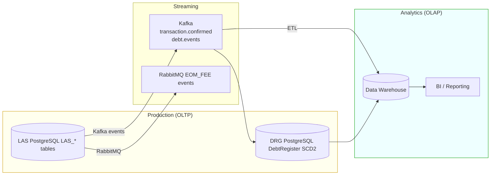

> *"Một khoản vay tốt trong một danh mục xấu vẫn là vấn đề. Quản lý tín dụng không phải là quản lý từng giao dịch - đó là quản lý tổng thể rủi ro và cơ hội theo thời gian."*

## Dẫn nhập: Khi cây cá nhân không thấy rừng danh mục

::::story
Cuối quý 3, bà Hương nhận báo cáo từ ba phòng ban - mỗi phòng đều "tốt":

**Sales:** "Disbursement tăng 35% so với quý trước. Outstanding portfolio đạt 2,800 tỷ VNĐ - kỷ lục mới!"

**Risk:** "Default rate quý này là 4.2% - trong giới hạn cho phép 5%."

**Finance:** "Net interest margin đạt 8.3% - trên target 8%."

Bà Hương nhìn vào ba con số này và cảm thấy bất an. Mọi thứ đều "ổn" - nhưng bức tranh tổng thể không đúng.

Bà yêu cầu thêm data:
- Vintage curve của batch khoản vay mới nhất (Q2): DPD 30+ đang ở 6.8% sau 90 ngày - cao hơn 70% so với vintage Q2 năm ngoái.
- Roll rate từ Current → Bucket 1: tăng từ 4.8% lên 7.2% trong 2 tháng qua.
- Concentration risk: 28% portfolio tập trung vào một ngành công nghiệp đang chịu áp lực.

"Chúng ta đang tăng trưởng nhanh vào một danh mục đang xấu đi," bà Hương kết luận. "Nếu không điều chỉnh ngay, Q1 năm sau sẽ rất khó khăn."
::::

Chương này dạy bạn cách nhìn thấy rừng - không chỉ từng cây. Từ P&L của một công ty tài chính tiêu dùng, qua các công cụ phân tích danh mục, đến quản lý rủi ro tập trung và ALM *(Asset-Liability Management)*. Và quan trọng hơn: cách những nhìn này định hình kiến trúc hệ thống.

## 5.1 P&L của một công Ty tài chính tiêu dùng

### Tình huống: Đọc báo cáo tài chính

::::story
Kỹ sư Tuấn được mời tham gia buổi họp quarterly business review lần đầu tiên. Bà Hương trình bày income statement - Tuấn nhìn vào và không hiểu hầu hết các dòng. Anh biết code, biết hệ thống - nhưng không biết đọc P&L của một CFTC *(Consumer Finance Company)*.

Đây là vấn đề phổ biến: kỹ sư xây dựng hệ thống xử lý hàng tỷ đồng mỗi ngày, nhưng không hiểu tại sao mình đang xây dựng những thứ đó.
::::

### Cấu trúc Income Statement của CFTC

```text
INCOME STATEMENT — Quý 3/2025
Công ty Tài Chính Tiêu Dùng ABC

A. INTEREST INCOME (Thu nhập lãi)
   Lãi từ khoản vay tiêu dùng                    185,000,000,000
   Lãi từ khoản vay trả góp                        62,000,000,000
   ─────────────────────────────────────────────────────────────
   Tổng interest income                            247,000,000,000

B. INTEREST EXPENSE (Chi phí lãi)
   Lãi vay từ ngân hàng mẹ                        (82,000,000,000)
   Lãi trái phiếu phát hành                       (31,000,000,000)
   ─────────────────────────────────────────────────────────────
   Tổng interest expense                          (113,000,000,000)

C. NET INTEREST INCOME (NII)  [A - B]             134,000,000,000

D. NON-INTEREST INCOME (Thu nhập ngoài lãi)
   Phí origination                                  8,500,000,000
   Phí bảo hiểm (commission)                        6,200,000,000
   Phí dịch vụ tài khoản                            4,800,000,000
   Phí trả trễ                                      3,100,000,000
   ─────────────────────────────────────────────────────────────
   Tổng non-interest income                         22,600,000,000

E. TOTAL REVENUE  [C + D]                          156,600,000,000

F. PROVISION FOR CREDIT LOSSES (Dự phòng rủi ro)
   ECL Stage 1                                     (12,000,000,000)
   ECL Stage 2                                      (8,500,000,000)
   ECL Stage 3                                     (15,200,000,000)
   Write-off net of recoveries                      (6,300,000,000)
   ─────────────────────────────────────────────────────────────
   Tổng provision                                  (42,000,000,000)

G. NET REVENUE AFTER PROVISION  [E - F]            114,600,000,000

H. OPERATING EXPENSES (Chi phí vận hành)
   Nhân sự (sales, ops, risk, tech)               (45,000,000,000)
   Chi phí marketing & acquisition                 (18,500,000,000)
   Chi phí công nghệ & infrastructure              (8,200,000,000)
   Chi phí collections                              (6,800,000,000)
   Chi phí khác                                     (4,100,000,000)
   ─────────────────────────────────────────────────────────────
   Tổng operating expenses                         (82,600,000,000)

I. PRE-TAX PROFIT  [G - H]                          32,000,000,000
J. TAX (20%)                                         (6,400,000,000)
K. NET PROFIT                                        25,600,000,000
```

### Ba chỉ số sức khỏe cốt lõi

**Chỉ số 1: NIM - Net Interest Margin**

:::key
**NIM** *(Net Interest Margin - Biên lãi suất thuần)* đo lường hiệu quả của hoạt động cho vay cốt lõi.
:::

```text
NIM = Net Interest Income / Average Earning Assets

Ví dụ:
  Net Interest Income (Q3): 134,000,000,000 VNĐ
  Annualized: 134 × 4 = 536,000,000,000 VNĐ/năm
  Average outstanding portfolio: 2,800,000,000,000 VNĐ

  NIM = 536,000,000,000 / 2,800,000,000,000 = 19.1%/năm
```

**Đọc NIM:**
- NIM 19.1% cho CFTC: trong khoảng bình thường (15-25% cho unsecured consumer lending)
- NIM giảm theo quý → lãi suất thu được giảm hoặc cost of funds tăng
- NIM tăng đột ngột → cần kiểm tra: có phải do mix shift sang sản phẩm rủi ro cao hơn không?

**So sánh NIM:**

| Loại tổ chức | NIM điển hình |
|-------------|---------------|
| Ngân hàng thương mại lớn | 3-5% |
| Ngân hàng bán lẻ | 5-8% |
| CFTC prime segment | 12-18% |
| CFTC mass market | 18-28% |
| Microfinance | 25-40% |

NIM của CFTC cao hơn ngân hàng vì risk premium và operating cost cao hơn - không phải vì "lợi nhuận cao bất thường."

**Chỉ số 2: ROA - Return on Assets**

:::key
**ROA** *(Return on Assets - Tỷ suất sinh lời trên tài sản)* đo lường hiệu quả sử dụng toàn bộ tài sản.
:::

```text
ROA = Net Profit (annualized) / Average Total Assets

Ví dụ:
  Net Profit Q3 (annualized): 25,600,000,000 × 4 = 102,400,000,000
  Average Total Assets: 3,200,000,000,000 VNĐ
  (bao gồm: loan portfolio + cash + other assets)

  ROA = 102,400,000,000 / 3,200,000,000,000 = 3.2%
```

**Benchmark:**
- ROA > 3% cho CFTC: tốt
- ROA 1-3%: trung bình
- ROA < 1%: cần cải thiện - có thể do credit loss quá cao hoặc operating cost quá lớn

**Chỉ số 3: ROE - Return on Equity**

:::key
**ROE** *(Return on Equity - Tỷ suất sinh lời trên vốn chủ sở hữu)* đo lường hiệu quả sử dụng vốn của cổ đông.
:::

```text
ROE = Net Profit (annualized) / Average Equity

Ví dụ:
  Net Profit (annualized): 102,400,000,000 VNĐ
  Average Equity: 640,000,000,000 VNĐ
  (Total Assets 3,200 tỷ - Total Liabilities 2,560 tỷ)

  ROE = 102,400,000,000 / 640,000,000,000 = 16%

Leverage ratio = Total Assets / Equity = 3,200 / 640 = 5x
```

**Mối quan hệ ROA - ROE:**
```text
ROE = ROA × Leverage = 3.2% × 5 = 16%
```

Leverage tăng → ROE tăng, nhưng rủi ro cũng tăng. Đây là lý do regulatory yêu cầu capital adequacy ratio tối thiểu - để đảm bảo CFTC không lever quá nhiều.

### Provision và IFRS 9: Dự phòng rủi ro tín dụng

::::story
Anh Minh nhìn vào P&L và thắc mắc: "Tại sao provision lại lớn đến vậy (42 tỷ trong Q3)? Chúng ta đang mất nhiều tiền thế à?"

Bà Hương giải thích: "Không phải là tiền đã mất - đó là tiền chúng ta *dự phòng* sẽ mất. Accounting yêu cầu chúng ta phải nhận ra tổn thất trước khi nó thực sự xảy ra."
::::

**Khái niệm - IFRS 9 Expected Credit Loss:**

:::key
**IFRS 9** là chuẩn mực kế toán quốc tế yêu cầu các tổ chức tài chính phải trích lập dự phòng *(provision)* dựa trên **expected credit loss** - tổn thất dự kiến trong tương lai - thay vì chỉ khi tổn thất đã xảy ra (chuẩn cũ IAS 39).
:::

**Ba Stage trong IFRS 9:**

```text
STAGE 1 — Performing (Bình thường)
  Điều kiện: DPD = 0, chưa có dấu hiệu tín dụng xấu đi
  Provision: 12-month ECL (tổn thất dự kiến trong 12 tháng tới)
  Ví dụ: Chị Lan vay xong, đang trả bình thường

STAGE 2 — Underperforming (Suy giảm đáng kể)
  Điều kiện: Rủi ro tín dụng tăng đáng kể so với lúc phát sinh
    (DPD 30+, hoặc scoring giảm mạnh, hoặc economic deterioration)
  Provision: Lifetime ECL (tổn thất dự kiến trong toàn bộ thời gian còn lại)
  Ví dụ: Chị Lan bắt đầu trả trễ, DPD = 35

STAGE 3 — Credit-impaired (Tổn thất đã xảy ra)
  Điều kiện: DPD 90+, hoặc có bằng chứng rõ ràng về default
  Provision: Lifetime ECL với higher severity
  Ví dụ: Chị Lan DPD = 120, không liên lạc được
```

**Ví dụ số - Tính Provision:**

Portfolio của bà Hương, Q3/2025:

```text
Stage 1 (bình thường):
  Dư nợ: 2,100,000,000,000 VNĐ (75% portfolio)
  12-month PD: 3.5%
  LGD: 60%
  12-month ECL = 2,100 tỷ × 3.5% × 60% = 44.1 tỷ
  Coverage ratio: 44.1 / 2,100 = 2.1%

Stage 2 (suy giảm):
  Dư nợ: 420,000,000,000 VNĐ (15% portfolio)
  Lifetime PD: 18%
  LGD: 62%
  Lifetime ECL = 420 tỷ × 18% × 62% = 46.9 tỷ
  Coverage ratio: 46.9 / 420 = 11.2%

Stage 3 (tổn thất):
  Dư nợ: 280,000,000,000 VNĐ (10% portfolio)
  PD: 85% (gần như chắc chắn default)
  LGD: 68%
  Lifetime ECL = 280 tỷ × 85% × 68% = 161.8 tỷ
  Coverage ratio: 161.8 / 280 = 57.8%

TOTAL PROVISION ON BALANCE SHEET: 44.1 + 46.9 + 161.8 = 252.8 tỷ

Q3 Provision EXPENSE (thay đổi trong quý):
  Provision đầu Q3: 210.5 tỷ
  Provision cuối Q3: 252.8 tỷ
  → Provision expense Q3 = 252.8 - 210.5 - write-offs + recoveries
  → Kết quả: 42 tỷ VNĐ (như trong P&L)
```

**Tại sao IFRS 9 quan trọng với hệ thống?**

Để tính ECL, hệ thống cần:
1. **Stage classification** cho mỗi khoản vay - dựa trên DPD và risk signals
2. **PD model** - probability of default theo từng stage và time horizon
3. **LGD model** - loss given default, có thể khác nhau theo collateral và sản phẩm
4. **EAD calculation** - dư nợ tại thời điểm default (với revolving: phải model credit utilization)
5. **Macro overlay** - điều chỉnh ECL theo kịch bản kinh tế vĩ mô

Đây là lý do tại sao nhiều CFTC có cả một team riêng cho IFRS 9 calculation - và tại sao data từ LAS module phải được chuẩn hóa để feed vào ECL models.

:::summary[P&L Và Chỉ Số Tài Chính]
NIM = NII / Earning Assets: hiệu quả cho vay lõi
ROA = Net Profit / Assets: hiệu quả tổng thể
ROE = Net Profit / Equity = ROA × Leverage
IFRS 9: provision dựa trên expected loss,
3 stage theo mức độ rủi ro
→ Stage classification cần DPD data real-time
từ LAS module
:::

## 5.2 Portfolio Analytics: Nhìn danh mục theo chiều sâu

### Vintage Curve: Đánh giá Cohort theo thời gian

::::story
Anh Minh cần báo cáo cho Board: "Sản phẩm vay giáo viên launch tháng 1/2025 - hiệu quả như thế nào?"

Câu hỏi đơn giản, nhưng sau 6 tháng vận hành, trả lời chính xác không dễ. Khoản vay 24 tháng - mới đi được 25% vòng đời, làm sao đánh giá?
::::

**Khái niệm:**

:::key
**Vintage** là nhóm các khoản vay được phê duyệt trong cùng một khoảng thời gian (thường là một tháng hoặc một quý). **Vintage curve** theo dõi hiệu suất của từng nhóm này theo số tháng kể từ khi giải ngân - cho phép so sánh "táo với táo" giữa các thế hệ khoản vay.
:::

**Tại sao không dùng tỷ lệ vỡ nợ tổng thể?**

```text
Ví dụ minh họa:

Tháng 12/2025:
  Portfolio: 10,000 khoản vay đang hoạt động
  Trong đó:
    Vintage Jan/2025 (11 tháng tuổi): 2,000 khoản, default rate 4.2%
    Vintage Jun/2025 (6 tháng tuổi): 3,000 khoản, default rate 1.8%
    Vintage Sep/2025 (3 tháng tuổi): 5,000 khoản, default rate 0.5%

  Tỷ lệ vỡ nợ tổng thể:
    = (2,000×4.2% + 3,000×1.8% + 5,000×0.5%) / 10,000
    = (84 + 54 + 25) / 10,000
    = 163 / 10,000 = 1.63%

  1.63% trông ổn. Nhưng ẩn đi sự thật:
  Vintage Jun đang có dấu hiệu xấu hơn Vintage Jan ở cùng tuổi.
```

Vintage curve phân tách điều này:

**Xây dựng Vintage Curve - Step by Step:**

*Step 1:* Thu thập data - mỗi khoản vay biết ngày giải ngân (vintage month) và DPD theo từng tháng.

*Step 2:* Tính cumulative default rate theo "loan age" (số tháng từ giải ngân):

```text
Vintage Jan/2025:
  Tháng 1 (age=1):  0 defaults → cum. default = 0%
  Tháng 2 (age=2):  2 defaults → cum. default = 0.1%
  Tháng 3 (age=3):  5 defaults → cum. default = 0.35%
  ...
  Tháng 6 (age=6):  15 defaults → cum. default = 0.75%
  Tháng 9 (age=9):  28 defaults → cum. default = 1.40%
  Tháng 12 (age=12): 45 defaults → cum. default = 2.25%

Vintage Jun/2025:
  Tháng 1 (age=1):  0 defaults → cum. default = 0%
  Tháng 2 (age=2):  3 defaults → cum. default = 0.15%
  Tháng 3 (age=3):  8 defaults → cum. default = 0.55%
  Tháng 6 (age=6):  21 defaults → cum. default = 1.40%
```

*Step 3:* Vẽ và so sánh:

```text
Cumulative Default Rate (%)
    │
 4% │                    ●●●●  Vintage Jan/2024 (bad)
    │              ●●●●
 3% │         ●●●●
    │    ●●●●
 2% │                    ○○○   Vintage Jan/2025 (current)
    │              ○○○
 1% │         ○○○
    │    ○○○       ▲▲▲▲        Vintage Jun/2025 (new - concerning!)
 0% │▲▲▲▲▲▲▲▲
    └────────────────────────────────→ Loan Age (months)
        3   6   9   12  15  18  21  24
```

**Đọc chart này:**

- Vintage Jan/2025 đang track tốt hơn Jan/2024 → sản phẩm và scoring cải thiện
- Vintage Jun/2025 tại age=6 đang ở 1.40% - **bằng** Vintage Jan/2025 tại age=6 (cũng 0.75%? Không! Jun đang cao hơn)
- **Red flag:** Jun/2025 tại age=6 (1.40%) cao hơn đáng kể Jan/2025 tại age=6 (0.75%) → vintage mới đang xấu hơn

**Ứng dụng - Dự báo tổn thất:**

Nếu vintage thường kết thúc ở 4% cumulative default rate tại age=24, và Jun/2025 đã đạt 1.40% ở age=6:

```text
Tỷ lệ "baked in" = 1.40% / 4.00% = 35% tại age=6

Nếu Jun/2025 có 3,000 khoản vay:
  Tổn thất đã biết (1.40%): 42 khoản
  Tổn thất dự báo (thêm 65%): ~81 khoản nữa
  Tổng tổn thất dự báo: 123 khoản

Khi nào phải act? NGAY BÂY — không phải khi 123 khoản thực sự default.
```

Đây là **leading indicator** vs **lagging indicator**. Tỷ lệ vỡ nợ tổng thể là lagging - bạn thấy vấn đề khi đã quá muộn. Vintage curve là leading - bạn thấy vấn đề khi còn có thể làm gì đó.

### Roll Rate Matrix: Early Warning System

**Khái niệm:**

:::key
**Roll rate** *(tỷ lệ chuyển dịch)* là xác suất một tài khoản di chuyển từ DPD bucket này sang bucket khác trong một tháng. Roll rate matrix là bảng tổng hợp tất cả các chuyển dịch này.
:::

**Xây dựng Roll Rate Matrix:**

Từ data LAS module (DPD tại đầu và cuối mỗi tháng):

```text
Tháng 9/2025 — 10,000 tài khoản:

                    Trạng thái CUỐI tháng
                Current  1-30  31-60  61-90  91+   Write-off
Trạng thái  Current  8,930   420    0      0      0     0
ĐẦU tháng   1-30      186    68    146     0      0     0
            31-60      31    14     51    184     0     0
            61-90       7     5     11     38    89     0
            91+          3     2      5      9   281    50
```

*Tổng mỗi hàng:*
- Current: 8,930 + 420 = 9,350 tài khoản đầu tháng là Current
- 1-30: 186 + 68 + 146 = 400 tài khoản đầu tháng là 1-30
- ... và tiếp tục

*Roll rate (% theo từng hàng):*

```text
                    Trạng thái CUỐI tháng
                Current  1-30  31-60  61-90  91+
Trạng thái  Current  95.5%  4.5%    0%     0%    0%
ĐẦU tháng   1-30     46.5% 17.0%  36.5%   0%    0%
            31-60    11.1%  5.0%  18.2%  65.7%   0%
            61-90     4.7%  3.3%   7.3%  25.3%  59.3%
            91+        0.9%  0.6%   1.5%   2.7%  84.3%
```

**Đọc bảng này:**

- **Current → Current (95.5%):** 95.5% tài khoản bình thường tiếp tục bình thường. Tốt.
- **Current → 1-30 (4.5%):** 4.5% tài khoản bình thường trả trễ trong tháng này - đây là "new delinquency rate."
- **1-30 → Current (46.5%):** Gần một nửa tài khoản trả trễ lần đầu tự phục hồi. Đây là **cure rate**.
- **1-30 → 31-60 (36.5%):** Hơn 1/3 chuyển sang trễ hơn - **roll forward rate**.
- **61-90 → 91+ (59.3%):** Phần lớn tài khoản DPD 61-90 sẽ thành 91+ - gần như mất.

**Tại sao roll rate là early warning?**

```text
Tháng 8: Current → 1-30 = 4.5% (baseline)
Tháng 9: Current → 1-30 = 4.5% (bình thường)
Tháng 10: Current → 1-30 = 6.8% (tăng 51%!)

Tín hiệu: Có điều gì đó xảy ra trong tháng 10 khiến nhiều tài khoản
tốt bắt đầu trả trễ. Có thể là:
  - Kinh tế vĩ mô xấu đi (thất nghiệp tăng)
  - Một nhóm khách hàng cụ thể bị ảnh hưởng (ngành bị layoff)
  - Scoring model không capture được một risk factor mới
  - Sản phẩm mới launch có vấn đề

Hành động: Investigate ngay — không phải chờ default rate tăng
(sẽ mất 3-6 tháng để hiện ra trong lagging indicators)
```

**Ứng dụng trong VLP:**

Module DRG *(Debt Register)* cập nhật DPD từng tài khoản real-time qua Kafka event stream từ LAS. Roll rate được tính batch nightly - cung cấp early warning mà không cần query production DB.

### Concentration Risk: Khi trứng quá nhiều trong một giỏ

::::story
Bà Hương nhìn vào portfolio breakdown và thấy 28% dư nợ tập trung vào khách hàng làm trong ngành dệt may. Tin tức cho thấy các nhà máy dệt may đang bị áp lực do đơn hàng xuất khẩu giảm. Bà biết đây là concentration risk.
::::

**Khái niệm:**

:::key
**Concentration risk** là rủi ro phát sinh khi danh mục cho vay quá tập trung vào một phân khúc (ngành, địa lý, nhân khẩu học) - khiến một cú shock từ phân khúc đó có thể gây tổn thất lớn hơn EL dự kiến.
:::

**Tại sao EL model thông thường không capture concentration risk?**

EL = PD × LGD × EAD giả định **independence** giữa các khoản vay - tức là default của khoản vay A không ảnh hưởng đến khoản vay B. Nhưng trong thực tế, nếu cả A và B đều là công nhân trong cùng nhà máy bị đóng cửa → they default cùng lúc.

**Ví dụ số - Tác động của concentration:**

```text
Kịch bản baseline (diversified portfolio):
  PD trung bình: 5%, LGD: 60%, EAD: 2,800 tỷ
  EL = 2,800 × 5% × 60% = 84 tỷ

Kịch bản concentration shock:
  28% portfolio = 784 tỷ trong dệt may
  Ngành dệt may bị shock → PD tăng từ 5% lên 18%

  EL (non-textile, 72%): 2,016 tỷ × 5% × 60% = 60.5 tỷ
  EL (textile, 28%): 784 tỷ × 18% × 60% = 84.7 tỷ
  Total EL mới: 145.2 tỷ

  Tăng so với baseline: 145.2 - 84 = 61.2 tỷ (tăng 73%!)
  Nhưng provision chỉ dự phòng 84 tỷ ban đầu
  → Gap: 61.2 tỷ không được dự phòng → ảnh hưởng P&L đột ngột
```

**Công cụ đo lường concentration:**

**Herfindahl-Hirschman Index (HHI):**
```text
HHI = Σ (s_i)²

Trong đó s_i = tỷ lệ % của phân khúc i trong tổng portfolio

HHI gần 0: Diversified tốt
HHI gần 10,000: Concentrated vào một phân khúc

Ví dụ (4 ngành):
  Dệt may: 28%, Giáo dục: 22%, Bán lẻ: 30%, Y tế: 20%
  HHI = 28² + 22² + 30² + 20² = 784 + 484 + 900 + 400 = 2,568

  So sánh: Nếu đều 25% mỗi ngành → HHI = 4 × 25² = 2,500
  HHI 2,568 ≈ 2,500 → khá diversified, nhưng textile hơi cao
```

**Limits và monitoring:**

Bà Hương đặt ra concentration limits:
```text
Một ngành: tối đa 20% portfolio
Một địa lý (tỉnh): tối đa 15% portfolio
Một employer lớn: tối đa 5% portfolio
```

Hệ thống phải monitor real-time và alert khi approaching limits - trước khi vượt, không phải sau.

:::summary[Portfolio Analytics]
Vintage curve: so sánh cohort ở cùng "tuổi" →
leading indicator tốt hơn aggregate metrics
Roll rate matrix: probability chuyển DPD bucket
→ early warning system trước khi default xảy ra
Concentration risk: EL standard model không
capture correlated default → cần limits và
stress testing riêng
Tất cả cần data real-time từ LAS module
:::

## 5.3 ALM: Asset-Liability Management

### Tình huống: Rủi ro ẩn trong bảng cân đối kế toán

::::story
Bà Hương họp với CFO về kế hoạch mở rộng. Câu hỏi: "Chúng ta có thể tăng portfolio thêm 30% không?"

CFO trả lời: "Revenue thì được, nhưng funding thì sao? Chúng ta đang có 1,200 tỷ bond đến hạn trong 6 tháng. Lãi suất thị trường đang tăng. Nếu chúng ta phải rollover bond với lãi suất cao hơn 2 điểm %, margin của toàn bộ portfolio sẽ bị ăn mòn."

Đây là **ALM problem** - Asset-Liability Management.
::::

### Duration Mismatch và Liquidity Risk

**Khái niệm - Duration:**

:::key
**Duration** (trong bối cảnh ALM) là thước đo độ nhạy cảm của giá trị tài sản/nợ với sự thay đổi lãi suất, đồng thời phản ánh thời gian trung bình có trọng số của các dòng tiền.
:::

**Duration của loan portfolio:**

Khoản vay 24 tháng không phải là "24 tháng" từ góc độ duration - vì tiền được nhận dần từng tháng (amortizing), không phải một lần cuối kỳ.

```text
Ví dụ: Khoản vay 20 triệu, 15%/năm, 24 tháng
PMT ≈ 970,000 VNĐ/tháng

Duration = Σ [t × CF_t / (1+r)^t] / PV

Tháng 1: weight = 1 × (970,000/1.0125) / 20,000,000 = 0.0479
Tháng 2: weight = 2 × (970,000/1.0125²) / 20,000,000 = 0.0943
...
Tháng 24: weight = 24 × (970,000/1.0125²⁴) / 20,000,000 = ...

Tổng duration ≈ 13.2 tháng (không phải 24 tháng!)
```

**Mismatch và rủi ro:**

```text
Assets (loan portfolio):
  Average duration: 14 months
  Tổng: 2,800 tỷ VNĐ

Liabilities (funding):
  Bond 3 năm (kỳ hạn còn lại 30 tháng): 1,200 tỷ
  Bond 1 năm (kỳ hạn còn lại 8 tháng): 800 tỷ
  Bank loan 6 tháng (kỳ hạn còn lại 4 tháng): 500 tỷ
  Average funding duration: (1,200×30 + 800×8 + 500×4) / 2,500 ≈ 18.4 months

Gap: Funding duration (18.4) > Asset duration (14) → Assets mature faster than liabilities
```

Trong kịch bản này, tài sản (khoản vay) được thu hồi nhanh hơn nghĩa vụ (bond). Điều này tạo ra **reinvestment risk**: khi khoản vay được trả, phải cho vay lại ở lãi suất thị trường hiện tại - có thể thấp hơn.

Kịch bản ngược lại cũng có rủi ro: nếu bond đến hạn trước khoản vay, phải tìm nguồn funding mới - có thể với lãi suất cao hơn.

### Prepayment Risk

::::story
Tháng 10/2025, lãi suất thị trường giảm mạnh. Ngay lập tức, hàng nghìn khách hàng bắt đầu liên hệ yêu cầu tất toán trước hạn - họ muốn vay ở ngân hàng khác với lãi suất thấp hơn.

Bà Hương nhìn vào hệ thống: tháng 10, prepayment rate từ 2% lên 8% của portfolio.
::::

**Vấn đề:**

Khi khách hàng trả trước, công ty mất:
1. **Future interest income** - lãi suất dự kiến thu được trong các tháng còn lại
2. **Reinvestment opportunity** - tiền nhận lại phải cho vay lại ở rate thấp hơn

```text
Ví dụ số:
  Khoản vay 20 triệu, lãi 18%/năm, 24 tháng
  Khách hàng tất toán sau tháng 12

  Số dư nợ tháng 12: ≈ 10,200,000 VNĐ (khoảng nửa gốc còn lại)
  Lãi dự kiến 12 tháng còn lại: ≈ 920,000 VNĐ
  → Lender mất 920,000 VNĐ interest income

  Nếu cho vay lại 10,200,000 VNĐ ở lãi suất mới 14%/năm:
  Lãi thu được: ≈ 718,000 VNĐ
  → Mất thêm 920,000 - 718,000 = 202,000 VNĐ do lãi suất thấp hơn
```

**Phí tất toán trước hạn *(prepayment fee)*** tồn tại để bù đắp một phần rủi ro này. Nhưng nhiều regulatory yêu cầu giới hạn hoặc cấm prepayment fee - tạo ra tension giữa lender protection và consumer protection.

**Ứng dụng trong VLP:**

Module LAS phải tracking prepayment behavior. Khi prepayment rate tăng bất thường:
1. Alert đến Finance/Treasury
2. Re-forecast cashflow dự kiến
3. Treasury điều chỉnh funding strategy
4. Product team review liệu có cần thêm retention incentives

### Interest Rate Risk trong Consumer Lending

::::story
Lãi suất thị trường tăng 2%/năm do NHNN thắt chặt chính sách tiền tệ. Tác động là gì?
::::

**Tài sản (khoản vay):**
- Fixed rate loans: lãi suất đã ký → không thay đổi → bị kẹt ở rate thấp hơn thị trường
- Variable rate loans: điều chỉnh theo lãi suất mới → không bị ảnh hưởng (có thể ngược lại tốt hơn cho lender, nhưng khó cho borrower)

**Nợ (funding):**
- Bond fixed rate đang chạy: không thay đổi → tốt cho lender (đang trả rate cũ thấp hơn)
- Bond đến hạn phải rollover: phải issue mới ở rate cao hơn → cost of funds tăng
- Bank loan variable rate: tăng ngay → cost of funds tăng

```text
Scenario Analysis: Lãi suất tăng 2%

Tài sản fixed rate (1,800 tỷ):
  NIM hiện tại: 18%/năm
  Sau 1 năm (khi khoản vay mới tăng rate, cũ vẫn cũ):
  Khoản vay mới (30% turnover): rate tăng lên 20% → tốt cho lender
  Khoản vay cũ (70% portfolio): vẫn 18% → không đổi

Nợ (funding rollover 40% trong năm tới):
  Bond cũ: 8.5% → Bond mới phải issue: 10.5%
  Tăng cost: 40% × 2,500 tỷ × 2% = 20 tỷ/năm cost tăng thêm

Net impact: Cost tăng 20 tỷ/năm, revenue tăng chậm hơn
→ NIM bị ăn mòn trong ngắn hạn, phục hồi khi portfolio turnover hoàn tất
```

**ALM response:**

```text
Short term: Hedge lãi suất với interest rate swap
  (Pay fixed, receive floating - lock in current cost)

Medium term: Issue floating rate loans nhiều hơn
  (Pass interest rate risk qua cho borrower)

Long term: Match funding duration với asset duration tốt hơn
```

:::summary[ALM]
Duration mismatch: assets và liabilities có
thời hạn khác nhau → reinvestment hoặc
refinancing risk
Prepayment risk: khách hàng trả sớm khi lãi thấp
→ lender mất future interest + phải reinvest
ở rate thấp hơn
Interest rate risk: fixed-rate portfolio bị kẹt
khi lãi suất thị trường thay đổi
Tất cả cần cashflow forecast từ amortization
schedule - data từ LAS module
:::

## 5.4 Reporting Architecture: Từ Transactions đến Insights

### Tình huống: Tại sao không Query Production DB

::::story
Kỹ sư Tuấn nhận yêu cầu từ analytics team: "Chúng tôi cần report vintage curve hàng ngày. Có thể query trực tiếp từ LAS database không?"

Tuấn biết câu trả lời ngay: không. Nhưng phải giải thích tại sao.
::::

### Vấn đề với Query Production DB

**Vấn đề 1: Performance impact**

LAS database đang phục vụ hàng nghìn transaction/giây. Một query analytics phức tạp (JOIN nhiều bảng lớn, aggregate trên millions rows) có thể lock tables, tăng latency của transactions thực tế, và trong worst case - crash hệ thống.

```text
Production DB Query (naïve):
  SELECT vintage_month, loan_age, COUNT(*) as defaults
  FROM las_transaction t
  JOIN las_account a ON t.account_id = a.id
  JOIN las_current_balance rb ON a.id = rb.account_id
  WHERE t.cancelled = false
    AND rb.overdue_days > 90
  GROUP BY 1, 2
  
→ Full table scan trên las_transaction (100M+ rows)
→ Execution time: 15-20 phút
→ During this time: transactions bị slow down
```

**Vấn đề 2: Point-in-time consistency**

Analytics cần snapshot tại một thời điểm cụ thể. Production DB đang thay đổi liên tục. Một report chạy trong 20 phút trên production DB có thể có inconsistent data (một phần đầu report là lúc 9h00, một phần cuối là 9h20 - trong khi hàng nghìn transactions đã xảy ra).

**Vấn đề 3: Schema không được thiết kế cho analytics**

Production schema được tối ưu cho OLTP *(Online Transaction Processing)* - ghi nhanh, đọc theo primary key nhanh. Analytics cần OLAP *(Online Analytical Processing)* - đọc nhiều cột, aggregate trên nhiều rows, nhiều dimensions.

### Data Pipeline Architecture

**Giải pháp: Separate analytical store**


**Hai luồng data:**

**Luồng 1 - Event Stream (Real-time, via Kafka):**
- LAS publish events khi: transaction confirmed, DPD changed, account status changed, payment received
- Analytics consumer đọc events và update analytical models real-time
- Latency: vài giây đến vài phút
- Phù hợp cho: roll rate monitoring, early warning alerts, dashboards

**Luồng 2 - Batch ETL (Nightly):**
- Full extract từ production DB vào analytical store
- Chạy sau giờ cao điểm (2-4h sáng)
- Đảm bảo reconciliation - analytical store phải match production DB
- Phù hợp cho: vintage curves (cần historical data chính xác), IFRS 9 calculation, regulatory reports

### Real-time vs Batch: Trade-offs

| | Real-time (Event Stream) | Batch (Nightly ETL) |
|--|------------------------|-------------------|
| Latency | Giây/phút | 8-24 giờ |
| Consistency | Eventually consistent | Point-in-time consistent |
| Complexity | Cao (event ordering, replay) | Thấp hơn |
| Cost | Cao (streaming infrastructure) | Thấp hơn |
| Use case | Alerts, dashboards, fraud | Reports, regulatory, IFRS 9 |

**Nguyên tắc thiết kế:**

```text
Dùng real-time khi:
  → Quyết định cần trong vài phút (fraud detection)
  → Alert cần sớm nhất có thể (roll rate spike)
  → Khách hàng đang chờ kết quả (credit decision)

Dùng batch khi:
  → Tính toán phức tạp cần toàn bộ dataset (IFRS 9)
  → Regulatory report cần point-in-time consistency
  → Historical analysis không cần real-time
```

### Dimensional Data Model cho Analytics

Production DB của LAS được chuẩn hóa *(normalized)* để giảm data redundancy. Analytics cần denormalized *(star schema)* để query nhanh.

**Ví dụ - Từ normalized sang star schema:**

```text
Production (Normalized — 3NF):
  LAS_ACCOUNT → LAS_TRANSACTION → LAS_LEDGER_ENTRY → LAS_INSTALMENT

Analytics (Star Schema):
  FACT_LOAN_PERFORMANCE:
    loan_id, account_id, vintage_month, loan_age_months,
    outstanding_balance, dpd_current, is_default,
    cumulative_payment, original_amount

  DIM_ACCOUNT:
    account_id, account_type, product_type, channel,
    segment, region, origination_date

  DIM_DATE:
    date_id, year, month, quarter, is_holiday, ...

Query vintage curve (analytics DB):
  SELECT
    d.vintage_month,
    p.loan_age_months,
    SUM(CASE WHEN p.is_default THEN 1 ELSE 0 END) / COUNT(*) as default_rate
  FROM fact_loan_performance p
  JOIN dim_account a ON p.account_id = a.account_id
  JOIN dim_date d ON a.origination_date = d.date_id
  GROUP BY 1, 2
  ORDER BY 1, 2

→ Execution time: 2-5 giây (vs 15-20 phút trên production DB)
```

**Ứng dụng trong VLP:**

Đây là lý do tại sao STS *(Statement Management)* module và DRG *(Debt Register)* module không trực tiếp query LAS database. Thay vào đó:
1. LAS publish events qua messaging:
   - LAS → DRG: **Kafka** (`transaction.confirmed` topic)
   - LAS → STS: **RabbitMQ** (EOM_FEE event, headers exchange)
2. STS và DRG subscribe và maintain state của riêng mình
3. Analytics team maintain analytical store riêng biệt

Separation of concerns này - mỗi consumer duy trì state của mình dựa trên event stream - là pattern được gọi là **Event-Driven Architecture** và là foundation của khả năng scale của VLP.

:::summary[Reporting Architecture]
Không query production DB cho analytics:
Performance, consistency, schema mismatch
Two-track: Real-time (Kafka events) cho alerts
+ Batch (nightly ETL) cho reports
Star schema trong analytics store:
denormalized, query-optimized
Event-driven pattern: mỗi consumer (STS, DRG,
Analytics) maintain state riêng từ LAS events
:::

## Tóm tắt chương 5

```text
Từ cảnh báo của bà Hương (vintage Q2 đang xấu):

Phát hiện vấn đề:
  Vintage curve: Q2/2025 tại age=6 cao hơn 87% so với Q2/2024
  Roll rate: Current→1-30 tăng từ 4.5% lên 6.8% trong 2 tháng
  Concentration: 28% portfolio trong ngành bị áp lực

Đo lường tác động:
  EL tăng từ 84 tỷ → 145 tỷ (73% tăng)
  Gap provision: 61 tỷ chưa được dự phòng
  P&L impact Q4 dự kiến: -40 đến -60 tỷ

Response:
  Short term: Tăng provision, tighten scoring cho Q2 segment
  Medium term: Reduce concentration limits
  ALM: Review funding gap, lock lãi suất fixed trước khi rollover bond

Data infrastructure:
  Real-time: Roll rate alerts từ Kafka event stream
  Batch: Vintage curve, IFRS 9 calculation nightly
  No production DB query cho analytics
```

**Tất cả những phân tích trên chỉ possible khi data từ LAS module được thiết kế đúng - event-driven, audit trail đầy đủ, và feed vào analytical pipeline.**

## Câu hỏi tự kiểm tra

**Loại 1 - Nhớ lại:**
1. NIM được tính như thế nào? NIM điển hình của CFTC là bao nhiêu so với ngân hàng thương mại?
2. IFRS 9 có 3 stage. Điều kiện chuyển từ Stage 1 sang Stage 2 là gì?
3. Vintage curve theo dõi cái gì? Tại sao phải nhìn theo "loan age" chứ không phải theo calendar time?
4. Tại sao không được query production database cho analytics?

**Loại 2 - Hiểu:**
5. Giải thích tại sao roll rate là "leading indicator" trong khi tỷ lệ vỡ nợ tổng thể là "lagging indicator". Cho ví dụ minh họa với số liệu.
6. Duration của một amortizing loan (24 tháng) tại sao lại ngắn hơn 24 tháng? Tính ước lược.
7. Concentration risk không được capture bởi standard EL model. Tại sao? Và cần thêm công cụ gì?
8. Trong event-driven architecture, tại sao mỗi downstream consumer (STS, DRG, Analytics) nên maintain state riêng thay vì query LAS database?

**Loại 3 - Áp dụng:**
9. Bà Hương có portfolio 3,000 tỷ VNĐ với roll rate tháng này:
   - Current → 1-30: 5.2% (tháng trước: 3.8%)
   - 1-30 → 31-60: 40% (tháng trước: 38%)
   - 31-60 → 61-90: 62% (tháng trước: 63%)

   (a) Roll rate nào thay đổi đáng kể nhất? Điều đó có nghĩa là gì?
   (b) Nếu Current portfolio là 2,400 tỷ, tính số khoản vay dự kiến bắt đầu trả trễ trong tháng tới (giả sử average loan 15 triệu)
   (c) Bà Hương nên làm gì ngay lập tức?

10. Công ty tài chính có portfolio:
    - Tech workers: 35%, PD = 2%, LGD = 55%
    - Factory workers: 40%, PD = 5%, LGD = 62%
    - Self-employed: 25%, PD = 8%, LGD = 65%

    (a) Tính EL tổng thể trên portfolio 2,000 tỷ
    (b) Tính HHI cho concentration risk
    (c) Nếu tin tức cho thấy ngành tech sẽ có layoff 20% trong 6 tháng tới (PD tăng từ 2% lên 12%), EL mới là bao nhiêu?
    (d) Gap với provision hiện tại là bao nhiêu? Cần action gì?

**Loại 4 - Phân tích:**
11. Startup fintech đề xuất kiến trúc đơn giản hơn: "Thay vì event streaming và analytics database riêng, chúng tôi sẽ cache query results từ production DB mỗi 15 phút. Đơn giản hơn, ít infrastructure hơn."

    Phân tích: (a) Use cases nào acceptable với approach này, (b) Use cases nào không acceptable và tại sao, (c) Long-term risk của approach này khi portfolio scale 10x.

12. Lãi suất thị trường đang tăng 3%/năm. Công ty tài chính có:
    - Portfolio: 2,500 tỷ fixed rate loans, average duration 15 tháng
    - Funding: 1,000 tỷ bond fixed rate (đến hạn 18 tháng), 1,000 tỷ bank loan variable rate, 500 tỷ bond fixed rate (đến hạn 36 tháng)

    Phân tích ALM impact và đề xuất hedging strategy. Metric nào cần monitor và tần suất bao nhiêu?

## Bài tập áp dụng

**Bài 1 - Xây Dựng Vintage Analysis:**

Bạn có data sau (số default tích lũy theo loan age):

| Vintage | Age 3 | Age 6 | Age 9 | Age 12 | Age 18 | Age 24 |
|---------|-------|-------|-------|--------|--------|--------|
| Q1/2023 (2000 loans) | 8 | 22 | 45 | 78 | 142 | 196 |
| Q2/2023 (2200 loans) | 7 | 19 | 41 | 72 | 138 | - |
| Q3/2023 (2500 loans) | 10 | 28 | 58 | 98 | - | - |
| Q4/2023 (2800 loans) | 9 | 26 | 52 | - | - | - |
| Q1/2024 (3000 loans) | 12 | 35 | - | - | - | - |
| Q2/2024 (3200 loans) | 15 | - | - | - | - | - |

(a) Tính cumulative default rate cho từng vintage ở từng loan age
(b) Vẽ vintage curve (text-based chart)
(c) Vintage nào đang "concerning"? Dựa trên basis gì?
(d) Dự báo tổng default số lượng khoản vay của Q1/2024 khi đạt age=24
(e) Action nào cần thực hiện với Q2/2024 dựa trên data hiện có?

**Bài 2 - IFRS 9 Calculation:**

Portfolio cuối tháng 10/2025:

| Stage | Dư nợ (tỷ) | PD | LGD |
|-------|-----------|-----|-----|
| 1 | 1,800 | 12-month PD: 3.2% | 58% |
| 2 | 350 | Lifetime PD: 22% | 63% |
| 3 | 180 | 88% | 70% |

Tháng 11/2025, do kinh tế xấu đi:
- 5% Stage 1 accounts di chuyển lên Stage 2
- 8% Stage 2 accounts di chuyển lên Stage 3
- Write-off: 15 tỷ từ Stage 3
- Recoveries: 3.5 tỷ

(a) Tính ECL tháng 10/2025
(b) Tính portfolio distribution mới sau các chuyển dịch tháng 11
(c) Tính ECL tháng 11/2025
(d) Tính provision expense tháng 11 cần ghi vào P&L
(e) Tác động lên Net Profit tháng 11 là bao nhiêu? (giả sử pre-provision profit = 35 tỷ, tax rate 20%)

**Bài 3 - Data Pipeline Design:**

Kỹ sư Tuấn cần thiết kế data pipeline để support:
- Real-time roll rate alert (ngưỡng: tăng > 30% so với baseline)
- Daily vintage curve report (chạy lúc 6h sáng)
- Monthly IFRS 9 ECL calculation (chạy ngày 1 mỗi tháng)
- Ad-hoc portfolio analytics cho Risk team

Yêu cầu thiết kế:
(a) Phân loại 4 use case trên theo real-time vs batch
(b) Thiết kế data flow từ LAS module đến từng consumer (diagram)
(c) Xác định tables/events nào từ LAS cần được exposed
(d) Trade-offs về latency, consistency, và cost cho từng lựa chọn
(e) Failure scenario: nếu Kafka consumer bị down 2 giờ, cần recovery strategy gì?

## Đọc thêm

**Portfolio Management:**
- Caouette, J. B., Altman, E. I., & Narayanan, P. (2008). *Managing Credit Risk: The Great Challenge for Global Financial Markets* (2nd ed.). Wiley. - Comprehensive reference về credit risk management ở cấp portfolio.

**IFRS 9:**
- IASB. (2014). *IFRS 9: Financial Instruments.* International Accounting Standards Board. - Chuẩn mực gốc, available free tại ifrs.org. Phần 5.5 về Impairment là phần cần đọc.

**Data Architecture:**
- Kleppmann, M. (2017). *Designing Data-Intensive Applications.* O'Reilly Media. - Chapters 10-12 về stream processing và batch processing - foundational knowledge cho analytics pipeline trong financial systems.

*Chương 6 sẽ chuyển từ business sang engineering: tại sao hệ thống tài chính được thiết kế khác với enterprise systems thông thường, và làm thế nào để những ràng buộc từ Phần 0 và Phần I trở thành quyết định kiến trúc cụ thể trong Phần II.*
