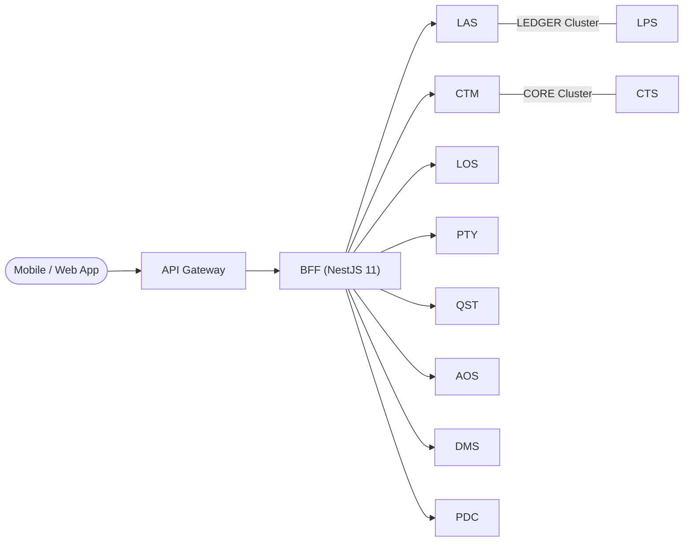

> *"Trong tài chính, hệ thống không chỉ phục vụ kinh doanh; hệ thống chính là kinh doanh. Một ngân hàng có hệ thống chạy không tốt không phải là một ngân hàng tồi, mà là không còn là ngân hàng."*

## Dẫn nhập: khi một lần triển khai trị giá 440 triệu đô la

::::story
Ngày 1/8/2012, Knight Capital Group, một trong những công ty tạo lập thị trường cổ phiếu lớn nhất nước Mỹ, triển khai phiên bản phần mềm giao dịch mới. Đoạn code mới được cài lên bảy trong tám máy chủ. Máy chủ thứ tám vẫn chạy code cũ, và một cờ cấu hình được dùng lại đã kích hoạt một tính năng tưởng đã ngừng hoạt động từ lâu.

Trong khoảng 45 phút, hệ thống tự động mua bán cổ phiếu theo logic sai, và không ai dừng được nó đủ nhanh. Knight Capital lỗ khoảng 440 triệu đô la, nhiều hơn toàn bộ giá trị vốn hóa của công ty. Vài ngày sau, công ty phải nhận khoản cứu trợ 400 triệu đô la đổi lấy phần lớn cổ phần; đến cuối năm, Knight đồng ý sáp nhập vào một đối thủ.

Trong tài chính tiêu dùng, quy mô thiệt hại thường nhỏ hơn, nhưng mẫu hình giống hệt: một quyết định thiết kế tưởng nhỏ, một giả định không được ghi lại, một ca kiểm thử bị bỏ sót. Và người chịu hậu quả là hàng triệu khách hàng thật.
::::

Chương này mở đầu Phần III. Nó trả lời câu hỏi **vì sao** hệ thống tài chính được thiết kế khác biệt, và vì sao những khác biệt đó không phải là thiết kế thừa *(over-engineering)* mà là phản ánh của những ràng buộc kinh doanh và pháp lý rất cụ thể. Các chương sau đi vào từng module của VLP; chương này cung cấp lăng kính để đọc chúng.

## 6.1 Vì sao hệ thống tài chính khác hệ thống doanh nghiệp thông thường

### Tình huống: hai hệ thống, hai thế giới

::::story
Kỹ sư Tuấn trước đây làm ở một startup thương mại điện tử. Ngày đầu tiên ở Vela Finance, anh mở code và ngạc nhiên:

"Sao lại nhiều bước kiểm tra như vậy? Sao thao tác nào cũng cần transaction? Sao không dùng nhất quán sau cùng *(eventual consistency)* như mọi nơi? Sao có cả một module chỉ để giữ dấu vết kiểm toán?"

Trưởng nhóm kỹ thuật giải thích: "Vì ở đây, một lỗi không chỉ là một lỗi. Nó là tiền của ai đó. Và số tiền đó phải chứng minh được là đúng, trước tòa nếu cần."
::::

### Nguyên tắc 1: đúng trước, sẵn sàng sau

Trong phần lớn hệ thống web, khi phải chọn giữa tính sẵn sàng *(availability)* và tính nhất quán *(consistency)*, người ta thường chọn sẵn sàng và chấp nhận nhất quán sau cùng: cứ phục vụ trước, đồng bộ sau. Trong hệ thống tài chính, thứ tự đó đảo ngược: **đúng trước, sẵn sàng sau**.

```text
Scenario e-commerce:
  User A và User B cùng xem sản phẩm.
  System A thấy stock = 5, System B thấy stock = 5 (eventual consistency)
  Cả hai đều order. Cuối cùng chỉ có 5 items — một người bị cancel.
  → Annoying, nhưng manageable. Refund được, apologize được.

Scenario consumer finance:
  Account A có balance = 2,000,000 VNĐ.
  System A xử lý rút 1,500,000 VNĐ.
  System B (chưa nhận update) cũng cho phép rút 1,500,000 VNĐ.
  Tổng rút: 3,000,000 VNĐ > balance thực tế.
  → Không chỉ là lỗi — đây là financial fraud/loss.
  → Không thể "apologize" — tiền đã mất.
  → Có thể vi phạm pháp luật.
```

Hậu quả của hai lỗi không cùng loại. Bán quá số hàng trong kho là chuyện phiền phức nhưng xử lý được bằng hoàn tiền và lời xin lỗi. Cho rút quá số dư là mất tiền thật, và có thể vi phạm pháp luật. Nguyên tắc này dẫn tới những lựa chọn kiến trúc khác nhau:

```text
E-commerce (availability first):
  ✓ Cache aggressively
  ✓ Eventual consistency acceptable
  ✓ Optimistic locking ok
  ✓ Read replicas without strict sync

Financial systems (correctness first):
  ✗ Cache phải có invalidation strategy nghiêm ngặt
  ✗ Eventual consistency KHÔNG acceptable cho balance
  ✗ Pessimistic locking hoặc optimistic với retry
  ✗ Read replicas chỉ cho analytics, không cho decisions
```

Trong VLP, khi LAS xử lý một giao dịch, mọi thay đổi diễn ra trong một transaction cơ sở dữ liệu ACID duy nhất:

```java
// illustrative pseudo-code — actual signature differs
// verified: verify-ch6-ch7-code.md
// Actual: confirmTransaction() returns ExecuteTransactionResult (not TransactionResult)
// Actual: no SERIALIZABLE annotation — LAS uses AccountLockGuard (pessimistic locking)
// Actual: idempotency via getAuthorizationFromConfirm() (not findBySourceTxCode)
@Transactional  // LAS uses default isolation, NOT SERIALIZABLE
public ExecuteTransactionResult confirmTransaction(ConfirmationRequestTo request) {
    // 1. Lock account (via AccountLockGuard — pessimistic locking)
    Account account = accountRepo.findByNumber(request.getAccountNumber());

    // 2. Validate all business rules
    validateContractService(account, request);
    validateSufficientBalance(account, request.getAmount());

    // 3. Create transaction record
    Transaction tx = createTransaction(account, request);

    // 4. Update running balance (atomic with transaction creation)
    updateCurrentBalance(account, request.getAmount());

    // 5. Publish event (via outbox pattern — not direct Kafka call!)
    outboxService.publish(new TransactionConfirmedEvent(tx));

    return buildResponse(tx);
}
// If ANY step fails → entire transaction rolls back
// → Balance unchanged, no transaction created, no event published
```

LAS dùng **khóa bi quan** *(pessimistic locking)* qua `AccountLockGuard`, với thời gian chờ tối đa một phút, để không có hai thread nào xử lý cùng một tài khoản cùng lúc. Mức cô lập *(isolation level)* là mặc định của cơ sở dữ liệu, không phải `SERIALIZABLE`. Cái giá là các thread phải chờ khi tranh chấp khóa; cái được là tính đúng đắn được bảo đảm mà không cần mức cô lập cao nhất, vốn đắt hơn nhiều với toàn hệ thống. [Chương 8](/docs/system/ch08-account-management) cho thấy khóa này hoạt động thế nào trong luồng xác nhận giao dịch.

### Nguyên tắc 2: dấu vết kiểm toán là ràng buộc thiết kế

::::story
Một khách hàng khiếu nại: "Tháng 3 năm ngoái tôi trả 2,000,000 VNĐ, nhưng hệ thống chỉ ghi 1,800,000 VNĐ. Tôi có biên lai chuyển khoản."

Công ty phải trả lời: số tiền đó đi đâu, ai xử lý, lúc mấy giờ, từ hệ thống nào, có lỗi không, có thử lại không. Và phải trả lời trong thời hạn mà quy định về giải quyết khiếu nại đặt ra.

Nếu không có dấu vết kiểm toán, công ty không trả lời được. Không trả lời được là vi phạm quy định, bị phạt và mất uy tín.
::::

:::key[Dấu vết kiểm toán (audit trail)]
**Dấu vết kiểm toán** là bản ghi không thể xóa và không thể sửa của mọi hoạt động nghiệp vụ trong hệ thống: ai làm gì, lúc nào, với kết quả gì, và vì sao.
:::

Dấu vết kiểm toán không phải là log ứng dụng:

| | Log ứng dụng | Dấu vết kiểm toán |
|---|---|---|
| Mục đích | Gỡ lỗi, giám sát | Trách nhiệm pháp lý |
| Ai đọc | Lập trình viên, vận hành | Kiểm toán viên, cơ quan quản lý, tòa án |
| Thời gian lưu | 7 đến 30 ngày | Nhiều năm, theo quy định (thường 7 đến 10 năm) |
| Xóa, sửa | Được | Tuyệt đối không |
| Mức chi tiết | Sự kiện kỹ thuật | Sự kiện nghiệp vụ, có ngữ cảnh |
| Định dạng | Văn bản tự do | Có cấu trúc, truy vấn được |

Hệ quả thiết kế là tính bất biến. Trong VLP, dữ liệu nghiệp vụ không bao giờ bị xóa và giá trị tiền không bao giờ bị sửa; sửa sai bằng cách đánh dấu hủy và ghi bản ghi mới:

```sql
-- Sai: Update transaction amount
UPDATE las_transaction SET amount = 1800000 WHERE id = 123;
-- → Mất dấu vết giá trị cũ

-- Đúng: Cancel and create new
UPDATE las_transaction SET cancelled = true,
    cancellation_reason = 'AMOUNT_CORRECTION',
    cancelled_at = NOW(),
    cancelled_by = 'SYSTEM'
WHERE id = 123;

INSERT INTO las_transaction (amount, ..., source_transaction_id)
VALUES (1800000, ..., 123);
-- → Biết cũ là bao nhiêu, mới là bao nhiêu, ai làm, khi nào
```

Các tham số của tài khoản như hạn mức tín dụng hay ngày billing cũng không bị ghi đè, mà được đóng hiệu lực và thay bằng bản ghi mới:

```sql
-- Không update credit limit
UPDATE las_account_parameter SET value = 25000000 WHERE ...;

-- Đóng record cũ, tạo record mới
UPDATE las_account_parameter
SET valid_to = TODAY - 1
WHERE account_id = X AND parameter_type = 'CREDIT_LIMIT'
  AND valid_to = UNREACHABLE_FUTURE_DATE;

INSERT INTO las_account_parameter
  (account_id, parameter_type, value, valid_from, valid_to)
VALUES (X, 'CREDIT_LIMIT', 25000000, TODAY, UNREACHABLE_FUTURE_DATE);
```

Kết quả là hệ thống biết hạn mức của một tài khoản là bao nhiêu **tại bất kỳ thời điểm nào trong lịch sử**, không chỉ hiện tại.

### Nguyên tắc 3: tuân thủ là mối quan tâm hạng nhất

::::story
Giả sử bộ phận tuân thủ chuyển cho trưởng nhóm kỹ thuật một yêu cầu mới: "Từ 1/1 năm sau, cơ quan quản lý yêu cầu báo cáo nhóm DPD của từng tài khoản theo định dạng mới, trong 5 ngày làm việc sau mỗi tháng."

Phản ứng thường gặp, và sai: "Được, làm xong tính năng X và Y rồi sẽ thêm một endpoint báo cáo."

Phản ứng đúng: "Báo cáo cần dữ liệu gì? Dữ liệu đó đã có chưa? Có phải đổi mô hình dữ liệu không? Làm sao bảo đảm báo cáo chạy được với độ tin cậy rất cao, vì trễ hạn là bị phạt?"
::::

Yêu cầu pháp lý thường ảnh hưởng tới năm khía cạnh của hệ thống. **Mô hình dữ liệu**: báo cáo cần một trường thì trường đó phải có trong cơ sở dữ liệu; thiếu thì phải migrate, kèm rủi ro gián đoạn. **Thời gian lưu trữ**: phải giữ dữ liệu bảy năm thì kiến trúc lưu trữ phải tính cho bảy năm tăng trưởng dữ liệu. **Khả năng kiểm toán**: "chứng minh rằng ngày 15/3/2024 hạn mức của tài khoản X là 20 triệu" đòi hỏi mô hình dữ liệu theo thời gian. **Độ trễ**: một số báo cáo yêu cầu gần thời gian thực, không thể dùng batch hằng đêm. **Nơi lưu dữ liệu**: yêu cầu lưu dữ liệu người dùng trong nước quyết định lựa chọn hạ tầng.

Một ví dụ về ràng buộc pháp lý tạo ra quyết định thiết kế:

```text
Yêu cầu pháp lý:
  "Khách hàng có quyền yêu cầu xóa dữ liệu cá nhân"
  (GDPR Điều 17; tại Việt Nam, Luật Bảo vệ dữ liệu cá nhân 91/2025/QH15
   có hiệu lực từ 1/1/2026 cũng trao quyền yêu cầu xóa dữ liệu)

Mâu thuẫn với yêu cầu lưu dấu vết kiểm toán:
  "Mọi giao dịch phải được lưu giữ nhiều năm"

Giải pháp được chọn:
  Giả danh hóa (pseudonymization): tách dữ liệu cá nhân khỏi dữ liệu giao dịch

  las_transaction: lưu account_id (không phải customer_id)
  CIS module: lưu mapping customer_id → account_id
  CIS module: lưu dữ liệu cá nhân (tên, địa chỉ, CCCD)

  Khi có yêu cầu xóa:
  → Xóa dữ liệu cá nhân trong CIS (và mapping)
  → Giữ bản ghi giao dịch trong LAS (chỉ có account_id, không còn truy về cá nhân)
  → Dấu vết kiểm toán về mặt tài chính vẫn nguyên vẹn
  → Đáp ứng yêu cầu về dữ liệu cá nhân
```

Đây là lý do CIS *(Customer Identity Service)* là một module riêng: không phải vì trào lưu microservices, mà vì tuân thủ pháp luật đòi hỏi tách dữ liệu cá nhân khỏi dữ liệu giao dịch. Cách làm này cũng có giới hạn: quyền xóa dữ liệu thường có ngoại lệ cho dữ liệu mà luật khác bắt buộc phải lưu, và việc áp dụng cụ thể cần bộ phận pháp chế xác nhận.

:::summary[Mục 6.1]
Hệ thống tài chính đặt tính đúng trước tính sẵn sàng: giao dịch ACID và khóa bi quan ở cấp tài khoản. Dấu vết kiểm toán là ràng buộc thiết kế, không phải log: dữ liệu nghiệp vụ không bị xóa, giá trị tiền không bị sửa, tham số có lịch sử hiệu lực. Tuân thủ pháp luật là mối quan tâm hạng nhất, ảnh hưởng tới mô hình dữ liệu, lưu trữ, độ trễ và cả ranh giới giữa các module, như việc tách dữ liệu cá nhân vào CIS.
:::

## 6.2 Microservices trong tài chính: cơ hội và cạm bẫy

### Tình huống: vì sao không phải một khối nguyên khối?

::::story
Bà Hương hỏi trưởng nhóm kỹ thuật: "Chúng ta có hơn hai mươi service. Có thật cần thiết không? Mỗi service là một đội, một pipeline triển khai, một cơ sở dữ liệu... Độ phức tạp rất cao."

Câu trả lời: "Có và không. Không phải vì microservices là trào lưu, mà vì miền nghiệp vụ của chúng ta thực sự có nhiều ngữ cảnh giới hạn khác nhau, với đội sở hữu khác nhau, nhịp triển khai khác nhau và nhu cầu mở rộng khác nhau."
::::

### Ngữ cảnh giới hạn trong miền tài chính

:::key[Ngữ cảnh giới hạn (bounded context)]
**Ngữ cảnh giới hạn** là ranh giới mà bên trong đó một mô hình miền có ý nghĩa nhất quán. Bên ngoài ranh giới, cùng một thuật ngữ có thể mang nghĩa khác.
:::

Chữ "account" là ví dụ rõ nhất:

```text
Trong LAS (Loan Account Service):
  Account = tài khoản tài chính của khách hàng
  Fields: accountNumber, status, creditLimit, billingPeriod
  Operations: activate, debit, credit, close

Trong CTS (Contract Services):
  Account (Contract) = hợp đồng pháp lý
  Fields: contractCode, startDate, contractType, terms
  Operations: sign, amend, terminate

Trong CIS (Customer Identity Service):
  Account (CustomerProfile) = thông tin cá nhân
  Fields: name, CCCD, address, incomeInfo
  Operations: create, update, pseudonymize

Trong CTM (Contract Management):
  Account (Contract) = vòng đời của hợp đồng
  Fields: stages, approvals, amendments
```

Cùng một chữ, bốn nghĩa khác nhau. Nếu dồn hết vào một khối, lớp `Account` sẽ có tám mươi trường và không ai còn hiểu rõ nó. Các ngữ cảnh trong VLP được tách thành service vì những lý do cụ thể:

| Service | Ngữ cảnh | Lý do tách riêng |
|---|---|---|
| LAS | Vòng đời tài khoản và giao dịch | Miền lõi, thay đổi thường xuyên, cần kiểm thử độc lập |
| LPS | Tính giá, lịch trả nợ | Nặng tính toán, mở rộng độc lập |
| CIS | Dữ liệu cá nhân | Cô lập theo yêu cầu pháp lý về dữ liệu cá nhân |
| DRG | Sổ nợ, quá hạn | Đội riêng, chu kỳ triển khai riêng |
| LOS | Điều phối khởi tạo khoản vay | Không trạng thái, thất bại và thử lại độc lập |
| STS | Tạo sao kê | Xử lý theo lô, mở rộng độc lập |

### Giao dịch phân tán và mẫu saga

Quy trình khởi tạo khoản vay của VLP gồm nhiều bước trên nhiều service: LOS gọi CIS tạo hồ sơ khách hàng, gọi ADR lưu dữ liệu đơn vay, gọi QCE tính đề nghị vay, rồi gọi LAS kích hoạt tài khoản. Nếu bước cuối thất bại sau khi ba bước đầu đã thành công, dữ liệu rơi vào trạng thái nửa vời: có hồ sơ khách hàng, có dữ liệu đơn vay, nhưng không có tài khoản.

Trong một khối nguyên khối, giải pháp đơn giản là một transaction cơ sở dữ liệu bao trùm mọi bước, lỗi ở đâu thì rollback tất cả. Với microservices, mỗi service có cơ sở dữ liệu riêng, nên không có transaction ACID xuyên service.

:::key[Saga]
**Saga** là một chuỗi transaction cục bộ; mỗi transaction phát một sự kiện hoặc thông điệp để kích hoạt bước tiếp theo. Nếu một bước thất bại, saga chạy các transaction bù trừ *(compensating transaction)* để hoàn tác những gì đã làm.
:::

Có hai cách tổ chức saga. Kiểu **phân tán** *(choreography)*: mỗi service tự phản ứng với sự kiện của service trước.

```text
LOS → publishes "ApplicationSubmitted" event
  ↓
CIS subscribes → creates customer profile → publishes "CustomerProfileCreated"
  ↓
ADR subscribes → saves application data → publishes "ApplicationDataStored"
  ↓
QCE subscribes → calculates offer → publishes "OfferCalculated"
  ↓
LAS subscribes → activates account → publishes "AccountActivated"

Nếu LAS fails:
  LAS publishes "AccountActivationFailed"
  QCE subscribes → undo offer calculation
  ADR subscribes → undo application data
  CIS subscribes → undo customer profile creation
```

Ưu điểm là các service ít phụ thuộc nhau, không có bộ điều phối trung tâm. Nhược điểm là khó gỡ lỗi, vì phải lần theo sự kiện qua nhiều service, và khó nhìn thấy toàn bộ luồng.

Kiểu **tập trung** *(orchestration)*: một service điều phối gọi lần lượt từng bước và biết phải bù trừ những gì khi thất bại.

```text
LOS (orchestrator) gọi trực tiếp từng service:
  Step 1: LOS → CIS.createProfile() → success
  Step 2: LOS → ADR.storeApplication() → success
  Step 3: LOS → QCE.calculateOffer() → success
  Step 4: LOS → LAS.activateAccount() → FAIL

LOS biết tất cả steps đã làm:
  LOS → QCE.cancelOffer()
  LOS → ADR.cancelApplication()
  LOS → CIS.cancelProfile()
```

Ưu điểm là toàn bộ logic luồng nằm ở một chỗ, dễ giám sát và gỡ lỗi. Nhược điểm là bộ điều phối trở thành điểm trung tâm: nếu nó lỗi thì sao?

**VLP chọn chiến lược thất bại sớm** *(fail-fast)* thay vì saga bù trừ đầy đủ: bước nào lỗi thì quy trình được đánh dấu `FAILED` và khách hàng thử lại từ đầu. Zeebe chỉ được dùng cho quy trình chấm điểm, không phải bộ điều phối chính. Trạng thái của quy trình được giữ trong cache Infinispan với thời gian sống ngắn. [Chương 7](/docs/system/ch07-origination) trình bày chi tiết lựa chọn này.

Vì sao bù trừ trong tài chính khó hơn nhiều so với thương mại điện tử:

```text
Step 4 fail: LAS.activateAccount() → FAIL

Technical compensation muốn: QCE.cancelOffer()

Nhưng: Offer đã được gửi cho khách hàng xem rồi.
Customer đã screenshot. Customer đang expect offer này.

"Cancel offer" về mặt technical: mark CANCELLED trong DB — dễ.
"Cancel offer" về mặt business: gọi điện giải thích cho khách hàng — khó.
"Cancel offer" về mặt legal: đã có binding commitment chưa? — rất khó.
```

"Hủy đề nghị vay" về mặt kỹ thuật chỉ là đổi một trạng thái. Về mặt nghiệp vụ, nó là một cuộc gọi giải thích với khách hàng. Về mặt pháp lý, câu hỏi là đề nghị đó đã thành cam kết ràng buộc chưa. Vì vậy chiến lược thất bại sớm hợp lý với VLP: phần lớn lỗi là tạm thời (mạng, timeout) nên thử lại sẽ thành công; số còn lại vốn cần con người phán đoán; và một tác vụ đối soát phát hiện và xử lý các đơn bị kẹt.

:::key[Nguyên tắc đặt bước không đảo ngược ở cuối]
Cách bù trừ tốt nhất là không phải bù trừ. Hãy thiết kế quy trình sao cho các bước không thể đảo ngược, như ký hợp đồng và tạo tài khoản, đến càng muộn càng tốt, sau khi mọi bước kiểm tra có thể đảo ngược đã qua.
:::

### Phản mẫu: khối nguyên khối phân tán

::::story
Một đội khác trong công ty đã "chuyển sang microservices" từ hai năm trước. Nhưng mỗi lần triển khai service A lại phải triển khai cả B, C, D cùng lúc. Mỗi khi A ngừng, B, C, D cũng ngừng theo. Cơ sở dữ liệu của A và B thực ra dùng chung một schema trên cùng một instance.

Đó là **khối nguyên khối phân tán** *(distributed monolith)*: gánh toàn bộ độ phức tạp của microservices mà không nhận được lợi ích nào.
::::

| Dấu hiệu khối nguyên khối phân tán | Dấu hiệu microservices thật |
|---|---|
| Các service phải triển khai cùng nhau | Triển khai độc lập, không cần phối hợp với đội khác |
| Service A truy vấn thẳng cơ sở dữ liệu của B | Cơ sở dữ liệu riêng, chỉ truy cập qua API hoặc sự kiện |
| Dùng chung schema trên cùng một instance | Mỗi service sở hữu dữ liệu của mình |
| Một service ngừng kéo theo nhiều service khác | Lỗi được cô lập, không lan truyền |
| Đổi API của A buộc mọi bên dùng phải sửa ngay | Có phiên bản API, tương thích ngược |
| Không mở rộng được một service mà không ảnh hưởng service khác | Mở rộng độc lập, ví dụ tăng LPS cho EOM rồi giảm sau đó |

Ví dụ từ VLP, khi LAS ngừng 5 phút để bảo trì:

```text
LAS module bị down trong 5 phút (maintenance):
  LOS: Queue origination requests, retry khi LAS available
  STS: Queue statement generation requests, retry sau
  DRG: Kafka events được buffer, process sau khi LAS recovered
  User-facing: "Processing, please wait" thay vì error

Nếu là distributed monolith:
  LAS down → LOS down → tất cả origination fail
  LAS down → STS down → không generate được statement
  LAS down → user thấy 500 errors trên toàn bộ platform
```

### Cầu dao ngắt mạch

:::key[Cầu dao ngắt mạch (circuit breaker)]
**Circuit breaker** là mẫu thiết kế ngăn lỗi lan truyền: khi một service phía sau liên tục lỗi, cầu dao "mở" và trả lỗi ngay lập tức thay vì tiếp tục chờ timeout, để service gọi không bị kẹt theo.
:::

```text
CLOSED state (bình thường):
  Requests → Service B → Response
  Nếu failure rate < threshold: stay CLOSED

OPEN state (downstream failing):
  Requests → Circuit Breaker → Return error immediately (no wait)
  Sau timeout period: thử HALF-OPEN

HALF-OPEN state (testing recovery):
  Một request được phép qua → nếu success: CLOSED
                             → nếu fail: OPEN again
```

Trong VLP, khi LAS gọi LPS để tính kế hoạch trả góp: ở trạng thái đóng, LAS gọi LPS và nhận phản hồi trong vòng 200 ms. Nếu 50% yêu cầu tới LPS lỗi trong 10 giây, cầu dao mở; LAS ngừng gọi LPS và trả lỗi "LPS không khả dụng" ngay. Sau 30 giây, LAS thử lại với một yêu cầu (nửa mở).

Không có cầu dao, mỗi giây 1,000 yêu cầu, mỗi yêu cầu chờ timeout 5 giây, sẽ có tới 5,000 yêu cầu treo cùng lúc. Thread pool của LAS cạn, LAS ngừng theo, và lỗi lan ra toàn hệ thống.

:::summary[Mục 6.2]
Microservices trong VLP được tách theo ngữ cảnh giới hạn và theo lý do cụ thể (pháp lý, nhịp triển khai, nhu cầu mở rộng), không theo trào lưu. Không có transaction ACID xuyên service, nên cần saga; VLP chọn thất bại sớm và đặt các bước không đảo ngược ở cuối. Khối nguyên khối phân tán là trường hợp xấu nhất của cả hai thế giới. Cầu dao ngắt mạch ngăn lỗi của một service lan ra toàn hệ thống.
:::

## 6.3 Thiết kế giao tiếp giữa các module

Các module của VLP giao tiếp qua ba cơ chế. Mỗi cơ chế có đánh đổi riêng, và chọn sai cơ chế là nguồn gốc của nhiều vấn đề kiến trúc.

### Kiểu 1: REST đồng bộ

Service A gửi yêu cầu HTTP tới service B và **chờ** phản hồi rồi mới làm tiếp.

| Phù hợp khi | Không phù hợp khi |
|---|---|
| Cần kết quả ngay để đi tiếp | Thao tác mất nhiều thời gian (trên 2 đến 3 giây) |
| Thao tác hoàn tất trong một vòng yêu cầu và phản hồi | Bên gọi có thể làm tiếp mà không cần kết quả |
| Bên gọi cần biết thành công hay thất bại trước khi đi tiếp | Thao tác kiểu gửi rồi quên |
| Yêu cầu độ trễ thấp (dưới 500 ms) | Lưu lượng cao, cần tách rời để mở rộng |

```text
LAS gọi LPS để tính instalment plan:
  LAS cần số tiền PMT ngay lập tức
  → Không thể "process later" — khách hàng đang chờ xem offer
  → REST synchronous call là đúng

LOS gọi CIS để verify customer identity:
  LOS cần biết customer có legit không trước khi proceed
  → REST synchronous call là đúng
```

Gọi đồng bộ luôn cần ba lớp bảo vệ: timeout, thử lại có giới hạn và cầu dao ngắt mạch.

```java
// illustrative pseudo-code — Resilience4j pattern (conceptually correct)
// verified: verify-ch6-ch7-code.md
// Note: LAS dùng RestTemplate để gọi LPS (không phải OpenFeign với built-in resilience)
// Resilience4j + circuit breaker được dùng tại SRT (không phải trực tiếp LAS→LPS)

// Ví dụ minh họa pattern (không phải code LAS thực tế):
InstalmentPlanDto calculateWithResilience(IPCalculationRequest request) {
    try {
        return apClient.calculatePlan(request);  // RestTemplate call
    } catch (ResourceAccessException e) {
        // Timeout → retry logic xử lý
        throw new ServiceUnavailableException("LPS_SERVICE_UNAVAILABLE");
    }
}
// SRT module có Resilience4j protection cho downstream services
// LAS gọi LPS chỉ trong IP flows (không phải regular transaction confirmation)
```

### Kiểu 2: sự kiện bất đồng bộ

Service A phát một sự kiện vào message broker (Kafka hoặc RabbitMQ). Service B đăng ký nhận và xử lý sau đó, vài mili giây hay vài giây.

Kiểu này phù hợp khi bên gọi không cần kết quả ngay, khi thao tác có thể xếp hàng xử lý sau, khi cần tách rời bên phát và bên nhận (khác đội, khác chu kỳ triển khai), khi một sự kiện cần tới nhiều bên nhận, và khi lưu lượng lớn cần bộ đệm.

```text
LAS publish EOM_FEE event → RabbitMQ (`am.headers.event.notification` exchange) → STS subscribes:
  *(Note: TransactionConfirmedEvent → Kafka → DRG (không phải STS))*
  LAS không cần chờ STS generate statement
  Statement generation có thể mất vài giây → async là đúng
  LAS và STS là hai teams khác nhau → loose coupling là đúng
  Nhiều events có thể queue → buffering là đúng

LAS publish transaction.confirmed → Kafka → DRG subscribes:
  Debt Register sync có thể có delay vài giây — acceptable
  High volume (triệu events/ngày) → Kafka handles well
  DRG cần full history → Kafka log retention là đúng
```

RabbitMQ và Kafka giải quyết hai bài toán khác nhau:

```text
RabbitMQ (AMQP):
  ✓ Task queues: một event được xử lý bởi MỘT consumer (competing consumers)
  ✓ Request-reply pattern (một dạng async call-response)
  ✓ Complex routing logic (exchanges, bindings)
  ✓ Short-lived messages không cần replay
  
  Trong VLP: LAS → STS (statement generation — task queue)
                 LOS → LAS (origination.completed — task queue)

Kafka:
  ✓ Event log: nhiều consumers đọc cùng stream
  ✓ Replay events (consumer reset offset về quá khứ)
  ✓ Very high throughput
  ✓ Long-term retention (analytics)
  
  Trong VLP: LAS → DRG (transaction events — multiple consumers)
                 QST → LOS (quote events — event log)
```

### Kiểu 3: đọc thẳng cơ sở dữ liệu

Service A đọc thẳng cơ sở dữ liệu của service B, không qua API hay sự kiện. Trong microservices, đây thường là phản mẫu. Nhưng có những trường hợp nó hợp lý trong hệ thống tài chính, và LAS đọc thẳng schema của CTM là một ví dụ:

```text
"Normal" approach:
  LAS cần ContractService data
  → LAS gọi CTS service via REST
  → CTS trả về data
  → LAS proceed

Tại sao VLP dùng direct DB read:
  1. Performance: Mỗi transaction confirm = 1 ContractService lookup
     Với 1000 transactions/giây → 1000 HTTP calls/giây đến CTS
     Latency: 10-20ms mỗi call → thêm 10-20ms vào mỗi transaction
     Với Direct DB read: 1-2ms → 5-10x faster

  2. Consistency: Transaction phải trong cùng DB transaction
     Nếu call CTS via HTTP, data CTS đọc được và data LAS đọc được
     có thể khác nhau (concurrent updates giữa các calls)
     Direct DB read trong cùng transaction → consistent view

  3. Operational risk: Nếu CTS service down, toàn bộ transaction
     confiramtion fail. Với direct DB read, LAS không phụ thuộc CTS availability.
```

| Hợp lý khi | Không hợp lý khi |
|---|---|
| Đường xử lý nóng, yêu cầu hiệu năng rất cao | Chỉ vì ngại viết API |
| Tính nhất quán buộc phải nằm trong cùng một transaction | Hai tổ chức khác nhau sở hữu dữ liệu |
| Bên sở hữu và bên đọc thuộc cùng một tổ chức | Cần ranh giới service chặt để mở rộng độc lập |
| Thay đổi schema được hai đội phối hợp | Schema thay đổi thường xuyên |
| Đánh đổi được ghi lại và chấp nhận có ý thức | |

Cái giá của lựa chọn này là sự ràng buộc: CTM không thể tự do đổi schema của `CONTRACT_SERVICE` mà không báo trước cho đội LAS.

### Bản đồ phụ thuộc giữa các module



*Hình 6.1. Lối vào của ứng dụng và các module phía sau. LAS và LPS dùng chung cụm cơ sở dữ liệu LEDGER, CTM và CTS dùng chung cụm CORE.*

Mỗi phụ thuộc trong VLP phải có tài liệu giải thích: thuộc kiểu nào (REST, sự kiện hay đọc thẳng cơ sở dữ liệu), vì sao (hiệu năng, nhất quán hay tách rời), chấp nhận đánh đổi nào, và khi phụ thuộc đó ngừng hoạt động thì bên gọi xử lý ra sao.

:::summary[Mục 6.3]
REST đồng bộ dùng khi cần kết quả ngay với độ trễ thấp, và luôn cần timeout, thử lại và cầu dao. Sự kiện bất đồng bộ dùng khi có thể xếp hàng, cần gửi tới nhiều bên hoặc cần tách rời; RabbitMQ cho hàng đợi tác vụ, Kafka cho nhật ký sự kiện. Đọc thẳng cơ sở dữ liệu thường là phản mẫu, nhưng hợp lý khi hiệu năng và tính nhất quán đòi hỏi. Mọi phụ thuộc đều phải được ghi lại cùng lý do.
:::

## 6.4 Kiến trúc dữ liệu trong tài chính

### Event sourcing trong billing

::::story
Anh Minh nhận một câu hỏi từ đội kiểm toán: "Số dư của tài khoản #12345 lúc 10 giờ 30 ngày 15/3/2024 là bao nhiêu?"

Nếu chỉ lưu số dư hiện tại, không thể trả lời câu hỏi về quá khứ. Nếu lưu mọi sự kiện làm thay đổi số dư, có thể dựng lại số dư tại bất kỳ thời điểm nào.
::::

:::key[Event sourcing]
**Event sourcing** là mẫu thiết kế lưu trạng thái của hệ thống dưới dạng chuỗi sự kiện thay đổi, thay vì chỉ lưu trạng thái hiện tại. Trạng thái tại một thời điểm bất kỳ được dựng lại bằng cách cộng dồn các sự kiện tới thời điểm đó.
:::

```text
Thay vì chỉ lưu:
  LAS_CURRENT_BALANCE: { account_id: 123, outstanding_debt: 15,641,561 }
  (Chỉ biết số dư hiện tại, không biết lịch sử)

Lưu chuỗi sự kiện:
  LAS_LEDGER_ENTRY:
  #1: 2024-01-05 10:00  DEBIT  18,500,000  (giải ngân)
  #2: 2024-02-05 00:00  DEBIT     277,500  (lãi kỳ 1)
  #3: 2024-02-05 09:30  CREDIT  1,696,080  (trả góp kỳ 1)
  #4: 2024-03-05 00:00  DEBIT     256,221  (lãi kỳ 2)
  #5: 2024-03-05 09:30  CREDIT  1,696,080  (trả góp kỳ 2)
  ...

  Dư nợ tại một thời điểm = tổng DEBIT - tổng CREDIT tính đến thời điểm đó
  Ví dụ sau bút toán #5: 18,500,000 + 277,500 + 256,221 - 2 × 1,696,080
                       = 15,641,561 VNĐ
```

Các con số trong ví dụ đi theo đúng lịch trả nợ của khoản vay của chị Lan ở [Chương 2](/docs/foundations/ch02-mathematics-of-lending): lãi kỳ 1 là 1.5% của 18,500,000, và dư nợ sau hai kỳ là 15,641,561 VNĐ.

VLP dùng cả hai cách. `LAS_LEDGER_ENTRY` ghi từng sự kiện (giao dịch, phí, lãi) và đóng vai trò kho sự kiện. `LAS_CURRENT_BALANCE` là materialized view được tính từ các sự kiện và cập nhật ngay sau mỗi sự kiện:

```text
Event store (append-only):
  Mỗi transaction → INSERT INTO las_ledger_entry (...)
  Không bao giờ DELETE hay UPDATE

Materialized view (for performance):
  LAS_CURRENT_BALANCE được update sau mỗi event
  Không thể derive realtime từ events (too slow for every request)
  Nếu balance có vấn đề → reconcile từ event store
```

Khi nghi ngờ số dư sai, đối soát với kho sự kiện:

```sql
-- Kiểm tra balance có đúng không:
SELECT
    SUM(CASE WHEN direction = 'CREDIT' THEN amount ELSE -amount END)
        as calculated_balance
FROM las_ledger_entry
WHERE account_id = 123
    AND NOT cancelled
    AND transaction_date <= '2024-03-15 10:30:00';

-- So sánh với:
SELECT outstanding_debt FROM las_current_balance WHERE account_id = 123;

-- Nếu khác nhau → inconsistency → investigate
```

### Dữ liệu theo thời gian

:::key[Dữ liệu theo thời gian (temporal data)]
**Dữ liệu theo thời gian** là dữ liệu gắn với khoảng hiệu lực: biết chính xác một bản ghi có giá trị từ khi nào đến khi nào, không chỉ giá trị hiện tại.
:::

```sql
-- AccountParameter: mỗi record biết valid từ/đến khi nào
CREATE TABLE las_account_parameter (
    id BIGINT PRIMARY KEY,
    account_id BIGINT NOT NULL,
    parameter_type VARCHAR(50) NOT NULL,
    value VARCHAR(255) NOT NULL,
    valid_from DATE NOT NULL,           -- Effective start
    valid_to DATE NOT NULL,             -- Effective end (UNREACHABLE_FUTURE_DATE nếu current)
    created_at TIMESTAMP,
    created_by VARCHAR(100)
);

-- Query: Credit limit của account X vào ngày 15/3/2024
SELECT value
FROM las_account_parameter
WHERE account_id = X
    AND parameter_type = 'CREDIT_LIMIT'
    AND valid_from <= '2024-03-15'
    AND valid_to >= '2024-03-15';
```

Vì sao không chỉ lưu giá trị hiện tại?

```text
Tình huống: Khách hàng complain "Tháng 3 tôi bị over-limit, nhưng
  credit limit của tôi lúc đó là 25 triệu, không phải 20 triệu
  như hệ thống đang hiển thị."

Với temporal data:
  → Query credit limit vào tháng 3 → trả lời chính xác
  → Nếu confirm là 25 triệu: hệ thống có lỗi → investigate
  → Nếu confirm là 20 triệu: khách hàng nhầm → show audit trail

Không có temporal data:
  → Chỉ biết credit limit hiện tại
  → Không thể verify claim của khách hàng
  → Phải trả lời "chúng tôi không có thông tin này"
  → Loss of trust, potential legal dispute
```

### Xóa mềm và hệ quả với kiểm toán

:::key[Xóa mềm (soft delete)]
**Xóa mềm** là "xóa" một bản ghi bằng cách đánh dấu, ví dụ `cancelled = true` trong ngữ cảnh tài chính, thay vì thực sự xóa khỏi cơ sở dữ liệu.
:::

```text
Hard delete: DELETE FROM las_transaction WHERE id = 123;
  → Record biến mất hoàn toàn
  → Audit trail mất
  → Không thể biết transaction này từng tồn tại
  → Vi phạm regulatory requirement

Soft delete: UPDATE las_transaction
    SET cancelled = true,
        cancellation_reason = 'DUPLICATE_ENTRY',
        cancelled_at = NOW(),
        cancelled_by = 'system:duplicate-detector'
    WHERE id = 123;
  → Record vẫn tồn tại trong DB
  → Audit trail intact: ai cancel, khi nào, tại sao
  → Có thể "undo" nếu cancel nhầm (set cancelled = false)
  → Regulatory compliant
```

Quy ước trong VLP:

```java
// illustrative pseudo-code — pattern exists, implementation differs
// verified: verify-ch6-ch7-code.md
// Note: Không có @MappedSuperclass BaseFinancialEntity chung trong LAS
// Mỗi entity implement soft delete riêng (e.g., PeriodBalanceSnapshot có cancelled field)
// Pattern cancelled=true vẫn đúng, nhưng không có shared base class

// Ví dụ: PeriodBalanceSnapshot (entity thực trong LAS):
@Entity @Table(name = "LAS_PERIOD_BALANCE_SNAPSHOT")
public class PeriodBalanceSnapshot {
    // ...
    @Column private boolean cancelled = false;
    // Cancelled entities excluded from active calculations
    // but visible for audit trail
}
```

Mọi truy vấn nghiệp vụ phải lọc bản ghi đã hủy:

```java
// Luôn filter cancelled = false trong business logic:
List<LedgerEntry> activeItems = ledgerEntryRepo.findByAccountAndCancelledFalse(account);

// Nhưng audit queries có thể xem cả cancelled:
List<LedgerEntry> allItemsForAudit = ledgerEntryRepo.findByAccount(account);
```

### Idempotency: xử lý yêu cầu trùng lặp

::::story
Khách hàng bấm "Xác nhận thanh toán". Ứng dụng gửi yêu cầu lên máy chủ, mạng bị timeout, ứng dụng không biết yêu cầu đã được xử lý chưa nên tự gửi lại. Máy chủ nhận yêu cầu thứ hai.

Kết quả mong muốn: khoản thanh toán được xử lý một lần. Kết quả không mong muốn: khách hàng bị trừ tiền hai lần.
::::

:::key[Idempotency]
**Idempotency** *(tính lũy đẳng)* là tính chất của một thao tác có thể thực hiện nhiều lần mà kết quả vẫn như thực hiện một lần.
:::

```java
// illustrative pseudo-code — concept correct, implementation differs
// verified: verify-ch6-ch7-code.md
// Note: LAS KHÔNG dùng X-Idempotency-Key header
// LAS dùng sourceTxCode trong request body — field trên Transaction entity

// Actual pattern trong LAS:
// Client gửi:
// POST /api/transactions/confirm
// Body: { "accountNumber": "ACC123", "amount": 1696080, "sourceTxCode": "EXT-TX-12345" }

// LAS kiểm tra:
@Transactional
public ExecuteTransactionResult confirmTransaction(ConfirmationRequestTo transactionTo) {
    // Idempotency: check sourceTxCode via getAuthorizationFromConfirm()
    // nếu đã tồn tại → return kết quả cũ
    return confirmTransactionInternal(transactionTo, true);
    // checkForDuplicities=true → bật kiểm tra sourceTxCode
}
```

Trong VLP, mỗi yêu cầu xác nhận giao dịch từ hệ thống bên ngoài (máy POS, ứng dụng) phải mang `sourceTxCode`, mã định danh duy nhất do bên gửi tạo. LAS kiểm tra `sourceTxCode` trước khi xử lý; nếu đã có thì trả lại kết quả cũ thay vì xử lý lại.

:::summary[Mục 6.4]
Event sourcing lưu chuỗi sự kiện để dựng lại trạng thái tại bất kỳ thời điểm nào; VLP kết hợp kho sự kiện `LAS_LEDGER_ENTRY` với materialized view `LAS_CURRENT_BALANCE`. Dữ liệu theo thời gian trả lời câu hỏi "giá trị tại thời điểm X là gì". Xóa mềm giữ dấu vết kiểm toán nguyên vẹn. Idempotency bằng `sourceTxCode` ngăn xử lý trùng, đặc biệt quan trọng với thanh toán.
:::

## 6.5 Lựa chọn công nghệ: vì sao, không chỉ là gì

### Vì sao Spring Boot cho dịch vụ tài chính

Kỹ sư Tuấn hỏi: "Sao lại là Java và Spring Boot? Có nhiều framework mới hơn, nhanh hơn: Go, Node.js, FastAPI..."

```text
Lý do 1: Độ chín muồi và ổn định
  Spring Framework đã có hơn 20 năm trong dịch vụ tài chính, Spring Boot hơn 10 năm.
  Phần lớn vấn đề về threading, quản lý transaction, bảo mật
  đã được phát hiện và xử lý qua hàng triệu lần triển khai trước.

  Gặp lỗi làm tròn BigDecimal với Spring Data JPA:
  đã có rất nhiều câu trả lời và cách xử lý được ghi lại.
  Với một framework mới hai năm tuổi: bạn tự xoay xở.
```

```text
Spring ecosystem cho financial services:
  Spring Security: OAuth2/OIDC, JWT, method-level security
  Spring Data JPA: Transaction management, temporal queries
  Spring Integration: Message channel patterns (ChargingGateway)
  Spring Batch: EOM batch processing (Job, Step, Chunk)
  Spring Cloud: Circuit breaker, config server, service discovery

Tất cả work well together, same configuration model,
same testing approach, same monitoring approach.
```

```text
JPA/Hibernate: battle-tested ORM, excellent PostgreSQL support
Jakarta EE: standardized APIs, not vendor lock-in
Maven/Gradle: mature build tooling với dependency management tốt
JVM: GC tuning, JIT optimization, excellent profiling tools
```

Spring Boot cũng có điểm yếu:

```text
Nhược điểm:
  - Startup time chậm (5-15 giây) → không phù hợp với serverless
  - Memory footprint cao → cần tune cho containers
  - Verbose configuration so với microframeworks
  - Học curve cao cho developer mới

Khi nào nên xem xét alternative:
  - Serverless functions → Quarkus (fast startup), Micronaut
  - High-throughput, low-latency I/O → Golang, Vert.x
  - Scripting/automation → Python
  - BFF layer → Node.js (non-blocking I/O, JSON-native)
```

VLP vì vậy pha trộn: các service phía sau dùng Java và Spring Boot, còn lớp BFF *(backend for frontend)* dùng NestJS trên Node.js. Mỗi lựa chọn hợp với việc của nó.

### Vì sao PostgreSQL

```text
PostgreSQL vs alternatives cho financial systems:

PostgreSQL chọn vì:
  ✓ ACID fully compliant (với stricter isolation levels)
  ✓ MVCC (Multi-Version Concurrency Control) — concurrent reads không block writes
  ✓ Excellent support cho complex queries, JSON, temporal data
  ✓ Row-level locking → fine-grained concurrency control
  ✓ Proven ở scale (nhiều banks dùng PostgreSQL)
  ✓ Open source nhưng enterprise-grade (không có vendor lock-in)
  ✓ Strong community, excellent tooling

MySQL: Ít features hơn cho complex financial queries
Oracle: Excellent nhưng very expensive, vendor lock-in
MongoDB/NoSQL: ACID transaction across collections phức tạp hơn
NewSQL (CockroachDB): Promising nhưng ít battle-tested hơn
```

Một số tính năng của PostgreSQL được dùng riêng cho nghiệp vụ tài chính trong VLP:

```sql
-- 1. Row-level locking cho account operations:
SELECT * FROM las_account WHERE id = X FOR UPDATE;
-- Lock row này, transaction khác phải chờ

-- 2. Pessimistic locking (AccountLockGuard, timeout 1 phút):
-- // illustrative — LAS không dùng SERIALIZABLE isolation level
-- Lock account record ngay khi nhận request → release sau commit

-- 3. Advisory locks cho long-running batch operations:
SELECT pg_advisory_lock(account_id);
-- Application-level lock, không block other transactions

-- 4. Partitioning cho large tables:
CREATE TABLE las_ledger_entry_2024
    PARTITION OF las_ledger_entry
    FOR VALUES FROM ('2024-01-01') TO ('2025-01-01');
-- 100M+ rows được partition theo year để query nhanh hơn
```

### Vì sao cả Kafka lẫn RabbitMQ

Câu hỏi hay gặp: "Sao dùng cả Kafka và RabbitMQ? Chọn một thôi." Câu trả lời là chúng giải quyết hai bài toán khác nhau.

```text
RabbitMQ (AMQP) trong VLP:

Use cases:
  LAS → STS: Statement generation requests
  LOS → LAS: Origination completion notification
  AOS → LOS: Supplement creation results

Đặc điểm phù hợp:
  → Task queue: message được process bởi một consumer
  → Request acknowledged khi processed successfully
  → Message không cần lưu lâu (7-14 ngày là đủ)
  → Complex routing: exchanges, bindings, dead-letter queues

─────────────────────────────────────────────────────

Kafka trong VLP:

Use cases:
  LAS → DRG: Transaction events (debt catalogue sync)
  ADR → SRT, LOS: Application lifecycle events
  QST → LOS: Quote state changes

Đặc điểm phù hợp:
  → Event log: multiple consumers đọc cùng stream
  → Consumer replay: DRG có thể reset và reprocess events
  → High throughput: triệu events/ngày
  → Long retention: analytics cần data lịch sử
  → Partitioning: parallel processing theo account_id
```

Quy tắc chọn:

```text
Chọn RabbitMQ khi:
  "Tôi cần task này được done exactly once bởi một worker"

Chọn Kafka khi:
  "Tôi cần nhiều consumers đọc event stream này,
   và có thể cần replay lại events từ quá khứ"
```

### Vì sao Keycloak

```text
Keycloak 26.2.0 được chọn vì:

OAuth2/OIDC standard:
  → Industry standard, không vendor lock-in
  → Tất cả services dùng same token format → consistent security model

Fine-grained authorization:
  → Role-based: ROLE_ADMIN, ROLE_TELLER, ROLE_API_CONSUMER
  → Resource-based: "User X có thể access Account Y không?"
  → Policy-based: "Chỉ trong giờ hành chính"

Audit trail cho security:
  → Mọi login, token issue, token refresh được log
  → Suspicious login patterns có thể được detect

Local development support:
  → Keycloak Docker image cho local dev
  → "Bypass" mode cho integration testing (--spring.security.provider=none)
  → Không phải production config leak vào dev environment
```

:::summary[Mục 6.5]
Spring Boot được chọn vì độ chín muồi và hệ sinh thái, chấp nhận thời gian khởi động chậm và tốn bộ nhớ. PostgreSQL được chọn vì ACID, MVCC và khóa ở cấp dòng. RabbitMQ dành cho hàng đợi tác vụ, Kafka cho nhật ký sự kiện có thể phát lại. Keycloak cung cấp OAuth2 và OIDC theo chuẩn cùng phân quyền chi tiết. Mỗi lựa chọn có lý do cụ thể, không theo trào lưu.
:::

## Tổng kết chương 6

Quay lại câu hỏi của kỹ sư Tuấn ngày đầu đi làm, "sao lại phức tạp đến vậy?", câu trả lời có năm phần:

| Yêu cầu | Vì sao | Hệ quả kiến trúc |
|---|---|---|
| Đúng đắn | Giao dịch là tiền thật, không chấp nhận nhất quán sau cùng cho số dư | ACID, khóa bi quan `AccountLockGuard` (chờ tối đa 1 phút) |
| Trách nhiệm giải trình | Dấu vết kiểm toán là bắt buộc | Bản ghi bất biến, dữ liệu theo thời gian, xóa mềm |
| Tuân thủ | Quy định là ràng buộc thiết kế hạng nhất | CIS tách dữ liệu cá nhân, giả danh hóa |
| Khả năng chống chịu | Dịch vụ tài chính chạy liên tục | Cầu dao, thất bại sớm, idempotency, event sourcing |
| Quy mô | Hàng triệu tài khoản, hàng nghìn giao dịch mỗi giây | Microservices theo ngữ cảnh giới hạn, Kafka cho sự kiện lưu lượng lớn |

Mỗi quyết định thiết kế đều có lý do kinh tế, pháp lý hoặc vận hành. Đây không phải thiết kế thừa, mà là mức phức tạp tối thiểu cần thiết để vận hành đúng một hệ thống tài chính.

Hạ tầng triển khai của VLP:

```text
Kubernetes chạy tại chỗ (on-premise, không phải cloud)
GitOps: ArgoCD + Helm (sync waves: ConfigMap → DB migration → App → HPA)
Secrets: HashiCorp Vault với Kubernetes auth
Autoscaling: KEDA (Prometheus metrics + cron-based)
Monitoring: Prometheus + Grafana + OpenTelemetry distributed tracing
5 cụm PostgreSQL (PgBouncer port 6432):
  LEDGER cluster (`vlp_ledger_a1p`): LAS, LPS, RVS
  CORE cluster (`vlp_core_a1p`): ADR, CTM, CTS, RDS, DRG, DMS, CIS, PTY, PDC, QST, AOS, TKT (12 modules)
  CNTR cluster (`vlp_cntr_a1p`): OFR
  STATEMENT cluster (`vlp_statement_a1p`): STS
  Local dev: `testdb` (all modules)
Module không trạng thái (không có DB): LOS, SRT, DSA (read-only cache)
```

Danh sách trên có bốn cụm cơ sở dữ liệu cho môi trường vận hành, cộng một cơ sở dữ liệu `testdb` chung cho môi trường phát triển.

## Câu hỏi tự kiểm tra

**Nhớ lại**

1. Kể ba khác biệt chính giữa hệ thống tài chính và hệ thống doanh nghiệp thông thường.
2. Xóa mềm là gì? Vì sao hệ thống tài chính không xóa cứng?
3. RabbitMQ và Kafka khác nhau ở điểm cơ bản nào? Cho một ví dụ phù hợp với mỗi loại.
4. Mẫu khóa idempotency là gì, và vì sao cần thiết trong hệ thống thanh toán?

**Hiểu**

5. Vì sao "đúng trước, sẵn sàng sau" là nguyên tắc quan trọng nhất của hệ thống tài chính? Cho một ví dụ cụ thể về hậu quả nếu vi phạm.
6. Khối nguyên khối phân tán là gì? Kể ba dấu hiệu nhận biết và giải thích vì sao nó là trường hợp xấu nhất của cả hai thế giới.
7. Saga giải quyết vấn đề gì trong microservices? Vì sao transaction bù trừ trong tài chính phức tạp hơn trong thương mại điện tử?
8. Dữ liệu theo thời gian phục vụ yêu cầu gì của kiểm toán và tuân thủ?

**Áp dụng**

9. Một công ty fintech mới cần xây API xác nhận thanh toán. Thiết kế: (a) lược đồ cơ sở dữ liệu hỗ trợ idempotency; (b) sơ đồ tuần tự từ lúc nhận yêu cầu đến lúc phản hồi; (c) xử lý lỗi: timeout mạng, yêu cầu trùng, số dư không đủ; (d) những gì cần ghi vào dấu vết kiểm toán.
10. Đội kỹ thuật đề xuất hai kiến trúc tạo sao kê. Phương án A: LAS gọi STS đồng bộ qua REST ngay trong lúc xác nhận giao dịch. Phương án B: LAS phát sự kiện, STS nhận và tạo sao kê bất đồng bộ. Phân tích từng phương án theo tính đúng đắn, hiệu năng, khả năng chống chịu và độ phức tạp. Bạn chọn phương án nào, với điều kiện gì?

**Phân tích**

11. VLP cân nhắc chuyển từ PostgreSQL sang một cơ sở dữ liệu NewSQL phân tán như CockroachDB để mở rộng toàn cầu. Phân tích (a) lợi ích, (b) rủi ro cụ thể với khối lượng công việc tài chính, (c) các tính năng PostgreSQL đang dùng có tương đương bên NewSQL không, (d) chiến lược chuyển đổi và phương án quay lui.
12. Phát hiện lỗi: LAS thỉnh thoảng ghi trùng giao dịch khi mạng thử lại. Hãy điều tra: (a) vì sao kiểm tra idempotency không chặn được; (b) giảm thiểu ngay lập tức bằng cách nào; (c) sửa triệt để kiến trúc ra sao; (d) làm sao phát hiện lỗi này đã từng xảy ra trong quá khứ?

## Bài tập áp dụng

**Bài 1. Đánh giá kiến trúc.** Một startup fintech ra mắt sản phẩm thẻ tín dụng với kiến trúc: một ứng dụng Spring Boot nguyên khối và một cơ sở dữ liệu PostgreSQL, mọi thao tác gọi REST đồng bộ, không có luồng sự kiện, có xóa mềm nhưng không có dấu vết kiểm toán ngoài log ứng dụng. Họ dự kiến đạt một triệu người dùng trong hai năm. (a) Chỉ ra năm vấn đề kiến trúc nghiêm trọng nhất. (b) Xếp chúng theo mức rủi ro (nghiêm trọng, cao, trung bình). (c) Đề xuất lộ trình chuyển đổi không gián đoạn cho vấn đề nghiêm trọng nhất. (d) Ước lượng nợ kỹ thuật và thời gian xử lý từng vấn đề.

**Bài 2. Thiết kế giao dịch phân tán.** Thiết kế saga cho quy trình khởi tạo khoản vay với các bước:

```text
1. CIS: tạo hồ sơ khách hàng (dữ liệu cá nhân)
2. ADR: lưu dữ liệu đơn vay
3. Chấm điểm tín dụng: chạy mô hình → lấy điểm
4. LPS: tính đề nghị vay (dựa trên điểm)
5. LAS: tạo tài khoản (chưa kích hoạt)
6. LOS: đánh dấu hoàn tất khởi tạo → thông báo khách hàng
```

(a) Thiết kế luồng sự kiện theo kiểu phân tán. (b) Thiết kế logic điều phối của LOS theo kiểu tập trung. (c) Kịch bản lỗi ở bước 3 và bước 5: transaction bù trừ là gì? (d) Vì sao bù trừ bước 1 (CIS) khó hơn bước 4 (LPS)? (e) Bạn chọn kiểu nào cho trường hợp này? Lập luận.

**Bài 3. Hiện thực dấu vết kiểm toán.** Kỹ sư Tuấn cần xây hệ thống dấu vết kiểm toán cho LAS: theo dõi thay đổi trạng thái tài khoản, thay đổi hạn mức, hủy giao dịch; ghi ai làm (người hoặc hệ thống), lúc nào (có múi giờ), vì sao (mã lý do và ghi chú), thay đổi gì (giá trị cũ và mới); lưu 10 năm; truy vấn được "lịch sử thay đổi hạn mức của tài khoản X". (a) Thiết kế lược đồ cơ sở dữ liệu. (b) So sánh ba cách hiện thực: trigger trong cơ sở dữ liệu, ở tầng ứng dụng, hoặc bằng event sourcing. (c) Đánh đổi của từng cách trong bối cảnh tài chính. (d) Làm sao để dấu vết kiểm toán không làm tăng quá 5% độ trễ của thao tác chính? (e) Làm sao chứng minh dấu vết kiểm toán không bị sửa đổi?

## Đọc thêm

**Hệ thống phân tán**

- Kleppmann, M. (2017). *Designing Data-Intensive Applications.* O'Reilly Media. Các chương 7 đến 9 về transaction, các vấn đề của hệ thống phân tán, nhất quán và đồng thuận; nên đọc với bất kỳ ai xây hệ thống tài chính.

**Domain-driven design**

- Evans, E. (2003). *Domain-Driven Design: Tackling Complexity in the Heart of Software.* Addison-Wesley. Khái niệm ngữ cảnh giới hạn, aggregate và sự kiện miền, nền tảng của thiết kế microservices.

**Sự cố Knight Capital**

- U.S. Securities and Exchange Commission (2013). *In the Matter of Knight Capital Americas LLC.* Quyết định xử phạt mô tả chi tiết diễn biến sự cố ngày 1/8/2012 và các thiếu sót trong kiểm soát triển khai, đọc tại sec.gov.

Chương 7 đi sâu vào quy trình khởi tạo khoản vay, từ khi khách hàng nộp đơn đến khi tài khoản được kích hoạt: bộ điều phối LOS, công cụ tính giá, chuỗi chấm điểm tín dụng và bước tạo tài khoản trong LAS. Với nền tảng kiến trúc của chương này, có thể hiểu vì sao từng quyết định trong quy trình đó được đưa ra như vậy. [Chương 7. Quy trình khởi tạo khoản vay](/docs/system/ch07-origination).
