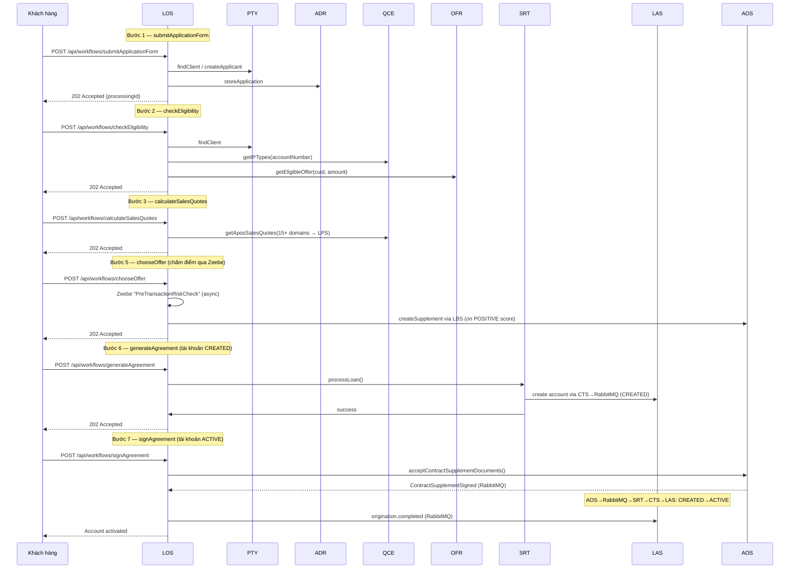

> *"Khởi tạo khoản vay là nơi chiến lược kinh doanh, quản trị rủi ro và trải nghiệm khách hàng va chạm nhau trong vài phút. Thiết kế đúng thì khách hàng được phục vụ tốt và rủi ro được kiểm soát. Thiết kế sai thì cả ba cùng hỏng một lúc."*

## Dẫn nhập: bốn phút quyết định một năm

::::story
10 giờ 15 sáng thứ hai, chị Lan mở ứng dụng và nộp đơn vay 18,500,000 VNĐ. 10 giờ 19, ứng dụng báo: "Đơn của bạn đã được phê duyệt. Tiền sẽ được giải ngân trong 24 giờ."

Bốn phút. Trong bốn phút đó, chuyện gì đã xảy ra?

Một chuỗi xử lý được thiết kế cẩn thận đã chạy: kiểm tra danh tính, đánh giá rủi ro, tính đề nghị vay, tạo tài khoản. Hàng chục quy tắc nghiệp vụ được thực thi đúng thứ tự, đúng thời hạn, với tính nhất quán được bảo đảm.

Và mọi thứ phải chạy đúng cùng lúc với hàng nghìn đơn vay khác: người khác cũng đang nộp đơn, mô hình chấm điểm vừa được cập nhật, một biểu phí mới vừa có hiệu lực.
::::

Chương này đi theo đơn vay của chị Lan từ lúc chị bấm "Nộp đơn" đến khi tài khoản được kích hoạt. Không chỉ mô tả luồng, mà đi vào từng quyết định thiết kế: vì sao LOS là bộ điều phối không trạng thái và bất đồng bộ, vì sao QCE là REST service chứ không phải hàng đợi, và vì sao chiến lược thực tế là thất bại sớm thay vì saga bù trừ đầy đủ như đã bàn ở [Chương 6](/docs/system/ch06-financial-system-architecture).

## 7.1 Tổng quan quy trình khởi tạo

### Sơ đồ tuần tự



*Hình 7.1. Luồng khởi tạo khoản vay trong trường hợp thuận lợi. Bước 4 (tính báo giá trước hợp đồng) được lược bớt để sơ đồ gọn hơn. Tài khoản được tạo ở trạng thái CREATED tại bước 6 và kích hoạt tại bước 7 qua chuỗi sự kiện RabbitMQ.*

Đây là trường hợp mọi thứ suôn sẻ. Thực tế, bước nào cũng có thể lỗi, timeout hoặc cần thử lại, và cả hệ thống phải xử lý được những tình huống đó; mục 7.6 bàn chi tiết.

### LOS: bộ điều phối bất đồng bộ, không trạng thái

::::story
Kỹ sư Tuấn mở code của LOS và ngạc nhiên: "Không có cơ sở dữ liệu? LOS không có bảng nào à?"

Trưởng nhóm kỹ thuật xác nhận: "Đúng. LOS dùng cache Infinispan nhúng, lưu trong bộ nhớ, thời gian sống ngắn. Trạng thái của quy trình nằm trong Infinispan, không nằm trong cơ sở dữ liệu."

"Nhưng nếu pod của LOS sập thì sao? Mất hết trạng thái à?"

"Infinispan nhân bản trong cụm. Nếu mất cả cụm, đã có tác vụ đối soát xử lý. Thiết kế cho khả năng chống chịu, không phải cho nhất quán hoàn hảo."
::::

Vì sao LOS dùng Infinispan thay vì cơ sở dữ liệu:

```text
Approach database-backed:
  LOS lưu mọi state vào PostgreSQL
  
  Vấn đề 1: LOS trở thành bottleneck — phải hit DB mỗi step
  Vấn đề 2: LOS scale out phức tạp — distributed sessions
  Vấn đề 3: Origination data (in-flight) lẫn với operational data
  Vấn đề 4: TTL management — khi nào xóa abandoned applications?

Approach Infinispan (hiện tại):
  In-memory distributed cache với configurable TTL
  LOS pod crash → Infinispan cluster replicate sang pod khác
  Auto-expiry: abandoned applications tự động expire sau TTL
  Horizontal scale đơn giản — cache distributed tự động

Quan trọng: LOS KHÔNG dùng Zeebe làm primary state holder.
Zeebe chỉ được dùng optional ở bước scoring
(Zeebe integration là optional profile: "zeebe-integration").
```

Kiến trúc quy trình của LOS dựa trên controller chứ không dựa trên BPMN engine:

```text
Thay vì BPMN engine, LOS dùng:
  WorkflowController (Spring MVC)
  Infinispan cache (workflow state)
  @Async methods (non-blocking steps)

Step order:
  1. submitApplicationForm → PTY + ADR
  2. checkEligibility → validate credit criteria
  3. calculateSalesQuotes → LOS → QCE → LPS (pricing)
  4. calculateAccountWithCashQuote / purchaseQuote → pre-contract
  5. chooseOffer → scoring, supplement creation (AOS)
  6. generateAgreement → SRT (loan processing), DMS
  7. signAgreement → waits for document acceptance
```

LOS dùng **mỗi bước một cache Infinispan có kiểu riêng**, không có lớp `WorkflowContext` chung:

```java
// verified: CacheConfiguration.java trong LOS
// CHOOSE_OFFER_CACHE, LOAN_PURPOSE_CACHE, GENERATE_AGREEMENT_CACHE, SIGN_AGREEMENT_CACHE
// Mỗi cache typed riêng: Cache<String, ChooseOfferCachedObject>, v.v.
```

Trạng thái của quy trình được lan truyền bằng cách **phát sự kiện lên Kafka**, không phải bằng `cache.put`:

```java
// verified: SubmitApplicationFormService.java
@Service
public class SubmitApplicationFormService {
    @Async
    public void submitApplicationForm(String processingId, SubmitApplicationFormTO formTO) {
        // Publish running state to Kafka:
        submitApplicationFormWorkflowKafkaService.publishRunning(processingId, formTO);

        // Execute workflow steps:
        var applicant = partyService.createApplicant(formTO);
        var application = applicationStorageService.createApplication(formTO, applicant);

        // Publish success:
        submitApplicationFormWorkflowKafkaService.publishSucceeded(processingId, ...);
    }
}
```

Mỗi bước phát trạng thái `RUNNING`, thực thi, rồi phát `SUCCEEDED` hoặc `FAILED` lên Kafka. Ứng dụng phía khách hàng gọi định kỳ `GET /status/{processingId}`, và LOS trả về trạng thái mới nhất của quy trình.

Vì sao trả về `202 Accepted` thay vì chờ xử lý xong:

```text
Nếu return response synchronously:
  POST /submit → chạy scoring (500ms) → chạy offer calc (300ms)
              → generate agreement (200ms) → ...
  Tổng: 1-5 giây trước khi return response
  → HTTP timeout risk
  → Mobile app có thể retry, tạo duplicate applications
  → User experience kém (loading spinner quá lâu)

Với 202 Accepted:
  POST /submit → LOS starts async processing (Infinispan cache) → return {processingId} ngay (50ms)
  Client poll GET /status/{processingId} mỗi 2 giây
  → Server không bị tie up chờ
  → Client biết đang processing
  → Retry an toàn (idempotent — cùng processingId)
  → Server có thể scale mỗi step independently
```

:::summary[Mục 7.1]
LOS là bộ điều phối không trạng thái: trạng thái của từng bước nằm trong cache Infinispan có thời gian sống ngắn, không nằm trong cơ sở dữ liệu, và được lan truyền qua sự kiện Kafka. Mỗi bước trả về `202 Accepted` ngay, khách hàng hỏi trạng thái định kỳ; cách này thân thiện với ứng dụng di động, thử lại an toàn và dễ mở rộng ngang. Mỗi bước có thể lỗi và thử lại độc lập.
:::

## 7.2 Nộp đơn và KYC

### ADR: kho dữ liệu đơn vay

::::story
Chị Lan bắt đầu điền đơn trên ứng dụng lúc 10 giờ. 10 giờ 10, điện thoại hết pin. Chị cắm sạc, mở lại ứng dụng, và phần đã điền vẫn còn nguyên. Chị điền tiếp và nộp lúc 10 giờ 15.

Điều đó không tự nhiên mà có; nó cần được thiết kế.
::::

:::key[ADR (Application Data Repository)]
**ADR** là kho lưu trữ lâu dài cho dữ liệu đơn vay trong suốt quá trình khởi tạo. Nó giữ mọi thứ từ khi khách hàng bắt đầu điền đơn đến khi tài khoản được tạo, và sau đó cho mục đích kiểm toán.
:::

Vì sao ADR tách khỏi LAS:

```text
LAS lưu: account sau khi activated (live financial data)
ADR lưu: application data trong quá trình origination

Nếu merge vào LAS:
  → LAS database chứa millions of incomplete/rejected applications
  → LAS query performance giảm
  → ADR và LAS có different lifecycle:
      ADR data: quan trọng trong origination, sau đó archive
      LAS data: quan trọng forever (audit trail)
  → Regulatory requirement khác nhau:
      ADR: có thể pseudonymize sau khi origination complete
      LAS: transactional data phải giữ nguyên

Nếu tách ra:
  → Clean domain boundary
  → Scale independently
  → Different retention policy
  → ADR events → trigger LOS steps
```

Thiết kế lược đồ của ADR:

```sql
-- Application header:
CREATE TABLE application (
    id UUID PRIMARY KEY,
    processing_id VARCHAR(36) UNIQUE,
    customer_id VARCHAR(100),     -- CIS customer identifier
    status VARCHAR(50),           -- DRAFT, SUBMITTED, SCORING, APPROVED, REJECTED, ACTIVATED
    product_code VARCHAR(50),
    requested_amount DECIMAL(15,2),
    requested_tenor INT,
    channel VARCHAR(50),          -- DIGITAL, POS, TELESALES
    created_at TIMESTAMP,
    updated_at TIMESTAMP,
    submitted_at TIMESTAMP,
    decision_at TIMESTAMP
);

-- Application steps (event log):
CREATE TABLE application_event (
    id BIGINT GENERATED ALWAYS AS IDENTITY,
    application_id UUID REFERENCES application(id),
    event_type VARCHAR(100),      -- KYC_COMPLETED, SCORE_RECEIVED, OFFER_GENERATED...
    event_data JSONB,
    created_at TIMESTAMP,
    created_by VARCHAR(100)
);
-- Không bao giờ UPDATE hay DELETE — append-only log
```

Hỗ trợ đa kênh, như yêu cầu ở [Chương 4](/docs/products/ch04-customer-journey): khách hàng dừng ở kênh này có thể tiếp tục ở kênh khác.

```java
// illustrative pseudo-code — ADR method names differ from actual
// verified: verify-ch6-ch7-code.md
// Actual ADR ApplicationService methods:
//   save(Application) — creates new application (no createDraft())
//   findByCode(String code) — find by code (no findByCustomerAndProduct())
//   update(Application) — complex cascade update (6 collections)

// User bắt đầu trên App (via LOS → ADR):
Application app = applicationService.save(newApplication);
// app.code = "abc-123", status = DRAFT

// App hết pin, re-open (LOS polls ADR):
Application existing = applicationService.findByCode(applicationCode);
// Vẫn còn, status = DRAFT → tiếp tục

// Cross-channel: teller tìm application qua application code
// (không có findByCustomerAndProduct — lookup qua code)
```

### Bốn lớp KYC

::::story
Khi chị Lan nộp đơn, hệ thống phải xác minh: người này có thật không? Tên, số CCCD, địa chỉ có khớp không? Có trong danh sách đen không? Có đủ điều kiện vay không?

Đó là KYC *(know your customer)*, một yêu cầu pháp lý chứ không chỉ là yêu cầu kinh doanh.
::::

**Lớp 1: xác minh danh tính.**

```text
Input: Ảnh CCCD mặt trước + mặt sau + ảnh selfie

Process:
  1. OCR: Đọc thông tin từ CCCD (tên, ngày sinh, địa chỉ, số CCCD)
  2. Liveness check: Ảnh selfie có phải người thật không? (chống ảnh in)
  3. Face match: Khuôn mặt trong selfie khớp với ảnh trên CCCD?
  4. Document authenticity: CCCD có dấu hiệu giả mạo không?

Output:
  PASS (confidence > 95%) → proceed
  REVIEW (70-95%) → manual review queue
  FAIL (< 70%) → reject với reason code
```

**Lớp 2: sàng lọc cấm vận và danh sách đen.**

```text
Input: Tên + ngày sinh + quốc tịch

Process:
  1. Check against OFAC list (US sanctions)
  2. Check against local regulatory blacklist (NHNN)
  3. Check against internal blacklist (previous fraud, default)
  4. PEP screening (Politically Exposed Person — increased risk)

Output:
  CLEAR → proceed
  MATCH/POSSIBLE_MATCH → compliance team review
  BLOCKED → reject immediately, log for regulatory reporting
```

**Lớp 3: tra cứu thông tin tín dụng.**

```text
Input: CCCD number + họ tên

Process:
  1. Query credit bureau (CIC, PCB tại Việt Nam)
  2. Retrieve: credit score, outstanding debts, DPD history, number of inquiries

Output:
  Credit report → feed vào scoring model
```

**Lớp 4: xác minh thu nhập.**

```text
Input: Loại thu nhập + documents (sao kê lương, thuế, BCTC...)

Process:
  1. Document authenticity check (DMS module)
  2. Income extraction via OCR
  3. Consistency check: income declared vs bank statement
  4. Employment verification (optional: call employer)

Output:
  Verified income amount → feed vào affordability check
```

Bốn lớp này đi từ rẻ đến đắt và từ nhanh đến chậm. Nếu lớp đầu đã thất bại, không cần trả tiền tra cứu thông tin tín dụng hay mất công xác minh thu nhập.

CIS là module riêng giữ dữ liệu KYC, vì những lý do đã bàn ở [Chương 6](/docs/system/ch06-financial-system-architecture):

```text
CIS lưu:
  customer_id → {name, CCCD, DOB, address, income, employment}

Quan hệ với LAS:
  LAS lưu account_id → {accountNumber, balance, transactions}
  LAS KHÔNG biết tên khách hàng — chỉ biết customer_id

Tại sao:
  1. GDPR/PDP compliance: PII được isolate trong CIS
     → Right to erasure: xóa CIS data, LAS transactions vẫn intact
  2. Reuse: một customer_id có thể có nhiều accounts trong LAS
     → KYC một lần, dùng nhiều lần
  3. Security: compromise của LAS database không expose PII
  4. Different team ownership: KYC team owns CIS, LAS team owns LAS
```

Tài liệu của khách hàng đi qua DMS:

```text
1. User upload CCCD → App → API Gateway → DMS
   DMS lưu: encrypted document, return docId = "doc-xyz"

2. LOS tells CIS: "Verify using doc-xyz"
   CIS gọi DMS để fetch document → run verification → return result
   CIS không lưu document (chỉ lưu verification result)

3. DMS lưu document với retention policy:
   In-process: full access
   After activation: read-only, compliance access only
   After 7 years: archive or delete per policy
```

:::summary[Mục 7.2]
ADR là kho lâu dài cho dữ liệu đơn vay, cho phép khách hàng dừng giữa chừng và tiếp tục ở bất kỳ kênh nào. KYC có bốn lớp: xác minh danh tính, sàng lọc cấm vận và danh sách đen, tra cứu thông tin tín dụng, xác minh thu nhập. CIS tách khỏi LAS để cô lập dữ liệu cá nhân và dùng lại kết quả KYC cho nhiều tài khoản. DMS lưu tài liệu đã mã hóa với vòng đời và thời hạn lưu trữ theo quy định.
:::

## 7.3 Chấm điểm tín dụng trong hệ thống vận hành

### Từ dữ liệu thô đến điểm số

::::story
Dữ liệu của chị Lan đã đủ: CCCD đã xác minh, kết quả tra cứu tín dụng đã về, thu nhập xác minh là 22,000,000 VNĐ/tháng. Giờ hệ thống phải quyết định: có cho vay không, và nếu có thì với điều kiện gì?

Đó là bài toán chấm điểm tín dụng. Và "bài toán" ở đây không chỉ là chạy một mô hình máy học, mà là cả một chuỗi xử lý với nhiều thành phần, nhiều ràng buộc và nhiều cách hỏng.
::::

Bước đầu là biến dữ liệu thô thành các biến đầu vào *(feature engineering)*:

```text
Raw data → Feature extraction → Feature vector → Model → Score

Raw data cho chị Lan:
  Từ credit bureau:
    - Số tài khoản credit hiện có: 1
    - Tổng outstanding debt: 3,500,000 VNĐ
    - Max DPD trong 12 tháng: 0
    - Số inquiry trong 6 tháng: 2

  Từ CIS (income verification):
    - Thu nhập hàng tháng: 22,000,000 VNĐ
    - Loại thu nhập: Salaried (ổn định hơn self-employed)
    - Thời gian làm việc hiện tại: 36 tháng

  Từ application:
    - Số tiền yêu cầu: 18,500,000 VNĐ
    - Kỳ hạn: 12 tháng
    - Loan purpose: Laptop (productive asset)
    - Channel: Digital (thường có PD thấp hơn POS bốc đồng)

Feature transformation:
  debt_to_income = 3,500,000 / 22,000,000 = 0.159
  requested_dti = (18,500,000 / 12) / 22,000,000 = 0.070
  employment_stability = 36 months → HIGH bucket
  max_dpd_12m = 0 → CLEAN bucket
  inquiry_rate_6m = 2 → NORMAL bucket
  loan_purpose_risk = PRODUCTIVE → LOW risk modifier
  channel_risk = DIGITAL → MEDIUM
```

Một thẻ điểm *(scorecard)* đơn giản hóa minh họa cách các biến được quy thành điểm:

```text
Variable              Value         Points
─────────────────────────────────────────
Max DPD (12 months)
  = 0                               +35
  1-30                              +15
  31-60                              -5
  61+                               -30

Debt-to-Income
  < 0.2                             +25
  0.2 - 0.4                         +10
  0.4 - 0.6                          -5
  > 0.6                             -20

Employment Stability
  > 24 months                       +20
  12-24 months                      +10
  6-12 months                        +0
  < 6 months                        -15

Credit Bureau Status
  CLEAN (no defaults)               +30
  MINOR (DPD <= 30 once)            +10
  POOR (multiple DPD)               -20

Số lượng inquiries (6 tháng)
  0-2                               +10
  3-5                                +0
  6+                                -10
─────────────────────────────────────────
BASE SCORE                           300 (starting point)

Chị Lan:
  Max DPD = 0          → +35
  DTI = 0.159          → +25
  Employment 36 months → +20
  Credit bureau: CLEAN → +30
  Inquiries: 2         → +10
  ─────────────────────────
  TOTAL SCORE = 300 + 35 + 25 + 20 + 30 + 10 = 420
```

Điểm số được ánh xạ thành quyết định và hạng giá:

```text
Score >= 440:    APPROVE — Prime tier, lãi suất 15%/năm
Score 380-439:   APPROVE — Standard tier, lãi suất 18%/năm
Score 340-379:   APPROVE — Sub-prime tier, lãi suất 21%/năm, hạn mức tối đa thấp hơn
Score 300-339:   REVIEW — thẩm định thủ công
Score < 300:     DECLINE
```

Chị Lan được 420 điểm, thuộc hạng Standard, nên được duyệt với lãi suất 18%/năm. Đây chính là khoản vay xuyên suốt cuốn sách: 18,500,000 VNĐ, 18%/năm, 12 tháng.

Một ngưỡng điểm duy nhất là quá đơn giản; quyết định thực tế kết hợp điểm số với các quy tắc chính sách:

```text
"Score >= 380: approve" là quá đơn giản.

Thực tế cần policy rules kết hợp:

Hard rejects (bất kể score):
  - Max DPD 90+ trong 12 tháng → DECLINE always
  - Sanctions list match → DECLINE always
  - DTI sau khoản vay mới > 0.5 → DECLINE (affordability)
  - Age < 18 hoặc > 70 → DECLINE (policy)

Soft rejects (có thể override bởi underwriter):
  - Score 300-339 → MANUAL_REVIEW
  - Income unverified but high score → MANUAL_REVIEW
  - First-time borrower + large loan → MANUAL_REVIEW
```

Quy tắc từ chối cứng tồn tại vì có những rủi ro mà mô hình thống kê không được phép "bù trừ" bằng các yếu tố tốt khác. Một khách hàng trong danh sách cấm vận không được duyệt dù điểm cao đến đâu. Quy tắc về tỷ lệ nợ trên thu nhập sau khi vay là hiện thân của nguyên tắc cho vay có trách nhiệm ở [Chương 1](/docs/foundations/ch01-credit-economics).

### Kiến trúc quy trình: điều khiển bằng controller, không phải BPMN

::::story
Anh Minh hỏi trưởng nhóm kỹ thuật: "Tôi thấy Zeebe trong danh sách thư viện. LOS dùng Zeebe để điều phối quy trình khởi tạo à?"

"Không hẳn. LOS dùng Spring controller bất đồng bộ với Infinispan giữ trạng thái. Zeebe chỉ được dùng tùy chọn cho một số quy trình chấm điểm, không phải bộ điều phối chính."

"Vậy nếu LOS sập giữa chừng?"

"Infinispan nhân bản trạng thái. Và có tác vụ đối soát phát hiện đơn bị kẹt để xử lý thủ công."
::::

Thứ tự các bước của LOS:

```text
Step 1: submitApplicationForm
  → Create applicant (PTY — Party Registry; CIS stores KYC data separately)
  → Store application (ADR)
  → Return 202 Accepted {processingId}

Step 2: checkEligibility
  → Validate against credit criteria (blacklist, sanctions, age)
  → If fail: immediate decline, don't proceed

Step 3: calculateSalesQuotes
  → LOS → QCE (REST, synchronous)
  → QCE → LPS (REST, synchronous)
  → Returns pricing proposals for customer

Step 4: calculateAccountWithCashQuote / purchaseQuote
  → Pre-contract quote calculation
  → APR disclosure preparation

Step 5: chooseOffer
  → Customer selects offer
  → Scoring runs here (optional Zeebe integration)
  → AOS (Supplement) entity created

Step 6: generateAgreement
  → SRT (Service Router) routes request to LAS, CTM, AOS for activation
    SRT is stateless — no DB, 9 FeignClient connectors
    LOS → SRT: POST /rest/v1/loan-requests → SRT fans out to backends
  → DMS generates contract PDF

  Supplementary: AOS creates Supplement entity (insurance, protection)
    → AOS activates when LAS fires "FIRST_PRINCIPAL_TX_CHARGED" event

Step 7: signAgreement
  → Wait for customer to sign (async, user-driven)
  → Document signing via DMS

[Account creation follows sign]
```

Không có thực thi song song, không có bộ hẹn giờ kiểu BPMN:

```text
Mỗi step là sequential REST calls hoặc @Async Spring methods.
Không có parallel gateways (BPMN-style).
Timeout implicit từ Infinispan TTL (5s đến 2 phút per step).

Tại sao đơn giản hơn BPMN engine:
  ✓ Easier to debug (just Spring controllers)
  ✓ No BPMN engine dependency in critical path
  ✓ Simpler deployment
  
Tradeoff:
  ✗ Retry logic phải viết thủ công
  ✗ Không có visual workflow cho business team
  ✗ Stuck applications cần manual recovery
```

### Thử nghiệm A/B cho mô hình chấm điểm

::::story
Đội khoa học dữ liệu vừa huấn luyện mô hình mới, chỉ số Gini tăng từ 0.52 lên 0.61. Anh Minh muốn triển khai, nhưng cần thử nghiệm trước khi áp dụng toàn bộ. VLP hiện chưa có sẵn khung champion/challenger, nên đây là thiết kế đề xuất.
::::

:::key[Champion và challenger]
Thay vì thay mô hình một lần, chạy song song: mô hình hiện tại *(champion)* nhận phần lớn lưu lượng, ví dụ 95%, mô hình mới *(challenger)* nhận phần còn lại. Sau ba đến sáu tháng, khi tỷ lệ vỡ nợ đã kịp hiện ra, so sánh kết quả của hai mô hình.
:::

```java
// illustrative pseudo-code — Champion/Challenger pattern (industry best practice)
// verified: scoring-pipeline-spec.md
// NOTE: A/B hash routing NOT implemented in VLP
// VLP dùng Zeebe BPMN "PreTransactionRiskCheck" — không có in-process routing
// Code dưới đây là ví dụ design pattern tốt cho AI/scoring systems:

@Service
public class ScoringService {  // ILLUSTRATIVE

    public ScoreResult score(ApplicationData application) {
        // Deterministic hash → same applicationId → same model (retry-safe)
        String modelVersion = routeByConfig(application.getApplicationId());

        ScoreResult result = scoringModelRegistry
            .getModel(modelVersion)
            .score(application);

        // Critical: log model version với result cho post-analysis
        auditLog.log(application.getId(), modelVersion,
                     result.getScore(), result.getDecision());
        return result;
    }

    private String routeByConfig(String applicationId) {
        int hash = Math.abs(applicationId.hashCode()) % 100;
        int challengerPct = configService.getInt("scoring.ab.challenger_pct", 0);
        return hash < challengerPct ? "challenger_v2" : "champion_v1";
    }
}
// VLP actual: ScoringService.createScoring() → Zeebe BPMN → POSITIVE/NEGATIVE callback
```

Vì sao cần ít nhất ba đến sáu tháng, và vì sao cỡ mẫu là ràng buộc thực sự:

```text
Problem: Khi approve application → default xảy ra sau 3-12 tháng.
Nếu chỉ test 2 tuần: chỉ thấy approval rate, không thấy default rate.
Default rate mới là metric quan trọng nhất.

Minimum: 3 tháng để thấy DPD 30+, 6 tháng để thấy DPD 90+.

Sample size requirement:
  Muốn detect 1% difference in approval rate: ~4,000 samples per arm
  Muốn detect 0.5% difference in DPD 90+: ~20,000+ samples per arm
  → 5% challenger với 3,000 applications/tháng: ~150 challenger/tháng
  → Cần 130+ months chỉ để detect DPD 90+ difference!
  
Kết luận thực tế: Dùng DPD 30+ thay vì 90+ làm primary metric,
                  hoặc tăng challenger % lên 20-30% để đủ sample size.
```

Phép tính cuối khối trên đáng chú ý: với 5% lưu lượng cho challenger, cần hơn mười năm mới đủ mẫu để phân biệt tỷ lệ DPD 90+. Vì vậy thực tế phải chọn chỉ số sớm hơn (DPD 30+) hoặc dành tỷ lệ lưu lượng lớn hơn cho challenger, chấp nhận rủi ro lớn hơn trong thời gian thử nghiệm. [Chương 11](/docs/intelligence/ch11-credit-scoring) đi sâu hơn vào vòng đời của mô hình chấm điểm.

:::summary[Mục 7.3]
Chấm điểm là một chuỗi: dữ liệu thô thành biến đầu vào, biến đầu vào thành điểm, điểm kết hợp với quy tắc chính sách thành quyết định. Thẻ điểm minh bạch và dễ giải thích; quy tắc từ chối cứng áp dụng bất kể điểm số. Chị Lan được 420 điểm, hạng Standard, lãi suất 18%/năm. LOS điều phối bằng controller, Zeebe chỉ dùng tùy chọn cho chấm điểm. Thử nghiệm mô hình mới cần ba đến sáu tháng và cỡ mẫu đủ lớn.
:::

## 7.4 Tính và trình bày đề nghị vay

### QCE: REST service tính báo giá

::::story
Chị Lan được duyệt ở hạng Standard với 420 điểm. Giờ hệ thống phải tính: với điểm này, thu nhập 22 triệu, yêu cầu 18.5 triệu trong 12 tháng, đề nghị vay cụ thể là gì?
::::

:::key[QCE (Quote Calculation Engine)]
**QCE** là một **REST service**, không phải hàng đợi thông điệp; chữ "Q" là "quote" chứ không phải "queue". QCE xử lý các phép tính giá phức tạp cho hơn 15 miền sản phẩm: PHONELOAN, BNPLPOS, sản phẩm trọn gói, kiểm tra điều kiện, PLOAN, báo giá trước hợp đồng và nhiều miền khác.
:::

```text
LOS → QCE: POST /calculateQuote (synchronous REST call, OpenFeign)
           {score: 420, tier: STANDARD, amount: 18.5M, tenor: 12M,
            offerCode: "STANDARD_LAPTOP_2025"}

QCE internal flow:
  1. Load product configuration + eligibility rules
     → Tier STANDARD cho product này: rate = 18%/năm
     → Available tenors: 6, 12, 18, 24 months
     → Origination fee: 1% (185,000 VNĐ, trừ vào tiền giải ngân)

  2. Call LPS để tính instalment plan cho mỗi tenor:
     QCE → LPS: POST /api/v3/calculators/instalment-plan/by-offer-code
     LPS → QCE: {annuityAmount: 1,696,080, totalRepayment: 20,352,957,
                 xirr (APR, gồm phí thẩm định): ≈ 19.94%}

  3. Apply business rules:
     → Check: DTI (1,696,080 / 22,000,000 = 7.7%) < max 40% → OK
     → Bundle offers (insurance, protection plans) if applicable

  4. Format quote for presentation:
     Primary offer: 12 months (matches customer request)
     Alternative: 24 months (lower PMT option)

QCE → LOS: formatted quote package (InstalmentPlansDto)
```

APR 19.94% là IRR của dòng tiền chị Lan thực nhận (18,315,000 VNĐ sau khi trừ phí thẩm định) và thực trả (12 kỳ theo lịch), nhân với 12, theo đúng phương pháp ở [Chương 2](/docs/foundations/ch02-mathematics-of-lending). Như [Chương 12](/docs/intelligence/ch12-risk-based-pricing) sẽ phân tích, LPS tính được XIRR nhưng VLP hiện chưa có bước tự động kiểm tra trần chi phí tín dụng; việc đó đang dựa vào cấu hình sản phẩm.

Vì sao cần QCE, thay vì để LOS gọi thẳng LPS:

```text
LOS job: orchestrate workflow → không nên biết về pricing details
LPS job: calculate instalment plan từ mathematical inputs
QCE job: translate business context → LPS inputs + apply product rules

Nếu LOS gọi LPS trực tiếp:
  LOS phải biết: tariff codes, offer codes, eligibility rules, bundle logic
  → LOS trở thành "god service" — violates single responsibility
  
QCE là domain expert cho pricing:
  Biết về product catalog
  Biết cách assemble offer từ nhiều sources
  Biết eligibility rules per product
  → LOS chỉ cần biết: "tôi có application, tôi cần quote"
  
Nếu QCE down:
  LOS nhận ASQ_COMMUNICATION_ERROR
  Workflow marked FAILED
  Customer must retry → không có fallback pricing
```

### Đề nghị vay theo rủi ro

::::story
Cùng yêu cầu 18.5 triệu trong 12 tháng, ba khách hàng khác nhau nhận ba đề nghị khác nhau.
::::

```text
Khách hàng A (score 450, Prime):
  → Approved 18,500,000 VNĐ, lãi 15%/năm, PMT 1,669,779 VNĐ/tháng

Khách hàng B, chị Lan (score 420, Standard):
  → Approved 18,500,000 VNĐ, lãi 18%/năm, PMT 1,696,080 VNĐ/tháng

Khách hàng C (score 345, Sub-prime):
  → Approved 12,000,000 VNĐ (counter-offer), lãi 21%/năm, PMT 1,117,365 VNĐ/tháng
  → Không duyệt đủ số tiền yêu cầu: vượt hạn mức tối đa của hạng Sub-prime
```

Với khách hàng C, đề nghị thay thế *(counter-offer)* được tính như sau:

```text
Yêu cầu: 18,500,000 VNĐ, 12 tháng
Lãi suất hạng Sub-prime: 21%/năm (1.75%/tháng)
PMT nếu duyệt đủ: 1,722,605 VNĐ/tháng
DTI: 1,722,605 / 22,000,000 = 7.8% → vẫn dưới ngưỡng 40%

Nhưng: hạng Sub-prime có hạn mức tối đa 12,000,000 VNĐ
(chính sách: giới hạn mức rủi ro với khách hàng Sub-prime)

Đề nghị thay thế: 12,000,000 VNĐ, 21%/năm, 12 tháng
PMT = 12,000,000 × 0.0175 × (1.0175)^12 / [(1.0175)^12 - 1]
    = 12,000,000 × 0.0175 × 1.23144 / 0.23144
    = 12,000,000 × 0.09311
    = 1,117,365 VNĐ/tháng

Thông điệp:
"Chúng tôi có thể phê duyệt 12,000,000 VNĐ với lãi suất 21%/năm.
 Bạn có muốn tiếp tục với khoản vay này không?"
```

Khách hàng C bị giới hạn không phải vì khả năng trả mỗi tháng (DTI chỉ 7.8%), mà vì công ty giới hạn tổng mức rủi ro với nhóm có PD cao. Đây là định giá theo rủi ro ở [Chương 1](/docs/foundations/ch01-credit-economics) được hiện thực hóa: rủi ro cao hơn thì lãi suất cao hơn và hạn mức thấp hơn.

### Trình bày đề nghị vay

Như [Chương 4](/docs/products/ch04-customer-journey) đã phân tích, cách trình bày đề nghị vay có thể khai thác hoặc hóa giải hiệu ứng mỏ neo:

```text
Cách khai thác thiên kiến:
  Đưa con số lớn ra trước, rồi "chỉ 1,696,080 VNĐ/tháng" trông rẻ hơn
  Giấu tổng chi phí, chỉ nhấn khoản trả hằng tháng

Cách hóa giải thiên kiến: hiển thị đầy đủ
  ┌─────────────────────────────────────────────┐
  │ Khoản vay: 18,500,000 VNĐ                   │
  │ Kỳ hạn: 12 tháng                            │
  │ Lãi suất: 18%/năm (APR: 19.94%)             │
  │ Số tiền trả hàng tháng: 1,696,080 VNĐ       │
  │ Tổng tiền phải trả: 20,352,957 VNĐ          │
  │ Tổng lãi phải trả: 1,852,957 VNĐ            │
  │ Phí thẩm định: 185,000 VNĐ (một lần)        │
  │ ─────────────────────────────────────────── │
  │ Bạn cần 1,696,080 VNĐ/tháng                 │
  │ (= 7.7% thu nhập hàng tháng của bạn)        │
  └─────────────────────────────────────────────┘
```

Dòng "7.7% thu nhập" đặt khoản trả hằng tháng vào bối cảnh khả năng chi trả thực tế của chị Lan, thay vì để con số đứng một mình làm mỏ neo.

:::summary[Mục 7.4]
QCE là REST service đứng giữa LOS và LPS, dịch bối cảnh kinh doanh thành đầu vào tính toán và áp quy tắc sản phẩm, để LOS không phải biết chi tiết về giá. Đề nghị vay khác nhau theo hạng rủi ro: lãi suất cao hơn và hạn mức thấp hơn cho nhóm rủi ro cao. Đề nghị vay phải được trình bày đầy đủ: lãi suất, APR, tổng tiền phải trả và tỷ lệ so với thu nhập.
:::

## 7.5 Hợp đồng, kích hoạt và tạo tài khoản

### Chữ ký điện tử và DMS

::::story
Chị Lan xem đề nghị và đồng ý. Bước tiếp theo là ký hợp đồng. Không ai muốn in giấy, ký tay rồi quét lại. Nhưng hợp đồng vay có giá trị pháp lý, nên chữ ký điện tử phải được thực hiện đúng chuẩn.
::::

```text
Hợp đồng điện tử tại Việt Nam dựa trên:
  Luật Giao dịch điện tử số 20/2023/QH15 (hiệu lực từ 1/7/2024)
  Nghị định 23/2025/NĐ-CP về chữ ký điện tử và dịch vụ tin cậy
    (hiệu lực từ 10/4/2025, thay thế Nghị định 130/2018/NĐ-CP)

Yêu cầu:
  1. Xác thực danh tính người ký (đã xác minh ở bước KYC)
  2. Chữ ký phải gắn với nội dung hợp đồng (content hash)
  3. Không thể chối bỏ sau khi ký (non-repudiation)
  4. Dấu thời gian chính xác
  5. Lưu trữ lâu dài (7 đến 10 năm)
```

Quy định về chữ ký điện tử thay đổi theo thời gian; [Phụ lục D](/docs/appendices/d-regulatory-reference) tổng hợp khung pháp lý, và việc áp dụng cụ thể cần bộ phận pháp chế xác nhận.

Luồng tạo và ký tài liệu:

```text
Step 1: Generate contract document
  LOS → DMS: generateDocument(templateId="LOAN_AGREEMENT_V3",
                               applicationId="abc-123",
                               terms={amount, rate, tenor, pmt, ...})

  DMS process:
    Load template LOAN_AGREEMENT_V3
    Fill in variables từ terms
    Generate PDF
    Apply document hash (SHA-256)
    Return docId = "doc-789"

Step 2: Present document to customer
  LOS → App: {docId: "doc-789", documentUrl: "/documents/doc-789/view"}
  Customer reads PDF in app

Step 3: Customer signs
  App → LOS: POST /sign {docId: "doc-789", signatureData: "...biometric..."}

  LOS → DMS: signDocument(docId="doc-789",
                           customerId="cust-456",
                           signatureType="OTP_PLUS_BIOMETRIC",
                           timestamp=NOW)

  DMS process:
    Verify customer identity (OTP + face match từ KYC)
    Attach signature to document
    Record: who signed, when, IP address, device fingerprint
    Create signed document copy (immutable)
    Return signedDocId = "doc-789-signed"
```

Vì sao dùng OTP kết hợp sinh trắc học, không chỉ OTP:

```text
OTP only: "Người cầm điện thoại này đã ký"
  → Nếu điện thoại bị lấy → unauthorized signing

OTP + Face match: "Người cầm điện thoại VÀ có khuôn mặt khớp với CCCD đã ký"
  → Binding mạnh hơn nhiều
  → Non-repudiation tốt hơn (khó deny "không phải tôi ký")
```

### Tạo và kích hoạt tài khoản trong LAS

::::story
Hợp đồng đã ký. Giờ là lúc tạo tài khoản trong LAS và kích hoạt nó. Đây là bước cuối, nhưng cũng là bước phức tạp nhất về toàn vẹn dữ liệu.
::::

Việc tạo tài khoản được dẫn dắt bằng sự kiện, không phải bằng một lời gọi REST trực tiếp:

```text
// verified: origination-flow-complete.md, supplement-lifecycle.md, supplement-bsl-lifecycle.md

// Account creation là EVENT-DRIVEN (không phải direct REST call):
// 1. generateAgreement: LOS → SRT.processLoan() → SRT → CTS create ACCMAINT service
// 2. CTS → RabbitMQ: ContractServiceCreatedNotification
//    → LAS receives → creates account → responds with accountNumber
//    → Account tồn tại sau step này

// 3. signAgreement: LOS → AOS.acceptContractSupplementDocuments()
//    (method name: acceptContractSupplementDocuments, not onDocumentSigned)
// 4. AOS → RabbitMQ: ContractSupplementSigned
//    → SRT → CTM.signContract + CTS.activate(ACCMAINT)
//      → LAS: Account CREATED → ACTIVE
// 5. LOS publishes origination.completed (RabbitMQ) → LAS confirms activation

// Key insight: Account CREATED at generateAgreement, ACTIVATED at signAgreement
// Both triggered via RabbitMQ events (not synchronous REST)
```

Khi LAS nhận yêu cầu tạo tài khoản, mọi thiết lập diễn ra trong một transaction:

```text
LAS receives createAccount request:
  Transaction bắt đầu:
    1. Create LAS_ACCOUNT record (status = CREATED)
    2. Create LAS_CURRENT_BALANCE (initial balance = 0)
    3. Create LAS_CONTRACT_SERVICE records:
       ACCMAINT (maintenance), ACCSTMT (statement), PAYM (payment)...
    4. Create LAS_ACCOUNT_PARAMETER records:
       CREDIT_LIMIT = appData.approvedAmount
       BILLING_DAY = contractData.billingDay
       DUE_DAY_OFFSET = contractData.dueDayOffset
    5. Link to tariff
  Transaction commit → account exists, status = CREATED
```

Vì sao `CREATED` và `ACTIVE` là hai bước tách rời:

```text
Account CREATED: tất cả data đã setup, nhưng chưa thể dùng
Account ACTIVE: khách hàng có thể thực hiện transactions

Tại sao cần hai bước?
  1. Downstream systems cần prepare:
     STS: setup billing schedule
     DRG: register account for monitoring
     Notification system: register for alerts
     
  2. Compliance check cuối cùng:
     Đảm bảo mọi required services đã được activate
     Đảm bảo tariff đang active (không bị expire giữa chừng)
     
  3. Business rule: disbursement phải xảy ra trước khi activate
     Với digital disbursement → instant
     Với manual disbursement → có thể cần 24h
```

Trạng thái của từng bước được phát lên Kafka, còn việc kích hoạt tài khoản đi qua chuỗi RabbitMQ:

```text
LOS publish events per-step tới Kafka (CloudEvents format):
  Topic: orp.workflow-events.<step-name>.v1
  Payload: {
    processingId: "p123",
    status: "SUCCEEDED" | "RUNNING" | "FAILED",
    data: { ... step-specific data ... }
  }

Ví dụ:
  Topic: orp.workflow-events.sign-agreement.v1
  Payload: {
    processingId: "p123",
    status: "SUCCEEDED",
    data: { accountNumber: "ACC-2025-789456", signedDocId: "doc-789-signed" }
  }

Thay vì một sự kiện "origination.completed" duy nhất,
mỗi bước có event riêng. LAS account activation xảy ra qua RabbitMQ chain:
  *(verified: supplement-lifecycle.md)*
  AOS (supplement signed) → RabbitMQ → SRT → CTS.activate(ACCMAINT)
  → CTS → RabbitMQ: ContractServiceOperStatusChanged (SWITCHED_ON)
  → LAS receives: Account CREATED → ACTIVE
  LOS sau đó publishes origination.completed (RabbitMQ) → LAS confirms

Lưu ý: Kafka producer trong LOS cấu hình
  enable.idempotence: false → duplicate events possible
  → LAS phải handle idempotency (AlreadyActivatedException)
```

Vì sao chắc chắn sẽ có sự kiện trùng lặp, và bên nhận phải xử lý thế nào:

```text
Kafka non-idempotent producer + network issue:
  LOS sends event → network timeout → không biết event đã arrive chưa
  LOS retry → event sent twice
  
LAS handler phải handle:
  First event: CREATED → ACTIVE (success)
  Second event: account đã ACTIVE → AlreadyActivatedException
    → catch, log, ack message → không gây lỗi

Bài học: Idempotency phải được implement ở consumer side
         không thể rely vào producer guarantees.
```

:::key[Idempotency phải nằm ở phía bên nhận]
Không thể dựa vào bảo đảm của bên phát. Mọi bên nhận sự kiện trong một hệ thống tài chính phải chịu được việc nhận cùng một sự kiện nhiều lần mà không làm sai dữ liệu.
:::

:::summary[Mục 7.5]
Chữ ký điện tử dùng OTP kết hợp đối chiếu khuôn mặt để gắn chặt danh tính và chống chối bỏ. Tài khoản được tạo ở trạng thái `CREATED` với đầy đủ tham số, dịch vụ và biểu phí, rồi chuyển sang `ACTIVE` qua chuỗi RabbitMQ từ AOS qua SRT, CTS tới LAS sau khi khách hàng ký. Sự kiện có thể trùng lặp, nên bên nhận phải idempotent.
:::

## 7.6 Các kiểu lỗi và cách khôi phục

### Phân loại lỗi trong quy trình khởi tạo

| Loại lỗi | Ví dụ | Cách khôi phục |
|---|---|---|
| Lỗi tạm thời | Tra cứu tín dụng timeout, mạng chập chờn | Thử lại có giãn cách, cầu dao ngắt mạch |
| Lỗi nghiệp vụ | Điểm dưới ngưỡng, DTI vượt hạn mức | Từ chối lịch sự, đề nghị thay thế |
| Yêu cầu trùng lặp | Bấm nộp hai lần, thử lại sau timeout | Phát hiện qua `processingId`, trả kết quả đã có |
| Hoàn tất dở dang | KYC xong nhưng chấm điểm lỗi; có đề nghị nhưng ký bị timeout | Tiếp tục từ bước đã xong, trình bày lại đề nghị |
| Dữ liệu không nhất quán | LAS tạo tài khoản xong nhưng sự kiện RabbitMQ bị mất | Tác vụ đối soát, hàng đợi thư chết |

### Xử lý timeout: trường hợp quan trọng nhất

::::story
10 giờ 20, chị Lan bấm "Xác nhận đề nghị". Đúng lúc đó wifi mất kết nối. 10 giờ 25, mạng có lại và ứng dụng tự gửi lại yêu cầu. Chuyện gì xảy ra?
::::

```text
10h20: App gửi POST /accept-offer {processingId: "p123"}
10h20: LOS nhận, bắt đầu process (Infinispan cache: "p123 → OFFER_ACCEPTED")
10h20.5: Infinispan cache saved: "p123 → OFFER_ACCEPTED" (per-step typed cache)
10h21: DMS bắt đầu generate document
       → App network dropped → không nhận response

10h25: App retry: POST /accept-offer {processingId: "p123"}
10h25: LOS kiểm tra Infinispan cache state:
       "p123 đã ở OFFER_ACCEPTED step → document đang được generate"
       → Return 200 với current status, không process lại

10h27: DMS hoàn thành document generation
       Infinispan cache: "p123 → DOCUMENT_READY"
       App poll GET /status/p123 → nhận docUrl
```

Idempotency trong quy trình khởi tạo:

```java
// verified: WorkflowController.java, ChooseOfferService.java
// Endpoint thực tế là /api/workflows/chooseOffer (không phải acceptOffer)
// Trả về 202 ACCEPTED + Location header cho async polling

@Override
public ResponseEntity<WorkflowResponseTO> createChooseOfferWorkflow(
        ChooseOfferWorkflowTO workflowTO) {
    var processingId = processingIdGeneratorService.getNextProcessingId();
    chooseOfferService.start(processingId, workflowTO);
    return ResponseEntity
        .status(HttpStatus.ACCEPTED)
        .headers(createHeaders(request, "chooseOffer", processingId))
        .body(new WorkflowResponseTO().processingId(processingId));
}
// Zeebe chỉ được dùng cho SCORING (không phải main workflow orchestration)
// chooseOffer triggers: scoring via Zeebe → callback → AOS supplement creation
```

### Thất bại sớm: lựa chọn thực tế thay cho saga đầy đủ

Nếu QCE lỗi ở bước `calculateSalesQuotes` thì sao? VLP dùng chiến lược thất bại sớm:

```text
Failure tại mỗi step:

Step 1: PTY fails (cannot create/find applicant)
  → Workflow FAILED, no rollback
  → Customer retries from beginning

Step 2: ADR fails
  → Workflow FAILED, no rollback
  → Customer retries

Step 3: QCE/LPS fails (calculateSalesQuotes)
  → LOS publishes FAILED event với ASQ_COMMUNICATION_ERROR
  → Workflow FAILED, no rollback
  → Customer retries

Step 5: chooseOffer fails
  → Workflow FAILED
  → No auto-compensation

Duy nhất có automatic compensation:
  Account cancelled externally (fraud detection, etc.)
  → AccountCancellationListener (RabbitMQ)
  → AOS supplement rejected automatically
```

Vì sao đây là lựa chọn thực tế:

```text
Full saga compensation rất phức tạp:

Vấn đề kỹ thuật:
  Mỗi step có thể fail theo nhiều cách
  Compensation cũng có thể fail
  "What if compensation fails?" → saga của saga
  Distributed transactions là hard problem

Vấn đề business:
  Customer đã thấy offer → cancel offer → confusion
  Customer đã ký document → "void document" → legal complexity
  E-signature là legal artifact → không thể "undo" kỹ thuật

Practical reality:
  80%+ failures là transient (network, timeout) → customer retry
  Remaining failures thường cần human intervention anyway
  → Fail-fast + reconciliation job + ops team là simpler và sufficient

Design principle (vẫn đúng dù không implement full saga):
  Delay expensive/irreversible steps as long as possible
  → Credit bureau check → early (cheap, reversible)
  → Account creation → late (after all checks pass)
  → Document signing → very late (highest commitment)
```

Nguyên tắc thiết kế cuối khối trên vẫn đúng dù VLP không hiện thực saga đầy đủ: đặt các bước rẻ và đảo ngược được (tra cứu tín dụng) lên trước, các bước đắt và không đảo ngược được (tạo tài khoản, ký hợp đồng) về sau.

Đơn bị kẹt vẫn xảy ra trong thực tế:

```text
Scenario: Application signed → LAS account creation fails
  → Workflow FAILED, no auto-recovery
  
  Customer experience: "Tôi đã ký nhưng không nhận được tiền"
  
Ops recovery:
  Reconciliation job: detect applications in SIGNED state > 2 hours
    without corresponding ACTIVE account
  Manual intervention:
    1. Verify signing genuinely happened (check DMS)
    2. Re-trigger account creation in LAS
    3. Activate account
    4. Trigger disbursement
    5. Notify customer

Monitoring:
  Alert: applications stuck > N hours at each step
  Dashboard: origination funnel drop-off per step
  Weekly review: stuck application count + root cause
```

### Hàng đợi thư chết: khi sự kiện không được xử lý

LOS phát sự kiện `origination.completed` qua RabbitMQ, nhưng bên nhận ở LAS đang ngừng 5 phút. Sự kiện có bị mất không?

```text
Normal flow:
  LOS → exchange("origination.events") → queue("am.origination.completed") → LAS

LAS subscriber down 5 phút:
  Events accumulated in queue (RabbitMQ buffers 10,000 messages by default)
  LAS recovers → processes queued events in order
  → No data loss

Nhưng: nếu LAS processes event và fails (exception):
  Message bị nack (negative acknowledge)
  After 3 retries → route to Dead Letter Queue (DLQ)
  Alert: "origination.completed.dlq có 5 messages"
  Ops team investigate → manual reprocess hoặc fix + replay
```

Hiện thực:

```java
// verified: origination-flow.md (step 8)
// origination.completed event CÓ TỒN TẠI — LOS publishes via RabbitMQ → LAS

// LOS publishes after signAgreement completes:
// Exchange: "origination.completed" (RabbitMQ)
// Consumer: LAS → activates account (CREATED → ACTIVE)

// Parallel: LOS also publishes per-step events via Kafka
// Topic: orp.workflow-events.<step-name>.v1
// Status: RUNNING | SUCCEEDED | FAILED

// NOTE: Account creation is event-driven via RabbitMQ (ACCMAINT service →LAS)
// Account activation is triggered by supplement signing flow
// origination.completed is the final confirmation event
```

:::summary[Mục 7.6]
Lỗi trong quy trình khởi tạo có năm loại, mỗi loại một cách khôi phục riêng. Timeout được xử lý bằng trạng thái trong Infinispan, nhờ đó thử lại an toàn. VLP chọn thất bại sớm thay vì saga bù trừ, kết hợp tác vụ đối soát và đội vận hành cho các đơn bị kẹt, và đặt các bước không đảo ngược ở cuối. Hàng đợi thư chết giữ lại sự kiện không xử lý được để điều tra và phát lại.
:::

## Tổng kết chương 7

Bốn phút khởi tạo khoản vay của chị Lan:

```text
10h15:00  Ứng dụng gửi đơn
          LOS nhận → bắt đầu xử lý bất đồng bộ (cache Infinispan theo bước)
          ADR lưu đơn vay
          LOS trả 202 {processingId: "p123"}

10h15:01  Bước 1: PTY.createApplicant() → ADR.storeApplication()

10h15:03  KYC:
          Xác minh danh tính: PASS (độ tin cậy 97%)
          Sàng lọc cấm vận: CLEAR
          Tra cứu tín dụng: lịch sử sạch, 2 lần tra cứu trong 6 tháng

10h15:07  Chấm điểm:
          Biến đầu vào → 420 điểm → hạng STANDARD
          DTI: 7.7% < 40% → PASS
          Quy tắc chính sách: PASS

10h15:10  Tính đề nghị vay:
          QCE → LPS: 18%/năm, PMT 1,696,080 VNĐ/tháng, APR 19.94%
          Phương án thay thế 24 tháng

10h17:00  Chị Lan xem đề nghị và đồng ý
          DMS tạo hợp đồng
          Ký điện tử bằng OTP và đối chiếu khuôn mặt

10h18:00  generateAgreement: SRT → CTS → LAS tạo tài khoản (CREATED)

10h19:00  signAgreement: AOS → RabbitMQ → SRT → CTS → LAS
          LAS kích hoạt tài khoản: CREATED → ACTIVE
          LOS phát origination.completed (RabbitMQ)
          Thông báo: "Tài khoản đã kích hoạt, tiền đang được giải ngân"

10h19:04  Hoàn tất.
```

Bốn phút, và mỗi bước đều có dấu vết kiểm toán, mỗi kiểu lỗi đều có đường khôi phục. Tài khoản của chị Lan giờ thuộc về LAS; [Chương 8](/docs/system/ch08-account-management) mô tả nó sống thế nào trong suốt mười hai tháng tiếp theo.

## Câu hỏi tự kiểm tra

**Nhớ lại**

1. LOS dùng cache Infinispan thay vì cơ sở dữ liệu. Vì sao? Thời gian sống của cache có ý nghĩa gì trong bối cảnh này?
2. Kể bốn lớp KYC. Mỗi lớp giải quyết vấn đề gì?
3. QCE là gì? Vì sao nó là REST service chứ không phải hàng đợi thông điệp?
4. Vì sao tài khoản có trạng thái `CREATED` trước `ACTIVE`, thay vì được tạo ra ở trạng thái `ACTIVE` ngay?

**Hiểu**

5. Vì sao LOS trả về `202 Accepted` thay vì chờ toàn bộ quy trình xong mới trả lời? Điều này ảnh hưởng thế nào tới cách viết ứng dụng phía khách hàng?
6. VLP chọn thất bại sớm thay vì saga bù trừ đầy đủ. Vì sao đây là lựa chọn thực tế, và những rủi ro nào vẫn còn?
7. Kafka producer của LOS cấu hình `enable.idempotence: false`. Điều này có nghĩa gì? Bên nhận (LAS) phải xử lý thế nào?
8. Vì sao QCE đứng giữa LOS và LPS? Nếu LOS gọi thẳng LPS, việc phân tách trách nhiệm bị ảnh hưởng thế nào?

**Áp dụng**

9. Khách hàng nộp đơn vay 30 triệu trên ứng dụng. Sau 2 phút không thấy phản hồi, họ bấm "Nộp đơn" lần nữa vì nghĩ đơn chưa được gửi. Thiết kế hệ thống xử lý đúng tình huống này: lược đồ dữ liệu, logic idempotency và thông điệp trên giao diện.
10. Đội khoa học dữ liệu đề xuất triển khai mô hình mới (Gini tăng từ 0.52 lên 0.65). Thiết kế thử nghiệm champion/challenger: (a) phân bổ lưu lượng ban đầu và lý do; (b) chỉ số cần theo dõi và tần suất; (c) tiêu chí thành công để thay mô hình cũ; (d) tiêu chí và quy trình quay lui; (e) ước tính tác động kinh doanh khi thay hoàn toàn.

**Phân tích**

11. Công ty cân nhắc thay kiến trúc controller kết hợp Infinispan bằng một máy trạng thái lưu trong PostgreSQL, với tác vụ định kỳ đẩy các đơn sang bước tiếp theo. Phân tích (a) lợi ích, (b) những kiểu lỗi cách làm này xử lý kém, (c) giới hạn khi số đơn tăng gấp 10, (d) khi nào cách làm này chấp nhận được.
12. Bạn phát hiện trong 3 tháng qua, 0.3% đơn vay bị kẹt ở bước đã ký hợp đồng nhưng tài khoản chưa được kích hoạt trong LAS, vì sự kiện `origination.completed` bị mất. Thiết kế (a) quy trình điều tra nguyên nhân gốc, (b) cách xử lý các đơn bị ảnh hưởng (không thể bắt khách hàng ký lại), (c) biện pháp phòng ngừa, (d) cách giám sát để phát hiện sớm.

## Bài tập áp dụng

**Bài 1. Thiết kế quy trình "vay nhanh 60 giây".** Công ty muốn ra sản phẩm "vay nhanh trong 60 giây" cho khách hàng quay lại (đã có tài khoản, lịch sử tốt), số tiền tối đa 5,000,000 VNĐ. (a) Bước KYC nào có thể bỏ qua, và vì sao an toàn? (b) Cách chấm điểm nào phù hợp với khách hàng quay lại? (c) Quy trình ký hợp đồng có thể rút gọn thế nào mà vẫn đúng luật? (d) Liệt kê các bước theo thứ tự, xác định bước nào bất đồng bộ được, bước nào phải đồng bộ. (e) Những kiểu lỗi nào trở nên quan trọng hơn với một quy trình siêu nhanh?

**Bài 2. Phân tích champion/challenger.** Sau 90 ngày thử nghiệm, bạn có dữ liệu:

```text
                    Champion (90%)    Challenger (10%)
Approval rate:          65%               70%
DPD 30+ tại M3:        3.8%              2.9%
DPD 90+ tại M3:        1.5%              1.0%
False positive rate:    8%                5%
Average score:          382               391
Processing time:       180ms             220ms (+40ms)
```

Mỗi tháng có 50,000 đơn vay, khoản vay bình quân 12 triệu đồng, lợi nhuận ròng 1.2 triệu đồng mỗi khoản vay. (a) Tính tác động kinh tế ròng nếu thay hoàn toàn bằng challenger. (b) Thời gian xử lý tăng 40 ms ảnh hưởng thế nào tới trải nghiệm? Có phải vấn đề quyết định không? (c) Nếu là Product Manager, bạn có đề xuất thay mô hình không, với điều kiện gì? (d) Thiết kế kế hoạch triển khai dần nếu quyết định thay.

**Bài 3. Tác vụ khôi phục đơn bị kẹt.** Kỹ sư Tuấn cần xây tác vụ đối soát phát hiện và xử lý đơn bị kẹt: đơn đã qua bước ký hợp đồng nhưng tài khoản LAS chưa được kích hoạt sau 2 giờ. (a) Logic phát hiện. (b) Cần kiểm tra gì trước khi xử lý, để không đụng vào những đơn đang được xử lý bình thường? (c) Logic xử lý để kích hoạt tài khoản an toàn. (d) Tác vụ chạy nhiều lần có gây hại không? (e) Khi nào cần báo cho người, khi nào tự xử lý là an toàn? (f) Theo dõi những chỉ số nào để đo sức khỏe của quy trình khởi tạo?

## Đọc thêm

**Quy trình và process engine**

- Ruecker, B. (2021). *Practical Process Automation.* O'Reilly Media. Về tự động hóa quy trình với Camunda và Zeebe, và khi nào nên hay không nên dùng process engine.

**Chấm điểm tín dụng**

- Anderson, R. (2007). *The Credit Scoring Toolkit.* Oxford University Press. Hướng dẫn đầy đủ về xây dựng và triển khai thẻ điểm.

**Mẫu thiết kế cho hệ thống phân tán**

- Richardson, C. (2018). *Microservices Patterns.* Manning Publications. Chương 4 về saga và transaction bù trừ, nền tảng cho thiết kế quy trình khởi tạo.

Chương 8 đi vào trái tim của VLP: quản lý tài khoản và billing engine, nơi mọi giao dịch được xử lý, mọi khoản lãi được tính và mọi thay đổi trạng thái được ghi lại. [Chương 8. Quản lý tài khoản và billing engine](/docs/system/ch08-account-management).
