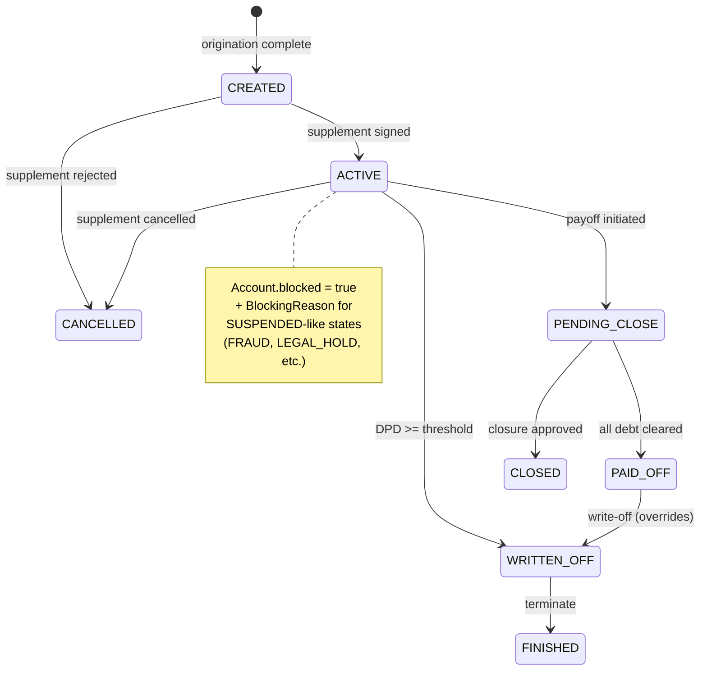

> *"Billing không phải là việc tính toán. Billing là việc thực hiện đúng một lời hứa - với từng đồng tiền, với từng khách hàng, lúc 3 giờ sáng khi không ai thức."*

## Dẫn nhập: Một đêm của một triệu khoản vay

::::story
Đêm cuối tháng 3. Lúc 23h00, hệ thống bắt đầu tiến trình End-of-Month *(EOM)*. Trong 8 giờ tiếp theo, LAS module phải:

- Tính lãi cho 1,247,832 tài khoản đang hoạt động
- Tạo 2,891,440 instalment records mới
- Cập nhật 1,247,832 running balance records
- Publish 1,247,832 events đến STS để generate statements
- Xử lý 34,221 tài khoản quá hạn theo protocol đặc biệt
- Hoàn thành trước 7h00 sáng - khi chi nhánh mở cửa

Không được phép sai một đồng nào. Không được miss một tài khoản nào. Không được để bất kỳ tài khoản nào trong trạng thái inconsistent.

Và tất cả điều này phải xảy ra trong khi hệ thống vẫn tiếp tục xử lý các giao dịch real-time của khách hàng trả nợ lúc 2h sáng.
::::

Chương này đi vào LAS module - trái tim của VLP. Từ domain model chi tiết (Account, Transaction, Instalment, CurrentBalance) đến transaction processing pipeline, từ billing cycle architecture đến instalment prescribing và pairing, từ EOM batch processing đến failure recovery. Đây là chương kỹ thuật nhất trong sách - và cũng là chương quan trọng nhất để hiểu cách consumer finance thực sự vận hành ở tầng engine.

## 8.1 Domain Model của LAS

### Tại sao Domain Model quan trọng trước Code

::::story
Kỹ sư Tuấn mới join team LAS. Ngày đầu tiên, Tech Lead đưa cho anh một tờ giấy - không phải requirement document, không phải architecture diagram. Đó là domain model:

"Học cái này trước. Nếu bạn hiểu domain model, bạn sẽ hiểu tại sao mọi thứ trong codebase được viết như vậy. Nếu bạn không hiểu domain model, bạn sẽ fix bugs mà không hiểu mình đang làm gì."
::::

### Account: Gốc rễ của mọi thứ

```text
LAS_ACCOUNT
┌─────────────────────────────────────────────────────────┐
│ accountNumber: String (@NaturalId)                       │ ← Business key
│ contractCode: String                                     │ ← Link đến CTM
│ accountOwnerCode: String                                 │ ← Customer ID (từ CIS)
│ accountType: AccountType                                 │ ← FLEXI_LIMIT, etc.
│ status: AccountStatus                                    │ ← State machine
│ currency: String                                         │
│ billingPeriod: BillingPeriod enum                        │ ← Day-of-month EOM runs (BP_1, BP_5, BP_20...)
│ activationDate: LocalDate                                │
│ blocked: Boolean                                         │
│ seized: Boolean                                          │ ← Court-ordered freeze
│ expired: Boolean                                         │
│ closureDate: LocalDate                                   │
│ payoffDate: LocalDate                                    │
│ writeoffDate: LocalDate                                  │
└─────────────────────────────────────────────────────────┘
```

**AccountStatus State Machine (7 states):**


**Tất cả 7 trạng thái:**

```text
CREATED (CR):
  Sau khi origination tạo account, TRƯỚC khi activation event
  → Có thể setup data (parameters, services, tariff)
  → CHƯA thể nhận transactions
  → Lưu ý: không phải "INITIATED" — CREATED là tên đúng

ACTIVE (AC):
  Sau khi activation event (sau disbursement)
  → Normal operational: debit/credit đều được
  → Đây là trạng thái phần lớn thời gian

CANCELLED (CA):
  Admin/customer cancelled TRƯỚC khi active
  → Terminal state — không thể reopen

PENDING_CLOSE (PCL):
  Tất toán đang diễn ra
  → Chỉ nhận payment, không cho transactions mới

PAID_OFF (PO):
  Toàn bộ debt = 0
  → Terminal hoặc có thể reopen (revolving accounts)

CLOSED (CL):
  Permanently closed — không thể reopen
  → Final terminal state

WRITTEN_OFF (WO):
  Bad debt decision via DRG write-off signal
  → Removed from balance sheet
  → NHƯNG payments vẫn được nhận (off-balance-sheet recovery)

SUSPENDED: KHÔNG phải AccountStatus
  → Implemented qua Account.blocked = true + BlockingReason entities
  → Blocking reasons: FLEXI_TERMINATION, FLEXI_CONVERSION, FRAUD, LEGAL_HOLD
```

### CurrentBalance: Real-Time Financial State

```text
LAS_CURRENT_BALANCE (One per Account)
// verified: am-core-entities-deep.md
// All monetary fields use Money type (@Embeddable: BigDecimal value + String currency)
┌─────────────────────────────────────────────────────────┐
│ holdBalance: Money                                       │ ← Sum of auth holds
│ holdIPBalance: Money                                    │ ← Instalment plan holds
│ outstandingDebt: Money                                  │ ← Sum of unpaid debit items
│ availableBalance: Money                                  │ ← CreditLimit - holds - debt
│ ledgerBalance: Money                                    │ ← Credits - debits (accounting)
│ customerCredit: Money                                         │ ← Overpayments (credit balance)
│ withholdCustomerCredit: Money                                │ ← Seized portion
│ overdueAmount: Money                                    │ ← Past-due amount (DPD > 0)
│ instDueAmountNext: Money                               │ ← Next minimum instalment
│ currentAccountMMI: Money                               │ ← Current MMI value
│ instDueDateFirst: Date                                  │ ← First overdue due date
│ instOverdueCount: Integer                              │ ← Overdue instalment count
└─────────────────────────────────────────────────────────┘
```

**Tại sao CurrentBalance là materialized view - không phải tính real-time:**

```text
Option A: Tính real-time từ event store
  SELECT SUM(CASE WHEN direction='DEBIT' THEN amount ELSE -amount END)
  FROM las_ledger_entry
  WHERE account_id = X AND NOT cancelled

  Vấn đề: account có 5,000 transactions trong 3 năm
  → Query mất 50-100ms mỗi lần
  → 10,000 concurrent users → 100,000 ms total query time/giây
  → Database chết

Option B: CurrentBalance materialized view
  Lưu balance hiện tại, update INCREMENTAL sau mỗi event
  SELECT available_balance FROM las_current_balance WHERE account_id = X
  → 1ms query

  Trade-off: CurrentBalance phải luôn sync với event store
  → Nếu có bug trong update logic → inconsistency
  → Cần reconciliation job định kỳ
```

**Available balance formula:**

```text
availableBalance = CREDIT_LIMIT - holdBalance - holdIPBalance - outstandingDebt + customerCredit

Ví dụ (chị Lan, sau 3 tháng):
  CREDIT_LIMIT = 18,500,000 VNĐ
  holdBalance = 0 (không có pending auths)
  holdIPBalance = 0
  outstandingDebt = 13,500,000 VNĐ (đã trả 3 × 1,668,400 = 5,005,200, gốc còn lại)
  customerCredit = 0

  availableBalance = 18,500,000 - 0 - 0 - 13,500,000 + 0 = 5,000,000 VNĐ
  → Chị Lan có thể chi tiêu thêm 5 triệu
  (Đây là revolving feature — phần gốc đã trả → trở thành available lại)
```

**FLEXI_LIMIT_ACCOUNT - Revolving Draw Mechanics:**

```text
Mỗi lần draw (mua hàng, rút tiền):
  → Tạo Transaction mới (type: RTL/ATM/ICD...)
  → Tạo LedgerEntry (DEBIT)
  → Tạo PostingUnit
  → EventAssignment.type = CARD (cho revolving draws)
  
  Không có InstalmentPlan tự động per draw.
  InstalmentPlan là OPTIONAL — customer có thể chủ động request
  convert một transaction cụ thể sang IP.

Không giới hạn số lần draw per billing period — chỉ limited bởi availableBalance.

Sau flexi-to-fixed conversion (EOM autoFlexiToFixed step):
  → BlockingReason(FLEXI_CONVERSION) được tạo
  → Account không thể draw thêm
  → Chỉ nhận payments cho existing debt
  → Dần dần trả hết theo fixed instalment schedule
```

### Transaction vs LedgerEntry: Hai khái niệm khác nhau

Đây là điểm dễ nhầm lẫn nhất trong LAS domain.

**Transaction (LAS_TRANSACTION):**
> Ghi lại một sự kiện từ thế giới bên ngoài - một lần mua hàng, một lần thanh toán, một lần rút tiền.

```text
Transaction ví dụ:
  Ngày: 2025-03-15
  Type: RTL (Retail POS)
  Amount: 2,500,000 VNĐ (chị Lan mua quần áo)
  Direction: DEBIT
  SourceTxCode: "POS-TXN-789456" (từ merchant terminal)
  Status: CONFIRMED
```

**LedgerEntry (LAS_LEDGER_ENTRY):**
> Hậu quả tài chính của một transaction hoặc event billing. Một transaction có thể tạo ra nhiều AccountItems.

```text
Từ transaction RTL 2,500,000 VNĐ ở trên:
  LedgerEntry #1: Principal debit 2,500,000 VNĐ (gốc)
  LedgerEntry #2: (Chưa có ngay — lãi sẽ được tính vào EOM)

  Từ EOM billing của tháng đó:
  LedgerEntry #3: Interest 37,500 VNĐ (lãi tháng đó trên khoản này)

  Nếu chị Lan trả trễ:
  LedgerEntry #4: Late fee 200,000 VNĐ
```

**PostingUnit:**
> Tracking chi tiết allocation của một LedgerEntry across tariff types.

```text
LedgerEntry #1 (Principal 2,500,000 VNĐ) có PostingUnit:
  Code: TAI-001
  FeeComponentType: PRINCIPAL
  BaseAmount: 2,500,000
  PrescribedAmount: 2,500,000 (đã tạo instalment)
  PairedAmount: 0 (chưa có payment match)
  ApplyIr: true (tính lãi trên khoản này)
  UpdatingAvailableAmount: true (giảm available balance)
```

### Instalment và InstalmentSummary: Two-Level Hierarchy

**Tại sao cần hai level:**

```text
Một account có nhiều khoản vay (items) với cùng due date:
  - Gốc của khoản mua laptop: 1,200,000 VNĐ due ngày 20/4
  - Gốc của khoản mua quần áo: 400,000 VNĐ due ngày 20/4
  - Phí bảo hiểm: 90,000 VNĐ due ngày 20/4

InstalmentSummary gom chúng lại:
  DueDate: 20/4
  InstalmentType: REGULAR
  Amount: 1,200,000 + 400,000 + 90,000 = 1,690,000 VNĐ
  PaidAmount: 0

  Children:
    Instalment A: amount=1,200,000 (laptop principal)
    Instalment B: amount=400,000 (clothes principal)
    Instalment C: amount=90,000 (insurance)

Tại sao gom lại:
  1. Khách hàng thấy một con số tổng: "Tháng này trả 1,690,000 VNĐ"
  2. Statement generation tổng hợp từ header, không từng item riêng
  3. Repaid status của header = true khi ALL children repaid
  4. Pairing logic có thể apply payment cho nhóm theo priority
```

**Gotcha nổi tiếng (VLP-670) - PersistentBag stale:**

```java
// BUG: dùng refreshInstalmentSummary() khi prescribing
// cho existing header

InstalmentSummary existingHeader = findOrCreate(dueDate, type, account);
if (existingHeader.isPersisted()) {
    // Thêm instalment mới:
    existingHeader.getInstalments().add(newInstalment); // Bước này thêm vào collection
    
    // BUG: gọi refresh sẽ đọc lại từ DB
    // nhưng newInstalment chưa được save → refresh đọc state cũ!
    refreshInstalmentSummary(existingHeader);
    // → Amount tính sai vì newInstalment chưa có trong DB
}

// FIX: dùng incremental update thay vì refresh
if (existingHeader.isPersisted()) {
    // Incremental update — không đọc lại từ collection:
    existingHeader.setAmount(existingHeader.getAmount().add(newInstalment.getAmount()));
    // Và save newInstalment explicitly:
    instalmentRepository.save(newInstalment);
}

// refreshInstalmentSummary() chỉ SAFE khi tất cả children đã trong DB
// → Dùng trong pairing (sau khi all children persisted)
// → KHÔNG dùng trong prescribing (khi adding new children)
```

### ContractService: Service trên Account

**ContractService là gì:**

```text
ContractService (bảng `CONTRACT_SERVICE` trong CTM schema, LAS đọc qua JPA cross-schema) đại diện cho một service
được activate trên account — ví dụ như maintenance, bảo hiểm, v.v.

Ví dụ services:
  ACCMAINT: Maintenance Account — dịch vụ duy trì tài khoản
          Đây là service "core" — mọi transaction đều cần ACCMAINT active
  ACCSTMT: Account Statement — dịch vụ sao kê
  PAYM: Payment — dịch vụ thanh toán
  ZERO_PROMO: Zero rate promotion — kỳ khuyến mãi 0%
  RELIP: Instalment Plan service
  LIFEINS: Life Insurance
```

**Tại sao transaction confirmation cần check ContractService:**

```text
Business rule: Một giao dịch chỉ hợp lệ nếu:
  1. Account tồn tại và ACTIVE
  2. Required ContractService đang active tại thời điểm giao dịch

LAS's implementation:
  LAS KHÔNG gọi CTS via HTTP REST.
  LAS query ContractService thẳng từ CTM schema via JPA/Hibernate.
  → Lower latency, tighter coupling (same DB or shared schema)
  → RVS (Revolving Services) module handles service definition lookups
  
Validation check:
  ContractService.contractServiceStatus = ACTIVE AND
  endDate >= effectiveDate (effectiveDate = currentDate khi bill-in-past)
  
  Nếu service không tồn tại hoặc expired:
  → ERR_TX_NO_VALID_CONTRACT_SERVICE  // verified: billing-flow.md
  
Sentinel date values:
  AccountParameter.validTo: 3000-01-01 (DateUtil.UNREACHABLE_FUTURE_DATE)
    NULL trong DB → NullDateToFarFutureConverter → 3000-01-01 in Java
    Truy vấn: WHERE validTo = UNREACHABLE_FUTURE_DATE OR validTo >= :effectiveDate
  
  AccountService.endDate: default 3000-01-01 (open-ended)
    Đây là giá trị explicit (không qua converter)
    Truy vấn: WHERE endDate >= :effectiveDate luôn TRUE khi 3000-01-01

  PostingUnit.firstPrescribeDate: 3333-01-01 cho IP allocations (khác!)
    — sentinel riêng cho "chưa prescribe"

  Sentinel dates trong VLP —
  tránh nhầm lẫn khi viết queries!
```

**Gotcha VLP-706 - Wrong effectiveDate:**

```java
// BUG: dùng billingDate khi chargeTransactionInPast=true
public void checkContractService(Transaction tx) {
    LocalDate effectiveDate = tx.getBillingDate();
    // Nhưng getBillingDate() = getPresentmentDate() = ngày quá khứ!
    // Nếu service được tạo SAU ngày quá khứ đó → NOT FOUND → reject!
    
    accountServiceFacade.getActiveService(account, serviceType, effectiveDate);
}

// FIX: dùng currentDate khi bill-in-past
public void checkContractService(Transaction tx, LocalDate effectiveDate) {
    // Gọi với currentDate khi chargeTransactionInPast=true
    accountServiceFacade.getActiveService(account, serviceType, effectiveDate);
}

// Caller:
if (tx.isChargeTransactionInPast()) {
    checkContractService(tx, timeService.getCurrentDate()); // currentDate
} else {
    checkContractService(tx, tx.getBillingDate()); // billingDate bình thường
}
```

**Lý do kinh tế của fix này:**

```text
Check "current permission to charge" vs "historical permission":

Scenario:
  - 1/3/2025: account activated, service ACCMAINT bắt đầu
  - 15/2/2025: merchant gửi giao dịch bị trễ (bill-in-past)
  - Check effectiveDate = 15/2 → service KHÔNG tồn tại → REJECT
  - Nhưng merchant đã cung cấp hàng hóa ngày 15/2!
  - Đây là legitimate transaction bị reject oan

  Fix: Check effectiveDate = currentDate → service ACTIVE → ACCEPT
  Semantic: "Bây giờ có quyền charge không?" thay vì "Ngày đó có quyền không?"
```

:::summary[Domain Model]
Account: state machine, root entity
CurrentBalance: materialized view, update
incremental, reconcile periodically
Transaction: external event; LedgerEntry:
financial consequence - 1 tx → nhiều items
InstalmentSummary: aggregate; Instalment: child
→ PersistentBag gotcha khi prescribing
ContractService: check BOTH status AND operation
active → VLP-706 fix: currentDate khi past-tx
:::

## 8.2 Transaction Processing Pipeline

### Authorization vs Confirmation: Tại sao hai bước

::::story
Chị Lan dùng thẻ tín dụng tại siêu thị. Cô quẹt thẻ, máy POS báo "Approved" trong 3 giây. Nhưng tiền chưa thực sự bị trừ - nó sẽ được trừ sau 1-3 ngày khi merchant settle.

Đây là Authorization vs Confirmation.
::::

**Authorization (Pre-authorization):**

:::key
**Authorization** là việc "giữ chỗ" một khoản tiền - đảm bảo khách hàng có đủ available balance tại thời điểm giao dịch, nhưng chưa thực sự debit.
:::

```text
Chị Lan quẹt thẻ 2,500,000 VNĐ:
  1. Merchant terminal gửi Authorization request
  2. LAS nhận → tạo Authorization record
  3. LAS update CurrentBalance:
     holdBalance += 2,500,000
     availableBalance -= 2,500,000
  4. LAS return: APPROVED
  (chưa có LedgerEntry, chưa có instalment)

CurrentBalance sau auth:
  availableBalance: 5,000,000 - 2,500,000 = 2,500,000 VNĐ
  holdBalance: 2,500,000
  outstandingDebt: 13,500,000 (chưa thay đổi)
```

**Confirmation:**

:::key
**Confirmation** là việc "settle" authorization - chuyển từ hold thành actual debt.
:::

```text
1-3 ngày sau, merchant gửi Confirmation request:
  1. LAS nhận → find Authorization bằng sourceTxCode
  2. Create Transaction record (CONFIRMED)
  3. Create LedgerEntry (DEBIT, principal 2,500,000 VNĐ)
  4. Update CurrentBalance:
     holdBalance -= 2,500,000 (release hold)
     outstandingDebt += 2,500,000 (add to debt)
     availableBalance: không thay đổi (hold → debt, net zero)
  5. Bill transaction (tính lãi, tạo instalment nếu cần)
  6. Publish TransactionConfirmedEvent

CurrentBalance sau confirmation:
  holdBalance: 0
  outstandingDebt: 13,500,000 + 2,500,000 = 16,000,000
  availableBalance: 2,500,000 (không đổi)
```

**Tại sao cần hai bước - không settle ngay:**

```text
Lý do 1: Merchant settlement cycle
  Merchant POS → Acquiring Bank → Card Network → Issuing Bank (LAS)
  Quy trình này mất 1-3 ngày trong hệ thống tài chính hiện tại

Lý do 2: Authorization có thể bị void
  Khách hàng return hàng trong 24h → merchant void authorization
  Không cần tạo transaction, không cần tính lãi

Lý do 3: Authorization amount có thể khác confirmation amount
  Hotel pre-auth 2,000,000 VNĐ → check-out chỉ 1,800,000 VNĐ
  Confirmation với đúng amount thực tế

Lý do 4: Float management (liquidity)
  Tiền không thực sự di chuyển cho đến settlement
  → Card network net settle hàng ngày
```

### Bill-in-Past: Nghiệp vụ phức tạp nhất

::::story
Ngày 15/3, một merchant POS gửi một transaction đáng lẽ phải được settle từ ngày 28/2 - nhưng bị delay do lỗi hệ thống của merchant. Transaction có `transactionDate = 28/2` nhưng được gửi đến LAS vào ngày 15/3.

LAS phải xử lý transaction này với ngày 28/2 - trong khi đó EOM của tháng 2 đã chạy xong từ ngày 1/3.
::::

**Vấn đề:**

```text
Nếu bill với ngày hiện tại (15/3):
  → Lãi tính từ 15/3 — thiếu 15 ngày lãi (từ 28/2 đến 14/3)
  → Balance tháng 2 đã được close → statement sai

Nếu bill với ngày quá khứ (28/2) naively:
  → Tháng 2 đã được close và settle với STS
  → Balance sau billing phải "thêm vào" quá khứ → phải reprocess mọi event sau 28/2

Đây là bill-in-past — cần cascade reprocessing.
```

**Bill-in-past flow:**

```java
public void billTransactionInPast(LocalDate pastDate, Transaction transaction) {
    // Mark transaction này là bill-in-past
    transaction.getEvent().setBillInPast(true);

    // Tìm event đã processed đầu tiên SAU ngày quá khứ:
    EventRecord firstEventAfter = eventService
        .findFirstProcessedEventAfterOrEqualDateTime(pastDate, account, eventType);

    if (firstEventAfter == null) {
        // Không có event sau → bill bình thường, không cần reprocess
        processEventManager.billTransaction(transaction);
    } else {
        // Có conflict: phải insert event này TRƯỚC event đã processed
        // Và reprocess tất cả events sau đó theo thứ tự
        eventReplayManager.billNewEventBeforeExistingEventAndReprocessOnwardEvents(
            event, firstEventAfter, ReprocessType.TRANSACTION_CREATE_IN_PAST);
    }

    // Luôn recalculate overdue debts với currentDate:
    currentBalanceService.recalculateOverDueDebts(account, currentDate, eventTimestamp);
}
```

**Tại sao reprocessing phức tạp:**

```text
Timeline:
  28/2: Transaction muốn bill vào đây (gốc 2,500,000 VNĐ)
  1/3:  EOM chạy → tính lãi tháng 2 dựa trên balance TẠI THỜI ĐIỂM ĐÓ
  5/3:  Customer trả 1,000,000 VNĐ
  10/3: EOM chạy (partial — lãi hàng ngày)
  15/3: Transaction đến

Nếu bill transaction vào 28/2:
  → Balance tháng 2 tăng 2,500,000 VNĐ
  → Lãi tháng 2 phải tính lại (balance cao hơn → lãi cao hơn)
  → Payment ngày 5/3 phải pair với instalments mới (thứ tự pair thay đổi)
  → Tất cả events từ 28/2 đến 15/3 phải được reprocess

Reprocessing đảm bảo:
  → Consistency: mọi calculation phản ánh thực tế
  → Audit: mọi reprocess được log với reason
  → Idempotency: nếu reprocess thêm lần nữa → same result
```

### idempotency và sourceTxCode

::::story
POS terminal gửi confirmation request. Network timeout - terminal không biết LAS đã xử lý chưa. Terminal retry. LAS nhận request thứ hai với cùng nội dung.

Không có idempotency: hai AccountItems được tạo → balance sai → fraud/error.
::::

**sourceTxCode - The Idempotency Key:**

```java
// illustrative pseudo-code — details differ from actual
// verified: verify-ch8-ch9-code.md
// Actual: return type = ExecuteTransactionResult (not TransactionResult)
// Actual: no SERIALIZABLE annotation; LAS uses AccountLockGuard
// Actual: idempotency via getAuthorizationFromConfirm() (not findBySourceTxCode)

@Transactional  // LAS uses default isolation + AccountLockGuard
public ExecuteTransactionResult confirmTransaction(ConfirmationRequestTo transactionTo) {
    // checkForDuplicities=true → kiểm tra via getAuthorizationFromConfirm()
    return confirmTransactionInternal(transactionTo, true);
}
// Idempotency: sourceTxCode in request body → Authorization lookup
// → nếu đã tồn tại: return existing result, không process lại
```

**Tại sao cần pessimistic locking ở đây:**

```text
Race condition nếu không có locking:

Thread 1: Read account balance → proceed
Thread 2: Read account balance → proceed (concurrent!)
Thread 1: Create transaction #1, update balance
Thread 2: Create transaction #2, update same balance (stale read!)

Result: Balance inconsistency → data corruption

Với AccountLockGuard (pessimistic locking):
Thread 1: Lock account → process → release
Thread 2: Chờ Thread 1 release → proceed safely
→ Serial processing per account, no conflict
```

:::summary[Transaction Processing]
Authorization: hold balance, chưa debit thực tế
Confirmation: release hold, create actual debt
Bill-in-past: cascade reprocessing từ pastDate
→ tất cả events sau must be reprocessed
sourceTxCode: idempotency key → prevent double
processing (via getAuthorizationFromConfirm)
:::

## 8.3 Billing Cycle: Từ Trigger đến Statement

### Event Types: IMMEDIATE vs EOM

**Khái niệm:**

Không phải mọi transaction đều được billed ngay. LAS phân loại events theo timing:

```text
IMMEDIATE:
  Bill ngay khi confirmed
  Ví dụ: Phí trả trễ (LATEFEE1) → cần phản hồi ngay để tạo urgency
  Ví dụ: Phí vượt hạn mức → cần update available balance ngay

IMMEDIATE_RESPECT_FREEZE:
  Bill ngay NHƯNG chờ nếu billing period đang frozen (EOM đang chạy)
  Ví dụ: Giao dịch mua hàng bình thường
  → Nếu EOM đang chạy: queue vào POSTPONED_TILL_EOM

EOM (End of Month):
  Defer đến cuối tháng
  Ví dụ: Lãi suất → chỉ tính vào cuối kỳ billing
  Ví dụ: Phí bảo hiểm hàng tháng → tính cuối tháng
```

**Tại sao cần IMMEDIATE_RESPECT_FREEZE:**

```text
Vấn đề: EOM đang chạy, tính lãi tháng 3 cho account X
         Đồng thời customer submit payment cho account X

Nếu không có freeze:
  EOM tính lãi dựa trên balance_at_start_of_march
  Payment comes in → updates balance mid-calculation
  EOM tính lãi với balance đã bị payment làm thay đổi
  → Lãi tính không đúng

Với freeze:
  EOM bắt đầu → account X bị "frozen"
  Payment arrives → POSTPONED_TILL_EOM (không xử lý ngay)
  EOM hoàn thành → account X unfrozen
  Payment được process → late billing, but consistent
```

### ChargingGateway và Spring Integration

**Tại sao Spring Integration:**

Billing pipeline là một chuỗi phức tạp: event → tariff lookup → fee calculation → LedgerEntry creation → balance update → notification. Mỗi bước là independent processing unit.

Spring Integration's MessagingGateway pattern cho phép express pipeline này như một chuỗi Message Channels - mỗi component xử lý một message, chain lại với nhau.

```text
EventRecord
   │
   ▼ ChargingGateway.billEvent(eventId)
[billEventChannel]       ← // verified: IntegrationConstants.Channels.BILL_EVENT
   │
   ▼ [internal processing chain]
[calculateTariffItemsAndCreateAccountItemsChannel]  ← // verified
   │
   ▼ BillingContext (result)
```

**Actual ChargingGateway interface:**

```java
// verified: billing-flow.md / ChargingGateway.java
@MessagingGateway
public interface ChargingGateway {
    @Gateway(requestChannel = "billEventChannel")
    BillingContext billEvent(Long eventId);

    @Gateway(requestChannel = "calculateTariffItemsAndCreateAccountItemsChannel")
    BillingContext calculateTariffItems(BillingContext billingContext);
}
```

Toàn bộ chuỗi billing chỉ đi qua **2 gateway channel**. Các bước resolve tariff, tính phí, tạo item và cập nhật số dư diễn ra bên trong chuỗi xử lý nội bộ, không phải mỗi bước một channel riêng.

**Tại sao pipeline architecture tốt hơn one giant method:**

```text
// Mỗi processor là independent component:
@ServiceActivator(inputChannel = "billEventChannel",
                  outputChannel = "tariffResolvedChannel")
public Message<TariffContext> lookupTariff(Message<Long> eventMessage) {
    Long eventId = eventMessage.getPayload();
    Event event = eventRepo.findById(eventId);
    Tariff tariff = tariffService.findForEvent(event);
    return MessageBuilder.withPayload(new TariffContext(event, tariff)).build();
}
// → Testable independently, extensible, clear responsibility
```

### STS Notification via RabbitMQ

**Flow từ billing đến statement:**

```text
1. Transaction confirmed → LAS bills event
2. After billing: TransactionSynchronization hook fires ON COMMIT:
   (Không phải trong transaction — sau khi commit thành công)

3. NotificationPublisher collects all events from this transaction
4. EventNotificationDispatcherService.dispatch(events)
5. AMQPEventPublishingService publishes to RabbitMQ:
   Exchange: "account.events"
   RoutingKey: "event.processed.v1"
   Payload: EventRecordNotification {accountId, eventId, billingPeriod, ...}

6. STS subscribes to "account.events"
7. STS generates/updates statement for account

Tại sao publish AFTER commit (TransactionSynchronization):
  Nếu publish TRƯỚC commit:
    Publish thành công → STS processes event
    Transaction ROLLBACK (vì lý do nào đó)
    → STS có statement update nhưng LAS không có transaction
    → Inconsistency

  Với publish AFTER commit:
    Transaction committed → publish → STS processes
    Nếu publish fails sau commit: retry mechanism (outbox pattern)
    → Consistency guaranteed
```

:::summary[Billing Cycle]
IMMEDIATE: bill now; EOM: defer; IMMEDIATE_FREEZE:
bill now nếu không frozen
ChargingGateway: Spring Integration pipeline
→ testable, extensible, clear separation
STS notification: AFTER commit (not during)
→ consistency guarantee
Outbox pattern: publish fails → retry, không mất
:::

## 8.4 Instalment Lifecycle

### Prescribing: Tạo Instalment

::::story
Cuối tháng 3, EOM chạy step "Instalment Generation" cho tài khoản của chị Lan. Anh Minh hỏi Kỹ sư Tuấn: "Instalment được tạo như thế nào? Dựa trên dữ liệu gì?"
::::

**Prescribing là gì:**

:::key
**Prescribing** là quá trình tạo Instalment records từ TechnicalAccountItems - định nghĩa khách hàng nợ bao nhiêu, loại gì, đến hạn khi nào.
:::

**Input của prescribing:**

```text
1. Danh sách TechnicalAccountItems chưa được fully prescribed
   Mỗi PostingUnit: loại phí, số tiền, đã prescribe bao nhiêu

2. MMI (Minimum Monthly Instalment) limit
   REPAYMENT_ALLOCATION_ORDER: PRIORITY_ONLY

3. Billing cycle info: dueDate cho kỳ này
```

**Prescribing algorithm:**

```text
public List<Instalment> generateInstalments(
        List<PostingUnit> items,
        BigDecimal mmiLimit,
        LocalDate dueDate) {
```

    List<Instalment> result = new ArrayList<>();
    BigDecimal remainingMMI = mmiLimit;

    // Sort items theo priority (PRIORITY_ONLY mode):
    List<PostingUnit> sorted = sortByPriority(items);

    for (PostingUnit tai : sorted) {
        if (remainingMMI.compareTo(ZERO) <= 0) break; // MMI exhausted

        BigDecimal unprescribed = tai.getBaseAmount()
                                     .subtract(tai.getPrescribedAmount());
        if (unprescribed.compareTo(ZERO) <= 0) continue; // Already prescribed

        // Prescribe min(unprescribed, remaining MMI):
        BigDecimal instalmentValue = unprescribed.min(remainingMMI);

        // Tạo instalment:
        Instalment inst = new Instalment();
        inst.setAmount(instalmentValue);
        inst.setDueDate(dueDate); // Có thể adjust cho payment holidays
        inst.setInstalmentType(InstalmentType.REGULAR);
        inst.setReconciliation(tai.getReconciliation());

        // Find or create header:
        InstalmentSummary header = findOrCreateHeader(dueDate, REGULAR, account);
        addInstalmentAmountsToHeader(header, instalmentValue); // INCREMENTAL, không refresh!

        inst.setInstalmentSummary(header);
        result.add(inst);

        tai.setPrescribedAmount(tai.getPrescribedAmount().add(instalmentValue));
        remainingMMI = remainingMMI.subtract(instalmentValue);
    }

    // Save all instalments (NOT via cascade - save explicitly):
    instalmentRepository.saveAll(result);

    return result;
}

**Bốn loại Instalment:**

```text
REGULAR (R): Tạo trong EOM processing
  → Instalment "bình thường" của billing cycle
  → DueDate = billing cycle due date
  → prescribeImmediately = false trên AccountFeeComponentType
  → Ví dụ: gốc laptop của chị Lan, phí bảo hiểm tháng

EXTRA (E): Tạo ngay khi LedgerEntry được created
  → Cho các khoản phí cần "visible" ngay (late fee, over-limit fee)
  → DueDate = current date (due ngay lập tức)
  → prescribeImmediately = true trên AccountFeeComponentType
  → Ví dụ: late fee, overdraft fee

ADDITIONAL (O): Tạo khi customer overpay
  → prescribeAndSaveOverpaymentAsAdditional()
  → Đại diện cho phần thừa sau khi tất cả instalments đã paid
  → Chuyển thành customerCredit trên CurrentBalance
  → Tự động paired vào oldest DEBIT trong lần pairing tiếp theo

PAYOFF (P): Tạo khi account được marked for payoff
  → Account status = PAY_OFF
  → Bao gồm toàn bộ remaining balance (principal + interest + fees)
  → DueDate = payoff date
  → isInPayoff=true flag trên prescribing call

Ví dụ:
  Chị Lan trả trễ ngày 5/4:
  → Late fee LedgerEntry: 200,000 VNĐ
  → prescribeImmediately = true cho LATEFEE1 → EXTRA Instalment: 200,000 VNĐ, due 5/4
  → Không chờ EOM cuối tháng 4
```

  Chị Lan trả 3,000,000 VNĐ, chỉ cần 2,890,000 VNĐ:
  → Pair tất cả instalments → thừa 110,000 VNĐ
  → ADDITIONAL Instalment: 110,000 VNĐ → customerCredit

### Pairing: Payments Matched to Instalments

::::story
Chị Lan trả 2,000,000 VNĐ vào ngày 20/4. Account có các instalments pending:

Instalment A: REGULAR, 1,200,000 VNĐ (gốc laptop), due 20/4
Instalment B: REGULAR, 400,000 VNĐ (gốc quần áo), due 20/4
Instalment C: EXTRA, 200,000 VNĐ (late fee từ 5/4), due 5/4
Instalment D: REGULAR, 90,000 VNĐ (bảo hiểm), due 20/4

Total pending: 1,890,000 VNĐ
Payment: 2,000,000 VNĐ → đủ để trả tất cả + thừa 110,000 VNĐ (own funds)
::::

**Pairing algorithm:**

```text
// illustrative pseudo-code — signature differs from actual
// verified: verify-ch8-ch9-code.md
// Actual signature (EntryInstalmentLinkService.java):
//   pairInstalments(
//     List<PostingUnit> payments,    ← NOT LedgerEntry
//     List<Instalment> instalments,
//     Date pairedDate,                         ← Date, NOT LocalDate
//     Account account,
//     Predicate<PostingUnit> ignoreSeizureConstraintByPayment)  ← extra param
// Actual: sorting via sortInstallmentsForPairing(), NOT account.getSortingLogic()
// Actual: seizure: calculateSeizedAndExemptCustomerCreditFromPayments()

public List<EntryInstalmentLink> pairInstalments(
        List<PostingUnit> payments,  // PostingUnit, not LedgerEntry
        List<Instalment> instalments,
        Date pairedDate,
        Account account) {
```

    List<EntryInstalmentLink> result = new ArrayList<>();

    // Step 1: Tính seized amount (nếu account bị phong tỏa):
    SeizureContext seizure = calculateSeizedAndExemptCustomerCreditFromPayments(account, payments);

    // Step 2: Sort instalments theo REPAYMENT_ALLOCATION_ORDER:
    List<Instalment> sortedInstalments = sortInstallmentsForPairing(instalments, account);

    // Step 3: Iterate payments và instalments:
    Iterator<PostingUnit> paymentIter = payments.iterator();
    Iterator<Instalment> instalmentIter = sortedInstalments.iterator();

    PostingUnit currentPayment = paymentIter.hasNext() ? paymentIter.next() : null;
    Instalment currentInstalment = instalmentIter.hasNext() ? instalmentIter.next() : null;

    while (currentPayment != null && currentInstalment != null) {
        BigDecimal paymentRemaining = currentPayment.getAmount()
                                                     .subtract(currentPayment.getPairedAmount());
        BigDecimal instalmentUnpaid = currentInstalment.getAmount()
                                                        .subtract(currentInstalment.getPaidAmount());

        // Seizure check:
        if (!seizure.canPay(currentInstalment)) {
            currentInstalment = advance(instalmentIter);
            continue;
        }

        // Pair min(available, needed):
        BigDecimal pairedValue = paymentRemaining.min(instalmentUnpaid);

        // Create pairing record:
        EntryInstalmentLink aii = new EntryInstalmentLink();
        aii.setAmount(pairedValue);
        aii.setPayment(currentPayment);
        aii.setInstalment(currentInstalment);
        result.add(aii);

        // Update amounts:
        currentPayment.setPairedAmount(currentPayment.getPairedAmount().add(pairedValue));
        currentInstalment.setPaidAmount(currentInstalment.getPaidAmount().add(pairedValue));

        // Check if instalment fully paid:
        checkAndSetInstalmentRepaid(currentInstalment, pairingDate);

        // Advance iterators as needed:
        if (currentPayment.getPairedAmount().compareTo(currentPayment.getAmount()) >= 0)
            currentPayment = advance(paymentIter);
        if (currentInstalment.getPaidAmount().compareTo(currentInstalment.getAmount()) >= 0)
            currentInstalment = advance(instalmentIter);
    }

    return result;
}

```text
private void checkAndSetInstalmentRepaid(Instalment inst, LocalDate date) {
    if (inst.getPaidAmount().compareTo(inst.getAmount()) >= 0) {
        inst.setRepaid(true);
        inst.setRepaidDate(date);
    }
    // Always refresh header — safe here because all children are persisted:
    refreshInstalmentSummary(inst.getInstalmentSummary());
}
```

**Kết quả pairing cho chị Lan:**

REPAYMENT_ALLOCATION_ORDER = PRIORITY_ONLY:
  Priority order: EXTRA (late fee) > REGULAR principal > REGULAR insurance

```text
Sorted:
  #1: Instalment C (EXTRA late fee 200,000) — highest priority
  #2: Instalment A (REGULAR gốc laptop 1,200,000)
  #3: Instalment B (REGULAR gốc quần áo 400,000)
  #4: Instalment D (REGULAR bảo hiểm 90,000)
```

Payment: 2,000,000 VNĐ

```text
Pairing:
  Payment → Instalment C: 200,000 paired → C repaid ✓
  Payment remaining: 1,800,000
  Payment → Instalment A: 1,200,000 paired → A repaid ✓
  Payment remaining: 600,000
  Payment → Instalment B: 400,000 paired → B repaid ✓
  Payment remaining: 200,000 (> D's 90,000)
  Payment → Instalment D: 90,000 paired → D repaid ✓
  Payment remaining: 110,000 → customerCredit (overpayment)
```

InstalmentSummary (20/4): amount=1,890,000, paidAmount=1,890,000 → repaid=true
Account: all instalments for 20/4 paid → account current
customerCredit: +110,000 VNĐ (credit balance)

### REPAYMENT_ALLOCATION_ORDER: Mechanism Design Revisited

**Năm modes và implications:**

RepaymentAllocationOrder enum (5 values):

1. PRIORITY_ONLY:
   Sort by tariff priority only. DUE DATE ignored entirely.
   Use when: priority order matters more than chronology.
   
2. DUE_DATE_AND_PRIORITY (most common default):
   Sort by due date first, then by priority within same date.
   "Oldest debt first" - intuitively fair cho customer.
   DPD override: khi account overdue, DPD priorities replace regular priorities.

3. DUE_DATE_IP_GROUP_PRIORITY:
   Sort by due date, nhưng instalment plans được group.
   Tất cả instalments của một InstalmentPlan treated as unit.
   Use when: account có multiple concurrent instalment plans.

4. IP_INTEREST_RANK:
   Sort by InstalmentPlan's interest rank.
   Higher-interest plans paid first.
   Economic logic: pay off most expensive debt first (similar to avalanche method).

5. DUE_DATE_AND_PRIORITY_NONZERO_DPD:
   Special logic applied only when DPD > 0.
   Otherwise behaves like DUE_DATE_AND_PRIORITY.

```text
Comparator chain (applies to all modes):
  OWN_FUNDS_FIRST → EXTRA_INSTALMENT_FIRST → PROFILE_SPECIFIC
  → BILLING_DATE_OLDEST_FIRST → LEDGER_ENTRY_ID_SMALLEST (tiebreaker)
```

**Economic analysis - PRIORITY_ONLY vs DUE_DATE:**

```text
Scenario: Account DPD 45, có late fee 200,000 VNĐ và gốc overdue 500,000 VNĐ

Customer payment: 300,000 VNĐ

PRIORITY_ONLY (late fee trước):
  200,000 → late fee (fully paid)
  100,000 → gốc overdue (partially paid)
  → Lender thu được late fee ngay
  → Gốc vẫn còn 400,000 overdue → DPD counter không reset
  → Customer vẫn ở DPD bucket
  → Cure rate: thấp (DPD vẫn tăng)

DUE_DATE (gốc trước — oldest first):
  300,000 → gốc overdue (partially paid)
  → Late fee chưa được trả
  → Gốc 400,000 overdue → DPD vẫn tăng
  → Tương tự cure rate

Outcome: Với cả hai mode, 300,000 VNĐ không đủ để cure account
Cần full payment (700,000 VNĐ) để cure

Real difference: Lãi trên khoản nào được tính sớm hơn
→ Đây là mechanism design choice về revenue timing, không phải cure rate
```

:::summary[Instalment Lifecycle]
Prescribing: REGULAR (EOM) vs EXTRA (immediate)
→ prescribeImmediately flag on AccountFeeComponent
InstalmentSummary: aggregate, incremental update
(không refresh khi prescribing existing header)
Pairing: match payments to instalments by
REPAYMENT_ALLOCATION_ORDER
checkAndSetRepaid: set header repaid khi ALL
children repaid → refreshHeader safe SAU SAVE
:::

### BillingRun và PeriodBalanceSnapshot: Snapshot của mỗi tháng

::::story
Sau khi EOM chạy xong tháng 3 cho chị Lan, hệ thống cần lưu lại: tháng này account trông như thế nào? Bao nhiêu gốc, bao nhiêu lãi, DPD bao nhiêu? Đây là PeriodBalanceSnapshot.
::::

**BillingRun (LAS_BILLING_RUN):**

:::key
**BillingRun** là "session header" cho một EOM run - đại diện cho toàn bộ quá trình EOM của một billing period.
:::

```text
BillingRun
  id
  billingPeriod: BillingPeriod enum (BP_1, BP_5, BP_20...) → ngày EOM chạy
  type: BillingRunType (REGULAR, ONE_TIME, SIMULATION, INITIAL, TERMINATION)
  status: NEW → RUNNING → SUCCESS | FAILURE | TERMINATED
  springBatchJobExecutionId → link đến Spring Batch job
  endDate → cuối billing period
  generateStatementFiles → có generate sao kê không

Relationship:
  1 BillingRun → N PeriodBalanceSnapshot (một per account)
  Query: BillingRun → PeriodBalanceSnapshot.billingRun → account

Lưu ý: billingPeriod ở đây là NGÀY TRONG THÁNG (day-of-month)
PeriodBalanceSnapshot có field riêng: billingPeriodNumber (counter 1, 2, 3...)
```

**PeriodBalanceSnapshot (LAS_PERIOD_BALANCE_SNAPSHOT):**

:::key
**PeriodBalanceSnapshot** là snapshot toàn diện của một account tại cuối một billing period - lưu lại mọi số liệu quan trọng cho audit, reporting, và IFRS 9.
:::

```text
Key fields:
  billingRun → BillingRun (tháng nào)
  account → Account (account nào)
  previousPeriodBalanceSnapshot → chain về tháng trước

Balance summary:
  startBalance, endBalance → số dư đầu/cuối kỳ
  endCardBalance, endIPBalance → phân chia theo loại

Debt snapshot (cuối kỳ):
  debtTotal, debtAllPrincipal, debtFee, debtInsurance, debtInterest
  overdueDebt, overdueDebtIgnoringDebtTolerance, dayPastDue

Period activity (hoạt động TRONG tháng):
  perPayments, perDebit, perCredit
  perPrincipal, perFee, perInterest, perLatePenalties

Lifetime cumulative:
  sumPayments, sumPrincipal, sumFee, sumInterest...

Due dates:
  dueDate, dueDateClient, dueDateGracePeriod

simulationOnly: true → dry-run (eom-simulation endpoint)
cancelled: true → on-demand EOM cancelled old balance
```

**Ứng dụng thực tế:**

```text
IFRS 9 staging:
  PeriodBalanceSnapshot.daysPastDue qua các tháng
  → Detect "Significant Increase in Credit Risk" (SICR)
  → Stage 1 → Stage 2 transition

Vintage analysis:
  Group PeriodBalanceSnapshot theo origination month
  → Track default rate evolution for each cohort

Statement generation:
  STS nhận EOM event → query PeriodBalanceSnapshot
  → Generate monthly statement với đầy đủ breakdown
```

### Entity Chain đầy đủ: Từ Transaction đến Instalment

**Một câu hỏi thường gặp:** "Payment event tạo ra những entities gì, theo thứ tự nào?"

Khi payment 2,000,000 VNĐ được confirmed:

```text
1. EventRecord (LAS_EVENT_RECORD)
   type=PAYMENT, status: REGISTERED → PROCESSED
   eventDate, processingDate, sourceSystem
   
2. LedgerEntry (LAS_LEDGER_ENTRY)
   amountDirection=CREDIT, amount=2,000,000
   link → EventRecord

3. PostingUnit (LAS_POSTING_UNIT)
   baseAmount=2,000,000 (immutable)
   pairedAmount=0 → increases as pairing happens
   fullyPaired=false → true when fully matched
   link → LedgerEntry, link → EventAssignment (if any)

4. [Pairing: MatchingService.pairInstalments()]
   EntryInstalmentLink (linking entity):
   link CREDIT TAI ↔ DEBIT Instalment
   pairedValue = min(payment, instalment outstanding)

5. Existing Instalment.paidAmount += pairedValue
   Existing InstalmentSummary refreshed (safe: all children already in DB)

6. CurrentBalance updated:
   outstandingDebt -= pairedValue
   customerCredit += any excess (ADDITIONAL instalment)

Full diagram:
  Transaction
    └── EventRecord (processing envelope)
          └── EventAssignment (CARD/IP/OUTER_DEBT type)
                └── LedgerEntry (financial consequence)
                      └── PostingUnit (pairing unit)
                            ├── [DEBIT] Reconciliation → Instalment → InstalmentSummary
                            └── [CREDIT] EntryInstalmentLink (link to DEBIT instalment)
```

## 8.5 EOM Batch Processing: Architecture

### Tổng quan EOM: Trigger và Sequence

**EOM được trigger như thế nào:**

```text
EOM KHÔNG có @Scheduled annotation trong LAS codebase.
LAS chỉ expose HTTP endpoint; external orchestrator quyết định khi nào gọi.

External caller gọi:
  POST /api/internal/v1/batch/execute-async
  {
    "jobName": "regularEOMBatchJob",
    "parameters": { "billingDate": "2025-03-20" }
  }

External orchestrator có thể là:
  K8s CronJob, Airflow DAG, hoặc dedicated orchestration service
  LAS không care — chỉ execute khi được gọi

Monitoring: BillingRun.status (SUCCESS/FAILURE) + external alerting
  LAS không tự alert — external system query batch status API
```

**Các bước phụ thuộc vào nhau - thứ tự không thể đổi:**

**Full EOM sequence:**

```text
STEP 1: getBillingRun
  → Tạo BillingRun record (status: NEW → RUNNING)
  → Đây là "lock" global: RUNNING status blocks new EOM sessions
  → Thiết lập billingDate, accountNumberList

STEP 2: eomServiceFeesJob (sub-job)
  → Tính và bill service fees từ LPS module
  → Run independently: partitioned by contract service cycles (not accounts)
  → Phải hoàn thành TRƯỚC main EOM (fees cần có trong balance khi tính lãi)

STEP 3 (Main EOM - per account):
  
  STEP 3.0: accountNumberToId
    → Convert account numbers sang internal IDs
    → Chuẩn bị partition data
  
  STEP 3.1: getBillingRunBase
    → Load billing session vào processor context
  
  STEP 3.2: accountsEOMBase [PARTITIONED - parallel]
    → Đây là main step, chạy parallel:
    
    Sub-step A: billPostponedEOMEvents
      → Process events bị POSTPONED_TILL_EOM từ trong tháng
      → Ví dụ: transactions đến trong khi billing period frozen
    
    Sub-step B: preloadStaticData
      → Cache account services, parameters vào memory
      → Giảm DB queries trong main processing
    
    Sub-step C: accountEOMStep [CHUNK-BASED]
      Reader: Đọc accounts theo partition
      
      // verified: bb-job-eom-beans.xml, verify-code-examples.md
      // doAccountMonthEndProcessor = CompositeItemProcessor với 4 delegates:
      Processor chain (theo thứ tự, trong doAccountMonthEndProcessor):
        P1: ClearAccountingNotificationsProcessor - clear notification buffer
        P2: PrepareContextForEOMItemProcessor - load account state vào context
        P3: AccountMonthEndProcessor - MAIN LOGIC (via billingBatchProcessorGateway):
            └─ billingBatchProcessingService.processEOMForRevolvingAccount()
               ├─ Delinquency check → set DPD
               ├─ Debt calculation
               ├─ Interest calculation (lãi tháng, 30/360)
               ├─ Fee calculation (phí dịch vụ tháng)
               ├─ Instalment generation (prescribing)
               ├─ Overpayment pairing
               └─ Balance calculation
        P4: EnqueueAccountingNotificationsProcessor - prepare notifications
      
      Lưu ý: P1-P4 là DELEGATES trong 1 CompositeItemProcessor (doAccountMonthEndProcessor),
      KHÔNG phải 4 separate Spring Batch steps.
      
      Writer chain (theo thứ tự):
        W1: StoreEOMResults → lưu PeriodBalanceSnapshot snapshot
        W2: NotifyEOMEvents → send billing events to notification queue
        W3: NotifyDebtRegister → sync với DRG module
        W4: NotifyAccountClosure → trigger closure nếu cần
        W5: NotifyMMI → send MMI info cho statement
        W6: FlushAndClearHibernate → clear Hibernate L1 cache (memory management)
    
    Sub-step D: billSuspendedEvents
      → Process events SUSPENDED sau main EOM
    
    Sub-step E: evictStaticData
      → Clear pre-loaded cache
  
  STEP 3.3: markBillingRunSuccess → BillingRun status: SUCCESS
  STEP 3.4: markBillingRunFailed → BillingRun status: FAILURE (nếu có lỗi)
  STEP 3.5: eomFinished → Send EOM completion notification

STEP 4: preloadAccountClosureStaticData
  → Cache data cho closure step (pre-load để tránh N+1 query)

STEP 5: autoFlexiToFixedConversionDecision (Decider)
  → Check nếu có FLEXI_LIMIT_ACCOUNT cần convert sang fixed instalment plan
  
  Business rationale:
  Sau X tháng revolving (configurable: accountLifespanMonths - 2):
    - Account tự động convert từ revolving → instalment plan
    - Regulatory/risk: limit long-term revolving exposure
    - Customer gets fixed schedule (predictable payments)
    - IP interest rates thường thấp hơn revolving rates
  
  If eligible accounts exist → CONTINUE → autoFlexiToFixedConversionStep
  If none → SKIP → next step

STEP 6: eomAccountClosureStep (sub-job)
  → Close PENDING_CLOSE accounts (standard revolving)
  → Triggered by: customer request, zero balance + no activity, regulatory
  → Flow: apply customerCredit → PENDING_CLOSE → CLOSED

STEP 7: eomAccountClosureStepRELPro (sub-job)
  → Close REVOLVING_PRO_ACCOUNT type (separate job, different params)
  → Same flow but different eligibility criteria
```

### Partitioned Processing: Parallel nhưng không Conflict

**Vấn đề:**

EOM phải xử lý 1.2 triệu accounts trong 8 giờ. Sequential processing: 1.2M accounts × 50ms/account = 60,000 seconds = 16.7 giờ. Quá chậm.

**Giải pháp: Partitioned Step (Spring Batch)**

```xml
<!-- verified: verify-ch8-ch9-code.md -->
<!-- EOM dùng XML config (bb-job-eom-beans.xml), KHÔNG phải Java @Bean -->
<!-- Partitioner thực tế: accountRangePartitioner -->
<!-- gridSize (số partitions): configurable via property placeholder (không hardcode 16) -->
    <!-- ${commit.interval.accountEOMStep} = chunk size (records per commit), NOT gridSize -->

<!-- Simplified illustration (actual config trong bb-job-eom-beans.xml): -->
<bean id="accountRangePartitioner" class="...AccountRangePartitioner" scope="step">
    <!-- Chia accounts thành N partitions — N đọc từ property placeholder -->
    <!-- ${commit.interval.accountEOMStep} = chunk size (records per commit); partition count is separate property -->
</bean>

<bean id="doAccountMonthEndProcessor"
      class="org.springframework.batch.item.support.CompositeItemProcessor" scope="step">
    <property name="delegates">
        <list>
            <ref bean="clearAccountingNotificationsProcessor"/>
            <ref bean="prepareContextForEOMItemProcessor"/>
            <bean class="...AccountMonthEndProcessor" scope="step">
                <property name="billingBatchProcessingService"
                          ref="billingBatchProcessorGateway"/>
            </bean>
            <ref bean="enqueueAccountingNotificationsProcessor"/>
        </list>
    </property>
</bean>
```

**Account isolation - không conflict:**

Một account thuộc đúng một partition.
Partition chạy trên một thread.
→ Không có concurrent access đến cùng một account.

Nhưng: Hai accounts khác nhau trong hai partitions khác nhau
có thể interact nếu: account A và B share cùng tài nguyên.

Trong LAS: không có shared state giữa accounts (design intentional).
Mỗi account có CurrentBalance riêng, Instalment riêng.
→ Safe to run partitions in parallel.

**Chunk-based processing - tại sao không process từng account:**

```text
// illustrative pseudo-code — actual config in XML (not Java @Bean)
// verified: verify-ch8-ch9-code.md
// Note: chunk size via property ${commit.interval.accountEOMStep}, skipLimit not confirmed
// Processor chain: 4 delegates (clear → prepare → EOM → enqueue notifications)

// Conceptually equivalent to:
// <step chunk-size="${commit.interval.accountEOMStep}">
//   <reader ref="accountReader"/>
//   <processor ref="doAccountMonthEndProcessor"/>  <!-- 4-delegate composite -->
//   <writer ref="accountWriter"/>
// </step>
```

**Tại sao chunk size = 50:**

```text
chunk size = 1: Commit sau mỗi account
  → 75,000 transactions cho partition 1
  → Overhead cao (transaction begin/commit)
  → Slow

chunk size = 1000: Commit sau mỗi 1000 accounts
  → Nếu account 999 fails → rollback 999 accounts
  → Retry 999 accounts
  → Wasted work

chunk size = 50: Balance point
  → Nếu fail: retry 50 accounts (acceptable)
  → Transaction overhead: 75,000/50 = 1,500 transactions
  → Memory: 50 accounts in memory (acceptable)
```

### Failure Recovery: On-Demand EOM

::::story[Scenario]
EOM chạy đêm qua. 47 accounts fail (database deadlock, network blip...). BillingRun status = FAILURE. 47 accounts không có PeriodBalanceSnapshot cho tháng này.
::::

**Recovery:**

```text
EOM không phải là "restartable" (restartable=false trong Spring Batch).
Không thể re-run toàn bộ EOM — vì 1.2M - 47 = 1,199,953 accounts đã được billed.

Giải pháp: On-demand EOM cho specific accounts

POST /batch/execute-async
{
    "jobName": "onDemandAccountNumberEOMBatchJob",
    "billingDate": "2025-03-31",
    "accountNumbers": ["ACC-001", "ACC-002", ... 47 accounts]
}

onDemandAccountNumberEOMBatchJob:
  1. Create new BillingRun for these 47 accounts
  2. Run EOM processing only for these accounts
  3. Previous PeriodBalanceSnapshot (if any) → cancelled
  4. New PeriodBalanceSnapshot → created

Idempotent: Running on-demand EOM twice for same account
  → Second run sees existing PeriodBalanceSnapshot → cancelled it → create new
  → Same result as running once (deterministic)

---
```

### Billing Period Freeze: Protecting Consistency

**Tại sao freeze:**

```text
EOM processing:
  T=0: Start processing account X
  T=1: Calculate interest based on outstandingDebt = 10,000,000
  T=2: Customer pays 2,000,000 → outstandingDebt = 8,000,000
  T=3: EOM writes interest based on 10,000,000 (calculation đã xong ở T=1)
  → Consistent (interest based on balance at start of calculation)

Nhưng nếu payment at T=2 ALSO updates the balance that EOM reads:
  T=0: EOM reads outstandingDebt = 10,000,000
  T=2: Payment → outstandingDebt = 8,000,000 (concurrent update!)
  T=3: EOM writes interest based on... 10M or 8M? Race condition!

Freeze solves this:
  T=0: Account X frozen for billing
  T=2: Payment arrives → queued as POSTPONED_TILL_EOM
  T=3: EOM processes X with consistent snapshot (10M)
  T=4: Account X unfrozen
  T=4: Payment processed → balance updated correctly
```

:::summary[EOM Batch Architecture]
regularEOMBatchJob: master job, 7 top-level steps
Step 2: eomServiceFeesJob (LPS fees, partitioned
by contract service cycles)
Step 3: baseRegularEOMBatchJob (main per-account
EOM, partitioned by accounts)
Step 5-7: closure, flexi-to-fixed conversion
Partitioned parallel: N partitions × accounts
Chunk size 50: balance overhead vs retry cost
restartable=false → on-demand EOM for failures
Billing freeze → POSTPONED_TILL_EOM for events
:::

## 8.6 Balance Integrity và Reconciliation

### Khi nào CurrentBalance bị Sai

::::story
Lúc 3h sáng, monitoring alert: "Account ACC-456789: calculated balance from events = 4,320,000 VNĐ. CurrentBalance.outstandingDebt = 4,520,000 VNĐ. Gap: 200,000 VNĐ."

Đây là balance inconsistency - CurrentBalance không phản ánh đúng thực tế.
::::

**Nguồn gốc của inconsistency:**

```text
1. Bug trong update logic:
   Transaction confirmed → LedgerEntry created
   LedgerEntry creation triggers balance update
   Bug: update tính sai amount (ví dụ: sign error)
   → CurrentBalance sai

2. Concurrent update race condition:
   Thread A và B cùng update CurrentBalance
   Nếu không có proper locking → lost update
   → CurrentBalance sai

3. Application crash mid-transaction:
   Transaction partially completed, not rolled back properly
   (Hiếm gặp với ACID DB nhưng edge case của distributed systems)

4. Bill-in-past reprocessing incomplete:
   eventReplayManager chạy partial → exception
   → Some events reprocessed, some not → balance inconsistent
```

**Reconciliation job:**

```text
-- Tính balance "đúng" từ event store:
WITH event_based_balance AS (
    SELECT
        ai.account_id,
        SUM(CASE
            WHEN tai.updating_principal_amount = true
                 AND ai.amount_direction = 'DEBIT'
                 AND NOT ai.cancelled
            THEN tai.base_amount - tai.paired_amount
            ELSE 0
        END) as calculated_outstanding_debt
    FROM las_ledger_entry ai
    JOIN las_posting_unit tai ON tai.ledger_entry_id = ai.id
    WHERE ai.account_id = :accountId
      AND NOT ai.cancelled
    GROUP BY ai.account_id
)
SELECT
    rb.account_id,
    rb.outstanding_debt as stored_balance,
    ebb.calculated_outstanding_debt as calculated_balance,
    rb.outstanding_debt - ebb.calculated_outstanding_debt as gap
FROM las_current_balance rb
JOIN event_based_balance ebb USING (account_id)
WHERE ABS(rb.outstanding_debt - ebb.calculated_outstanding_debt) > 1;
-- Gap > 1 VNĐ → inconsistency
```

**Khi phát hiện inconsistency:**

```text
Gap nhỏ (< 100 VNĐ, rounding):
  → Log warning, schedule for review
  → Không auto-fix (có thể là expected rounding behavior)

Gap trung bình (100 VNĐ - 10,000 VNĐ):
  → Alert ops team
  → Investigate root cause
  → Manual fix sau khi xác nhận

Gap lớn (> 10,000 VNĐ):
  → Immediate alert (PagerDuty / on-call)
  → Freeze account (prevent further transactions)
  → Investigate và fix before unfreezing
```

### Event Sourcing cho Audit: Lịch sử bất biến

**Bất biến (Immutability) trong practice:**

Mọi thay đổi trong LAS đều là INSERT, không phải UPDATE/DELETE:

LedgerEntry created: INSERT → id=123, amount=2,500,000, cancelled=false
LedgerEntry cancelled: UPDATE id=123 SET cancelled=true, reason='DISPUTE'
                       + INSERT id=124 (corrected item) amount=2,300,000

CurrentBalance: UPDATE (materialized view) - exception vì performance
                nhưng mỗi update có timestamp → có thể rebuild history

AccountParameter: Soft-expire + INSERT new record
→ Full history of every parameter value at every point in time

Transaction: INSERT → id=456
             Nếu cancel: UPDATE id=456 SET cancelled=true
             + INSERT id=457 (linked to 456 via source_transaction_id)

**Answering "point-in-time" queries:**

```sql
-- "Outstanding debt của account X ngày 15/3/2025 lúc 14:30 là bao nhiêu?"

-- Approach 1: Từ event store (chậm, nhưng đúng):
SELECT
    SUM(CASE WHEN ai.amount_direction = 'DEBIT' THEN tai.base_amount ELSE 0 END)
    - SUM(tai.paired_amount) as outstanding_at_point_in_time
FROM las_ledger_entry ai
JOIN las_posting_unit tai ON tai.ledger_entry_id = ai.id
WHERE ai.account_id = X
    AND tai.updating_principal_amount = true
    AND ai.created_at <= '2025-03-15 14:30:00'
    AND (ai.cancelled = false
         OR ai.cancelled_at > '2025-03-15 14:30:00'); -- chưa cancel tại thời điểm đó

-- Approach 2: Từ PeriodBalanceSnapshot snapshot (nhanh nhưng chỉ đến EOM):
SELECT outstanding_debt
FROM las_period_balance_snapshot
WHERE account_id = X
    AND billing_date = '2025-02-28' -- Last EOM before March 15
ORDER BY created_at DESC LIMIT 1;
-- Và cộng thêm events từ 1/3 đến 15/3
```

:::summary[Balance Integrity]
CurrentBalance có thể drift khỏi event store
→ Reconciliation job daily detect gaps
Gap nhỏ: log; Gap lớn: freeze + investigate
Immutability: mọi change là INSERT
→ Có thể answer point-in-time queries
PeriodBalanceSnapshot: EOM snapshot → shortcut
cho historical queries (thay vì replay all events)
:::

## Tóm tắt chương 8

Đêm cuối tháng 3, 8 tiếng EOM:

23:00 - BillingRun created (status: RUNNING)
        → Global lock: no concurrent EOM

23:01 - eomServiceFeesJob: 1.2M service fees calculated via LPS
        → Done by 23:45

00:00 - Main EOM starts:
        16 partitions × 75,000 accounts = parallel

        Per account (50ms average):
          P1: Clear notifications
          P2: Load account state
          P3: Main EOM logic:
              → DPD check: 34,221 accounts marked overdue
              → Interest calculation: 2,891,440 AccountItems created
              → Fee calculation: 1,247,832 fee items
              → [STEP 7] Prescribing: 2,891,440 instalments created
              → [STEP 8] Overpayment pairing
              → [STEP 9] Balance recalculation
          P4: Queue notifications

        Per chunk (50 accounts):
          W1: Save PeriodBalanceSnapshot snapshot
          W2: Publish billing events → STS via RabbitMQ
          W3: Sync to DRG (Debt Register)
          W4-6: Closure, MMI, Hibernate flush

```text
06:45 - All 16 partitions complete
        47 accounts failed → logged to DLQ
        BillingRun: SUCCESS (with 47 skipped)
```

06:46 - Closure jobs run

06:55 - EOM complete. 5 minutes before branch opening.

07:00 - Reconciliation job scheduled: verify CurrentBalance
        On-demand EOM queued for 47 failed accounts

Everything logged. Everything auditable.
1.2 million promises kept - to the penny.

## Câu hỏi tự kiểm tra

**Loại 1 - Nhớ lại:**
1. Sự khác biệt giữa Transaction và LedgerEntry là gì? Một Transaction có thể tạo ra bao nhiêu AccountItems?
2. InstalmentSummary và Instalment có mối quan hệ gì? Tại sao cần two-level hierarchy?
3. REGULAR và EXTRA instalment khác nhau ở điểm nào? Trigger của mỗi loại là gì?
4. Tại sao EOM step 2 (service fees) phải hoàn thành TRƯỚC main EOM (step 3)?

**Loại 2 - Hiểu:**
5. Authorization tạo ra gì trong CurrentBalance? Confirmation tạo ra gì? Tại sao availableBalance không thay đổi khi confirm (chỉ authorization → debt)?
6. Tại sao `refreshInstalmentSummary()` an toàn trong pairing nhưng KHÔNG an toàn trong prescribing khi header đã có children? Giải thích cơ chế JPA PersistentBag.
7. Billing period freeze giải quyết vấn đề concurrent update như thế nào? Nếu không có freeze, loại inconsistency nào có thể xảy ra?
8. Tại sao chunk size 50 thay vì 1 hoặc 1000? Phân tích trade-offs.

**Loại 3 - Áp dụng:**
9. Account có:
   - Outstanding debt: 8,000,000 VNĐ
   - 3 instalments pending tháng này:
     * I-A: 3,000,000 VNĐ (gốc laptop, priority 1)
     * I-B: 2,500,000 VNĐ (gốc phone, priority 1)
     * I-C: 500,000 VNĐ (late fee, priority 0 - highest)
   - Customer pays 4,000,000 VNĐ
   - REPAYMENT_ALLOCATION_ORDER = PRIORITY_ONLY

   (a) Trace pairing algorithm step by step
   (b) Sau pairing: repaid/partial/unpaid status của mỗi instalment
   (c) InstalmentSummary status sau pairing
   (d) CurrentBalance changes sau pairing

10. EOM chạy và 3 accounts fail ở step W1 (StoreEOMResults):
    - ACC-001: fail do deadlock
    - ACC-002: fail do disk full (resolved sau 5 phút)
    - ACC-003: fail do bug trong fee calculation
    
    (a) Spring Batch behavior: skip hay abort?
    (b) BillingRun status sau khi 3 accounts fail?
    (c) Recovery approach cho mỗi account (same hay different)?
    (d) Làm thế nào detect nếu reconciliation thấy ACC-002 có gap?

**Loại 4 - Phân tích:**
11. Tech Lead đề xuất thay Spring Batch bằng custom Java code với ThreadPoolExecutor:
    "Spring Batch quá phức tạp. Chúng ta chỉ cần: List<Account> → forEach trong thread pool."

    Phân tích:
    (a) Features của Spring Batch mà custom code sẽ phải re-implement
    (b) Failure recovery: làm thế nào implement idempotent retry với custom code?
    (c) Monitoring và progress tracking
    (d) Khi nào custom approach là acceptable, khi nào không?

12. Performance analysis: EOM mất 6 giờ 45 phút cho 1.2M accounts. Target là 4 giờ. Đề xuất optimization:
    (a) Identify bottlenecks (không phải toán học, mà là architectural analysis)
    (b) Có thể tăng partition count từ 16 lên 64 không? Trade-offs?
    (c) Database là bottleneck? Evidence nào cần để confirm?
    (d) Chunk size optimization: tại sao 50 có thể không optimal cho tất cả cases?

## Bài tập áp dụng

**Bài 1 - Domain Model Design:**
Công ty đang plan thêm sản phẩm "Joint Account" - hai người share một credit limit (ví dụ: vợ chồng có thể cùng dùng một thẻ).

Yêu cầu:
- (a) Những thay đổi nào cần trong AccountStatus state machine?
- (b) CurrentBalance cần thêm fields gì? Tại sao?
- (c) ContractService check cần thay đổi gì (một trong hai owner có thể active service)?
- (d) EOM processing: nếu owner A thanh toán, instalment pairing hoạt động như thế nào?
- (e) Audit trail: khi A thực hiện transaction trên joint account, ghi nhận như thế nào?

**Bài 2 - Bill-in-Past Implementation:**
Merchant gửi 15 transactions bị delay 45 ngày (server crash của merchant). EOM tháng 2 đã chạy xong. Các transactions này cần được billed với transactionDate trong tháng 1.

Thiết kế recovery:
- (a) Tại sao không thể bill với current date?
- (b) Sequence of operations để bill 15 transactions correctly
- (c) Tác động lên PeriodBalanceSnapshot của tháng 1 và tháng 2
- (d) Customer sẽ thấy gì trên statement tháng 3?
- (e) Tại sao `recalculateOverDueDebts` phải dùng currentDate (không phải pastDate)?

**Bài 3 - EOM Optimization:**
EOM hiện tại mất 7 giờ. Analysis cho thấy:
- Database queries trong processor: 45% của time
- Hibernate flush (W6): 20% of time
- RabbitMQ publishing (W2): 15% of time
- Actual business logic: 20% of time

Thiết kế optimization plan:
- (a) Database query optimization: preloading vs lazy loading trade-offs
- (b) Batch RabbitMQ publishing: thay vì publish per-chunk, có thể batch không?
- (c) Hibernate flush strategy: thay flush-per-chunk bằng flush-per-partition cuối có được không?
- (d) Rủi ro của mỗi optimization: nếu thay đổi sai, hậu quả là gì?
- (e) Sequence để apply optimizations an toàn (không phải tất cả cùng lúc)

## Đọc thêm

**Spring Batch:**
- Minella, M. T. (2011). *The Definitive Guide to Spring Batch.* Apress. - Reference đầy đủ về Spring Batch architecture.

**Domain-Driven Design trong Financial:**
- Vernon, V. (2013). *Implementing Domain-Driven Design.* Addison-Wesley. - Chapters 5-7 về aggregate design - cách thiết kế Account, Instalment, CurrentBalance đúng theo DDD.

**JPA và Hibernate:**
- Mihalcea, V. (2016). *High-Performance Java Persistence.* Vlad Mihalcea. - Available free tại vladmihalcea.com - critical knowledge về PersistentBag, fetch strategies, và N+1 issues trong financial systems.

*Chương 9 sẽ kéo tất cả lại với nhau - billing cycle từ perspective của toàn bộ system: từ khi trigger EOM đến khi statement được generate, từ khi payment được nhận đến khi instalment được pair và account được declared current. Đây là chapter về how all the pieces work together.*
