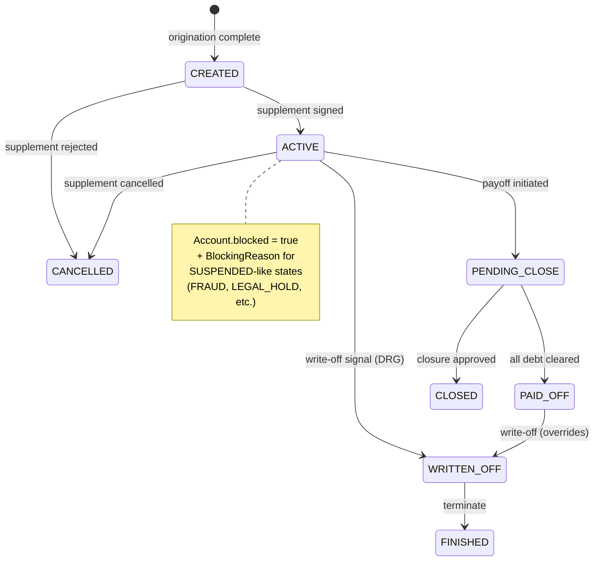
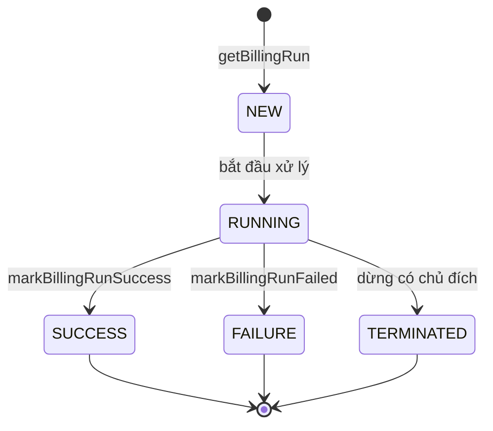
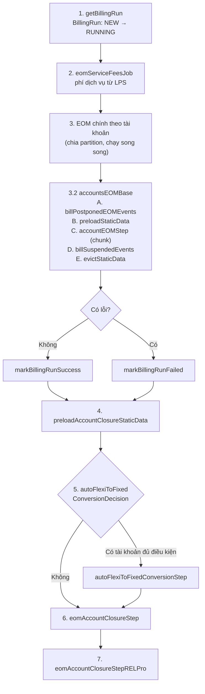

> *"Billing không phải là việc tính toán. Billing là việc giữ đúng một lời hứa, với từng đồng tiền, với từng khách hàng, lúc 3 giờ sáng khi không ai còn thức."*

## Dẫn nhập: một đêm của một triệu khoản vay

::::story
Đêm cuối tháng 3. Lúc 23 giờ, hệ thống bắt đầu tiến trình cuối kỳ *(end of month, EOM)*. Trong tám giờ tiếp theo, module LAS phải:

- tính lãi cho 1,247,832 tài khoản đang hoạt động;
- tạo 2,891,440 kỳ trả nợ *(instalment)* mới;
- cập nhật 1,247,832 bản ghi số dư hiện thời *(CurrentBalance)*;
- phát 1,247,832 sự kiện sang STS để tạo sao kê;
- xử lý 34,221 tài khoản quá hạn theo quy trình riêng;
- và hoàn tất trước 7 giờ sáng, khi chi nhánh mở cửa.

Không được sai một đồng. Không được sót một tài khoản. Không tài khoản nào được ở trạng thái nửa vời.

Và tất cả diễn ra trong khi hệ thống vẫn phải nhận các khoản trả nợ của khách hàng lúc 2 giờ sáng.
::::

Chương này đi vào LAS, trái tim của VLP. Mục 8.1 trình bày mô hình miền: tài khoản, giao dịch, bút toán, kỳ trả nợ và số dư. Mục 8.2 đi theo một giao dịch từ lúc được giữ chỗ đến lúc được xác nhận, kể cả trường hợp khó nhất là giao dịch đến muộn. Mục 8.3 mô tả billing pipeline. Mục 8.4 là vòng đời của kỳ trả nợ: tạo kỳ trả nợ *(prescribing)* và ghép thanh toán vào kỳ trả nợ *(pairing)*. Mục 8.5 là kiến trúc EOM batch, và mục 8.6 là cách giữ cho số dư luôn đúng. Đây là chương kỹ thuật nhất của sách, và cũng là chương quan trọng nhất để hiểu tài chính tiêu dùng vận hành thế nào ở tầng engine.

## 8.1 Mô hình miền của LAS

### Vì sao học mô hình miền trước khi đọc code

::::story
Kỹ sư Tuấn vừa chuyển sang đội LAS. Ngày đầu tiên, trưởng nhóm kỹ thuật đưa anh một tờ giấy. Không phải tài liệu yêu cầu, cũng không phải sơ đồ kiến trúc, mà là mô hình miền.

"Học cái này trước. Hiểu mô hình miền thì sẽ hiểu vì sao mọi thứ trong code được viết như vậy. Không hiểu nó thì em sẽ sửa lỗi mà không biết mình đang làm gì."
::::

### Account: gốc của mọi thứ

Mỗi khoản vay trong VLP sống trong một tài khoản `LAS_ACCOUNT`. Tài khoản mang mã nghiệp vụ, liên kết tới hợp đồng ở CTM và tới khách hàng ở CIS, cùng trạng thái và ngày chạy EOM của nó.

```text
LAS_ACCOUNT
┌─────────────────────────────────────────────────────────┐
│ accountNumber: String (@NaturalId)                       │ ← Business key
│ contractCode: String                                     │ ← Link đến CTM
│ accountOwnerCode: String                                 │ ← Customer ID (từ CIS)
│ accountType: AccountType                                 │ ← FLEXI_LIMIT, etc.
│ status: AccountStatus                                    │ ← State machine
│ currency: String                                         │
│ billingPeriod: BillingPeriod enum                        │ ← Day-of-month EOM runs (BP_1, BP_5, BP_20...)
│ activationDate: LocalDate                                │
│ blocked: Boolean                                         │
│ seized: Boolean                                          │ ← Court-ordered freeze
│ expired: Boolean                                         │
│ closureDate: LocalDate                                   │
│ payoffDate: LocalDate                                    │
│ writeoffDate: LocalDate                                  │
└─────────────────────────────────────────────────────────┘
```

Trường `billingPeriod` cho biết EOM của tài khoản chạy vào ngày nào trong tháng (`BP_1`, `BP_5`, `BP_20`...). Nhờ đó không phải mọi tài khoản đều dồn vào một đêm cuối tháng: công ty có thể chia danh mục thành nhiều nhóm chạy vào các ngày khác nhau.

Trạng thái tài khoản là một máy trạng thái:



*Hình 8.1. Máy trạng thái của tài khoản trong LAS.*

Ý nghĩa của từng trạng thái:

```text
CREATED (CR):
  Sau khi origination tạo account, TRƯỚC khi activation event
  → Có thể setup data (parameters, services, tariff)
  → CHƯA thể nhận transactions
  → Lưu ý: không phải "INITIATED" — CREATED là tên đúng

ACTIVE (AC):
  Sau khi activation event (sau disbursement)
  → Normal operational: debit/credit đều được
  → Đây là trạng thái phần lớn thời gian

CANCELLED (CA):
  Admin/customer cancelled TRƯỚC khi active
  → Terminal state — không thể reopen

PENDING_CLOSE (PCL):
  Tất toán đang diễn ra
  → Chỉ nhận payment, không cho transactions mới

PAID_OFF (PO):
  Toàn bộ debt = 0
  → Terminal hoặc có thể reopen (revolving accounts)

CLOSED (CL):
  Permanently closed — không thể reopen
  → Final terminal state

WRITTEN_OFF (WO):
  Bad debt decision via DRG write-off signal
  → Removed from balance sheet
  → NHƯNG payments vẫn được nhận (off-balance-sheet recovery)

SUSPENDED: KHÔNG phải AccountStatus
  → Implemented qua Account.blocked = true + BlockingReason entities
  → Blocking reasons: FLEXI_TERMINATION, FLEXI_CONVERSION, FRAUD, LEGAL_HOLD
```

Có hai điểm đáng chú ý. Thứ nhất, `WRITTEN_OFF` không có nghĩa là ngừng nhận tiền: khoản nợ đã được đưa ra khỏi bảng cân đối, nhưng mọi khoản khách hàng trả sau đó vẫn được ghi nhận như thu hồi nợ đã xóa. Thứ hai, "tạm ngưng" không phải là một trạng thái. Nó được biểu diễn bằng cờ `blocked` cùng các lý do chặn `BlockingReason`, vì một tài khoản có thể bị chặn vì nhiều lý do cùng lúc (nghi gian lận, phong tỏa theo lệnh tòa, đang chuyển đổi sản phẩm) mà vẫn giữ nguyên trạng thái vòng đời của nó.

### CurrentBalance: trạng thái tài chính hiện thời

Mỗi tài khoản có đúng một bản ghi `LAS_CURRENT_BALANCE`, chứa mọi con số mà hệ thống cần biết ngay lập tức: tiền đang giữ chỗ, dư nợ, số dư khả dụng, số tiền quá hạn, khoản trả tối thiểu kỳ tới.

```text
LAS_CURRENT_BALANCE (One per Account)
// verified: am-core-entities-deep.md
// All monetary fields use Money type (@Embeddable: BigDecimal value + String currency)
┌─────────────────────────────────────────────────────────┐
│ holdBalance: Money                                       │ ← Sum of auth holds
│ holdIPBalance: Money                                    │ ← Instalment plan holds
│ outstandingDebt: Money                                  │ ← Sum of unpaid debit items
│ availableBalance: Money                                  │ ← CreditLimit - holds - debt
│ ledgerBalance: Money                                    │ ← Credits - debits (accounting)
│ customerCredit: Money                                         │ ← Overpayments (credit balance)
│ withholdCustomerCredit: Money                                │ ← Seized portion
│ overdueAmount: Money                                    │ ← Past-due amount (DPD > 0)
│ instDueAmountNext: Money                               │ ← Next minimum instalment
│ currentAccountMMI: Money                               │ ← Current MMI value
│ instDueDateFirst: Date                                  │ ← First overdue due date
│ instOverdueCount: Integer                              │ ← Overdue instalment count
└─────────────────────────────────────────────────────────┘
```

Vì sao lưu sẵn các con số này, thay vì tính lại từ lịch sử bút toán mỗi lần cần?

```text
Option A: Tính real-time từ event store
  SELECT SUM(CASE WHEN direction='DEBIT' THEN amount ELSE -amount END)
  FROM las_ledger_entry
  WHERE account_id = X AND NOT cancelled

  Vấn đề: account có 5,000 transactions trong 3 năm
  → Query mất 50-100ms mỗi lần
  → 10,000 concurrent users → 100,000 ms total query time/giây
  → Database chết

Option B: CurrentBalance materialized view
  Lưu balance hiện tại, update INCREMENTAL sau mỗi event
  SELECT available_balance FROM las_current_balance WHERE account_id = X
  → 1ms query

  Trade-off: CurrentBalance phải luôn sync với event store
  → Nếu có bug trong update logic → inconsistency
  → Cần reconciliation job định kỳ
```

`CurrentBalance` là một **materialized view**: một bản tổng hợp được cập nhật dần sau mỗi sự kiện. Đổi lại tốc độ, hệ thống phải chấp nhận một rủi ro: nếu logic cập nhật có lỗi, bản tổng hợp sẽ lệch khỏi lịch sử bút toán. Mục 8.6 trình bày cách phát hiện và xử lý độ lệch đó.

Số dư khả dụng được tính theo công thức sau. Ví dụ dưới đây giả định khoản vay của chị Lan nằm trên một tài khoản hạn mức linh hoạt `FLEXI_LIMIT` với hạn mức đúng bằng số tiền vay, sau ba kỳ trả nợ:

```text
availableBalance = CREDIT_LIMIT - holdBalance - holdIPBalance - outstandingDebt + customerCredit

Ví dụ (chị Lan, sau 3 kỳ trả nợ):
  CREDIT_LIMIT = 18,500,000 VNĐ
  holdBalance = 0 (không có giao dịch đang giữ chỗ)
  holdIPBalance = 0
  outstandingDebt = 14,180,104 VNĐ (gốc còn lại sau 3 kỳ trả 1,696,080 VNĐ)
  customerCredit = 0

  availableBalance = 18,500,000 - 0 - 0 - 14,180,104 + 0 = 4,319,896 VNĐ
  → Chị Lan có thể chi tiêu thêm khoảng 4.3 triệu
  (Đây là tính năng quay vòng: phần gốc đã trả trở thành hạn mức khả dụng)
```

Dư nợ 14,180,104 VNĐ là gốc còn lại theo lịch trả nợ ở [Chương 2](/docs/foundations/ch02-mathematics-of-lending); tiền lãi đã trả không làm tăng hạn mức khả dụng.

Với tài khoản `FLEXI_LIMIT`, mỗi lần rút tiền hoặc mua hàng tạo một chuỗi bản ghi riêng, và kế hoạch trả góp là tùy chọn:

```text
Mỗi lần draw (mua hàng, rút tiền):
  → Tạo Transaction mới (type: RTL/ATM/ICD...)
  → Tạo LedgerEntry (DEBIT)
  → Tạo PostingUnit
  → EventAssignment.type = CARD (cho revolving draws)
  
  Không có InstalmentPlan tự động per draw.
  InstalmentPlan là OPTIONAL — customer có thể chủ động request
  convert một transaction cụ thể sang IP.

Không giới hạn số lần draw per billing period — chỉ limited bởi availableBalance.

Sau flexi-to-fixed conversion (EOM autoFlexiToFixed step):
  → BlockingReason(FLEXI_CONVERSION) được tạo
  → Account không thể draw thêm
  → Chỉ nhận payments cho existing debt
  → Dần dần trả hết theo fixed instalment schedule
```

### Transaction và LedgerEntry: hai khái niệm khác nhau

Đây là điểm dễ nhầm nhất trong mô hình miền của LAS.

Một **Transaction** (`LAS_TRANSACTION`) ghi lại một sự kiện từ thế giới bên ngoài: một lần mua hàng, một lần thanh toán, một lần rút tiền.

```text
Transaction ví dụ:
  Ngày: 2025-03-15
  Type: RTL (Retail POS)
  Amount: 2,500,000 VNĐ (chị Lan mua quần áo)
  Direction: DEBIT
  SourceTxCode: "POS-TXN-789456" (từ merchant terminal)
  Status: CONFIRMED
```

Một **LedgerEntry** (`LAS_LEDGER_ENTRY`) ghi lại hệ quả tài chính của một giao dịch hoặc một sự kiện billing. Một giao dịch có thể sinh ra nhiều bút toán, vào những thời điểm khác nhau:

```text
Từ transaction RTL 2,500,000 VNĐ ở trên:
  LedgerEntry #1: Principal debit 2,500,000 VNĐ (gốc)
  LedgerEntry #2: (Chưa có ngay — lãi sẽ được tính vào EOM)

  Từ EOM billing của tháng đó:
  LedgerEntry #3: Interest 37,500 VNĐ (lãi tháng đó trên khoản này)

  Nếu chị Lan trả trễ:
  LedgerEntry #4: Late fee 200,000 VNĐ
```

Tiền lãi 37,500 VNĐ là 2,500,000 × 1.5%, tức lãi một tháng với lãi suất 18%/năm. Bút toán lãi không sinh ra cùng lúc với giao dịch mà ở bước EOM, còn phí trả trễ chỉ sinh ra nếu có trễ hạn.

Bên dưới mỗi bút toán là một hoặc nhiều **PostingUnit**, đơn vị theo dõi chi tiết: thuộc loại phí nào, đã được đưa vào kỳ trả nợ bao nhiêu, đã được thanh toán bao nhiêu.

```text
LedgerEntry #1 (Principal 2,500,000 VNĐ) có PostingUnit:
  Code: TAI-001
  FeeComponentType: PRINCIPAL
  BaseAmount: 2,500,000
  PrescribedAmount: 2,500,000 (đã tạo instalment)
  PairedAmount: 0 (chưa có payment match)
  ApplyIr: true (tính lãi trên khoản này)
  UpdatingAvailableAmount: true (giảm available balance)
```

Hai cờ `ApplyIr` và `UpdatingAvailableAmount` được sao từ cấu hình `AccountFeeComponentType` đã trình bày ở [Chương 3, mục 3.3](/docs/products/ch03-product-design#33-thiết-kế-dựa-trên-biểu-phí-vì-sao-không-viết-cứng-trong-code). Đây là chỗ cấu hình biểu phí trở thành hành vi trên từng đồng tiền.

### Instalment và InstalmentSummary: hai tầng

Một tài khoản có thể có nhiều khoản nợ cùng đến hạn một ngày. Vì vậy LAS dùng hai tầng: `Instalment` cho từng khoản, và `InstalmentSummary` gom các khoản cùng ngày đến hạn, cùng loại.

```text
Một account có nhiều khoản vay (items) với cùng due date:
  - Gốc của khoản mua laptop: 1,200,000 VNĐ due ngày 20/4
  - Gốc của khoản mua quần áo: 400,000 VNĐ due ngày 20/4
  - Phí bảo hiểm: 90,000 VNĐ due ngày 20/4

InstalmentSummary gom chúng lại:
  DueDate: 20/4
  InstalmentType: REGULAR
  Amount: 1,200,000 + 400,000 + 90,000 = 1,690,000 VNĐ
  PaidAmount: 0

  Children:
    Instalment A: amount=1,200,000 (laptop principal)
    Instalment B: amount=400,000 (clothes principal)
    Instalment C: amount=90,000 (insurance)

Tại sao gom lại:
  1. Khách hàng thấy một con số tổng: "Tháng này trả 1,690,000 VNĐ"
  2. Statement generation tổng hợp từ header, không từng item riêng
  3. Repaid status của header = true khi ALL children repaid
  4. Pairing logic có thể apply payment cho nhóm theo priority
```

Khách hàng chỉ thấy một con số: "Tháng này trả 1,690,000 VNĐ". Nhưng hệ thống vẫn biết chính xác 1,690,000 đó gồm những gì, để ghép thanh toán đúng thứ tự và báo cáo đúng loại doanh thu.

Hai tầng cũng mang theo một cái bẫy kỹ thuật nổi tiếng trong đội LAS, sự cố VLP-670: tổng của header bị tính sai khi thêm kỳ trả nợ mới vào một header đã có trong cơ sở dữ liệu.

```java
// BUG: dùng refreshInstalmentSummary() khi prescribing
// cho existing header

InstalmentSummary existingHeader = findOrCreate(dueDate, type, account);
if (existingHeader.isPersisted()) {
    // Thêm instalment mới:
    existingHeader.getInstalments().add(newInstalment); // Bước này thêm vào collection
    
    // BUG: gọi refresh sẽ đọc lại từ DB
    // nhưng newInstalment chưa được save → refresh đọc state cũ!
    refreshInstalmentSummary(existingHeader);
    // → Amount tính sai vì newInstalment chưa có trong DB
}

// FIX: dùng incremental update thay vì refresh
if (existingHeader.isPersisted()) {
    // Incremental update — không đọc lại từ collection:
    existingHeader.setAmount(existingHeader.getAmount().add(newInstalment.getAmount()));
    // Và save newInstalment explicitly:
    instalmentRepository.save(newInstalment);
}

// refreshInstalmentSummary() chỉ SAFE khi tất cả children đã trong DB
// → Dùng trong pairing (sau khi all children persisted)
// → KHÔNG dùng trong prescribing (khi adding new children)
```

Bài học: tính lại tổng từ tập con chỉ an toàn khi mọi phần tử con đã được lưu. Khi đang thêm phần tử con mới, phải cộng dồn tăng thêm *(incremental update)*.

### ContractService: dịch vụ trên tài khoản

Một tài khoản chỉ được nhận giao dịch khi các dịch vụ cần thiết đang hoạt động trên nó.

```text
ContractService (bảng `CONTRACT_SERVICE` trong CTM schema, LAS đọc qua JPA cross-schema) đại diện cho một service
được activate trên account — ví dụ như maintenance, bảo hiểm, v.v.

Ví dụ services:
  ACCMAINT: Maintenance Account — dịch vụ duy trì tài khoản
          Đây là service "core" — mọi transaction đều cần ACCMAINT active
  ACCSTMT: Account Statement — dịch vụ sao kê
  PAYM: Payment — dịch vụ thanh toán
  ZERO_PROMO: Zero rate promotion — kỳ khuyến mãi 0%
  RELIP: Instalment Plan service
  LIFEINS: Life Insurance
```

`ACCMAINT` là dịch vụ lõi; phí quản lý tài khoản của nó được tính theo tariff item `SVCFEE` như đã nói ở [Chương 3](/docs/products/ch03-product-design). Vì vậy mỗi lần xác nhận giao dịch, LAS phải kiểm tra dịch vụ:

```text
Business rule: Một giao dịch chỉ hợp lệ nếu:
  1. Account tồn tại và ACTIVE
  2. Required ContractService đang active tại thời điểm giao dịch

LAS's implementation:
  LAS KHÔNG gọi CTS via HTTP REST.
  LAS query ContractService thẳng từ CTM schema via JPA/Hibernate.
  → Lower latency, tighter coupling (same DB or shared schema)
  → RVS (Revolving Services) module handles service definition lookups
  
Validation check:
  ContractService.contractServiceStatus = ACTIVE AND
  endDate >= effectiveDate (effectiveDate = currentDate khi bill-in-past)
  
  Nếu service không tồn tại hoặc expired:
  → ERR_TX_NO_VALID_CONTRACT_SERVICE  // verified: billing-flow.md
  
Sentinel date values:
  AccountParameter.validTo: 3000-01-01 (DateUtil.UNREACHABLE_FUTURE_DATE)
    NULL trong DB → NullDateToFarFutureConverter → 3000-01-01 in Java
    Truy vấn: WHERE validTo = UNREACHABLE_FUTURE_DATE OR validTo >= :effectiveDate
  
  AccountService.endDate: default 3000-01-01 (open-ended)
    Đây là giá trị explicit (không qua converter)
    Truy vấn: WHERE endDate >= :effectiveDate luôn TRUE khi 3000-01-01

  PostingUnit.firstPrescribeDate: 3333-01-01 cho IP allocations (khác!)
    — sentinel riêng cho "chưa prescribe"

  Sentinel dates trong VLP —
  tránh nhầm lẫn khi viết queries!
```

Ba giá trị "ngày ở rất xa" trong khối trên là nguồn gây lỗi truy vấn kinh điển: `validTo` rỗng được đổi thành 3000-01-01, `endDate` mặc định là 3000-01-01, còn `firstPrescribeDate` của phân bổ kế hoạch trả góp lại dùng 3333-01-01 để đánh dấu "chưa tạo kỳ trả nợ". Ai viết truy vấn cũng phải biết bảng mình đang đọc dùng quy ước nào.

Sự cố VLP-706 cho thấy chọn sai ngày hiệu lực khi kiểm tra dịch vụ dẫn đến hậu quả gì:

```java
// BUG: dùng billingDate khi chargeTransactionInPast=true
public void checkContractService(Transaction tx) {
    LocalDate effectiveDate = tx.getBillingDate();
    // Nhưng getBillingDate() = getPresentmentDate() = ngày quá khứ!
    // Nếu service được tạo SAU ngày quá khứ đó → NOT FOUND → reject!
    
    accountServiceFacade.getActiveService(account, serviceType, effectiveDate);
}

// FIX: dùng currentDate khi bill-in-past
public void checkContractService(Transaction tx, LocalDate effectiveDate) {
    // Gọi với currentDate khi chargeTransactionInPast=true
    accountServiceFacade.getActiveService(account, serviceType, effectiveDate);
}

// Caller:
if (tx.isChargeTransactionInPast()) {
    checkContractService(tx, timeService.getCurrentDate()); // currentDate
} else {
    checkContractService(tx, tx.getBillingDate()); // billingDate bình thường
}
```

Lý do nghiệp vụ của cách sửa:

```text
Check "current permission to charge" vs "historical permission":

Scenario:
  - 1/3/2025: account activated, service ACCMAINT bắt đầu
  - 15/2/2025: merchant gửi giao dịch bị trễ (bill-in-past)
  - Check effectiveDate = 15/2 → service KHÔNG tồn tại → REJECT
  - Nhưng merchant đã cung cấp hàng hóa ngày 15/2!
  - Đây là legitimate transaction bị reject oan

  Fix: Check effectiveDate = currentDate → service ACTIVE → ACCEPT
  Semantic: "Bây giờ có quyền charge không?" thay vì "Ngày đó có quyền không?"
```

Câu hỏi đúng không phải là "ngày đó có được tính phí không?", mà là "bây giờ có được tính phí không?". Người bán đã giao hàng; giao dịch là hợp lệ, chỉ đến muộn.

:::summary[Mục 8.1]
`Account` là thực thể gốc, có máy trạng thái riêng; "tạm ngưng" là cờ chặn chứ không phải trạng thái. `CurrentBalance` là materialized view được cập nhật dần, nhanh nhưng phải đối soát định kỳ. `Transaction` là sự kiện bên ngoài; `LedgerEntry` là hệ quả tài chính, một giao dịch có thể sinh nhiều bút toán. `InstalmentSummary` gom các `Instalment` cùng ngày đến hạn và phải được cập nhật tăng dần khi thêm phần tử mới. Kiểm tra dịch vụ của giao dịch đến muộn phải dùng ngày hiện tại, không phải ngày giao dịch.
:::

## 8.2 Luồng xử lý giao dịch

### Authorization và confirmation: vì sao cần hai bước

::::story
Chị Lan dùng thẻ tại siêu thị. Chị quẹt thẻ, máy POS báo "Approved" trong 3 giây. Nhưng tiền chưa thực sự bị trừ; nó chỉ được ghi nợ một đến ba ngày sau, khi người bán quyết toán.

Đó là hai bước authorization và confirmation.
::::

:::key[Authorization]
**Authorization** là bước "giữ chỗ" một khoản tiền: bảo đảm khách hàng có đủ số dư khả dụng tại thời điểm giao dịch, nhưng chưa ghi nợ thật.
:::

```text
Chị Lan quẹt thẻ 2,500,000 VNĐ:
  1. Merchant terminal gửi Authorization request
  2. LAS nhận → tạo Authorization record
  3. LAS update CurrentBalance:
     holdBalance += 2,500,000
     availableBalance -= 2,500,000
  4. LAS return: APPROVED
  (chưa có LedgerEntry, chưa có instalment)

CurrentBalance sau auth:
  availableBalance: 4,319,896 - 2,500,000 = 1,819,896 VNĐ
  holdBalance: 2,500,000
  outstandingDebt: 14,180,104 (chưa thay đổi)
```

:::key[Confirmation]
**Confirmation** là bước quyết toán authorization: chuyển khoản giữ chỗ thành nợ thật.
:::

```text
1-3 ngày sau, merchant gửi Confirmation request:
  1. LAS nhận → find Authorization bằng sourceTxCode
  2. Create Transaction record (CONFIRMED)
  3. Create LedgerEntry (DEBIT, principal 2,500,000 VNĐ)
  4. Update CurrentBalance:
     holdBalance -= 2,500,000 (release hold)
     outstandingDebt += 2,500,000 (add to debt)
     availableBalance: không thay đổi (hold → debt, net zero)
  5. Bill transaction (tính lãi, tạo instalment nếu cần)
  6. Publish TransactionConfirmedEvent

CurrentBalance sau confirmation:
  holdBalance: 0
  outstandingDebt: 14,180,104 + 2,500,000 = 16,680,104
  availableBalance: 1,819,896 (không đổi)
```

Số dư khả dụng không đổi khi xác nhận, vì nó đã giảm từ lúc authorization; khoản giữ chỗ chỉ đổi thành dư nợ. Vì sao không quyết toán ngay từ đầu?

```text
Lý do 1: Merchant settlement cycle
  Merchant POS → Acquiring Bank → Card Network → Issuing Bank (LAS)
  Quy trình này mất 1-3 ngày trong hệ thống tài chính hiện tại

Lý do 2: Authorization có thể bị void
  Khách hàng return hàng trong 24h → merchant void authorization
  Không cần tạo transaction, không cần tính lãi

Lý do 3: Authorization amount có thể khác confirmation amount
  Hotel pre-auth 2,000,000 VNĐ → check-out chỉ 1,800,000 VNĐ
  Confirmation với đúng amount thực tế

Lý do 4: Float management (liquidity)
  Tiền không thực sự di chuyển cho đến settlement
  → Card network net settle hàng ngày
```

### Bill-in-past: nghiệp vụ phức tạp nhất

::::story
Ngày 15/3, một máy POS gửi giao dịch lẽ ra phải được quyết toán từ ngày 28/2, nhưng bị chậm do lỗi hệ thống của người bán. Giao dịch có `transactionDate = 28/2` nhưng đến LAS ngày 15/3.

LAS phải ghi nhận giao dịch này vào ngày 28/2, trong khi EOM của tháng 2 đã chạy xong từ ngày 1/3.
::::

Có hai cách làm đơn giản, và cả hai đều sai:

```text
Nếu bill với ngày hiện tại (15/3):
  → Lãi tính từ 15/3 — thiếu 15 ngày lãi (từ 28/2 đến 14/3)
  → Balance tháng 2 đã được close → statement sai

Nếu bill với ngày quá khứ (28/2) naively:
  → Tháng 2 đã được close và settle với STS
  → Balance sau billing phải "thêm vào" quá khứ → phải reprocess mọi event sau 28/2

Đây là bill-in-past — cần cascade reprocessing.
```

Cách đúng là chèn sự kiện vào đúng chỗ của nó trên dòng thời gian, rồi xử lý lại mọi sự kiện phía sau:

```java
public void billTransactionInPast(LocalDate pastDate, Transaction transaction) {
    // Mark transaction này là bill-in-past
    transaction.getEvent().setBillInPast(true);

    // Tìm event đã processed đầu tiên SAU ngày quá khứ:
    EventRecord firstEventAfter = eventService
        .findFirstProcessedEventAfterOrEqualDateTime(pastDate, account, eventType);

    if (firstEventAfter == null) {
        // Không có event sau → bill bình thường, không cần reprocess
        processEventManager.billTransaction(transaction);
    } else {
        // Có conflict: phải insert event này TRƯỚC event đã processed
        // Và reprocess tất cả events sau đó theo thứ tự
        eventReplayManager.billNewEventBeforeExistingEventAndReprocessOnwardEvents(
            event, firstEventAfter, ReprocessType.TRANSACTION_CREATE_IN_PAST);
    }

    // Luôn recalculate overdue debts với currentDate:
    currentBalanceService.recalculateOverDueDebts(account, currentDate, eventTimestamp);
}
```

Vì sao việc xử lý lại phức tạp:

```text
Timeline:
  28/2: Transaction muốn bill vào đây (gốc 2,500,000 VNĐ)
  1/3:  EOM chạy → tính lãi tháng 2 dựa trên balance TẠI THỜI ĐIỂM ĐÓ
  5/3:  Customer trả 1,000,000 VNĐ
  10/3: EOM chạy (partial — lãi hàng ngày)
  15/3: Transaction đến

Nếu bill transaction vào 28/2:
  → Balance tháng 2 tăng 2,500,000 VNĐ
  → Lãi tháng 2 phải tính lại (balance cao hơn → lãi cao hơn)
  → Payment ngày 5/3 phải pair với instalments mới (thứ tự pair thay đổi)
  → Tất cả events từ 28/2 đến 15/3 phải được reprocess

Reprocessing đảm bảo:
  → Consistency: mọi calculation phản ánh thực tế
  → Audit: mọi reprocess được log với reason
  → Idempotency: nếu reprocess thêm lần nữa → same result
```

Xử lý lại phải nhất quán (mọi phép tính phản ánh đúng thứ tự sự kiện), có dấu vết kiểm toán (mỗi lần xử lý lại được ghi lý do), và idempotent (xử lý lại lần nữa cho cùng kết quả). Bài tập 2 cuối chương đi qua một tình huống bill-in-past nhiều giao dịch.

### Idempotency và sourceTxCode

::::story
Máy POS gửi yêu cầu xác nhận. Mạng bị timeout, máy không biết LAS đã xử lý hay chưa, nên gửi lại. LAS nhận yêu cầu thứ hai với nội dung y hệt.

Nếu không có idempotency, hai bút toán được tạo, số dư sai, khách hàng bị trừ tiền hai lần.
::::

Khóa idempotency của giao dịch xác nhận là `sourceTxCode`, mã giao dịch do hệ thống nguồn cấp:

```java
// illustrative pseudo-code — details differ from actual
// verified: verify-ch8-ch9-code.md
// Actual: return type = ExecuteTransactionResult (not TransactionResult)
// Actual: no SERIALIZABLE annotation; LAS uses AccountLockGuard
// Actual: idempotency via getAuthorizationFromConfirm() (not findBySourceTxCode)

@Transactional  // LAS uses default isolation + AccountLockGuard
public ExecuteTransactionResult confirmTransaction(ConfirmationRequestTo transactionTo) {
    // checkForDuplicities=true → kiểm tra via getAuthorizationFromConfirm()
    return confirmTransactionInternal(transactionTo, true);
}
// Idempotency: sourceTxCode in request body → Authorization lookup
// → nếu đã tồn tại: return existing result, không process lại
```

Idempotency chống được yêu cầu trùng lặp, nhưng chưa chống được hai yêu cầu *khác nhau* cùng sửa một tài khoản một lúc. Việc đó cần khóa bi quan:

```text
Race condition nếu không có locking:

Thread 1: Read account balance → proceed
Thread 2: Read account balance → proceed (concurrent!)
Thread 1: Create transaction #1, update balance
Thread 2: Create transaction #2, update same balance (stale read!)

Result: Balance inconsistency → data corruption

Với AccountLockGuard (pessimistic locking):
Thread 1: Lock account → process → release
Thread 2: Chờ Thread 1 release → proceed safely
→ Serial processing per account, no conflict
```

LAS khóa ở cấp tài khoản bằng `AccountLockGuard`: các giao dịch trên cùng một tài khoản được xử lý tuần tự, còn các tài khoản khác nhau vẫn chạy song song. [Chương 6](/docs/system/ch06-financial-system-architecture) phân tích lựa chọn khóa bi quan so với khóa lạc quan.

:::summary[Mục 8.2]
Authorization giữ chỗ số dư nhưng chưa ghi nợ; confirmation giải phóng khoản giữ chỗ và ghi nợ thật. Giao dịch đến muộn được chèn vào đúng ngày của nó, và mọi sự kiện phía sau phải được xử lý lại. `sourceTxCode` là khóa idempotency chống xử lý trùng; khóa bi quan ở cấp tài khoản chống cập nhật đồng thời.
:::

## 8.3 Billing pipeline: từ sự kiện đến sao kê

### Ba loại thời điểm billing

Không phải sự kiện nào cũng được tính phí ngay. LAS phân loại sự kiện theo thời điểm billing:

```text
IMMEDIATE:
  Bill ngay khi confirmed
  Ví dụ: Phí trả trễ (LATEFEE1) → cần phản hồi ngay để tạo urgency
  Ví dụ: Phí vượt hạn mức → cần update available balance ngay

IMMEDIATE_RESPECT_FREEZE:
  Bill ngay NHƯNG chờ nếu billing period đang frozen (EOM đang chạy)
  Ví dụ: Giao dịch mua hàng bình thường
  → Nếu EOM đang chạy: queue vào POSTPONED_TILL_EOM

EOM (End of Month):
  Defer đến cuối tháng
  Ví dụ: Lãi suất → chỉ tính vào cuối kỳ billing
  Ví dụ: Phí bảo hiểm hàng tháng → tính cuối tháng
```

Loại thứ hai, `IMMEDIATE_RESPECT_FREEZE`, tồn tại để giải quyết xung đột giữa giao dịch trong ngày và EOM:

```text
Vấn đề: EOM đang chạy, tính lãi tháng 3 cho account X
         Đồng thời customer submit payment cho account X

Nếu không có freeze:
  EOM tính lãi dựa trên balance_at_start_of_march
  Payment comes in → updates balance mid-calculation
  EOM tính lãi với balance đã bị payment làm thay đổi
  → Lãi tính không đúng

Với freeze:
  EOM bắt đầu → account X bị "frozen"
  Payment arrives → POSTPONED_TILL_EOM (không xử lý ngay)
  EOM hoàn thành → account X unfrozen
  Payment được process → late billing, but consistent
```

Khoản thanh toán được xử lý muộn vài phút nhưng nhất quán. Mục 8.5 quay lại cơ chế đóng băng này ở góc nhìn EOM.

### ChargingGateway và Spring Integration

Billing pipeline là một chuỗi bước: sự kiện, tìm biểu phí, tính phí, tạo bút toán, cập nhật số dư, phát thông báo. LAS biểu diễn chuỗi này bằng mẫu `MessagingGateway` của Spring Integration: mỗi bước là một thành phần xử lý message, nối với nhau qua các message channel.

```text
EventRecord
   │
   ▼ ChargingGateway.billEvent(eventId)
[billEventChannel]       ← // verified: IntegrationConstants.Channels.BILL_EVENT
   │
   ▼ [internal processing chain]
[calculateFeeComponentsAndCreateLedgerEntriesChannel]  ← // verified
   │
   ▼ BillingContext (result)
```

Interface của gateway:

```java
// verified: billing-flow.md / ChargingGateway.java
@MessagingGateway
public interface ChargingGateway {
    @Gateway(requestChannel = "billEventChannel")
    BillingContext billEvent(Long eventId);

    @Gateway(requestChannel = "calculateFeeComponentsAndCreateLedgerEntriesChannel")
    BillingContext calculateFeeComponents(BillingContext billingContext);
}
```

Toàn bộ chuỗi billing chỉ đi qua **hai gateway channel**. Các bước tìm biểu phí, tính phí, tạo bút toán và cập nhật số dư diễn ra bên trong chuỗi xử lý nội bộ, không phải mỗi bước một channel riêng.

Lợi ích của kiến trúc pipeline so với một phương thức khổng lồ là mỗi bước có thể kiểm thử độc lập và có trách nhiệm rõ ràng. Một bước xử lý điển hình trông như sau:

```text
// Mỗi processor là independent component:
@ServiceActivator(inputChannel = "billEventChannel",
                  outputChannel = "tariffResolvedChannel")
public Message<TariffContext> lookupTariff(Message<Long> eventMessage) {
    Long eventId = eventMessage.getPayload();
    Event event = eventRepo.findById(eventId);
    Tariff tariff = tariffService.findForEvent(event);
    return MessageBuilder.withPayload(new TariffContext(event, tariff)).build();
}
// → Testable independently, extensible, clear responsibility
```

### Thông báo sang STS qua RabbitMQ

```text
1. Transaction confirmed → LAS bills event
2. After billing: TransactionSynchronization hook fires ON COMMIT:
   (Không phải trong transaction — sau khi commit thành công)

3. NotificationPublisher collects all events from this transaction
4. EventNotificationDispatcherService.dispatch(events)
5. AMQPEventPublishingService publishes to RabbitMQ:
   Exchange: "account.events"
   RoutingKey: "event.processed.v1"
   Payload: EventRecordNotification {accountId, eventId, billingPeriod, ...}

6. STS subscribes to "account.events"
7. STS generates/updates statement for account

Tại sao publish AFTER commit (TransactionSynchronization):
  Nếu publish TRƯỚC commit:
    Publish thành công → STS processes event
    Transaction ROLLBACK (vì lý do nào đó)
    → STS có statement update nhưng LAS không có transaction
    → Inconsistency

  Với publish AFTER commit:
    Transaction committed → publish → STS processes
    Nếu publish fails sau commit: retry mechanism (outbox pattern)
    → Consistency guaranteed
```

Điểm mấu chốt là thứ tự: chỉ phát sự kiện **sau khi** transaction cơ sở dữ liệu đã commit thành công. Nếu phát trước, STS có thể tạo sao kê cho một giao dịch mà LAS rồi lại rollback. [Chương 6](/docs/system/ch06-financial-system-architecture) trình bày mẫu outbox, cách bảo đảm sự kiện không bị mất khi việc phát thất bại sau commit.

:::summary[Mục 8.3]
Sự kiện `IMMEDIATE` được tính phí ngay, sự kiện `EOM` chờ đến cuối kỳ, còn `IMMEDIATE_RESPECT_FREEZE` được tính ngay trừ khi tài khoản đang bị đóng băng cho EOM. `ChargingGateway` biểu diễn billing pipeline bằng Spring Integration qua hai gateway channel. Sự kiện sang STS chỉ được phát sau khi commit, và mẫu outbox bảo đảm không mất sự kiện.
:::

## 8.4 Vòng đời của kỳ trả nợ

### Prescribing: tạo kỳ trả nợ

::::story
Cuối tháng 3, bước tạo kỳ trả nợ của EOM chạy cho tài khoản của chị Lan. Anh Minh hỏi kỹ sư Tuấn: "Kỳ trả nợ được tạo thế nào? Dựa trên dữ liệu gì?"
::::

:::key[Prescribing]
**Prescribing** là quá trình tạo các bản ghi `Instalment` từ các `PostingUnit`: xác định khách hàng nợ bao nhiêu, thuộc loại gì, đến hạn khi nào.
:::

Đầu vào của bước này:

```text
1. Danh sách PostingUnits chưa được fully prescribed
   Mỗi PostingUnit: loại phí, số tiền, đã prescribe bao nhiêu

2. MMI (Minimum Monthly Instalment) limit
   REPAYMENT_ALLOCATION_ORDER: PRIORITY_ONLY

3. Billing cycle info: dueDate cho kỳ này
```

Thuật toán đi qua các `PostingUnit` theo thứ tự ưu tiên, đưa phần chưa được tạo kỳ trả nợ vào kỳ này cho đến khi hết hạn mức MMI:

```java
public List<Instalment> generateInstalments(
        List<PostingUnit> items,
        BigDecimal mmiLimit,
        LocalDate dueDate) {
    List<Instalment> result = new ArrayList<>();
    BigDecimal remainingMMI = mmiLimit;

    // Sort items theo priority (PRIORITY_ONLY mode):
    List<PostingUnit> sorted = sortByPriority(items);

    for (PostingUnit tai : sorted) {
        if (remainingMMI.compareTo(ZERO) <= 0) break; // MMI exhausted

        BigDecimal unprescribed = tai.getBaseAmount()
                                     .subtract(tai.getPrescribedAmount());
        if (unprescribed.compareTo(ZERO) <= 0) continue; // Already prescribed

        // Prescribe min(unprescribed, remaining MMI):
        BigDecimal instalmentValue = unprescribed.min(remainingMMI);

        // Tạo instalment:
        Instalment inst = new Instalment();
        inst.setAmount(instalmentValue);
        inst.setDueDate(dueDate); // Có thể adjust cho payment holidays
        inst.setInstalmentType(InstalmentType.REGULAR);
        inst.setReconciliation(tai.getReconciliation());

        // Find or create header:
        InstalmentSummary header = findOrCreateHeader(dueDate, REGULAR, account);
        addInstalmentAmountsToHeader(header, instalmentValue); // INCREMENTAL, không refresh!

        inst.setInstalmentSummary(header);
        result.add(inst);

        tai.setPrescribedAmount(tai.getPrescribedAmount().add(instalmentValue));
        remainingMMI = remainingMMI.subtract(instalmentValue);
    }

    // Save all instalments (NOT via cascade - save explicitly):
    instalmentRepository.saveAll(result);

    return result;
}
```

Lưu ý dòng cập nhật header: thuật toán cộng dồn vào header (`addInstalmentAmountsToHeader`) thay vì tính lại, đúng như bài học từ sự cố VLP-670 ở mục 8.1.

LAS có bốn loại kỳ trả nợ:

```text
REGULAR (R): Tạo trong EOM processing
  → Instalment "bình thường" của billing cycle
  → DueDate = billing cycle due date
  → prescribeImmediately = false trên AccountFeeComponentType
  → Ví dụ: gốc laptop của chị Lan, phí bảo hiểm tháng

EXTRA (E): Tạo ngay khi LedgerEntry được created
  → Cho các khoản phí cần "visible" ngay (late fee, over-limit fee)
  → DueDate = current date (due ngay lập tức)
  → prescribeImmediately = true trên AccountFeeComponentType
  → Ví dụ: late fee, overdraft fee

ADDITIONAL (O): Tạo khi customer overpay
  → prescribeAndSaveOverpaymentAsAdditional()
  → Đại diện cho phần thừa sau khi tất cả instalments đã paid
  → Chuyển thành customerCredit trên CurrentBalance
  → Tự động paired vào oldest DEBIT trong lần pairing tiếp theo

PAYOFF (P): Tạo khi account được marked for payoff
  → Account status = PAY_OFF
  → Bao gồm toàn bộ remaining balance (principal + interest + fees)
  → DueDate = payoff date
  → isInPayoff=true flag trên prescribing call

Ví dụ:
  Chị Lan trả trễ ngày 5/4:
  → Late fee LedgerEntry: 200,000 VNĐ
  → prescribeImmediately = true cho LATEFEE1 → EXTRA Instalment: 200,000 VNĐ, due 5/4
  → Không chờ EOM cuối tháng 4
```

Kỳ trả nợ loại `ADDITIONAL` xuất hiện khi khách hàng trả thừa. Ví dụ chị Lan trả 3,000,000 VNĐ trong khi chỉ cần 2,890,000 VNĐ: mọi kỳ trả nợ được ghép đủ, phần thừa 110,000 VNĐ được ghi thành một kỳ `ADDITIONAL` và chuyển vào `customerCredit`, để tự động trừ vào khoản nợ cũ nhất trong lần ghép tiếp theo.

### Pairing: ghép thanh toán vào kỳ trả nợ

::::story
Ngày 20/4, chị Lan trả 2,000,000 VNĐ. Tài khoản đang có bốn kỳ trả nợ chưa thanh toán:

| Kỳ trả nợ | Loại | Số tiền | Đến hạn |
|---|---|---:|---|
| A | REGULAR, gốc laptop | 1,200,000 | 20/4 |
| B | REGULAR, gốc quần áo | 400,000 | 20/4 |
| C | EXTRA, phí trả trễ | 200,000 | 5/4 |
| D | REGULAR, bảo hiểm | 90,000 | 20/4 |

Tổng cần trả là 1,890,000 VNĐ. Khoản thanh toán 2,000,000 VNĐ đủ trả hết và còn thừa 110,000 VNĐ.
::::

Thuật toán pairing duyệt song song danh sách khoản thanh toán và danh sách kỳ trả nợ đã được sắp xếp, mỗi lần ghép số tiền nhỏ hơn giữa phần thanh toán còn lại và phần kỳ trả nợ chưa trả:

```java
// illustrative pseudo-code — signature differs from actual
// verified: verify-ch8-ch9-code.md
// Actual signature (EntryInstalmentLinkService.java):
//   pairInstalments(
//     List<PostingUnit> payments,    ← NOT LedgerEntry
//     List<Instalment> instalments,
//     Date pairedDate,                         ← Date, NOT LocalDate
//     Account account,
//     Predicate<PostingUnit> ignoreSeizureConstraintByPayment)  ← extra param
// Actual: sorting via sortInstallmentsForPairing(), NOT account.getSortingLogic()
// Actual: seizure: calculateSeizedAndExemptCustomerCreditFromPayments()

public List<EntryInstalmentLink> pairInstalments(
        List<PostingUnit> payments,  // PostingUnit, not LedgerEntry
        List<Instalment> instalments,
        Date pairedDate,
        Account account) {
    List<EntryInstalmentLink> result = new ArrayList<>();

    // Step 1: Tính seized amount (nếu account bị phong tỏa):
    SeizureContext seizure = calculateSeizedAndExemptCustomerCreditFromPayments(account, payments);

    // Step 2: Sort instalments theo REPAYMENT_ALLOCATION_ORDER:
    List<Instalment> sortedInstalments = sortInstallmentsForPairing(instalments, account);

    // Step 3: Iterate payments và instalments:
    Iterator<PostingUnit> paymentIter = payments.iterator();
    Iterator<Instalment> instalmentIter = sortedInstalments.iterator();

    PostingUnit currentPayment = paymentIter.hasNext() ? paymentIter.next() : null;
    Instalment currentInstalment = instalmentIter.hasNext() ? instalmentIter.next() : null;

    while (currentPayment != null && currentInstalment != null) {
        BigDecimal paymentRemaining = currentPayment.getAmount()
                                                     .subtract(currentPayment.getPairedAmount());
        BigDecimal instalmentUnpaid = currentInstalment.getAmount()
                                                        .subtract(currentInstalment.getPaidAmount());

        // Seizure check:
        if (!seizure.canPay(currentInstalment)) {
            currentInstalment = advance(instalmentIter);
            continue;
        }

        // Pair min(available, needed):
        BigDecimal pairedValue = paymentRemaining.min(instalmentUnpaid);

        // Create pairing record:
        EntryInstalmentLink aii = new EntryInstalmentLink();
        aii.setAmount(pairedValue);
        aii.setPayment(currentPayment);
        aii.setInstalment(currentInstalment);
        result.add(aii);

        // Update amounts:
        currentPayment.setPairedAmount(currentPayment.getPairedAmount().add(pairedValue));
        currentInstalment.setPaidAmount(currentInstalment.getPaidAmount().add(pairedValue));

        // Check if instalment fully paid:
        checkAndSetInstalmentRepaid(currentInstalment, pairingDate);

        // Advance iterators as needed:
        if (currentPayment.getPairedAmount().compareTo(currentPayment.getAmount()) >= 0)
            currentPayment = advance(paymentIter);
        if (currentInstalment.getPaidAmount().compareTo(currentInstalment.getAmount()) >= 0)
            currentInstalment = advance(instalmentIter);
    }

    return result;
}
```

Sau mỗi lần ghép, kỳ trả nợ được kiểm tra xem đã trả đủ chưa, và header được tính lại. Ở đây tính lại là an toàn, vì mọi kỳ trả nợ con đều đã nằm trong cơ sở dữ liệu:

```text
private void checkAndSetInstalmentRepaid(Instalment inst, LocalDate date) {
    if (inst.getPaidAmount().compareTo(inst.getAmount()) >= 0) {
        inst.setRepaid(true);
        inst.setRepaidDate(date);
    }
    // Always refresh header — safe here because all children are persisted:
    refreshInstalmentSummary(inst.getInstalmentSummary());
}
```

Với chế độ `PRIORITY_ONLY` và biểu phí đặt phí trả trễ ưu tiên cao nhất, thứ tự là: kỳ EXTRA phí trả trễ, rồi gốc, rồi bảo hiểm.

```text
Sorted:
  #1: Instalment C (EXTRA late fee 200,000) — highest priority
  #2: Instalment A (REGULAR gốc laptop 1,200,000)
  #3: Instalment B (REGULAR gốc quần áo 400,000)
  #4: Instalment D (REGULAR bảo hiểm 90,000)
```

Ghép khoản thanh toán 2,000,000 VNĐ:

```text
Pairing:
  Payment → Instalment C: 200,000 paired → C repaid ✓
  Payment remaining: 1,800,000
  Payment → Instalment A: 1,200,000 paired → A repaid ✓
  Payment remaining: 600,000
  Payment → Instalment B: 400,000 paired → B repaid ✓
  Payment remaining: 200,000 (> D's 90,000)
  Payment → Instalment D: 90,000 paired → D repaid ✓
  Payment remaining: 110,000 → customerCredit (overpayment)
```

Kết quả: `InstalmentSummary` của ngày 20/4 có số tiền 1,890,000 VNĐ, đã trả 1,890,000 VNĐ, nên được đánh dấu đã trả. Tài khoản trở lại trạng thái đúng hạn, và `customerCredit` tăng 110,000 VNĐ.

### REPAYMENT_ALLOCATION_ORDER: nhìn lại bài toán thiết kế cơ chế

[Chương 2, mục 2.4](/docs/foundations/ch02-mathematics-of-lending#24-thiết-kế-cơ-chế-khi-toán-học-gặp-kinh-tế-học) đã giới thiệu tham số `REPAYMENT_ALLOCATION_ORDER` từ góc độ kinh tế. Ở tầng engine, enum `RepaymentAllocationOrder` có năm giá trị:

| Chế độ | Cách sắp xếp | Khi nào dùng |
|---|---|---|
| `PRIORITY_ONLY` | Chỉ theo độ ưu tiên trong biểu phí, bỏ qua ngày đến hạn | Khi thứ tự loại phí quan trọng hơn thứ tự thời gian |
| `DUE_DATE_AND_PRIORITY` | Theo ngày đến hạn, cùng ngày thì theo độ ưu tiên; khi tài khoản quá hạn, độ ưu tiên DPD thay cho độ ưu tiên thường | Mặc định phổ biến nhất, "nợ cũ trả trước", dễ giải thích với khách hàng |
| `DUE_DATE_IP_GROUP_PRIORITY` | Theo ngày đến hạn, các kỳ của cùng một kế hoạch trả góp được xử lý như một nhóm | Tài khoản có nhiều kế hoạch trả góp cùng lúc |
| `IP_INTEREST_RANK` | Kế hoạch trả góp lãi suất cao nhất trả trước | Giảm nhanh khoản nợ đắt nhất, giống phương pháp "avalanche" |
| `DUE_DATE_AND_PRIORITY_NONZERO_DPD` | Logic riêng khi DPD > 0, còn lại như `DUE_DATE_AND_PRIORITY` | Sản phẩm cần thứ tự riêng cho tài khoản quá hạn |

Dù chọn chế độ nào, chuỗi so sánh chung vẫn được áp dụng, với khoản tiền tự có của khách hàng và kỳ EXTRA được ưu tiên trước:

```text
Comparator chain (applies to all modes):
  OWN_FUNDS_FIRST → EXTRA_INSTALMENT_FIRST → PROFILE_SPECIFIC
  → BILLING_DATE_OLDEST_FIRST → LEDGER_ENTRY_ID_SMALLEST (tiebreaker)
```

Phân tích kinh tế dưới đây cho thấy vì sao tên chế độ không nói lên kết quả:

```text
Scenario: Account DPD 45, có late fee 200,000 VNĐ và gốc overdue 500,000 VNĐ

Customer payment: 300,000 VNĐ

PRIORITY_ONLY (late fee trước):
  200,000 → late fee (fully paid)
  100,000 → gốc overdue (partially paid)
  → Lender thu được late fee ngay
  → Gốc vẫn còn 400,000 overdue → DPD counter không reset
  → Customer vẫn ở DPD bucket
  → Cure rate: thấp (DPD vẫn tăng)

DUE_DATE (gốc trước — oldest first):
  300,000 → gốc overdue (partially paid)
  → Late fee chưa được trả
  → Gốc 400,000 overdue → DPD vẫn tăng
  → Tương tự cure rate

Outcome: Với cả hai mode, 300,000 VNĐ không đủ để cure account
Cần full payment (700,000 VNĐ) để cure

Real difference: Lãi trên khoản nào được tính sớm hơn
→ Đây là mechanism design choice về revenue timing, không phải cure rate
```

Với một khoản thanh toán không đủ, cả hai chế độ đều không đưa tài khoản về trạng thái đúng hạn. Khác biệt thật nằm ở chỗ khoản nào được trả trước, nên doanh thu loại nào được ghi nhận sớm hơn và khoản nào tiếp tục bị tính lãi. Đây chính là điểm [Chương 2](/docs/foundations/ch02-mathematics-of-lending) đã nêu: kết quả kinh tế của một chế độ phân bổ nằm ở thứ tự ưu tiên được cấu hình, không ở tên của nó.

:::summary[Mục 8.4]
Prescribing tạo kỳ trả nợ `REGULAR` ở bước EOM, hoặc kỳ `EXTRA` ngay lập tức khi cờ `prescribeImmediately` bật; header được cộng dồn, không tính lại. Pairing ghép thanh toán vào kỳ trả nợ theo `REPAYMENT_ALLOCATION_ORDER`, và header chỉ được tính lại khi mọi phần tử con đã được lưu. Trả thừa trở thành kỳ `ADDITIONAL` và số dư có của khách hàng. Với khoản thanh toán thiếu, chế độ phân bổ quyết định thời điểm ghi nhận doanh thu, không quyết định việc tài khoản có hết quá hạn hay không.
:::

### BillingRun và PeriodBalanceSnapshot: ảnh chụp mỗi kỳ

::::story
Sau khi EOM tháng 3 chạy xong cho chị Lan, hệ thống cần lưu lại tài khoản trông như thế nào vào cuối kỳ: bao nhiêu gốc, bao nhiêu lãi, DPD bao nhiêu. Đó là việc của `PeriodBalanceSnapshot`.
::::

:::key[BillingRun]
**BillingRun** (`LAS_BILLING_RUN`) là bản ghi đầu mối của một lần chạy EOM, đại diện cho toàn bộ quá trình EOM của một kỳ billing.
:::

```text
BillingRun
  id
  billingPeriod: BillingPeriod enum (BP_1, BP_5, BP_20...) → ngày EOM chạy
  type: BillingRunType (REGULAR, ONE_TIME, SIMULATION, INITIAL, TERMINATION)
  status: NEW → RUNNING → SUCCESS | FAILURE | TERMINATED
  springBatchJobExecutionId → link đến Spring Batch job
  endDate → cuối billing period
  generateStatementFiles → có generate sao kê không

Relationship:
  1 BillingRun → N PeriodBalanceSnapshot (một per account)
  Query: BillingRun → PeriodBalanceSnapshot.billingRun → account

Lưu ý: billingPeriod ở đây là NGÀY TRONG THÁNG (day-of-month)
PeriodBalanceSnapshot có field riêng: billingPeriodNumber (counter 1, 2, 3...)
```

Trạng thái của một lần chạy EOM:



*Hình 8.2. Vòng đời của một BillingRun. Trong lúc một BillingRun đang `RUNNING`, không phiên EOM mới nào được bắt đầu.*

:::key[PeriodBalanceSnapshot]
**PeriodBalanceSnapshot** (`LAS_PERIOD_BALANCE_SNAPSHOT`) là ảnh chụp toàn diện của một tài khoản vào cuối một kỳ billing, lưu mọi con số quan trọng cho kiểm toán, báo cáo và IFRS 9.
:::

```text
Key fields:
  billingRun → BillingRun (tháng nào)
  account → Account (account nào)
  previousPeriodBalanceSnapshot → chain về tháng trước

Balance summary:
  startBalance, endBalance → số dư đầu/cuối kỳ
  endCardBalance, endIPBalance → phân chia theo loại

Debt snapshot (cuối kỳ):
  debtTotal, debtAllPrincipal, debtFee, debtInsurance, debtInterest
  overdueDebt, overdueDebtIgnoringDebtTolerance, dayPastDue

Period activity (hoạt động TRONG tháng):
  perPayments, perDebit, perCredit
  perPrincipal, perFee, perInterest, perLatePenalties

Lifetime cumulative:
  sumPayments, sumPrincipal, sumFee, sumInterest...

Due dates:
  dueDate, dueDateClient, dueDateGracePeriod

simulationOnly: true → dry-run (eom-simulation endpoint)
cancelled: true → on-demand EOM cancelled old balance
```

Các snapshot nối với nhau thành chuỗi qua `previousPeriodBalanceSnapshot`, nên trả lời được câu hỏi "tháng trước tài khoản này thế nào" mà không cần dựng lại lịch sử. Đây là nguồn dữ liệu cho nhiều phân tích ở [Chương 5](/docs/products/ch05-revenue-portfolio):

```text
IFRS 9 staging:
  PeriodBalanceSnapshot.daysPastDue qua các tháng
  → Detect "Significant Increase in Credit Risk" (SICR)
  → Stage 1 → Stage 2 transition

Vintage analysis:
  Group PeriodBalanceSnapshot theo origination month
  → Track default rate evolution for each cohort

Statement generation:
  STS nhận EOM event → query PeriodBalanceSnapshot
  → Generate monthly statement với đầy đủ breakdown
```

### Chuỗi thực thể đầy đủ: từ giao dịch đến kỳ trả nợ

Một câu hỏi hay gặp: một khoản thanh toán sinh ra những thực thể nào, theo thứ tự nào? Khi khoản thanh toán 2,000,000 VNĐ được xác nhận:

```text
1. EventRecord (LAS_EVENT_RECORD)
   type=PAYMENT, status: REGISTERED → PROCESSED
   eventDate, processingDate, sourceSystem
   
2. LedgerEntry (LAS_LEDGER_ENTRY)
   amountDirection=CREDIT, amount=2,000,000
   link → EventRecord

3. PostingUnit (LAS_POSTING_UNIT)
   baseAmount=2,000,000 (immutable)
   pairedAmount=0 → increases as pairing happens
   fullyPaired=false → true when fully matched
   link → LedgerEntry, link → EventAssignment (if any)

4. [Pairing: MatchingService.pairInstalments()]
   EntryInstalmentLink (linking entity):
   link CREDIT TAI ↔ DEBIT Instalment
   pairedValue = min(payment, instalment outstanding)

5. Existing Instalment.paidAmount += pairedValue
   Existing InstalmentSummary refreshed (safe: all children already in DB)

6. CurrentBalance updated:
   outstandingDebt -= pairedValue
   customerCredit += any excess (ADDITIONAL instalment)

Full diagram:
  Transaction
    └── EventRecord (processing envelope)
          └── EventAssignment (CARD/IP/OUTER_DEBT type)
                └── LedgerEntry (financial consequence)
                      └── PostingUnit (pairing unit)
                            ├── [DEBIT] Reconciliation → Instalment → InstalmentSummary
                            └── [CREDIT] EntryInstalmentLink (link to DEBIT instalment)
```

## 8.5 Kiến trúc EOM batch

### EOM được kích hoạt thế nào

```text
EOM KHÔNG có @Scheduled annotation trong LAS codebase.
LAS chỉ expose HTTP endpoint; external orchestrator quyết định khi nào gọi.

External caller gọi:
  POST /api/internal/v1/batch/execute-async
  {
    "jobName": "regularEOMBatchJob",
    "parameters": { "billingDate": "2025-03-20" }
  }

External orchestrator có thể là:
  K8s CronJob, Airflow DAG, hoặc dedicated orchestration service
  LAS không care — chỉ execute khi được gọi

Monitoring: BillingRun.status (SUCCESS/FAILURE) + external alerting
  LAS không tự alert — external system query batch status API
```

LAS không tự lập lịch EOM. Nó chỉ cung cấp một API; một bộ điều phối bên ngoài quyết định khi nào gọi, và hệ thống giám sát bên ngoài theo dõi trạng thái `BillingRun` để cảnh báo. Tách như vậy giúp LAS đơn giản, và cho phép đội vận hành đổi lịch hoặc chạy lại mà không cần triển khai lại LAS.

### Trình tự đầy đủ của EOM

Các bước của EOM phụ thuộc vào nhau, nên thứ tự không thể đổi:



*Hình 8.3. Các bước cấp cao của regularEOMBatchJob.*

Chi tiết từng bước:

```text
STEP 1: getBillingRun
  → Tạo BillingRun record (status: NEW → RUNNING)
  → Đây là "lock" global: RUNNING status blocks new EOM sessions
  → Thiết lập billingDate, accountNumberList

STEP 2: eomServiceFeesJob (sub-job)
  → Tính và bill service fees từ LPS module
  → Run independently: partitioned by contract service cycles (not accounts)
  → Phải hoàn thành TRƯỚC main EOM (fees cần có trong balance khi tính lãi)

STEP 3 (Main EOM - per account):
  
  STEP 3.0: accountNumberToId
    → Convert account numbers sang internal IDs
    → Chuẩn bị partition data
  
  STEP 3.1: getBillingRunBase
    → Load billing session vào processor context
  
  STEP 3.2: accountsEOMBase [PARTITIONED - parallel]
    → Đây là main step, chạy parallel:
    
    Sub-step A: billPostponedEOMEvents
      → Process events bị POSTPONED_TILL_EOM từ trong tháng
      → Ví dụ: transactions đến trong khi billing period frozen
    
    Sub-step B: preloadStaticData
      → Cache account services, parameters vào memory
      → Giảm DB queries trong main processing
    
    Sub-step C: accountEOMStep [CHUNK-BASED]
      Reader: Đọc accounts theo partition
      
      // verified: bb-job-eom-beans.xml, verify-code-examples.md
      // doAccountMonthEndProcessor = CompositeItemProcessor với 4 delegates:
      Processor chain (theo thứ tự, trong doAccountMonthEndProcessor):
        P1: ClearAccountingNotificationsProcessor - clear notification buffer
        P2: PrepareContextForEOMItemProcessor - load account state vào context
        P3: AccountMonthEndProcessor - MAIN LOGIC (via billingBatchProcessorGateway):
            └─ billingBatchProcessingService.processEOMForRevolvingAccount()
               ├─ Delinquency check → set DPD
               ├─ Debt calculation
               ├─ Interest calculation (lãi tháng, 30/360)
               ├─ Fee calculation (phí dịch vụ tháng)
               ├─ Instalment generation (prescribing)
               ├─ Overpayment pairing
               └─ Balance calculation
        P4: EnqueueAccountingNotificationsProcessor - prepare notifications
      
      Lưu ý: P1-P4 là DELEGATES trong 1 CompositeItemProcessor (doAccountMonthEndProcessor),
      KHÔNG phải 4 separate Spring Batch steps.
      
      Writer chain (theo thứ tự):
        W1: StoreEOMResults → lưu PeriodBalanceSnapshot snapshot
        W2: NotifyEOMEvents → send billing events to notification queue
        W3: NotifyDebtRegister → sync với DRG module
        W4: NotifyAccountClosure → trigger closure nếu cần
        W5: NotifyMMI → send MMI info cho statement
        W6: FlushAndClearHibernate → clear Hibernate L1 cache (memory management)
    
    Sub-step D: billSuspendedEvents
      → Process events SUSPENDED sau main EOM
    
    Sub-step E: evictStaticData
      → Clear pre-loaded cache
  
  STEP 3.3: markBillingRunSuccess → BillingRun status: SUCCESS
  STEP 3.4: markBillingRunFailed → BillingRun status: FAILURE (nếu có lỗi)
  STEP 3.5: eomFinished → Send EOM completion notification

STEP 4: preloadAccountClosureStaticData
  → Cache data cho closure step (pre-load để tránh N+1 query)

STEP 5: autoFlexiToFixedConversionDecision (Decider)
  → Check nếu có FLEXI_LIMIT_ACCOUNT cần convert sang fixed instalment plan
  
  Business rationale:
  Sau X tháng revolving (configurable: accountLifespanMonths - 2):
    - Account tự động convert từ revolving → instalment plan
    - Regulatory/risk: limit long-term revolving exposure
    - Customer gets fixed schedule (predictable payments)
    - IP interest rates thường thấp hơn revolving rates
  
  If eligible accounts exist → CONTINUE → autoFlexiToFixedConversionStep
  If none → SKIP → next step

STEP 6: eomAccountClosureStep (sub-job)
  → Close PENDING_CLOSE accounts (standard revolving)
  → Triggered by: customer request, zero balance + no activity, regulatory
  → Flow: apply customerCredit → PENDING_CLOSE → CLOSED

STEP 7: eomAccountClosureStepRELPro (sub-job)
  → Close REVOLVING_PRO_ACCOUNT type (separate job, different params)
  → Same flow but different eligibility criteria
```

Bước 2 phải xong trước bước 3, vì phí dịch vụ của tháng phải có trong số dư trước khi EOM tính lãi và tạo kỳ trả nợ. Trong bước 3, bốn bộ xử lý P1 đến P4 là bốn delegate của cùng một `CompositeItemProcessor`, không phải bốn step riêng của Spring Batch; sáu bộ ghi W1 đến W6 chạy sau mỗi chunk.

Bước 5 tự động chuyển tài khoản hạn mức linh hoạt sang kế hoạch trả góp cố định sau một số tháng nhất định. Lý do vừa là quản trị rủi ro (giới hạn thời gian một khoản nợ quay vòng tồn tại), vừa là lợi ích của khách hàng: lịch trả cố định dễ dự đoán, và lãi suất kế hoạch trả góp thường thấp hơn lãi suất quay vòng.

### Chia partition: song song mà không xung đột

EOM phải xử lý 1.2 triệu tài khoản trong một đêm. Mỗi tài khoản mất khoảng 300 ms tính cả đọc và ghi dữ liệu, nên xử lý tuần tự cần 1,200,000 × 0.3 giây = 360,000 giây, tức 100 giờ. Không thể chấp nhận được.

Giải pháp là partitioned step của Spring Batch: chia tài khoản thành N partition chạy song song. Với 16 partition, mỗi partition 75,000 tài khoản, thời gian còn khoảng 100 / 16 ≈ 6.25 giờ, vừa trong khung một đêm.

```xml
<!-- verified: verify-ch8-ch9-code.md -->
<!-- EOM dùng XML config (bb-job-eom-beans.xml), KHÔNG phải Java @Bean -->
<!-- Partitioner thực tế: accountRangePartitioner -->
<!-- gridSize (số partitions): configurable via property placeholder (không hardcode 16) -->
    <!-- ${commit.interval.accountEOMStep} = chunk size (records per commit), NOT gridSize -->

<!-- Simplified illustration (actual config trong bb-job-eom-beans.xml): -->
<bean id="accountRangePartitioner" class="...AccountRangePartitioner" scope="step">
    <!-- Chia accounts thành N partitions — N đọc từ property placeholder -->
    <!-- ${commit.interval.accountEOMStep} = chunk size (records per commit); partition count is separate property -->
</bean>

<bean id="doAccountMonthEndProcessor"
      class="org.springframework.batch.item.support.CompositeItemProcessor" scope="step">
    <property name="delegates">
        <list>
            <ref bean="clearAccountingNotificationsProcessor"/>
            <ref bean="prepareContextForEOMItemProcessor"/>
            <bean class="...AccountMonthEndProcessor" scope="step">
                <property name="billingBatchProcessingService"
                          ref="billingBatchProcessorGateway"/>
            </bean>
            <ref bean="enqueueAccountingNotificationsProcessor"/>
        </list>
    </property>
</bean>
```

Vì sao chạy song song mà không xung đột? Mỗi tài khoản thuộc đúng một partition, và mỗi partition chạy trên một thread, nên không có hai thread cùng xử lý một tài khoản. Hai tài khoản ở hai partition khác nhau chỉ có thể xung đột nếu dùng chung trạng thái, và LAS được thiết kế có chủ ý để không có trạng thái dùng chung giữa các tài khoản: mỗi tài khoản có `CurrentBalance` riêng, kỳ trả nợ riêng. Thiết kế dữ liệu ở mục 8.1 chính là điều kiện để EOM chạy song song được.

Trong mỗi partition, tài khoản được xử lý theo chunk:

```text
// illustrative pseudo-code — actual config in XML (not Java @Bean)
// verified: verify-ch8-ch9-code.md
// Note: chunk size via property ${commit.interval.accountEOMStep}, skipLimit not confirmed
// Processor chain: 4 delegates (clear → prepare → EOM → enqueue notifications)

// Conceptually equivalent to:
// <step chunk-size="${commit.interval.accountEOMStep}">
//   <reader ref="accountReader"/>
//   <processor ref="doAccountMonthEndProcessor"/>  <!-- 4-delegate composite -->
//   <writer ref="accountWriter"/>
// </step>
```

Vì sao chunk 50 tài khoản là điểm cân bằng:

```text
chunk size = 1: Commit sau mỗi account
  → 75,000 transactions cho một partition
  → Overhead cao (transaction begin/commit)
  → Slow

chunk size = 1000: Commit sau mỗi 1000 accounts
  → Nếu một account trong chunk fail → rollback cả 1,000 accounts
  → Phải xử lý lại toàn bộ chunk
  → Wasted work

chunk size = 50: Balance point
  → Nếu fail: retry 50 accounts (acceptable)
  → Transaction overhead: 75,000/50 = 1,500 transactions
  → Memory: 50 accounts in memory (acceptable)
```

Con số 50 không phải hằng số: kích thước chunk được cấu hình qua property `commit.interval.accountEOMStep`, và giá trị tối ưu phụ thuộc vào kích thước trung bình của tài khoản và tài nguyên của cơ sở dữ liệu (câu hỏi 12).

### Khôi phục khi lỗi: EOM theo yêu cầu

::::story
EOM chạy đêm qua. 47 tài khoản bị lỗi vì deadlock cơ sở dữ liệu và trục trặc mạng. `BillingRun` có trạng thái `FAILURE`, và 47 tài khoản đó không có `PeriodBalanceSnapshot` cho tháng này.
::::

```text
EOM không phải là "restartable" (restartable=false trong Spring Batch).
Không thể re-run toàn bộ EOM — vì 1.2M - 47 = 1,199,953 accounts đã được billed.

Giải pháp: On-demand EOM cho specific accounts

POST /batch/execute-async
{
    "jobName": "onDemandAccountNumberEOMBatchJob",
    "billingDate": "2025-03-31",
    "accountNumbers": ["ACC-001", "ACC-002", ... 47 accounts]
}

onDemandAccountNumberEOMBatchJob:
  1. Create new BillingRun for these 47 accounts
  2. Run EOM processing only for these accounts
  3. Previous PeriodBalanceSnapshot (if any) → cancelled
  4. New PeriodBalanceSnapshot → created

Idempotent: Running on-demand EOM twice for same account
  → Second run sees existing PeriodBalanceSnapshot → cancelled it → create new
  → Same result as running once (deterministic)

---
```

Chạy lại toàn bộ EOM là không thể, vì hơn 1.19 triệu tài khoản kia đã được tính xong. EOM theo yêu cầu cho phép chạy lại chính xác những tài khoản bị lỗi, và nhờ cơ chế hủy snapshot cũ, chạy lại nhiều lần vẫn cho cùng kết quả.

### Đóng băng kỳ billing: bảo vệ tính nhất quán

Đóng băng ở mục 8.3 được nhìn lại từ góc độ EOM:

```text
EOM processing:
  T=0: Start processing account X
  T=1: Calculate interest based on outstandingDebt = 10,000,000
  T=2: Customer pays 2,000,000 → outstandingDebt = 8,000,000
  T=3: EOM writes interest based on 10,000,000 (calculation đã xong ở T=1)
  → Consistent (interest based on balance at start of calculation)

Nhưng nếu payment at T=2 ALSO updates the balance that EOM reads:
  T=0: EOM reads outstandingDebt = 10,000,000
  T=2: Payment → outstandingDebt = 8,000,000 (concurrent update!)
  T=3: EOM writes interest based on... 10M or 8M? Race condition!

Freeze solves this:
  T=0: Account X frozen for billing
  T=2: Payment arrives → queued as POSTPONED_TILL_EOM
  T=3: EOM processes X with consistent snapshot (10M)
  T=4: Account X unfrozen
  T=4: Payment processed → balance updated correctly
```

:::summary[Mục 8.5]
LAS không tự lập lịch EOM; bộ điều phối bên ngoài gọi API và theo dõi trạng thái `BillingRun`. `regularEOMBatchJob` có bảy bước cấp cao; phí dịch vụ phải xong trước EOM chính, rồi mới đến chuyển đổi hạn mức linh hoạt và đóng tài khoản. EOM chính chạy song song theo partition, an toàn vì các tài khoản không dùng chung trạng thái, và commit theo chunk để cân bằng chi phí transaction với chi phí chạy lại. EOM không chạy lại được toàn bộ, nên tài khoản lỗi được xử lý bằng EOM theo yêu cầu. Đóng băng kỳ billing bảo đảm EOM đọc một ảnh chụp số dư nhất quán.
:::

## 8.6 Toàn vẹn số dư và đối soát

### Khi nào CurrentBalance bị sai

::::story
3 giờ sáng, hệ thống giám sát cảnh báo: "Tài khoản ACC-456789: dư nợ tính từ bút toán = 4,320,000 VNĐ. CurrentBalance.outstandingDebt = 4,520,000 VNĐ. Chênh lệch: 200,000 VNĐ."

`CurrentBalance` đã lệch khỏi lịch sử bút toán.
::::

Độ lệch có thể đến từ bốn nguồn:

```text
1. Bug trong update logic:
   Transaction confirmed → LedgerEntry created
   LedgerEntry creation triggers balance update
   Bug: update tính sai amount (ví dụ: sign error)
   → CurrentBalance sai

2. Concurrent update race condition:
   Thread A và B cùng update CurrentBalance
   Nếu không có proper locking → lost update
   → CurrentBalance sai

3. Application crash mid-transaction:
   Transaction partially completed, not rolled back properly
   (Hiếm gặp với ACID DB nhưng edge case của distributed systems)

4. Bill-in-past reprocessing incomplete:
   eventReplayManager chạy partial → exception
   → Some events reprocessed, some not → balance inconsistent
```

### Tác vụ đối soát

Tác vụ đối soát tính lại dư nợ từ bút toán và so với `CurrentBalance`:

```text
-- Tính balance "đúng" từ event store:
WITH event_based_balance AS (
    SELECT
        ai.account_id,
        SUM(CASE
            WHEN tai.updating_principal_amount = true
                 AND ai.amount_direction = 'DEBIT'
                 AND NOT ai.cancelled
            THEN tai.base_amount - tai.paired_amount
            ELSE 0
        END) as calculated_outstanding_debt
    FROM las_ledger_entry ai
    JOIN las_posting_unit tai ON tai.ledger_entry_id = ai.id
    WHERE ai.account_id = :accountId
      AND NOT ai.cancelled
    GROUP BY ai.account_id
)
SELECT
    rb.account_id,
    rb.outstanding_debt as stored_balance,
    ebb.calculated_outstanding_debt as calculated_balance,
    rb.outstanding_debt - ebb.calculated_outstanding_debt as gap
FROM las_current_balance rb
JOIN event_based_balance ebb USING (account_id)
WHERE ABS(rb.outstanding_debt - ebb.calculated_outstanding_debt) > 1;
-- Gap > 1 VNĐ → inconsistency
```

Khi phát hiện chênh lệch, cách xử lý tùy độ lớn:

```text
Gap nhỏ (< 100 VNĐ, rounding):
  → Log warning, schedule for review
  → Không auto-fix (có thể là expected rounding behavior)

Gap trung bình (100 VNĐ - 10,000 VNĐ):
  → Alert ops team
  → Investigate root cause
  → Manual fix sau khi xác nhận

Gap lớn (> 10,000 VNĐ):
  → Immediate alert (PagerDuty / on-call)
  → Freeze account (prevent further transactions)
  → Investigate và fix before unfreezing
```

Ngưỡng 200,000 VNĐ trong tình huống đầu mục rơi vào nhóm lớn: tài khoản bị đóng băng ngay, và chỉ được mở lại sau khi tìm ra nguyên nhân. Số tiền 200,000 VNĐ đúng bằng một khoản phí trả trễ là một manh mối tốt để bắt đầu điều tra.

### Lịch sử bất biến cho kiểm toán

Nguyên tắc trong LAS là dữ liệu tài chính không bao giờ bị xóa hay bị sửa giá trị. Sửa sai bằng cách đánh dấu bản ghi cũ là đã hủy và thêm bản ghi mới, để lịch sử luôn còn nguyên:

```text
LedgerEntry tạo mới:   INSERT id=123, amount=2,500,000, cancelled=false
LedgerEntry bị hủy:    UPDATE id=123 SET cancelled=true, reason='DISPUTE'
                       + INSERT id=124 (bút toán đã sửa) amount=2,300,000

Transaction tạo mới:   INSERT id=456
Transaction bị hủy:    UPDATE id=456 SET cancelled=true
                       + INSERT id=457 (liên kết với 456 qua source_transaction_id)

AccountParameter:      hết hiệu lực bản cũ (validTo) + INSERT bản mới
                       → lịch sử đầy đủ của mọi tham số tại mọi thời điểm

CurrentBalance:        UPDATE tại chỗ (materialized view), ngoại lệ vì hiệu năng;
                       có thể dựng lại từ bút toán bất cứ lúc nào
```

Thao tác `UPDATE` duy nhất trên bút toán là bật cờ hủy, không bao giờ sửa số tiền. Nhờ vậy, hệ thống trả lời được câu hỏi "tại một thời điểm trong quá khứ, dư nợ là bao nhiêu":

```sql
-- "Outstanding debt của account X ngày 15/3/2025 lúc 14:30 là bao nhiêu?"

-- Approach 1: Từ event store (chậm, nhưng đúng):
SELECT
    SUM(CASE WHEN ai.amount_direction = 'DEBIT' THEN tai.base_amount ELSE 0 END)
    - SUM(tai.paired_amount) as outstanding_at_point_in_time
FROM las_ledger_entry ai
JOIN las_posting_unit tai ON tai.ledger_entry_id = ai.id
WHERE ai.account_id = X
    AND tai.updating_principal_amount = true
    AND ai.created_at <= '2025-03-15 14:30:00'
    AND (ai.cancelled = false
         OR ai.cancelled_at > '2025-03-15 14:30:00'); -- chưa cancel tại thời điểm đó

-- Approach 2: Từ PeriodBalanceSnapshot snapshot (nhanh nhưng chỉ đến EOM):
SELECT outstanding_debt
FROM las_period_balance_snapshot
WHERE account_id = X
    AND billing_date = '2025-02-28' -- Last EOM before March 15
ORDER BY created_at DESC LIMIT 1;
-- Và cộng thêm events từ 1/3 đến 15/3
```

:::summary[Mục 8.6]
`CurrentBalance` có thể lệch khỏi lịch sử bút toán vì lỗi logic, cập nhật đồng thời, lỗi giữa chừng hoặc xử lý lại dở dang. Tác vụ đối soát hằng ngày phát hiện độ lệch; chênh lệch nhỏ được ghi nhận, chênh lệch lớn khiến tài khoản bị đóng băng để điều tra. Bút toán không bao giờ bị xóa hay sửa số tiền, nên luôn trả lời được câu hỏi về một thời điểm trong quá khứ; `PeriodBalanceSnapshot` là lối tắt cho các câu hỏi đó.
:::

## Tổng kết chương 8

Đêm cuối tháng 3, tám tiếng EOM:

```text
23:00  BillingRun được tạo (RUNNING) → không phiên EOM nào khác được chạy
23:01  eomServiceFeesJob: phí dịch vụ của 1.2 triệu tài khoản qua LPS, xong lúc 23:45
00:00  EOM chính: 16 partition × 75,000 tài khoản, chạy song song
         Mỗi tài khoản (khoảng 300 ms):
           P1 xóa bộ đệm thông báo
           P2 nạp trạng thái tài khoản
           P3 logic EOM chính:
              kiểm tra DPD: 34,221 tài khoản quá hạn
              tính lãi và phí: tạo bút toán lãi, phí tháng
              prescribing: 2,891,440 kỳ trả nợ
              ghép số dư có, tính lại số dư
           P4 xếp hàng thông báo
         Mỗi chunk (50 tài khoản):
           W1 lưu PeriodBalanceSnapshot
           W2 phát sự kiện billing sang STS qua RabbitMQ
           W3 đồng bộ sang DRG
           W4-W6 đóng tài khoản, MMI, flush Hibernate
06:45  16 partition hoàn tất; 47 tài khoản lỗi được ghi lại
06:46  Các bước chuyển đổi và đóng tài khoản
06:55  EOM hoàn tất, năm phút trước giờ mở cửa chi nhánh
07:00  Tác vụ đối soát CurrentBalance; EOM theo yêu cầu cho 47 tài khoản lỗi
```

Mọi bước đều được ghi lại, mọi con số đều kiểm toán được. Một triệu hai trăm nghìn lời hứa, giữ đúng đến từng đồng.

### Những điểm cần ghi nhớ

| Khái niệm | Ý nghĩa | Vì sao quan trọng |
|---|---|---|
| `CurrentBalance` | Materialized view của số dư | Nhanh, nhưng phải đối soát với bút toán |
| `Transaction` và `LedgerEntry` | Sự kiện bên ngoài và hệ quả tài chính | Một giao dịch sinh nhiều bút toán theo thời gian |
| `InstalmentSummary` | Header gom các kỳ trả nợ cùng ngày | Cộng dồn khi thêm, chỉ tính lại khi mọi phần tử đã lưu |
| Authorization, confirmation | Giữ chỗ rồi mới ghi nợ | Phù hợp chu kỳ quyết toán của thẻ |
| Bill-in-past | Chèn sự kiện vào quá khứ và xử lý lại phía sau | Đúng lãi, đúng thứ tự ghép thanh toán |
| Prescribing, pairing | Tạo kỳ trả nợ, ghép thanh toán | Nơi thứ tự phân bổ thanh toán trở thành hành vi |
| EOM partition và chunk | Song song theo tài khoản, commit theo lô | Hoàn tất 1.2 triệu tài khoản trong một đêm |
| Lịch sử bất biến | Không xóa, không sửa số tiền | Kiểm toán và truy vấn theo thời điểm |

## Câu hỏi tự kiểm tra

**Nhớ lại**

1. `Transaction` và `LedgerEntry` khác nhau thế nào? Một giao dịch có thể sinh ra bao nhiêu bút toán?
2. `InstalmentSummary` và `Instalment` quan hệ với nhau thế nào? Vì sao cần hai tầng?
3. Kỳ trả nợ `REGULAR` và `EXTRA` khác nhau ở điểm nào? Điều gì kích hoạt từng loại?
4. Vì sao bước 2 của EOM (phí dịch vụ) phải hoàn tất trước EOM chính (bước 3)?

**Hiểu**

5. Authorization thay đổi những gì trong `CurrentBalance`? Confirmation thay đổi những gì? Vì sao `availableBalance` không đổi khi xác nhận?
6. Vì sao `refreshInstalmentSummary()` an toàn khi pairing nhưng không an toàn khi prescribing vào một header đã có phần tử con? Giải thích cơ chế `PersistentBag` của JPA.
7. Đóng băng kỳ billing giải quyết cập nhật đồng thời thế nào? Nếu không có nó, loại sai lệch nào có thể xảy ra?
8. Vì sao chọn chunk 50 thay vì 1 hoặc 1,000? Phân tích đánh đổi.

**Áp dụng**

9. Một tài khoản có dư nợ 8,000,000 VNĐ và ba kỳ trả nợ tháng này: I-A 3,000,000 VNĐ (gốc laptop, ưu tiên 1), I-B 2,500,000 VNĐ (gốc điện thoại, ưu tiên 1), I-C 500,000 VNĐ (phí trả trễ, ưu tiên 0, cao nhất). Khách hàng trả 4,000,000 VNĐ, chế độ `PRIORITY_ONLY`.
   (a) Đi qua thuật toán pairing từng bước.
   (b) Sau khi ghép, mỗi kỳ trả nợ ở trạng thái đã trả, trả một phần hay chưa trả?
   (c) Trạng thái `InstalmentSummary` sau khi ghép?
   (d) `CurrentBalance` thay đổi thế nào?
10. EOM chạy và ba tài khoản lỗi ở bước W1 (`StoreEOMResults`): ACC-001 vì deadlock, ACC-002 vì đầy đĩa (khắc phục sau 5 phút), ACC-003 vì lỗi trong tính phí.
    (a) Spring Batch sẽ bỏ qua hay dừng?
    (b) Trạng thái `BillingRun` sau khi ba tài khoản lỗi?
    (c) Cách khôi phục cho từng tài khoản có giống nhau không?
    (d) Nếu đối soát phát hiện ACC-002 có chênh lệch, làm sao biết?

**Phân tích**

11. Trưởng nhóm kỹ thuật đề xuất bỏ Spring Batch, thay bằng code Java tự viết với `ThreadPoolExecutor`: "Spring Batch quá phức tạp. Chỉ cần List<Account> rồi forEach trong một thread pool." Phân tích (a) những tính năng của Spring Batch mà code tự viết phải làm lại, (b) cách hiện thực chạy lại idempotent khi lỗi, (c) giám sát và theo dõi tiến độ, (d) khi nào cách tự viết chấp nhận được và khi nào không.
12. EOM mất 6 giờ 45 phút cho 1.2 triệu tài khoản, mục tiêu là 4 giờ. (a) Xác định điểm nghẽn bằng phân tích kiến trúc. (b) Có nên tăng số partition từ 16 lên 64? Đánh đổi là gì? (c) Cơ sở dữ liệu có phải điểm nghẽn không? Cần bằng chứng nào để khẳng định? (d) Vì sao chunk 50 có thể không tối ưu cho mọi trường hợp?

## Bài tập áp dụng

**Bài 1. Thiết kế mô hình miền cho tài khoản chung.** Công ty muốn ra sản phẩm "tài khoản chung": hai người, ví dụ vợ chồng, dùng chung một hạn mức. (a) Máy trạng thái `AccountStatus` cần thay đổi gì? (b) `CurrentBalance` cần thêm trường nào, vì sao? (c) Kiểm tra `ContractService` cần thay đổi gì khi một trong hai người có thể kích hoạt dịch vụ? (d) Khi người A thanh toán, pairing hoạt động thế nào? (e) Khi A thực hiện giao dịch trên tài khoản chung, dấu vết kiểm toán ghi nhận thế nào?

**Bài 2. Bill-in-past cho nhiều giao dịch.** Một người bán gửi 15 giao dịch bị chậm 45 ngày vì máy chủ của họ gặp sự cố. EOM tháng 2 đã chạy xong; các giao dịch cần được ghi nhận với `transactionDate` trong tháng 1. (a) Vì sao không thể ghi nhận với ngày hiện tại? (b) Thứ tự thao tác để ghi nhận đúng 15 giao dịch. (c) Tác động lên `PeriodBalanceSnapshot` của tháng 1 và tháng 2. (d) Khách hàng sẽ thấy gì trên sao kê tháng 3? (e) Vì sao `recalculateOverDueDebts` phải dùng ngày hiện tại, không phải ngày trong quá khứ?

**Bài 3. Tối ưu EOM.** EOM hiện mất 7 giờ. Phân tích cho thấy truy vấn cơ sở dữ liệu trong bộ xử lý chiếm 45% thời gian, flush Hibernate (W6) chiếm 20%, phát sự kiện RabbitMQ (W2) chiếm 15%, còn logic nghiệp vụ thực sự chỉ 20%. (a) Tối ưu truy vấn: đánh đổi giữa nạp trước và nạp lười. (b) Có thể gom việc phát sự kiện RabbitMQ thay vì phát theo từng chunk không? (c) Có thể đổi flush theo chunk thành flush một lần cuối partition không? (d) Nếu mỗi tối ưu được làm sai, hậu quả là gì? (e) Thứ tự áp dụng các tối ưu một cách an toàn, không làm tất cả cùng lúc.

## Đọc thêm

**Spring Batch**

- Minella, M. T. (2019). *The Definitive Guide to Spring Batch* (2nd ed.). Apress. Tài liệu đầy đủ về kiến trúc Spring Batch, gồm partitioning và xử lý lỗi.

**Domain-driven design**

- Vernon, V. (2013). *Implementing Domain-Driven Design.* Addison-Wesley. Chương 10 về thiết kế aggregate, nền tảng để hiểu vì sao `Account`, `Instalment` và `CurrentBalance` được tổ chức như trong LAS.

**JPA và Hibernate**

- Mihalcea, V. (2016). *High-Performance Java Persistence.* Kiến thức then chốt về collection của Hibernate, chiến lược fetch và vấn đề N+1; nhiều chủ đề liên quan có trên blog vladmihalcea.com.

Chương 9 ghép mọi mảnh lại với nhau: chu kỳ billing nhìn từ toàn hệ thống, từ khi EOM được kích hoạt đến khi sao kê được tạo, từ khi nhận thanh toán đến khi kỳ trả nợ được ghép và tài khoản trở lại đúng hạn. [Chương 9. Chu kỳ thanh toán](/docs/system/ch09-billing-cycle).
