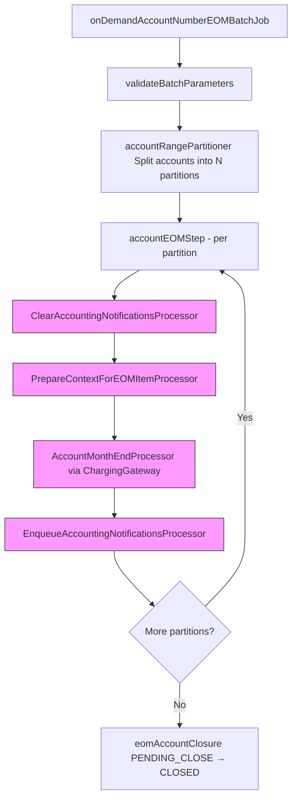
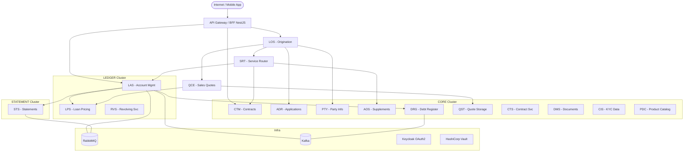

This appendix is a reference for engineers and architects. There is no need to read it in order: open it when you need to look up a module, an exchange or a design decision. The corresponding chapters explain the reasoning behind them.

## A.1 Module overview {#a1-tổng-quan-các-module}

### Module map

```text
┌─────────────────────────────────────────────────────────────────────────┐
│                        Vela Lending Platform                            │
│                                                                         │
│  ┌─────────┐  ┌─────────┐  ┌─────────┐  ┌─────────┐  ┌─────────┐        │
│  │   LOS   │  │   LPS   │  │   LAS   │  │   DRG   │  │   DSA   │        │
│  │  Loan   │  │ Instal. │  │ Account │  │  Debt   │  │  Data   │        │
│  │ origin. │  │  plans  │  │  mgmt   │  │register │  │ aggreg. │        │
│  └────┬────┘  └────┬────┘  └────┬────┘  └────┬────┘  └────┬────┘        │
│       │            │            │            │            │             │
│  ┌────┴────┐  ┌────┴────┐  ┌────┴────┐  ┌────┴────┐  ┌────┴────┐        │
│  │   ADR   │  │   QST   │  │   PDC   │  │   CTM   │  │   CTS   │        │
│  │ Applic. │  │  Quote  │  │ Product │  │Contract │  │Contract │        │
│  │  data   │  │  store  │  │ catalog │  │  mgmt   │  │services │        │
│  └─────────┘  └─────────┘  └─────────┘  └─────────┘  └─────────┘        │
│                                                                         │
│  Messaging: RabbitMQ + Kafka                                            │
│  Orchestration: LOS uses async controllers + Infinispan                 │
│                 (Zeebe used only optionally, for scoring)               │
│  Product and tariff configuration: PDC                                  │
└─────────────────────────────────────────────────────────────────────────┘
```

### Each module's responsibilities

| Module | Role | Main entities | Main APIs |
|---------|------|-------------|---------|
| **LOS** | Loan Origination Service: a stateless asynchronous orchestrator (10 endpoints) | ApplicationRequest (Infinispan cache, 7 named caches) | POST /api/workflows/*ApplicationForm |
| **LPS** | Loan Pricing: calculates instalment plans and XIRR (EIR) with Newton-Raphson | InstalmentPlan, InstalmentSummary, Instalment | POST /api/v3/calculators/instalment-plan/by-offer-code |
| **LAS** | Account Management: account lifecycle, billing | Account, Transaction, CurrentBalance, LedgerEntry | GET /accounts/{id}, POST /accounts/{id}/transactions |
| **DRG** | Debt Register: tracks DPD, publishes debt state (SCD Type 2) | DebtRegister, DebtRegisterStatistics | GET /debt-catalogue/{contractCode} |
| **DSA** | Data Source Aggregator: aggregates data from internal systems into XML for document generation | DataSource (XML) | POST /api/generateDataSource |
| **ADR** | Application Data Repository: stores application data during origination | Application, ApplicationEvent | GET /applications/{id} |
| **QST** | Quote Store: stores and manages the quote lifecycle | SalesQuote (with arrangement) | POST /sales-quotes |
| **QCE** | Quote Calculation Engine: complex pricing calculations (15+ calculation domains) | Quote calculation DTOs | POST /calculateQuote (via LOS) |
| **PDC** | Product Catalog: financing packages, tariff management | FinancingPackage, Tariff, FeeComponent | Product definition APIs |
| **SRT** | Service Router: a stateless router (9 FeignClient connectors) | | POST /rest/v1/loan-requests |
| **AOS** | Supplement: optional add-on products (insurance, protection packages) | ContractSupplement | Supplement lifecycle APIs |
| **STS** | Statement Management: generates monthly statements | STS_STATEMENT (cabinetUUID→DMS, states NEW→XML_GENERATED→PDF_GENERATED), STS_STATEMENT_LINE | Triggered by EOM_FEE events from LAS via RabbitMQ; STATEMENT cluster (schema `sts`) |
| **RVS** | Revolving Service: revolving service definitions | `rvs_rel_service` (RelService), ServiceParameter | `GET /rel-services/api/relService?code={id}`; LEDGER cluster (schema `rvs`) |
| **RDS** | Reference Data Service: reference data (currencies, countries) | RDS_COUNTRY, RDS_CURRENCY | Code list APIs |
| **CIS** | Customer Identity Service: customer identification and verification | CustomerProfile, IncomeVerification | KYC verification APIs |
| **CTM** | Contract Management: contract lifecycle, parties, events | Contract, ContractStatusTransition, BusinessEvent | Contract management APIs |
| **CTS** | Contract Services: operations on contract services | CONTRACT_SERVICE, CONTRACT_SERVICE_H (SCD2 history) | activate/deactivate/terminate/cancel APIs; shares the CORE cluster (own `cts` schema) |
| **LBS** | Legacy Business Services: an **external** legacy system (disbursement, card management) | External | External REST |
| **CMS** | Card Management System: card operations, **external** | External | External (RabbitMQ) |

## A.2 Domain model: LAS {#a2-mô-hình-miền-las}

### Main entities (simplified)

```text
Account
  ├── id: Long (PK)
  ├── contractId: UUID
  ├── customerId: Long
  ├── status: CREATED | ACTIVE | CANCELLED | PENDING_CLOSE | CLOSED | WRITTEN_OFF | PAID_OFF
  ├── openDate: LocalDate
  ├── closeDate: LocalDate (nullable)
  ├── tariffCode: String → tariff lookup
  └── accountParameters: List<AccountParameter>

AccountParameter
  ├── account: Account (FK)
  ├── parameterType: ParameterType (enum)
  ├── value: String (stored as a string, parsed by the consumer)
  ├── effectiveFrom: LocalDate
  └── effectiveTo: LocalDate (null in the DB = currently in force)

  Main ParameterTypes:
    CREDIT_LIMIT, INTEREST_RATE_OVERRIDE, PAYMENT_HOLIDAY_USED,
    DPD_BUCKET, RISK_TIER, CHANNEL

CurrentBalance
  ├── account: Account (FK)
  ├── balanceType: PRINCIPAL | INTEREST | FEE | PENALTY
  ├── amount: BigDecimal (non-negative)
  ├── currency: Currency
  └── asOf: LocalDate

Transaction
  ├── id: Long (PK)
  ├── account: Account (FK)
  ├── transactionType: TransactionType (enum)
  ├── amount: BigDecimal
  ├── eventDate: LocalDate      ← the date it happened
  ├── processingDate: LocalDate ← the date the system processed it
  ├── valueDate: LocalDate      ← the date the money actually takes effect
  ├── referenceId: String       ← external reference (payment_id...)
  └── reversalOf: Transaction (FK, nullable)

  Main TransactionTypes:
    DISBURSEMENT, PAYMENT_RECEIVED, INTEREST_ACCRUAL, FEE_CHARGE,
    WRITE_OFF, REVERSAL, PAYMENT_HOLIDAY_ACCRUAL

LedgerEntry
  ├── account: Account (FK)
  ├── itemType: PRINCIPAL | INTEREST | FEE
  ├── dueDate: LocalDate
  ├── dueAmount: BigDecimal
  ├── paidAmount: BigDecimal
  ├── paidDate: LocalDate (nullable)
  └── status: OPEN | PARTIAL | PAID | OVERDUE

InstalmentSummary (aggregate, denormalized)
  ├── account: Account (FK, OneToOne)
  ├── totalInstallments: Integer
  ├── remainingInstallments: Integer
  ├── totalPrincipal: BigDecimal
  ├── totalInterest: BigDecimal
  ├── nextDueDate: LocalDate
  ├── nextDueAmount: BigDecimal
  └── refreshedAt: LocalDateTime

  IMPORTANT: refreshInstalmentSummary() is only safe once ALL child entities
  have been saved. Do not call it during prescribing (see A.6 and Chapter 16, VLP-670).

ContractService (links an Account to a PDC tariff)
  ├── account: Account (FK)
  ├── serviceType: INTEREST | INSURANCE | FEE
  ├── tariffCode: String
  ├── tariffVersion: Integer
  └── activatedAt: LocalDate
```

### The account state machine

```text
                  [CREATED]
                     │
              supplement signed / account activated
                     │
                     ▼
              [ACTIVE] ────────────────────┐
                │  │                       │
                │  │ settlement starts     │
                │  ▼                       │
                │ [PENDING_CLOSE]          │ write-off signal from DRG
                │      │                   │ (DPD above threshold)
                │      │ debt cleared      ▼
                │      └──► [PAID_OFF]  [WRITTEN_OFF]
                │                          │
                │  close                   │ terminate
                └──► [CLOSED] ◄────────────┘

Cancelled before ACTIVE: [CANCELLED]

Note: the AccountStatus enum has NO SUSPENDED state.
Blocking uses Account.blocked=true + a BlockingReason entity
(types: FLEXI_TERMINATION, FLEXI_CONVERSION, FRAUD, LEGAL_HOLD)
```

## A.3 The origination flow {#a3-luồng-khởi-tạo}

```text
LOS: 10 REST endpoints, all returning 202 ACCEPTED with a Location header

Step 1: POST /api/workflows/submitApplicationForm
  LOS → PTY (create the applicant) → ADR (create the application)

Step 2: POST /api/workflows/checkEligibility
  LOS → PTY (find the customer) → LAS (check accounts) → QCE (instalment plan type) → OFR (match offers)

Step 3: POST /api/workflows/calculateSalesQuotes
  LOS → QCE (pricing, 15+ domains) → LPS (calculate XIRR) → QST (store quotes)

Step 4: POST /api/workflows/chooseOffer
  LOS → ADR (update) → OFR (check) → Zeebe "PreTransactionRiskCheck" (asynchronous scoring)
       → POSITIVE: LOS → LBS (create supplement)
       → NEGATIVE: workflow FAILED

Steps 5-6: calculateAccountWithPurchaseQuote / calculateAccountWithCashQuote
  LOS → QCE (pre-contract quote)

Step 7: POST /api/workflows/generateAgreement
  LOS → SRT → {CTS → RabbitMQ → LAS (account CREATED), CTM, AOS, DMS, QST, PDC}

Step 8: POST /api/workflows/signAgreement
  LOS → AOS.acceptContractSupplementDocuments() → RabbitMQ chain
       → SRT → CTM.signContract → CTS.activate(ACCMAINT) → LAS (account CREATED→ACTIVE)
  LOS publishes origination.completed (RabbitMQ) → LAS confirms activation

Additional: cancelSupplement, rejectSupplement

Key points: LOS is stateless, using an embedded Infinispan cache for each step.
            Zeebe is optional, used for scoring in step 4, not the main orchestration engine.
            No champion/challenger A/B routing yet.
```

Chapter 7 presents this flow together with the design rationale.

## A.4 EOM processing {#a4-xử-lý-eom}

### Batch architecture



*Figure A.1. The on-demand EOM job: validate parameters, split accounts into partitions, process each partition, then close PENDING_CLOSE accounts.*

### Idempotency keys

```sql
-- Check before processing:
SELECT 1 FROM eom_completion_log 
WHERE account_id = ? AND processing_date = ? AND status = 'COMPLETED';

-- After processing:
INSERT INTO eom_completion_log 
  (account_id, processing_date, completed_at, status)
VALUES (?, ?, NOW(), 'COMPLETED');
-- Unique constraint on (account_id, processing_date)
-- Duplicate insert → constraint violation → skip (idempotent)
```

### Daily interest calculation

```text
Formula (30/360 convention, as in the book's examples):
  I = P × r × d / 360

  P = principal balance (from CurrentBalance)
  r = annual interest rate (from ContractService → tariff)
  d = days since the previous accrual (a full monthly period = 30)

Example: Lan's loan, instalment 2
  P = 17,081,420 VND (after instalment 1)
  r = 18% = 0.18
  d = 30

  I = 17,081,420 × 0.18 × 30 / 360
    = 256,221.3
    → 256,221 VND (rounded HALF_UP to the dong), matching the schedule in Chapter 2

Implementation: BigDecimal, HALF_UP rounding, scale 0 (dong)
```

The day count convention is configured per product; if a product uses actual/365, only the denominator and the actual number of days in the period change.

## A.5 Messaging architecture {#a5-kiến-trúc-thông-điệp}

### Main RabbitMQ exchanges

| Exchange | Type | Publisher | Consumers | Purpose |
|----------|------|----------|-----------|---------|
| `am.headers.event.notification` | Headers | LAS | CTM, LOS, AOS, SRT | Account events (EventRecord: CREATE/ACTIVATE/CANCEL_ACCOUNT...) |
| `am.topic.account.closure` | Topic | LAS | CTM | Account closure events |
| `csi.contract.service` | Headers | CTS | LAS | Service lifecycle notifications (header routing) |
| `csi.sup.contract.supplement` | Fanout | AOS | SRT, LOS (and CTM) | Supplement lifecycle (signed, cancelling, cancelled) |
| `cos.contractservice` | Direct | CTS | LAS | Contract service cancellation |
| `stm.direct` | Direct | STS | STS (internal) | STS internal routing (statement delivery) |
| `account.events` (or EOM_FEE filtering on am.headers) | Headers | LAS | STS | Triggers statement generation; STS filters eventType=EOM_FEE |
| `AM_FANOUT_CMS_ACCOUNT_BALANCE_CHANGE_EXCHANGE` | Fanout | LAS | CMS | Balance changes → card system |
| `zeebe.event.exchange` | Fanout | Zeebe | LOS | Scoring callback (optional) |
| `cosi.sir.processing-result` | Fanout | SRT | LOS | Loan processing results |
| `origination.completed` | Topic | LOS | LAS | Origination complete signal → LAS activates the account |

Routing is by header (`eventType`, `version`, `x-match: all`). The error handling pattern: `queue → queue.dlq (retry by TTL) → queue.plq (manual handling)`.

### Kafka topics

| Topic | Publisher | Consumers | Format | Notes |
|-------|----------|-----------|--------|-------|
| `transaction.confirmed` | LAS | DRG | Avro | DRG's main trigger |
| `contract.events` | CTM | DRG, SRT | Avro | Contract state changes |
| `debt.events` | DRG | Several | CloudEvents | Debt state changes (DPD, write-off) |
| `application.events` (alias `ads.application-data.v2`) | ADR | SRT, LOS | CloudEvents + Avro | Application lifecycle |
| `sqs.sales-quote.v1` | QST | LOS | CloudEvents | Quote ready |
| `orp.workflow-events.<step>.v1` | LOS | Zeebe, QCE | CloudEvents + Avro | Per-step workflow events |
| `tck.ticket.event.v1` | TKT | | Avro | Ticket events |

Schema Registry: Confluent at `https://schema-registry.vlp.internal:8081`. Security: SASL_SSL + SCRAM-SHA-256 (production: SCRAM-SHA-512).

## A.6 Key technical decisions {#a6-các-quyết-định-kỹ-thuật-then-chốt}

### Why BigDecimal instead of double

Floating-point numbers cannot represent decimal fractions exactly. With money, even a tiny error per transaction becomes significant at scale. Use `BigDecimal` for every monetary value: scale 0 for VND (no subunits), scale 10 for intermediate calculation steps (Chapter 2, Chapter 16).

### Why tariff-based design

Business rules change faster than code can be deployed. A rate change (for regulatory or competitive reasons) must take effect on the right day without a deployment. Tariffs in the database with `validFrom`/`validTo` allow business rules to change without disruption (Chapter 3, Chapter 12).

### Why optimistic locking

Accounts are read often and written occasionally. Pessimistic locking creates contention; optimistic locking (a version field) allows concurrent reads and detects conflicts at write time. This is acceptable because concurrent writes to the same account are rare.

### Why calling refreshInstalmentSummary during prescribing is dangerous

`InstalmentSummary` is a denormalized aggregate computed from child `Instalment` records. During prescribing, the child records are being created within the transaction. If `refreshInstalmentSummary()` is called before every child record has been saved, the aggregate is computed from incomplete data and the header is wrong. Only call it after the transaction completes.

### Why use a "never reached" date

For a record currently in force (`effectiveTo = null`), there are two ways to query "which record is in force today": `WHERE effectiveTo IS NULL OR effectiveTo >= :today` (correct but needs an OR), or `WHERE effectiveTo >= :today` with a sentinel value (a simpler query that can use an index). VLP uses several sentinel values for different entities (Chapter 8):

| Field | Value | How it arises |
|---|---|---|
| `AccountParameter.validTo` | 3000-01-01 (`DateUtil.UNREACHABLE_FUTURE_DATE`) | NULL in the DB → `NullDateToFarFutureConverter` → 3000-01-01 in Java |
| `AccountService.endDate` | 3000-01-01 | A default value declared in the entity |
| `PostingUnit.firstPrescribeDate` | 3333-01-01 | A separate sentinel for "not yet prescribed" |

### Why LOS uses async controllers, not a BPMN engine

LOS uses Spring async controllers with an Infinispan cache to manage state. Zeebe is an optional integration used only for scoring (the `zeebe-integration` profile), not the main orchestrator. This choice makes debugging simpler (standard Spring controllers) and keeps a BPMN engine off the critical path. The price is having to write retry logic by hand and having no visual representation of the workflow; stuck applications are handled by an external reconciliation job (Chapter 7).

## A.7 Reference performance figures {#a7-số-liệu-hiệu-năng-tham-khảo}

| Operation | P50 | P99 | Throughput | Notes |
|-----------|------------|------------|-----------|-------|
| Credit scoring | 45 ms | 180 ms | 500 req/s | Including model inference |
| Credit bureau lookup | 450 ms | 950 ms | 200 req/s | External dependency |
| Account creation | 120 ms | 350 ms | 300 req/s | DB write + event |
| EOM per account | about 300 ms | | | Including data reads and writes |
| Full EOM (1.2 million accounts) | | | about 6.25 hours | 16 partitions in parallel (Chapter 8) |
| Payment processing | 65 ms | 180 ms | 400 req/s | Including the idempotency check |

## A.8 Database schema: the main tables {#a8-schema-cơ-sở-dữ-liệu-các-bảng-chính}

```sql
-- Account (simplified)
CREATE TABLE account (
    id BIGINT GENERATED ALWAYS AS IDENTITY PRIMARY KEY,
    contract_id UUID NOT NULL UNIQUE,
    customer_id BIGINT NOT NULL,
    status VARCHAR(20) NOT NULL DEFAULT 'ACTIVE',
    open_date DATE NOT NULL,
    close_date DATE,
    tariff_code VARCHAR(50) NOT NULL,
    version INTEGER NOT NULL DEFAULT 0, -- optimistic locking
    created_at TIMESTAMP NOT NULL DEFAULT NOW(),
    updated_at TIMESTAMP NOT NULL DEFAULT NOW()
);

-- Transaction (simplified)
CREATE TABLE transaction (
    id BIGINT GENERATED ALWAYS AS IDENTITY PRIMARY KEY,
    account_id BIGINT NOT NULL REFERENCES account(id),
    transaction_type VARCHAR(50) NOT NULL,
    amount NUMERIC(15,2) NOT NULL,
    event_date DATE NOT NULL,
    processing_date DATE NOT NULL,
    value_date DATE NOT NULL,
    reference_id VARCHAR(100),
    reversal_of_id BIGINT REFERENCES transaction(id),
    created_at TIMESTAMP NOT NULL DEFAULT NOW()
    -- NOTE: No updated_at — transactions are immutable
);

-- Tariff Item (simplified)
CREATE TABLE fee_component (
    id BIGINT GENERATED ALWAYS AS IDENTITY PRIMARY KEY,
    tariff_code VARCHAR(50) NOT NULL,
    item_type VARCHAR(50) NOT NULL,
    percentage NUMERIC(10,8), -- e.g., 0.01292 for 1.292%/month
    fixed_amount NUMERIC(15,2),
    valid_from DATE NOT NULL,
    valid_to DATE NOT NULL DEFAULT '3333-01-01', -- UNREACHABLE_FUTURE_DATE (NULL in DB → 3333-01-01 in Java)
    created_at TIMESTAMP NOT NULL DEFAULT NOW()
);
CREATE INDEX idx_fee_component_lookup ON fee_component(tariff_code, item_type, valid_from, valid_to);

-- EOM Completion Log (idempotency)
CREATE TABLE eom_completion_log (
    id BIGINT GENERATED ALWAYS AS IDENTITY PRIMARY KEY,
    account_id BIGINT NOT NULL REFERENCES account(id),
    processing_date DATE NOT NULL,
    completed_at TIMESTAMP NOT NULL,
    status VARCHAR(20) NOT NULL,
    CONSTRAINT uq_eom_completion UNIQUE (account_id, processing_date)
);
```

The schema above is a simplified illustration. The 3333-01-01 default of `fee_component.valid_to` is this sample schema's choice; VLP's `DateUtil.UNREACHABLE_FUTURE_DATE` constant is 3000-01-01, while 3333-01-01 is the separate sentinel of `PostingUnit.firstPrescribeDate` (the table in section A.6). When writing "currently in force" queries, always compare against the right constant for the entity being queried.

## A.9 Deployment architecture {#a9-kiến-trúc-triển-khai}



*Figure A.2. Modules, database clusters and shared infrastructure.*

### Database clusters (PostgreSQL via PgBouncer, port 6432)

| Cluster | Database | Modules | Notes |
|---------|----------|---------|------|
| LEDGER (accounts) | `vlp_ledger_a1p` | LAS, LPS, RVS | LAS queries the LPS/RVS schemas directly |
| CORE (holdings) | `vlp_core_a1p` | ADR, CTM, CTS, RDS, DRG, DMS, CIS, PTY, PDC, QST, AOS, TKT | The largest cluster (12 modules) |
| CNTR (contracts) | `vlp_cntr_a1p` | OFR | |
| STATEMENT (statements) | `vlp_statement_a1p` | STS | |
| Local development | `testdb` | All | Podman/local |

Four clusters for production, plus one shared database for local development, as Chapter 6 described. Modules without their own database: LOS, SRT, DSA (read cache only) and the BFF (NestJS 11, no direct DB access, aggregating the APIs behind it). Cross-schema access: LAS reads CTM's schema directly through JPA (not via REST) to get ContractService data.

### GitOps deployment (ArgoCD + Helm)

```text
Sync waves:
  Wave 1: ConfigMaps, Secrets
  Wave 2: Database migrations with Liquibase
  Wave 3: Application Deployments
  Wave 98: HPA (Horizontal Pod Autoscaler)
  Wave 99: PDB (Pod Disruption Budget)

Autoscaling: KEDA with Prometheus and cron triggers
Secrets: HashiCorp Vault (Kubernetes authentication)
Tracing: OpenTelemetry Java agent (W3C Trace Context)
```

### Environments

| Environment | Purpose | Data | Automatic deployment |
|------------|---------|------|------------|
| dev | Development | Synthetic data | Every commit |
| staging | Integration testing | Anonymized production data | On PR merge |
| uat | User acceptance | Anonymized production data | Manual |
| prod | Production (on-premises Kubernetes) | Real data | Manual via ArgoCD |

*Appendix A is updated when the architecture changes significantly.*
