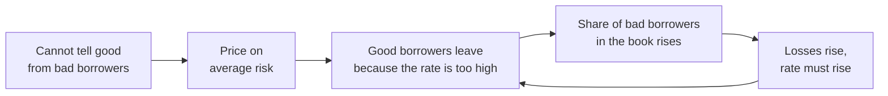
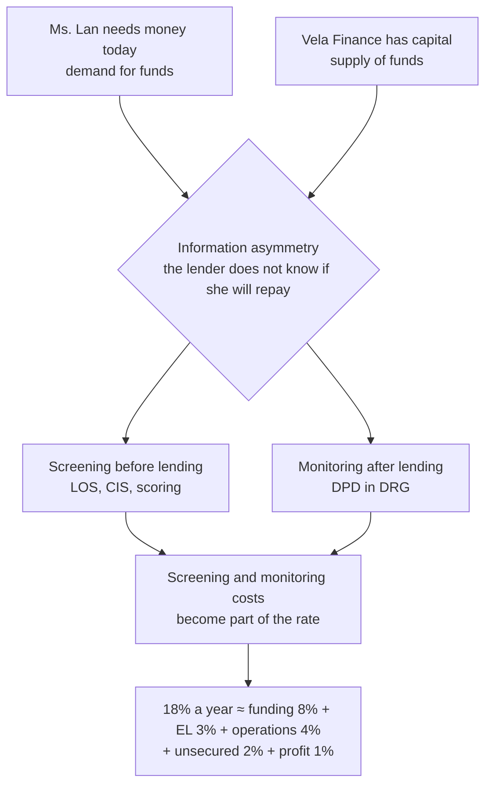

import CostStackChart from '@site/src/components/Charts/CostStackChart';

> *"Credit does not create wealth; it redistributes wealth across time. The questions are who it is redistributed to, on what terms, and who bears the risk."*
>
> *After Hyman Minsky*

## Introduction: a Monday morning

::::story
Ms. Lan, 28, an accountant at an import-export company in Hanoi, has just had bad news: the laptop she uses for work has died for good. Her company does not supply equipment and expects her to have her own machine within three days.

A suitable laptop costs 18,500,000 VND. Her savings account holds 6,000,000 VND, put aside over six months for a summer holiday. Payday is ten days away.

She has three options: use all her savings and borrow the rest from friends; buy a cheaper laptop that is not powerful enough; or take a consumer loan, buy now and repay over 12 months. She chooses the third, and the story of this book starts here.
::::

That simple, everyday decision contains the whole economics of consumer credit. Why is someone willing to lend to her? On what terms? Why is the rate 18% a year and not 5% or 50%? Who bears the risk if she cannot repay? And what technology lets the whole process happen in minutes rather than the weeks it took twenty years ago?

This chapter answers those questions, from the principles of economics down to the reason each module of the lending platform that handles Ms. Lan's loan exists.

## 1.1 What is credit? {/* #11-tín-dụng-là-gì */}

### A tale of two farmers

::::story
Forget Ms. Lan for a moment and go back a few thousand years.

In a village there are two farmers, Mr. Bình and Mr. Cường. In spring, Mr. Bình has 100 kg of seed rice but only enough land to sow 60 kg. Mr. Cường has land but no seed: the winter was hard and he had to eat it all. Without seed, his field will lie fallow for a year.

Mr. Bình lends Mr. Cường 40 kg of seed. At harvest, Mr. Cường returns 50 kg: the 40 kg he borrowed and 10 kg as thanks.
::::

This is credit in its most primitive form, and it already contains three elements that remain intact in the modern financial system. Credit **moves resources across time**: Mr. Cường uses the rice today and repays later. Credit **benefits both sides**: Mr. Bình earns a return on surplus rice, and Mr. Cường does not lose a season. And credit **has a cost**: the extra 10 kg is a form of interest.

### The time value of money

::::story
Mr. Minh, Product Owner at Vela Finance, is meeting an investor. The investor makes an offer: "I'll lend you 1 billion dong today. In two years you pay me back exactly 1 billion. What do you think?"
::::

The offer sounds generous, but Mr. Minh knows the investor is losing out. One billion dong today and one billion dong in two years are not the same thing. With the money in hand today, the investor could put it in a savings account at 6% a year and have 1,123,600,000 VND after two years, buy government bonds, or invest in a business. Lending it interest-free, they give up at least 123,600,000 VND. That forgone amount is the **opportunity cost**.

:::key[Time value of money]
The **time value of money** (TVM) is the principle that a dong received today is worth more than a dong received in the future, because today's dong can be invested to earn a return. The two core formulas, with $r$ the interest rate per period and $n$ the number of periods:

$$
FV = PV \cdot (1 + r)^n \qquad\qquad PV = \frac{FV}{(1 + r)^n}
$$
:::

Here $PV$ is the present value and $FV$ the future value.

**Worked example.** Ms. Hương, CFO of Vela Finance, must choose between two projects that each need 500,000,000 VND of capital: project A returns 650,000,000 VND after 3 years, project B returns 580,000,000 VND after 1 year. The opportunity cost of capital is 10% a year.

```text
PV(A) = 650,000,000 / 1.10^3 = 650,000,000 / 1.331 ≈ 488,354,621 VND
PV(B) = 580,000,000 / 1.10   =                      ≈ 527,272,727 VND
```

Project A pays more in absolute terms, but its present value is lower than the capital invested. In other words, project A earns only about 9.1% a year, below the 10% cost of capital, so it destroys value. Project B is chosen.

If the opportunity cost falls to 7% a year, PV(A) rises to about 530.6 million and PV(B) to about 542.1 million. Both projects are now worth doing, though B is still better. When market rates fall, long-term projects become more attractive; that is one of the mechanisms behind investment cycles.

**In VLP**, the time value of money is the reason the LPS module (Loan Pricing Service) exists. When Ms. Lan borrows 18,500,000 VND, LPS does not simply divide the amount by 12. It computes the monthly payment so that the present value of the 12 payments equals exactly the amount borrowed. Chapter 2 walks through this calculation.

### The three components of an interest rate

Lenders charge interest to be compensated for three things.

**Time.** The real interest rate is the reward for giving up consumption today. Even in a world with no risk and no inflation, people want to be compensated for waiting. The real rate reflects the supply and demand of capital in the economy and is influenced by the central bank's policy rate.

**Inflation.** If inflation is 4% a year, the lender gets back money with less purchasing power. The relationship is described by the **Fisher equation**, with $i$ the nominal rate (the number in the contract), $r$ the real rate and $\pi^e$ expected inflation:

$$
(1 + i) = (1 + r)(1 + \pi^e) \qquad\Longrightarrow\qquad i \approx r + \pi^e
$$

With a real rate of 3% and expected inflation of 4%, the minimum nominal rate is about 7%. A bank lending at 6% when inflation is 4% earns a real rate of only 2%.

**Risk.** Borrowers may fail to repay, and risk differs from one borrower to the next. The risk premium must be enough to cover the amounts that will be lost. This is the most complex component and the focus of section 1.3.

$$
\text{Nominal rate} \approx \text{real rate} + \text{expected inflation} + \text{risk premium}
$$

For Ms. Lan's 18% loan, one illustrative breakdown is about 3% real rate, 4% expected inflation and 11% risk premium. Section 1.3 breaks down the same 18% from a different angle, the cost structure of the finance company; the two breakdowns complement each other rather than conflict.

:::summary[Section 1.1]
Money today is worth more than money in the future because of the investment opportunity forgone. The nominal rate compensates for time, inflation and risk; the Fisher equation gives $i \approx r + \pi^e$. Every calculation of VLP's pricing module LPS rests on the time value of money.
:::

## 1.2 Information asymmetry: the root problem {/* #12-thông-tin-bất-cân-xứng-vấn-đề-gốc-rễ */}

### The used-motorbike seller

::::story
Engineer Tuấn wants to buy a used motorbike. At the market he sees three bikes of the same year, make and colour, priced at 18, 22 and 28 million dong. The sellers know each bike's history: the 28-million bike has never been dropped and was serviced on schedule; the 18-million bike has been in two accidents and its frame is slightly bent. Tuấn does not know any of this.

To be safe, Tuấn decides to pay at most 20 million. The owner of the good bike will not sell below 28 million and leaves the market. The owner of the bad bike happily sells for 20 million. Gradually only bad bikes remain; buyers notice and lower what they will pay to 15 million; the remaining sellers leave too. The market shrinks, not for lack of buyers or sellers, but because of **information asymmetry**.
::::

This is the "market for lemons" model that George Akerlof published in 1970, part of the work for which he received the Nobel Prize in Economics in 2001.

Credit markets have the same problem, but it is more dangerous for three reasons. The goods, money, are delivered first and paid for later, so the risk sits with the lender. Borrowers understand their own finances, the purpose of the loan and their ability to repay better than anyone else. And there is no way to "inspect the bike" and verify a borrower's intentions with certainty before disbursement.

### Adverse selection

:::key[Adverse selection]
**Adverse selection** happens **before** the transaction. When a lender cannot tell good borrowers from bad ones, it sets an "average" rate. That rate is too high for good borrowers, who look elsewhere, and too low for bad borrowers, who accept. The loan book therefore deteriorates over time.
:::

**Worked example.** Suppose 1,000 people want to borrow: 700 good borrowers with a probability of default (PD) of 1%, and 300 bad borrowers with a PD of 15%. Unable to tell the groups apart, the finance company prices on the average PD:

```text
Average PD = (700 × 1% + 300 × 15%) / 1,000 = (7 + 45) / 1,000 = 5.2%
Expected loss with LGD 60% = 5.2% × 60% = 3.12% a year
```

Adding the cost of funds, operating costs and profit, the required rate is about 15% a year. But good borrowers can get 10% from a bank, so they do not borrow here. With only bad borrowers left, the actual PD is 15%, the expected loss is 15% × 60% = 9% a year, and the rate must rise to about 24% a year. At 24%, even the "moderately bad" borrowers leave; only the riskiest remain. This self-reinforcing spiral can bring down a finance company.



*Figure 1.1. The adverse selection spiral. Each rate increase pushes more good borrowers out of the book.*

In the author's observation, some consumer finance companies in Vietnam fell into this spiral in 2015-2018, when growth outpaced their credit scoring capability.

**In VLP**, breaking the spiral requires the system to **tell good and bad borrowers apart**. That is why the loan origination module LOS (Loan Origination Service) is not simply "receive the application, approve it" but orchestrates a multi-step screening process. Each step answers an economic question:

| Step | Module or source | Economic question |
|---|---|---|
| Collect and verify identity | CIS (Customer Identity Service) | Is this person real, and are they on a blacklist? |
| Check credit history | Credit bureau | Has this person defaulted before? |
| Verify income | Documents stored in DMS | Can this person afford to repay? |
| Behavioural scoring | Behavioural data | Which group of customers does this person resemble? |
| Compute the loan offer | QCE (Quote Calculation Engine) and LPS | At this level of risk, what rate is appropriate? |

Each step is an effort to reduce information asymmetry. The cost of the process, in staff, systems and time, becomes the cost of originating the loan and is ultimately reflected in the rate on the contract.

### Moral hazard

::::story
Ms. Lan's 18,500,000 VND loan has just been disbursed. On her way to the laptop shop she passes a phone shop and sees a newly launched premium phone for 25,000,000 VND. She starts calculating: the old laptop could limp along for a few more months, and these 18.5 million plus a small credit-card balance would...
::::

:::key[Moral hazard]
**Moral hazard** happens **after** the transaction. Once borrowers have the money, they have less incentive to keep their original commitments, because part of the consequences has shifted to the lender.
:::

Moral hazard is not necessarily deliberate fraud; it is often a natural reaction when the burden of consequences is shared, the "if I can't repay, a finance company that big won't go bankrupt" kind of thinking.

| Commitment before borrowing | Possible behaviour after borrowing |
|---|---|
| Promise to cut spending | Buy more things that are not needed |
| Use the money for purpose X | Use it for a riskier purpose Y |
| Repay on time | Delay repayment when possible |
| Save as a buffer | Spend it all because "I can borrow more" |

Left unchecked, moral hazard pushes default rates above what they need to be. The reason is not that borrowers lack the ability to repay, but that the incentive structure is wrong. The financial system responds with two mechanisms.

**Continuous monitoring.** The system records every payment and measures days past due (DPD). An on-time first payment is recorded normally; paying 5 days late on the second raises DPD to 5 and triggers an alert; 35 days late on the third leads to escalation; no payment on the fourth takes DPD to 65 and the account moves to collections.

In VLP, the DRG module (Debt Register) tracks the DPD of every account. DRG receives events from the account management module LAS through Kafka (topic `transaction.confirmed`) in near real time, and also runs the daily `updateOverdueDebtJob` to reconcile overdue debt. The two mechanisms complement each other: events give fast updates, the batch job gives consistency. Whenever LAS confirms a transaction, DRG updates the `DebtRegister` record (kept as SCD Type 2 history) and publishes an event on the `debt.events` topic. Chapter 10 describes this architecture.

**Reputation.** Ms. Lan's payment history affects not only her current loan but every future loan: bad behaviour today leads to higher rates or rejection later. This is why credit bureaus exist and why credit institutions must report to them. The mechanism works only when information is shared widely across the industry.

### Signalling and screening: the market's answer

If information asymmetry is the disease, signalling and screening are the cure.

**Signalling** is initiated by the **borrower**. Good borrowers want to set themselves apart from bad ones, so they volunteer information that is hard to fake, information that bad borrowers cannot or will not provide.

| Signal | Why it is hard to fake |
|---|---|
| Six months of salary statements | Someone without a stable income has no such statements |
| Accepting a higher rate for a larger limit | Someone who knows they will default hesitates to commit |
| Using the service for years before borrowing a large amount | Opportunists lack the patience |

**Screening** is initiated by the **lender**. The lender designs processes to verify what borrowers provide and to collect information borrowers would not volunteer.

:::key[The economic argument]
Good screening usually costs less than the bad-debt losses that occur without it.
:::

This argument explains why the whole technology stack of loan origination exists. In VLP, CIS verifies identity, LOS orchestrates the scoring steps, QCE computes risk-based offers, and DMS stores and verifies documents. Each module is not just a technical service but the implementation of an economic solution to information asymmetry.

:::summary[Section 1.2]
Adverse selection happens before the transaction: without screening, bad borrowers push good ones out of the market. Moral hazard happens after it: behaviour changes when consequences are shared. Markets respond with signals from borrowers and screening by lenders. In VLP, the origination chain is the screening machine and the DRG module is the tool for monitoring moral hazard.
:::

## 1.3 Why are consumer loan rates higher than mortgage rates? {/* #13-vì-sao-lãi-suất-vay-tiêu-dùng-cao-hơn-vay-mua-nhà */}

### The situation

::::story
Mr. Minh has just met a journalist writing about "loan sharks hiding behind consumer finance". The journalist has data: mortgages at 9% a year, consumer loans at 24%, a 15-point gap, and concludes that this is exploitation. Mr. Minh knows the conclusion is wrong, but needs to explain why convincingly.

The answer lies in the cost structure. The lending rate must cover four real costs of the lender; miss one and the lender loses money.
::::

### Component 1: cost of funds

Commercial banks raise savings deposits at around 5-6% a year. This is the cheapest source of funds, partly because deposits are insured.

Consumer finance companies **cannot take deposits**. They raise funds by borrowing from a parent bank (typically 7-9% a year), issuing corporate bonds (8-10% a year), or borrowing from international institutions (7-9% a year plus the cost of hedging currency risk). Their average cost of funds is therefore around 8-10% a year, 2-4 percentage points above a bank's even when everything else is equal.

### Component 2: expected loss

This is the most important component and the most often misunderstood.

:::key[Expected loss]
**Expected loss** (EL) is the average loss per year:

$$
EL = PD \times LGD \times EAD
$$
:::

| Variable | Meaning | Mortgage | Consumer loan |
|---|---|---|---|
| PD | Probability of default within one year | 0.5-1% | 3-8% |
| LGD | Loss given default | 15-25% | 50-70% |
| EAD | Exposure at default | About the outstanding balance | Can be higher with revolving limits |

Consumer loans have a higher PD because mortgage borrowers usually meet strict conditions: a stable income with a debt-to-income ratio no higher than about 40%, savings for a 20-30% down payment, a clean credit history. Consumer lending serves a much broader segment, including people who do not qualify for bank loans.

Consumer loans have a higher LGD because there is no collateral. When a mortgage borrower defaults, the bank sells the property and usually recovers 75-85% of the balance, an LGD of 15-25%. When a consumer borrower defaults, there is nothing to seize; the lender runs costly collections, and after years often recovers only 30-50%. LGD is therefore 50-70%.

**Worked example.** Ms. Hương prices a consumer loan product with historical data: PD 5%, LGD 60%, average EAD 15,000,000 VND.

```text
EL per loan         = 5% × 60% × 15,000,000 = 450,000 VND a year
For 100,000 loans   = 100,000 × 450,000     = 45 billion VND a year
As a share of book  = 45 bn / 1,500 bn      = 3% a year
```

To cover these 45 billion, the rate must include at least 3 percentage points of risk premium across the whole 1,500-billion-dong book. For a 1.5-billion-dong mortgage with a PD of 0.8% and an LGD of 20%, EL is only 0.8% × 20% = 0.16% a year, or 2,400,000 VND a year. Expected loss alone creates a gap of about 2.84 percentage points.

### Component 3: operating costs

This component is rarely discussed but matters a great deal. A 2-billion-dong, 20-year mortgage costs about 2-5 million dong to originate once, has 240 stable payments and rarely needs collections; total operating costs are about 0.3-0.5% a year of the balance. A 20-million-dong, 12-month consumer loan costs about 0.5-2 million dong to originate, 5-10% of the loan amount; it has 12 payments that must be well automated, frequent collections and many questions from mass-market customers. Total operating costs are about **3-5% a year** of the balance.

Most origination cost is fixed: underwriting a 5-million loan costs almost as much as a 50-million one. For small loans, that cost is a very large share.

This is the economic reason VLP must be highly automated. A 20-million loan at 18% a year earns only about 3.6 million dong of interest a year. If two employees have to spend significant time on it, the company loses money. Operating costs of 3-5% a year are sustainable only when most of the process, from origination to billing and collections, is automated.

### Component 4: the unsecured premium

A mortgage is a **secured loan**: if the borrower does not pay, the bank can enforce on the property. Most consumer loans are **unsecured**: on default, the lender can only remind, run collections or go to court, which is costly, slow and uncertain. The premium for this risk is about **2-4% a year**.

### Putting it together

| Cost component | Mortgage | Consumer loan | Difference |
|---|---:|---:|---:|
| Cost of funds | 5.50% | 8.50% | +3.00 |
| Expected loss (EL) | 0.16% | 3.00% | +2.84 |
| Operating costs | 0.40% | 4.00% | +3.60 |
| Unsecured premium | 0.00% | 3.00% | +3.00 |
| **Total cost** | **6.06%** | **18.50%** | **+12.44** |
| Profit margin | 2-3% | 2-4% | about the same |
| **Lending rate** | **about 9%** | **about 21-23%** | |

<CostStackChart
  title="Figure 1.2. The cost structure of interest rates: mortgage and consumer loan"
  categoryKey="product"
  data={[
    {product: 'Mortgage', cof: 5.5, el: 0.16, opex: 0.4, unsecured: 0},
    {product: 'Consumer loan', cof: 8.5, el: 3.0, opex: 4.0, unsecured: 3.0},
  ]}
  series={[
    {key: 'cof', label: 'Cost of funds', color: '#2f6f9f'},
    {key: 'el', label: 'Expected loss', color: '#c98a2b'},
    {key: 'opex', label: 'Operating costs', color: '#6b8f71'},
    {key: 'unsecured', label: 'Unsecured premium', color: '#9b6a9e'},
  ]}
  caption="Illustrative figures from the table above, in percentage points a year, before profit margin. The 12.44-point gap comes from all four components, not any single one."
/>

The rate gap between consumer loans and mortgages is not exploitation; it reflects a real cost gap. The profit margin on consumer lending is in fact not much higher than on mortgages.

### Risk-based pricing

If every customer pays the same rate, that rate must be high enough to cover the riskiest customers. Good customers then **subsidise** bad ones. **Risk-based pricing** solves this: each customer is priced according to their actual risk.

| Segment | PD | LGD | EL | Cost of funds | Operating costs | Required rate |
|---|---:|---:|---:|---:|---:|---:|
| Prime | 1% | 50% | 0.5% | 8.5% | 3.5% | about 15% |
| Standard | 5% | 60% | 3.0% | 8.5% | 4.0% | about 20% |
| Sub-prime | 12% | 65% | 7.8% | 8.5% | 5.0% | about 27% |

The last column is higher than the sum of the three cost columns (12.0%, 15.5% and 21.3%) because it also includes the unsecured premium and the profit margin. Together these add about 3.0, 4.5 and 5.7 percentage points respectively.

With a single rate of 20%, the Prime segment overpays by about 5 points and will drift to banks; the Sub-prime segment is subsidised by about 7 points and the company loses money on every loan in that group. This is exactly the adverse selection mechanism of section 1.2.

**In VLP**, this is why the fee system has no single fixed rate. The Tariff, FeeComponent and FeeComponentType structures let rates and fees be configured by product, segment and risk level without code changes. Chapter 3 explains why this design is better than hard-coding values.

:::summary[Section 1.3]
The lending rate covers the cost of funds, the expected loss $EL = PD \times LGD \times EAD$, operating costs and the unsecured premium, plus a profit margin. Consumer loans cost more than mortgages because all four components are higher. Risk-based pricing, one price per customer, is fairer and more sustainable than a single rate.
:::

## 1.4 Consumer finance in the financial ecosystem {/* #14-tài-chính-tiêu-dùng-trong-hệ-sinh-thái-tài-chính */}

### Who is who in the ecosystem

To design a good system you need to know what kind of institution it serves, because the type of institution determines the design constraints.

**Commercial banks** are licensed to take deposits, have the cheapest funding, face the strictest supervision (Basel standards, capital adequacy ratios) and usually serve the middle and upper segments. Their systems must support complex regulatory reporting, rigorous audit trails and regular stress testing.

**Consumer finance companies** do not take deposits; they fund themselves with bonds or loans from a parent bank, pay 2-4 points more than banks for funding, and serve the mass market, including people with little credit history (thin-file). Their most important design constraint is: **high volume, small ticket size, so automation is a matter of survival**. Operating costs must be tightly controlled, and origination must take minutes, not days.

Vela Finance is this type of institution, and VLP was designed for it. That explains why the end-of-month batch must process millions of accounts in parallel, and why loan origination is an asynchronous workflow rather than a synchronous blocking call.

**Fintech lending platforms** have no banking licence and often act as marketplaces connecting borrowers with investors. Their operating costs are low because they have no branch network, but their funding is expensive and depends on investors' risk appetite.

### Funding sources and their consequences

Funding is the factor least considered in system design, yet it shapes many architectural decisions.

| Funding source | Cost | Stability | Used by |
|---|---|---|---|
| Deposits | Lowest | High | Banks only |
| Loans from a parent bank | Medium | High, depends on the parent | Finance companies with a parent |
| Bond issuance | Medium | Medium | Finance companies, banks |
| Securitisation | Medium | Low, market-dependent | Large institutions with a book of sufficient size |
| Equity | Highest | High | Startups |

When a company packages loans into asset-backed securities (ABS) for investors, the system must extract detailed portfolio data: the loan tape, vintage performance, cash-flow projections. That is a data architecture requirement not every system is prepared for.

When a company raises three-year bonds but lends for five years, it bears refinancing risk: when the bonds mature, the market may be unfavourable. Asset-liability management (ALM) must track this gap, and the reporting system must analyse cash flows by maturity. Chapter 5 returns to this topic.

### Regulation as a design constraint

A common mistake is to treat compliance as a feature added after the system is running. In reality, legal requirements are **first-class constraints** and must be built into the architecture from the start. Four requirements shape VLP.

**Never delete history.** Regulators require a complete audit trail: every transaction and every state change must be stored with the time and the person or system that made it. In VLP, a `LedgerEntry` is never physically deleted; to cancel one, the system sets `cancelled = true` with a `cancellationReason`. That is not a technical preference but a legal requirement turned into a design constraint.

**Rate caps.** Many countries cap consumer lending rates. The cap often applies not only to the nominal rate but to the total cost of credit, such as APR including fees. The fee system therefore needs a layer that checks the actual APR before confirming a loan and rejects it if it exceeds the cap, even when the fee configuration is technically valid.

:::info[VLP scope]
VLP's LPS module computes XIRR and EIR, but blocking loans above a rate cap has not been implemented (there is no `RateCapValidator` class). This is a recommended design, not current behaviour. Chapter 2, section 2.2 shows the calculation and the check flow.
:::

**Responsible lending.** Lenders must assess a borrower's real ability to repay and must not lend when the debt-to-income ratio (DTI) exceeds a threshold. Origination therefore must not skip the affordability step; LOS must enforce it even under sales pressure.

**Data protection.** Customer identity data and credit history are sensitive: they must be encrypted at rest and in transit, access-controlled, and deleted when there is no longer a legal obligation to keep them. This directly conflicts with the requirement never to delete history; modern financial systems usually resolve it with pseudonymisation, removing the identity link while keeping aggregate data. It is also why identity data is not stored alongside transaction data: CIS is a separate module not only because of a business boundary but because of the requirement to separate data.

:::summary[Section 1.4]
The type of institution determines its funding, funding determines its costs, and costs determine its design constraints. For a consumer finance company, high volume and small tickets make automation vital. Audit trail, rate caps, responsible lending and data protection are four major legal constraints that must be built into the architecture from the start.
:::

## Chapter 1 summary

Ms. Lan's decision to borrow for a laptop, seen through the lens of economics:



*Figure 1.3. From the need to borrow to the structure of the rate. This figure breaks 18% down by the lender's costs; section 1.1 breaks the same number down into real rate, inflation and risk.*

### Key takeaways

| Concept | Meaning | Link to VLP |
|---|---|---|
| Time value of money | Money today is worth more than money tomorrow | Basis of every LPS calculation |
| Fisher equation | Nominal rate ≈ real rate + expected inflation | Framework for thinking about rates |
| Adverse selection | Bad borrowers push good borrowers out of the market | Why screening has many steps |
| Moral hazard | Behaviour changes once risk is shared | Why DRG monitors continuously |
| $EL = PD \times LGD \times EAD$ | Expected loss | Core component of pricing |
| Risk-based pricing | One price per customer | Why the fee system is flexible |

### Key terms

Time value of money, opportunity cost, nominal and real interest rate, information asymmetry, adverse selection, moral hazard, signalling and screening, PD, LGD, EAD, expected loss, risk-based pricing, DPD. See the definitions on the [Glossary](/docs/glossary) page.

## Review questions

**Recall**

1. What is the Fisher equation? What does each variable mean?
2. Give full definitions of PD, LGD and EAD in $EL = PD \times LGD \times EAD$.
3. Name the four cost components of a consumer lending rate.
4. Does adverse selection happen before or after a loan is approved? And moral hazard?

**Understand**

5. Why is the LGD of a consumer loan higher than that of a mortgage, even for two borrowers with the same income and credit history?
6. Explain why a single rate for all customers leads to the adverse selection spiral. Draw a diagram of the process.
7. Why does originating a 5-million-dong loan cost almost as much as a 50-million-dong loan? What does that mean for product design?

**Apply**

8. A finance company has 50,000 loans with PD 4%, LGD 65% and an average EAD of 25 million dong. Compute the annual expected loss. If the cost of funds is 9% a year and operating costs 4% a year, what is the minimum break-even rate (ignoring the unsecured premium and profit)?
9. Ms. Hương is considering a loan product for public-school teachers, a group with stable incomes and low job-loss risk. Pilot data give PD 1.5% and LGD 55%. Compare its EL with the standard product (PD 5%, LGD 60%). How should she price the new product?

**Analyse**

10. A fintech startup proposes dropping credit scoring entirely and replacing it with social-media analysis. From the standpoint of information asymmetry, analyse the pros and cons. What would VLP need to change to adopt it?
11. During COVID-19 (2020-2021), many consumer finance companies let customers defer payments for 3 to 6 months. Analyse the effect of this policy on adverse selection and moral hazard. As CTO, what features would you add to the system to manage this period?

## Exercises

**Exercise 1. Basic.** Ms. Lan borrows 18,500,000 VND at 18% a year for 12 months. (a) Compute the monthly payment; the annuity formula is in [Chapter 2](/docs/foundations/ch02-mathematics-of-lending). (b) Compute the total interest over the term. (c) Of the 18% a year, estimate how much is cost of funds, expected loss and operating costs. (d) If the rate falls to 15% a year, how much does the monthly payment change? You can check (a), (b) and (d) with the [calculators](/docs/tools).

**Exercise 2. Intermediate.** A finance company designs risk-based pricing for three segments: A (stable income, good credit history) with PD 1.5%, LGD 55%; B (stable income, thin credit history) with PD 4%, LGD 62%; C (volatile income, poor credit history) with PD 9%, LGD 68%. Cost of funds 8.5% a year and operating costs 4% a year for all segments, target margin 2% a year. (a) Compute the EL and minimum rate for each segment. (b) With a single rate of 20%, which segment is subsidised and which loses out? (c) In the long run, how does a single 20% rate affect the mix of the book, and why?

**Exercise 3. Advanced.** Engineer Tuấn designs a new module, "early moral hazard detection", that automatically spots warning signs and triggers interventions. (a) List five signals in transaction data that might indicate moral hazard, and explain why each is worrying. (b) In VLP, what data would need to be aggregated, from which modules? (c) When a sign is detected, what should the system do? Design an intervention process with at least three escalation levels. (d) What risks do false positives create, and what safeguards are needed?

## Further reading

**Economics**

- Akerlof (1970). "The Market for 'Lemons': Quality Uncertainty and the Market Mechanism." *Quarterly Journal of Economics*, 84(3), 488-500. The original paper on the market for lemons, short and readable.

**Finance**

- Saunders & Cornett. *Financial Institutions Management: A Risk Management Approach*. McGraw-Hill. The chapters on consumer lending and credit risk.

**Practice**

- Bank for International Settlements, Basel Committee on Banking Supervision (2021). *Revisions to the Principles for the Sound Management of Operational Risk*. A framework for operational risk management in financial institutions, available at bis.org.

Chapter 2 builds the mathematical foundation for understanding how the LPS module computes Ms. Lan's monthly payment, and why being wrong by even one dong is unacceptable in a financial system. [Chapter 2. The mathematics of lending](/docs/foundations/ch02-mathematics-of-lending).
