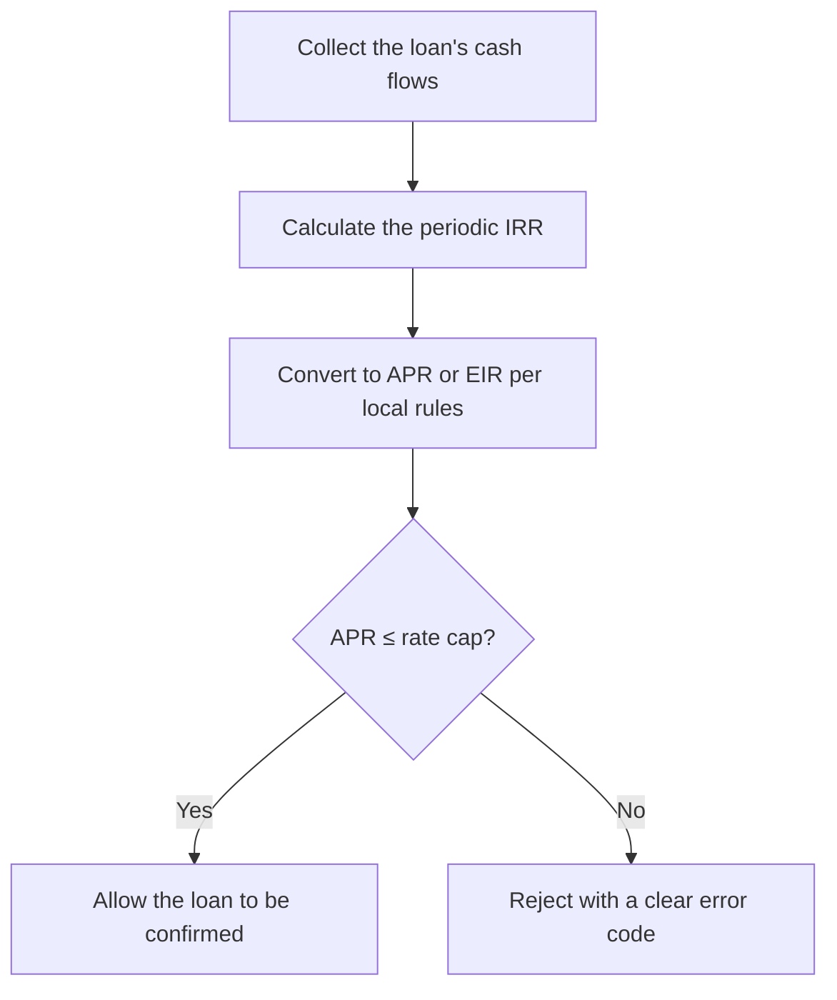
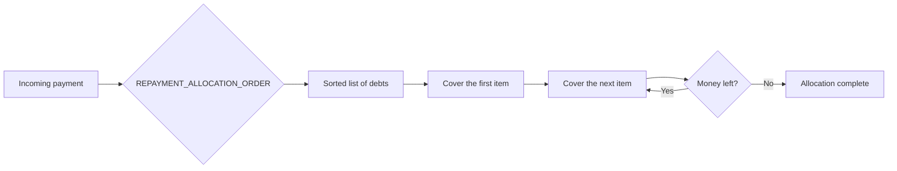
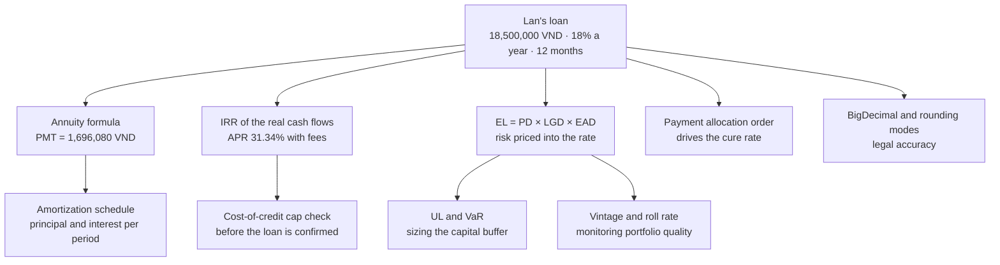

import {AmortizationFigure, LoanCalculator, CostOfCreditCalculator, TermComparison} from '@site/src/components/Loan';

> *"Mathematics does not care about your intentions. If the formula is wrong, the amount is wrong, however good your intentions."*
>
> *A principle of financial system design*

## Introduction: when a single dong matters

::::story
In banking it is not unusual for a lender to refund hundreds of millions of dollars to customers because of an interest calculation error that ran for years. What these cases have in common is that the error rarely comes from bad intent. Usually a formula was implemented incorrectly, or the system took the end-of-day balance where the contract specified the start-of-day balance. The error on each transaction is tiny, but multiplied across millions of transactions over several years it becomes a figure nobody can ignore.

Finance is one of the few fields where a rounding error can be a breach of contract and a breach of law at the same time.
::::

This chapter builds the mathematical foundation for understanding how a lending system calculates correctly. The focus is not only on the formulas, but on why a given formula is used, why it is implemented the way it is, and why even a tiny deviation is unacceptable.

Each character will find an answer here. Tuấn, the engineer, will understand why `BigDecimal` must be used instead of `double`. Lan will understand how her monthly payment is calculated. Minh will understand why the APR is not the rate printed on the contract. Hương will understand why the average loss is not enough to decide how much capital to hold.

## 2.1 Annuities: the foundation of every instalment calculation {/* #21-niên-kim-nền-tảng-của-mọi-tính-toán-trả-góp */}

### The situation

::::story
Tuấn is asked to implement the endpoint that calculates how much a customer pays each month. A former colleague left this code behind:

```java
public BigDecimal calculateMonthlyPayment(BigDecimal principal,
                                           double annualRate,
                                           int months) {
    return principal.divide(BigDecimal.valueOf(months), 2, HALF_UP);
}
```

Tuấn sees immediately that the code is wrong. The question is where it goes wrong, and what the correct formula is.
::::

### The problem

The code divides the principal evenly by the number of months and ignores the interest rate entirely. For a loan of 18,500,000 VND over 12 months, the result is 1,541,667 VND per month. That is principal only. The lender collects no interest at all.

A common fix is to add simple interest calculated on the original principal:

```text
Interest per month = 18,500,000 × 18% / 12 = 277,500 VND
Total per month    = 1,541,667 + 277,500  = 1,819,167 VND
```

This is also wrong, because it charges interest on the full original principal every month. After Lan pays her first instalment, the actual outstanding balance has fallen. If interest is still charged on 18,500,000 VND, she is paying interest on money she has already repaid.

:::key[Principle]
In each period, interest is calculated on the principal outstanding at the start of the period, not on the original principal.
:::

### Concept: the annuity

:::key[Annuity]
An **annuity** is a series of equal payments made at regular intervals. A borrower who takes a loan and repays a fixed amount each month is paying an annuity.
:::

The reason the payments are designed to be equal lies mostly in human behaviour, not in engineering. Borrowers find it easier to plan their finances when they know exactly how much they owe each month. A fixed amount also discourages the "pay less this month, catch up next month" mindset, and makes automated collection simpler.

### Mechanism: deriving the PMT formula

Let:

- $PV$ (present value) be the amount borrowed,
- $PMT$ (payment) be the amount paid each period,
- $r$ be the interest rate per period; for a monthly loan, $r = i / 12$, where $i$ is the nominal annual rate,
- $n$ be the number of periods.

For the loan to be mathematically "fair", the total present value of all payments must equal exactly the amount borrowed. The payment at the end of period $k$ has a present value of $PMT / (1+r)^k$, so:

$$
PV = \frac{PMT}{(1+r)} + \frac{PMT}{(1+r)^2} + \cdots + \frac{PMT}{(1+r)^n}
= PMT \cdot \frac{1 - (1+r)^{-n}}{r}
$$

The right-hand side is the sum of a geometric series with ratio $1/(1+r)$. Solving for $PMT$:

:::key[Periodic payment formula]
$$
PMT = PV \cdot \frac{r\,(1+r)^n}{(1+r)^n - 1}
$$
:::

This is the formula for an **ordinary annuity**: payments fall at the end of each period. Most consumer instalment loans use it.

### Worked example: Lan's loan

Lan borrows 18,500,000 VND at a nominal rate of 18% a year, over 12 months, repaid monthly. This is simulated data, used throughout the book.

**Step 1. Periodic rate.** $r = 18\% / 12 = 1.5\%$ per month, so $r = 0.015$.

**Step 2. Growth factor.** $(1 + 0.015)^{12}$ can be computed by repeated squaring:

```text
(1.015)^2  = 1.030225
(1.015)^4  = 1.030225^2 = 1.061364
(1.015)^8  = 1.061364^2 = 1.126493
(1.015)^12 = (1.015)^8 × (1.015)^4 = 1.126493 × 1.061364 = 1.195618
```

**Step 3. Apply the formula.**

$$
PMT = 18{,}500{,}000 \times \frac{0.015 \times 1.195618}{1.195618 - 1}
= 18{,}500{,}000 \times \frac{0.017934}{0.195618}
\approx 18{,}500{,}000 \times 0.091680
$$

The unrounded result is 1,696,079.87 VND. Rounded to the nearest dong with HALF_UP, **PMT = 1,696,080 VND per month**.

**Sanity check.** Twelve payments of 1,696,080 VND total 20,352,960 VND, so total interest is roughly 1.85 million, about 10% of the amount borrowed. That is reasonable: interest each period is the opening balance times 1.5%, and the balance falls steadily from 18.5 million to 0. The average balance over the 12 months is therefore only about 10.3 million, and 10.3 million × 18% ≈ 1.85 million.

The amortization schedule in the next section gives total interest of exactly 1,852,957 VND, 3 dong less than the estimate of 12 × PMT, because the final instalment is adjusted for rounding.

### A longer term: smaller payments, more interest

If Lan chooses a 24-month term at the same rate:

$$
(1.015)^{24} = 1.429503, \qquad
PMT = 18{,}500{,}000 \times \frac{0.015 \times 1.429503}{0.429503} \approx 923{,}596
$$

| Term | Monthly payment | Total interest per schedule |
|---|---|---|
| 12 months | 1,696,080 VND | 1,852,957 VND |
| 24 months | 923,596 VND | 3,666,301 VND |

Extending the term nearly halves the monthly payment, but nearly doubles the total interest. Behavioural economics calls the tendency of borrowers to focus on the monthly payment and ignore the total cost the "payment size illusion". Chapter 13 returns to it in the discussion of responsible product design.

The table below extends the comparison to more terms. You can change the amount and the rate to check for yourself.

<TermComparison />

### The amortization schedule

The annuity formula gives the payment for each period, but not how much of it is principal and how much is interest. The **amortization schedule** answers that with three rules applied in turn to each period $t$. Let $B_t$ be the opening balance, $I_t$ the interest and $P_t$ the principal of period $t$:

$$
\begin{aligned}
I_t &= B_t \times r \\
P_t &= PMT - I_t \\
B_{t+1} &= B_t - P_t
\end{aligned}
$$

Applied to Lan's loan, with each period's interest rounded HALF_UP to the dong:

| Period | Opening balance | Interest (1.5%) | Principal | Payment | Closing balance |
|---:|---:|---:|---:|---:|---:|
| 1 | 18,500,000 | 277,500 | 1,418,580 | 1,696,080 | 17,081,420 |
| 2 | 17,081,420 | 256,221 | 1,439,859 | 1,696,080 | 15,641,561 |
| 3 | 15,641,561 | 234,623 | 1,461,457 | 1,696,080 | 14,180,104 |
| 4 | 14,180,104 | 212,702 | 1,483,378 | 1,696,080 | 12,696,726 |
| 5 | 12,696,726 | 190,451 | 1,505,629 | 1,696,080 | 11,191,097 |
| 6 | 11,191,097 | 167,866 | 1,528,214 | 1,696,080 | 9,662,883 |
| 7 | 9,662,883 | 144,943 | 1,551,137 | 1,696,080 | 8,111,746 |
| 8 | 8,111,746 | 121,676 | 1,574,404 | 1,696,080 | 6,537,342 |
| 9 | 6,537,342 | 98,060 | 1,598,020 | 1,696,080 | 4,939,322 |
| 10 | 4,939,322 | 74,090 | 1,621,990 | 1,696,080 | 3,317,332 |
| 11 | 3,317,332 | 49,760 | 1,646,320 | 1,696,080 | 1,671,012 |
| 12 | 1,671,012 | 25,065 | 1,671,012 | **1,696,077** | 0 |
| **Total** | | **1,852,957** | **18,500,000** | **20,352,957** | |

Period 12 needs an explanation. If the full 1,696,080 VND were still paid, the principal portion would be 1,671,015 VND, 3 dong more than the remaining balance. Those 3 dong are the accumulated error from rounding the PMT and rounding each period's interest. The rule is that the final period pays exactly the remaining balance plus that period's interest, so the final payment is 1,696,077 VND and the balance closes at exactly 0.

Depending on the inputs, the final-period difference can be positive or negative, but it is always only a few dong. What matters is that the rule is clearly defined and applied consistently, because the customer, the statement and the accounting system must all see the same figure.

<AmortizationFigure
  principal={18500000}
  annualRate={18}
  months={12}
  kind="split"
  title="Figure 2.1. Principal and interest in each payment, Lan's loan"
  caption="Simulated data: 18,500,000 VND, 18% a year, 12 months, ordinary annuity. Interest falls and principal rises while the total payment stays almost constant. Generated by the same function as the 12-period table above."
/>

Three observations from the table and chart:

1. In period 1, interest makes up 277,500 / 1,696,080 ≈ 16.4% of the payment. In period 12, the share is only 25,065 / 1,696,077 ≈ 1.5%.
2. The principal repaid each period rises. This is the defining feature of an amortizing loan.
3. The balance does not fall linearly. It falls slowly early in the term and faster towards the end, as Figure 2.2 shows.

<AmortizationFigure
  principal={18500000}
  annualRate={18}
  months={12}
  kind="balance"
  title="Figure 2.2. Outstanding principal at the end of each period, Lan's loan"
  caption="Period 0 is the disbursement date. The curve bows slightly downward because the principal repaid each period rises."
/>

**Business meaning.** If Lan pays off the loan right after period 3, she owes only 14,180,104 VND, not 18,500,000 VND. The lender loses all the interest from the remaining 9 periods that it expected when it priced the loan. This is **prepayment risk**, an important risk in consumer lending, and the reason many products carry an early repayment fee. Chapter 5 analyses its effect on portfolio revenue.

### Implementation: the LPS module

In VLP, the LPS (Loan Pricing) module generates the repayment schedule using exactly these rules, but it has to handle more detail: fee schedules, promotional periods, actual due dates. The code below is simplified to make the algorithm clear.

```java
// Code minh họa - không phải mã nguồn production
InstalmentPlanDto calculateInstalmentPlan(IPCalculationRequest request) {
    BigDecimal monthlyRate = request.getAnnualRate()
        .divide(TWELVE, 10, HALF_UP);            // (1) 10 chữ số thập phân cho giá trị trung gian

    BigDecimal factor = ONE.add(monthlyRate).pow(request.getTenor());

    BigDecimal pmt = request.getFinancedAmount()
        .multiply(monthlyRate).multiply(factor)
        .divide(factor.subtract(ONE), 0, HALF_UP); // (2) chỉ làm tròn về đồng ở bước cuối

    List<IPInstalmentDto> schedule = new ArrayList<>();
    BigDecimal balance = request.getFinancedAmount();

    for (int month = 1; month <= request.getTenor(); month++) {
        BigDecimal interest = balance.multiply(monthlyRate)
            .setScale(0, HALF_UP);                 // lãi kỳ làm tròn về đồng
        BigDecimal principal = pmt.subtract(interest);
        BigDecimal payment = pmt;

        if (month == request.getTenor()) {         // (3) kỳ cuối khép dư nợ về đúng 0
            principal = balance;
            payment = principal.add(interest);
        }

        schedule.add(new IPInstalmentDto(month, payment, principal, interest));
        balance = balance.subtract(principal);
    }
    return new InstalmentPlanDto(pmt, schedule);
}
```

The input is the financed amount, the annual rate and the term. The output is the PMT and a list of periods, each with a total amount, a principal portion and an interest portion. Three design decisions stand out:

1. The periodic rate is kept to 10 decimal places. Rounding the monthly rate early would amplify the error through the power $(1+r)^n$.
2. Rounding to the dong happens only at the step that produces a figure the customer sees: the PMT and each period's interest. Section 2.5 explains why.
3. The final period uses a separate `payment` variable to clear the balance. It does not overwrite `pmt`, because `pmt` is the periodic payment committed to the customer and is used elsewhere.

### Ordinary annuity and annuity due

The formula above applies to an ordinary annuity: payments fall at the end of each period. With an **annuity due**, payments fall at the start of each period, so each one is discounted by one period less:

$$
PMT_{due} = \frac{PMT_{ordinary}}{1 + r}
$$

For Lan's loan, paying at the start of each period gives 1,696,079.87 / 1.015 ≈ 1,671,015 VND. Most consumer loans in Vietnam are ordinary annuities, but some products collect a payment at the start of the period. Confusing the two is the source of many calculation errors.

You can check this whole section with the tool below. The defaults are Lan's loan.

<LoanCalculator />

:::summary[Section 2.1]
The periodic payment on an instalment loan is given by the annuity formula $PMT = PV \cdot r(1+r)^n / ((1+r)^n - 1)$. Each period's interest is the opening balance times the periodic rate, and the rest of the payment is principal, so interest falls and principal rises. A longer term means a smaller payment but more total interest. The final period is adjusted so that the balance reaches exactly 0.
:::

## 2.2 IRR, APR and EIR: what is the "real" interest rate? {/* #22-irr-apr-và-eir-lãi-suất-thật-là-gì */}

### The situation

::::story
Lan's contract states a rate of 18% a year. But the contract also has two fees:

- an appraisal fee of 200,000 VND, charged once and deducted directly from the disbursed amount,
- a loan insurance premium of 100,000 VND a month, paid with each instalment.

In practice, Lan receives only 18,300,000 VND but pays 1,696,080 + 100,000 = 1,796,080 VND each month. Is the real cost of this loan still 18% a year?
::::

### The problem with the nominal rate

The 18% on the contract is the **nominal interest rate**. It reflects only the cost of using the principal and excludes fees. This is why customers are often surprised to find that the total cost is much higher than the figure they saw.

That is why regulation in many countries requires lenders to disclose a measure that captures the full cost of borrowing, usually the **APR** or the **EIR**. Both are built from the same quantity: the IRR.

### The internal rate of return

:::key[IRR]
The **IRR** (internal rate of return) is the interest rate that makes the total present value of all cash flows equal to zero. For a loan, the IRR is the periodic rate the borrower actually pays once **all** cash flows are counted: the amount actually received, the instalments, fees and insurance.
:::

$$
0 = CF_0 + \frac{CF_1}{1+IRR} + \frac{CF_2}{(1+IRR)^2} + \cdots + \frac{CF_n}{(1+IRR)^n}
$$

Here $CF_0$ is the amount the borrower actually receives at disbursement (positive for the borrower), and $CF_1, \ldots, CF_n$ are the amounts paid in each period (negative). The IRR has no closed-form solution; it has to be found iteratively, by trial and adjustment, bisection or Newton-Raphson.

### Worked example: the real cost of Lan's loan

Cash flows from Lan's side:

```text
CF_0           = +18,300,000   (18,500,000 less the 200,000 appraisal fee)
CF_1 ... CF_11 = -1,796,080    (1,696,080 principal and interest + 100,000 insurance)
CF_12          = -1,796,077    (final period adjusted for rounding)
```

We look for the monthly rate $i$ at which the present value of the 12 payments equals exactly 18,300,000 VND. The higher the discount rate, the smaller the present value, so we can home in on it:

| Trial monthly rate | Present value of 12 payments | Versus 18,300,000 |
|---:|---:|---|
| 1.9% | 19,111,336 | higher, raise the rate |
| 2.1% | 18,878,030 | higher, raise the rate |
| 2.5% | 18,423,766 | higher, raise the rate |
| 2.6% | 18,312,708 | slightly higher |
| 2.7% | 18,202,631 | lower, overshot |

The solution lies between 2.6% and 2.7%. Solving exactly by bisection gives **IRR ≈ 2.611% per month**.

:::caution[One wrong factor, a wrong conclusion]
When calculating by hand, a single discount factor wrong in the fourth digit, for example writing $(1.019)^{-12}$ as 0.79685 instead of 0.79783, can push the solution down to about 2.15% a month, an APR of only 25.8%. That is why LPS solves the IRR numerically and verifies it by substituting the solution back into the NPV equation.
:::

### APR, EIR and the nominal rate

These three concepts are often confused, even within the industry.

The **nominal rate** is the figure on the contract. It reflects only the pure interest cost and excludes fees.

The **APR** (annual percentage rate) annualizes the periodic IRR by simple multiplication, without compounding between periods. Writing $IRR_m$ for the monthly IRR:

$$
APR = IRR_m \times 12
$$

The **EIR** (effective interest rate) annualizes the IRR with compounding, reflecting the real cost if cash flows are reinvested at the same rate:

$$
EIR = (1 + IRR_m)^{12} - 1
$$

Applied to Lan's loan:

| Measure | No fees | Appraisal fee only | Appraisal fee and insurance |
|---|---:|---:|---:|
| Nominal rate | 18.00% a year | 18.00% a year | 18.00% a year |
| Monthly IRR | 1.500% | 1.675% | 2.611% |
| APR | 18.00% | 20.10% | 31.34% |
| EIR | 19.56% | 22.06% | 36.25% |

The first column shows a point that is often overlooked: even with no fees, the EIR is higher than the nominal rate (19.56% versus 18%), because interest compounds monthly. The second and third columns show that the 100,000 VND monthly insurance premium, which sounds small, amounts to about 6.5% of the loan amount each year and pushes the APR from around 20% to over 31%.

### Why this is a legal issue

Suppose a regulation in force caps the APR at 20% a year. Lan's loan, with an APR of 31.34%, breaches it even though the nominal rate is only 18%. Even without the insurance premium, an APR of 20.10% still exceeds the cap.

This example implies three requirements for the system:

1. The APR must be calculated and checked before the loan is confirmed, not afterwards.
2. Checking the nominal rate is not enough.
3. Every mandatory fee must be included in the cash flows used to calculate the APR.

The 20% cap here is an assumption for illustration. Actual rate caps and how the cost of credit is calculated depend on each market's regulation; Appendix D summarizes the legal framework in Vietnam.

### Implementation: checking the cost-of-credit cap

:::info[Scope of VLP]
In VLP, the LPS module calculates XIRR and EIR, but blocking loans that exceed a rate cap has not been implemented: there is no `RateCapValidator` class and no `APR_EXCEEDS_RATE_CAP` error code. The flow below is a recommended design based on industry practice, not current system behaviour.
:::



The cash flows to collect are the amount actually received after one-off fees, the periodic payments including periodic fees, and any fees due at the end of the term. In a compliant system, this check is a hard stop in the origination flow, not an optional feature.

The tool below calculates the IRR, APR and EIR for any combination of rate and fees. The defaults are Lan's loan.

<CostOfCreditCalculator />

:::summary[Section 2.2]
The nominal rate does not reflect fees. The IRR is the periodic rate that makes the present value of all cash flows zero. The APR is the monthly IRR times 12; the EIR is $(1+IRR)^{12} - 1$. For Lan's loan, the appraisal fee and the insurance premium push the APR from 18% to 31.34%. The cost-of-credit cap check is a recommended design and is not yet in VLP.
:::

## 2.3 Quantitative credit risk models {/* #23-mô-hình-rủi-ro-tín-dụng-định-lượng */}

### From expected loss to a capital buffer

Chapter 1 introduced the expected loss formula $EL = PD \times LGD \times EAD$. This section goes one step further: EL is only the **average** loss. The actual loss in any given year can be much lower or much higher.

::::story
Hương receives a report: the portfolio's expected loss this year is 45 billion VND. She asks the head of risk whether provisioning 45 billion is enough. The answer is no. 45 billion is an average. This year's loss could be 30 billion with luck, or 80 billion in a downturn. The company needs enough capital to stay standing in the bad scenario.
::::

### Expected and unexpected loss

**Expected loss** (EL) is the average level of loss. It can be estimated and priced into the interest rate through a risk premium.

**Unexpected loss** (UL) is the part of the loss above EL in bad scenarios. UL cannot be priced into the rate, because doing so would make the product too expensive; it has to be absorbed by equity.

| Component | Covered by |
|---|---|
| Expected loss (EL) | The interest rate, specifically the credit risk premium |
| Unexpected loss (UL) | Equity, acting as a capital buffer |

**VaR** (value at risk) at 99% confidence is the loss level that the actual loss does not exceed in 99% of scenarios. The required capital buffer $C$ is approximately the gap between VaR and EL:

$$
C \approx VaR_{99\%} - EL
$$

**Worked example.** A portfolio of 100,000 loans, each 15 million VND, PD = 5%, LGD = 60%.

```text
Total EAD = 100,000 × 15,000,000           = 1,500 billion VND
EL        = 5% × 60% × 1,500 billion       = 45 billion VND
```

Assume, for simplicity, that losses are normally distributed with a standard deviation of about 12 billion VND (estimated from the year-to-year variation in PD). Under a normal distribution, one-sided 99% confidence corresponds to 2.33 standard deviations:

```text
VaR 99%        ≈ EL + 2.33 × σ = 45 + 2.33 × 12 = 72.96 billion VND
Capital buffer ≈ 72.96 - 45                     = 27.96 billion VND
```

If Hương provisions only 45 billion and a bad year brings losses of 72 billion, the company is about 27 billion short and may become insolvent. In practice, credit loss distributions are right-skewed with fatter tails than the normal distribution, so the normal assumption tends to understate VaR. This example only illustrates the logic.

### Vintage analysis

::::story
Minh has to report to the board on the performance of the loan product for teachers launched in January 2024. The question sounds simple but is not easy to answer: how do you evaluate a 36-month loan that has only been running for 12 months?
::::

:::key[Vintage]
A **vintage** is a group of loans disbursed in the same period, usually a month or a quarter. **Vintage analysis** tracks each group's performance by the "age" of the loans, meaning the number of months since disbursement.
:::

The overall default rate alone is not enough because it mixes vintages of different ages. A good 2022 vintage can mask a bad 2024 vintage, simply because the new vintage has not had time to reveal its problems.

```text
Cumulative default rate (illustrative)
    │
10% │                          ....vintage_2022
    │                    .....
 8% │              ......              vintage_2023
    │        .......         .........
 6% │  .......        ......
    │..                          .......vintage_2024
 4% │              ...........
    │    ..........
 2% │....
    └───────────────────────────────────→ Months since disbursement
        3   6   9   12  15  18  21  24
```

How to read the chart: the 2022 vintage has a cumulative default rate of 10% after 24 months; the 2023 vintage is at 8%, better, perhaps thanks to an improved scoring model; the 2024 vintage is only 6 months old at 2%, not enough data to draw a conclusion.

Behaviour in the first 1 to 3 months of a vintage is usually a good early indicator of long-term performance. If the 2024 vintage already shows 3% at month 3, while the 2023 vintage at the same age showed only 1.5%, it should be investigated at once rather than waiting for more data.

### Roll rate

The **roll rate** is the probability that an account moves from one days-past-due (DPD) bucket to another over one month. The buckets commonly used:

| Bucket | Days past due (DPD) |
|---|---|
| Current | 0, paid on time |
| Bucket 1 | 1 to 30 |
| Bucket 2 | 31 to 60 |
| Bucket 3 | 61 to 90 |
| Bucket 4 | over 90, usually treated as default |

An illustrative roll rate matrix, each row being this month's state, each column next month's state, with every row summing to 100%:

| From \ To | Current | 1–30 | 31–60 | 61–90 | 91+ |
|---|---:|---:|---:|---:|---:|
| **Current** | 94% | 6% | 0% | 0% | 0% |
| **1–30** | 40% | 20% | 40% | 0% | 0% |
| **31–60** | 15% | 10% | 15% | 60% | 0% |
| **61–90** | 5% | 5% | 10% | 15% | 65% |
| **91+** | 2% | 1% | 2% | 5% | 90% |

Reading by row: each month 6% of current accounts become delinquent for the first time; 40% of Bucket 1 accounts return to current on their own (self-cure); 65% of Bucket 3 accounts move to over 90 days and almost certainly become losses.

**In VLP**, the DRG (Debt Register) module tracks DPD from the event stream sent by the LAS module over Kafka (topic `transaction.confirmed`) and a daily batch job. Roll rate analysis is usually computed in batch from DRG data, not in real time. When the roll rate from Bucket 1 to Bucket 2 jumps, say from 40% to 55%, it is an early warning of portfolio quality, typically appearing 2 to 3 months before the official default rate rises. Chapter 10 describes the DRG architecture.

:::summary[Section 2.3]
EL is the average loss and is priced into the interest rate; UL is the loss above average in bad scenarios and must be absorbed by equity. VaR at 99% gives the loss level not exceeded in 99% of scenarios. Vintage analysis compares groups of loans of the same age; the roll rate is an early indicator of portfolio quality.
:::

## 2.4 Mechanism design: where mathematics meets economics {/* #24-thiết-kế-cơ-chế-khi-toán-học-gặp-kinh-tế-học */}

### The situation

::::story
The collections team sends Minh a request: "The system currently uses customer payments to cover penalty fees first, then principal. We want to reverse it: principal first, penalties after."

On the surface, this is a simple configuration change. In reality, it is a **mechanism design** problem with significant economic consequences.
::::

### Incentive mechanisms in credit

:::key[Mechanism design]
**Mechanism design** is the branch of economics that studies how to set the rules of the game so as to reach a desired outcome when each participant acts in its own interest.
:::

In consumer credit, one important "rule of the game" is the **payment allocation order**: when a customer pays less than the full amount due, which items the payment covers first. For example, a customer pays 500,000 VND while owing 800,000 VND in principal, interest and penalty fees.

**Approach A: penalties first, principal last.** The order is penalties, interest, then principal. This favours the lender in the short term: penalties are collected immediately, and the principal stays high so future interest remains large. But principal falls very slowly, the customer easily slides into a debt spiral, and loses the motivation to pay because "however much I pay, I never get out". Some stop paying altogether. This is the moral hazard discussed in Chapter 1.

**Approach B: principal first, penalties last.** The order is interest, principal, then penalties. Principal falls faster, the customer can see a way out, and the share of delinquent accounts that return to current (the cure rate) is higher. In exchange, penalties may never be collected if the account defaults.

### Worked example: comparing the two mechanisms

Hương has historical data on 10,000 accounts 30 to 60 days past due, with an average balance of 8 million VND and an LGD of 60%:

- under approach A, 35% of accounts self-cure,
- under approach B, 52% of accounts self-cure,
- the average uncollected penalty under approach B is 500,000 VND per defaulted account.

```text
Approach A: 6,500 defaulted accounts × 8,000,000 × 60% = 31.20 billion VND loss
Approach B: 4,800 defaulted accounts × 8,000,000 × 60% = 23.04 billion VND loss
            Uncollected penalties: 4,800 × 500,000    =  2.40 billion VND

Net benefit of approach B = 31.20 - 23.04 - 2.40      =  5.76 billion VND
```

The mechanism that seems to disadvantage the lender turns out to be better economically, because it gives the customer the right incentive to repay. The cure rates here are illustrative; in practice they must be measured with a controlled experiment before changing the mechanism for the whole portfolio.

### Implementation: the `REPAYMENT_ALLOCATION_ORDER` parameter

In VLP, the payment allocation order is determined by the `REPAYMENT_ALLOCATION_ORDER` parameter. Its value is stored in the database table `GLOBAL_PARAMETER`, not hard-coded. LAS supports five modes:

```text
// verified: 5 modes confirmed in the LAS module technical documentation
PRIORITY_ONLY                      Sort by priority in the fee schedule
DUE_DATE_AND_PRIORITY              Earliest due first, then by priority
DUE_DATE_IP_GROUP_PRIORITY         By due date and instalment plan group priority
IP_INTEREST_RANK                   Higher interest rate first
DUE_DATE_AND_PRIORITY_NONZERO_DPD  Overdue items first when DPD > 0
```



Each mode answers the question "which debt is covered first" differently:

| Mode | Covered first | Characteristics |
|---|---|---|
| `PRIORITY_ONLY` | The item with the highest priority in the fee schedule, ignoring due dates | The outcome depends entirely on how priorities are configured |
| `DUE_DATE_AND_PRIORITY` | The earliest due item, then by priority on the same date | "Oldest debt first", easy to explain to customers |
| `IP_INTEREST_RANK` | The instalment plan with the highest interest rate | Pays down the most expensive debt fastest |

:::key[A mode's name does not tell you its outcome]
By its name, `PRIORITY_ONLY` looks like a "principal first" mode. But with the fee schedule configured in VLP, penalty fees have the highest priority, so this mode actually covers penalties first. With an insufficient payment, neither `PRIORITY_ONLY` nor `DUE_DATE_AND_PRIORITY` brings the account back to current; the real difference lies in when revenue is recognized. [Chapter 8](/docs/system/ch08-account-management) analyses both modes in detail.
:::

The economic outcome of an allocation mode lies not in its name but in the priority order configured in the fee schedule, and in how customers repay when they see their balance change.

The choice of mode directly affects actual losses (through the cure rate), customer behaviour (through the incentive to repay), and legal compliance, since some markets regulate the priority order for payment allocation. It is therefore a business decision, implemented as technical configuration, not an engineering decision.

:::summary[Section 2.4]
Payment allocation order is an incentive mechanism. A mechanism that seems to disadvantage the lender, such as covering principal first, can deliver more net economic value by raising the cure rate. In VLP, the decision is configured through `REPAYMENT_ALLOCATION_ORDER`, which has five modes.
:::

## 2.5 Why finance does not use floating-point numbers {/* #25-tại-sao-tài-chính-không-dùng-số-thực-dấu-phẩy-động */}

### The situation

::::story
Tuấn is reviewing code from a new colleague:

```java
double principal = 18500000.0;
double rate = 0.015;
double payment = principal * rate * Math.pow(1 + rate, 12)
                / (Math.pow(1 + rate, 12) - 1);
System.out.println("Monthly payment: " + payment);
// Output: Monthly payment: 1696079.8687652452

long charged = (long) payment;   // 1,696,079
```

The calculation comes out close, but the last line truncates the fractional part instead of rounding, so the payment is recorded as 1,696,079 VND instead of the 1,696,080 VND on the contract. The colleague argues that nobody cares about one dong. Tuấn refuses to merge. The reason is not just the one dong.
::::

:::note[Where the dong went]
The exact value of the expression above is 1,696,079.8687... The `(long)` cast truncates the fraction instead of rounding, so the system loses almost a whole dong. The representation error of `double` at this magnitude is far smaller; the main problem is the lack of an explicitly declared rounding rule. Together, these two issues are the source of reconciliation differences.
:::

### The problem with floating point

Computers store floating-point numbers according to the IEEE 754 standard, in binary. Most decimal numbers cannot be represented exactly in binary, just as 1/3 cannot be written exactly in decimal.

```java
System.out.println(0.1 + 0.2);         // 0.30000000000000004
System.out.println(0.1 + 0.2 == 0.3);  // false
```

For a single calculation, the error is minute: a `double` has about 15 to 16 significant digits, so for amounts in the tens of millions of dong, the error per operation is on the order of a billionth of a dong. The problems lie in three other places.

**Comparisons are unreliable.** Two systems computing the same amount with operations in a different order can produce two `double` values that differ in the last digit, and the equality check fails. In reconciliation between systems, a daily routine at a finance company, differences like these generate hundreds of hours of investigation.

**Accumulation does not give the expected result.** Adding 0.1 ten times does not give 1.0:

```java
double total = 0.0;
for (int i = 0; i < 10; i++) {
    total += 0.1;
}
System.out.println(total);  // 0.9999999999999999
```

Likewise, summing 30 days of daily accrued interest with `double` does not guarantee the exact monthly interest.

**Rounding at boundary values goes wrong.** This is the most serious problem. The number 1.005 cannot be represented exactly; the value actually stored is 1.00499999999999989... Rounding HALF_UP to two decimal places gives 1.00 instead of 1.01:

```java
new BigDecimal(1.005).setScale(2, RoundingMode.HALF_UP);    // 1.00  (từ double)
new BigDecimal("1.005").setScale(2, RoundingMode.HALF_UP);  // 1.01  (từ chuỗi thập phân)
```

An infinitesimal deviation has flipped the rounding direction and produced a difference of a whole unit. In a system that calculates interest for millions of accounts, boundary cases like this are certain to occur, and each one is an amount charged differently from the contract.

### The solution: `BigDecimal`

`BigDecimal` in Java, and equivalent types such as `decimal` in C# or `NUMERIC` in PostgreSQL, store decimal numbers with configurable precision and without the representation error of floating point:

```java
BigDecimal a = new BigDecimal("0.1");
BigDecimal b = new BigDecimal("0.2");
System.out.println(a.add(b));  // 0.3
```

Always construct a `BigDecimal` from a string (`new BigDecimal("0.1")`) or with `BigDecimal.valueOf(...)`, never from a `double` value, because `new BigDecimal(0.1)` carries the binary error of the `double` intact.

### Rounding modes and their legal meaning

| Mode | Rule | Example, rounding to an integer | Typical use |
|---|---|---|---|
| `HALF_UP` | .5 and above rounds up | 1.5 → 2, 1.4 → 1 | Most common, "ordinary rounding" |
| `HALF_EVEN` | Exactly .5 goes to the nearest even number | 1.5 → 2, 2.5 → 2 | Reduces cumulative bias (banker's rounding) |
| `UP` | Always away from zero | 1.1 → 2, −1.1 → −2 | Fees, so as never to undercharge |
| `DOWN` | Always towards zero | 1.9 → 1, −1.9 → −1 | Interest paid to customers, so as never to overpay |
| `CEILING` | Towards positive infinity | 1.1 → 2, −1.9 → −1 | Rarely used |
| `FLOOR` | Towards negative infinity | 1.9 → 1, −1.1 → −2 | Rarely used |

The choice of rounding mode is a legal issue because it determines how much the customer pays. Suppose 1,000,000 accounts, where each month's interest calculation produces 12,345.678 VND:

```text
HALF_UP → 12,346 VND
DOWN    → 12,345 VND

Difference: 1 VND × 1,000,000 accounts × 12 months = 12,000,000 VND a year
```

If the contract specifies one rounding method and the system uses another, that is a breach of contract, even at one dong per transaction.

### Precision of intermediate values

Rounding too early is as dangerous as not rounding at all:

```java
// Sai: làm tròn lãi suất tháng còn 2 chữ số thập phân
BigDecimal monthlyRate = annualRate.divide(TWELVE, 2, HALF_UP);   // 0.18/12 = 0.015 thành 0.02: sai lệch 33%
BigDecimal factor = ONE.add(monthlyRate).pow(n);

// Đúng: giữ độ chính xác cao cho giá trị trung gian
BigDecimal monthlyRate = annualRate.divide(TWELVE, 10, HALF_UP);  // 10 chữ số thập phân
BigDecimal factor = ONE.add(monthlyRate).pow(n);
// Chỉ làm tròn ở bước tạo ra con số khách hàng nhìn thấy
BigDecimal result = /* ... */ .setScale(0, HALF_UP);
```

:::key[Rounding principle]
Keep high precision throughout the calculation, and round exactly once, at the step that produces the amount to be recorded, using the rounding mode the contract specifies.
:::

### Implementation: the `Money` class in VLP

In VLP, all financial calculations must use `BigDecimal`. On top of that, the system wraps monetary values in a `Money` class, an `@Embeddable` holding a `BigDecimal` and a currency code, so that two amounts in different currencies can never be added by mistake:

```java
// verified: Money.java (com.vela.lending.las.entity.container.Money)
@Embeddable
@NoArgsConstructor
public class Money implements Serializable, Comparable<Money> {
    private BigDecimal value;
    private String currency;

    // Factory methods
    public static Money of(BigDecimal value, String currency) { ... }
    public static Money zero(String currency) { ... }

    // Arithmetic
    public Money add(Money other) { ... }
    public Money subtract(Money other) { ... }
    public Money multiply(BigDecimal factor) { ... }

    // Comparisons
    public boolean isZero() { ... }
    public boolean isPositive() { ... }
}
```

A usage example, based on the `CurrentBalance` entity whose `outstandingDebt` field is of type `Money`:

```java
// Không bao giờ:
double interest = balance * rate;                       // ✗ số dấu phẩy động

// Luôn luôn:
Money interest = Money.setScale(
    currentBalance.getOutstandingDebt().multiply(rate),
    0, HALF_UP);                                        // ✓ phương thức static của Money
```

When Tuấn refused to merge the code that used `double`, he was not being difficult. He was protecting the legal accuracy of millions of transactions.

:::summary[Section 2.5]
Floating-point numbers carry representation error; although small, it breaks comparisons, accumulation and above all rounding at boundary values. Money must be represented with an exact decimal type such as `BigDecimal`, constructed from a string. The rounding mode must match the contract, and rounding happens once, at the final step. VLP uses the `Money` class to bind a value to its currency.
:::

## Chapter 2 summary

This chapter covered all the mathematics behind Lan's loan:



### Formula reference

| Formula | Meaning | Used for |
|---|---|---|
| $PMT = PV \cdot \dfrac{r(1+r)^n}{(1+r)^n - 1}$ | Periodic payment | Generating the repayment schedule |
| $FV = PV \cdot (1+r)^n$ | Future value | Accumulated interest |
| $PV = FV / (1+r)^n$ | Present value | Discounting cash flows |
| $EL = PD \times LGD \times EAD$ | Expected loss | Risk pricing |
| $APR = IRR_m \times 12$ | Annual cost of credit, not compounded | Disclosure, cap checks |
| $EIR = (1 + IRR_m)^{12} - 1$ | Annual cost of credit, compounded | Comparing products |

### Key takeaways

A fixed instalment does not mean fixed principal and interest; their shares change every period. The rate on the contract is not the real cost of the loan when there are fees. The average loss is not enough to decide how much capital to hold. Decisions that sound like technical configuration, such as payment allocation order or rounding mode, are in fact business and legal decisions.

### Key terms

Annuity, amortization schedule, nominal rate, IRR, APR, EIR, expected loss (EL), unexpected loss (UL), VaR, vintage, roll rate, cure rate, mechanism design, rounding mode. See the full definitions on the [Glossary](/docs/glossary) page.

## Review questions

**Recall**

1. What is the PMT formula for an ordinary annuity? What does each variable mean?
2. How do the nominal rate, the APR and the EIR differ?
3. What is vintage analysis? Why is the overall default rate alone not enough?
4. Why must `double` or `float` never be used for money?

**Understand**

5. Explain why a longer term lowers the PMT but raises total interest. What behavioural economics problem does this create?
6. In an amortization schedule, why does the principal portion rise while the interest portion falls? What does that mean for prepayment risk?
7. Why does the way APR is calculated matter for legal compliance? Give an example of a loan whose nominal rate is "compliant" but whose APR exceeds the cap.
8. The roll rate from Bucket 1 to Bucket 2 rises from 35% to 50% in one month. What does that mean, and what would you do next?

**Apply**

9. Minh designs a student loan product: 5,000,000 VND, 24% a year, a 6-month term, an appraisal fee of 150,000 VND.
   - (a) Calculate the monthly PMT.
   - (b) Calculate the APR including the appraisal fee.
   - (c) If the cap is an APR of 30%, is the product compliant?
   - (d) What is the maximum appraisal fee that keeps it under the cap?
10. Hương's portfolio has 200,000 loans, PD = 3.5%, LGD = 58%, average EAD 12 million VND.
    - (a) Calculate the annual EL, in absolute terms and as a percentage of the outstanding balance.
    - (b) How far above the base rate must the interest rate be to cover this EL?
    - (c) If PD rises to 5% as the economy weakens, how much does EL increase?

**Analyse**

11. VLP uses the 30/360 day-count convention (D30_360). A fintech company proposes switching to actual/365.
    - (a) Calculate the interest for February (28 days) and August (31 days) under both conventions for a 10 million VND loan at 18% a year.
    - (b) Which convention favours the lender, which the borrower, and in what circumstances?
    - (c) If switching from 30/360 to actual/365, what has to change in the fee schedule configuration, the billing engine and the contract template?
    - (d) From a legal standpoint, does Vietnam regulate day-count conventions?
12. Tuấn finds that the system rounds both interest and principal HALF_UP, while the contract says "interest rounded up, principal rounded down". Estimate the financial impact after 5 years across 500,000 active accounts. Does this need an immediate hotfix? Argue your answer.

## Exercises

**Exercise 1. Build an amortization schedule.** Build a full amortization schedule for a loan of 30,000,000 VND at 21% a year over 18 months. Calculate the PMT first, then fill in each period; the balance after period 18 must be exactly 0. Follow-up: if the customer wants to settle right after period 9, how much do they pay? This is the settlement amount, equal to the outstanding principal after period 9, before any early repayment fee. You can use the [repayment schedule tool](/docs/tools#schedule) to check the schedule, and the [early settlement tool](/docs/tools#early-settlement) to check the settlement amount.

**Exercise 2. Calculate the APR and check compliance.** A finance company offers a product: a 10,000,000 VND loan, a 12-month term, a nominal rate of 19.8% a year, an appraisal fee of 300,000 VND charged at disbursement, an insurance premium of 80,000 VND a month and a service fee of 50,000 VND a month. The assumed cost-of-credit cap is an APR of 25%.
(a) Calculate the total monthly payment. (b) Calculate the APR by trial and adjustment to find the IRR. (c) Does the product exceed the cap? (d) If it does, which parameters should change, and how?

**Exercise 3. Analyse a mechanism design.** A finance company is considering switching `REPAYMENT_ALLOCATION_ORDER` from `DUE_DATE_AND_PRIORITY` to `PRIORITY_ONLY`. Current data: 50,000 accounts 30 to 60 days past due, an average balance of 10 million VND, LGD 62%, a cure rate of 38% under the current mode. A trial on 5,000 accounts with `PRIORITY_ONLY` gave a cure rate of 49%.
(a) Calculate the net economic gain or loss from switching. (b) Calculate the total uncollected penalties, assuming an average of 300,000 VND per defaulted account. (c) Should the company switch, and under what conditions? (d) What needs to be discussed with the regulator when making the change?

## Further reading

**Financial mathematics**

- Brealey, Myers & Allen (2019). *Principles of Corporate Finance*, 13th ed. McGraw-Hill. Chapters 2 to 4 on the time value of money, chapter 24 on credit risk.

**Credit risk**

- McNeil, Frey & Embrechts (2015). *Quantitative Risk Management: Concepts, Techniques and Tools*. Princeton University Press. A reference on VaR and credit risk models.

**Engineering**

- Bloch (2018). *Effective Java*, 3rd ed. Addison-Wesley. Item 60, "Avoid float and double if exact answers are required", explains concisely why to use `BigDecimal` from a software engineer's point of view.

Chapter 3 applies this foundation to the first practical problem: designing a credit product. From decisions about rate structure, fees and term, it moves on to how VLP's tariff system turns those decisions into configuration that can change without redeploying code. [Chapter 3. Designing financial products](/docs/products/ch03-product-design).
