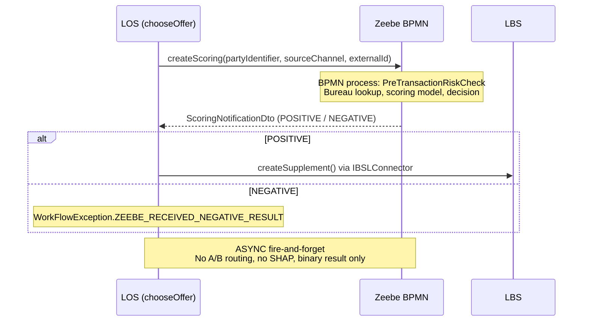

> *"A good model in the hands of someone who does not understand it is more dangerous than no model at all."*
>
> *A principle of model risk management*

## Introduction: four minutes to decide {#dẫn-nhập-bốn-phút-quyết-định}

::::story
Lan submits her loan application at 10:15 and is approved at 10:19. In those four minutes a decision was made that she did not see, and in truth nobody saw.

A model looked at 47 input variables about Lan, from her credit history and verified income to the time she applied and even the way she filled in the form, and produced a single number: 420.

That number decides whether Lan gets the loan, how much she can borrow and at what rate.

Is the model right or wrong? Fair or biased? Better or worse than the old model? When does it start to go stale?
::::

This chapter goes from the statistical foundations of credit scoring, through modern modelling techniques, to the issues that are rarely discussed when running it for real: explainability, fairness, model drift and deployment. Data scientists, engineers and business analysts all need this chapter, each from their own angle.

## 11.1 The history of credit scoring {#111-lịch-sử-của-chấm-điểm-tín-dụng}

### From judgement to statistics

::::story
In 1950, Bình wants to borrow money to buy a house. He goes to the bank and sits opposite the loan officer, Phúc, who has twenty years in the job. Phúc looks at Bình, asks a few questions about his work, his family and what the money is for, and then decides.

That is judgmental lending: decisions based on human experience and intuition.
::::

This approach has four problems:

| Problem | How it shows |
|---|---|
| Inconsistency | Phúc might approve Bình but turn down Cường with a similar profile, depending on his mood that morning |
| Hidden bias | Phúc may unconsciously favour people from his home town, his school, or who talk the way he does |
| It does not scale | One officer handles 10-20 files a day; 10,000 applications a day need 500-1,000 people |
| No audit trail | "Why was Bình rejected?" "It didn't feel right." Indefensible in law, and impossible to improve |

**Statistical scoring, the breakthrough:**

```text
1956: Bill Fair and Earl Isaac found Fair, Isaac and Company
      → Later FICO
1989: The FICO Score is launched and widely adopted by US lenders

The idea: instead of asking "Do I feel I can trust you?",
ask "How did people with a profile like yours repay?"

The statistical approach:
  1. Collect historical data: borrower characteristics + outcome (repaid / defaulted)
  2. Find the variables that predict the outcome
  3. Assign weights: good predictors → higher weights
  4. Score = a weighted combination of the variables
  5. Decision: score above the cut-off → approve
```

### Why the FICO Score is still around

::::story
Tuấn, an engineer, asks: "With modern ML, why do so many banks still use FICO? Is it just habit, or is there a real reason?"
::::

FICO publishes five groups of factors with their relative weights:

| Group | Weight | What it covers | Why it predicts |
|---|---|---|---|
| Payment history | 35% | Whether payments were on time, DPD history | Past behaviour is the strongest indicator of future behaviour |
| Amounts owed | 30% | Utilization = balance / limit | Using most of the limit is a sign of financial stress |
| Length of credit history | 15% | How long the person has had credit | Longer history, more data, easier to predict |
| Credit mix | 10% | Cards, instalment loans, mortgages | Shows experience in using credit |
| New credit | 10% | Number of recent inquiries | Applying in many places is a sign of stress |

FICO survives not only because it is good enough. First, there is the ecosystem effect: mortgage lenders, landlords and many others all refer to FICO, so the switching cost for the whole ecosystem is very high. Second, regulators understand FICO, know how to audit it and know its biases; a new ML model needs time to build that trust. Third, explainability: "your score fell because you opened another card" is far easier to tell a customer than an explanation from inside an ensemble. Fourth, every lender uses the same 300-850 scale, so scores are comparable across lenders and over time; its value comes from everyone using it. Finally, in data-rich, low-complexity settings the accuracy gap between traditional scores and ML is often small, so the improvement may not cover the switching cost.

### Scorecard or ML: when to use which

| Factor | Traditional scorecard | ML model |
|--------|----------------------|----------|
| Accuracy (Gini, typical range) | 0.40-0.55 | 0.55-0.70 |
| Explainability | Very high | Lower, needs SHAP |
| Regulatory approval | Easy | More complex |
| Development time | 3-6 months | 2-4 months, but longer validation |
| Maintenance | Low | High (drift monitoring) |
| Minimum data | A few thousand defaults | Usually considerably more |
| Thin-file customers | Poor | Better when alternative data is available |

A scorecard fits when regulation requires full explanations, training data is limited, the team lacks ML infrastructure, the product is stable and most customers already have a credit history. ML fits when there is a thin-file segment with alternative data, large data volumes, clearly non-linear relationships, and an accuracy gain big enough to pay for the compliance cost. In practice, hybrids are very common: the scorecard is the primary model and ML handles edge cases, or the ML score is mapped onto the scorecard scale for compliance.

:::summary[Section 11.1]
Statistical scoring replaced human judgement because it is consistent, scales and leaves an audit trail. FICO survives through the ecosystem effect, regulators' familiarity, explainability and a shared scale. Scorecards suit tightly regulated, data-poor settings; ML suits thin-file customers and large data, and hybrids of the two are very common.
:::

## 11.2 Building a scorecard {#112-xây-dựng-một-thẻ-điểm}

### Step 1: data and input variables

::::story
The data science team is asked to build a new scoring model for the consumer loan product, with 18 months of historical data. Where do they start?
::::

**The target variable: defining "default"**

Before anything else, you have to define precisely what "default" means.

| Option | Advantages | Disadvantages |
|---|---|---|
| DPD 30+ at any time within 12 months | Many positive cases to train on | Includes temporary difficulties; may overstate the risk of marginal customers |
| DPD 90+ at any time within 24 months | Close to real credit losses; consistent with IFRS 9 | Fewer positive cases |
| Write-off or debt sale | The purest definition of loss | Too few cases; you must wait more than two years to observe them |

DPD 90+ within 24 months is a common choice because it balances predictive power and closeness to real losses. In VLP, this threshold is a configuration parameter in the DRG module rather than hard-coded; the examples in this chapter use DPD 90+ within 24 months.

**Observation point and performance window:**

```text
Timeline:
  Jan 2022 ────────── Dec 2022 ─────────────────── Dec 2024
     │                    │                            │
     │← Applications submitted in 2022                 │
     │                    │← Each application tracked  │
     │                    │   for 24 months from submission │← Performance window
     │                    │                            │   of the last application ends

For each application submitted in Jan-Dec 2022:
  Inputs: only data available AT THE TIME OF APPLICATION
  Target: did it default within the next 24 months?

Key rule: never use data from AFTER the application date as an input
  → Future data leakage → the model looks great in testing, fails in production
```

**Groups of input variables:**

```text
GROUP 1: Credit bureau data
  cb_max_dpd_12m: Maximum DPD in 12 months
  cb_max_dpd_24m: Maximum DPD in 24 months
  cb_num_accounts: Number of credit accounts
  cb_total_outstanding: Total outstanding balance
  cb_num_inquiries_6m: Number of inquiries in 6 months
  cb_credit_age_months: Age of the oldest account
  cb_utilization_rate: Utilization (balance/limit)

GROUP 2: Income and employment (verified through CIS)
  income_monthly_verified: Verified monthly income
  income_type: SALARIED, SELF_EMPLOYED, PENSION
  employment_tenure_months: Months with the current employer
  income_stability_score: Stability of the income evidence

GROUP 3: Application information
  loan_to_income: Loan amount / monthly income
  dti_after_loan: Debt-to-income ratio if the loan is approved
  loan_purpose: PRODUCTIVE, CONSUMPTION or REFINANCE
  channel: DIGITAL, POS or TELESALES
  application_hour: Hour of application
  form_completion_time: Time taken to fill in the form

GROUP 4: Behaviour (existing customers only)
  payment_ratio_12m: Amount paid / amount due
  avg_utilization_12m: Average utilization over 12 months
  app_login_frequency: App login frequency
  early_payment_rate: Share of months paid early
```

### Step 2: WOE and Information Value

:::key
**WOE** *(Weight of Evidence)* measures how well each group of values (bin) of a variable separates "good" customers (no default) from "bad" ones (default).

**IV** *(Information Value)* summarizes the predictive power of the whole variable.
:::

Instead of feeding raw values into the model, the WOE transformation handles missing values (the "missing" bin gets its own WOE), handles non-linear relationships (one WOE per bin), puts every variable on the same scale and makes the conversion to scorecard points much simpler. It also forces the modeller to look at each bin, so non-monotonic relationships are easy to spot.

**Calculating WOE for `cb_max_dpd_12m`:**

```text
Data: 10,000 loans, 800 defaults (8%), 9,200 goods

Bin        | Accts | Bad   | Good  | Default rate | %Bad   | %Good
───────────────────────────────────────────────────────────────────
DPD = 0    | 6,000 |  240  | 5,760 |     4.0%    | 30.0%  | 62.6%
DPD 1-5    | 2,000 |  200  | 1,800 |    10.0%    | 25.0%  | 19.6%
DPD 6-30   | 1,200 |  200  | 1,000 |    16.7%    | 25.0%  | 10.9%
DPD 31-90  |   600 |  120  |   480 |    20.0%    | 15.0%  |  5.2%
DPD 90+    |   200 |   40  |   160 |    20.0%    |  5.0%  |  1.7%
───────────────────────────────────────────────────────────────────
Total      |10,000 |  800  | 9,200 |     8.0%    | 100.0% | 100.0%

Formula: WOE_i = ln(%Bad_i / %Good_i)

DPD = 0:   ln(30.0% / 62.6%) = −0.736  ← Leans towards good customers
DPD 1-5:   ln(25.0% / 19.6%) = +0.245
DPD 6-30:  ln(25.0% / 10.9%) = +0.833
DPD 31-90: ln(15.0% /  5.2%) = +1.056
DPD 90+:   ln( 5.0% /  1.7%) = +1.056

Reading the result:
  Negative WOE: the bin leans towards good customers (low risk)
  Positive WOE: the bin leans towards bad customers (high risk)
  Large absolute value: the bin discriminates strongly
```

The last two bins have the same 20% default rate, and so the same WOE. The data does not show DPD 90+ as riskier than DPD 31-90, only because the DPD 90+ bin is too small (200 accounts). The usual fix is to merge the two bins into "DPD 31+", keeping WOE monotonically increasing with DPD as business logic says it should.

**Information Value:**

```text
IV = Σ (%Bad_i − %Good_i) × WOE_i

DPD = 0:   (30.0% − 62.6%) × (−0.736) = 0.240
DPD 1-5:   (25.0% − 19.6%) × 0.245   = 0.013
DPD 6-30:  (25.0% − 10.9%) × 0.833   = 0.118
DPD 31-90: (15.0% −  5.2%) × 1.056   = 0.103
DPD 90+:   ( 5.0% −  1.7%) × 1.056   = 0.034

Total IV = 0.509

Common IV scale:
  IV < 0.02: No value
  IV 0.02-0.10: Weak
  IV 0.10-0.30: Medium
  IV > 0.30: Strong
  IV > 0.50: Suspiciously strong, check for data leakage

cb_max_dpd_12m: IV = 0.509 → very strong, and credible because this is
                a payment history variable, the best predicting group
```

**Selecting variables by IV:**

| Variable | IV | Decision |
|---|---|---|
| `cb_max_dpd_12m` | 0.509 | Include |
| `cb_utilization_rate` | 0.312 | Include |
| `employment_tenure_months` | 0.245 | Include |
| `loan_to_income` | 0.198 | Include |
| `income_type` | 0.156 | Include |
| `application_hour` | 0.043 | Weak, consider |
| `cb_credit_age_months` | 0.031 | Weak, consider |
| `form_completion_time` | 0.018 | Too weak, exclude |
| `customer_surname` | 0.000 | No value, exclude |

### Step 3: logistic regression and scorecard points

The goal is to estimate the probability of default P(default = 1 | inputs). A probability must lie between 0 and 1, so linear regression cannot be used. Logistic regression models the log-odds:

$$
P = \frac{1}{1 + e^{-z}}, \qquad z = \beta_0 + \beta_1 \cdot WOE_1 + \dots + \beta_n \cdot WOE_n
$$

After the WOE transformation, the model is linear in the log-odds, easy to validate and easy to explain. With WOE defined as above (positive means higher risk), every variable's β coefficient must be positive. A negative coefficient signals multicollinearity or a binning error, and must be investigated before the model is used.

**A logistic regression example (simplified):**

```text
Training result (5 variables):

Variable                 Coefficient (β)
────────────────────────────────────
Intercept               −1.767
cb_max_dpd_12m_WOE      +1.234
cb_utilization_WOE      +0.856
employment_tenure_WOE   +0.642
loan_to_income_WOE      +0.521
income_type_WOE         +0.398

Lan:
  cb_max_dpd_12m = 0        → WOE = −0.736
  cb_utilization = 15%      → WOE = −0.520 (from the binning table)
  employment_tenure = 36 months → WOE = −0.480
  loan_to_income = 18.5/22 = 0.84 → WOE = −0.210
  income_type = SALARIED    → WOE = −0.380

z = −1.767
  + 1.234 × (−0.736) = −0.908
  + 0.856 × (−0.520) = −0.445
  + 0.642 × (−0.480) = −0.308
  + 0.521 × (−0.210) = −0.109
  + 0.398 × (−0.380) = −0.151

z = −3.688

P(default) = 1 / (1 + e^3.688) = 1 / (1 + 40.0) = 2.4%
Good/bad odds = 40 : 1
```

**Converting to points:**

Scorecard points are a linear transformation of the log-odds, chosen to be easy to read. A common convention is to choose an anchor point and the points to double the odds (PDO).

```text
Score = Offset + Factor × ln(good/bad odds)

This scorecard's convention:
  Anchor: 380 points at odds of 20 : 1 (P(default) ≈ 4.8%)
  PDO: 40 points (every 40 extra points doubles the good/bad odds)

  Factor = PDO / ln(2) = 40 / 0.6931 = 57.71
  Offset = 380 − 57.71 × ln(20) = 380 − 172.9 = 207.1

Lan:
  ln(odds) = −z = 3.688
  Score = 207.1 + 57.71 × 3.688 = 207.1 + 212.8 = 420

Other points on the same scale:
  340 points ↔ odds 10 : 1 (P ≈ 9.1%)
  440 points ↔ odds ≈ 57 : 1 (P ≈ 1.7%)
```

Lan's odds are 40 : 1, double the odds at the anchor, so her score is exactly one PDO above the anchor. With the cut-offs from Chapter 7 (Prime from 440, Standard 380-439, Sub-prime 340-379), 420 points puts her in the Standard tier. The scale also tells you the probability of default range for each tier: Prime below about 1.7%, Standard from 1.7% to 4.8%, Sub-prime from 4.8% to 9.1%. Chapter 12 uses these ranges for pricing. The scale, anchor and PDO are design choices, not laws: what matters is keeping them fixed so scores stay comparable across model versions.

### Step 4: model validation

**Gini, the main measure:**

```text
Gini measures how well the model separates good and bad customers:
  0 = random (a worthless model)
  1 = perfect
  Common benchmark in consumer credit: Gini > 0.45 is acceptable

Formula: Gini = 2 × AUROC − 1
(AUROC: the area under the ROC curve)

Example with 2,000 validation accounts (160 defaults), sorted by descending risk:
  Riskiest 10%: 200 accounts, 60 defaults (37.5% of all defaults)
  Riskiest 20%: 400 accounts, 96 defaults (60% of all defaults)
  ...

ROC curve: at each cut-off, true positive rate against false positive rate
AUROC = 0.72 → Gini = 2 × 0.72 − 1 = 0.44 → just under the acceptable mark
AUROC = 0.80 → Gini = 0.60 → a good model
```

**KS (Kolmogorov-Smirnov):**

```text
KS = max(cumulative %Bad − cumulative %Good) across score bands

Score band  | Cum. %Good  | Cum. %Bad   | Difference
──────────────────────────────────────────────────────
300-350     |      5%     |     18%     |   13%
350-400     |     18%     |     38%     |   20%
400-450     |     40%     |     62%     |   22%  ← KS = 22%
450-500     |     68%     |     80%     |   12%
500-550     |     85%     |     92%     |    7%
550-600     |     95%     |     98%     |    3%
600+        |    100%     |    100%     |    0%

KS = 22% in the 400-450 band
Common benchmark: KS > 30% is good, KS > 40% is very good
→ This model does not discriminate well enough
```

**PSI (Population Stability Index):**

```text
PSI measures whether the distribution of applicants is shifting.

High PSI = the model was trained on a different population
           from today's applicants → performance may have dropped

Formula:
  PSI = Σ (%Actual_i − %Expected_i) × ln(%Actual_i / %Expected_i)

Scale:
  PSI < 0.10: No significant change → the model is still usable
  PSI 0.10-0.25: Some change → monitor closely
  PSI > 0.25: Major change → retraining needed

Example: a model trained on 2022 data, applied to 2024 applicants.
  If the economy has changed sharply → PSI > 0.25 → retrain
```

:::summary[Section 11.2]
Each application is described only by data available at the time of application, and the outcome is observed in the performance window that follows. WOE puts variables on a common log-odds scale, IV measures predictive power for variable selection, and logistic regression on WOE produces log-odds that are converted into points with an anchor and a PDO. With 380 points at odds of 20 : 1 and a PDO of 40, Lan's odds of 40 : 1 give exactly 420 points. The model is validated with Gini, KS and PSI.
:::

## 11.3 ML in credit scoring {#113-ml-trong-chấm-điểm-tín-dụng}

### Gradient boosting: why it is the most popular

::::story
The data science team tries several algorithms. XGBoost gives a Gini of 0.63, LightGBM 0.65, the scorecard 0.48. The team wants to deploy XGBoost straight away.

Minh stops them: "Is more accurate enough? We have to be able to explain why we reject a customer."
::::

Gradient boosting (XGBoost, LightGBM) dominates on tabular data for several reasons:

| Characteristic | What it means in credit |
|---|---|
| Accuracy | On tabular data, gradient boosting usually beats other methods, including in public data competitions |
| Imbalanced data | Default rates are only a few percent; parameters such as `scale_pos_weight` make the model pay attention to the minority class |
| Non-linear interactions | "DPD 0 + low income + new to the job" carries a different risk from each factor alone; trees capture this on their own |
| Missing values | XGBoost learns a direction for missing values itself, with no need for imputed values (which can introduce bias) |
| Explanation | SHAP with TreeExplainer is fast on tree models |
| Training speed | LightGBM uses histograms and handles tens of millions of rows efficiently, so frequent retraining is feasible |

**Tuning XGBoost for credit scoring:**

```python
# Key hyperparameters với credit scoring rationale:

params = {
    'objective': 'binary:logistic',     # Output probability
    'eval_metric': 'auc',               # AUROC as primary metric
    
    'n_estimators': 500,                # Number of trees
    'max_depth': 4,                     # Shallow trees → less overfit
                                        # Credit data: 3-6 typical
    
    'learning_rate': 0.05,              # Small step → better generalization
    'subsample': 0.8,                   # Row sampling → prevents overfit
    'colsample_bytree': 0.8,            # Feature sampling per tree
    
    'min_child_weight': 50,             # Min samples per leaf
                                        # High value → conservative splits
                                        # Prevents: learning from 1-2 defaults
    
    'scale_pos_weight': 19,             # = (non-defaults / defaults) - 1
                                        # = (95/5) - 1 = 19
                                        # Helps with imbalanced data
    
    'reg_alpha': 0.1,                   # L1 regularization
    'reg_lambda': 1.0,                  # L2 regularization
    
    'random_state': 42,                 # Reproducibility
}

# Cross-validation strategy for time-series data:
# KHÔNG dùng random k-fold (data leakage in time)
# Dùng TimeSeriesSplit:

from sklearn.model_selection import TimeSeriesSplit
tscv = TimeSeriesSplit(n_splits=5)
# Fold 1: train Jan-Apr 2022, test May 2022
# Fold 2: train Jan-Jun 2022, test Jul 2022
# ...
# Validates temporal generalization
```

### SHAP: explaining ML models

::::story
A customer is rejected by an ML model. The regulator asks: "Why was this customer rejected?" You cannot answer "Because of node 284 in tree 47 of the ensemble..."

SHAP *(SHapley Additive exPlanations)* solves this problem.
::::

:::key
**SHAP values** split one specific prediction into the contribution of each variable, so that the base value plus the sum of the contributions equals the prediction exactly. They apply to any model.
:::

**An example SHAP explanation:**

```text
Rejected customer, P(default) = 23%
Base value: 8% (the average default rate)

SHAP breakdown (on the probability scale, for readability):
  Base value:                             0.08

  + cb_max_dpd_12m = DPD 35             + 0.09 (high DPD → more risk)
  + cb_num_inquiries_6m = 4             + 0.04 (many inquiries → more risk)
  + loan_to_income = 1.2                + 0.05 (high loan/income → more risk)

  − employment_tenure = 48 months       − 0.02 (long tenure → less risk)
  − income_type = SALARIED              − 0.01 (stable income → less risk)
  ─────────────────────────────────────────────
  Final prediction:                       0.23

Human-readable reasons for rejection:
  "Your application was not approved because:
   1. Payment history: your account was 35 days overdue
      in the last 12 months (the most important factor)
   2. Loan to income: this loan is high
      relative to your monthly income
   3. Credit inquiries: your credit has been checked
      many times in the last 6 months

   You can improve this by: [specific suggestions]"
```

For tree models, SHAP is usually computed on the log-odds scale; the example above is converted to the probability scale so it is easier to follow, and the contributions plus the base value add up exactly to 23%.

**SHAP in production:**

```python
import shap
import xgboost as xgb

# Train model:
model = xgb.XGBClassifier(**params)
model.fit(X_train_woe, y_train)

# Create explainer (one-time, reusable):
explainer = shap.TreeExplainer(model)

# For each application at scoring time:
def get_rejection_reasons(application_features):
    # Transform to WOE:
    features_woe = transform_to_woe(application_features)
    
    # Get SHAP values:
    shap_values = explainer.shap_values(features_woe)
    
    # Sort by absolute contribution:
    contributions = dict(zip(feature_names, shap_values[0]))
    sorted_contributions = sorted(contributions.items(),
                                  key=lambda x: abs(x[1]),
                                  reverse=True)
    
    # Take top 3 negative factors:
    top_negative = [(f, v) for f, v in sorted_contributions if v > 0][:3]
    
    # Translate to human-readable:
    return translate_to_customer_language(top_negative, application_features)
```

### Ensembles: combining models

A single model can overfit one particular data pattern and lose performance suddenly when that pattern changes. There are three common ways to combine models. A weighted average, for example 0.6 × the scorecard score + 0.4 × the XGBoost score, is more stable than either model and helps when the two capture different aspects. Stacking uses a second-level model to combine the predictions of the first-level models; it is more powerful but harder to validate. The third way is a specialist model per segment: one model for customers with under six months of history, one for customers with a thick history, plus routing logic that sends each customer to the model that suits the data available.

:::summary[Section 11.3]
Gradient boosting usually gives the highest accuracy on tabular data and handles imbalanced data and non-linear interactions well; when tuning for credit, prefer shallow trees and conservative parameters. SHAP turns a prediction into additive per-variable contributions, the basis for rejection reasons. Validation must be time-based (TimeSeriesSplit) to avoid future data leakage. Ensembles and segment models make the model more stable.
:::

## 11.4 Fairness and bias in credit scoring {#114-công-bằng-và-thiên-lệch-trong-chấm-điểm-tín-dụng}

### Disparate impact: when a "correct" model is still wrong

::::story
A finance company deploys a new model. The model does not use ethnicity, gender or address as inputs. But after six months, analysis shows that women's approval rate is 8 percentage points lower than men's, despite the same income and the same credit history.

The legal team warns: "This could be discrimination through disparate impact."
::::

:::key
**Proxy discrimination** happens when a variable that is not a protected attribute (ethnicity, gender, religion...) **correlates strongly** with one, producing discriminatory outcomes even though nobody intended them.
:::

| Variable | May be a proxy for |
|---|---|
| Area of residence, postcode | Ethnicity, because of historical settlement patterns |
| Education level | Family economic circumstances, not the individual's creditworthiness |
| Employer name, occupation | Gender, in sectors with skewed gender ratios |
| Hour of application | Night-shift workers, i.e. manual versus office work |

These variables look "neutral" but can correlate with protected attributes. Detecting them takes SHAP combined with analysis by demographic group.

**Testing for disparate impact:**

```text
The 80% rule (guidance from the US Equal Employment Opportunity Commission, EEOC):
  If the selection rate of a protected group < 80% of the rate of the most favoured group
  → There is a sign of disparate impact

Example:
  Approval rate, men: 72%
  Approval rate, women: 64%
  Ratio: 64% / 72% = 88.9% > 80% → passes the 80% rule

  If the approval rate for women were 55%:
  Ratio: 55% / 72% = 76.4% < 80% → sign of disparate impact

Note: the 80% rule is NOT a legal safe harbour, only a starting point
```

### Do the definitions of fairness contradict each other?

There are four common definitions of fairness, each requiring something different:

| Definition | Condition | Meaning |
|---|---|---|
| Demographic parity | P(approve \| men) = P(approve \| women) | Equal approval rates across groups. If true default rates differ, enforcing this means approving riskier customers in one group and rejecting less risky customers in the other |
| Equal opportunity | P(approve \| good, men) = P(approve \| good, women) | Among good customers, the same chance of approval; close to the principle of "rewarding real creditworthiness" |
| Equalized odds | As above, and P(approve \| bad, men) = P(approve \| bad, women) | Equal true positive AND false positive rates across groups |
| Calibration | P(default \| score S, men) = P(default \| score S, women) | The same score means the same real risk, fair from a pricing point of view |

**The impossibility result:**

When base default rates differ between two groups, these definitions cannot all be satisfied at once. Chouldechova (2017) and Kleinberg, Mullainathan and Raghavan (2016) proved that a calibrated score cannot also have equal false positive and false negative rates across groups, unless the model is perfect or the base rates are equal. The conflict between calibration and demographic parity is even more direct: if group A has a 10% default rate and group B 5%, a calibrated model will give group A lower scores, so group A's approval rate will be lower.

This is not a model bug but a mathematical limit. The practical consequence is that an organization must **choose** which definition of fairness to optimize, and that is a legal, ethical and business decision, not only a technical one.

### Regulatory requirements

**Adverse action notices:**

In the US, the Equal Credit Opportunity Act (ECOA) and Regulation B require lenders to give specific reasons when they reject an application; the Fair Credit Reporting Act (FCRA) requires a notice when the decision is based on a credit report, including the score used, the range of possible scores, up to four key factors that lowered the score, and the bureau's contact details. The reasons must be specific: not "your score is not high enough" but "your score was affected by: (1) 35 days overdue...".

In VLP, LOS calls a BPMN process on Zeebe for scoring and receives a binary POSITIVE or NEGATIVE result through a callback. Detailed rejection reasons and SHAP explanations are not part of this flow. If Vela Finance needs to send adverse action notices with specific reasons, that part has to be built, and SHAP is the natural way to do it.

**Explainability requirements:**

| Region | Legal framework | Main requirements |
|---|---|---|
| EU | The AI Act (2024) classifies individual credit scoring systems as high-risk; GDPR Article 22 on automated decisions | Transparency, human oversight, the right to ask for human review |
| US | ECOA/Regulation B, FCRA | Adverse action notices with reasons; no use of protected attributes |
| Vietnam | State Bank rules on credit information; the Law on Personal Data Protection 91/2025/QH15 | The framework for explaining credit decisions is still taking shape; the trend is towards more transparency |

### Ways to reduce bias

**Approach 1: fairness-aware variable selection**

```python
def fairness_aware_feature_selection(features, demographic_data):
    high_risk_features = []
    
    for feature in features:
        # Test correlation với protected attributes:
        for protected_attr in ['gender', 'region', 'age_group']:
            correlation = calculate_correlation(features[feature],
                                               demographic_data[protected_attr])
            if abs(correlation) > 0.3:  # Threshold
                high_risk_features.append(
                    (feature, protected_attr, correlation))
    
    return high_risk_features

# Remove or adjust high-risk features
# Alternatively: keep but monitor closely
```

**Approach 2: post-model adjustment**

```python
def fair_score_adjustment(raw_score, group):
    # Calibrate scores across groups:
    group_medians = {
        'salaried_urban': 0.06,
        'salaried_rural': 0.08,
        'self_employed': 0.12,
    }
    
    base_median = 0.08
    adjustment = base_median / group_medians[group]
    
    # Apply adjustment: equalize expected default rates at same score
    adjusted_score = raw_score * adjustment
    return adjusted_score

# Caveat: May conflict with calibration requirement
# Legal review required before implementation
```

**Approach 3: regular fairness audits.** Every month, calculate approval rates and default rates at the same score level for each demographic group, apply the 80% rule and check equalized odds. If disparate impact is found, analyse the root cause, record the findings and the corrective actions, and report to compliance.

:::summary[Section 11.4]
A variable that looks neutral can still be a proxy for a protected attribute and cause disparate impact. When base default rates differ between groups, calibration, equal error rates and demographic parity cannot all be achieved at once, so choosing a definition of fairness is a policy decision. Adverse action notices with specific reasons are a legal requirement in many places; VLP currently only receives a binary result from Zeebe, so rejection reasons need to be built. Mitigation comes through variable selection, post-model adjustment and regular audits.
:::

## 11.5 From model to production {#115-từ-mô-hình-đến-vận-hành}

### The model governance framework

::::story
Minh wants to deploy a new model. Hương insists: "It must be fully validated before deployment. A wrong model approves people it shouldn't and rejects people who deserve approval, and both cost money."
::::

Model Risk Management (MRM) usually has three layers:

| Layer | Who | What |
|---|---|---|
| 1. Development validation | The model builder | Out-of-time (data after the training cut-off) and out-of-sample testing; Gini, KS; calibration (predicted probability against actual default rate); PSI across periods; fairness analysis; key drivers through SHAP |
| 2. Independent validation | A different team | Repeat all of layer 1; challenge assumptions and feature construction; compare with a simpler model; sensitivity analysis when key variables are missing; stress tests under adverse economic scenarios |
| 3. Ongoing monitoring | After deployment | Monthly PSI of variables and scores; quarterly Gini on accumulated outcome data; automatic alerts when PSI > 0.25 or Gini drops by more than 0.05 |

### Post-deployment monitoring

The champion/challenger mechanism for trying new models was covered in Chapter 7. Here we focus on monitoring once the model is live.

```text
Daily:
  Application volume (total, by channel, by product)
  Score distribution (mean, standard deviation, percentiles)
  Approval rate (total, by tier)

Weekly:
  PSI by variable and by score
  Missing value rate by variable

Monthly (once outcome data has matured):
  DPD 30+ rate by vintage and by score band
  Gini on the first 12 months of data
  Drift analysis of the 5 most important variables

Automatic alerts:
  PSI > 0.10: Warning
  PSI > 0.25: Action required
  Mean score shifts > 10 points: Investigate
  Approval rate changes > 5 percentage points: Investigate
  Early DPD rate > 2 times expected: Urgent
```

### Drift and when to retrain

| Type of drift | What changes | Example | Detection | Response |
|---|---|---|---|---|
| Data drift | The distribution of inputs | Applicants' incomes rise steadily; a model trained on old income levels misreads them | PSI per variable | Retrain if PSI > 0.25 |
| Concept drift | The relationship between inputs and outcome | After COVID-era forbearance programmes, DPD no longer predicts as well as before | Performance drops on new data | Retrain, usually more urgently |
| Label drift | The default rate itself | A recession doubles the default rate; a model trained in good times underestimates risk | Actual rates diverge from predictions | Recalibrate cut-offs, retrain |

When the economy is stable, retrain periodically every 12-18 months on a rolling data window, typically the last 36 months, with more weight on recent data. When there is an economic shock, a regulatory change or a product change, retrain on an event basis within 2-4 weeks, accepting a shortened validation process. Continuous learning, updating the model with each new batch of customers, always reflects current behaviour but risks adapting too quickly to noise; it only suits very large data and a stable regulatory environment.

### Deployment architecture

**Scoring in VLP, through Zeebe:**



*Figure 11.1. VLP's scoring flow through Zeebe.*

LOS sends a scoring request and receives the result asynchronously. The current flow has no A/B routing and no SHAP; the result is only POSITIVE or NEGATIVE.

A full scoring pipeline following industry best practice has these steps: feature extraction, a feature store, model serving (champion/challenger), SHAP explanation, policy rules, then the decision with audit logging. In VLP, most of these steps live inside the BPMN process on Zeebe, outside the services this book examines.

**The latency budget:**

```text
Total scoring latency budget: 2,000 ms
  Credit bureau API: 800 ms (the largest)
  Feature extraction: 200 ms
  Model inference: 50 ms (XGBoost is fast)
  SHAP calculation: 150 ms (TreeExplainer)
  Policy rules: 50 ms
  Logging: 100 ms, asynchronous (non-blocking)
  Headroom: 650 ms

Optimizations:
  Credit bureau: call in parallel if using several sources
  Feature store: Redis cache for reused features
  Model: ONNX runtime for faster inference
  SHAP: run in the background for complex cases, precompute for common ones
```

:::summary[Section 11.5]
Model governance has three layers: development validation, independent validation and ongoing monitoring. There are three kinds of drift, data, concept and label, detected respectively through PSI, performance on new data and the gap between actual and predicted rates. Retrain periodically every 12-18 months and on an event basis after a shock. The 2-second latency budget is dominated by the call to the credit bureau.
:::

## 11.6 Alternative data: widening the reach of scoring {#116-dữ-liệu-thay-thế-mở-rộng-phạm-vi-chấm-điểm}

### The thin-file problem

::::story
Hương receives a report: 35% of applicants have no history at the credit bureau, or too little to score. All of them are rejected automatically. That is 35% of opportunities missed.
::::

Thin-file borrowers are typically young people borrowing for the first time, people who have recently moved to the city, freelancers who rarely use formal credit, and low-income groups with little contact with the financial system.

In Vietnam, the biggest gap is no longer bank accounts but credit history. According to the State Bank, the share of people aged 15 and over with a bank account reached 86.97% in 2024, and close to 89% by the end of 2025. The Global Findex survey uses a different method and gives lower figures: account ownership among people aged 15 and over rose from 30.8% in 2017 to 70.6% in 2024. Whichever figures you use, a great many people have accounts and use digital payments but have never borrowed formally, so the credit bureau has almost nothing on them. That is exactly the group alternative data targets.

**Sources of alternative data:**

| Source | Signal | Caveat |
|---|---|---|
| Mobile network operators | Regular top-ups (financial discipline), plan type (a proxy for income), calling patterns | Explicit consent is mandatory |
| E-wallets, mobile payments | Transaction frequency, diversity of merchants, small saving habits, unusual large transactions | Usually the richest source of signal for thin-file customers |
| Electricity, water, internet bills | On-time payment history | Closest to loan repayment behaviour; strong for first-time borrowers |
| Social media | Network quality, profile completeness | Highly controversial, high legal and privacy risk; not recommended |
| In-app behaviour | How the form is filled in, time spent reading the terms | Predictive but ethically complex; use only carefully and transparently |

The Gini improvement that alternative data brings to the thin-file segment varies a great deal between markets and datasets, so it has to be measured on your own portfolio through champion/challenger, not taken from someone else's numbers.

**A scoring architecture for thin-file customers:**

```text
Step 1: Classify the applicant
  IF credit bureau data exists AND is sufficient to score:
    → Standard scorecard
  IF data is thin OR absent:
    → Alternative data model

Step 2: The alternative data model
  Inputs:
    telco_payment_regularity: a 0-100 score from operator data
    ewallet_transaction_count_6m: number of wallet transactions in 6 months
    utility_ontime_rate_12m: share of bills paid on time in 12 months
    mobile_app_tenure_months: time using financial apps

  Model: XGBoost (stronger when traditional variables are scarce)

Step 3: Combine
  If there is some credit data:
    Score = α × standard model + (1 − α) × alternative model
    α depends on how thick the data is
  If there is no credit data:
    Score = the alternative model only
    Cap the maximum loan amount (caution with a segment that has no history)
```

**Privacy and consent:**

Alternative data is personal data, so every principle of consent and minimization applies, all the more strictly since the Law on Personal Data Protection came into force. The customer must give explicit consent ("Do you agree to let us access your [operator/wallet/bill] data to assess your application?") and be told specifically how the data will be used. The customer has the right to refuse, and in that case the application is still processed through the thin-file route. Take only the data needed for scoring (six months of transactions if six months is all you need), delete it after the decision or per the published retention period, and the customer has the right to ask how alternative data affected their result.

:::summary[Section 11.6]
In Vietnam, most adults now have a bank account but many have no credit history, so thin-file is a large segment. Bills, e-wallets and operator data are useful alternative sources; social media is more risk than benefit. The architecture combines a standard model, an alternative model and routing logic based on data thickness. Explicit consent, data minimization and the right to an explanation are mandatory.
:::

## Chapter 11 summary {#tóm-tắt-chương-11}

```text
The scoring journey, from raw data to decision:

DATA
  47 variables about Lan:
  - Credit bureau: DPD history, utilization, number of inquiries
  - CIS: income 22 million, SALARIED, 36 months with the current employer
  - Application: 18.5 million, DIGITAL channel, submitted at 10:15

FEATURE TRANSFORMATION
  WOE: cb_max_dpd_12m (DPD = 0) → WOE = −0.736, a good signal

MODEL
  Logistic regression on 5 WOE variables
  → z = −3.688, P(default | Lan) = 2.4%, odds 40 : 1

SCORE
  Anchor 380 points at odds 20 : 1, PDO 40 → 420 points
  → Standard tier, 18%/year interest rate (Chapter 7)

EXPLANATION (if rejected; Lan was approved):
  SHAP shows the factors that raise and lower risk
  → Regulatory compliance, transparency with the customer

FAIRNESS CHECK
  Monthly audit: approval rates by gender, region, age
  → Catch proxy discrimination before it becomes systemic

MONITORING
  Weekly PSI, monthly Gini
  → The model is still valid, no drift yet

Every step is recorded. Every decision is auditable.
"420 points" is not a black box but a grounded, explainable, monitored decision.
```

## Review questions {#câu-hỏi-tự-kiểm-tra}

**Type 1: Recall**
1. What is WOE? Why transform variables to WOE before using logistic regression?
2. What does IV = 0.05 mean? What IV threshold is commonly used for variable selection?
3. What does Gini measure? What level is acceptable in credit scoring?
4. What should you do when PSI > 0.25?

**Type 2: Understand**
5. Why not use random k-fold cross-validation for credit scoring? What do you use instead, and why?
6. What does the fairness impossibility result say? Why can't calibration and equal error rates be achieved at the same time when base default rates differ?
7. What regulatory problem of ML models does SHAP solve?
8. With a scorecard anchored at 380 points at odds of 20 : 1 and a PDO of 40, how many points does a customer with P(default) = 3% get? Which tier under the Chapter 7 cut-offs?

**Type 3: Apply**
9. Given the data:
   - 8,000 accounts: 4,000 DPD = 0, 2,000 DPD 1-30, 1,500 DPD 31-90, 500 DPD 90+
   - Total defaults: 640 (distribution: 80, 120, 200, 240)
   - Total goods: 7,360

   (a) Calculate WOE for each bin
   (b) Calculate the IV of this variable
   (c) Should this variable be included in the model?
   (d) Does WOE increase monotonically with DPD? If not, how should it be handled?

10. A model has a Gini of 0.58. After 6 months in production, the PSI of `employment_tenure` is 0.18 and the Gini calculated monthly on new data is 0.51.
    (a) What should be done immediately?
    (b) Root cause analysis: what needs investigating?
    (c) If you retrain immediately, what validation is required?

**Type 4: Analyse**
11. A fintech proposes using phone behaviour data (app usage, GPS location history, social network) to score thin-file customers. Analyse:
    (a) The potential predictive power of each type of data
    (b) Privacy and legal risks
    (c) Fairness impact: which groups could be disadvantaged?
    (d) Your recommendation: what is acceptable, and what is not?

12. A startup has a new ML model (Gini 0.68 against 0.50 for the scorecard). The CEO wants to deploy immediately without full validation because "competition is too fierce". Analyse:
    (a) The risks of incomplete validation in credit scoring
    (b) The minimum validation if speed is unavoidable
    (c) Monitoring requirements to detect problems early
    (d) Explain to the CEO why this shortcut is dangerous

## Exercises {#bài-tập-áp-dụng}

**Exercise 1: WOE/IV analysis**

Data: 15,500 loans, the target is default within 24 months.

Variable: `loan_to_income_ratio`

| Bin | Number of accounts | Number of defaults |
|-----|------------|------------|
| < 0.3 | 3,000 | 90 |
| 0.3 - 0.5 | 4,500 | 180 |
| 0.5 - 0.7 | 3,500 | 280 |
| 0.7 - 1.0 | 2,500 | 325 |
| > 1.0 | 1,500 | 375 |
| Missing | 500 | 100 |

(a) Calculate WOE for each bin
(b) Calculate the total IV
(c) Should this variable be included in the model?
(d) Is WOE consistent with business logic?
(e) How should the "Missing" bin be handled?

**Exercise 2: Evaluating champion/challenger**

You have two models:
- Champion: Gini 0.52, approval rate 65%, running for 18 months
- Challenger: Gini 0.61, approval rate 68%, trialled for 3 months on 5% of traffic

Challenger data after 3 months (1,500 loans):
- DPD 30+ rate at month 3: 2.8% against 4.1% for the champion
- Mean score: 392 against 381 for the champion

Portfolio: 100,000 loans, averaging 12 million VND.

(a) Calculate the net economic benefit of promoting the challenger to replace the champion
(b) Are three months of data enough? What further validation is needed?
(c) Design a gradual rollout plan (10% → 50% → 100%)
(d) Which metrics must be monitored during the rollout?
(e) Define the rollback conditions

**Exercise 3: Designing a fairness audit**

Design a monthly fairness audit process for the scoring system:

Portfolio: 50,000 applications a month. Attributes to monitor: gender, age group (18-25, 26-40, 41-60, over 60), province.

(a) The metrics to calculate for each group
(b) Alert thresholds: when to investigate, when only to monitor
(c) The root cause analysis process when disparate impact is found
(d) Remediation options, in order of priority
(e) A report template for compliance

## Further reading {#đọc-thêm}

**Credit scoring:**
- Siddiqi, N. (2017). *Intelligent Credit Scoring: Building and Implementing Better Credit Risk Scorecards* (2nd ed.). Wiley. The standard book on scorecard development, including WOE/IV in practice.

**Explainability:**
- Molnar, C. (2022). *Interpretable Machine Learning* (2nd ed.). Free to read at christophm.github.io/interpretable-ml-book. A thorough guide to SHAP, LIME and other explanation methods.

**Fairness in ML:**
- Barocas, S., Hardt, M., & Narayanan, A. (2023). *Fairness and Machine Learning: Limitations and Opportunities.* MIT Press. Free to read at fairmlbook.org. A rigorous treatment of fairness definitions and the impossibility results.
- Chouldechova, A. (2017). Fair prediction with disparate impact: A study of bias in recidivism prediction instruments. *Big Data*, 5(2), 153-163.

*Chapter 12 builds on credit scoring to tackle a harder problem: risk-based pricing. The question is no longer "approve or not" but "approve on what terms?". From score to interest rate, from fee schedule architecture to price optimization, and why "the right price for the right customer" matters far more than "the lowest price possible".*
