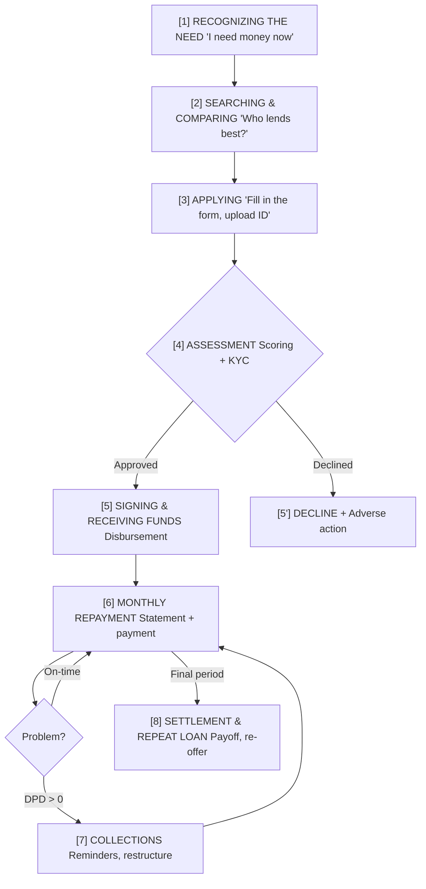

> *"Borrowers do not make purely rational financial decisions. They make human decisions, with all the complexity, bias and emotion that comes with them. A good system has to understand this."*

## Introduction: the same person, two different decisions {#dẫn-nhập-cùng-một-người-hai-quyết-định-khác-nhau}

::::story
On Monday morning, Lan is at the office reading an email saying her laptop cannot be repaired. She calmly works it out: "I need 18.5 million. Payday is ten days away. A consumer loan is the most sensible option."

She opens the app, fills in her details carefully, reads the terms closely and only then signs. A completely clear-headed decision.

On Friday afternoon the same week, Lan goes shopping with a friend at a mall. Her friend has just bought a 48 million sofa set, after a salesperson pointed out the "instalments from just 2.3 million a month over 24 months" offer. Lan looks at a nicer set priced at 56 million, "only" about 2.7 million a month. She signs the contract within 15 minutes.

The same person, the same kind of financial product. But the way she decided was completely different, and so was how sound the decision was.
::::

This chapter follows Lan through the whole journey, from recognizing a need to settling the loan, through two lenses: the *operational flow* and *behavioral economics*. Understanding both is a prerequisite for designing products and systems that genuinely serve users rather than exploiting their weaknesses.

## 4.1 Journey overview: eight stages {#41-tổng-quan-hành-trình-tám-giai-đoạn}

### The big picture



*Figure 4.1. The eight stages of the borrowing journey.*

Every arrow in the figure is a business decision, every box is one or more VLP modules, and every transition is an opportunity to improve or ruin the customer's experience.

### Stage 1: recognizing the need

The need to borrow does not arise from a single point. It comes from different *triggers*, and the type of trigger says a great deal about how the borrower will behave afterwards.

| Type of trigger | Example | State of mind | Borrowing behaviour |
|---|---|---|---|
| **Urgent crisis** | Laptop broken, needs replacing now | Anxious, under time pressure | Decides fast, compares little |
| **Planned purchase** | Saving for a motorbike, a part still missing | Clear-headed, has time | Compares a lot, negotiates |
| **Impulse spending** | Sees a nice sofa at the mall | Excited, afraid of missing out | Decides on the spot, reads few terms |
| **Financial restructuring** | Wants to consolidate several debts | Financially stressed | Focuses on the rate, less on the term |

The type of trigger affects four things. **Preferred channel**: an urgent crisis points to digital channels because they are fast, while a planned purchase might go to a branch. **Price sensitivity**: someone in crisis is less sensitive to the rate because they need the money now, while a planner compares carefully. **Default risk**: impulse spending tends to carry a higher PD because the decision is less considered. **Need for support**: someone restructuring debt needs advice, not just a transaction.

Marketing and the experience in each channel therefore need to match the type of trigger. A push notification saying "Borrow 20 million in 5 minutes" targets people in crisis: effective for conversion, but it also attracts exactly the group with high behavioural risk.

### Stage 2: searching and comparing

::::story
Lan searches online for "fast consumer loan" and sees dozens of results. Which one does she choose?

Research on information-seeking in financial services shows a striking pattern: most borrowers do **not** choose the financially best option. They choose the option that is **good enough** and has the **fewest obstacles**.
::::

A borrower's typical priorities when choosing a lender, with illustrative weights:

```text
1. Brand recognition / Trust (40%)
   "I have heard of this bank/company"

2. Speed and friction (30%)
   "Approved in 5 minutes, no paperwork"

3. Rate / terms (20%)
   "What's the rate?" — often checked AFTER applying
```

This has an important consequence: a better rate does not automatically attract better customers. At the search stage, trust and speed often matter more than price. That is why fintech companies advertise "approved in 3 minutes" more than "lowest rate". Referrals from friends are the fourth factor, making up the remainder.

### Stage 3: applying and assessment

This is the most complex stage in system terms. VLP's loan origination process is described in detail in [Chapter 7](/docs/system/ch07-origination); here we focus on the customer's experience.

The amount of *friction* in the application process cuts both ways. High friction, meaning many documents and many steps, filters out less serious borrowers and so reduces adverse selection, and people who have "invested effort" are less likely to drop out after approval. But the *completion rate* is low, so acquisition cost is high. Low friction, meaning a five-minute application, brings a high conversion rate and more applications; but also more frivolous applications, more adverse selection, and borrowers who think less, so the latent default risk is higher.

The optimal amount of friction is the balance between conversion and risk, and it differs by segment and by product.

```text
Scenario A: High friction (10 documents, 3 days of assessment)
  Applications submitted: 1,000
  Completion rate: 40% → 400 complete applications
  Approval rate: 70% → 280 approved
  Default rate (12 months): 3%
  Bad loans: 280 × 3% = 8.4 loans

Scenario B: Low friction (3 fields, 5 minutes)
  Applications submitted: 3,000 (conversion 3x)
  Completion rate: 80% → 2,400 complete applications
  Approval rate: 50% (scoring has to work harder): 1,200 approved
  Default rate: 6% (adverse selection)
  Bad loans: 1,200 × 6% = 72 loans

Volume: B about 4.3 times higher
Bad loans: B about 8.6 times higher
```

Scenario B can still be profitable if the margin is high enough, but its portfolio contains a much larger share of bad loans. Section 4.2 works out the profit and loss for a similar problem.

### Stage 4: the decision and presenting the offer

Once enough information is in hand, the system reaches one of two outcomes.

**Decline.** The decline message is one of the most important touchpoints, yet often the worst designed. A clumsy decline makes the customer feel insulted and leads to bad reviews. A good decline helps the customer understand why and lets them come back when they qualify.

```text
Instead of: "Your application has been declined."

Better: "We cannot approve your application at the moment because [specific reason].
         You can improve this by [specific action].
         Please try again after [specific time]."
```

The system must therefore be able to produce decline reasons that mean something to the customer, not just an error code. This requirement links directly to the explainability of the scoring model in section 4.4 and [Chapter 11](/docs/intelligence/ch11-credit-scoring).

**Approval.** How the offer is presented has a big influence on whether it is accepted, and this is where behavioural economics starts to play an important role. Section 4.3 goes into this in depth.

### Stages 5 to 8: from signing to borrowing again

The last four stages are described in detail in the technical chapters, from [Chapter 7](/docs/system/ch07-origination) to [Chapter 10](/docs/system/ch10-collections). What matters here is that each stage is an opportunity, or a risk, for the customer lifetime value (CLV) introduced in [Chapter 3](/docs/products/ch03-product-design):

| Stage | CLV opportunity | CLV risk |
|---|---|---|
| Signing | Upselling, cross-selling insurance | Over-commitment leading to default |
| Repaying | Engagement, loyalty | Indifference, no repeat loan |
| Paying late | A support programme keeps the customer | Over-aggressive collections lose the customer |
| Settlement | A timely offer to borrow again | No contact, the customer goes elsewhere |

:::summary[Section 4.1]
The type of trigger behind the need to borrow determines the customer's preferred channel and risk profile. At the search stage, trust and speed often matter more than the rate. Friction in the application is a double-edged sword between conversion and risk. A good decline is a chance to keep the customer for the future, and every stage of the journey is an opportunity or a risk for CLV.
:::

## 4.2 Distribution channels and customer behaviour {#42-kênh-phân-phối-và-hành-vi-khách-hàng}

### The situation: which channel is best?

::::story
The CEO asks Minh: "Which channel should we invest in, the app or the retail partner network?"

The right answer is: "It depends on the target segment and the risk appetite. There is no best channel, only the channel that best fits each goal."
::::

### Three main channels and their economics

#### Channel 1: point of sale (POS)

The buyer is in the store; a trained salesperson presents the financial product on the spot. The trigger is usually a planned or impulse purchase, the buyer is excited about the item, and friction is low because staff help fill in the application.

```text
Acquisition cost: 500,000 - 1,500,000 VND/customer
  (merchant commission + training cost + system integration)

Advantages:
  • High conversion rate (the context fits)
  • The merchant handles most of origination
  • Tied to a specific purchase → EAD predictable

Disadvantages:
  • Depends on the merchant relationship
  • High commission → needs large volume to be profitable
  • Hard to scale fast (each merchant has to be signed)
  • Behavioural risk: impulse → higher default
```

A simple calculation shows how much of this channel's profit goes to commission:

```text
100 merchant partners × 50 loans/month = 5,000 loans/month
Average loan: 15,000,000 VND
Merchant commission: 2% = 300,000 VND/loan
Total commission: 5,000 × 300,000 = 1,500,000,000 VND/month

Profit before commission: 1,200,000 VND/loan × 5,000 = 6,000,000,000 VND/month
Commission / profit before commission: 1.5 / 6.0 = 25%
```

A quarter of the profit goes to commission. The POS channel is only sustainable when the margin per loan is thick enough, and [Chapter 3](/docs/products/ch03-product-design) showed how thin that margin is.

#### Channel 2: digital (app, website)

Customers apply on their own through the app or website, without staff. The trigger is usually an urgent crisis or a deliberate plan; the customer decides in a private space, with no social pressure; and the company designs the friction itself, from very low to moderate.

```text
Acquisition cost: 200,000 - 600,000 VND/customer
  (digital marketing: CPC, CPM, referral)

Advantages:
  • Scales without geographic limits
  • High automation → low cost per loan
  • Data rich → better scoring
  • 24/7 operation

Disadvantages:
  • High trust barrier for new-to-credit customers
  • Higher fraud risk than POS (no face-to-face contact)
  • Customer service is more complex (no one on hand to help)
```

The digital channel also produces data other channels lack, for example the time of application. Some consumer finance companies have found that the time of application correlates with risk:

```text
Observed pattern (illustrative):
  Apply 9:00-17:00 (office hours): Default rate X%
  Apply 18:00-22:00 (evening): Default rate X + 0.5%
  Apply 23:00-5:00: Default rate X + 1.8%

Behavioural explanation: applying at 2 a.m. is often a sign
of acute financial stress → higher risk
```

This information can become a variable in the scoring model. But it also raises an ethical question: should someone be declined, or charged more, just because they need money at 2 a.m.? [Chapter 11](/docs/intelligence/ch11-credit-scoring) returns to this question when discussing model fairness.

#### Channel 3: telesales and field agents

Staff call customers or meet them at home or at work. This channel is usually *outbound*; the customer has someone advising them but is also under pressure; friction is the highest, but conversion after that friction is usually good.

```text
Acquisition cost: 800,000 - 2,500,000 VND/customer
  (salary + agent commission + overhead)

Suits:
  • Large loans (> 30 million) → enough margin to cover the cost
  • Customers who need advice (debt restructuring, first-time borrowers)
  • Rural areas with low smartphone penetration
```

### Omnichannel: shared state is a technical requirement

::::story
Lan starts an application in the app at 10 p.m., gets 60% through, feels sleepy and closes the app. The next morning she drops by a branch to ask some questions. The staff member checks the system and says: "I'm sorry, you'll have to fill it in again from the start, I can't see your application."

Lan walks out and borrows somewhere else.
::::

This is an *omnichannel failure*, and its cause is that the channels do not share a common state layer. To avoid it, the system needs three things:

```text
Shared Application State:
  → The app saves the application state (draft) per session
  → A branch can continue from where the customer stopped
  → The call centre can see the history and context

Shared Customer Profile:
  → Every channel sees the same customer 360
  → No asking again for information already provided

Cross-channel Journey Tracking:
  → Know which channel the customer came from
  → Correct attribution for marketing
```

In VLP, this is why the ADR *(Application Data Repository)* module exists separately from LOS *(Loan Origination Service)*. ADR is where the application's long-lived state is stored, while LOS is a *stateless orchestrator*. Thanks to that separation, an application can be continued from any channel. [Chapter 7](/docs/system/ch07-origination) analyses this design in more detail.

### Designing friction: an art and a calculation

::::story
Minh runs an A/B test on two versions of the sign-up process. Version A has 3 steps and takes 5 minutes. Version B has 8 steps and takes 15 minutes, adding an income verification step and questions about spending habits.

Version A has a completion rate of 78% and a default rate of 5.8%. Version B has a completion rate of 45% and a default rate of 3.2%.

Which version is better for the company?
::::

Suppose each good loan brings 1,200,000 VND of profit, and each bad loan has an EAD of 15 million and an LGD of 60%:

```text
Version A (1,000 visitors):
  Completed: 780
  Approved (70%): 546
  Good loans (94.2%): 514
  Bad loans (5.8%): 32
  Revenue: 514 × 1,200,000 = 616,800,000 VND
  Loss from bad loans: 32 × 15,000,000 × 60% LGD = 288,000,000 VND
  NET: 328,800,000 VND

Version B (1,000 visitors):
  Completed: 450
  Approved (75% — better scoring thanks to more data): 338
  Good loans (96.8%): 327
  Bad loans (3.2%): 11
  Revenue: 327 × 1,200,000 = 392,400,000 VND
  Loss from bad loans: 11 × 15,000,000 × 60% = 99,000,000 VND
  NET: 293,400,000 VND
```

Version A delivers more net value, despite its higher default rate. Friction is not always the right answer; what needs optimizing is net value, not the completion rate or the default rate on its own. The result is also very sensitive to the assumptions: if the profit per good loan is only 800,000 VND, version A yields 123.2 million and version B 162.6 million, and the conclusion flips.

:::key[Four principles for designing friction]
First, friction must have a purpose: if you cannot answer "what is this information for", drop the step. Second, friction must be explainable to the customer, for example "we ask this to avoid lending you more than you can repay". Third, ask gradually *(progressive disclosure)*: basic information first, complex information later. Fourth, friction should vary with risk: small loans get little friction, large loans more, and returning customers less than first-time customers.
:::

:::summary[Section 4.2]
The POS channel converts well but carries high commissions and high behavioural risk, and suits products tied to a specific item. The digital channel scales easily and is rich in data, but has higher fraud risk and struggles to build trust with first-time borrowers. Direct sales is the most expensive channel and suits large loans, first-time borrowers and rural areas. Shared state across channels is a technical requirement, not an optional feature. Friction must be optimized for net value.
:::

## 4.3 Behavioural economics in consumer credit {#43-kinh-tế-học-hành-vi-trong-tín-dụng-tiêu-dùng}

### Why this section matters

Traditional economics assumes people make optimal decisions *(rational agents)*. Behavioural economics, pioneered by people such as Daniel Kahneman and Richard Thaler, shows that people decide in patterns that are predictable but not always optimal.

In consumer credit, that has two sides. A lender that understands behavioural biases can design products and experiences that raise conversion and retention. But the same understanding can be used to exploit borrowers, and the line between the two is very thin. System designers need to understand both sides. [Chapter 13](/docs/intelligence/ch13-behavioral-economics) goes deeper into the subject; this section introduces the four most important biases.

### Bias 1: present bias

:::key[Present bias]
**Present bias** is the tendency to value immediate rewards over future rewards in an inconsistent way, even when one knows this is not optimal.
:::

A classic experiment illustrates the inconsistency. Ask someone: "Would you rather have 100,000 VND today or 120,000 VND next week?" Most choose 100,000 VND today, even though waiting a week for 20% more is an extraordinary return. Then ask: "Would you rather have 100,000 VND in 52 weeks or 120,000 VND in 53 weeks?" This time most choose 120,000 VND, because both are far away and one more week hardly matters. The same trade-off, 20,000 VND more for waiting one more week, but the decision changes depending on whether the reward is right in front of them.

In consumer credit, this bias shows up at two moments. When borrowing, "the item today" feels far more real than "the debt in the future":

```text
How a borrower with present bias thinks:
  "The 56 million sofa today = very real, very attractive"
  "2,715,252 VND × 24 months = 65,166,053 VND = abstract, far away"
```

When repaying, the borrower thinks "spend now this month, save next month to pay it off", but next month the same thought comes back.

::::story
**The price of having it now.** Back to Lan's 56 million sofa, borrowed at 15% a year over 24 months. Compare it with saving first and buying later:

```text
Scenario A: save, then buy
  Deposit 2,333,333 VND/month for 24 months, savings rate 6%/year
  After 24 months: ≈ 59,341,220 VND (including ≈ 3,341,220 VND of interest)
  Buy the 56 million sofa, ≈ 3,341,220 VND left over

Scenario B: borrow and pay in instalments now
  Borrow 56,000,000 VND, 15%/year, 24 months
  PMT = 56,000,000 × 0.0125 × (1.0125)^24 / [(1.0125)^24 - 1]
      = 56,000,000 × 0.0125 × 1.34735 / 0.34735
      = 2,715,252 VND/month
  Total loan interest: 2,715,252 × 24 - 56,000,000 ≈ 9,166,053 VND

Difference between the two scenarios:
  Loan interest paid:          ≈ 9,166,053 VND
  Savings interest forgone:    ≈ 3,341,220 VND
  Total:                       ≈ 12,507,273 VND, about 22% of the sofa's price
```

To have the sofa two years earlier, Lan pays about 12.5 million more.
::::

Having something two years earlier is not worthless, and borrowing to buy is not wrong in itself. The problem is that present bias makes borrowers underestimate that price at the moment of decision, especially when the decision is made in 15 minutes in a store.

### Bias 2: anchoring and the small-payment illusion

:::key[Anchoring]
**Anchoring** is the tendency to rely too heavily on the first piece of information received when making a decision.
:::

In consumer lending, the first figure a borrower sees is usually the monthly payment, and it becomes the anchor. Borrowers focus on the monthly payment instead of the total cost of borrowing. Put two offers to the same group of people:

- Offer A: borrow 20 million, 18% a year, 12 months, paying 1,833,600 VND a month.
- Offer B: borrow 20 million, 18% a year, 36 months, paying 723,048 VND a month.

Ask "which offer is cheaper?" and most people without financial training choose B, because 723,048 is less than 1,833,600. But:

```text
Offer A: total repaid ≈ 22,003,199 VND → Total interest: ≈ 2,003,199 VND
Offer B: total repaid ≈ 26,029,723 VND → Total interest: ≈ 6,029,723 VND

The "cheaper" offer B costs 3 times as much interest.
```

Offer B has a smaller payment and the same rate, but three times the total interest. This is not the borrower's fault; it follows from putting the monthly payment first. Salespeople are therefore often trained to present the long term first: the monthly payment feels "easier", borrowers rarely work out the total cost themselves, and the lender's total interest income is higher.

To counter this effect, disclosure laws in many countries require the **total amount repayable** to be shown next to the monthly payment, and the **APR** next to the nominal rate. For the system, this means the offer screen must always show enough information for an informed decision. This is not just good user experience practice; in many markets it is a legal requirement. You can quickly compare several terms with the [term comparison tool](/docs/tools).

### Bias 3: mental accounting, or why BNPL "feels free"

:::key[Mental accounting]
**Mental accounting** is the tendency to sort money into different mental "accounts" and treat them differently, even though financially they are the same.
:::

A classic example: you receive an unexpected 1,000,000 VND bonus and spend it on a fancy dinner and some clothes. If that 1,000,000 VND had come from hard overtime work, would you spend it as freely? Research suggests usually not. "Windfall money" and "hard-earned money" are treated differently even though they are worth the same.

With BNPL, "just 500,000 VND a month" is filed under "small monthly spending", not under "debt". That feels very different from "I owe 6 million".

```text
Financial reality:
  BNPL 6,000,000 VND in 3 instalments = a debt of 6,000,000 VND

Mental accounting:
  "3 × 2,000,000 VND" → seen as a monthly expense, not as debt

Consequence: someone with 5 BNPL plans running at once may
  not realize they owe 20-30 million VND
```

This helps explain why BNPL default rates are often higher than expected. BNPL providers' risk models easily underestimate the mental accounting effect: users accumulate more obligations than they realize, and when the instalments fall due together, their actual ability to pay is lower than forecast. Combined with the risk of borrowing from several providers described in [Chapter 3](/docs/products/ch03-product-design), this is one of the biggest weaknesses of the BNPL model.

### Bias 4: loss aversion

:::key[Loss aversion]
**Loss aversion** is the tendency to feel the pain of a loss more strongly than the pleasure of an equivalent gain, by about 2 to 2.5 times according to research.
:::

Try a coin toss: heads you win 150,000 VND, tails you lose 100,000 VND. The expected value is $0.5 \times 150,000 - 0.5 \times 100,000 = +25,000$ VND. The game is favourable, yet most people refuse, because the pain of losing 100,000 VND outweighs the pleasure of winning 150,000 VND. With a loss aversion coefficient of about 2.25, the loss "feels" like 225,000 VND.

Loss aversion is a powerful tool for retention. The same reward can be framed in two ways:

```text
Message A (gain framing):
  "Pay on time 3 months in a row → get a 50,000 VND reward"

Message B (loss framing):
  "You have 50,000 reward points that will expire
   if you don't pay on time this month"
```

Theory predicts message B is more effective, but the size of the difference depends on the product and the customers, so it should be measured with an A/B test before rolling it out widely.

In collections, loss framing also helps raise the cure rate:

```text
Message A (standard):
  "Your account is overdue. Please pay immediately."

Message B (loss framing, truthful):
  "Your payment is 5 days late.
   If you pay before [X], your credit history will not be affected.
   A good credit history helps you borrow on better terms in the future."
```

:::caution[The ethical limit of loss aversion]
Misused, loss aversion becomes a tool for fear: "You are about to lose your home" on an unsecured loan, or threats of consequences that do not exist in order to force payment. Used properly, it means stating real consequences (the effect on credit history and future borrowing), reminding customers of rewards about to expire, or a "you're nearly there" message when a customer is close to settling.
:::

### Reasonable nudge or manipulation

::::story
Tuấn, the engineer, is asked to design the app's notification system. He has data on behavioural biases and wants to use it to optimize.

Minh reminds him: "Tuấn, we can use psychology to raise on-time payment. But we have to be clear about what is a reasonable nudge and what is manipulation."
::::

A reasonable *nudge* gives accurate information and presents it clearly, leaves the user free to choose otherwise or to refuse, aims at the user's own interest and is transparent about how it works. *Manipulation* creates false pressure, hides important information, exploits people in a weak position such as those in financial crisis, and serves the lender's interest at the user's expense.

| Behaviour | Reasonable nudge or manipulation? |
|---|---|
| Countdown "offer expires in 2 hours", when the deadline is real | Reasonable nudge |
| Countdown with no real deadline, resetting automatically | Manipulation |
| "You save X VND compared with paying all at once", when true | Reasonable nudge |
| Showing only the monthly payment to hide the total cost | Manipulation |
| A payment reminder 3 days before the due date | Reasonable nudge |
| Calling several times a day when a customer is only 1 day late | Manipulation |

:::summary[Section 4.3]
Present bias makes borrowers underestimate the price of having something now, leading to over-borrowing. Anchoring makes borrowers look at the monthly payment and ignore the total cost. Mental accounting makes BNPL instalments not "feel" like debt. Loss aversion is a powerful tool for retention and collections if used responsibly. The line is this: a reasonable nudge serves the user's interest, while manipulation exploits biases to harm them.
:::

## 4.4 Customer segmentation and product fit {#44-phân-khúc-khách-hàng-và-độ-phù-hợp-của-sản-phẩm}

### The situation: the right product, the wrong segment

::::story
A finance company launches a loan product for teachers and it is a great success: a default rate of only 1.5% and an NPS of 72. The following year, it extends exactly the same product, with the same rate and terms, to "state employees and civil servants".

Twelve months later, the default rate has risen to 4.8%. An investigation shows that "state employees and civil servants" is far too broad a definition, including people with unstable incomes, several other debts and much higher risk than teachers.

The right product, but the wrong segment.
::::

### Thin-file and thick-file customers

**Thin-file** customers have little or no formal credit history: young first-time borrowers, people who have just moved to the city, people who have never used a bank. The difficulty is that there is no data to score them, so they are either treated as high risk or wrongly declined.

**Thick-file** customers have a rich credit history, are easy to score and their risk is easy to predict. But competition in this segment is fierce, because banks want to serve them too.

For the thin-file group, there are three strategies:

```text
Option A: Decline them all
  → Safe, but misses a large market that is profitable if served properly

Option B: Lend at a high rate (to compensate for the lack of data)
  → May attract adverse selection (good borrowers have alternatives)

Option C: Starter loan → Build history → Graduate to better products
  → A small first loan (1-3 million), monitor behaviour, update the model
  → If repaid well → raise the limit, lower the rate
  → This is the sustainable model for thin-file customers
```

Option C is the most sustainable. It turns the information problem of [Chapter 1](/docs/foundations/ch01-credit-economics) into a learning process: every instalment paid on time is a signal, and a small first loan limits the damage while the company is still learning.

### Segmenting by behaviour

Beyond demographics and the credit score, behaviour on the platform also gives valuable signals:

| Behaviour | Signal |
|---|---|
| Reads the full terms and conditions | Responsible borrower |
| Uses a calculator before applying | Careful planner |
| Applies and cancels several times | Undecided, or comparing several lenders |
| Pays more than the minimum every month | High financial discipline |
| Draws on the credit line exactly on payday | Tight cash flow |
| Stops logging in to the app after the first three months | Risk of indifference, no repeat loan |

Combining behavioural signals with the credit score allows finer segmentation, not only "good" and "bad" but also "good but needs guidance", "average but improving", or "bad because of temporary hardship".

### Segmenting by risk and the consequences for pricing

Good segmentation leads to good pricing, following the risk-based pricing logic of [Chapter 1](/docs/foundations/ch01-credit-economics). But there is an important tension between accuracy and fairness. Pricing precisely by risk can lead to discrimination: if a demographic characteristic correlates with risk, a price that is "fair" in actuarial terms can be "unfair" in social terms.

```text
If the scoring model finds that living in certain wards
correlates with a higher PD (because of socioeconomic factors)

→ Pricing by address will charge poorer people more
→ It is "actuarially fair" (accurate about risk)
→ But it is "redlining" (geographic discrimination)
→ Prohibited in many countries
```

Many countries require scoring models to be explainable, not just accurate, and prohibit the use of certain characteristics such as race, religion and sex, as well as variables that indirectly stand in for them *(proxies)*, in credit decisions.

For the system, this means the scoring model must be able to explain the reason for a decline, input variables must be audited to detect indirect discrimination, and every decision must be logged in full so that the regulator can review it. This is not a "nice to have" feature but a compliance requirement that shapes the architecture of the whole machine learning pipeline. [Chapter 11](/docs/intelligence/ch11-credit-scoring) shows how these requirements are implemented.

:::summary[Section 4.4]
A successful product is only successful with its own segment. For thin-file customers, a small starter loan to build history is more sustainable than either declining them or charging a high rate from the outset. Behavioural signals complement demographics and the credit score. Pricing precisely by risk can breach anti-discrimination law, so explainability and auditing of input variables are architectural requirements.
:::

## 4.5 Ten principles for designing the customer journey {#45-mười-nguyên-tắc-thiết-kế-hành-trình-khách-hàng}

Drawing the chapter together, here are ten principles for designing the customer journey in consumer finance.

1. **Match the channel to the trigger.** An urgent crisis needs a fast digital channel; a deliberate plan may need an adviser; impulse spending needs deliberate friction to protect the customer.
2. **Trust first, rate second.** At the search stage, trust and speed matter more than the rate. Invest in brand and experience, not only in price.
3. **Friction must have a purpose.** Every form field must answer the question "how does this information help us serve the customer better?". Friction without a purpose is just a barrier.
4. **A decline is an opportunity.** A good decline gives the reason, what the customer can do, and an invitation to come back. It is a brand moment.
5. **Be transparent about the total cost.** Show the APR, the total amount repayable and the time to settle, not just the monthly payment. That is both ethically and legally right.
6. **Counter biases, do not exploit them.** Use behavioural insight to help customers decide better: show the total cost to counter anchoring, warn about total debt to counter mental accounting.
7. **Omnichannel is mandatory.** Customers do not live in a single channel. A shared state layer is an indispensable foundation.
8. **Segmentation drives personalization.** First-time and returning borrowers, thin-file and thick-file, people who prefer their phone and people who prefer a branch need different journeys.
9. **Collections is customer service.** The collections team is the last line for keeping a customer relationship. In CLV terms, a hardship programme is worth more than aggressive collection.
10. **A repeat loan is an outcome, not a default.** After settlement, an offer to borrow again must be based on whether a new loan fits the customer's needs, not just on the need for more volume.

## Chapter 4 summary {#tổng-kết-chương-4}

Lan's journey can be seen from two angles:

| Operational view | Behavioural view |
|---|---|
| Recognizing the need, searching (trust before speed, speed before rate) | Present bias: borrowing more than is optimal |
| Applying (optimizing friction), assessment (LOS, CIS, scoring) | Anchoring: looking at the monthly payment, ignoring the total cost |
| Presenting the offer, signing (DMS) | Mental accounting: BNPL debt does not "feel" like debt |
| Repayment and billing (LAS, EOM), settlement (a CLV opportunity) | Loss aversion: a tool for retention and collections |

Good design takes both views into account. Poor design looks at only one. Bad design deliberately exploits the borrower's biases.

### Key takeaways

| Concept | Meaning | In VLP |
|---|---|---|
| Eight journey stages | Each stage is a CLV opportunity or risk | Each stage maps to a group of modules |
| Friction | The trade-off between conversion and risk | Optimized for net value |
| Omnichannel | The customer continues an application in any channel | ADR stores state, LOS is stateless |
| Present bias, anchoring | Borrowers underestimate future costs | The offer screen shows the total cost and APR |
| Mental accounting | Small debts split into instalments do not "feel" like debt | Warnings about total debt |
| Nudge versus manipulation | The ethical limit of behavioural design | Rules for the notification system |
| Explainability | Decline reasons, auditing input variables | An architectural requirement of the scoring pipeline |

### Key terms

Customer journey, trigger, friction, completion rate, omnichannel, present bias, anchoring, mental accounting, loss aversion, nudge, thin-file, redlining. See the definitions on the [Glossary](/docs/glossary) page.

## Review questions {#câu-hỏi-tự-kiểm-tra}

**Recall**

1. Name four types of trigger that make people want a consumer loan. How does each affect borrowing behaviour?
2. What is present bias? Give an example unrelated to credit.
3. How do thin-file customers differ from thick-file customers? Why does the lender need to distinguish them?
4. What does omnichannel require of the system technically?

**Understand**

5. Why do trust and speed matter more than the rate at the search stage? Does that mean the rate does not matter?
6. Why is high friction not always good for the company, even though it lowers the default rate? Use a net value analysis to illustrate.
7. How does mental accounting explain why someone with several BNPL plans at once does not realize how much they really owe? What risk does that create for the system?
8. Why is the explainability of a scoring model an architectural requirement, not just a "nice to have" feature?

**Apply**

9. A finance company designs a notification system to raise on-time payment. Based on loss aversion and present bias, design three notifications: one sent 7 days before the due date, one sent 1 day before, and one sent after a missed payment. Explain why you chose that wording.
10. Minh analyses an A/B test. Variant A shows only "Just 723,048 VND/month". Variant B shows "723,048 VND/month · Total repayable 26,029,723 VND · APR 18%". Variant A has a conversion rate of 68%, variant B 52%.
    (a) Why does variant A convert better? Explain in behavioural economics terms.
    (b) Predict the difference in default rate and customer satisfaction between the two variants.
    (c) Which variant do you choose? Argue from both a business and an ethical point of view.

**Analyse**

11. A finance company collects app usage data (login times, how often the balance is checked, spending patterns through linked accounts) and uses it to (a) detect early signs of financial stress in order to offer support proactively, (b) score people with no credit history, (c) charge a higher rate to people who check their balance often, treating it as a sign of financial anxiety. For each case, analyse (i) whether it is ethically acceptable, (ii) whether it is legal, and (iii) what the system needs to deploy it safely.
12. A fintech startup proposes: "Instead of an 8-step process, we use AI to approve in 30 seconds with just a phone number." Analyse (a) the consequences for adverse selection and moral hazard, (b) the difficulty of modelling risk with little data, (c) the legal compliance risk, and (d) the long-term viability of this business model.

## Exercises {#bài-tập-áp-dụng}

**Exercise 1. Customer journey map.** Draw a complete journey map for a customer who wants to borrow 30 million through the digital channel to buy a motorbike. (a) Eight stages, each with at least three concrete touchpoints. (b) An emotion curve: the level of satisfaction or anxiety at each touchpoint. (c) The three points where customers are most likely to drop out, and why. (d) Which VLP modules are triggered at each stage? (e) Which behavioural biases may appear at each stage?

**Exercise 2. Designing a behavioural intervention.** A finance company wants to cut the late payment rate from 8% to 5%, with an intervention budget of 50,000 VND per customer per month. Available data: 70% of customers use a smartphone regularly, 85% allow push notifications, the average delay when paying late is 12 days, and the late fee is 200,000 VND each time. (a) Design at least three types of intervention based on different behavioural principles. (b) Set the order and timing of each intervention. (c) Design an A/B test to verify their effect. (d) Which metrics will tell you whether the programme works?

**Exercise 3. A strategy for a new segment.** A finance company targets freelancers and the self-employed, who make up 30% of the workforce but only 8% of its current loan book. The difficulties: irregular income, no traditional payslip, and many have thin credit files. (a) Design a scoring approach that does not rely on payslips: which alternative data sources would you use? (b) Design a product suited to irregular income: term, repayment schedule, limit. (c) Design an origination process suited to the segment. (d) Set out the main risks and how to mitigate them. (e) What does VLP need to change to support flexible repayment schedules?

## Further reading {#đọc-thêm}

**Behavioural economics**

- Thaler, R. H. & Sunstein, C. R. (2008). *Nudge: Improving Decisions About Health, Wealth, and Happiness.* Yale University Press. The foundational book on nudge theory and its applications.
- Kahneman, D. (2011). *Thinking, Fast and Slow.* Farrar, Straus and Giroux. Presents the two systems of thinking, the basis for understanding why borrowers decide the way they do.

**User experience in financial services**

- Morville, P. (2014). *Intertwingled: Information Changes Everything.* Semantic Studios. On designing information experiences in complex contexts, applicable to financial products.

Chapter 5 looks at Lan's journey from the point of view of the people running the company: the revenue model, portfolio management, and what happens when millions of journeys like hers are added together. [Chapter 5. Revenue model and portfolio management](/docs/products/ch05-revenue-portfolio).
