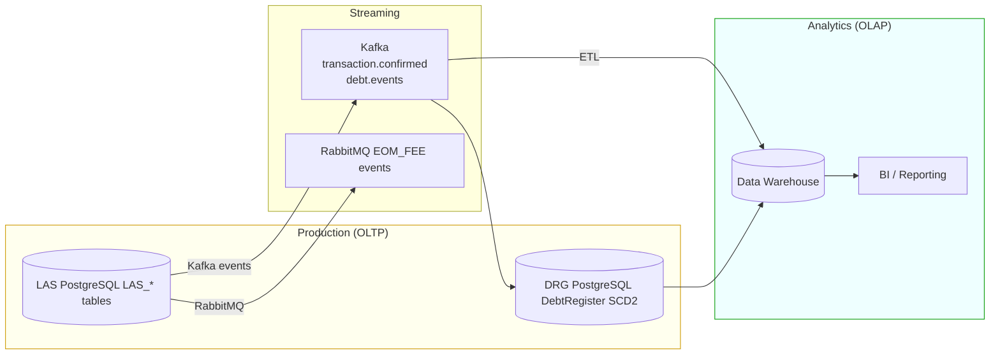

import SeriesLineChart from '@site/src/components/Charts/SeriesLineChart';

> *"A good loan in a bad portfolio is still a problem. Credit management is not about managing individual transactions, but about managing overall risk and opportunity over time."*

## Introduction: seeing the trees but not the forest {/* #dẫn-nhập-thấy-cây-mà-không-thấy-rừng */}

::::story
At the end of the third quarter, Hương receives reports from three departments, and every one of them says "good".

**Sales:** "Disbursements up 35% on the previous quarter. The loan book has reached 2,800 billion VND, a new record!"

**Risk:** "The default rate this quarter is 4.2%, within the 5% limit."

**Finance:** "NIM reached 20.2%, beating the 20% target."

Hương looks at the three figures and feels uneasy. Everything is "fine", but the overall picture is not right. She asks for more data:

- The vintage curve of the newest group of loans (Q2): the DPD 30+ rate is already 6.8% after 90 days, 70% higher than last year's Q2 group at the same point.
- The roll rate from current to 1-30 days late: up from 4.5% to 6.8% over the last two months.
- Concentration risk: 28% of the loan book is with customers working in one industry that is under pressure.

"We are growing fast into a portfolio that is getting worse," Hương concludes. "If we don't adjust now, Q1 next year will be very difficult."
::::

Those three "good" figures are all aggregate measures, and aggregate measures hide what is happening inside the portfolio. This chapter helps you see the forest, not just the trees: from the P&L of a consumer finance company, through portfolio analysis tools, to concentration risk and *asset-liability management (ALM)*. More importantly, it shows how these views shape the system's architecture.

## 5.1 The P&L of a consumer finance company {/* #51-báo-cáo-lãi-lỗ-của-một-công-ty-tài-chính-tiêu-dùng */}

### The situation: reading the financial statements

::::story
Tuấn, the engineer, is invited for the first time to the quarterly business review. Hương presents the income statement, and Tuấn does not understand most of the lines. He knows code, he knows the system, but he has never read the P&L of a consumer finance company.

This is common: engineers build systems that process billions of dong a day, without understanding why they are building them.
::::

### The structure of the income statement

Below is Vela Finance's Q3 statement, with an average loan book of 2,800 billion VND and 2,500 billion VND of borrowed funding.

```text
INCOME STATEMENT, Q3/2025 (billion VND)
Vela Finance

A. INTEREST INCOME
   Interest on cash loans                              140.0
   Interest on point-of-sale instalment loans           56.0
   ──────────────────────────────────────────────────────────
   Total interest income                               196.0

B. INTEREST EXPENSE
   Interest on bonds issued (2,000 billion, 8.5%/year) (42.5)
   Interest on bank loans (500 billion)                (12.0)
   ──────────────────────────────────────────────────────────
   Total interest expense                              (54.5)

C. NET INTEREST INCOME (NII)  [A - B]                 141.5

D. NON-INTEREST INCOME
   Appraisal fees                                        8.5
   Insurance commissions                                 6.2
   Account service fees                                  4.8
   Late fees                                             3.1
   ──────────────────────────────────────────────────────────
   Total non-interest income                            22.6

E. TOTAL OPERATING INCOME  [C + D]                    164.1

F. CREDIT LOSS PROVISION EXPENSE
   Increase in ECL provision, Stage 1                   (5.2)
   Increase in ECL provision, Stage 2                  (10.4)
   Increase in ECL provision, Stage 3                  (17.2)
   Net write-offs after recoveries                      (9.2)
   ──────────────────────────────────────────────────────────
   Total provision expense                             (42.0)

G. INCOME AFTER PROVISIONS  [E - F]                   122.1

H. OPERATING EXPENSES
   Staff (sales, operations, risk, technology)         (45.0)
   Marketing and customer acquisition                  (18.5)
   Technology and infrastructure                        (8.2)
   Collections                                          (6.8)
   Other expenses                                       (4.1)
   ──────────────────────────────────────────────────────────
   Total operating expenses                            (82.6)

I. PROFIT BEFORE TAX  [G - H]                           39.5
J. TAX (20%)                                            (7.9)
K. PROFIT AFTER TAX                                     31.6
```

This statement differs from a manufacturer's in two ways. First, a finance company's "cost of goods sold" is its interest expense, the price of the money it borrows. Second, there is a large expense line other businesses do not have: the credit loss provision, money set aside for loans that will not be repaid.

### Three core health indicators

#### NIM: net interest margin

:::key[NIM (net interest margin)]
**NIM** measures the efficiency of the core lending business: net interest income per unit of interest-earning assets.
:::

```text
NIM = Net interest income / Average interest-earning assets

  Net interest income Q3: 141.5 billion VND
  Annualized: 141.5 × 4 = 566 billion VND/year
  Average loan book: 2,800 billion VND

  NIM = 566 / 2,800 ≈ 20.2%/year
```

A falling NIM over several quarters means lending rates are falling or the cost of funds is rising. A sudden rise in NIM also needs close scrutiny: is the portfolio shifting towards riskier, higher-rate products?

Typical NIM ranges by type of institution (reference figures that vary by market and period):

| Type of institution | Typical NIM |
|---|---|
| Large commercial bank | 3-5% |
| Retail bank | 5-8% |
| Finance company, prime segment | 12-18% |
| Finance company, mass market | 18-28% |
| Microfinance | 25-40% |

A consumer finance company's NIM is higher than a bank's because it has to cover higher credit losses and operating costs, as analysed in [Chapter 1](/docs/foundations/ch01-credit-economics), not because of unusually high profits. Vela Finance's statement illustrates this: of 141.5 billion of net interest income, 42 billion goes into provisions and 82.6 billion into operating expenses.

#### ROA: return on assets

:::key[ROA (return on assets)]
**ROA** measures how efficiently the company uses all its assets.
:::

```text
ROA = Profit after tax (annualized) / Average total assets

  Annualized profit after tax: 31.6 × 4 = 126.4 billion VND
  Average total assets: 3,200 billion VND
  (loan book, cash and other assets)

  ROA = 126.4 / 3,200 ≈ 3.95%
```

For a consumer finance company, an ROA above 3% is usually considered good, 1% to 3% average, and below 1% in need of improvement, usually because of excessive credit losses or operating costs.

#### ROE: return on equity

:::key[ROE (return on equity)]
**ROE** measures how efficiently shareholders' capital is used.
:::

```text
ROE = Profit after tax (annualized) / Average shareholders' equity

  Annualized profit after tax: 126.4 billion VND
  Average equity: 640 billion VND
  (Total assets 3,200 billion - Total liabilities 2,560 billion)

  ROE = 126.4 / 640 ≈ 19.75%

Leverage = Total assets / Equity = 3,200 / 640 = 5 times
ROE = ROA × Leverage = 3.95% × 5 ≈ 19.75%
```

The higher the leverage, the higher the ROE, but so is the risk: with 5 times leverage, a loss equal to 20% of total assets wipes out equity entirely. That is why regulators set a minimum capital adequacy ratio, so that finance companies do not borrow too much relative to their own capital.

### IFRS 9 provisioning

::::story
Minh looks at the P&L and wonders: "Why are provisions so large, 42 billion in one quarter? Are we losing that much money?"

Hương explains: "That is not money we have lost, it is money we *expect* to lose. The accounting standard requires losses to be recognized before they actually happen."
::::

:::key[IFRS 9 and expected credit loss]
**IFRS 9** is the international accounting standard that requires financial institutions to provision based on future **expected credit loss** *(ECL)*, instead of recognizing losses only once they have occurred as under the old IAS 39 standard.
:::

IFRS 9 divides loans into three *stages*:

```text
STAGE 1 — Performing
  Condition: DPD = 0, no sign of credit deterioration
  Provision: 12-month ECL (expected loss over the next 12 months)
  Example: Lan has just borrowed and is repaying normally

STAGE 2 — Underperforming (significant increase in credit risk)
  Condition: Credit risk has increased significantly since origination
    (DPD 30+, or a sharp fall in score, or economic deterioration)
  Provision: Lifetime ECL (expected loss over the whole remaining life)
  Example: Lan starts paying late, DPD = 35

STAGE 3 — Credit-impaired
  Condition: DPD 90+, or clear evidence of default
  Provision: Lifetime ECL with higher severity
  Example: Lan is at DPD = 120 and cannot be reached
```

The DPD 30 threshold for Stage 2 and DPD 90 for Stage 3 are default presumptions in IFRS 9; an institution can use other criteria if it can show they are more appropriate.

Applied to Vela Finance's portfolio at the end of Q3:

```text
Stage 1 (performing):
  Balance: 2,100 billion VND (75% of the portfolio)
  12-month PD: 3.5%, LGD: 60%
  ECL = 2,100 × 3.5% × 60% = 44.1 billion
  Coverage ratio: 44.1 / 2,100 = 2.1%

Stage 2 (underperforming):
  Balance: 420 billion VND (15% of the portfolio)
  Lifetime PD: 18%, LGD: 62%
  ECL = 420 × 18% × 62% = 46.9 billion
  Coverage ratio: 46.9 / 420 = 11.2%

Stage 3 (credit-impaired):
  Balance: 280 billion VND (10% of the portfolio)
  PD: 85%, LGD: 68%
  ECL = 280 × 85% × 68% = 161.8 billion
  Coverage ratio: 161.8 / 280 = 57.8%

TOTAL PROVISION ON THE BALANCE SHEET: 44.1 + 46.9 + 161.8 = 252.8 billion
```

The figure in the P&L is not the total provision but the quarter's **provision expense**: the additional provision needed to bring the provision balance to the required level, plus the amount used for write-offs during the quarter.

```text
Provision at the start of Q3:          220.0 billion
  (Stage 1: 38.9, Stage 2: 36.5, Stage 3: 144.6)
Less: net write-offs after recoveries:  (9.2) billion
Plus: provision expense for the quarter: 42.0 billion
Provision at the end of Q3:            252.8 billion

Provision expense = 252.8 - 220.0 + 9.2 = 42.0 billion (matches line F of the statement)
```

To calculate ECL, the system needs five things. Each loan must be **assigned a stage** based on DPD and risk signals. It needs a **PD model** for each stage and time horizon, an **LGD model** by product and collateral, and a way to **calculate EAD**, which for revolving products also means modelling limit utilization. Finally, there are **macroeconomic scenario adjustments**, because IFRS 9 requires ECL to reflect forward-looking information about the economy. That is why many finance companies have a dedicated IFRS 9 team, and why data from LAS must be standardized to feed the ECL models.

:::summary[Section 5.1]
NIM is net interest income over interest-earning assets and measures the efficiency of the core lending business. ROA measures overall efficiency, ROE measures efficiency on shareholders' capital, and ROE equals ROA times leverage. IFRS 9 requires provisioning on expected loss, divided into three stages by degree of credit deterioration. The provision expense in the P&L is the change in the provision balance plus net write-offs, and stage assignment needs continuously updated DPD data from LAS.
:::

## 5.2 Portfolio analysis in depth {/* #52-phân-tích-danh-mục-theo-chiều-sâu */}

### Vintage curves: comparing generations of loans

::::story
Minh has to report to the board: "How is the teacher loan product launched in January 2025 performing?"

The question sounds simple, but after six months of operation it is hard to answer accurately. A 24-month loan has only gone through a quarter of its life. How can it be judged?
::::

:::key[Vintage and vintage curve]
A **vintage** is a group of loans disbursed in the same period, usually a month or a quarter. A **vintage curve** tracks each group's outcomes by months since disbursement, so that generations of loans can be compared at the same "age".
:::

**Why not use the overall default rate?** Because it mixes loans of different ages:

```text
December 2025, the portfolio has 10,000 active loans:
  Vintage Jan/2025 (11 months old): 2,000 loans, 1.60% defaulted (32 loans)
  Vintage Jun/2025 (6 months old):  3,000 loans, 1.40% defaulted (42 loans)
  Vintage Sep/2025 (3 months old):  5,000 loans, 0.40% defaulted (20 loans)

Overall default rate:
  = (32 + 42 + 20) / 10,000 = 0.94%
```

0.94% looks very healthy. But it hides a fact: the June vintage, only six months old, already has a default rate close to that of the January vintage at 11 months. The faster the portfolio grows, the more "young" loans there are that have not had time to default, and the better the overall rate looks. Fast growth hides deteriorating credit quality; that is exactly what Hương sensed at the start of the chapter.

To build a vintage curve, each loan needs its disbursement date and its DPD month by month. Then compute the cumulative default rate by loan age:

```text
Vintage Jan/2025 (2,000 loans):
  Age 2 months:   2 defaults → cumulative 0.10%
  Age 3 months:   5 defaults → cumulative 0.25%
  Age 6 months:  15 defaults → cumulative 0.75%
  Age 9 months:  25 defaults → cumulative 1.25%
  Age 12 months: 35 defaults → cumulative 1.75%

Vintage Jun/2025 (3,000 loans):
  Age 2 months:   4 defaults → cumulative 0.13%
  Age 3 months:  16 defaults → cumulative 0.53%
  Age 6 months:  42 defaults → cumulative 1.40%
```

<SeriesLineChart
  title="Figure 5.1. Vintage curves: cumulative default rate by loan age"
  xKey="age"
  xLabel="Loan age (months)"
  data={[
    {age: 0, typical: 0, jan25: 0, jun25: 0},
    {age: 3, typical: 0.3, jan25: 0.25, jun25: 0.53},
    {age: 6, typical: 0.75, jan25: 0.75, jun25: 1.4},
    {age: 9, typical: 1.3, jan25: 1.25},
    {age: 12, typical: 1.8, jan25: 1.75},
    {age: 15, typical: 2.2},
    {age: 18, typical: 2.55},
    {age: 21, typical: 2.8},
    {age: 24, typical: 3.0},
  ]}
  series={[
    {key: 'typical', label: 'Product benchmark curve', color: '#8a8f98', dashed: true},
    {key: 'jan25', label: 'Vintage Jan/2025', color: '#0b8a66'},
    {key: 'jun25', label: 'Vintage Jun/2025', color: '#c0392b'},
  ]}
  caption="The benchmark curve is the average of older vintages that have completed their 24-month life, ending at 3.0%. The January vintage tracks the benchmark closely; the June vintage is already nearly double at 6 months."
/>

Reading the figure, the January 2025 vintage tracks the benchmark curve closely, even slightly better. The June 2025 vintage is different: at 6 months it is already at 1.40%, nearly double the 0.75% of the January vintage and of the benchmark at the same age. This is a red flag: the new generation of loans is clearly worse.

**Forecasting losses from the vintage curve.** On the benchmark curve, only 0.75 / 3.00 = 25% of lifetime defaults have occurred by age 6 months. If the June vintage follows the same curve shape:

```text
Forecast lifetime default rate = 1.40% / 25% = 5.6%

Vintage Jun/2025 has 3,000 loans:
  Defaulted by age 6 months (1.40%):   42 loans
  Forecast lifetime defaults (5.6%):  168 loans
  Still to default:                   126 loans

When to act? Now, not when those 126 loans actually default.
```

This is the difference between a **leading indicator** and a **lagging indicator**. The overall default rate is a lagging indicator: by the time it shows the problem, it is too late. The vintage curve is a leading indicator: it shows the problem while something can still be done, such as tightening approval criteria for the deteriorating segment or raising provisions early.

### The roll rate matrix: an early warning system

:::key[Roll rate]
The **roll rate** is the share of accounts that move from one *DPD bucket* to another in a month. A **roll rate matrix** brings all those movements together in one table.
:::

From LAS's start-of-month and end-of-month DPD data, the 10,530 accounts in September 2025 were distributed as follows (rows are the state at the start of the month, columns the state at the end):

| Start \ End | Current | 1-30 | 31-60 | 61-90 | 91+ | Write-off | Total |
|---|---:|---:|---:|---:|---:|---:|---:|
| Current | 8,930 | 420 | 0 | 0 | 0 | 0 | 9,350 |
| 1-30 | 186 | 68 | 146 | 0 | 0 | 0 | 400 |
| 31-60 | 31 | 14 | 51 | 184 | 0 | 0 | 280 |
| 61-90 | 7 | 5 | 11 | 38 | 89 | 0 | 150 |
| 91+ | 3 | 2 | 5 | 9 | 281 | 50 | 350 |

Dividing each cell by its row total gives the roll rates:

| Start \ End | Current | 1-30 | 31-60 | 61-90 | 91+ | Write-off |
|---|---:|---:|---:|---:|---:|---:|
| Current | 95.5% | 4.5% | 0% | 0% | 0% | 0% |
| 1-30 | 46.5% | 17.0% | 36.5% | 0% | 0% | 0% |
| 31-60 | 11.1% | 5.0% | 18.2% | 65.7% | 0% | 0% |
| 61-90 | 4.7% | 3.3% | 7.3% | 25.3% | 59.3% | 0% |
| 91+ | 0.9% | 0.6% | 1.4% | 2.6% | 80.3% | 14.3% |

Each cell answers a business question:

- **Current to current (95.5%):** almost every good account stays good.
- **Current to 1-30 (4.5%):** the share of good accounts that start paying late in the month, the new delinquency rate.
- **1-30 to current (46.5%):** nearly half of first-time late accounts return to current on their own. This is the **cure rate**.
- **1-30 to 31-60 (36.5%):** more than a third slip deeper. This is the **roll forward** rate.
- **61-90 to 91+ (59.3%):** most accounts 61-90 days late will move to 91+, where recovery prospects are very low.

The roll rate is an early warning system because it changes before the default rate does:

```text
August: Current → 1-30 = 4.5% (baseline)
September: Current → 1-30 = 4.5% (normal)
October: Current → 1-30 = 6.8% (up 51%!)

Signal: something in October made many good accounts start paying late.
Possibly:
  - The macroeconomy deteriorated (rising unemployment)
  - A specific group of customers was affected (an industry cutting jobs)
  - The scoring model missed a new risk factor
  - A newly launched product has a problem

Action: investigate now, do not wait for the default rate to rise
(it takes 3 to 6 months to show up in lagging indicators)
```

**Roll rates in VLP.** The DRG *(Debt Register)* module updates each account's DPD almost in real time from the Kafka event stream published by LAS. Roll rates are calculated by a nightly job on that data, giving an early warning without querying LAS's transactional database. Section 5.4 explains why this matters.

### Concentration risk: too many eggs in one basket

::::story
Hương looks at the portfolio mix and sees that 28% of the loan book is with customers working in the textile and garment industry. The news says garment factories are under pressure from falling export orders. She knows this is concentration risk.
::::

:::key[Concentration risk]
**Concentration risk** is the risk that arises when a loan portfolio is too concentrated in one segment (industry, geography, demographics), so that a shock to that segment causes losses far larger than expected.
:::

The formula $EL = PD \times LGD \times EAD$ applies to each loan individually, and when summed across the portfolio it implicitly assumes loans default **independently** of each other. Reality is different: if two borrowers work at the same factory and the factory closes, they default at the same time.

```text
Base scenario (diversified portfolio):
  Average PD: 5%, LGD: 60%, EAD: 2,800 billion
  EL = 2,800 × 5% × 60% = 84 billion

Concentration shock scenario:
  28% of the portfolio = 784 billion in textiles and garments
  The industry is hit → PD rises from 5% to 18%

  EL (outside textiles, 72%): 2,016 × 5% × 60% = 60.5 billion
  EL (textiles, 28%):          784 × 18% × 60% = 84.7 billion
  New total EL: 145.2 billion

  Increase over the base scenario: 145.2 - 84 = 61.2 billion (up 73%)
```

The profit plan and pricing are built on an expected loss of 84 billion. If the shock happens, the company has to recognize about 61 billion of additional provision expense, nearly two quarters of profit after tax, usually concentrated in one or two quarters.

**Measuring concentration with the HHI.** The Herfindahl-Hirschman Index *(HHI)* is the sum of the squared shares (in percent) of the segments:

$$
HHI = \sum_i s_i^2
$$

The closer the HHI is to 0, the more diversified the portfolio; an HHI of 10,000 means the whole portfolio is in a single segment.

```text
Example with 4 industries:
  Textiles 28%, Education 22%, Retail 30%, Healthcare 20%
  HHI = 28² + 22² + 30² + 20² = 784 + 484 + 900 + 400 = 2,568

Compare: with 25% in each industry, HHI = 4 × 25² = 2,500
```

An HHI of 2,568 is very close to the lowest possible value with four industries, so by HHI this portfolio is fairly diversified. Yet the same portfolio has 28% of its loan book in an industry in trouble. An aggregate measure, however useful for tracking trends, cannot replace limits for each segment. So Hương adds concentration limits:

```text
One industry:                     at most 20% of the portfolio
One area (province):              at most 15% of the portfolio
One large employer:               at most 5% of the portfolio
```

Against these limits, textiles exceed the cap by 8 percentage points. The system has to monitor continuously and warn when a segment **approaches** its limit, before it is breached rather than after. That requires every loan to carry the full segment attributes (industry, employer, area) from origination.

:::summary[Section 5.2]
Vintage curves compare generations of loans at the same age, so they are a better leading indicator than the overall default rate, which fast growth flatters. The roll rate matrix gives the probability of moving between DPD buckets and is an early warning system before default happens. Concentration risk is not captured by the usual EL formula, because loans in the same segment default together; it needs per-segment limits and stress testing. All three tools need continuously updated data from LAS.
:::

## 5.3 Asset-liability management (ALM) {/* #53-quản-lý-tài-sản-và-nợ-alm */}

### The situation: the risk hidden in the balance sheet

::::story
Hương meets the CEO about expansion plans. The question: "Can we grow the loan book by another 30%?"

She replies: "In terms of sales, yes. But what about funding? Over the next 8 months, 800 billion of bonds and 500 billion of bank loans mature. Market rates are rising. If we have to refinance at 2 percentage points more, the margin on the whole portfolio will be eroded."

This is an asset-liability management problem.
::::

### Maturity mismatch and liquidity risk

:::key[Duration]
**Duration** (in the ALM context) is the average time, weighted by present value, of the cash flows of an asset or a liability. It also measures the sensitivity of that asset's or liability's value to changes in interest rates.
:::

A 24-month instalment loan does not have a duration of 24 months, because the money comes back gradually every month rather than all at once at the end.

```text
Example: A 20 million loan, 15%/year, 24 months
PMT ≈ 969,733 VND/month

Duration = Σ [t × CF_t / (1+r)^t] / PV, with r = 1.25%/month

Month 1: weight = 1 × (969,733/1.0125) / 20,000,000 ≈ 0.0479
Month 2: weight = 2 × (969,733/1.0125²) / 20,000,000 ≈ 0.0946
...
Month 24: weight = 24 × (969,733/1.0125²⁴) / 20,000,000 ≈ 0.864

Total duration ≈ 11.9 months, less than half of the 24-month term
```

For a portfolio with many different terms, suppose the average asset duration is about 14 months. Compare that with the funding:

```text
Assets (loan portfolio):
  Average duration: ≈ 14 months
  Total: 2,800 billion VND

Funding:
  3-year bonds (30 months remaining):      1,200 billion
  1-year bonds (8 months remaining):         800 billion
  6-month bank loans (4 months remaining):   500 billion
  Average remaining maturity:
    (1,200×30 + 800×8 + 500×4) / 2,500 ≈ 17.8 months

Gap: funding (17.8) is longer than assets (14)
→ assets are collected faster than debts fall due
```

Here the remaining maturity of the funding is used as an approximation of its duration, because bonds and bank loans mostly repay principal in one go at maturity.

In this scenario, loans are collected faster than the bonds fall due, so the company has **reinvestment risk**: when customers repay, the money collected has to be lent again at the market rate of the time, which may be lower. The opposite scenario is also risky: if bonds mature before the loans are collected, the company has to find new funding, possibly at a higher rate, or worse, may not find any. Averages also hide detail: even though the average funding maturity is longer, 1,300 billion of it falls due in the next 8 months, exactly Hương's concern.

### Prepayment risk {/* #rủi-ro-trả-nợ-trước-hạn */}

::::story
In October 2025, market rates fall sharply. Immediately, thousands of customers ask to settle early so they can refinance elsewhere at a lower rate.

Hương checks the system: in October, the prepayment rate jumped from 2% to 8% of the loan book.
::::

When customers prepay, the company loses the interest income of the remaining months and has to relend the money collected at the new, lower rate.

```text
A 20 million loan, 18%/year, 24 months (PMT 998,482 VND)
The customer settles after payment 12

  Balance after payment 12:                ≈ 10,890,949 VND
  Expected interest on the 12 remaining:   ≈ 1,090,836 VND

  Relending 10,890,949 VND for 12 months at the new rate of 14%/year:
  Interest earned:                         ≈ 843,454 VND

  Net interest income lost:                ≈ 247,382 VND
```

You can try other scenarios with the [early settlement calculator](/docs/tools#early-settlement): with 20 million, 18% a year, 24 months and 12 payments made, the borrower saves exactly the 1,090,836 VND of interest remaining on the schedule.

Prepayment fees exist to offset part of this risk. But many countries cap or ban prepayment fees, creating a tension between protecting the lender and protecting the consumer. As [Chapter 3](/docs/products/ch03-product-design) showed, this is also a CLV decision: a low fee can make customers more willing to borrow again.

**Prepayment in VLP.** LAS has to track prepayment behaviour. When the prepayment rate rises abnormally, the system alerts finance and treasury, re-forecasts cash flows so that treasury can adjust its funding plan, and lets the product team consider whether more retention incentives are needed.

### Interest rate risk in consumer lending

::::story
The State Bank of Vietnam tightens monetary policy and market rates rise by 2 percentage points. What is the impact on Vela Finance?
::::

On the asset side, fixed-rate loans already signed do not change, so they are "stuck" below the market rate; only new loans are priced at the new rate. Floating-rate loans adjust with the market, which is less risky for the lender but harder for the borrower. On the funding side, outstanding fixed-rate bonds do not change, which benefits the company; but maturing bonds have to be reissued at higher rates, and floating-rate bank loans raise costs immediately.

```text
Scenario analysis: rates up 2 percentage points

Assets (2,800 billion, fixed rate, average 28%/year):
  During the year, about 30% of the portfolio is replaced by new loans at 30%
  Once fully replaced: 2,800 × 30% × 2% = +16.8 billion/year
  First-year average (replaced gradually through the year): ≈ +8.4 billion

Funding (2,500 billion, 40% to be refinanced within the year):
  Old bonds at 8.5% → new bonds at 10.5%
  Additional cost: 40% × 2,500 × 2% = 20 billion/year

Net first-year impact: +8.4 - 20 ≈ -11.6 billion
→ NIM is eroded in the short term and only recovers once the portfolio has been replaced
```

There are three layers of response. In the short term, hedge with an *interest rate swap*: pay fixed, receive floating, to lock in the cost of the floating-rate funding. In the medium term, increase the share of floating-rate loans, shifting part of the interest rate risk to borrowers, provided this is clearly disclosed and consistent with regulation. In the long term, structure funding so that the duration of liabilities better matches the duration of assets.

:::summary[Section 5.3]
A maturity mismatch between assets and funding creates reinvestment or refinancing risk, and averages can hide maturities bunched at one point in time. When rates fall, customers prepay, and the company loses interest income and has to relend at lower rates. When rates rise, a fixed-rate loan book is stuck while funding costs rise faster. All three analyses need cash flow forecasts from each loan's repayment schedule in LAS.
:::

## 5.4 Reporting architecture: from transactions to insight {/* #54-kiến-trúc-báo-cáo-từ-giao-dịch-đến-hiểu-biết */}

### The situation: why not query the transactional database directly

::::story
The data analytics team asks Tuấn: "We need a daily vintage curve report. Can we query the LAS database directly?"

Tuấn knows at once that the answer is no. But he needs to explain why.
::::

### Three problems with running analytics on a transactional database

**Performance impact.** The LAS database is serving thousands of transactions a second. A complex analytical query, joining several large tables and aggregating over millions of rows, can hold table locks, slow down real transactions, and in the worst case bring the system down.

```text
Production DB Query (naïve):
  SELECT vintage_month, loan_age, COUNT(*) as defaults
  FROM las_transaction t
  JOIN las_account a ON t.account_id = a.id
  JOIN las_current_balance rb ON a.id = rb.account_id
  WHERE t.cancelled = false
    AND rb.overdue_days > 90
  GROUP BY 1, 2
  
→ Full table scan on las_transaction (100M+ rows)
→ Execution time: 15-20 minutes
→ During this time: transactions slow down
```

**Point-in-time consistency.** Analysis needs a snapshot of the data at a specific moment, while the transactional database changes constantly. A report that runs for 20 minutes may read the first part of the data at 9:00 and the last part at 9:20, with thousands of transactions in between.

**A schema not designed for analysis.** A transactional database is optimized for OLTP *(online transaction processing)*: fast writes and fast reads by primary key. Analysis needs OLAP *(online analytical processing)*: reading many columns, aggregating over many rows, along many dimensions.

### Data pipeline architecture

The solution is a separate analytics store, fed from the event stream and from periodic extracts.



*Figure 5.2. Data flows from the transactional system to the analytics store through the event stream.*

There are two data flows. The **event stream** runs through Kafka almost in real time: LAS publishes events when a transaction is confirmed, when DPD changes, when an account's status changes, when a payment is received; consumers read the events and update the analytical model with a delay of seconds to minutes. This flow suits roll rate monitoring, early warnings and dashboards. The **batch extract** runs nightly after peak hours (2 to 4 a.m.), extracting all the required data into the analytics store and reconciling it so that the analytics store matches the transactional system. This flow suits vintage curves, IFRS 9 calculations and regulatory reporting, work that needs accurate historical data.

| | Real time (event stream) | Batch (nightly extract) |
|---|---|---|
| Latency | Seconds to minutes | 8 to 24 hours |
| Consistency | *Eventually consistent* | Consistent at a point in time |
| Complexity | High (event ordering, replay) | Lower |
| Cost | High (streaming infrastructure) | Lower |
| Use cases | Alerts, dashboards, fraud detection | Reports, regulatory reporting, IFRS 9 |

The rule for choosing is fairly simple. Use real time when a decision is needed within minutes (fraud detection), when an alert must come as early as possible (a spike in roll rates), or when a customer is waiting for the result (a credit decision). Use batch processing when a complex calculation needs the whole data set (IFRS 9), when regulatory reporting needs point-in-time consistency, or when historical analysis does not need an immediate result.

### A dimensional data model for analysis

The LAS database is *normalized* to avoid duplicated data. Analysis, on the other hand, needs denormalized data in a *star schema* for fast queries.

```text
Production (Normalized — 3NF):
  LAS_ACCOUNT → LAS_TRANSACTION → LAS_LEDGER_ENTRY → LAS_INSTALMENT

Analytics (Star Schema):
  FACT_LOAN_PERFORMANCE:
    loan_id, account_id, vintage_month, loan_age_months,
    outstanding_balance, dpd_current, is_default,
    cumulative_payment, original_amount

  DIM_ACCOUNT:
    account_id, account_type, product_type, channel,
    segment, region, origination_date

  DIM_DATE:
    date_id, year, month, quarter, is_holiday, ...

Query vintage curve (analytics DB):
  SELECT
    d.vintage_month,
    p.loan_age_months,
    SUM(CASE WHEN p.is_default THEN 1 ELSE 0 END) / COUNT(*) as default_rate
  FROM fact_loan_performance p
  JOIN dim_account a ON p.account_id = a.account_id
  JOIN dim_date d ON a.origination_date = d.date_id
  GROUP BY 1, 2
  ORDER BY 1, 2

→ Execution time: 2-5 seconds (vs 15-20 minutes on the production DB)
```

The `DIM_ACCOUNT` dimension table is also where segment attributes such as industry and area live, so the concentration limits of section 5.2 can be monitored with a simple query.

**How VLP applies this principle.** This is also why the STS (statements) and DRG (debt register) modules do not query the LAS database directly. LAS publishes events through messaging: to DRG via **Kafka** (topic `transaction.confirmed`), to STS via **RabbitMQ** (`EOM_FEE` events, through a headers exchange). STS and DRG subscribe to the events and maintain their own state; the analytics team maintains its own data store. This separation, in which each consumer maintains its own state from the event stream, is an **event-driven architecture**, the foundation of VLP's scalability. [Chapter 6](/docs/system/ch06-financial-system-architecture) analyses the trade-offs of this architecture.

:::summary[Section 5.4]
Do not run analytics on the transactional database, for three reasons: performance, point-in-time consistency, and an unsuitable schema. Use two flows: real-time events through Kafka for alerts, and nightly batch extracts for reports. The analytics store uses a denormalized star schema for fast queries. In VLP, each consumer (STS, DRG, the analytics store) maintains its own state from the events published by LAS.
:::

## Chapter 5 summary {/* #tổng-kết-chương-5 */}

Back to Hương's warning at the start of the chapter, the tools in this chapter take you from a sense of unease to concrete action:

| Step | Tool | Result |
|---|---|---|
| Detect | Vintage curve | The Q2 vintage's DPD 30+ rate after 90 days is 70% higher than the same period last year |
| | Roll rate matrix | The new delinquency rate rose from 4.5% to 6.8% in two months |
| | Concentration analysis | 28% of the loan book is in one industry under pressure, above the 20% limit |
| Measure | Shock scenario | EL could rise from 84 to 145 billion, about 61 billion of extra provision expense |
| Short-term action | Provisions, credit policy | Raise provisions early, tighten approval criteria for the deteriorating segment |
| Medium-term action | Concentration limits | Gradually reduce the share of the industry over its limit |
| ALM | Funding plan | Review maturities, lock in the cost of funds before refinancing |
| Data infrastructure | Event stream and batch flow | Real-time roll rate alerts; vintage and IFRS 9 in nightly batches |

All these analyses are only possible when the data from LAS is designed correctly from the start: event-driven, with a complete audit trail, every loan carrying its full segment attributes, and fed into the analytics pipeline consistently.

### Key takeaways

| Concept | Meaning | In VLP |
|---|---|---|
| NIM, ROA, ROE | Lending efficiency, asset efficiency, capital efficiency | ROE = ROA × leverage |
| ECL under IFRS 9 | Provisioning on expected loss, three stages | Stage assignment needs DPD from LAS and DRG |
| Vintage curve | Comparing generations of loans at the same age | A leading indicator, computed in batch |
| Roll rate matrix | The probability of moving between DPD buckets | Early warning from DRG data |
| Concentration risk, HHI | Correlated defaults within a segment | Per-segment limits; every loan needs segment attributes |
| ALM, duration | Maturity mismatch between assets and funding | Cash flow forecasts from repayment schedules |
| OLTP and OLAP | Transactional versus analytical systems | Event-driven architecture, a separate analytics store |

### Key terms

Net interest income, net interest margin (NIM), ROA, ROE, leverage, IFRS 9, expected credit loss (ECL), vintage, roll rate, cure rate, concentration risk, HHI, asset-liability management (ALM), duration, prepayment risk, OLTP, OLAP, star schema. See the definitions on the [Glossary](/docs/glossary) page.

## Review questions {/* #câu-hỏi-tự-kiểm-tra */}

**Recall**

1. How is NIM calculated? How does the typical NIM of a consumer finance company differ from that of a commercial bank, and why?
2. IFRS 9 has three stages. What is the condition for a loan to move from Stage 1 to Stage 2?
3. What does a vintage curve track? Why look at loan age rather than calendar time?
4. Why not run analytics directly on the transactional database?

**Understand**

5. Why is the roll rate a leading indicator while the overall default rate is a lagging one? Give a numerical example.
6. Why is the duration of a 24-month instalment loan shorter than 24 months? Estimate the duration of a 20 million loan at 18% a year over 24 months.
7. Why does the usual EL formula fail to capture concentration risk? What other tools are needed? Why is a low HHI not enough to conclude that a portfolio is safe?
8. In an event-driven architecture, why should each consumer (STS, DRG, the analytics store) maintain its own state rather than query the LAS database?

**Apply**

9. Hương has a 3,000 billion portfolio with this month's roll rates: current to 1-30 at 5.2% (last month 3.8%), 1-30 to 31-60 at 40% (last month 38%), 31-60 to 61-90 at 62% (last month 63%).
   (a) Which roll rate changed most significantly? What does that tell you?
   (b) If the current balance is 2,400 billion and the average loan is 15 million, estimate how many loans will start paying late next month.
   (c) What should Hương do right away?
10. A 2,000 billion portfolio has three segments: technology employees 35% (PD 2%, LGD 55%), factory workers 40% (PD 5%, LGD 62%), self-employed 25% (PD 8%, LGD 65%).
    (a) Calculate the EL of the whole portfolio.
    (b) Calculate the portfolio's HHI across the three segments.
    (c) If the technology industry cuts 20% of its workforce over the next six months, raising this segment's PD from 2% to 12%, what is the new EL?
    (d) What is the gap against the current provision level? What action is needed?

**Analyse**

11. A fintech startup proposes a simpler architecture: "Instead of an event stream and a separate analytics store, we cache query results from the transactional database every 15 minutes. Simpler, less infrastructure." Analyse (a) the cases where this approach is acceptable, (b) the cases where it is not, and why, (c) the long-term risks when the portfolio grows tenfold.
12. Market rates rise by 3 percentage points a year. A finance company has a 2,500 billion portfolio of fixed-rate loans with an average duration of 15 months. Its funding consists of 1,000 billion of fixed-rate bonds maturing in 18 months, 1,000 billion of floating-rate bank loans, and 500 billion of fixed-rate bonds maturing in 36 months. Analyse the ALM impact and propose a hedging strategy. Which indicators should be monitored, and how often?

## Exercises {/* #bài-tập-áp-dụng */}

**Exercise 1. Vintage analysis.** Given the cumulative number of defaulted loans by loan age:

| Vintage | Age 3 | Age 6 | Age 9 | Age 12 | Age 18 | Age 24 |
|---|---:|---:|---:|---:|---:|---:|
| Q1/2023 (2,000 loans) | 8 | 22 | 45 | 78 | 142 | 196 |
| Q2/2023 (2,200 loans) | 7 | 19 | 41 | 72 | 138 | |
| Q3/2023 (2,500 loans) | 10 | 28 | 58 | 98 | | |
| Q4/2023 (2,800 loans) | 9 | 26 | 52 | | | |
| Q1/2024 (3,000 loans) | 12 | 35 | | | | |
| Q2/2024 (3,200 loans) | 15 | | | | | |

(a) Calculate the cumulative default rate of each vintage at each age. (b) Plot the vintage curves. (c) Which vintage is worrying? On what basis? (d) Forecast the total number of defaulted loans in Q1/2024 when it reaches 24 months, stating your assumptions. (e) With the data available, what should be done about Q2/2024?

**Exercise 2. Calculating IFRS 9 provisions.** The portfolio at the end of October 2025:

| Stage | Balance (billion) | PD | LGD |
|---|---:|---|---:|
| 1 | 1,800 | 12-month PD: 3.2% | 58% |
| 2 | 350 | Lifetime PD: 22% | 63% |
| 3 | 180 | 88% | 70% |

In November 2025, because the economy deteriorates, 5% of the Stage 1 balance moves to Stage 2, 8% of the Stage 2 balance moves to Stage 3, 15 billion is written off from Stage 3 and 3.5 billion is recovered from previously written-off loans. Assume the PD and LGD of each stage do not change. (a) Calculate ECL at the end of October. (b) Calculate the new portfolio mix after the November movements. (c) Calculate ECL at the end of November. (d) Calculate the November provision expense to be recognized in the P&L. (e) If profit before provisions in November is 35 billion and the tax rate is 20%, what is the profit after tax?

**Exercise 3. Designing the data pipeline.** Tuấn needs to design a data pipeline for four needs: real-time roll rate alerts (when a rate rises more than 30% above baseline), a daily vintage curve report at 6 a.m., IFRS 9 ECL calculation on the 1st of each month, and ad hoc portfolio analysis for the risk team. (a) Classify the four needs as real time or batch. (b) Draw the data flow from LAS to each consumer. (c) Identify which tables and events LAS needs to provide. (d) Analyse the trade-offs in latency, consistency and cost for each choice. (e) If the Kafka consumer is down for 2 hours, what recovery strategy is needed?

## Further reading {/* #đọc-thêm */}

**Credit portfolio management**

- Caouette, J. B., Altman, E. I. & Narayanan, P. (2008). *Managing Credit Risk: The Great Challenge for Global Financial Markets* (2nd ed.). Wiley. A general reference on credit risk management at portfolio level.

**IFRS 9**

- IASB (2014). *IFRS 9: Financial Instruments.* International Accounting Standards Board. The original standard, available at ifrs.org; section 5.5 on impairment is the part to read.

**Data architecture**

- Kleppmann, M. (2017). *Designing Data-Intensive Applications.* O'Reilly Media. Chapters 10 and 11 on batch and stream processing, background knowledge for analytics pipelines in financial systems.

Part II ends here. Chapter 6 moves from business to engineering: why financial systems are designed differently from ordinary enterprise systems, and how the constraints from Parts I and II become concrete architectural decisions in Part III. [Chapter 6. Financial system architecture](/docs/system/ch06-financial-system-architecture).
