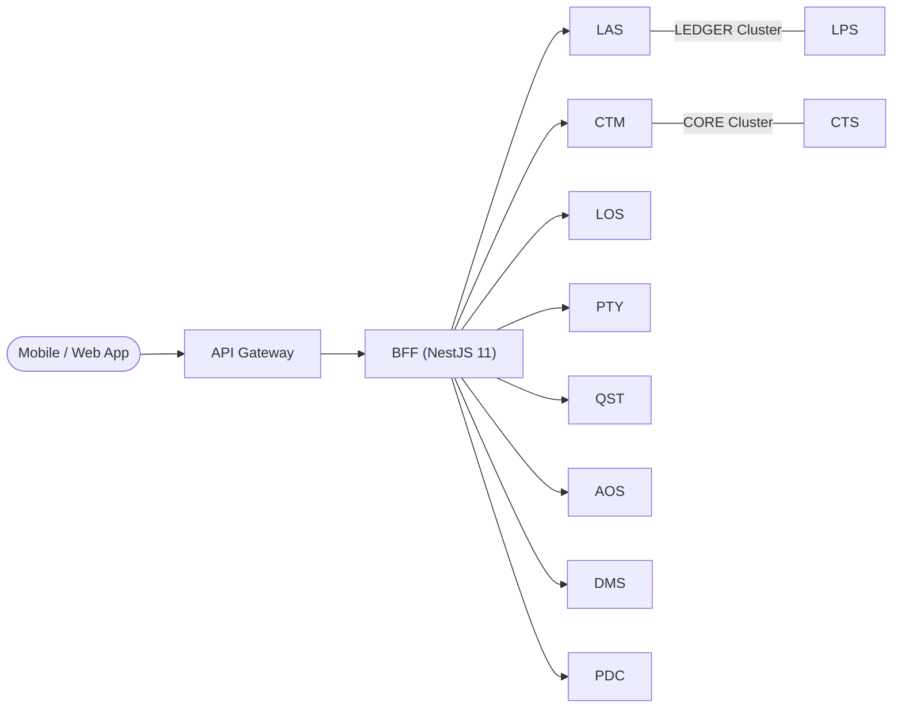

> *"In finance, the system does not just serve the business; the system is the business. A bank whose systems do not work is not a bad bank, it is no longer a bank."*

## Introduction: a 440 million dollar deployment {#dẫn-nhập-khi-một-lần-triển-khai-trị-giá-440-triệu-đô-la}

::::story
On 1 August 2012, Knight Capital Group, one of the largest equity market makers in the United States, deployed a new version of its trading software. The new code was installed on seven of eight servers. The eighth server still ran the old code, and a repurposed configuration flag activated a feature that was thought to have been retired long ago.

For about 45 minutes, the system automatically bought and sold shares according to the wrong logic, and nobody could stop it fast enough. Knight Capital lost about 440 million dollars, more than the company's entire market value. A few days later, it had to accept a 400 million dollar rescue in exchange for most of its equity; by the end of the year, Knight had agreed to merge with a competitor.

In consumer finance the scale of damage is usually smaller, but the pattern is the same: a design decision that seemed small, an assumption that was never written down, a test case that was skipped. And those who bear the consequences are millions of real customers.
::::

This chapter opens Part III. It answers the question of **why** financial systems are designed differently, and why those differences are not *over-engineering* but a reflection of very specific business and legal constraints. The following chapters go into each VLP module; this chapter provides the lens for reading them.

## 6.1 Why financial systems differ from ordinary enterprise systems {#61-vì-sao-hệ-thống-tài-chính-khác-hệ-thống-doanh-nghiệp-thông-thường}

### The situation: two systems, two worlds

::::story
Tuấn, the engineer, used to work at an e-commerce startup. On his first day at Vela Finance, he opens the code and is surprised:

"Why so many checks? Why does every operation need a transaction? Why not use *eventual consistency* like everywhere else? Why is there a whole module just for keeping an audit trail?"

The tech lead explains: "Because here, a bug is not just a bug. It is somebody's money. And that amount has to be provably correct, in court if necessary."
::::

### Principle 1: correct first, available second

In most web systems, when you have to choose between *availability* and *consistency*, you usually choose availability and accept eventual consistency: serve first, synchronize later. In financial systems that order is reversed: **correct first, available second**.

```text
E-commerce scenario:
  User A and User B are looking at the same product.
  System A sees stock = 5, System B sees stock = 5 (eventual consistency)
  Both order. In the end there are only 5 items — one order is cancelled.
  → Annoying, but manageable. You can refund, you can apologize.

Consumer finance scenario:
  Account A has balance = 2,000,000 VND.
  System A processes a withdrawal of 1,500,000 VND.
  System B (not yet updated) also allows a withdrawal of 1,500,000 VND.
  Total withdrawn: 3,000,000 VND > actual balance.
  → Not just a bug — this is financial fraud/loss.
  → You cannot "apologize" — the money is gone.
  → It may break the law.
```

The consequences of the two errors are of a different kind. Overselling stock is a nuisance but can be handled with a refund and an apology. Allowing a withdrawal beyond the balance loses real money and may break the law. This principle leads to different architectural choices:

```text
E-commerce (availability first):
  ✓ Cache aggressively
  ✓ Eventual consistency acceptable
  ✓ Optimistic locking ok
  ✓ Read replicas without strict sync

Financial systems (correctness first):
  ✗ Caches need a strict invalidation strategy
  ✗ Eventual consistency NOT acceptable for balances
  ✗ Pessimistic locking, or optimistic with retry
  ✗ Read replicas only for analytics, not for decisions
```

In VLP, when LAS processes a transaction, every change happens in a single ACID database transaction:

```java
// illustrative pseudo-code — actual signature differs
// verified: verify-ch6-ch7-code.md
// Actual: confirmTransaction() returns ExecuteTransactionResult (not TransactionResult)
// Actual: no SERIALIZABLE annotation — LAS uses AccountLockGuard (pessimistic locking)
// Actual: idempotency via getAuthorizationFromConfirm() (not findBySourceTxCode)
@Transactional  // LAS uses default isolation, NOT SERIALIZABLE
public ExecuteTransactionResult confirmTransaction(ConfirmationRequestTo request) {
    // 1. Lock account (via AccountLockGuard — pessimistic locking)
    Account account = accountRepo.findByNumber(request.getAccountNumber());

    // 2. Validate all business rules
    validateContractService(account, request);
    validateSufficientBalance(account, request.getAmount());

    // 3. Create transaction record
    Transaction tx = createTransaction(account, request);

    // 4. Update running balance (atomic with transaction creation)
    updateCurrentBalance(account, request.getAmount());

    // 5. Publish event (via outbox pattern — not direct Kafka call!)
    outboxService.publish(new TransactionConfirmedEvent(tx));

    return buildResponse(tx);
}
// If ANY step fails → entire transaction rolls back
// → Balance unchanged, no transaction created, no event published
```

LAS uses **pessimistic locking** through `AccountLockGuard`, with a maximum wait of one minute, so that no two threads process the same account at the same time. The *isolation level* is the database default, not `SERIALIZABLE`. The price is that threads have to wait when they contend for the lock; the gain is that correctness is guaranteed without the highest isolation level, which is much more expensive for the whole system. [Chapter 8](/docs/system/ch08-account-management) shows how this lock works in the transaction confirmation flow.

### Principle 2: the audit trail is a design constraint

::::story
A customer complains: "In March last year I paid 2,000,000 VND, but the system only recorded 1,800,000 VND. I have the bank transfer receipt."

The company has to answer: where did that money go, who processed it, at what time, from which system, was there an error, was there a retry. And it has to answer within the deadline set by the complaints regulation.

Without an audit trail, the company cannot answer. Not being able to answer is a regulatory breach, with fines and lost reputation.
::::

:::key[Audit trail]
An **audit trail** is an undeletable, unmodifiable record of every business activity in the system: who did what, when, with what result, and why.
:::

An audit trail is not an application log:

| | Application log | Audit trail |
|---|---|---|
| Purpose | Debugging, monitoring | Legal accountability |
| Who reads it | Developers, operations | Auditors, regulators, courts |
| Retention | 7 to 30 days | Many years, as required by regulation (often 7 to 10 years) |
| Deleting, editing | Allowed | Absolutely not |
| Level of detail | Technical events | Business events, with context |
| Format | Free text | Structured, queryable |

The design consequence is immutability. In VLP, business data is never deleted and monetary values are never edited; errors are corrected by marking a record as cancelled and writing a new one:

```sql
-- Sai: Update transaction amount
UPDATE las_transaction SET amount = 1800000 WHERE id = 123;
-- → Mất dấu vết giá trị cũ

-- Đúng: Cancel and create new
UPDATE las_transaction SET cancelled = true,
    cancellation_reason = 'AMOUNT_CORRECTION',
    cancelled_at = NOW(),
    cancelled_by = 'SYSTEM'
WHERE id = 123;

INSERT INTO las_transaction (amount, ..., source_transaction_id)
VALUES (1800000, ..., 123);
-- → Biết cũ là bao nhiêu, mới là bao nhiêu, ai làm, khi nào
```

Account parameters such as the credit limit or the billing date are not overwritten either, but closed off and replaced by a new record:

```sql
-- Không update credit limit
UPDATE las_account_parameter SET value = 25000000 WHERE ...;

-- Đóng record cũ, tạo record mới
UPDATE las_account_parameter
SET valid_to = TODAY - 1
WHERE account_id = X AND parameter_type = 'CREDIT_LIMIT'
  AND valid_to = UNREACHABLE_FUTURE_DATE;

INSERT INTO las_account_parameter
  (account_id, parameter_type, value, valid_from, valid_to)
VALUES (X, 'CREDIT_LIMIT', 25000000, TODAY, UNREACHABLE_FUTURE_DATE);
```

As a result, the system knows what an account's limit was **at any point in its history**, not only now.

### Principle 3: compliance is a first-class concern

::::story
Suppose the compliance team sends the tech lead a new requirement: "From 1 January next year, the regulator requires a report of each account's DPD bucket in a new format, within 5 working days after each month end."

The common, wrong reaction: "Sure, once we've finished features X and Y we'll add a reporting endpoint."

The right reaction: "What data does the report need? Do we have that data already? Do we need to change the data model? How do we make sure the report runs with very high reliability, given that being late means a fine?"
::::

Regulatory requirements usually affect five aspects of the system. **The data model**: if a report needs a field, that field has to exist in the database; if it does not, a migration is needed, with the risk of disruption. **Retention**: if data must be kept for seven years, the storage architecture has to allow for seven years of data growth. **Auditability**: "prove that on 15 March 2024 the limit of account X was 20 million" requires a temporal data model. **Latency**: some reports need near real time and cannot use a nightly batch. **Data location**: a requirement to keep user data in the country determines the choice of infrastructure.

An example of a legal constraint producing a design decision:

```text
Legal requirement:
  "Customers have the right to request deletion of their personal data"
  (GDPR Article 17; in Vietnam, the Law on Personal Data Protection 91/2025/QH15,
   in force from 1/1/2026, also grants a right to request deletion)

Conflict with the audit trail requirement:
  "Every transaction must be retained for many years"

Chosen solution:
  Pseudonymization: separate personal data from transaction data

  las_transaction: stores account_id (not customer_id)
  CIS module: stores the customer_id → account_id mapping
  CIS module: stores personal data (name, address, national ID)

  When a deletion request arrives:
  → Delete the personal data in CIS (and the mapping)
  → Keep the transaction records in LAS (account_id only, no longer traceable to a person)
  → The financial audit trail stays intact
  → The personal data requirement is met
```

This is why CIS *(Customer Identity Service)* is a separate module: not because microservices are fashionable, but because compliance requires personal data to be separated from transaction data. The approach has limits too: the right to deletion usually has exceptions for data that other laws require to be kept, and how it applies in practice needs to be confirmed by the legal team.

:::summary[Section 6.1]
Financial systems put correctness before availability: ACID transactions and pessimistic locking at account level. The audit trail is a design constraint, not a log: business data is never deleted, monetary values are never edited, and parameters have a history of validity periods. Compliance is a first-class concern that affects the data model, storage, latency and even the boundaries between modules, as in separating personal data into CIS.
:::

## 6.2 Microservices in finance: opportunities and pitfalls {#62-microservices-trong-tài-chính-cơ-hội-và-cạm-bẫy}

### The situation: why not a monolith?

::::story
Hương asks the tech lead: "We have more than twenty services. Is that really necessary? Each service is a team, a deployment pipeline, a database... The complexity is very high."

The answer: "Yes and no. Not because microservices are fashionable, but because our business domain really does have many different bounded contexts, with different owning teams, different deployment rhythms and different scaling needs."
::::

### Bounded contexts in the financial domain

:::key[Bounded context]
A **bounded context** is a boundary within which a domain model has a consistent meaning. Outside the boundary, the same term can mean something else.
:::

The word "account" is the clearest example:

```text
In LAS (Loan Account Service):
  Account = the customer's financial account
  Fields: accountNumber, status, creditLimit, billingPeriod
  Operations: activate, debit, credit, close

In CTS (Contract Services):
  Account (Contract) = the legal contract
  Fields: contractCode, startDate, contractType, terms
  Operations: sign, amend, terminate

In CIS (Customer Identity Service):
  Account (CustomerProfile) = personal information
  Fields: name, national ID, address, incomeInfo
  Operations: create, update, pseudonymize

In CTM (Contract Management):
  Account (Contract) = the contract lifecycle
  Fields: stages, approvals, amendments
```

The same word, four different meanings. Put everything in one monolith and the `Account` class ends up with eighty fields that nobody fully understands. The contexts in VLP are split into services for specific reasons:

| Service | Context | Why it is separate |
|---|---|---|
| LAS | Account and transaction lifecycle | The core domain, changes often, needs independent testing |
| LPS | Pricing, repayment schedules | Compute-heavy, scales independently |
| CIS | Personal data | Isolated because of personal data regulation |
| DRG | Debt register, overdue tracking | Its own team, its own deployment cycle |
| LOS | Orchestrating loan origination | Stateless, fails and retries independently |
| STS | Statement generation | Batch processing, scales independently |

### Distributed transactions and the saga pattern

VLP's loan origination process has several steps across several services: LOS calls CIS to create the customer profile, calls ADR to store the application data, calls QCE to calculate the offer, then calls LAS to activate the account. If the last step fails after the first three have succeeded, the data is left half-done: there is a customer profile, there is application data, but there is no account.

In a monolith, the simple solution is one database transaction spanning every step, rolling back everything if anything fails. With microservices, each service has its own database, so there is no ACID transaction across services.

:::key[Saga]
A **saga** is a sequence of local transactions; each transaction publishes an event or message that triggers the next step. If a step fails, the saga runs *compensating transactions* to undo what has been done.
:::

There are two ways to organize a saga. **Choreography**: each service reacts to the events of the previous service.

```text
LOS → publishes "ApplicationSubmitted" event
  ↓
CIS subscribes → creates customer profile → publishes "CustomerProfileCreated"
  ↓
ADR subscribes → saves application data → publishes "ApplicationDataStored"
  ↓
QCE subscribes → calculates offer → publishes "OfferCalculated"
  ↓
LAS subscribes → activates account → publishes "AccountActivated"

If LAS fails:
  LAS publishes "AccountActivationFailed"
  QCE subscribes → undo offer calculation
  ADR subscribes → undo application data
  CIS subscribes → undo customer profile creation
```

The advantage is that services depend little on each other and there is no central coordinator. The disadvantage is that it is hard to debug, because you have to follow events across many services, and hard to see the whole flow.

**Orchestration**: one coordinating service calls each step in turn and knows what to compensate when something fails.

```text
LOS (orchestrator) calls each service directly:
  Step 1: LOS → CIS.createProfile() → success
  Step 2: LOS → ADR.storeApplication() → success
  Step 3: LOS → QCE.calculateOffer() → success
  Step 4: LOS → LAS.activateAccount() → FAIL

LOS knows every step it has done:
  LOS → QCE.cancelOffer()
  LOS → ADR.cancelApplication()
  LOS → CIS.cancelProfile()
```

The advantage is that the whole flow logic sits in one place, easy to monitor and debug. The disadvantage is that the orchestrator becomes a central point: what if it fails?

**VLP chooses a fail-fast strategy** instead of a full compensating saga: if any step fails, the process is marked `FAILED` and the customer retries from the beginning. Zeebe is used only for the scoring process, not as the main orchestrator. The process state is kept in an Infinispan cache with a short time to live. [Chapter 7](/docs/system/ch07-origination) explains this choice in detail.

Why compensation is much harder in finance than in e-commerce:

```text
Step 4 fails: LAS.activateAccount() → FAIL

Technical compensation would like: QCE.cancelOffer()

But: the offer has already been shown to the customer.
The customer has taken a screenshot. The customer is expecting this offer.

"Cancel offer" technically: mark CANCELLED in the DB — easy.
"Cancel offer" for the business: call the customer to explain — hard.
"Cancel offer" legally: is there already a binding commitment? — very hard.
```

"Cancelling an offer" is technically just changing a status. For the business, it is an explanatory phone call to the customer. Legally, the question is whether the offer has already become a binding commitment. That is why the fail-fast strategy suits VLP: most failures are transient (network, timeouts), so a retry succeeds; the rest need human judgement anyway; and a reconciliation job detects and handles stuck applications.

:::key[Put irreversible steps last]
The best compensation is not needing to compensate. Design the process so that irreversible steps, such as signing the contract and creating the account, come as late as possible, after every reversible check has passed.
:::

### The anti-pattern: the distributed monolith

::::story
Another team in the company "moved to microservices" two years ago. But every time service A is deployed, B, C and D have to be deployed at the same time. Whenever A goes down, B, C and D go down with it. A's and B's databases actually share one schema on the same instance.

That is a **distributed monolith**: carrying all the complexity of microservices without getting any of the benefits.
::::

| Signs of a distributed monolith | Signs of real microservices |
|---|---|
| Services must be deployed together | Independent deployment, no coordination with other teams |
| Service A queries B's database directly | Own database, accessed only through an API or events |
| A shared schema on the same instance | Each service owns its data |
| One service going down takes many others with it | Failures are isolated and do not cascade |
| Changing A's API forces every consumer to change at once | Versioned APIs, backward compatible |
| One service cannot be scaled without affecting others | Independent scaling, for example scaling LPS up for EOM and back down afterwards |

An example from VLP, when LAS goes down for 5 minutes of maintenance:

```text
LAS module down for 5 minutes (maintenance):
  LOS: queue origination requests, retry when LAS is available
  STS: queue statement generation requests, retry later
  DRG: Kafka events are buffered, processed after LAS recovers
  User-facing: "Processing, please wait" instead of an error

If it were a distributed monolith:
  LAS down → LOS down → all origination fails
  LAS down → STS down → no statements can be generated
  LAS down → users see 500 errors across the whole platform
```

### The circuit breaker

:::key[Circuit breaker]
A **circuit breaker** is a design pattern that stops failures from cascading: when a downstream service keeps failing, the breaker "opens" and returns an error immediately instead of waiting for a timeout, so that the calling service does not get stuck as well.
:::

```text
CLOSED state (normal):
  Requests → Service B → Response
  If failure rate < threshold: stay CLOSED

OPEN state (downstream failing):
  Requests → Circuit Breaker → Return error immediately (no wait)
  After the timeout period: try HALF-OPEN

HALF-OPEN state (testing recovery):
  One request is allowed through → if success: CLOSED
                                  → if fail: OPEN again
```

In VLP, when LAS calls LPS to calculate an instalment plan: in the closed state, LAS calls LPS and gets a response within 200 ms. If 50% of requests to LPS fail within 10 seconds, the breaker opens; LAS stops calling LPS and immediately returns an "LPS unavailable" error. After 30 seconds, LAS tries again with one request (half-open).

Without a breaker, at 1,000 requests a second each waiting for a 5-second timeout, there would be up to 5,000 requests hanging at once. LAS's thread pool runs dry, LAS goes down too, and the failure spreads across the whole system.

:::summary[Section 6.2]
VLP's microservices are split by bounded context and for specific reasons (legal, deployment rhythm, scaling needs), not by fashion. There are no ACID transactions across services, so sagas are needed; VLP chooses fail-fast and puts irreversible steps last. The distributed monolith is the worst of both worlds. Circuit breakers stop one service's failure from spreading across the whole system.
:::

## 6.3 Designing communication between modules {#63-thiết-kế-giao-tiếp-giữa-các-module}

VLP's modules communicate through three mechanisms. Each has its own trade-offs, and choosing the wrong one is the source of many architectural problems.

### Style 1: synchronous REST

Service A sends an HTTP request to service B and **waits** for the response before carrying on.

| Suits | Does not suit |
|---|---|
| A result is needed right away to continue | Long-running operations (over 2 to 3 seconds) |
| The operation completes in one request-response round trip | The caller can carry on without the result |
| The caller needs to know success or failure before continuing | Fire-and-forget operations |
| Low latency is required (under 500 ms) | High volume that needs decoupling to scale |

```text
LAS calls LPS to calculate an instalment plan:
  LAS needs the PMT amount immediately
  → Cannot "process later" — the customer is waiting to see the offer
  → A synchronous REST call is right

LOS calls CIS to verify customer identity:
  LOS needs to know whether the customer is legitimate before proceeding
  → A synchronous REST call is right
```

Synchronous calls always need three layers of protection: a timeout, bounded retries and a circuit breaker.

```java
// illustrative pseudo-code — Resilience4j pattern (conceptually correct)
// verified: verify-ch6-ch7-code.md
// Note: LAS dùng RestTemplate để gọi LPS (không phải OpenFeign với built-in resilience)
// Resilience4j + circuit breaker được dùng tại SRT (không phải trực tiếp LAS→LPS)

// Ví dụ minh họa pattern (không phải code LAS thực tế):
InstalmentPlanDto calculateWithResilience(IPCalculationRequest request) {
    try {
        return apClient.calculatePlan(request);  // RestTemplate call
    } catch (ResourceAccessException e) {
        // Timeout → retry logic xử lý
        throw new ServiceUnavailableException("LPS_SERVICE_UNAVAILABLE");
    }
}
// SRT module có Resilience4j protection cho downstream services
// LAS gọi LPS chỉ trong IP flows (không phải regular transaction confirmation)
```

### Style 2: asynchronous events

Service A publishes an event to a message broker (Kafka or RabbitMQ). Service B subscribes and processes it afterwards, milliseconds or seconds later.

This style suits cases where the caller does not need the result immediately, where the operation can be queued for later, where publisher and consumer need to be decoupled (different teams, different deployment cycles), where one event needs to reach several consumers, and where high volume needs buffering.

```text
LAS publishes EOM_FEE event → RabbitMQ (`am.headers.event.notification` exchange) → STS subscribes:
  *(Note: TransactionConfirmedEvent → Kafka → DRG (not STS))*
  LAS does not need to wait for STS to generate the statement
  Statement generation can take a few seconds → async is right
  LAS and STS are two different teams → loose coupling is right
  Many events can be queued → buffering is right

LAS publishes transaction.confirmed → Kafka → DRG subscribes:
  Debt Register sync can be a few seconds behind — acceptable
  High volume (millions of events/day) → Kafka handles it well
  DRG needs the full history → Kafka log retention is right
```

RabbitMQ and Kafka solve two different problems:

```text
RabbitMQ (AMQP):
  ✓ Task queues: an event is processed by ONE consumer (competing consumers)
  ✓ Request-reply pattern (a form of async call-response)
  ✓ Complex routing logic (exchanges, bindings)
  ✓ Short-lived messages with no need for replay
  
  In VLP: LAS → STS (statement generation — task queue)
                 LOS → LAS (origination.completed — task queue)

Kafka:
  ✓ Event log: many consumers read the same stream
  ✓ Replay events (a consumer resets its offset to the past)
  ✓ Very high throughput
  ✓ Long-term retention (analytics)
  
  In VLP: LAS → DRG (transaction events — multiple consumers)
                 QST → LOS (quote events — event log)
```

### Style 3: reading the database directly

Service A reads service B's database directly, not through an API or events. In microservices this is usually an anti-pattern. But there are cases where it makes sense in a financial system, and LAS reading the CTM schema directly is one example:

```text
"Normal" approach:
  LAS needs ContractService data
  → LAS calls the CTS service via REST
  → CTS returns the data
  → LAS proceeds

Why VLP uses a direct DB read:
  1. Performance: every transaction confirm = 1 ContractService lookup
     At 1000 transactions/second → 1000 HTTP calls/second to CTS
     Latency: 10-20ms per call → adds 10-20ms to every transaction
     With a direct DB read: 1-2ms → 5-10x faster

  2. Consistency: the transaction must be in the same DB transaction
     If CTS is called via HTTP, the data CTS reads and the data LAS reads
     may differ (concurrent updates between the calls)
     A direct DB read in the same transaction → a consistent view

  3. Operational risk: if the CTS service is down, every transaction
     confirmation fails. With a direct DB read, LAS does not depend on CTS availability.
```

| Makes sense when | Does not make sense when |
|---|---|
| A hot path with very high performance requirements | Just to avoid writing an API |
| Consistency must sit inside the same transaction | Two different organizations own the data |
| Owner and reader belong to the same organization | Strict service boundaries are needed for independent scaling |
| Schema changes are coordinated between the two teams | The schema changes often |
| The trade-off is documented and consciously accepted | |

The price of this choice is coupling: CTM cannot freely change the `CONTRACT_SERVICE` schema without warning the LAS team.

### The dependency map between modules



*Figure 6.1. The application's entry point and the modules behind it. LAS and LPS share the LEDGER database cluster, CTM and CTS share the CORE cluster.*

Every dependency in VLP must be documented: what style it is (REST, events or direct database read), why (performance, consistency or decoupling), which trade-off is accepted, and how the caller copes when the dependency is down.

:::summary[Section 6.3]
Synchronous REST is used when a result is needed right away with low latency, and always needs a timeout, retries and a circuit breaker. Asynchronous events are used when work can be queued, must reach several consumers or needs decoupling; RabbitMQ for task queues, Kafka for event logs. Reading a database directly is usually an anti-pattern, but makes sense when performance and consistency demand it. Every dependency must be documented with its reasons.
:::

## 6.4 Data architecture in finance {#64-kiến-trúc-dữ-liệu-trong-tài-chính}

### Event sourcing in billing

::::story
Minh receives a question from the audit team: "What was the balance of account #12345 at 10:30 on 15 March 2024?"

If only the current balance is stored, a question about the past cannot be answered. If every event that changed the balance is stored, the balance can be rebuilt at any point in time.
::::

:::key[Event sourcing]
**Event sourcing** is a design pattern that stores the system's state as a sequence of change events, instead of only the current state. The state at any point in time is rebuilt by accumulating the events up to that point.
:::

```text
Instead of storing only:
  LAS_CURRENT_BALANCE: { account_id: 123, outstanding_debt: 15,641,561 }
  (Only the current balance is known, not the history)

Store the sequence of events:
  LAS_LEDGER_ENTRY:
  #1: 2024-01-05 10:00  DEBIT  18,500,000  (disbursement)
  #2: 2024-02-05 00:00  DEBIT     277,500  (period 1 interest)
  #3: 2024-02-05 09:30  CREDIT  1,696,080  (period 1 instalment)
  #4: 2024-03-05 00:00  DEBIT     256,221  (period 2 interest)
  #5: 2024-03-05 09:30  CREDIT  1,696,080  (period 2 instalment)
  ...

  Balance at a point in time = total DEBIT - total CREDIT up to that point
  Example after entry #5: 18,500,000 + 277,500 + 256,221 - 2 × 1,696,080
                         = 15,641,561 VND
```

The figures in the example follow exactly the repayment schedule of Lan's loan in [Chapter 2](/docs/foundations/ch02-mathematics-of-lending): period 1 interest is 1.5% of 18,500,000, and the balance after two periods is 15,641,561 VND.

VLP uses both approaches. `LAS_LEDGER_ENTRY` records each event (transactions, fees, interest) and acts as the event store. `LAS_CURRENT_BALANCE` is a materialized view computed from the events and updated right after each event:

```text
Event store (append-only):
  Every transaction → INSERT INTO las_ledger_entry (...)
  Never DELETE or UPDATE

Materialized view (for performance):
  LAS_CURRENT_BALANCE is updated after every event
  Cannot be derived in real time from events (too slow for every request)
  If the balance looks wrong → reconcile from the event store
```

When a balance is suspected to be wrong, reconcile against the event store:

```sql
-- Kiểm tra balance có đúng không:
SELECT
    SUM(CASE WHEN direction = 'CREDIT' THEN amount ELSE -amount END)
        as calculated_balance
FROM las_ledger_entry
WHERE account_id = 123
    AND NOT cancelled
    AND transaction_date <= '2024-03-15 10:30:00';

-- So sánh với:
SELECT outstanding_debt FROM las_current_balance WHERE account_id = 123;

-- Nếu khác nhau → inconsistency → investigate
```

### Temporal data

:::key[Temporal data]
**Temporal data** is data tied to a validity period: you know exactly from when to when a record held its value, not only its current value.
:::

```sql
-- AccountParameter: mỗi record biết valid từ/đến khi nào
CREATE TABLE las_account_parameter (
    id BIGINT PRIMARY KEY,
    account_id BIGINT NOT NULL,
    parameter_type VARCHAR(50) NOT NULL,
    value VARCHAR(255) NOT NULL,
    valid_from DATE NOT NULL,           -- Effective start
    valid_to DATE NOT NULL,             -- Effective end (UNREACHABLE_FUTURE_DATE nếu current)
    created_at TIMESTAMP,
    created_by VARCHAR(100)
);

-- Query: Credit limit của account X vào ngày 15/3/2024
SELECT value
FROM las_account_parameter
WHERE account_id = X
    AND parameter_type = 'CREDIT_LIMIT'
    AND valid_from <= '2024-03-15'
    AND valid_to >= '2024-03-15';
```

Why not store only the current value?

```text
Situation: a customer complains "In March I was over limit, but
  my credit limit at the time was 25 million, not 20 million
  as the system now shows."

With temporal data:
  → Query the credit limit in March → an exact answer
  → If it was 25 million: the system has a bug → investigate
  → If it was 20 million: the customer is mistaken → show the audit trail

Without temporal data:
  → Only the current credit limit is known
  → The customer's claim cannot be verified
  → The answer has to be "we don't have that information"
  → Loss of trust, potential legal dispute
```

### Soft deletes and their consequences for audit

:::key[Soft delete]
A **soft delete** "deletes" a record by marking it, for example `cancelled = true` in a financial context, instead of actually removing it from the database.
:::

```text
Hard delete: DELETE FROM las_transaction WHERE id = 123;
  → The record disappears completely
  → The audit trail is lost
  → No way to know this transaction ever existed
  → Breaches the regulatory requirement

Soft delete: UPDATE las_transaction
    SET cancelled = true,
        cancellation_reason = 'DUPLICATE_ENTRY',
        cancelled_at = NOW(),
        cancelled_by = 'system:duplicate-detector'
    WHERE id = 123;
  → The record still exists in the DB
  → Audit trail intact: who cancelled it, when, why
  → Can be "undone" if cancelled by mistake (set cancelled = false)
  → Regulatory compliant
```

The convention in VLP:

```java
// illustrative pseudo-code — pattern exists, implementation differs
// verified: verify-ch6-ch7-code.md
// Note: Không có @MappedSuperclass BaseFinancialEntity chung trong LAS
// Mỗi entity implement soft delete riêng (e.g., PeriodBalanceSnapshot có cancelled field)
// Pattern cancelled=true vẫn đúng, nhưng không có shared base class

// Ví dụ: PeriodBalanceSnapshot (entity thực trong LAS):
@Entity @Table(name = "LAS_PERIOD_BALANCE_SNAPSHOT")
public class PeriodBalanceSnapshot {
    // ...
    @Column private boolean cancelled = false;
    // Cancelled entities excluded from active calculations
    // but visible for audit trail
}
```

Every business query must filter out cancelled records:

```java
// Luôn filter cancelled = false trong business logic:
List<LedgerEntry> activeItems = ledgerEntryRepo.findByAccountAndCancelledFalse(account);

// Nhưng audit queries có thể xem cả cancelled:
List<LedgerEntry> allItemsForAudit = ledgerEntryRepo.findByAccount(account);
```

### Idempotency: handling duplicate requests

::::story
A customer taps "Confirm payment". The app sends the request to the server, the network times out, and the app, not knowing whether the request was processed, sends it again. The server receives a second request.

The desired outcome: the payment is processed once. The undesired outcome: the customer is charged twice.
::::

:::key[Idempotency]
**Idempotency** is the property of an operation that can be performed many times with the same result as performing it once.
:::

```java
// illustrative pseudo-code — concept correct, implementation differs
// verified: verify-ch6-ch7-code.md
// Note: LAS KHÔNG dùng X-Idempotency-Key header
// LAS dùng sourceTxCode trong request body — field trên Transaction entity

// Actual pattern trong LAS:
// Client gửi:
// POST /api/transactions/confirm
// Body: { "accountNumber": "ACC123", "amount": 1696080, "sourceTxCode": "EXT-TX-12345" }

// LAS kiểm tra:
@Transactional
public ExecuteTransactionResult confirmTransaction(ConfirmationRequestTo transactionTo) {
    // Idempotency: check sourceTxCode via getAuthorizationFromConfirm()
    // nếu đã tồn tại → return kết quả cũ
    return confirmTransactionInternal(transactionTo, true);
    // checkForDuplicities=true → bật kiểm tra sourceTxCode
}
```

In VLP, every transaction confirmation request from an external system (a POS terminal, the app) must carry a `sourceTxCode`, a unique identifier created by the sender. LAS checks the `sourceTxCode` before processing; if it already exists, it returns the earlier result instead of processing again.

:::summary[Section 6.4]
Event sourcing stores the sequence of events so that state can be rebuilt at any point in time; VLP combines the `LAS_LEDGER_ENTRY` event store with the `LAS_CURRENT_BALANCE` materialized view. Temporal data answers the question "what was the value at time X". Soft deletes keep the audit trail intact. Idempotency through `sourceTxCode` prevents duplicate processing, which is especially important for payments.
:::

## 6.5 Technology choices: why, not just what {#65-lựa-chọn-công-nghệ-vì-sao-không-chỉ-là-gì}

### Why Spring Boot for financial services

Tuấn asks: "Why Java and Spring Boot? There are many newer, faster frameworks: Go, Node.js, FastAPI..."

```text
Reason 1: Maturity and stability
  The Spring Framework has more than 20 years in financial services, Spring Boot more than 10.
  Most problems with threading, transaction management and security
  have been found and fixed through millions of earlier deployments.

  Hit a BigDecimal rounding problem with Spring Data JPA:
  there are plenty of documented answers and fixes.
  With a two-year-old framework: you are on your own.
```

```text
Spring ecosystem for financial services:
  Spring Security: OAuth2/OIDC, JWT, method-level security
  Spring Data JPA: Transaction management, temporal queries
  Spring Integration: Message channel patterns (ChargingGateway)
  Spring Batch: EOM batch processing (Job, Step, Chunk)
  Spring Cloud: Circuit breaker, config server, service discovery

They all work well together: the same configuration model,
the same testing approach, the same monitoring approach.
```

```text
JPA/Hibernate: battle-tested ORM, excellent PostgreSQL support
Jakarta EE: standardized APIs, no vendor lock-in
Maven/Gradle: mature build tooling with good dependency management
JVM: GC tuning, JIT optimization, excellent profiling tools
```

Spring Boot has weaknesses too:

```text
Disadvantages:
  - Slow startup (5-15 seconds) → not suited to serverless
  - High memory footprint → needs tuning for containers
  - Verbose configuration compared with microframeworks
  - Steep learning curve for new developers

When to consider an alternative:
  - Serverless functions → Quarkus (fast startup), Micronaut
  - High-throughput, low-latency I/O → Golang, Vert.x
  - Scripting/automation → Python
  - BFF layer → Node.js (non-blocking I/O, JSON-native)
```

VLP therefore mixes: the back-end services use Java and Spring Boot, while the BFF *(backend for frontend)* layer uses NestJS on Node.js. Each choice fits its job.

### Why PostgreSQL

```text
PostgreSQL vs alternatives for financial systems:

PostgreSQL chosen because:
  ✓ Fully ACID compliant (with stricter isolation levels)
  ✓ MVCC (Multi-Version Concurrency Control) — concurrent reads do not block writes
  ✓ Excellent support for complex queries, JSON, temporal data
  ✓ Row-level locking → fine-grained concurrency control
  ✓ Proven at scale (many banks use PostgreSQL)
  ✓ Open source but enterprise-grade (no vendor lock-in)
  ✓ Strong community, excellent tooling

MySQL: Fewer features for complex financial queries
Oracle: Excellent but very expensive, vendor lock-in
MongoDB/NoSQL: ACID transactions across collections are more complex
NewSQL (CockroachDB): Promising but less battle-tested
```

Some PostgreSQL features are used specifically for financial operations in VLP:

```sql
-- 1. Row-level locking cho account operations:
SELECT * FROM las_account WHERE id = X FOR UPDATE;
-- Lock row này, transaction khác phải chờ

-- 2. Pessimistic locking (AccountLockGuard, timeout 1 phút):
-- // illustrative — LAS không dùng SERIALIZABLE isolation level
-- Lock account record ngay khi nhận request → release sau commit

-- 3. Advisory locks cho long-running batch operations:
SELECT pg_advisory_lock(account_id);
-- Application-level lock, không block other transactions

-- 4. Partitioning cho large tables:
CREATE TABLE las_ledger_entry_2024
    PARTITION OF las_ledger_entry
    FOR VALUES FROM ('2024-01-01') TO ('2025-01-01');
-- 100M+ rows được partition theo year để query nhanh hơn
```

### Why both Kafka and RabbitMQ

A common question: "Why use both Kafka and RabbitMQ? Just pick one." The answer is that they solve two different problems.

```text
RabbitMQ (AMQP) in VLP:

Use cases:
  LAS → STS: Statement generation requests
  LOS → LAS: Origination completion notification
  AOS → LOS: Supplement creation results

Why it fits:
  → Task queue: a message is processed by one consumer
  → Request acknowledged when processed successfully
  → Messages do not need long retention (7-14 days is enough)
  → Complex routing: exchanges, bindings, dead-letter queues

─────────────────────────────────────────────────────

Kafka in VLP:

Use cases:
  LAS → DRG: Transaction events (debt catalogue sync)
  ADR → SRT, LOS: Application lifecycle events
  QST → LOS: Quote state changes

Why it fits:
  → Event log: multiple consumers read the same stream
  → Consumer replay: DRG can reset and reprocess events
  → High throughput: millions of events/day
  → Long retention: analytics needs historical data
  → Partitioning: parallel processing by account_id
```

The rule for choosing:

```text
Choose RabbitMQ when:
  "I need this task done exactly once by one worker"

Choose Kafka when:
  "I need many consumers reading this event stream,
   and may need to replay events from the past"
```

### Why Keycloak

```text
Keycloak 26.2.0 chosen because:

OAuth2/OIDC standard:
  → Industry standard, no vendor lock-in
  → All services use the same token format → a consistent security model

Fine-grained authorization:
  → Role-based: ROLE_ADMIN, ROLE_TELLER, ROLE_API_CONSUMER
  → Resource-based: "Can user X access account Y?"
  → Policy-based: "Only during office hours"

Audit trail for security:
  → Every login, token issue and token refresh is logged
  → Suspicious login patterns can be detected

Local development support:
  → Keycloak Docker image for local dev
  → "Bypass" mode for integration testing (--spring.security.provider=none)
  → No production config leaking into the dev environment
```

:::summary[Section 6.5]
Spring Boot is chosen for its maturity and ecosystem, accepting slow startup and a large memory footprint. PostgreSQL is chosen for ACID, MVCC and row-level locking. RabbitMQ is for task queues, Kafka for replayable event logs. Keycloak provides standard OAuth2 and OIDC with fine-grained authorization. Each choice has a specific reason, not a fashion.
:::

## Chapter 6 summary {#tổng-kết-chương-6}

Back to the question Tuấn asked on his first day, "why is it so complicated?", the answer has five parts:

| Requirement | Why | Architectural consequence |
|---|---|---|
| Correctness | Transactions are real money; eventual consistency is not acceptable for balances | ACID, pessimistic locking with `AccountLockGuard` (waits at most 1 minute) |
| Accountability | An audit trail is mandatory | Immutable records, temporal data, soft deletes |
| Compliance | Regulation is a first-class design constraint | CIS separates personal data, pseudonymization |
| Resilience | Financial services run continuously | Circuit breakers, fail-fast, idempotency, event sourcing |
| Scale | Millions of accounts, thousands of transactions a second | Microservices by bounded context, Kafka for high-volume events |

Every design decision has an economic, legal or operational reason. This is not over-engineering, but the minimum complexity needed to run a financial system correctly.

VLP's deployment infrastructure:

```text
Kubernetes running on-premise (not in the cloud)
GitOps: ArgoCD + Helm (sync waves: ConfigMap → DB migration → App → HPA)
Secrets: HashiCorp Vault with Kubernetes auth
Autoscaling: KEDA (Prometheus metrics + cron-based)
Monitoring: Prometheus + Grafana + OpenTelemetry distributed tracing
5 PostgreSQL clusters (PgBouncer port 6432):
  LEDGER cluster (`vlp_ledger_a1p`): LAS, LPS, RVS
  CORE cluster (`vlp_core_a1p`): ADR, CTM, CTS, RDS, DRG, DMS, CIS, PTY, PDC, QST, AOS, TKT (12 modules)
  CNTR cluster (`vlp_cntr_a1p`): OFR
  STATEMENT cluster (`vlp_statement_a1p`): STS
  Local dev: `testdb` (all modules)
Stateless modules (no DB): LOS, SRT, DSA (read-only cache)
```

The list above has four database clusters for the production environment, plus one shared `testdb` database for development.

## Review questions {#câu-hỏi-tự-kiểm-tra}

**Recall**

1. Name three main differences between financial systems and ordinary enterprise systems.
2. What is a soft delete? Why do financial systems not use hard deletes?
3. What is the fundamental difference between RabbitMQ and Kafka? Give a fitting example for each.
4. What is the idempotency key pattern, and why is it needed in payment systems?

**Understand**

5. Why is "correct first, available second" the most important principle of financial systems? Give a concrete example of the consequences of breaking it.
6. What is a distributed monolith? Name three signs and explain why it is the worst of both worlds.
7. What problem do sagas solve in microservices? Why are compensating transactions more complex in finance than in e-commerce?
8. Which audit and compliance requirements does temporal data serve?

**Apply**

9. A new fintech company needs to build a payment confirmation API. Design: (a) a database schema that supports idempotency; (b) a sequence diagram from receiving the request to responding; (c) error handling: network timeouts, duplicate requests, insufficient balance; (d) what needs to go into the audit trail.
10. The engineering team proposes two architectures for statement generation. Option A: LAS calls STS synchronously over REST during transaction confirmation. Option B: LAS publishes an event, and STS receives it and generates the statement asynchronously. Analyse each option for correctness, performance, resilience and complexity. Which do you choose, and under what conditions?

**Analyse**

11. VLP is considering moving from PostgreSQL to a distributed NewSQL database such as CockroachDB to scale globally. Analyse (a) the benefits, (b) the specific risks for financial workloads, (c) whether the PostgreSQL features currently in use have NewSQL equivalents, (d) a migration strategy and a rollback plan.
12. A bug is found: LAS occasionally records duplicate transactions when the network retries. Investigate: (a) why the idempotency check does not catch them; (b) how to mitigate immediately; (c) how to fix the architecture properly; (d) how to detect whether this bug has happened in the past.

## Exercises {#bài-tập-áp-dụng}

**Exercise 1. Architecture review.** A fintech startup launches a credit card product with this architecture: one monolithic Spring Boot application and one PostgreSQL database, every operation a synchronous REST call, no event stream, soft deletes but no audit trail beyond the application log. It expects to reach one million users within two years. (a) Identify the five most serious architectural problems. (b) Rank them by risk (critical, high, medium). (c) Propose a zero-downtime migration path for the most serious problem. (d) Estimate the technical debt and the time to address each problem.

**Exercise 2. Designing a distributed transaction.** Design a saga for the loan origination process with these steps:

```text
1. CIS: create the customer profile (personal data)
2. ADR: store the application data
3. Credit scoring: run the model → get the score
4. LPS: calculate the offer (based on the score)
5. LAS: create the account (not yet activated)
6. LOS: mark origination complete → notify the customer
```

(a) Design the event flow in the choreography style. (b) Design LOS's coordination logic in the orchestration style. (c) Failure scenarios at step 3 and step 5: what are the compensating transactions? (d) Why is compensating step 1 (CIS) harder than step 4 (LPS)? (e) Which style do you choose for this case? Argue your choice.

**Exercise 3. Implementing an audit trail.** Tuấn needs to build an audit trail for LAS: tracking account status changes, limit changes and transaction cancellations; recording who did it (a person or the system), when (with time zone), why (a reason code and a note), and what changed (old and new values); retained for 10 years; able to answer "the history of limit changes for account X". (a) Design the database schema. (b) Compare three implementations: database triggers, the application layer, or event sourcing. (c) The trade-offs of each in a financial context. (d) How do you keep the audit trail from adding more than 5% to the latency of the main operation? (e) How do you prove that the audit trail has not been tampered with?

## Further reading {#đọc-thêm}

**Distributed systems**

- Kleppmann, M. (2017). *Designing Data-Intensive Applications.* O'Reilly Media. Chapters 7 to 9 on transactions, the trouble with distributed systems, consistency and consensus; recommended for anyone building financial systems.

**Domain-driven design**

- Evans, E. (2003). *Domain-Driven Design: Tackling Complexity in the Heart of Software.* Addison-Wesley. The concepts of bounded contexts, aggregates and domain events, the foundation of microservice design.

**The Knight Capital incident**

- U.S. Securities and Exchange Commission (2013). *In the Matter of Knight Capital Americas LLC.* The enforcement order describes in detail the events of 1 August 2012 and the shortcomings in deployment controls, available at sec.gov.

Chapter 7 goes deep into the loan origination process, from the moment the customer applies until the account is activated: the LOS orchestrator, the pricing engine, the credit scoring pipeline and the account creation step in LAS. With the architectural foundation of this chapter, you can see why each decision in that process was made the way it was. [Chapter 7. Loan origination](/docs/system/ch07-origination).
