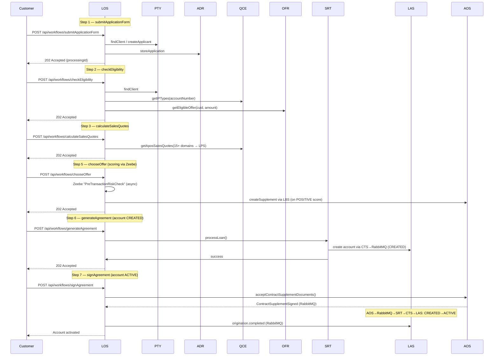

> *"Loan origination is where business strategy, risk management and customer experience collide in a few minutes. Design it right and the customer is well served and risk is under control. Design it wrong and all three fail at once."*

## Introduction: four minutes that decide a year {#dẫn-nhập-bốn-phút-quyết-định-một-năm}

::::story
At 10:15 on Monday morning, Lan opens the app and applies for a loan of 18,500,000 VND. At 10:19, the app says: "Your application has been approved. The money will be disbursed within 24 hours."

Four minutes. What happened in those four minutes?

A carefully designed chain of processing ran: identity checks, risk assessment, offer calculation, account creation. Dozens of business rules were executed in the right order, on time, with consistency guaranteed.

And everything had to run correctly alongside thousands of other applications: other people applying at the same time, a scoring model that had just been updated, a new tariff that had just taken effect.
::::

This chapter follows Lan's application from the moment she taps "Apply" until her account is activated. It does not just describe the flow, but goes into each design decision: why LOS is a stateless, asynchronous orchestrator, why QCE is a REST service rather than a queue, and why the practical strategy is fail-fast rather than the full compensating saga discussed in [Chapter 6](/docs/system/ch06-financial-system-architecture).

## 7.1 Overview of the origination process {#71-tổng-quan-quy-trình-khởi-tạo}

### Sequence diagram



*Figure 7.1. The loan origination flow in the happy path. Step 4 (pre-contract quote calculation) is omitted to keep the diagram compact. The account is created in the CREATED state at step 6 and activated at step 7 through a chain of RabbitMQ events.*

This is the case where everything goes smoothly. In reality, any step can fail, time out or need a retry, and the whole system has to cope with that; section 7.6 discusses this in detail.

### LOS: an asynchronous, stateless orchestrator

::::story
Tuấn, the engineer, opens the LOS code and is surprised: "No database? LOS has no tables?"

The tech lead confirms: "Right. LOS uses an embedded Infinispan cache, held in memory with a short time to live. The process state lives in Infinispan, not in a database."

"But what if an LOS pod crashes? Is all the state lost?"

"Infinispan replicates across the cluster. If the whole cluster is lost, there is a reconciliation job to handle it. It is designed for resilience, not for perfect consistency."
::::

Why LOS uses Infinispan instead of a database:

```text
Database-backed approach:
  LOS stores all state in PostgreSQL
  
  Problem 1: LOS becomes a bottleneck — it hits the DB at every step
  Problem 2: Scaling LOS out is complex — distributed sessions
  Problem 3: In-flight origination data mixed with operational data
  Problem 4: TTL management — when to delete abandoned applications?

Infinispan approach (current):
  In-memory distributed cache with a configurable TTL
  LOS pod crash → the Infinispan cluster replicates to another pod
  Auto-expiry: abandoned applications expire automatically after the TTL
  Simple horizontal scaling — the cache distributes automatically

Important: LOS does NOT use Zeebe as the primary state holder.
Zeebe is used only optionally in the scoring step
(the Zeebe integration is an optional profile: "zeebe-integration").
```

LOS's process architecture is based on controllers, not on a BPMN engine:

```text
Instead of a BPMN engine, LOS uses:
  WorkflowController (Spring MVC)
  Infinispan cache (workflow state)
  @Async methods (non-blocking steps)

Step order:
  1. submitApplicationForm → PTY + ADR
  2. checkEligibility → validate credit criteria
  3. calculateSalesQuotes → LOS → QCE → LPS (pricing)
  4. calculateAccountWithCashQuote / purchaseQuote → pre-contract
  5. chooseOffer → scoring, supplement creation (AOS)
  6. generateAgreement → SRT (loan processing), DMS
  7. signAgreement → waits for document acceptance
```

LOS uses **a separate typed Infinispan cache for each step**, with no shared `WorkflowContext` class:

```java
// verified: CacheConfiguration.java trong LOS
// CHOOSE_OFFER_CACHE, LOAN_PURPOSE_CACHE, GENERATE_AGREEMENT_CACHE, SIGN_AGREEMENT_CACHE
// Mỗi cache typed riêng: Cache<String, ChooseOfferCachedObject>, v.v.
```

The process state is propagated by **publishing events to Kafka**, not by `cache.put`:

```java
// verified: SubmitApplicationFormService.java
@Service
public class SubmitApplicationFormService {
    @Async
    public void submitApplicationForm(String processingId, SubmitApplicationFormTO formTO) {
        // Publish running state to Kafka:
        submitApplicationFormWorkflowKafkaService.publishRunning(processingId, formTO);

        // Execute workflow steps:
        var applicant = partyService.createApplicant(formTO);
        var application = applicationStorageService.createApplication(formTO, applicant);

        // Publish success:
        submitApplicationFormWorkflowKafkaService.publishSucceeded(processingId, ...);
    }
}
```

Each step publishes a `RUNNING` status, executes, then publishes `SUCCEEDED` or `FAILED` to Kafka. The customer-facing app periodically calls `GET /status/{processingId}`, and LOS returns the latest state of the process.

Why return `202 Accepted` instead of waiting for processing to finish:

```text
If the response is returned synchronously:
  POST /submit → run scoring (500ms) → run offer calc (300ms)
              → generate agreement (200ms) → ...
  Total: 1-5 seconds before the response is returned
  → HTTP timeout risk
  → The mobile app may retry, creating duplicate applications
  → Poor user experience (the loading spinner runs too long)

With 202 Accepted:
  POST /submit → LOS starts async processing (Infinispan cache) → returns {processingId} at once (50ms)
  The client polls GET /status/{processingId} every 2 seconds
  → The server is not tied up waiting
  → The client knows processing is under way
  → Retries are safe (idempotent — same processingId)
  → The server can scale each step independently
```

:::summary[Section 7.1]
LOS is a stateless orchestrator: each step's state lives in an Infinispan cache with a short time to live, not in a database, and is propagated through Kafka events. Each step returns `202 Accepted` immediately and the client polls for status; this suits mobile apps, makes retries safe and scales horizontally with ease. Each step can fail and be retried independently.
:::

## 7.2 Application and KYC {#72-nộp-đơn-và-kyc}

### ADR: the application data repository

::::story
Lan starts filling in the application in the app at 10:00. At 10:10, her phone runs out of battery. She plugs it in, reopens the app, and everything she had entered is still there. She carries on and submits at 10:15.

That does not happen by itself; it has to be designed.
::::

:::key[ADR (Application Data Repository)]
**ADR** is the long-lived store for application data throughout origination. It holds everything from the moment the customer starts filling in the application until the account is created, and afterwards for audit purposes.
:::

Why ADR is separate from LAS:

```text
LAS stores: the account after activation (live financial data)
ADR stores: application data during origination

If merged into LAS:
  → The LAS database would hold millions of incomplete/rejected applications
  → LAS query performance would degrade
  → ADR and LAS have different lifecycles:
      ADR data: important during origination, then archived
      LAS data: important forever (audit trail)
  → Different regulatory requirements:
      ADR: can be pseudonymized once origination is complete
      LAS: transactional data must be kept intact

If kept separate:
  → A clean domain boundary
  → Independent scaling
  → Different retention policies
  → ADR events → trigger LOS steps
```

ADR's schema design:

```sql
-- Application header:
CREATE TABLE application (
    id UUID PRIMARY KEY,
    processing_id VARCHAR(36) UNIQUE,
    customer_id VARCHAR(100),     -- CIS customer identifier
    status VARCHAR(50),           -- DRAFT, SUBMITTED, SCORING, APPROVED, REJECTED, ACTIVATED
    product_code VARCHAR(50),
    requested_amount DECIMAL(15,2),
    requested_tenor INT,
    channel VARCHAR(50),          -- DIGITAL, POS, TELESALES
    created_at TIMESTAMP,
    updated_at TIMESTAMP,
    submitted_at TIMESTAMP,
    decision_at TIMESTAMP
);

-- Application steps (event log):
CREATE TABLE application_event (
    id BIGINT GENERATED ALWAYS AS IDENTITY,
    application_id UUID REFERENCES application(id),
    event_type VARCHAR(100),      -- KYC_COMPLETED, SCORE_RECEIVED, OFFER_GENERATED...
    event_data JSONB,
    created_at TIMESTAMP,
    created_by VARCHAR(100)
);
-- Không bao giờ UPDATE hay DELETE — append-only log
```

Omnichannel support, as required in [Chapter 4](/docs/products/ch04-customer-journey): a customer who stops in one channel can continue in another.

```java
// illustrative pseudo-code — ADR method names differ from actual
// verified: verify-ch6-ch7-code.md
// Actual ADR ApplicationService methods:
//   save(Application) — creates new application (no createDraft())
//   findByCode(String code) — find by code (no findByCustomerAndProduct())
//   update(Application) — complex cascade update (6 collections)

// User bắt đầu trên App (via LOS → ADR):
Application app = applicationService.save(newApplication);
// app.code = "abc-123", status = DRAFT

// App hết pin, re-open (LOS polls ADR):
Application existing = applicationService.findByCode(applicationCode);
// Vẫn còn, status = DRAFT → tiếp tục

// Cross-channel: teller tìm application qua application code
// (không có findByCustomerAndProduct — lookup qua code)
```

### The four layers of KYC

::::story
When Lan applies, the system has to verify: is this a real person? Do the name, national ID number and address match? Is she on a blacklist? Is she eligible to borrow?

That is KYC *(know your customer)*, a legal requirement and not just a business one.
::::

**Layer 1: identity verification.**

```text
Input: Photos of the front and back of the national ID + a selfie

Process:
  1. OCR: read the information on the ID (name, date of birth, address, ID number)
  2. Liveness check: is the selfie a real person? (guards against printed photos)
  3. Face match: does the face in the selfie match the photo on the ID?
  4. Document authenticity: does the ID show signs of forgery?

Output:
  PASS (confidence > 95%) → proceed
  REVIEW (70-95%) → manual review queue
  FAIL (< 70%) → reject with a reason code
```

**Layer 2: sanctions and blacklist screening.**

```text
Input: Name + date of birth + nationality

Process:
  1. Check against the OFAC list (US sanctions)
  2. Check against the local regulatory blacklist (State Bank of Vietnam)
  3. Check against the internal blacklist (previous fraud, default)
  4. PEP screening (Politically Exposed Person — increased risk)

Output:
  CLEAR → proceed
  MATCH/POSSIBLE_MATCH → compliance team review
  BLOCKED → reject immediately, log for regulatory reporting
```

**Layer 3: credit bureau enquiry.**

```text
Input: National ID number + full name

Process:
  1. Query the credit bureau (CIC, PCB in Vietnam)
  2. Retrieve: credit score, outstanding debts, DPD history, number of inquiries

Output:
  Credit report → fed into the scoring model
```

**Layer 4: income verification.**

```text
Input: Income type + documents (salary statements, tax records, financial statements...)

Process:
  1. Document authenticity check (DMS module)
  2. Income extraction via OCR
  3. Consistency check: declared income vs bank statement
  4. Employment verification (optional: call the employer)

Output:
  Verified income amount → fed into the affordability check
```

The four layers go from cheap to expensive and from fast to slow. If the first layer fails, there is no need to pay for a credit bureau enquiry or spend effort verifying income.

CIS is the separate module that holds KYC data, for the reasons discussed in [Chapter 6](/docs/system/ch06-financial-system-architecture):

```text
CIS stores:
  customer_id → {name, national ID, DOB, address, income, employment}

Relationship with LAS:
  LAS stores account_id → {accountNumber, balance, transactions}
  LAS does NOT know the customer's name — only the customer_id

Why:
  1. GDPR/PDP compliance: PII is isolated in CIS
     → Right to erasure: delete the CIS data, the LAS transactions stay intact
  2. Reuse: one customer_id can have several accounts in LAS
     → KYC once, use many times
  3. Security: a compromise of the LAS database does not expose PII
  4. Different team ownership: the KYC team owns CIS, the LAS team owns LAS
```

Customer documents go through DMS:

```text
1. The user uploads the ID → App → API Gateway → DMS
   DMS stores: the encrypted document, returns docId = "doc-xyz"

2. LOS tells CIS: "Verify using doc-xyz"
   CIS calls DMS to fetch the document → runs verification → returns the result
   CIS does not store the document (only the verification result)

3. DMS stores the document under a retention policy:
   In process: full access
   After activation: read-only, compliance access only
   After 7 years: archive or delete per policy
```

:::summary[Section 7.2]
ADR is the long-lived store for application data, letting customers stop halfway and continue in any channel. KYC has four layers: identity verification, sanctions and blacklist screening, credit bureau enquiry, and income verification. CIS is separate from LAS to isolate personal data and reuse KYC results across accounts. DMS stores encrypted documents with a lifecycle and retention period set by regulation.
:::

## 7.3 Credit scoring in the live system {#73-chấm-điểm-tín-dụng-trong-hệ-thống-vận-hành}

### From raw data to a score

::::story
Lan's data is complete: her ID is verified, the credit bureau result is back, and her verified income is 22,000,000 VND a month. Now the system has to decide: lend or not, and if so, on what terms?

That is the credit scoring problem. And the "problem" here is not just running a machine learning model, but a whole pipeline with many components, many constraints and many ways to fail.
::::

The first step is turning raw data into input variables *(feature engineering)*:

```text
Raw data → Feature extraction → Feature vector → Model → Score

Raw data for Lan:
  From the credit bureau:
    - Number of existing credit accounts: 1
    - Total outstanding debt: 3,500,000 VND
    - Max DPD in 12 months: 0
    - Number of inquiries in 6 months: 2

  From CIS (income verification):
    - Monthly income: 22,000,000 VND
    - Income type: Salaried (more stable than self-employed)
    - Time in current job: 36 months

  From the application:
    - Amount requested: 18,500,000 VND
    - Term: 12 months
    - Loan purpose: Laptop (productive asset)
    - Channel: Digital (usually lower PD than impulse POS)

Feature transformation:
  debt_to_income = 3,500,000 / 22,000,000 = 0.159
  requested_dti = (18,500,000 / 12) / 22,000,000 = 0.070
  employment_stability = 36 months → HIGH bucket
  max_dpd_12m = 0 → CLEAN bucket
  inquiry_rate_6m = 2 → NORMAL bucket
  loan_purpose_risk = PRODUCTIVE → LOW risk modifier
  channel_risk = DIGITAL → MEDIUM
```

A simplified scorecard illustrates how the variables are converted into points:

```text
Variable              Value         Points
─────────────────────────────────────────
Max DPD (12 months)
  = 0                               +35
  1-30                              +15
  31-60                              -5
  61+                               -30

Debt-to-Income
  < 0.2                             +25
  0.2 - 0.4                         +10
  0.4 - 0.6                          -5
  > 0.6                             -20

Employment Stability
  > 24 months                       +20
  12-24 months                      +10
  6-12 months                        +0
  < 6 months                        -15

Credit Bureau Status
  CLEAN (no defaults)               +30
  MINOR (DPD <= 30 once)            +10
  POOR (multiple DPD)               -20

Number of inquiries (6 months)
  0-2                               +10
  3-5                                +0
  6+                                -10
─────────────────────────────────────────
BASE SCORE                           300 (starting point)

Lan:
  Max DPD = 0          → +35
  DTI = 0.159          → +25
  Employment 36 months → +20
  Credit bureau: CLEAN → +30
  Inquiries: 2         → +10
  ─────────────────────────
  TOTAL SCORE = 300 + 35 + 25 + 20 + 30 + 10 = 420
```

The score is mapped to a decision and a price tier:

```text
Score >= 440:    APPROVE — Prime tier, 15%/year
Score 380-439:   APPROVE — Standard tier, 18%/year
Score 340-379:   APPROVE — Sub-prime tier, 21%/year, lower maximum limit
Score 300-339:   REVIEW — manual underwriting
Score < 300:     DECLINE
```

Lan scores 420 points, in the Standard tier, so she is approved at 18% a year. This is the loan that runs through the whole book: 18,500,000 VND, 18% a year, 12 months.

A single score threshold is too simple; the real decision combines the score with policy rules:

```text
"Score >= 380: approve" is too simple.

In practice, policy rules are combined:

Hard rejects (regardless of score):
  - Max DPD 90+ in 12 months → DECLINE always
  - Sanctions list match → DECLINE always
  - DTI after the new loan > 0.5 → DECLINE (affordability)
  - Age < 18 or > 70 → DECLINE (policy)

Soft rejects (can be overridden by an underwriter):
  - Score 300-339 → MANUAL_REVIEW
  - Income unverified but high score → MANUAL_REVIEW
  - First-time borrower + large loan → MANUAL_REVIEW
```

Hard reject rules exist because some risks must not be "offset" by other good factors in a statistical model. A customer on a sanctions list is not approved however high their score. The rule on debt-to-income after borrowing embodies the responsible lending principle of [Chapter 1](/docs/foundations/ch01-credit-economics).

### Process architecture: controller-driven, not BPMN

::::story
Minh asks the tech lead: "I see Zeebe in the list of libraries. Does LOS use Zeebe to orchestrate origination?"

"Not exactly. LOS uses asynchronous Spring controllers with Infinispan holding the state. Zeebe is used only optionally for some scoring processes, not as the main orchestrator."

"So what if LOS crashes halfway?"

"Infinispan replicates the state. And there is a reconciliation job that detects stuck applications for manual handling."
::::

The order of LOS's steps:

```text
Step 1: submitApplicationForm
  → Create applicant (PTY — Party Registry; CIS stores KYC data separately)
  → Store application (ADR)
  → Return 202 Accepted {processingId}

Step 2: checkEligibility
  → Validate against credit criteria (blacklist, sanctions, age)
  → If fail: immediate decline, don't proceed

Step 3: calculateSalesQuotes
  → LOS → QCE (REST, synchronous)
  → QCE → LPS (REST, synchronous)
  → Returns pricing proposals for customer

Step 4: calculateAccountWithCashQuote / purchaseQuote
  → Pre-contract quote calculation
  → APR disclosure preparation

Step 5: chooseOffer
  → Customer selects offer
  → Scoring runs here (optional Zeebe integration)
  → AOS (Supplement) entity created

Step 6: generateAgreement
  → SRT (Service Router) routes request to LAS, CTM, AOS for activation
    SRT is stateless — no DB, 9 FeignClient connectors
    LOS → SRT: POST /rest/v1/loan-requests → SRT fans out to backends
  → DMS generates contract PDF

  Supplementary: AOS creates Supplement entity (insurance, protection)
    → AOS activates when LAS fires "FIRST_PRINCIPAL_TX_CHARGED" event

Step 7: signAgreement
  → Wait for customer to sign (async, user-driven)
  → Document signing via DMS

[Account creation follows sign]
```

There is no parallel execution and no BPMN-style timer:

```text
Each step is sequential REST calls or @Async Spring methods.
No parallel gateways (BPMN-style).
Timeouts are implicit from the Infinispan TTL (5s to 2 minutes per step).

Why it is simpler than a BPMN engine:
  ✓ Easier to debug (just Spring controllers)
  ✓ No BPMN engine dependency in the critical path
  ✓ Simpler deployment
  
Trade-off:
  ✗ Retry logic has to be written by hand
  ✗ No visual workflow for the business team
  ✗ Stuck applications need manual recovery
```

### A/B testing the scoring model

::::story
The data science team has just trained a new model, raising the Gini coefficient from 0.52 to 0.61. Minh wants to deploy it, but needs to test it before rolling it out fully. VLP does not yet have a champion/challenger framework, so this is a proposed design.
::::

:::key[Champion and challenger]
Instead of replacing the model in one go, run both in parallel: the current model *(champion)* receives most of the traffic, say 95%, and the new model *(challenger)* the rest. After three to six months, once default rates have had time to emerge, compare the outcomes of the two models.
:::

```java
// illustrative pseudo-code — Champion/Challenger pattern (industry best practice)
// verified: scoring-pipeline-spec.md
// NOTE: A/B hash routing NOT implemented in VLP
// VLP dùng Zeebe BPMN "PreTransactionRiskCheck" — không có in-process routing
// Code dưới đây là ví dụ design pattern tốt cho AI/scoring systems:

@Service
public class ScoringService {  // ILLUSTRATIVE

    public ScoreResult score(ApplicationData application) {
        // Deterministic hash → same applicationId → same model (retry-safe)
        String modelVersion = routeByConfig(application.getApplicationId());

        ScoreResult result = scoringModelRegistry
            .getModel(modelVersion)
            .score(application);

        // Critical: log model version với result cho post-analysis
        auditLog.log(application.getId(), modelVersion,
                     result.getScore(), result.getDecision());
        return result;
    }

    private String routeByConfig(String applicationId) {
        int hash = Math.abs(applicationId.hashCode()) % 100;
        int challengerPct = configService.getInt("scoring.ab.challenger_pct", 0);
        return hash < challengerPct ? "challenger_v2" : "champion_v1";
    }
}
// VLP actual: ScoringService.createScoring() → Zeebe BPMN → POSITIVE/NEGATIVE callback
```

Why at least three to six months are needed, and why sample size is the real constraint:

```text
Problem: when an application is approved → default happens 3-12 months later.
Test for only 2 weeks: you only see the approval rate, not the default rate.
The default rate is the metric that matters most.

Minimum: 3 months to see DPD 30+, 6 months to see DPD 90+.

Sample size requirement:
  To detect a 1% difference in approval rate: ~4,000 samples per arm
  To detect a 0.5% difference in DPD 90+: ~20,000+ samples per arm
  → 5% challenger with 3,000 applications/month: ~150 challenger/month
  → It takes 130+ months just to detect a DPD 90+ difference!
  
Practical conclusion: use DPD 30+ instead of 90+ as the primary metric,
                      or raise the challenger share to 20-30% for enough samples.
```

The last calculation in the block is worth noting: with 5% of traffic going to the challenger, it would take more than ten years to gather enough samples to distinguish DPD 90+ rates. In practice, then, you have to choose an earlier metric (DPD 30+) or give the challenger a larger share of traffic, accepting more risk during the test. [Chapter 11](/docs/intelligence/ch11-credit-scoring) goes deeper into the lifecycle of a scoring model.

:::summary[Section 7.3]
Scoring is a pipeline: raw data becomes input variables, input variables become a score, and the score combined with policy rules becomes a decision. Scorecards are transparent and easy to explain; hard reject rules apply regardless of the score. Lan scores 420, in the Standard tier, at 18% a year. LOS orchestrates with controllers, with Zeebe used only optionally for scoring. Testing a new model takes three to six months and a large enough sample.
:::

## 7.4 Calculating and presenting the offer {#74-tính-và-trình-bày-đề-nghị-vay}

### QCE: the quote calculation REST service

::::story
Lan is approved in the Standard tier with 420 points. Now the system has to work out: with this score, an income of 22 million and a request for 18.5 million over 12 months, what exactly is the offer?
::::

:::key[QCE (Quote Calculation Engine)]
**QCE** is a **REST service**, not a message queue; the "Q" stands for "quote", not "queue". QCE handles complex pricing calculations for more than 15 product domains: PHONELOAN, BNPLPOS, bundled products, eligibility checks, PLOAN, pre-contract quotes and many others.
:::

```text
LOS → QCE: POST /calculateQuote (synchronous REST call, OpenFeign)
           {score: 420, tier: STANDARD, amount: 18.5M, tenor: 12M,
            offerCode: "STANDARD_LAPTOP_2025"}

QCE internal flow:
  1. Load product configuration + eligibility rules
     → Tier STANDARD for this product: rate = 18%/year
     → Available tenors: 6, 12, 18, 24 months
     → Appraisal fee: 200,000 VND (deducted from the disbursement)

  2. Call LPS to calculate the instalment plan for each tenor:
     QCE → LPS: POST /api/v3/calculators/instalment-plan/by-offer-code
     LPS → QCE: {annuityAmount: 1,696,080, totalRepayment: 20,352,957,
                 xirr (APR, including the appraisal fee): ≈ 20.10%}

  3. Apply business rules:
     → Check: DTI (1,696,080 / 22,000,000 = 7.7%) < max 40% → OK
     → Bundle offers (insurance, protection plans) if applicable

  4. Format the quote for presentation:
     Primary offer: 12 months (matches the customer's request)
     Alternative: 24 months (lower PMT option)

QCE → LOS: formatted quote package (InstalmentPlansDto)
```

The 20.10% APR is the IRR of the cash flows Lan actually receives (18,300,000 VND after the appraisal fee) and actually pays (12 instalments on the schedule), multiplied by 12, following the method in [Chapter 2](/docs/foundations/ch02-mathematics-of-lending). As [Chapter 12](/docs/intelligence/ch12-risk-based-pricing) will discuss, LPS can calculate the XIRR but VLP does not yet have an automated check against a cost-of-credit cap; that currently relies on product configuration.

Why QCE is needed, instead of LOS calling LPS directly:

```text
LOS's job: orchestrate the workflow → should not know about pricing details
LPS's job: calculate the instalment plan from mathematical inputs
QCE's job: translate business context → LPS inputs + apply product rules

If LOS called LPS directly:
  LOS would have to know: tariff codes, offer codes, eligibility rules, bundle logic
  → LOS becomes a "god service" — violates single responsibility
  
QCE is the domain expert for pricing:
  Knows the product catalogue
  Knows how to assemble an offer from several sources
  Knows the eligibility rules per product
  → LOS only needs to know: "I have an application, I need a quote"
  
If QCE is down:
  LOS receives ASQ_COMMUNICATION_ERROR
  The workflow is marked FAILED
  The customer must retry → there is no fallback pricing
```

### Risk-based offers

::::story
For the same request of 18.5 million over 12 months, three different customers receive three different offers.
::::

```text
Customer A (score 450, Prime):
  → Approved 18,500,000 VND, 15%/year, PMT 1,669,779 VND/month

Customer B, Lan (score 420, Standard):
  → Approved 18,500,000 VND, 18%/year, PMT 1,696,080 VND/month

Customer C (score 345, Sub-prime):
  → Approved 12,000,000 VND (counter-offer), 21%/year, PMT 1,117,365 VND/month
  → Not approved for the full amount: exceeds the Sub-prime tier's maximum
```

For customer C, the *counter-offer* is calculated as follows:

```text
Request: 18,500,000 VND, 12 months
Sub-prime tier rate: 21%/year (1.75%/month)
PMT if approved in full: 1,722,605 VND/month
DTI: 1,722,605 / 22,000,000 = 7.8% → still below the 40% threshold

But: the Sub-prime tier has a maximum of 12,000,000 VND
(policy: limit exposure to Sub-prime customers)

Counter-offer: 12,000,000 VND, 21%/year, 12 months
PMT = 12,000,000 × 0.0175 × (1.0175)^12 / [(1.0175)^12 - 1]
    = 12,000,000 × 0.0175 × 1.23144 / 0.23144
    = 12,000,000 × 0.09311
    = 1,117,365 VND/month

Message:
"We can approve 12,000,000 VND at 21% a year.
 Would you like to continue with this loan?"
```

Customer C is limited not because of their monthly ability to pay (the DTI is only 7.8%), but because the company limits its total exposure to the high-PD group. This is the risk-based pricing of [Chapter 1](/docs/foundations/ch01-credit-economics) put into practice: higher risk means a higher rate and a lower limit.

### Presenting the offer

As [Chapter 4](/docs/products/ch04-customer-journey) showed, the way an offer is presented can either exploit or counter anchoring:

```text
Exploiting the bias:
  Put a big number first, so "just 1,696,080 VND/month" looks cheaper
  Hide the total cost, emphasize only the monthly payment

Countering the bias: show everything
  ┌─────────────────────────────────────────────┐
  │ Loan amount: 18,500,000 VND                 │
  │ Term: 12 months                             │
  │ Interest rate: 18%/year (APR: 20.10%)       │
  │ Monthly payment: 1,696,080 VND              │
  │ Total repayable: 20,352,957 VND             │
  │ Total interest: 1,852,957 VND               │
  │ Appraisal fee: 200,000 VND (one-off)        │
  │ ─────────────────────────────────────────── │
  │ You need 1,696,080 VND/month                │
  │ (= 7.7% of your monthly income)             │
  └─────────────────────────────────────────────┘
```

The "7.7% of income" line puts the monthly payment in the context of Lan's real ability to pay, instead of leaving the figure on its own as an anchor.

:::summary[Section 7.4]
QCE is a REST service between LOS and LPS that translates business context into calculation inputs and applies product rules, so that LOS does not need to know pricing details. Offers differ by risk tier: a higher rate and a lower limit for the riskier group. The offer must be presented in full: the rate, the APR, the total repayable and the share of income.
:::

## 7.5 Contract, activation and account creation {#75-hợp-đồng-kích-hoạt-và-tạo-tài-khoản}

### Electronic signatures and DMS

::::story
Lan reviews the offer and accepts. The next step is signing the contract. Nobody wants to print paper, sign by hand and scan it back. But a loan contract has legal force, so the electronic signature has to be done properly.
::::

```text
Electronic contracts in Vietnam are based on:
  Law on Electronic Transactions No. 20/2023/QH15 (in force from 1/7/2024)
  Decree 23/2025/NĐ-CP on electronic signatures and trust services
    (in force from 10/4/2025, replacing Decree 130/2018/NĐ-CP)

Requirements:
  1. Authenticate the signer's identity (already verified at the KYC step)
  2. The signature must be bound to the contract content (content hash)
  3. It cannot be repudiated after signing (non-repudiation)
  4. An accurate timestamp
  5. Long-term storage (7 to 10 years)
```

Regulations on electronic signatures change over time; [Appendix D](/docs/appendices/d-regulatory-reference) summarizes the legal framework, and how they apply in practice needs to be confirmed by the legal team.

The document generation and signing flow:

```text
Step 1: Generate the contract document
  LOS → DMS: generateDocument(templateId="LOAN_AGREEMENT_V3",
                               applicationId="abc-123",
                               terms={amount, rate, tenor, pmt, ...})

  DMS process:
    Load template LOAN_AGREEMENT_V3
    Fill in variables from the terms
    Generate PDF
    Apply document hash (SHA-256)
    Return docId = "doc-789"

Step 2: Present the document to the customer
  LOS → App: {docId: "doc-789", documentUrl: "/documents/doc-789/view"}
  The customer reads the PDF in the app

Step 3: The customer signs
  App → LOS: POST /sign {docId: "doc-789", signatureData: "...biometric..."}

  LOS → DMS: signDocument(docId="doc-789",
                           customerId="cust-456",
                           signatureType="OTP_PLUS_BIOMETRIC",
                           timestamp=NOW)

  DMS process:
    Verify customer identity (OTP + face match from KYC)
    Attach the signature to the document
    Record: who signed, when, IP address, device fingerprint
    Create a signed document copy (immutable)
    Return signedDocId = "doc-789-signed"
```

Why OTP combined with biometrics, not OTP alone:

```text
OTP only: "The person holding this phone signed"
  → If the phone is taken → unauthorized signing

OTP + Face match: "The person holding this phone AND whose face matches the ID signed"
  → A much stronger binding
  → Better non-repudiation (hard to claim "it wasn't me who signed")
```

### Creating and activating the account in LAS

::::story
The contract is signed. Now it is time to create the account in LAS and activate it. This is the last step, but also the most complex one in terms of data integrity.
::::

Account creation is event-driven, not a direct REST call:

```text
// verified: origination-flow-complete.md, supplement-lifecycle.md, supplement-bsl-lifecycle.md

// Account creation is EVENT-DRIVEN (not a direct REST call):
// 1. generateAgreement: LOS → SRT.processLoan() → SRT → CTS create ACCMAINT service
// 2. CTS → RabbitMQ: ContractServiceCreatedNotification
//    → LAS receives → creates account → responds with accountNumber
//    → The account exists after this step

// 3. signAgreement: LOS → AOS.acceptContractSupplementDocuments()
//    (method name: acceptContractSupplementDocuments, not onDocumentSigned)
// 4. AOS → RabbitMQ: ContractSupplementSigned
//    → SRT → CTM.signContract + CTS.activate(ACCMAINT)
//      → LAS: Account CREATED → ACTIVE
// 5. LOS publishes origination.completed (RabbitMQ) → LAS confirms activation

// Key insight: Account CREATED at generateAgreement, ACTIVATED at signAgreement
// Both triggered via RabbitMQ events (not synchronous REST)
```

When LAS receives the account creation request, all the set-up happens in one transaction:

```text
LAS receives createAccount request:
  Transaction begins:
    1. Create LAS_ACCOUNT record (status = CREATED)
    2. Create LAS_CURRENT_BALANCE (initial balance = 0)
    3. Create LAS_CONTRACT_SERVICE records:
       ACCMAINT (maintenance), ACCSTMT (statement), PAYM (payment)...
    4. Create LAS_ACCOUNT_PARAMETER records:
       CREDIT_LIMIT = appData.approvedAmount
       BILLING_DAY = contractData.billingDay
       DUE_DAY_OFFSET = contractData.dueDayOffset
    5. Link to tariff
  Transaction commit → account exists, status = CREATED
```

Why `CREATED` and `ACTIVE` are two separate steps:

```text
Account CREATED: all data is set up, but it cannot be used yet
Account ACTIVE: the customer can make transactions

Why two steps?
  1. Downstream systems need to prepare:
     STS: set up the billing schedule
     DRG: register the account for monitoring
     Notification system: register for alerts
     
  2. A final compliance check:
     Make sure every required service has been activated
     Make sure the tariff is active (has not expired in the meantime)
     
  3. Business rule: disbursement must happen before activation
     With digital disbursement → instant
     With manual disbursement → may take 24h
```

Each step's state is published to Kafka, while account activation goes through the RabbitMQ chain:

```text
LOS publishes events per step to Kafka (CloudEvents format):
  Topic: orp.workflow-events.<step-name>.v1
  Payload: {
    processingId: "p123",
    status: "SUCCEEDED" | "RUNNING" | "FAILED",
    data: { ... step-specific data ... }
  }

Example:
  Topic: orp.workflow-events.sign-agreement.v1
  Payload: {
    processingId: "p123",
    status: "SUCCEEDED",
    data: { accountNumber: "ACC-2025-789456", signedDocId: "doc-789-signed" }
  }

Instead of a single "origination.completed" event,
each step has its own event. LAS account activation happens through the RabbitMQ chain:
  *(verified: supplement-lifecycle.md)*
  AOS (supplement signed) → RabbitMQ → SRT → CTS.activate(ACCMAINT)
  → CTS → RabbitMQ: ContractServiceOperStatusChanged (SWITCHED_ON)
  → LAS receives: Account CREATED → ACTIVE
  LOS then publishes origination.completed (RabbitMQ) → LAS confirms

Note: the Kafka producer in LOS is configured with
  enable.idempotence: false → duplicate events are possible
  → LAS must handle idempotency (AlreadyActivatedException)
```

Why duplicate events are certain to happen, and how the consumer must handle them:

```text
Kafka non-idempotent producer + network issue:
  LOS sends an event → network timeout → does not know whether the event arrived
  LOS retries → the event is sent twice
  
The LAS handler must handle it:
  First event: CREATED → ACTIVE (success)
  Second event: the account is already ACTIVE → AlreadyActivatedException
    → catch, log, ack the message → no error

Lesson: idempotency must be implemented on the consumer side;
        you cannot rely on producer guarantees.
```

:::key[Idempotency belongs on the consumer side]
You cannot rely on the producer's guarantees. Every event consumer in a financial system must tolerate receiving the same event several times without corrupting data.
:::

:::summary[Section 7.5]
Electronic signatures use OTP combined with face matching to bind identity tightly and prevent repudiation. The account is created in the `CREATED` state with all its parameters, services and tariff, then moves to `ACTIVE` through the RabbitMQ chain from AOS through SRT and CTS to LAS after the customer signs. Events can be duplicated, so consumers must be idempotent.
:::

## 7.6 Failure modes and recovery {#76-các-kiểu-lỗi-và-cách-khôi-phục}

### Classifying failures in origination

| Type of failure | Example | Recovery |
|---|---|---|
| Transient failure | Credit bureau timeout, flaky network | Retry with backoff, circuit breaker |
| Business failure | Score below threshold, DTI over the limit | A polite decline, a counter-offer |
| Duplicate request | Tapping submit twice, retry after a timeout | Detected through `processingId`, return the existing result |
| Partial completion | KYC done but scoring failed; offer made but signing timed out | Resume from the completed step, present the offer again |
| Inconsistent data | LAS created the account but the RabbitMQ event was lost | Reconciliation job, dead-letter queue |

### Handling timeouts: the most important case

::::story
At 10:20, Lan taps "Accept offer". At that very moment the wifi drops. At 10:25 the connection comes back and the app automatically resends the request. What happens?
::::

```text
10:20: The app sends POST /accept-offer {processingId: "p123"}
10:20: LOS receives it, starts processing (Infinispan cache: "p123 → OFFER_ACCEPTED")
10:20.5: Infinispan cache saved: "p123 → OFFER_ACCEPTED" (per-step typed cache)
10:21: DMS starts generating the document
       → The app's network drops → no response received

10:25: The app retries: POST /accept-offer {processingId: "p123"}
10:25: LOS checks the Infinispan cache state:
       "p123 is already at the OFFER_ACCEPTED step → the document is being generated"
       → Return 200 with the current status, do not process again

10:27: DMS finishes generating the document
       Infinispan cache: "p123 → DOCUMENT_READY"
       The app polls GET /status/p123 → receives the docUrl
```

Idempotency in the origination process:

```java
// verified: WorkflowController.java, ChooseOfferService.java
// Endpoint thực tế là /api/workflows/chooseOffer (không phải acceptOffer)
// Trả về 202 ACCEPTED + Location header cho async polling

@Override
public ResponseEntity<WorkflowResponseTO> createChooseOfferWorkflow(
        ChooseOfferWorkflowTO workflowTO) {
    var processingId = processingIdGeneratorService.getNextProcessingId();
    chooseOfferService.start(processingId, workflowTO);
    return ResponseEntity
        .status(HttpStatus.ACCEPTED)
        .headers(createHeaders(request, "chooseOffer", processingId))
        .body(new WorkflowResponseTO().processingId(processingId));
}
// Zeebe chỉ được dùng cho SCORING (không phải main workflow orchestration)
// chooseOffer triggers: scoring via Zeebe → callback → AOS supplement creation
```

### Fail-fast: the practical alternative to a full saga

What if QCE fails at the `calculateSalesQuotes` step? VLP uses a fail-fast strategy:

```text
Failure at each step:

Step 1: PTY fails (cannot create/find applicant)
  → Workflow FAILED, no rollback
  → Customer retries from the beginning

Step 2: ADR fails
  → Workflow FAILED, no rollback
  → Customer retries

Step 3: QCE/LPS fails (calculateSalesQuotes)
  → LOS publishes a FAILED event with ASQ_COMMUNICATION_ERROR
  → Workflow FAILED, no rollback
  → Customer retries

Step 5: chooseOffer fails
  → Workflow FAILED
  → No auto-compensation

The only automatic compensation:
  Account cancelled externally (fraud detection, etc.)
  → AccountCancellationListener (RabbitMQ)
  → AOS supplement rejected automatically
```

Why this is the practical choice:

```text
Full saga compensation is very complex:

Technical problems:
  Each step can fail in many ways
  Compensation can fail too
  "What if compensation fails?" → a saga of sagas
  Distributed transactions are a hard problem

Business problems:
  The customer has seen the offer → cancelling it → confusion
  The customer has signed the document → "void the document" → legal complexity
  An e-signature is a legal artifact → cannot be technically "undone"

Practical reality:
  80%+ of failures are transient (network, timeout) → the customer retries
  The remaining failures usually need human intervention anyway
  → Fail-fast + reconciliation job + ops team is simpler and sufficient

Design principle (still valid without a full saga):
  Delay expensive/irreversible steps as long as possible
  → Credit bureau check → early (cheap, reversible)
  → Account creation → late (after all checks pass)
  → Document signing → very late (highest commitment)
```

The design principle at the end of the block still holds even though VLP does not implement a full saga: put cheap, reversible steps (the credit bureau check) first, and expensive, irreversible steps (account creation, contract signing) later.

Stuck applications still happen in practice:

```text
Scenario: Application signed → LAS account creation fails
  → Workflow FAILED, no auto-recovery
  
  Customer experience: "I signed but I haven't received the money"
  
Ops recovery:
  Reconciliation job: detect applications in the SIGNED state > 2 hours
    without a corresponding ACTIVE account
  Manual intervention:
    1. Verify the signing genuinely happened (check DMS)
    2. Re-trigger account creation in LAS
    3. Activate the account
    4. Trigger disbursement
    5. Notify the customer

Monitoring:
  Alert: applications stuck > N hours at each step
  Dashboard: origination funnel drop-off per step
  Weekly review: stuck application count + root cause
```

### Dead-letter queues: when an event is not processed

LOS publishes the `origination.completed` event through RabbitMQ, but the consumer in LAS is down for 5 minutes. Is the event lost?

```text
Normal flow:
  LOS → exchange("origination.events") → queue("am.origination.completed") → LAS

LAS subscriber down for 5 minutes:
  Events accumulate in the queue (RabbitMQ buffers 10,000 messages by default)
  LAS recovers → processes the queued events in order
  → No data loss

But: if LAS processes the event and fails (exception):
  The message is nacked (negative acknowledge)
  After 3 retries → routed to the Dead Letter Queue (DLQ)
  Alert: "origination.completed.dlq has 5 messages"
  The ops team investigates → manual reprocess, or fix + replay
```

Implementation:

```java
// verified: origination-flow.md (step 8)
// origination.completed event CÓ TỒN TẠI — LOS publishes via RabbitMQ → LAS

// LOS publishes after signAgreement completes:
// Exchange: "origination.completed" (RabbitMQ)
// Consumer: LAS → activates account (CREATED → ACTIVE)

// Parallel: LOS also publishes per-step events via Kafka
// Topic: orp.workflow-events.<step-name>.v1
// Status: RUNNING | SUCCEEDED | FAILED

// NOTE: Account creation is event-driven via RabbitMQ (ACCMAINT service →LAS)
// Account activation is triggered by supplement signing flow
// origination.completed is the final confirmation event
```

:::summary[Section 7.6]
Failures in origination come in five types, each with its own recovery. Timeouts are handled through the state in Infinispan, which makes retries safe. VLP chooses fail-fast instead of a compensating saga, combined with a reconciliation job and an operations team for stuck applications, and puts irreversible steps last. Dead-letter queues keep events that could not be processed for investigation and replay.
:::

## Chapter 7 summary {#tổng-kết-chương-7}

The four minutes of Lan's loan origination:

```text
10:15:00  The app submits the application
          LOS receives it → starts asynchronous processing (per-step Infinispan cache)
          ADR stores the application
          LOS returns 202 {processingId: "p123"}

10:15:01  Step 1: PTY.createApplicant() → ADR.storeApplication()

10:15:03  KYC:
          Identity verification: PASS (confidence 97%)
          Sanctions screening: CLEAR
          Credit bureau: clean history, 2 inquiries in 6 months

10:15:07  Scoring:
          Input variables → 420 points → STANDARD tier
          DTI: 7.7% < 40% → PASS
          Policy rules: PASS

10:15:10  Offer calculation:
          QCE → LPS: 18%/year, PMT 1,696,080 VND/month, APR 20.10%
          24-month alternative

10:17:00  Lan reviews the offer and accepts
          DMS generates the contract
          Electronic signature with OTP and face matching

10:18:00  generateAgreement: SRT → CTS → LAS creates the account (CREATED)

10:19:00  signAgreement: AOS → RabbitMQ → SRT → CTS → LAS
          LAS activates the account: CREATED → ACTIVE
          LOS publishes origination.completed (RabbitMQ)
          Notification: "Your account is active, the money is being disbursed"

10:19:04  Done.
```

Four minutes, and every step has an audit trail and every failure mode has a recovery path. Lan's account now belongs to LAS; [Chapter 8](/docs/system/ch08-account-management) describes how it lives through the next twelve months.

## Review questions {#câu-hỏi-tự-kiểm-tra}

**Recall**

1. LOS uses an Infinispan cache instead of a database. Why? What does the cache's time to live mean in this context?
2. Name the four layers of KYC. What problem does each layer solve?
3. What is QCE? Why is it a REST service rather than a message queue?
4. Why does an account have a `CREATED` state before `ACTIVE`, instead of being created as `ACTIVE` straight away?

**Understand**

5. Why does LOS return `202 Accepted` instead of waiting for the whole process to finish before replying? How does this affect the way the client app is written?
6. VLP chooses fail-fast instead of a full compensating saga. Why is this the practical choice, and what risks remain?
7. The LOS Kafka producer is configured with `enable.idempotence: false`. What does this mean? How must the consumer (LAS) handle it?
8. Why does QCE sit between LOS and LPS? If LOS called LPS directly, how would the separation of responsibilities suffer?

**Apply**

9. A customer applies for a 30 million loan in the app. After 2 minutes with no response, they tap "Apply" again, thinking the application was not sent. Design the system to handle this correctly: the data schema, the idempotency logic and the message in the interface.
10. The data science team proposes deploying a new model (Gini up from 0.52 to 0.65). Design a champion/challenger test: (a) the initial traffic split and why; (b) the metrics to track and how often; (c) the success criteria for replacing the old model; (d) the rollback criteria and process; (e) an estimate of the business impact of a full replacement.

**Analyse**

11. The company is considering replacing the controller plus Infinispan architecture with a state machine stored in PostgreSQL, with a periodic job that moves applications to the next step. Analyse (a) the benefits, (b) the failure modes this approach handles poorly, (c) the limits when the number of applications grows tenfold, (d) when this approach is acceptable.
12. You find that over the last 3 months, 0.3% of applications have been stuck after contract signing with the account not activated in LAS, because the `origination.completed` event was lost. Design (a) a root cause investigation process, (b) how to handle the affected applications (customers cannot be asked to sign again), (c) preventive measures, (d) monitoring to detect this early.

## Exercises {#bài-tập-áp-dụng}

**Exercise 1. Designing a "60-second loan" process.** The company wants to launch a "loan in 60 seconds" product for returning customers (with an existing account and a good history), up to 5,000,000 VND. (a) Which KYC steps can be skipped, and why is that safe? (b) What scoring approach suits returning customers? (c) How can the contract signing process be shortened while remaining lawful? (d) List the steps in order, identifying which can be asynchronous and which must be synchronous. (e) Which failure modes become more important in an ultra-fast process?

**Exercise 2. Champion/challenger analysis.** After 90 days of testing, you have this data:

```text
                    Champion (90%)    Challenger (10%)
Approval rate:          65%               70%
DPD 30+ at M3:         3.8%              2.9%
DPD 90+ at M3:         1.5%              1.0%
False positive rate:    8%                5%
Average score:          382               391
Processing time:       180ms             220ms (+40ms)
```

There are 50,000 applications a month, an average loan of 12 million and a net profit of 1.2 million per loan. (a) Calculate the net economic impact of switching fully to the challenger. (b) How does the extra 40 ms of processing time affect the experience? Is it a deciding issue? (c) As Product Manager, would you recommend replacing the model, and under what conditions? (d) Design a gradual rollout plan if the decision is to switch.

**Exercise 3. A recovery job for stuck applications.** Tuấn needs to build a reconciliation job that detects and handles stuck applications: applications that have passed contract signing but whose LAS account has not been activated after 2 hours. (a) The detection logic. (b) What must be checked before acting, so as not to interfere with applications still being processed normally? (c) The logic for activating the account safely. (d) Is running the job several times harmful? (e) When should a person be alerted, and when is it safe to handle automatically? (f) Which metrics should be tracked to measure the health of the origination process?

## Further reading {#đọc-thêm}

**Processes and process engines**

- Ruecker, B. (2021). *Practical Process Automation.* O'Reilly Media. On process automation with Camunda and Zeebe, and when to use a process engine and when not to.

**Credit scoring**

- Anderson, R. (2007). *The Credit Scoring Toolkit.* Oxford University Press. A complete guide to building and deploying scorecards.

**Design patterns for distributed systems**

- Richardson, C. (2018). *Microservices Patterns.* Manning Publications. Chapter 4 on sagas and compensating transactions, the foundation for designing the origination process.

Chapter 8 goes to the heart of VLP: account management and the billing engine, where every transaction is processed, every interest charge calculated and every change of state recorded. [Chapter 8. Account management and the billing engine](/docs/system/ch08-account-management).
