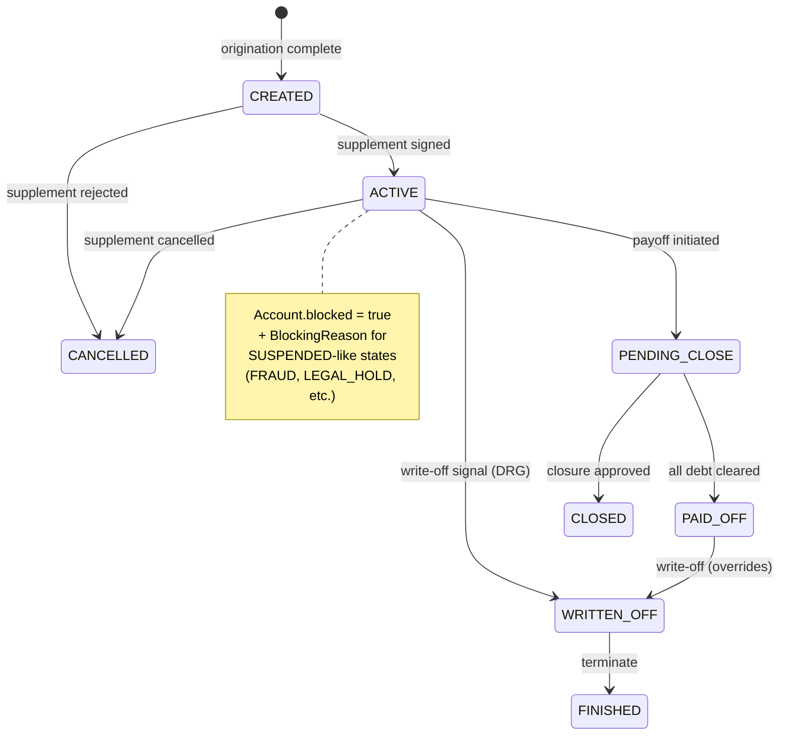
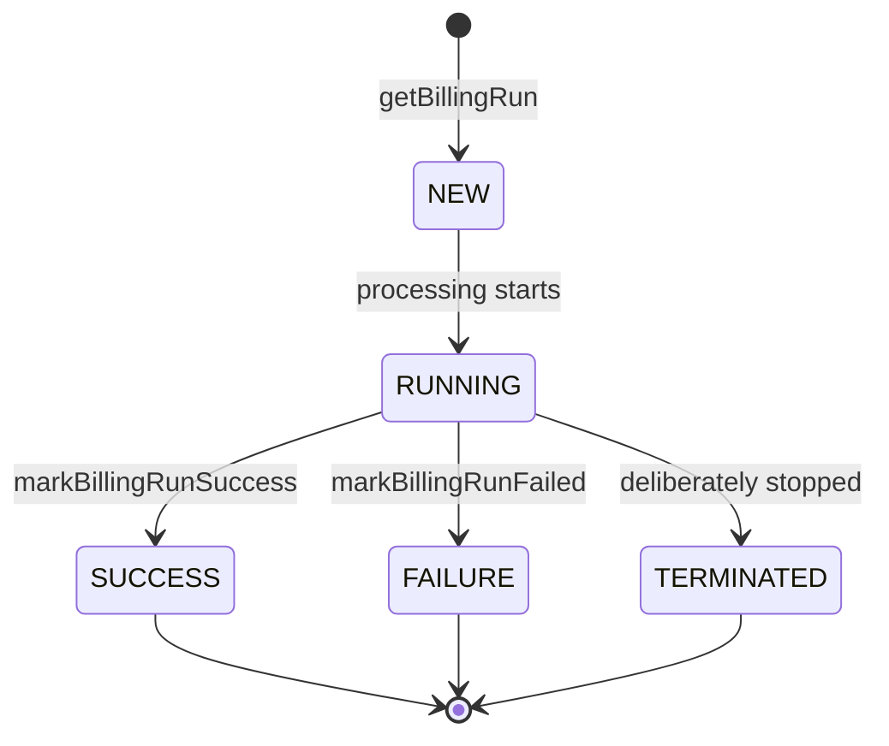
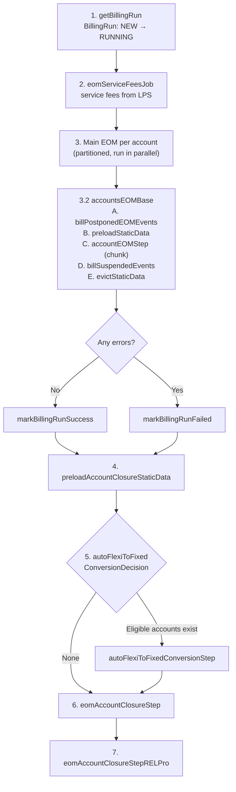

> *"Billing is not about calculation. Billing is about keeping a promise, to every dong, to every customer, at 3 a.m. when nobody is awake."*

## Introduction: one night, a million loans {#dẫn-nhập-một-đêm-của-một-triệu-khoản-vay}

::::story
The last night of March. At 23:00, the system starts the *end of month (EOM)* process. Over the next eight hours, the LAS module has to:

- calculate interest for 1,247,832 active accounts;
- create 2,891,440 new *instalments*;
- update 1,247,832 *CurrentBalance* records;
- publish 1,247,832 events to STS to generate statements;
- handle 34,221 overdue accounts through their own process;
- and finish before 7:00, when the branches open.

Not one dong may be wrong. Not one account may be missed. No account may be left half-processed.

And all of this happens while the system still has to accept customers' payments at 2 a.m.
::::

This chapter goes into LAS, the heart of VLP. Section 8.1 presents the domain model: accounts, transactions, ledger entries, instalments and balances. Section 8.2 follows a transaction from the moment it is authorized to the moment it is confirmed, including the hardest case, a transaction that arrives late. Section 8.3 describes the billing pipeline. Section 8.4 covers the instalment lifecycle: creating instalments *(prescribing)* and matching payments to instalments *(pairing)*. Section 8.5 is the EOM batch architecture, and section 8.6 is how balances are kept correct. This is the most technical chapter of the book, and also the most important one for understanding how consumer finance works at the engine level.

## 8.1 The LAS domain model {#81-mô-hình-miền-của-las}

### Why learn the domain model before reading the code

::::story
Tuấn, the engineer, has just moved to the LAS team. On his first day, the tech lead hands him a sheet of paper. Not a requirements document, nor an architecture diagram, but the domain model.

"Learn this first. Once you understand the domain model, you'll understand why everything in the code is written the way it is. Without it, you'll be fixing bugs without knowing what you're doing."
::::

### Account: the root of everything

Every loan in VLP lives in an `LAS_ACCOUNT`. The account carries a business key, links to the contract in CTM and the customer in CIS, along with its status and its EOM day.

```text
LAS_ACCOUNT
┌─────────────────────────────────────────────────────────┐
│ accountNumber: String (@NaturalId)                       │ ← Business key
│ contractCode: String                                     │ ← Link to CTM
│ accountOwnerCode: String                                 │ ← Customer ID (from CIS)
│ accountType: AccountType                                 │ ← FLEXI_LIMIT, etc.
│ status: AccountStatus                                    │ ← State machine
│ currency: String                                         │
│ billingPeriod: BillingPeriod enum                        │ ← Day-of-month EOM runs (BP_1, BP_5, BP_20...)
│ activationDate: LocalDate                                │
│ blocked: Boolean                                         │
│ seized: Boolean                                          │ ← Court-ordered freeze
│ expired: Boolean                                         │
│ closureDate: LocalDate                                   │
│ payoffDate: LocalDate                                    │
│ writeoffDate: LocalDate                                  │
└─────────────────────────────────────────────────────────┘
```

The `billingPeriod` field says which day of the month the account's EOM runs on (`BP_1`, `BP_5`, `BP_20`...). That way not every account piles into a single month-end night: the company can split the portfolio into groups that run on different days.

The account status is a state machine:



*Figure 8.1. The account state machine in LAS.*

What each state means:

```text
CREATED (CR):
  After origination creates the account, BEFORE the activation event
  → Data can be set up (parameters, services, tariff)
  → Cannot yet accept transactions
  → Note: not "INITIATED" — CREATED is the correct name

ACTIVE (AC):
  After the activation event (after disbursement)
  → Normal operation: debits and credits both allowed
  → The state an account spends most of its time in

CANCELLED (CA):
  Cancelled by an admin/customer BEFORE becoming active
  → Terminal state — cannot be reopened

PENDING_CLOSE (PCL):
  Settlement in progress
  → Only payments accepted, no new transactions

PAID_OFF (PO):
  All debt = 0
  → Terminal, or can be reopened (revolving accounts)

CLOSED (CL):
  Permanently closed — cannot be reopened
  → Final terminal state

WRITTEN_OFF (WO):
  Bad debt decision via the DRG write-off signal
  → Removed from the balance sheet
  → BUT payments are still accepted (off-balance-sheet recovery)

SUSPENDED: NOT an AccountStatus
  → Implemented through Account.blocked = true + BlockingReason entities
  → Blocking reasons: FLEXI_TERMINATION, FLEXI_CONVERSION, FRAUD, LEGAL_HOLD
```

Two points stand out. First, `WRITTEN_OFF` does not mean money stops coming in: the debt has been taken off the balance sheet, but anything the customer pays afterwards is still recorded as recovery of written-off debt. Second, "suspended" is not a state. It is represented by the `blocked` flag together with `BlockingReason` records, because an account can be blocked for several reasons at once (suspected fraud, a court freeze, a product conversion in progress) while keeping its lifecycle state.

### CurrentBalance: the current financial state

Each account has exactly one `LAS_CURRENT_BALANCE` record, holding every figure the system needs to know instantly: money on hold, the outstanding balance, the available balance, the overdue amount, the next minimum payment.

```text
LAS_CURRENT_BALANCE (One per Account)
// verified: am-core-entities-deep.md
// All monetary fields use Money type (@Embeddable: BigDecimal value + String currency)
┌─────────────────────────────────────────────────────────┐
│ holdBalance: Money                                       │ ← Sum of auth holds
│ holdIPBalance: Money                                    │ ← Instalment plan holds
│ outstandingDebt: Money                                  │ ← Sum of unpaid debit items
│ availableBalance: Money                                  │ ← CreditLimit - holds - debt
│ ledgerBalance: Money                                    │ ← Credits - debits (accounting)
│ customerCredit: Money                                         │ ← Overpayments (credit balance)
│ withholdCustomerCredit: Money                                │ ← Seized portion
│ overdueAmount: Money                                    │ ← Past-due amount (DPD > 0)
│ instDueAmountNext: Money                               │ ← Next minimum instalment
│ currentAccountMMI: Money                               │ ← Current MMI value
│ instDueDateFirst: Date                                  │ ← First overdue due date
│ instOverdueCount: Integer                              │ ← Overdue instalment count
└─────────────────────────────────────────────────────────┘
```

Why store these figures, instead of recomputing them from the ledger history every time?

```text
Option A: Compute in real time from the event store
  SELECT SUM(CASE WHEN direction='DEBIT' THEN amount ELSE -amount END)
  FROM las_ledger_entry
  WHERE account_id = X AND NOT cancelled

  Problem: an account has 5,000 transactions over 3 years
  → The query takes 50-100ms each time
  → 10,000 concurrent users → 100,000 ms of query time per second
  → The database dies

Option B: CurrentBalance materialized view
  Store the current balance, update it INCREMENTALLY after each event
  SELECT available_balance FROM las_current_balance WHERE account_id = X
  → 1ms query

  Trade-off: CurrentBalance must always stay in sync with the event store
  → A bug in the update logic → inconsistency
  → A periodic reconciliation job is needed
```

`CurrentBalance` is a **materialized view**: a summary updated incrementally after each event. In exchange for speed, the system has to accept a risk: if the update logic has a bug, the summary drifts away from the ledger history. Section 8.6 shows how that drift is detected and handled.

The available balance is calculated with the formula below. The example assumes Lan's loan sits on a `FLEXI_LIMIT` account with a limit exactly equal to the amount borrowed, after three instalments:

```text
availableBalance = CREDIT_LIMIT - holdBalance - holdIPBalance - outstandingDebt + customerCredit

Example (Lan, after 3 instalments):
  CREDIT_LIMIT = 18,500,000 VND
  holdBalance = 0 (no transactions on hold)
  holdIPBalance = 0
  outstandingDebt = 14,180,104 VND (principal left after 3 payments of 1,696,080 VND)
  customerCredit = 0

  availableBalance = 18,500,000 - 0 - 0 - 14,180,104 + 0 = 4,319,896 VND
  → Lan can spend about 4.3 million more
  (This is the revolving feature: principal repaid becomes available credit)
```

The 14,180,104 VND balance is the principal remaining on the repayment schedule in [Chapter 2](/docs/foundations/ch02-mathematics-of-lending); interest paid does not increase the available credit.

With a `FLEXI_LIMIT` account, each drawdown or purchase creates its own chain of records, and an instalment plan is optional:

```text
Each draw (purchase, cash withdrawal):
  → Create a new Transaction (type: RTL/ATM/ICD...)
  → Create a LedgerEntry (DEBIT)
  → Create a PostingUnit
  → EventAssignment.type = CARD (for revolving draws)
  
  No automatic InstalmentPlan per draw.
  An InstalmentPlan is OPTIONAL — the customer can request
  that a specific transaction be converted into an IP.

No limit on the number of draws per billing period — limited only by availableBalance.

After flexi-to-fixed conversion (EOM autoFlexiToFixed step):
  → A BlockingReason(FLEXI_CONVERSION) is created
  → The account can no longer draw
  → Only payments on existing debt are accepted
  → Gradually repaid on a fixed instalment schedule
```

### Transaction and LedgerEntry: two different concepts

This is the most commonly confused point in the LAS domain model.

A **Transaction** (`LAS_TRANSACTION`) records an event from the outside world: a purchase, a payment, a cash withdrawal.

```text
Example transaction:
  Date: 2025-03-15
  Type: RTL (Retail POS)
  Amount: 2,500,000 VND (Lan buys clothes)
  Direction: DEBIT
  SourceTxCode: "POS-TXN-789456" (from the merchant terminal)
  Status: CONFIRMED
```

A **LedgerEntry** (`LAS_LEDGER_ENTRY`) records the financial consequence of a transaction or a billing event. One transaction can produce several ledger entries, at different times:

```text
From the 2,500,000 VND RTL transaction above:
  LedgerEntry #1: Principal debit 2,500,000 VND
  LedgerEntry #2: (Not yet — interest will be charged at EOM)

  From that month's EOM billing:
  LedgerEntry #3: Interest 37,500 VND (that month's interest on this item)

  If Lan pays late:
  LedgerEntry #4: Late fee 200,000 VND
```

The 37,500 VND of interest is 2,500,000 × 1.5%, one month's interest at 18% a year. The interest entry is not created with the transaction but at the EOM step, and the late fee only arises if a payment is late.

Beneath each ledger entry are one or more **PostingUnits**, the unit of detailed tracking: which fee type it belongs to, how much has been put into instalments, how much has been paid.

```text
LedgerEntry #1 (Principal 2,500,000 VND) has a PostingUnit:
  Code: TAI-001
  FeeComponentType: PRINCIPAL
  BaseAmount: 2,500,000
  PrescribedAmount: 2,500,000 (instalment created)
  PairedAmount: 0 (no payment matched yet)
  ApplyIr: true (interest charged on this item)
  UpdatingAvailableAmount: true (reduces the available balance)
```

The `ApplyIr` and `UpdatingAvailableAmount` flags are copied from the `AccountFeeComponentType` configuration presented in [Chapter 3, section 3.3](/docs/products/ch03-product-design#33-thiết-kế-dựa-trên-biểu-phí-vì-sao-không-viết-cứng-trong-code). This is where tariff configuration becomes behaviour on every dong.

### Instalment and InstalmentSummary: two tiers

An account can have several debts falling due on the same day. That is why LAS uses two tiers: an `Instalment` for each item, and an `InstalmentSummary` grouping items with the same due date and type.

```text
An account has several items with the same due date:
  - Principal of the laptop purchase: 1,200,000 VND due 20/4
  - Principal of the clothes purchase: 400,000 VND due 20/4
  - Insurance premium: 90,000 VND due 20/4

The InstalmentSummary groups them:
  DueDate: 20/4
  InstalmentType: REGULAR
  Amount: 1,200,000 + 400,000 + 90,000 = 1,690,000 VND
  PaidAmount: 0

  Children:
    Instalment A: amount=1,200,000 (laptop principal)
    Instalment B: amount=400,000 (clothes principal)
    Instalment C: amount=90,000 (insurance)

Why group them:
  1. The customer sees one total: "Pay 1,690,000 VND this month"
  2. Statement generation summarizes from the header, not each item
  3. The header's repaid status = true when ALL children are repaid
  4. Pairing logic can apply a payment to the group by priority
```

The customer sees a single figure: "Pay 1,690,000 VND this month". But the system still knows exactly what that 1,690,000 is made of, so it can match payments in the right order and report the right type of revenue.

The two tiers also carry a technical trap well known in the LAS team, incident VLP-670: the header total was miscalculated when a new instalment was added to a header that already existed in the database.

```java
// BUG: dùng refreshInstalmentSummary() khi prescribing
// cho existing header

InstalmentSummary existingHeader = findOrCreate(dueDate, type, account);
if (existingHeader.isPersisted()) {
    // Thêm instalment mới:
    existingHeader.getInstalments().add(newInstalment); // Bước này thêm vào collection
    
    // BUG: gọi refresh sẽ đọc lại từ DB
    // nhưng newInstalment chưa được save → refresh đọc state cũ!
    refreshInstalmentSummary(existingHeader);
    // → Amount tính sai vì newInstalment chưa có trong DB
}

// FIX: dùng incremental update thay vì refresh
if (existingHeader.isPersisted()) {
    // Incremental update — không đọc lại từ collection:
    existingHeader.setAmount(existingHeader.getAmount().add(newInstalment.getAmount()));
    // Và save newInstalment explicitly:
    instalmentRepository.save(newInstalment);
}

// refreshInstalmentSummary() chỉ SAFE khi tất cả children đã trong DB
// → Dùng trong pairing (sau khi all children persisted)
// → KHÔNG dùng trong prescribing (khi adding new children)
```

The lesson: recomputing a total from a collection is only safe when every child element has been persisted. When adding a new child, you must use an *incremental update*.

### ContractService: services on the account

An account can only accept transactions when the required services are active on it.

```text
A ContractService (the `CONTRACT_SERVICE` table in the CTM schema, read by LAS via cross-schema JPA) represents a service
activated on the account — for example maintenance, insurance, etc.

Example services:
  ACCMAINT: Maintenance Account — the account maintenance service
          This is the "core" service — every transaction needs ACCMAINT active
  ACCSTMT: Account Statement — the statement service
  PAYM: Payment — the payment service
  ZERO_PROMO: Zero rate promotion — a 0% promotional period
  RELIP: Instalment Plan service
  LIFEINS: Life Insurance
```

`ACCMAINT` is the core service; its account maintenance fee is charged from the `SVCFEE` tariff item, as mentioned in [Chapter 3](/docs/products/ch03-product-design). So every time a transaction is confirmed, LAS has to check the services:

```text
Business rule: a transaction is valid only if:
  1. The account exists and is ACTIVE
  2. The required ContractService is active at the time of the transaction

LAS's implementation:
  LAS does NOT call CTS via HTTP REST.
  LAS queries ContractService directly from the CTM schema via JPA/Hibernate.
  → Lower latency, tighter coupling (same DB or shared schema)
  → The RVS (Revolving Services) module handles service definition lookups
  
Validation check:
  ContractService.contractServiceStatus = ACTIVE AND
  endDate >= effectiveDate (effectiveDate = currentDate for bill-in-past)
  
  If the service does not exist or has expired:
  → ERR_TX_NO_VALID_CONTRACT_SERVICE  // verified: billing-flow.md
  
Sentinel date values:
  AccountParameter.validTo: 3000-01-01 (DateUtil.UNREACHABLE_FUTURE_DATE)
    NULL in the DB → NullDateToFarFutureConverter → 3000-01-01 in Java
    Query: WHERE validTo = UNREACHABLE_FUTURE_DATE OR validTo >= :effectiveDate
  
  AccountService.endDate: default 3000-01-01 (open-ended)
    This is an explicit value (not through the converter)
    Query: WHERE endDate >= :effectiveDate is always TRUE when 3000-01-01

  PostingUnit.firstPrescribeDate: 3333-01-01 for IP allocations (different!)
    — a separate sentinel for "not yet prescribed"

  Sentinel dates in VLP —
  avoid confusion when writing queries!
```

The three "very distant date" values in the block are a classic source of query bugs: an empty `validTo` is converted to 3000-01-01, `endDate` defaults to 3000-01-01, while the `firstPrescribeDate` of an instalment plan allocation uses 3333-01-01 to mean "no instalment created yet". Anyone writing a query has to know which convention the table they are reading uses.

Incident VLP-706 shows what happens when the wrong effective date is used to check services:

```java
// BUG: dùng billingDate khi chargeTransactionInPast=true
public void checkContractService(Transaction tx) {
    LocalDate effectiveDate = tx.getBillingDate();
    // Nhưng getBillingDate() = getPresentmentDate() = ngày quá khứ!
    // Nếu service được tạo SAU ngày quá khứ đó → NOT FOUND → reject!
    
    accountServiceFacade.getActiveService(account, serviceType, effectiveDate);
}

// FIX: dùng currentDate khi bill-in-past
public void checkContractService(Transaction tx, LocalDate effectiveDate) {
    // Gọi với currentDate khi chargeTransactionInPast=true
    accountServiceFacade.getActiveService(account, serviceType, effectiveDate);
}

// Caller:
if (tx.isChargeTransactionInPast()) {
    checkContractService(tx, timeService.getCurrentDate()); // currentDate
} else {
    checkContractService(tx, tx.getBillingDate()); // billingDate bình thường
}
```

The business reasoning behind the fix:

```text
Check "current permission to charge" vs "historical permission":

Scenario:
  - 1/3/2025: account activated, the ACCMAINT service starts
  - 15/2/2025: a merchant sends a delayed transaction (bill-in-past)
  - Check effectiveDate = 15/2 → the service does NOT exist → REJECT
  - But the merchant delivered the goods on 15/2!
  - A legitimate transaction is wrongly rejected

  Fix: check effectiveDate = currentDate → the service is ACTIVE → ACCEPT
  Semantics: "Do we have the right to charge now?" instead of "Did we on that date?"
```

The right question is not "could we charge on that date?", but "can we charge now?". The merchant has delivered the goods; the transaction is valid, it has just arrived late.

:::summary[Section 8.1]
`Account` is the root entity, with its own state machine; "suspended" is a blocking flag, not a state. `CurrentBalance` is a materialized view updated incrementally, fast but in need of periodic reconciliation. A `Transaction` is an external event; a `LedgerEntry` is its financial consequence, and one transaction can produce several entries. `InstalmentSummary` groups `Instalment`s with the same due date and must be updated incrementally when new children are added. The service check for a late transaction must use the current date, not the transaction date.
:::

## 8.2 Transaction processing {#82-luồng-xử-lý-giao-dịch}

### Authorization and confirmation: why two steps

::::story
Lan uses her card at a supermarket. She swipes, and the POS terminal shows "Approved" within 3 seconds. But the money has not really been taken yet; it is only debited one to three days later, when the merchant settles.

Those are the two steps, authorization and confirmation.
::::

:::key[Authorization]
**Authorization** "reserves" an amount: it ensures the customer has enough available balance at the time of the transaction, without debiting yet.
:::

```text
Lan swipes her card for 2,500,000 VND:
  1. The merchant terminal sends an Authorization request
  2. LAS receives it → creates an Authorization record
  3. LAS updates CurrentBalance:
     holdBalance += 2,500,000
     availableBalance -= 2,500,000
  4. LAS returns: APPROVED
  (no LedgerEntry yet, no instalment yet)

CurrentBalance after authorization:
  availableBalance: 4,319,896 - 2,500,000 = 1,819,896 VND
  holdBalance: 2,500,000
  outstandingDebt: 14,180,104 (unchanged)
```

:::key[Confirmation]
**Confirmation** settles an authorization: it turns the hold into real debt.
:::

```text
1-3 days later, the merchant sends a Confirmation request:
  1. LAS receives it → finds the Authorization by sourceTxCode
  2. Create the Transaction record (CONFIRMED)
  3. Create a LedgerEntry (DEBIT, principal 2,500,000 VND)
  4. Update CurrentBalance:
     holdBalance -= 2,500,000 (release the hold)
     outstandingDebt += 2,500,000 (add to debt)
     availableBalance: unchanged (hold → debt, net zero)
  5. Bill the transaction (charge interest, create an instalment if needed)
  6. Publish TransactionConfirmedEvent

CurrentBalance after confirmation:
  holdBalance: 0
  outstandingDebt: 14,180,104 + 2,500,000 = 16,680,104
  availableBalance: 1,819,896 (unchanged)
```

The available balance does not change on confirmation, because it already fell at authorization; the hold simply becomes debt. Why not settle straight away?

```text
Reason 1: Merchant settlement cycle
  Merchant POS → Acquiring Bank → Card Network → Issuing Bank (LAS)
  This takes 1-3 days in today's financial system

Reason 2: An authorization can be voided
  The customer returns the goods within 24h → the merchant voids the authorization
  No transaction needs to be created, no interest charged

Reason 3: The authorization amount can differ from the confirmation amount
  A hotel pre-authorizes 2,000,000 VND → check-out is only 1,800,000 VND
  Confirmation uses the actual amount

Reason 4: Float management (liquidity)
  Money does not actually move until settlement
  → Card networks net settle daily
```

### Bill-in-past: the most complex operation

::::story
On 15 March, a POS terminal sends a transaction that should have been settled on 28 February, but was delayed by an error in the merchant's system. The transaction has `transactionDate = 28/2` but reaches LAS on 15/3.

LAS has to record this transaction on 28 February, even though February's EOM finished running on 1 March.
::::

There are two simple approaches, and both are wrong:

```text
If billed at the current date (15/3):
  → Interest starts on 15/3 — 15 days of interest missing (28/2 to 14/3)
  → February's balance has already been closed → the statement is wrong

If billed at the past date (28/2) naively:
  → February has already been closed and settled with STS
  → The balance after billing has to be "added to" the past → every event after 28/2 must be reprocessed

This is bill-in-past — it needs cascade reprocessing.
```

The right way is to insert the event at its proper place on the timeline, then reprocess every event after it:

```java
public void billTransactionInPast(LocalDate pastDate, Transaction transaction) {
    // Mark transaction này là bill-in-past
    transaction.getEvent().setBillInPast(true);

    // Tìm event đã processed đầu tiên SAU ngày quá khứ:
    EventRecord firstEventAfter = eventService
        .findFirstProcessedEventAfterOrEqualDateTime(pastDate, account, eventType);

    if (firstEventAfter == null) {
        // Không có event sau → bill bình thường, không cần reprocess
        processEventManager.billTransaction(transaction);
    } else {
        // Có conflict: phải insert event này TRƯỚC event đã processed
        // Và reprocess tất cả events sau đó theo thứ tự
        eventReplayManager.billNewEventBeforeExistingEventAndReprocessOnwardEvents(
            event, firstEventAfter, ReprocessType.TRANSACTION_CREATE_IN_PAST);
    }

    // Luôn recalculate overdue debts với currentDate:
    currentBalanceService.recalculateOverDueDebts(account, currentDate, eventTimestamp);
}
```

Why reprocessing is complex:

```text
Timeline:
  28/2: The transaction should be billed here (principal 2,500,000 VND)
  1/3:  EOM runs → February interest calculated on the balance AT THAT TIME
  5/3:  The customer pays 1,000,000 VND
  10/3: EOM runs (partial — daily interest)
  15/3: The transaction arrives

If the transaction is billed on 28/2:
  → February's balance rises by 2,500,000 VND
  → February's interest must be recalculated (higher balance → more interest)
  → The 5/3 payment must be paired with new instalments (the pairing order changes)
  → Every event from 28/2 to 15/3 must be reprocessed

Reprocessing guarantees:
  → Consistency: every calculation reflects reality
  → Audit: every reprocess is logged with a reason
  → Idempotency: reprocessing again → the same result
```

Reprocessing must be consistent (every calculation reflects the correct order of events), auditable (each reprocessing is logged with a reason) and idempotent (reprocessing again gives the same result). Exercise 2 at the end of the chapter walks through a bill-in-past case with several transactions.

### Idempotency and sourceTxCode

::::story
A POS terminal sends a confirmation request. The network times out, the terminal does not know whether LAS has processed it, so it sends it again. LAS receives a second request with exactly the same content.

Without idempotency, two ledger entries are created, the balance is wrong, and the customer is charged twice.
::::

The idempotency key for a confirmation is the `sourceTxCode`, the transaction code supplied by the source system:

```java
// illustrative pseudo-code — details differ from actual
// verified: verify-ch8-ch9-code.md
// Actual: return type = ExecuteTransactionResult (not TransactionResult)
// Actual: no SERIALIZABLE annotation; LAS uses AccountLockGuard
// Actual: idempotency via getAuthorizationFromConfirm() (not findBySourceTxCode)

@Transactional  // LAS uses default isolation + AccountLockGuard
public ExecuteTransactionResult confirmTransaction(ConfirmationRequestTo transactionTo) {
    // checkForDuplicities=true → kiểm tra via getAuthorizationFromConfirm()
    return confirmTransactionInternal(transactionTo, true);
}
// Idempotency: sourceTxCode in request body → Authorization lookup
// → nếu đã tồn tại: return existing result, không process lại
```

Idempotency guards against duplicate requests, but not against two *different* requests modifying the same account at the same time. That needs pessimistic locking:

```text
Race condition without locking:

Thread 1: Read account balance → proceed
Thread 2: Read account balance → proceed (concurrent!)
Thread 1: Create transaction #1, update balance
Thread 2: Create transaction #2, update the same balance (stale read!)

Result: Balance inconsistency → data corruption

With AccountLockGuard (pessimistic locking):
Thread 1: Lock account → process → release
Thread 2: Wait for Thread 1 to release → proceed safely
→ Serial processing per account, no conflict
```

LAS locks at account level with `AccountLockGuard`: transactions on the same account are processed one after another, while different accounts still run in parallel. [Chapter 6](/docs/system/ch06-financial-system-architecture) analyses the choice of pessimistic over optimistic locking.

:::summary[Section 8.2]
Authorization reserves balance without debiting; confirmation releases the hold and records the real debt. A late transaction is inserted at its own date, and every event after it must be reprocessed. `sourceTxCode` is the idempotency key that prevents duplicate processing; pessimistic locking at account level prevents concurrent updates.
:::

## 8.3 The billing pipeline: from event to statement {#83-billing-pipeline-từ-sự-kiện-đến-sao-kê}

### Three kinds of billing timing

Not every event is charged straight away. LAS classifies events by billing timing:

```text
IMMEDIATE:
  Billed as soon as confirmed
  Example: Late fee (LATEFEE1) → needs an immediate response to create urgency
  Example: Over-limit fee → the available balance must be updated at once

IMMEDIATE_RESPECT_FREEZE:
  Billed immediately BUT waits if the billing period is frozen (EOM running)
  Example: An ordinary purchase
  → If EOM is running: queued as POSTPONED_TILL_EOM

EOM (End of Month):
  Deferred to month end
  Example: Interest → only charged at the end of the billing period
  Example: Monthly insurance premium → charged at month end
```

The second kind, `IMMEDIATE_RESPECT_FREEZE`, exists to resolve the conflict between intraday transactions and EOM:

```text
Problem: EOM is running, calculating March interest for account X
         At the same time the customer submits a payment for account X

Without a freeze:
  EOM calculates interest on balance_at_start_of_march
  The payment comes in → updates the balance mid-calculation
  EOM calculates interest on a balance already changed by the payment
  → Interest is wrong

With a freeze:
  EOM starts → account X is "frozen"
  The payment arrives → POSTPONED_TILL_EOM (not processed immediately)
  EOM finishes → account X is unfrozen
  The payment is processed → billed late, but consistently
```

The payment is processed a few minutes late but consistently. Section 8.5 returns to this freezing mechanism from the EOM point of view.

### ChargingGateway and Spring Integration

The billing pipeline is a chain of steps: event, tariff lookup, fee calculation, ledger entry creation, balance update, notification. LAS expresses this chain with Spring Integration's `MessagingGateway` pattern: each step is a message-processing component, connected to the others through message channels.

```text
EventRecord
   │
   ▼ ChargingGateway.billEvent(eventId)
[billEventChannel]       ← // verified: IntegrationConstants.Channels.BILL_EVENT
   │
   ▼ [internal processing chain]
[calculateFeeComponentsAndCreateLedgerEntriesChannel]  ← // verified
   │
   ▼ BillingContext (result)
```

The gateway interface:

```java
// verified: billing-flow.md / ChargingGateway.java
@MessagingGateway
public interface ChargingGateway {
    @Gateway(requestChannel = "billEventChannel")
    BillingContext billEvent(Long eventId);

    @Gateway(requestChannel = "calculateFeeComponentsAndCreateLedgerEntriesChannel")
    BillingContext calculateFeeComponents(BillingContext billingContext);
}
```

The whole billing chain goes through only **two gateway channels**. The steps of tariff lookup, fee calculation, ledger entry creation and balance update take place inside the internal processing chain, not one channel per step.

The benefit of a pipeline architecture over one giant method is that each step can be tested independently and has a clear responsibility. A typical processing step looks like this:

```text
// Each processor is an independent component:
@ServiceActivator(inputChannel = "billEventChannel",
                  outputChannel = "tariffResolvedChannel")
public Message<TariffContext> lookupTariff(Message<Long> eventMessage) {
    Long eventId = eventMessage.getPayload();
    Event event = eventRepo.findById(eventId);
    Tariff tariff = tariffService.findForEvent(event);
    return MessageBuilder.withPayload(new TariffContext(event, tariff)).build();
}
// → Testable independently, extensible, clear responsibility
```

### Notifying STS through RabbitMQ

```text
1. Transaction confirmed → LAS bills the event
2. After billing: a TransactionSynchronization hook fires ON COMMIT:
   (Not inside the transaction — after a successful commit)

3. NotificationPublisher collects all events from this transaction
4. EventNotificationDispatcherService.dispatch(events)
5. AMQPEventPublishingService publishes to RabbitMQ:
   Exchange: "account.events"
   RoutingKey: "event.processed.v1"
   Payload: EventRecordNotification {accountId, eventId, billingPeriod, ...}

6. STS subscribes to "account.events"
7. STS generates/updates the statement for the account

Why publish AFTER commit (TransactionSynchronization):
  If published BEFORE commit:
    Publish succeeds → STS processes the event
    The transaction ROLLS BACK (for some reason)
    → STS has a statement update but LAS has no transaction
    → Inconsistency

  If published AFTER commit:
    Transaction committed → publish → STS processes
    If publishing fails after commit: retry mechanism (outbox pattern)
    → Consistency guaranteed
```

The key is the order: events are published only **after** the database transaction has committed successfully. If published before, STS could generate a statement for a transaction that LAS then rolls back. [Chapter 6](/docs/system/ch06-financial-system-architecture) presents the outbox pattern, the way to make sure events are not lost when publishing fails after the commit.

:::summary[Section 8.3]
`IMMEDIATE` events are charged at once, `EOM` events wait until period end, and `IMMEDIATE_RESPECT_FREEZE` events are charged immediately unless the account is frozen for EOM. `ChargingGateway` expresses the billing pipeline with Spring Integration through two gateway channels. Events to STS are published only after commit, and the outbox pattern ensures no event is lost.
:::

## 8.4 The instalment lifecycle {#84-vòng-đời-của-kỳ-trả-nợ}

### Prescribing: creating instalments

::::story
At the end of March, EOM's instalment creation step runs for Lan's account. Minh asks Tuấn: "How are instalments created? From what data?"
::::

:::key[Prescribing]
**Prescribing** is the process of creating `Instalment` records from `PostingUnit`s: working out how much the customer owes, of what type, and when it falls due.
:::

The inputs to this step:

```text
1. A list of PostingUnits not yet fully prescribed
   Each PostingUnit: fee type, amount, how much already prescribed

2. MMI (Minimum Monthly Instalment) limit
   REPAYMENT_ALLOCATION_ORDER: PRIORITY_ONLY

3. Billing cycle info: the dueDate for this period
```

The algorithm walks through the `PostingUnit`s in priority order, putting the not-yet-prescribed portion into this period's instalment until the MMI limit is reached:

```java
public List<Instalment> generateInstalments(
        List<PostingUnit> items,
        BigDecimal mmiLimit,
        LocalDate dueDate) {
    List<Instalment> result = new ArrayList<>();
    BigDecimal remainingMMI = mmiLimit;

    // Sort items theo priority (PRIORITY_ONLY mode):
    List<PostingUnit> sorted = sortByPriority(items);

    for (PostingUnit tai : sorted) {
        if (remainingMMI.compareTo(ZERO) <= 0) break; // MMI exhausted

        BigDecimal unprescribed = tai.getBaseAmount()
                                     .subtract(tai.getPrescribedAmount());
        if (unprescribed.compareTo(ZERO) <= 0) continue; // Already prescribed

        // Prescribe min(unprescribed, remaining MMI):
        BigDecimal instalmentValue = unprescribed.min(remainingMMI);

        // Tạo instalment:
        Instalment inst = new Instalment();
        inst.setAmount(instalmentValue);
        inst.setDueDate(dueDate); // Có thể adjust cho payment holidays
        inst.setInstalmentType(InstalmentType.REGULAR);
        inst.setReconciliation(tai.getReconciliation());

        // Find or create header:
        InstalmentSummary header = findOrCreateHeader(dueDate, REGULAR, account);
        addInstalmentAmountsToHeader(header, instalmentValue); // INCREMENTAL, không refresh!

        inst.setInstalmentSummary(header);
        result.add(inst);

        tai.setPrescribedAmount(tai.getPrescribedAmount().add(instalmentValue));
        remainingMMI = remainingMMI.subtract(instalmentValue);
    }

    // Save all instalments (NOT via cascade - save explicitly):
    instalmentRepository.saveAll(result);

    return result;
}
```

Note the header update line: the algorithm adds to the header (`addInstalmentAmountsToHeader`) instead of recomputing it, exactly as the VLP-670 incident in section 8.1 taught.

LAS has four types of instalment:

```text
REGULAR (R): Created during EOM processing
  → The "normal" instalment of the billing cycle
  → DueDate = the billing cycle due date
  → prescribeImmediately = false on AccountFeeComponentType
  → Example: Lan's laptop principal, the monthly insurance premium

EXTRA (E): Created as soon as the LedgerEntry is created
  → For fees that must be "visible" at once (late fee, over-limit fee)
  → DueDate = current date (due immediately)
  → prescribeImmediately = true on AccountFeeComponentType
  → Example: late fee, overdraft fee

ADDITIONAL (O): Created when the customer overpays
  → prescribeAndSaveOverpaymentAsAdditional()
  → Represents the excess once all instalments are paid
  → Becomes customerCredit on CurrentBalance
  → Automatically paired against the oldest DEBIT in the next pairing

PAYOFF (P): Created when the account is marked for payoff
  → Account status = PAY_OFF
  → Includes the whole remaining balance (principal + interest + fees)
  → DueDate = payoff date
  → isInPayoff=true flag on the prescribing call

Example:
  Lan pays late on 5/4:
  → Late fee LedgerEntry: 200,000 VND
  → prescribeImmediately = true for LATEFEE1 → EXTRA Instalment: 200,000 VND, due 5/4
  → No waiting for the end-of-April EOM
```

An `ADDITIONAL` instalment appears when the customer overpays. For example, Lan pays 3,000,000 VND when only 2,890,000 VND is due: every instalment is fully paired, and the 110,000 VND excess is recorded as an `ADDITIONAL` instalment and moved into `customerCredit`, to be deducted automatically from the oldest debt at the next pairing.

### Pairing: matching payments to instalments

::::story
On 20 April, Lan pays 2,000,000 VND. The account has four unpaid instalments:

| Instalment | Type | Amount | Due |
|---|---|---:|---|
| A | REGULAR, laptop principal | 1,200,000 | 20/4 |
| B | REGULAR, clothes principal | 400,000 | 20/4 |
| C | EXTRA, late fee | 200,000 | 5/4 |
| D | REGULAR, insurance | 90,000 | 20/4 |

The total due is 1,890,000 VND. The 2,000,000 VND payment covers everything and leaves 110,000 VND over.
::::

The pairing algorithm walks the list of payments and the sorted list of instalments side by side, each time pairing the smaller of the remaining payment and the unpaid part of the instalment:

```java
// illustrative pseudo-code — signature differs from actual
// verified: verify-ch8-ch9-code.md
// Actual signature (EntryInstalmentLinkService.java):
//   pairInstalments(
//     List<PostingUnit> payments,    ← NOT LedgerEntry
//     List<Instalment> instalments,
//     Date pairedDate,                         ← Date, NOT LocalDate
//     Account account,
//     Predicate<PostingUnit> ignoreSeizureConstraintByPayment)  ← extra param
// Actual: sorting via sortInstallmentsForPairing(), NOT account.getSortingLogic()
// Actual: seizure: calculateSeizedAndExemptCustomerCreditFromPayments()

public List<EntryInstalmentLink> pairInstalments(
        List<PostingUnit> payments,  // PostingUnit, not LedgerEntry
        List<Instalment> instalments,
        Date pairedDate,
        Account account) {
    List<EntryInstalmentLink> result = new ArrayList<>();

    // Step 1: Tính seized amount (nếu account bị phong tỏa):
    SeizureContext seizure = calculateSeizedAndExemptCustomerCreditFromPayments(account, payments);

    // Step 2: Sort instalments theo REPAYMENT_ALLOCATION_ORDER:
    List<Instalment> sortedInstalments = sortInstallmentsForPairing(instalments, account);

    // Step 3: Iterate payments và instalments:
    Iterator<PostingUnit> paymentIter = payments.iterator();
    Iterator<Instalment> instalmentIter = sortedInstalments.iterator();

    PostingUnit currentPayment = paymentIter.hasNext() ? paymentIter.next() : null;
    Instalment currentInstalment = instalmentIter.hasNext() ? instalmentIter.next() : null;

    while (currentPayment != null && currentInstalment != null) {
        BigDecimal paymentRemaining = currentPayment.getAmount()
                                                     .subtract(currentPayment.getPairedAmount());
        BigDecimal instalmentUnpaid = currentInstalment.getAmount()
                                                        .subtract(currentInstalment.getPaidAmount());

        // Seizure check:
        if (!seizure.canPay(currentInstalment)) {
            currentInstalment = advance(instalmentIter);
            continue;
        }

        // Pair min(available, needed):
        BigDecimal pairedValue = paymentRemaining.min(instalmentUnpaid);

        // Create pairing record:
        EntryInstalmentLink aii = new EntryInstalmentLink();
        aii.setAmount(pairedValue);
        aii.setPayment(currentPayment);
        aii.setInstalment(currentInstalment);
        result.add(aii);

        // Update amounts:
        currentPayment.setPairedAmount(currentPayment.getPairedAmount().add(pairedValue));
        currentInstalment.setPaidAmount(currentInstalment.getPaidAmount().add(pairedValue));

        // Check if instalment fully paid:
        checkAndSetInstalmentRepaid(currentInstalment, pairingDate);

        // Advance iterators as needed:
        if (currentPayment.getPairedAmount().compareTo(currentPayment.getAmount()) >= 0)
            currentPayment = advance(paymentIter);
        if (currentInstalment.getPaidAmount().compareTo(currentInstalment.getAmount()) >= 0)
            currentInstalment = advance(instalmentIter);
    }

    return result;
}
```

After each pairing, the instalment is checked to see whether it is fully paid, and the header is recomputed. Here recomputing is safe, because every child instalment is already in the database:

```text
private void checkAndSetInstalmentRepaid(Instalment inst, LocalDate date) {
    if (inst.getPaidAmount().compareTo(inst.getAmount()) >= 0) {
        inst.setRepaid(true);
        inst.setRepaidDate(date);
    }
    // Always refresh header — safe here because all children are persisted:
    refreshInstalmentSummary(inst.getInstalmentSummary());
}
```

With the `PRIORITY_ONLY` mode and a tariff giving the late fee the highest priority, the order is: the EXTRA late fee instalment, then principal, then insurance.

```text
Sorted:
  #1: Instalment C (EXTRA late fee 200,000) — highest priority
  #2: Instalment A (REGULAR laptop principal 1,200,000)
  #3: Instalment B (REGULAR clothes principal 400,000)
  #4: Instalment D (REGULAR insurance 90,000)
```

Pairing the 2,000,000 VND payment:

```text
Pairing:
  Payment → Instalment C: 200,000 paired → C repaid ✓
  Payment remaining: 1,800,000
  Payment → Instalment A: 1,200,000 paired → A repaid ✓
  Payment remaining: 600,000
  Payment → Instalment B: 400,000 paired → B repaid ✓
  Payment remaining: 200,000 (> D's 90,000)
  Payment → Instalment D: 90,000 paired → D repaid ✓
  Payment remaining: 110,000 → customerCredit (overpayment)
```

Result: the `InstalmentSummary` for 20 April has an amount of 1,890,000 VND and 1,890,000 VND paid, so it is marked repaid. The account is back to current, and `customerCredit` rises by 110,000 VND.

### REPAYMENT_ALLOCATION_ORDER: the mechanism design problem revisited

[Chapter 2, section 2.4](/docs/foundations/ch02-mathematics-of-lending#24-thiết-kế-cơ-chế-khi-toán-học-gặp-kinh-tế-học) introduced the `REPAYMENT_ALLOCATION_ORDER` parameter from an economic angle. At engine level, the `RepaymentAllocationOrder` enum has five values:

| Mode | How it sorts | When to use it |
|---|---|---|
| `PRIORITY_ONLY` | By tariff priority only, ignoring due dates | When the order of fee types matters more than chronological order |
| `DUE_DATE_AND_PRIORITY` | By due date, then by priority on the same date; when the account is overdue, DPD priority replaces normal priority | The most common default, "oldest debt first", easy to explain to customers |
| `DUE_DATE_IP_GROUP_PRIORITY` | By due date, with instalments of the same instalment plan handled as a group | Accounts with several instalment plans at once |
| `IP_INTEREST_RANK` | The instalment plan with the highest rate first | Pays down the most expensive debt fastest, like the "avalanche" method |
| `DUE_DATE_AND_PRIORITY_NONZERO_DPD` | Its own logic when DPD > 0, otherwise like `DUE_DATE_AND_PRIORITY` | Products that need a specific order for overdue accounts |

Whatever the mode, a common comparator chain applies, with the customer's own funds and EXTRA instalments taking precedence:

```text
Comparator chain (applies to all modes):
  OWN_FUNDS_FIRST → EXTRA_INSTALMENT_FIRST → PROFILE_SPECIFIC
  → BILLING_DATE_OLDEST_FIRST → LEDGER_ENTRY_ID_SMALLEST (tiebreaker)
```

The economic analysis below shows why a mode's name does not tell you its outcome:

```text
Scenario: Account at DPD 45, with a 200,000 VND late fee and 500,000 VND of overdue principal

Customer payment: 300,000 VND

PRIORITY_ONLY (late fee first):
  200,000 → late fee (fully paid)
  100,000 → overdue principal (partially paid)
  → The lender collects the late fee at once
  → 400,000 of principal still overdue → the DPD counter does not reset
  → The customer stays in the DPD bucket
  → Cure rate: low (DPD keeps rising)

DUE_DATE (principal first — oldest first):
  300,000 → overdue principal (partially paid)
  → The late fee is not paid
  → 400,000 of principal overdue → DPD keeps rising
  → Similar cure rate

Outcome: with either mode, 300,000 VND is not enough to cure the account
A full payment (700,000 VND) is needed to cure it

The real difference: which item keeps bearing interest sooner
→ This is a mechanism design choice about revenue timing, not about the cure rate
```

With an insufficient payment, neither mode brings the account back to current. The real difference lies in which item is paid first, and so which type of revenue is recognized earlier and which item keeps bearing interest. This is exactly the point [Chapter 2](/docs/foundations/ch02-mathematics-of-lending) made: the economic outcome of an allocation mode lies in the configured priority order, not in its name.

:::summary[Section 8.4]
Prescribing creates `REGULAR` instalments at the EOM step, or `EXTRA` instalments immediately when the `prescribeImmediately` flag is on; the header is added to, not recomputed. Pairing matches payments to instalments according to `REPAYMENT_ALLOCATION_ORDER`, and the header is recomputed only when every child has been persisted. Overpayment becomes an `ADDITIONAL` instalment and a customer credit balance. With an insufficient payment, the allocation mode decides when revenue is recognized, not whether the account stops being overdue.
:::

### BillingRun and PeriodBalanceSnapshot: a snapshot every period

::::story
Once March's EOM has finished running for Lan, the system needs to record what the account looked like at period end: how much principal, how much interest, what DPD. That is the job of `PeriodBalanceSnapshot`.
::::

:::key[BillingRun]
A **BillingRun** (`LAS_BILLING_RUN`) is the master record of one EOM run, representing the whole EOM process of one billing period.
:::

```text
BillingRun
  id
  billingPeriod: BillingPeriod enum (BP_1, BP_5, BP_20...) → the day EOM runs
  type: BillingRunType (REGULAR, ONE_TIME, SIMULATION, INITIAL, TERMINATION)
  status: NEW → RUNNING → SUCCESS | FAILURE | TERMINATED
  springBatchJobExecutionId → link to the Spring Batch job
  endDate → end of the billing period
  generateStatementFiles → whether statements are generated

Relationship:
  1 BillingRun → N PeriodBalanceSnapshot (one per account)
  Query: BillingRun → PeriodBalanceSnapshot.billingRun → account

Note: billingPeriod here is the DAY OF THE MONTH (day-of-month)
PeriodBalanceSnapshot has its own field: billingPeriodNumber (counter 1, 2, 3...)
```

The states of an EOM run:



*Figure 8.2. The lifecycle of a BillingRun. While a BillingRun is `RUNNING`, no new EOM session can start.*

:::key[PeriodBalanceSnapshot]
A **PeriodBalanceSnapshot** (`LAS_PERIOD_BALANCE_SNAPSHOT`) is a comprehensive snapshot of an account at the end of a billing period, storing every figure that matters for audit, reporting and IFRS 9.
:::

```text
Key fields:
  billingRun → BillingRun (which month)
  account → Account (which account)
  previousPeriodBalanceSnapshot → chain back to the previous month

Balance summary:
  startBalance, endBalance → opening/closing balance
  endCardBalance, endIPBalance → split by type

Debt snapshot (period end):
  debtTotal, debtAllPrincipal, debtFee, debtInsurance, debtInterest
  overdueDebt, overdueDebtIgnoringDebtTolerance, dayPastDue

Period activity (activity DURING the month):
  perPayments, perDebit, perCredit
  perPrincipal, perFee, perInterest, perLatePenalties

Lifetime cumulative:
  sumPayments, sumPrincipal, sumFee, sumInterest...

Due dates:
  dueDate, dueDateClient, dueDateGracePeriod

simulationOnly: true → dry-run (eom-simulation endpoint)
cancelled: true → on-demand EOM cancelled the old balance
```

The snapshots form a chain through `previousPeriodBalanceSnapshot`, so the question "how was this account last month" can be answered without rebuilding history. This is the data source for many of the analyses in [Chapter 5](/docs/products/ch05-revenue-portfolio):

```text
IFRS 9 staging:
  PeriodBalanceSnapshot.daysPastDue across months
  → Detect "Significant Increase in Credit Risk" (SICR)
  → Stage 1 → Stage 2 transition

Vintage analysis:
  Group PeriodBalanceSnapshot by origination month
  → Track default rate evolution for each cohort

Statement generation:
  STS receives the EOM event → queries PeriodBalanceSnapshot
  → Generates the monthly statement with a full breakdown
```

### The full entity chain: from transaction to instalment

A common question: which entities does a payment create, and in what order? When the 2,000,000 VND payment is confirmed:

```text
1. EventRecord (LAS_EVENT_RECORD)
   type=PAYMENT, status: REGISTERED → PROCESSED
   eventDate, processingDate, sourceSystem
   
2. LedgerEntry (LAS_LEDGER_ENTRY)
   amountDirection=CREDIT, amount=2,000,000
   link → EventRecord

3. PostingUnit (LAS_POSTING_UNIT)
   baseAmount=2,000,000 (immutable)
   pairedAmount=0 → increases as pairing happens
   fullyPaired=false → true when fully matched
   link → LedgerEntry, link → EventAssignment (if any)

4. [Pairing: MatchingService.pairInstalments()]
   EntryInstalmentLink (linking entity):
   link CREDIT TAI ↔ DEBIT Instalment
   pairedValue = min(payment, instalment outstanding)

5. Existing Instalment.paidAmount += pairedValue
   Existing InstalmentSummary refreshed (safe: all children already in DB)

6. CurrentBalance updated:
   outstandingDebt -= pairedValue
   customerCredit += any excess (ADDITIONAL instalment)

Full diagram:
  Transaction
    └── EventRecord (processing envelope)
          └── EventAssignment (CARD/IP/OUTER_DEBT type)
                └── LedgerEntry (financial consequence)
                      └── PostingUnit (pairing unit)
                            ├── [DEBIT] Reconciliation → Instalment → InstalmentSummary
                            └── [CREDIT] EntryInstalmentLink (link to DEBIT instalment)
```

## 8.5 The EOM batch architecture {#85-kiến-trúc-eom-batch}

### How EOM is triggered

```text
EOM has NO @Scheduled annotation in the LAS codebase.
LAS only exposes an HTTP endpoint; an external orchestrator decides when to call it.

The external caller calls:
  POST /api/internal/v1/batch/execute-async
  {
    "jobName": "regularEOMBatchJob",
    "parameters": { "billingDate": "2025-03-20" }
  }

The external orchestrator can be:
  a K8s CronJob, an Airflow DAG, or a dedicated orchestration service
  LAS does not care — it just executes when called

Monitoring: BillingRun.status (SUCCESS/FAILURE) + external alerting
  LAS does not alert by itself — an external system queries the batch status API
```

LAS does not schedule EOM itself. It only provides an API; an external orchestrator decides when to call it, and external monitoring watches the `BillingRun` status to raise alerts. This separation keeps LAS simple, and lets the operations team change the schedule or re-run without redeploying LAS.

### The full EOM sequence

The EOM steps depend on each other, so their order cannot change:



*Figure 8.3. The high-level steps of regularEOMBatchJob.*

The detail of each step:

```text
STEP 1: getBillingRun
  → Create the BillingRun record (status: NEW → RUNNING)
  → This is a global "lock": the RUNNING status blocks new EOM sessions
  → Set billingDate, accountNumberList

STEP 2: eomServiceFeesJob (sub-job)
  → Calculate and bill service fees from the LPS module
  → Runs independently: partitioned by contract service cycles (not accounts)
  → Must finish BEFORE the main EOM (fees must be in the balance when interest is calculated)

STEP 3 (Main EOM - per account):
  
  STEP 3.0: accountNumberToId
    → Convert account numbers to internal IDs
    → Prepare partition data
  
  STEP 3.1: getBillingRunBase
    → Load the billing session into the processor context
  
  STEP 3.2: accountsEOMBase [PARTITIONED - parallel]
    → This is the main step, run in parallel:
    
    Sub-step A: billPostponedEOMEvents
      → Process events POSTPONED_TILL_EOM during the month
      → Example: transactions that arrived while the billing period was frozen
    
    Sub-step B: preloadStaticData
      → Cache account services and parameters in memory
      → Fewer DB queries in the main processing
    
    Sub-step C: accountEOMStep [CHUNK-BASED]
      Reader: reads accounts by partition
      
      // verified: bb-job-eom-beans.xml, verify-code-examples.md
      // doAccountMonthEndProcessor = CompositeItemProcessor with 4 delegates:
      Processor chain (in order, within doAccountMonthEndProcessor):
        P1: ClearAccountingNotificationsProcessor - clear notification buffer
        P2: PrepareContextForEOMItemProcessor - load account state into context
        P3: AccountMonthEndProcessor - MAIN LOGIC (via billingBatchProcessorGateway):
            └─ billingBatchProcessingService.processEOMForRevolvingAccount()
               ├─ Delinquency check → set DPD
               ├─ Debt calculation
               ├─ Interest calculation (monthly interest, 30/360)
               ├─ Fee calculation (monthly service fee)
               ├─ Instalment generation (prescribing)
               ├─ Overpayment pairing
               └─ Balance calculation
        P4: EnqueueAccountingNotificationsProcessor - prepare notifications
      
      Note: P1-P4 are DELEGATES in 1 CompositeItemProcessor (doAccountMonthEndProcessor),
      NOT 4 separate Spring Batch steps.
      
      Writer chain (in order):
        W1: StoreEOMResults → save the PeriodBalanceSnapshot
        W2: NotifyEOMEvents → send billing events to the notification queue
        W3: NotifyDebtRegister → sync with the DRG module
        W4: NotifyAccountClosure → trigger closure if needed
        W5: NotifyMMI → send MMI info for the statement
        W6: FlushAndClearHibernate → clear the Hibernate L1 cache (memory management)
    
    Sub-step D: billSuspendedEvents
      → Process events SUSPENDED after the main EOM
    
    Sub-step E: evictStaticData
      → Clear the pre-loaded cache
  
  STEP 3.3: markBillingRunSuccess → BillingRun status: SUCCESS
  STEP 3.4: markBillingRunFailed → BillingRun status: FAILURE (if there were errors)
  STEP 3.5: eomFinished → Send the EOM completion notification

STEP 4: preloadAccountClosureStaticData
  → Cache data for the closure step (pre-load to avoid N+1 queries)

STEP 5: autoFlexiToFixedConversionDecision (Decider)
  → Check whether any FLEXI_LIMIT_ACCOUNT needs converting to a fixed instalment plan
  
  Business rationale:
  After X months of revolving (configurable: accountLifespanMonths - 2):
    - The account automatically converts from revolving → instalment plan
    - Regulatory/risk: limit long-term revolving exposure
    - The customer gets a fixed schedule (predictable payments)
    - IP interest rates are usually lower than revolving rates
  
  If eligible accounts exist → CONTINUE → autoFlexiToFixedConversionStep
  If none → SKIP → next step

STEP 6: eomAccountClosureStep (sub-job)
  → Close PENDING_CLOSE accounts (standard revolving)
  → Triggered by: customer request, zero balance + no activity, regulatory
  → Flow: apply customerCredit → PENDING_CLOSE → CLOSED

STEP 7: eomAccountClosureStepRELPro (sub-job)
  → Close REVOLVING_PRO_ACCOUNT type (separate job, different params)
  → Same flow but different eligibility criteria
```

Step 2 must finish before step 3, because the month's service fees have to be in the balance before EOM calculates interest and creates instalments. Within step 3, the four processors P1 to P4 are four delegates of the same `CompositeItemProcessor`, not four separate Spring Batch steps; the six writers W1 to W6 run after each chunk.

Step 5 automatically converts flexi-limit accounts into a fixed instalment plan after a set number of months. The reasons are both risk management (limiting how long a revolving debt can exist) and the customer's benefit: a fixed schedule is predictable, and instalment plan rates are usually lower than revolving rates.

### Partitioning: parallel without conflict

EOM has to process 1.2 million accounts in one night. Each account takes about 300 ms including reads and writes, so sequential processing would take 1,200,000 × 0.3 seconds = 360,000 seconds, or 100 hours. Unacceptable.

The solution is Spring Batch's partitioned step: split the accounts into N partitions that run in parallel. With 16 partitions of 75,000 accounts each, the time falls to about 100 / 16 ≈ 6.25 hours, which fits in one night.

```xml
<!-- verified: verify-ch8-ch9-code.md -->
<!-- EOM dùng XML config (bb-job-eom-beans.xml), KHÔNG phải Java @Bean -->
<!-- Partitioner thực tế: accountRangePartitioner -->
<!-- gridSize (số partitions): configurable via property placeholder (không hardcode 16) -->
    <!-- ${commit.interval.accountEOMStep} = chunk size (records per commit), NOT gridSize -->

<!-- Simplified illustration (actual config trong bb-job-eom-beans.xml): -->
<bean id="accountRangePartitioner" class="...AccountRangePartitioner" scope="step">
    <!-- Chia accounts thành N partitions — N đọc từ property placeholder -->
    <!-- ${commit.interval.accountEOMStep} = chunk size (records per commit); partition count is separate property -->
</bean>

<bean id="doAccountMonthEndProcessor"
      class="org.springframework.batch.item.support.CompositeItemProcessor" scope="step">
    <property name="delegates">
        <list>
            <ref bean="clearAccountingNotificationsProcessor"/>
            <ref bean="prepareContextForEOMItemProcessor"/>
            <bean class="...AccountMonthEndProcessor" scope="step">
                <property name="billingBatchProcessingService"
                          ref="billingBatchProcessorGateway"/>
            </bean>
            <ref bean="enqueueAccountingNotificationsProcessor"/>
        </list>
    </property>
</bean>
```

Why is running in parallel free of conflict? Each account belongs to exactly one partition, and each partition runs on one thread, so no two threads ever process the same account. Two accounts in different partitions could only conflict if they shared state, and LAS is deliberately designed to have no state shared between accounts: each account has its own `CurrentBalance` and its own instalments. The data design of section 8.1 is precisely what makes parallel EOM possible.

Within each partition, accounts are processed in chunks:

```text
// illustrative pseudo-code — actual config in XML (not Java @Bean)
// verified: verify-ch8-ch9-code.md
// Note: chunk size via property ${commit.interval.accountEOMStep}, skipLimit not confirmed
// Processor chain: 4 delegates (clear → prepare → EOM → enqueue notifications)

// Conceptually equivalent to:
// <step chunk-size="${commit.interval.accountEOMStep}">
//   <reader ref="accountReader"/>
//   <processor ref="doAccountMonthEndProcessor"/>  <!-- 4-delegate composite -->
//   <writer ref="accountWriter"/>
// </step>
```

Why a chunk of 50 accounts is the balance point:

```text
chunk size = 1: Commit after every account
  → 75,000 transactions for one partition
  → High overhead (transaction begin/commit)
  → Slow

chunk size = 1000: Commit after every 1000 accounts
  → If one account in the chunk fails → roll back all 1,000 accounts
  → The whole chunk has to be reprocessed
  → Wasted work

chunk size = 50: Balance point
  → On failure: retry 50 accounts (acceptable)
  → Transaction overhead: 75,000/50 = 1,500 transactions
  → Memory: 50 accounts in memory (acceptable)
```

The figure 50 is not a constant: the chunk size is configured through the `commit.interval.accountEOMStep` property, and the optimal value depends on the average size of an account and on database resources (question 12).

### Recovery after failure: on-demand EOM

::::story
EOM ran last night. 47 accounts failed because of database deadlocks and network glitches. The `BillingRun` has the `FAILURE` status, and those 47 accounts have no `PeriodBalanceSnapshot` for this month.
::::

```text
EOM is not "restartable" (restartable=false in Spring Batch).
The whole EOM cannot be re-run — 1.2M - 47 = 1,199,953 accounts have already been billed.

Solution: on-demand EOM for specific accounts

POST /batch/execute-async
{
    "jobName": "onDemandAccountNumberEOMBatchJob",
    "billingDate": "2025-03-31",
    "accountNumbers": ["ACC-001", "ACC-002", ... 47 accounts]
}

onDemandAccountNumberEOMBatchJob:
  1. Create a new BillingRun for these 47 accounts
  2. Run EOM processing only for these accounts
  3. Previous PeriodBalanceSnapshot (if any) → cancelled
  4. New PeriodBalanceSnapshot → created

Idempotent: running on-demand EOM twice for the same account
  → The second run sees the existing PeriodBalanceSnapshot → cancels it → creates a new one
  → Same result as running once (deterministic)

---
```

Re-running the whole EOM is impossible, because the other 1.19 million accounts have already been processed. On-demand EOM lets you re-run exactly the failed accounts, and thanks to the mechanism that cancels the old snapshot, running it several times gives the same result.

### Freezing the billing period: protecting consistency

The freeze from section 8.3, seen again from the EOM side:

```text
EOM processing:
  T=0: Start processing account X
  T=1: Calculate interest based on outstandingDebt = 10,000,000
  T=2: The customer pays 2,000,000 → outstandingDebt = 8,000,000
  T=3: EOM writes interest based on 10,000,000 (the calculation finished at T=1)
  → Consistent (interest based on the balance at the start of the calculation)

But if the payment at T=2 ALSO updates the balance that EOM reads:
  T=0: EOM reads outstandingDebt = 10,000,000
  T=2: Payment → outstandingDebt = 8,000,000 (concurrent update!)
  T=3: EOM writes interest based on... 10M or 8M? Race condition!

The freeze solves this:
  T=0: Account X frozen for billing
  T=2: The payment arrives → queued as POSTPONED_TILL_EOM
  T=3: EOM processes X with a consistent snapshot (10M)
  T=4: Account X unfrozen
  T=4: The payment is processed → the balance is updated correctly
```

:::summary[Section 8.5]
LAS does not schedule EOM itself; an external orchestrator calls the API and monitors the `BillingRun` status. `regularEOMBatchJob` has seven high-level steps; service fees must finish before the main EOM, followed by flexi-limit conversion and account closure. The main EOM runs in parallel by partition, safely because accounts share no state, and commits by chunk to balance transaction cost against rework cost. EOM cannot be re-run as a whole, so failed accounts are handled with on-demand EOM. Freezing the billing period ensures EOM reads a consistent snapshot of the balance.
:::

## 8.6 Balance integrity and reconciliation {#86-toàn-vẹn-số-dư-và-đối-soát}

### When CurrentBalance goes wrong

::::story
At 3 a.m., monitoring raises an alert: "Account ACC-456789: balance computed from ledger entries = 4,320,000 VND. CurrentBalance.outstandingDebt = 4,520,000 VND. Difference: 200,000 VND."

`CurrentBalance` has drifted from the ledger history.
::::

The drift can come from four sources:

```text
1. A bug in the update logic:
   Transaction confirmed → LedgerEntry created
   LedgerEntry creation triggers the balance update
   Bug: the update uses the wrong amount (e.g. a sign error)
   → CurrentBalance wrong

2. A concurrent update race condition:
   Threads A and B update CurrentBalance at the same time
   Without proper locking → lost update
   → CurrentBalance wrong

3. An application crash mid-transaction:
   The transaction partially completed and was not rolled back properly
   (Rare with an ACID DB but an edge case of distributed systems)

4. Incomplete bill-in-past reprocessing:
   eventReplayManager runs partially → exception
   → Some events reprocessed, some not → balance inconsistent
```

### The reconciliation job

The reconciliation job recomputes the outstanding balance from the ledger entries and compares it with `CurrentBalance`:

```text
-- Compute the "correct" balance from the event store:
WITH event_based_balance AS (
    SELECT
        ai.account_id,
        SUM(CASE
            WHEN tai.updating_principal_amount = true
                 AND ai.amount_direction = 'DEBIT'
                 AND NOT ai.cancelled
            THEN tai.base_amount - tai.paired_amount
            ELSE 0
        END) as calculated_outstanding_debt
    FROM las_ledger_entry ai
    JOIN las_posting_unit tai ON tai.ledger_entry_id = ai.id
    WHERE ai.account_id = :accountId
      AND NOT ai.cancelled
    GROUP BY ai.account_id
)
SELECT
    rb.account_id,
    rb.outstanding_debt as stored_balance,
    ebb.calculated_outstanding_debt as calculated_balance,
    rb.outstanding_debt - ebb.calculated_outstanding_debt as gap
FROM las_current_balance rb
JOIN event_based_balance ebb USING (account_id)
WHERE ABS(rb.outstanding_debt - ebb.calculated_outstanding_debt) > 1;
-- Gap > 1 VND → inconsistency
```

When a difference is found, the handling depends on its size:

```text
Small gap (< 100 VND, rounding):
  → Log a warning, schedule for review
  → No auto-fix (may be expected rounding behaviour)

Medium gap (100 VND - 10,000 VND):
  → Alert the ops team
  → Investigate the root cause
  → Manual fix after confirmation

Large gap (> 10,000 VND):
  → Immediate alert (PagerDuty / on-call)
  → Freeze the account (prevent further transactions)
  → Investigate and fix before unfreezing
```

The 200,000 VND difference in the situation at the start of the section falls in the large group: the account is frozen at once and only reopened once the cause is found. The fact that 200,000 VND is exactly one late fee is a good clue to start the investigation.

### Immutable history for audit

The principle in LAS is that financial data is never deleted and values are never edited. Errors are corrected by marking the old record as cancelled and adding a new one, so the history always remains intact:

```text
New LedgerEntry:        INSERT id=123, amount=2,500,000, cancelled=false
LedgerEntry cancelled:  UPDATE id=123 SET cancelled=true, reason='DISPUTE'
                        + INSERT id=124 (the corrected entry) amount=2,300,000

New Transaction:        INSERT id=456
Transaction cancelled:  UPDATE id=456 SET cancelled=true
                        + INSERT id=457 (linked to 456 through source_transaction_id)

AccountParameter:       end the old version's validity (validTo) + INSERT a new version
                        → a full history of every parameter at every point in time

CurrentBalance:         UPDATE in place (materialized view), an exception for performance;
                        can be rebuilt from the ledger entries at any time
```

The only `UPDATE` on a ledger entry is setting the cancellation flag, never changing the amount. Thanks to that, the system can answer the question "what was the outstanding balance at a point in the past":

```sql
-- "Outstanding debt của account X ngày 15/3/2025 lúc 14:30 là bao nhiêu?"

-- Approach 1: Từ event store (chậm, nhưng đúng):
SELECT
    SUM(CASE WHEN ai.amount_direction = 'DEBIT' THEN tai.base_amount ELSE 0 END)
    - SUM(tai.paired_amount) as outstanding_at_point_in_time
FROM las_ledger_entry ai
JOIN las_posting_unit tai ON tai.ledger_entry_id = ai.id
WHERE ai.account_id = X
    AND tai.updating_principal_amount = true
    AND ai.created_at <= '2025-03-15 14:30:00'
    AND (ai.cancelled = false
         OR ai.cancelled_at > '2025-03-15 14:30:00'); -- chưa cancel tại thời điểm đó

-- Approach 2: Từ PeriodBalanceSnapshot snapshot (nhanh nhưng chỉ đến EOM):
SELECT outstanding_debt
FROM las_period_balance_snapshot
WHERE account_id = X
    AND billing_date = '2025-02-28' -- Last EOM before March 15
ORDER BY created_at DESC LIMIT 1;
-- Và cộng thêm events từ 1/3 đến 15/3
```

:::summary[Section 8.6]
`CurrentBalance` can drift from the ledger history because of logic bugs, concurrent updates, failures mid-way or incomplete reprocessing. A daily reconciliation job detects the drift; small differences are logged, large ones freeze the account for investigation. Ledger entries are never deleted and their amounts never changed, so a question about a point in the past can always be answered; `PeriodBalanceSnapshot` is the shortcut for those questions.
:::

## Chapter 8 summary {#tổng-kết-chương-8}

The last night of March, eight hours of EOM:

```text
23:00  BillingRun created (RUNNING) → no other EOM session can run
23:01  eomServiceFeesJob: service fees for 1.2 million accounts through LPS, done at 23:45
00:00  Main EOM: 16 partitions × 75,000 accounts, in parallel
         Each account (about 300 ms):
           P1 clear the notification buffer
           P2 load the account state
           P3 main EOM logic:
              DPD check: 34,221 overdue accounts
              interest and fees: create interest and monthly fee entries
              prescribing: 2,891,440 instalments
              pair credit balances, recompute balances
           P4 queue notifications
         Each chunk (50 accounts):
           W1 save the PeriodBalanceSnapshot
           W2 publish billing events to STS via RabbitMQ
           W3 sync to DRG
           W4-W6 account closure, MMI, Hibernate flush
06:45  16 partitions done; 47 failed accounts logged
06:46  Conversion and account closure steps
06:55  EOM complete, five minutes before the branches open
07:00  CurrentBalance reconciliation job; on-demand EOM for the 47 failed accounts
```

Every step is recorded, every figure is auditable. One million two hundred thousand promises, kept to the last dong.

### Key takeaways

| Concept | Meaning | Why it matters |
|---|---|---|
| `CurrentBalance` | A materialized view of the balance | Fast, but must be reconciled against the ledger |
| `Transaction` and `LedgerEntry` | The external event and its financial consequence | One transaction produces several entries over time |
| `InstalmentSummary` | A header grouping instalments on the same date | Add incrementally, recompute only when every child is persisted |
| Authorization, confirmation | Hold first, then debit | Matches the card settlement cycle |
| Bill-in-past | Insert the event in the past and reprocess what follows | Correct interest, correct pairing order |
| Prescribing, pairing | Creating instalments, matching payments | Where the payment allocation order becomes behaviour |
| EOM partitions and chunks | Parallel by account, commit in batches | 1.2 million accounts finished in one night |
| Immutable history | No deletes, no edited amounts | Audit and point-in-time queries |

## Review questions {#câu-hỏi-tự-kiểm-tra}

**Recall**

1. How do `Transaction` and `LedgerEntry` differ? How many ledger entries can one transaction produce?
2. How are `InstalmentSummary` and `Instalment` related? Why are two tiers needed?
3. How do `REGULAR` and `EXTRA` instalments differ? What triggers each?
4. Why must EOM step 2 (service fees) finish before the main EOM (step 3)?

**Understand**

5. What does authorization change in `CurrentBalance`? What does confirmation change? Why does `availableBalance` not change on confirmation?
6. Why is `refreshInstalmentSummary()` safe during pairing but not when prescribing into a header that already has children? Explain JPA's `PersistentBag` mechanism.
7. How does freezing the billing period handle concurrent updates? Without it, what kind of error could occur?
8. Why choose a chunk of 50 rather than 1 or 1,000? Analyse the trade-off.

**Apply**

9. An account has an outstanding balance of 8,000,000 VND and three instalments this month: I-A 3,000,000 VND (laptop principal, priority 1), I-B 2,500,000 VND (phone principal, priority 1), I-C 500,000 VND (late fee, priority 0, the highest). The customer pays 4,000,000 VND, in `PRIORITY_ONLY` mode.
   (a) Walk through the pairing algorithm step by step.
   (b) After pairing, is each instalment repaid, partially paid or unpaid?
   (c) What is the state of the `InstalmentSummary` after pairing?
   (d) How does `CurrentBalance` change?
10. EOM runs and three accounts fail at step W1 (`StoreEOMResults`): ACC-001 because of a deadlock, ACC-002 because the disk is full (fixed after 5 minutes), ACC-003 because of a bug in the fee calculation.
    (a) Will Spring Batch skip or stop?
    (b) What is the `BillingRun` status after the three accounts fail?
    (c) Is the recovery the same for each account?
    (d) If reconciliation finds a difference on ACC-002, how would you know?

**Analyse**

11. The tech lead proposes dropping Spring Batch for hand-written Java code with a `ThreadPoolExecutor`: "Spring Batch is too complicated. All we need is a List<Account> and a forEach in a thread pool." Analyse (a) the Spring Batch features the hand-written code would have to rebuild, (b) how to implement idempotent re-runs on failure, (c) monitoring and progress tracking, (d) when the hand-written approach is acceptable and when it is not.
12. EOM takes 6 hours 45 minutes for 1.2 million accounts, against a target of 4 hours. (a) Identify the bottleneck through architectural analysis. (b) Should the number of partitions go from 16 to 64? What is the trade-off? (c) Is the database the bottleneck? What evidence would confirm it? (d) Why might a chunk of 50 not be optimal in every case?

## Exercises {#bài-tập-áp-dụng}

**Exercise 1. Designing the domain model for a joint account.** The company wants to launch a "joint account" product: two people, for example a married couple, share one credit limit. (a) What needs to change in the `AccountStatus` state machine? (b) Which fields does `CurrentBalance` need, and why? (c) What needs to change in the `ContractService` check when either person can activate a service? (d) When person A pays, how does pairing work? (e) When A makes a transaction on the joint account, how does the audit trail record it?

**Exercise 2. Bill-in-past for several transactions.** A merchant sends 15 transactions delayed by 45 days because its server had a problem. February's EOM has already run; the transactions need to be recorded with a `transactionDate` in January. (a) Why can they not be recorded at the current date? (b) The order of operations to record the 15 transactions correctly. (c) The impact on January's and February's `PeriodBalanceSnapshot`. (d) What will the customer see on the March statement? (e) Why must `recalculateOverDueDebts` use the current date rather than a past date?

**Exercise 3. Optimizing EOM.** EOM currently takes 7 hours. Analysis shows that database queries in the processors take 45% of the time, the Hibernate flush (W6) 20%, publishing RabbitMQ events (W2) 15%, and the actual business logic only 20%. (a) Query optimization: the trade-off between eager and lazy loading. (b) Can RabbitMQ events be batched instead of published per chunk? (c) Can the per-chunk flush become a single flush at the end of the partition? (d) If each optimization is done wrongly, what are the consequences? (e) The order in which to apply the optimizations safely, not all at once.

## Further reading {#đọc-thêm}

**Spring Batch**

- Minella, M. T. (2019). *The Definitive Guide to Spring Batch* (2nd ed.). Apress. A comprehensive reference on the Spring Batch architecture, including partitioning and error handling.

**Domain-driven design**

- Vernon, V. (2013). *Implementing Domain-Driven Design.* Addison-Wesley. Chapter 10 on aggregate design, the basis for understanding why `Account`, `Instalment` and `CurrentBalance` are organized as they are in LAS.

**JPA and Hibernate**

- Mihalcea, V. (2016). *High-Performance Java Persistence.* Essential knowledge on Hibernate collections, fetch strategies and the N+1 problem; many related topics are on the vladmihalcea.com blog.

Chapter 9 puts all the pieces together: the billing cycle seen from the whole system, from the moment EOM is triggered to the moment the statement is generated, from receiving a payment to pairing it with instalments and bringing the account back to current. [Chapter 9. The billing cycle](/docs/system/ch09-billing-cycle).
